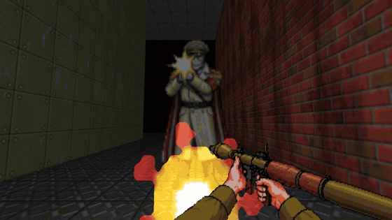

# Soviet Doom

A GZDoom total conversion. The USSR of the 1970s is invaded by two allied
alien factions, Yankee and Nazi, united to defend capital. You are a Spetsnaz
sergeant who came to this country as a refugee child from Barcelona.

[](https://github.com/kahache/soviet_doom/releases/download/v1.3/sovietdoom-trailer-en.mp4)

**Trailer:** [English](https://github.com/kahache/soviet_doom/releases/download/v1.3/sovietdoom-trailer-en.mp4) · [Русский](https://github.com/kahache/soviet_doom/releases/download/v1.3/sovietdoom-trailer-ru.mp4) · [Català](https://github.com/kahache/soviet_doom/releases/download/v1.3/sovietdoom-trailer-ca.mp4) (62 s, mp4).

Status: **v1.3, the finished game** (2026-10-27): **nine maps in three episodes** (Soviet Doom, «The Road to Moscow», «The Portal») plus a practice range, with the AKM and the RGD-5 hand grenade, the Legion gunner, the Liberty Colossus, the Chrome Marshal and the Consortium, weapon reloads (key R; Options → Soviet Doom turns them off), medals and an operations map between levels, an illustration at the end of each episode, propaganda loudspeakers, composed music, and English, Russian and Catalan. Download: https://github.com/kahache/soviet_doom/releases/latest. Detail in `CLAUDE.md` and `docs/qa/GATE-REVIEWS.md`.
See `CLAUDE.md` for the operational summary, `docs/PRD.md` for decisions and
`docs/ru/` for the Russian mirror of all documentation. En català: [més avall](#soviet-doom-en-català).

## How to play

**Windows, one click:** download `sovietdoom-<version>-windows.zip` from the
release page (where the release offers it), right-click it → Extract All, open the `SovietDoom` folder and
double-click `Play Soviet Doom.bat`.
GZDoom and Freedoom are inside; nothing is installed, and settings and saves
stay in that folder. GZDoom is unsigned, so Windows may say "Windows
protected your PC": click More info → Run anyway (or tick Unblock in the
zip's Properties before extracting). `README-FIRST.txt` in the folder
explains the rest, including the switch to Russian or Catalan.

**macOS, one click** (Intel and Apple silicon, macOS 10.15+; not yet tested
on a real Mac): download `sovietdoom-<version>-macos.zip` and double-click it.
GZDoom is not signed by Apple, so the first time right-click
`Play Soviet Doom.command` → Open (or run `xattr -dr com.apple.quarantine`
on the `SovietDoom` folder in Terminal; on macOS 15+ System Settings →
Privacy & Security → Open Anyway). Then double-click `Play Soviet Doom.command`.

**Linux (x86-64)** (tested on Ubuntu 24.04; there use `libasound2t64` for `libasound2`): download
`sovietdoom-<version>-linux.tar.gz`, `tar xzf` it, install the libraries
listed in `README-FIRST.txt` (one `sudo apt install` line), then
`cd SovietDoom && ./play.sh`. Problems with either: please open an Issue.

**Any OS, with your own GZDoom:** download `sovietdoom-<version>.zip`, get
GZDoom 4.14.2 or newer (https://zdoom.org/downloads) and Freedoom: Phase 2
(`freedoom2.wad`, https://freedoom.github.io/download.html), then run
`gzdoom -iwad freedoom2.wad -file sovietdoom.pk3`; the zip's `README.txt`
has the details.

**Language:** Options → Soviet Doom → Language: English, Russian or Catalan
(or the system's language). It applies at once and is remembered; from the
console, `language default`, `language ru` or `language ca`. GZDoom's own
option screens stay in English when the game is in Catalan: the engine ships
no Catalan of its own.

**Starting a game:** New Game offers three episodes: **Soviet Doom** (MAP01-03,
the Zarya-7 launch site, the metro-bunker, Tankograd), **The Road to Moscow**
(MAP04-06, the Trans-Siberian rail yard, the Volga dam, Red Square) and
**The Portal** (MAP07-09, the Novaya Zemlya radar station, the Severomorsk
submarine base, the Tunguska portal). The practice range is a separate entry.

How the packages are made: `docs/engine/RELEASE.md`.

```bash
python3 tools/build.py        # → dist/sovietdoom.pk3
tools/run.sh                  # needs GZDoom and freedoom2.wad in iwads/
python3 tools/verify.py auto  # verify what changed: fast (~7 s, no window),
                              # full (~30 s, boots GZDoom) or just the docs —
                              # it reads git, picks the level and says why
```

## Continuous integration

`.github/workflows/ci.yml` runs on every push and pull request to `main`:
repo hygiene (no stray `.wad`/`.pk3`, nothing over 5 MB committed), then
`tools/build.py`, `tools/check_pk3.py` and the `tests/` suite, in that order,
failing at the first red step; the built PK3 is uploaded as a run artifact.

**What it does not run:** `tools/smoke.py`. That needs a real GZDoom install
and an IWAD, neither of which exists on the runner, and fetching Freedoom
(~23 MB) on every run isn't worth it yet. The engine smoke test stays the
committer's responsibility, locally, before every push — see
`docs/PIPELINE.md`, stage 5.

## How this was made: tools and AI

The game is produced by a studio of AI agents run by the project lead, who
sets the direction and approves every asset by looking at it or listening to
it (nothing enters `assets/` without that approval). Each asset's origin and
licence is in `docs/art/LICENSES.md`; music rights are in
`docs/sound/MUSIC-RIGHTS.md`.

**AI**

- **Claude (Anthropic), through Claude Code.** The agents (art director,
  level designer, mod engineer, QA, sound designer, translator, PMO; roles
  in `.claude/agents/`) and the PM session are Claude. Claude wrote the
  design documents, generated the UDMF maps from Python, wrote the ZScript
  and the build, packaging and test tooling, painted the textures and pixel
  art procedurally (Python, Pillow, NumPy), modelled the enemies on a 3D rig
  of our own (`tools/art/gen_rig.py`) and rendered their sprites from it at
  Doom's eight rotations, designed the sound effects (synthesis, with CC0
  clips layered in), sequenced the original music and the arrangements of
  public-domain works, translated the text and docs into Russian, and the
  game's text into Catalan.
- **Google Gemini.** Images generated from the project lead's prompts, from
  which the first-person frames of the PPSh-41, IZh-58, RPG-7, ROKS-3, hand
  Katyusha and ice axe were cut and reworked into pixel art
  (`tools/art/gemini_frames.py`, D79), and the sergeant's status-bar face
  (42 frames, `tools/art/gemini_face.py`; approved in D90, in the game with
  status bar A since M2e-i). The source images stay on the project lead's
  machine and are not in this repository.
- **Fooocus / SDXL, run locally.** Reference images of hands holding the
  weapons, used as references only; not distributed.
- **Chatterbox Multilingual (Resemble AI), run locally**: voice drafts for
  the enemies' spoken lines, 57 takes with the predefined voices of
  Chatterbox-TTS-Server and 47 cloned from shouted reference recordings
  (kurt's "Soldier Voice Acting", CC-BY 3.0; Thorsten Müller's "angry"
  Thorsten-Voice set and HaelDB's yells, CC0; the references are not in
  this repository). 24 takes are in the game, 7 approved in D91 and 17 in
  D96: eight of the twelve enemy voices (the Reich rifleman's idle, sight
  and death, the Liberty Legion trooper's idle, sight and pain, the
  General's sight and his order "Vorwärts!"); the other four are still
  Freedoom's.

**Not AI**

- **GZDoom** (GNU GPL 3.0), the engine the game runs on.
- **Freedoom** 0.13.0 (BSD 3-clause), the IWAD under the mod; a few of its
  pixels (the TT-33 hands) and sounds are reworked in ours.
- **CC0 sound packs**, layered into our sounds: Kenney's *Impact Sounds*
  (kenney.nl); rubberduck's *100 CC0 SFX* and *80 CC0 creature SFX* #1 and
  #2, and Darsycho's *Monster snarls* (OpenGameArt).
- **Public-domain music**: *The Internationale* (Pierre De Geyter, 1888) in
  Jerry Engelbach's MIDI sequence (attribution licence); *Ey, ukhnem* and
  *Kolokolchik* in Peter Gerloff's MIDI sequences (CC0); our arrangements of
  *Vy zhertvoyu pali* and Mussorgsky's *The Great Gate of Kiev*.
- **Public-domain photographs** for the posters (Lenin after Pavel Zhukov,
  1920; Stalin after a 1930 photograph).
- **Tooling**: Python, Pillow, NumPy, FFmpeg, GZDoom's ZMusic for renders,
  Git and GitHub Actions.

---

# Soviet Doom en català

Una conversió total per a GZDoom. L'URSS dels anys setanta és envaïda per dues
faccions alienígenes aliades, ianquis i nazis, unides per defensar el capital.
Ets un sergent de l'Spetsnaz que va arribar al país de petit, refugiat de
Barcelona. La v1.3 és el joc acabat: nou mapes en tres episodis (Soviet Doom,
«El camí de Moscou» i «El portal») i un camp de tir per practicar, amb
recàrregues, medalles, el mapa d'operacions i una il·lustració al final de cada
episodi. Tràiler: [en català](https://github.com/kahache/soviet_doom/releases/download/v1.3/sovietdoom-trailer-ca.mp4).

**Com jugar-hi.** A Windows, baixa `sovietdoom-<versió>-windows.zip` de la
pàgina de la versió (https://github.com/kahache/soviet_doom/releases),
descomprimeix-lo i fes doble clic a `Play Soviet Doom.bat`: GZDoom i Freedoom
ja hi són, i no s'instal·la res. Si Windows diu que ha protegit l'ordinador,
obre «Més informació» i tria executar-lo igualment. Per a macOS i Linux hi ha
`sovietdoom-<versió>-macos.zip` i `sovietdoom-<versió>-linux.tar.gz`
(el de Linux provat a Ubuntu 24.04, el de macOS encara no; les instruccions són a
`README-FIRST.txt`). A qualsevol sistema amb
GZDoom 4.14.2 o posterior i Freedoom: Phase 2 (`freedoom2.wad`):
`gzdoom -iwad freedoom2.wad -file sovietdoom.pk3`.

**Com posar-lo en català.** Al menú, Options → Soviet Doom → Language →
Català. S'aplica a l'acte i es recorda per a la propera vegada; també es pot
escriure `language ca` a la consola. Les pantalles d'opcions del mateix
GZDoom es queden en anglès, perquè el motor no porta català.

---

# Советский Doom

Тотальная конверсия для GZDoom. СССР 1970-х годов подвергается вторжению двух
союзных инопланетных фракций, янки и нацистов, объединившихся ради защиты
капитала. Вы — сержант спецназа, попавший в эту страну ребёнком-беженцем из
Барселоны.

Статус: **v1.3, законченная игра** (2026-10-27): **девять карт в трёх
эпизодах** («Советский Doom», «Дорога на Москву», «Портал») и полигон,
перезарядка оружия, медали, оперативная карта между уровнями, иллюстрация в
конце каждого эпизода; английский, русский и каталанский. Трейлер: [на русском](https://github.com/kahache/soviet_doom/releases/download/v1.3/sovietdoom-trailer-ru.mp4).
Загрузка: https://github.com/kahache/soviet_doom/releases/latest.
Подробности — в `CLAUDE.md` и `docs/qa/GATE-REVIEWS.md`.
См. `CLAUDE.md` (операционная сводка), `docs/PRD.md` (решения) и `docs/ru/`
(русское зеркало всей документации).

```bash
python3 tools/build.py        # → dist/sovietdoom.pk3
tools/run.sh                  # нужны GZDoom и freedoom2.wad в iwads/
python3 tools/verify.py auto  # проверить изменённое: fast (~7 с, без окна),
                              # full (~30 с, запускает GZDoom) или только
                              # документы — читает git, выбирает уровень
                              # и объясняет почему
```

## Непрерывная интеграция

`.github/workflows/ci.yml` запускается при каждом push и pull request в
`main`: сначала гигиена репозитория (никаких случайных `.wad`/`.pk3`, ничего
тяжелее 5 МБ в коммите), затем `tools/build.py`, `tools/check_pk3.py` и набор
тестов `tests/`, в этом порядке, с остановкой на первом же красном шаге;
собранный PK3 загружается как артефакт запуска.

**Чего CI не делает:** не запускает `tools/smoke.py`. Для этого нужен
настоящий GZDoom и IWAD, которых на раннере нет, а скачивать Freedoom
(~23 МБ) при каждом запуске пока не оправдано. Проверка в движке остаётся
обязанностью коммитящего, локально, перед каждым push — см. `docs/PIPELINE.md`,
этап 5.

## Как это сделано: инструменты и ИИ

Игру делает студия ИИ-агентов во главе с руководителем проекта: он задаёт
направление и утверждает каждый ресурс, посмотрев или послушав его (без
такого утверждения в `assets/` ничего не попадает). Происхождение и лицензия
каждого ресурса — в `docs/art/LICENSES.md`, права на музыку — в
`docs/sound/MUSIC-RIGHTS.md`.

**ИИ**

- **Claude (Anthropic) в Claude Code.** Агенты (арт-директор, левел-дизайнер,
  мод-инженер, QA, звукорежиссёр, переводчик, PMO; роли в `.claude/agents/`)
  и сессия PM — это Claude. Claude написал проектные документы, сгенерировал
  карты UDMF на Python, написал ZScript и инструменты сборки, упаковки и
  тестов, программно нарисовал текстуры и пиксель-арт (Python, Pillow,
  NumPy), смоделировал врагов на собственном 3D-риге (`tools/art/gen_rig.py`)
  и отрисовал по нему их спрайты в восьми ракурсах Doom, сделал звуковые
  эффекты (синтез с вплетёнными фрагментами CC0), секвенировал оригинальную
  музыку и обработки произведений из общественного достояния и перевёл
  тексты и документацию на русский.
- **Google Gemini.** Изображения по запросам руководителя проекта, из которых
  вырезаны и переработаны в пиксель-арт кадры от первого лица для ППШ-41,
  ИЖ-58, РПГ-7, РОКС-3, ручной «Катюши» и ледоруба
  (`tools/art/gemini_frames.py`, D79), а также лицо сержанта в строке
  состояния (42 кадра, `tools/art/gemini_face.py`; утверждено в D90, в игре
  вместе со строкой состояния A с M2e-i). Исходные изображения остаются на
  машине руководителя проекта и в этот репозиторий не входят.
- **Fooocus / SDXL, локально.** Референсные изображения рук с оружием, только
  как образец; не распространяются.
- **Chatterbox Multilingual (Resemble AI), локально**: черновики реплик
  врагов, 57 дублей стандартными голосами Chatterbox-TTS-Server и 47
  голосами, клонированными с записей-образцов криков («Soldier Voice
  Acting» автора kurt, CC-BY 3.0; набор Thorsten-Voice Торстена Мюллера в
  стиле «angry» и крики HaelDB, CC0; образцы в этот репозиторий не входят).
  В игре 24 дубля, 7 утверждены в D91 и 17 в D96: восемь из двенадцати
  голосов врагов (покой, обнаружение и смерть стрелка рейха; покой,
  обнаружение и боль солдата Легиона свободы; обнаружение и приказ
  «Vorwärts!» Генерала); остальные четыре пока из Freedoom.

**Не ИИ**

- **GZDoom** (GNU GPL 3.0) — движок игры.
- **Freedoom** 0.13.0 (BSD 3-clause) — IWAD под модом; немного его пикселей
  (руки с ТТ-33) и звуков переработано в наших.
- **Наборы звуков CC0**, вплетённые в наши звуки: *Impact Sounds* от Kenney
  (kenney.nl); *100 CC0 SFX* и *80 CC0 creature SFX* №1 и №2 от rubberduck и
  *Monster snarls* от Darsycho (OpenGameArt).
- **Музыка из общественного достояния**: «Интернационал» (Пьер Дегейтер,
  1888) в MIDI-секвенции Джерри Энгельбаха (лицензия с указанием авторства);
  «Эй, ухнем» и «Колокольчик» в MIDI-секвенциях Петера Герлоффа (CC0); наши
  обработки «Вы жертвою пали» и «Богатырских ворот» Мусоргского.
- **Фотографии из общественного достояния** для плакатов (Ленин по
  фотографии Павла Жукова, 1920; Сталин по фотографии 1930 года).
- **Инструменты**: Python, Pillow, NumPy, FFmpeg, ZMusic из GZDoom для
  рендеров, Git и GitHub Actions.
