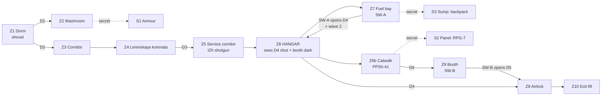

# MAP01 — Zarya-7 Cosmodrome

Design document. Owner: `level-designer`. Status: **text approved by the CEO;
v0 (the grey floor plan) is BUILT and walkable — see §14.** v1–v3 still to
come. Russian mirror: `docs/ru/levels/MAP01-zarya-7.md`.

> **Walk it:** `python3 tools/build.py && MAP=MAP01 tools/run.sh`
> The as-built plan, labelled, is
> `docs/levels/shots/2026-10-13_0045_F3_map01-v0-plan.png`.

Inputs this document obeys and does not restate: `docs/PRD.md` (D1–D15),
`docs/product/LORE.md` (MAP01 = cosmodrome, barracks and hangar, weapon
tutorial, the invasion has just begun), `docs/engine/MOD-SPEC.md` (UDMF
`zdoom`, map generated by `src/maps/MAP01/map.py`), `docs/art/TEXTURE-INDEX.md`
(the only textures that exist) and `docs/art/ART-BIBLE.md` §4 (composition and
light proposal).

## 1. Synopsis

The alarm catches Sergeant Vilanova in the barracks of a secret cosmodrome:
he arms himself as he walks, crosses the base his comrades have already lost,
and fights his way through the hangar to the service lift that drops into the
metro tunnels.

## 2. What the map has to do

| Job | How the layout does it |
|---|---|
| Teach the weapons (lore: MAP01 = tutorial) | one weapon per act, each followed by the enemy it is the answer to: shovel → a single hound; IZh shotgun → recruits at close range; PPSh-41 → the hangar's second wave. The RPG-7 is a secret reward, not a requirement. |
| Teach the vocabulary of the base | the red stripe (`SDCONC2`) is **the route**; the yellow lane (`SDFLR1`) is **the hangar's traffic**, and it points at the exit and at one secret. Both are taught in the first 90 seconds and never lie. |
| "The invasion has just begun" | the base is intact, lit and clean (ART-BIBLE §1: dirt is *use*, not decay). Enemies are few and scattered at the start, massed only in the hangar where they landed. |
| End on the metro | the exit is a service lift going **down**, with the darkest light value of the map (96): MAP02 is already visible as a mood. |

Target length: 5–8 min first run on skill 3; ~3 min once known.

## 3. Plan

Schematic, not to scale. North is up, x grows east, y grows north.

```
                                                                 N
                                      +---------------+      +-----------------+
                                      |   Z7 FUEL BAY |      | Z9 CONTROL BOOTH|
                      +---------+     |    [SW-A]     |      |  [SW-B]  window |
                      | S3 SUMP |=====|  ~~~ drums ~~~|      +--------+--------+
                      | (secret)| up  +-------+-------+               | D6
                      +---------+             |                       |
    +-----------------+--------------------------------------------------------+
    |                 |                 Z6  H A N G A R               [catwalk] |
    |                 |                                          ===============|
    |                 |            #### transporter cradle ####        /\ stairs|
    |                 |                                                         |
    |   Z5 SERVICE  ->| stair down                                              |
    |   CORRIDOR      |  - - - - yellow lane (SDFLR1) - - - - - - - - -> [D4]===[airlock]===[D5]-> Z10 EXIT LIFT
    |  [guard post:   |                                                         |
    |   IZh shotgun]  +--------------------------------------------------------+
    +--------+--------+
             |
    +--------+--------+
    | Z4 LENINSKAYA   |   political room + mess: mural wall (SDPOSTR2),
    |    KOMNATA      |   emblem plaque (SDSTAR1, if approved)
    +--------+--------+
             |
       Z3 CORRIDOR  (red stripe starts here)
             |
    +--------+--------+       +-----------+     +--------+
    |  Z1 DORM        |---D1--| Z2 WASHRM |-----| S1     |
    |  [player start] |       |           | (secret panel)
    |  [shovel rack]  |       +-----------+     +--------+
    +-----------------+
```

Working coordinates (grid 64; they may shift by a cell at build time, the
relations may not):

| # | Zone | x | y | floor | ceil | sector light |
|---|---|---|---|---|---|---|
| Z1 | Dorm (start) | 0…640 | 0…448 | 0 | 128 | 144 |
| Z2 | Washroom | 640…896 | 0…192 | 0 | 96 | 112 |
| S1 | Locker closet (secret 1) | 896…1024 | 32…160 | 0 | 96 | 96 |
| Z3 | Barracks corridor | 192…320 | 448…960 | 0 | 96 | 120 / 144 pools |
| Z4 | Leninskaya komnata | 0…640 | 960…1408 | 0 | 192 | 160 / 176 at the mural |
| Z5 | Service corridor | 640…1152 | 1088…1216 | 0 | 112 | 112 / 144 pools / 96–144 flicker |
| Z5b | Guard post | 896…1024 | 1216…1344 | 8 | 112 | 128 |
| Z6 | Hangar | 1152…2688 | 320…1600 | −32 | 288 | 176 (192 under lamps, 144 in bay shadow) |
| Z6a | Transporter cradle (walkable) | 1600…2240 | 832…1216 | 32 | 288 | 176 |
| Z6b | Catwalk (+ parapet strip) | 1280…2560 | 1440…1600 | 96 / 128 | 288 | 160 |
| Z7 | Fuel bay | 1152…1600 | 1600…1920 | −32 | 160 | 112 / 160 at SW-A |
| S3 | Fuel sump (secret 3) | 896…1152 | 1664…1856 | −96 | 0 | 96 |
| Z9 | Control booth | 2560…2816 | 1600…1856 | 96 | 224 | 144 |
| Z8 | Airlock | 2688…2944 | 544…800 | −32 | 96 | 128 |
| Z10 | Exit lift room | 2944…3264 | 480…864 | −32 → 0 | 224 | 96 / 144 on the exit switch |

Map extent ≈ 3264 × 2048 units. Every height is a multiple of 16; no floor
step is higher than 24 unless a stair carries it.

## 4. Progression and gates



**One gate, two steps, both signposted.**

1. The player enters the hangar at floor level and sees, down the yellow
   lane, the **blast door D4**, shut, framed by the red stripe and a dead
   indicator. The only other red-striped opening at floor level is the fuel
   bay to the north-west. The route is read, not told.
2. **SW-A** (fuel bay) opens D4 for good, lights the indicator, lights the
   control-booth window at the far end of the hangar, and opens the wave-2
   closets. The player now has a lit destination he had not noticed.
3. Behind D4 is a 256-deep **airlock** whose inner door **D5** is powered
   down. The lit booth window is the answer; the stairs to the catwalk are
   next to it, and the PPSh-41 is on the way.
4. **SW-B** (booth) opens D5 permanently. Exit through the airlock.

### Keys and doors

**MAP01 has no keys.** `docs/product/LORE.md` assigns the episode's first key
to MAP02, and Doom's own MAP01/E1M1 are key-free: the first map teaches
shooting and reading a space, not inventory. The key *grammar* ("every key
shows its door before you find it") is still obeyed, transposed to switches:
the locked thing (D4, then D5) is always seen **before** the switch that
opens it, and the switch's effect is visible from where it is thrown.

> **CEO decision wanted (one line):** confirm key-free MAP01. If you want a
> keycard here instead, the drop-in place is the guard post (Z5b): yellow
> card on the dead guard's desk, its door replacing D4, visible from the
> hangar entrance. It is a 20-minute change at v0, not later.

| Id | Where | Type | Special (to confirm, §9) | Can it ever lock the player out? |
|---|---|---|---|---|
| D1 | Dorm → washroom | manual door, both sides | `Door_Raise`, repeatable | no |
| D2 | Dorm → corridor | manual door, both sides | `Door_Raise`, repeatable | no |
| D3 | Komnata → service corridor | manual door, both sides | `Door_Raise`, repeatable | no |
| D4 | Hangar → airlock (256 wide, two leaves) | remote, opens for good | `Door_Open` tag 10, by SW-A | no: opens and stays open |
| D5 | Airlock → exit (128 wide) | remote, opens for good | `Door_Open` tag 11, by SW-B | no |
| D6 | Catwalk → booth | manual door, both sides | `Door_Raise`, repeatable | no |
| SW-A | Fuel bay, lit niche | wall switch, **repeatable** | `Door_Open` 10 + `Door_Open` 20 + `Light_ChangeToValue` 30 | no |
| SW-B | Control booth | wall switch, **repeatable** | `Door_Open` 11 | no |
| EXIT | Lift room, east wall | wall switch | `Exit_Normal` | — |

Rules that remove whole classes of softlock, applied everywhere:

- **No door ever closes behind the player.** The fuel-bay ambush is wall
  panels opening, never a door shutting.
- **No lifts on the critical path.** Height is changed by stairs only (the
  hangar is reached by a 3-step stair, the catwalk by an 8-step stair), so
  nothing can be left in the wrong position.
- **Every switch is `repeatspecial`** and every remote door is `Door_Open`
  (open and stay), so a mis-timed or repeated use can never consume a gate.
- **No drop greater than 24 units without a return route in the same zone.**
  The two intentional height changes (hangar −32, sump −96) are both served
  by two-way stairs.
- Monster closets open and stay open; a player who walks into one walks out.

## 5. Intensity curve

```
  high |                                              ####  <- climax: wave 2
       |                                   ####       ####     across the
 press |                        ####       ####       ####     hangar with
  ure  |             ####       ####  ##   ####  ##   ####     the PPSh
       |   ##   ##   ####  ##   ####  ##   ####  ##   ####  ##
   low |   ##   ##   ####  ##   ####  ##   ####  ##   ####  ##   #
       +------------------------------------------------------------>
         Z1    Z3    Z4    Z5    Z6    Z7    Z6b   Z9    Z6    Z8/Z10
        dorm  corr  komn  corr  hangar fuel  cat-  booth hangar exit
                               first   bay   walk        wave2
                              contact (trap)
         0:00                                                    ~7:00
```

| Beat | Space | Feeling | Mechanic introduced |
|---|---|---|---|
| 1 | Dorm, washroom | alarm, confusion, three bodies and two enemies | movement, shovel, the first secret panel |
| 2 | Corridor, komnata | the base is theirs now; first open room | crossfire in a room with cover; the red stripe |
| 3 | Service corridor | tension, flickering light, a corner | the IZh and close-range aiming |
| 4 | Hangar, first contact | the map opens: height, lamps, distance | long sightlines, the cradle as cover, barrels |
| 5 | Fuel bay | spike: an ambush from three panels | fighting with your back to a doorway |
| 6 | Catwalk, booth | relief and reward, a high view of what is coming | the PPSh, shooting downward |
| 7 | Hangar, wave 2 | **climax**: the room you already know, full | using the whole arena you learned in beat 4 |
| 8 | Airlock, lift | release, one or two stragglers, darkness | the exit |

## 6. Textures by zone

Only textures that are **approved** in `docs/art/TEXTURE-INDEX.md` are load
bearing. Everything conditional is listed with its fallback, so the map
builds and ships whatever the CEO decides.

| Zone | Walls | Floor | Ceiling | Light | Note |
|---|---|---|---|---|---|
| Z1 Dorm | `SDCONC1`; `SDSTEL1` on the bunk frames and the shovel rack | `SDFLR3` | `SDCEIL2`, one `SDCEIL1` | 144 | the clean, lit, ordinary room: the player's "before" |
| Z2 Washroom | `SDCONC1` | `SDFLR3` | `SDCEIL2` | 112 | darker than the dorm so the seam of S1 reads |
| S1 Locker closet | `SDSTEL1` | `SDFLR2` | `SDCEIL2` | 96 | |
| Z3 Barracks corridor | `SDCONC1` + **`SDCONC2`** at eye height on the right-hand wall, continuous | `SDFLR3` | `SDCEIL2`, `SDCEIL1` every 256 | 120, pools 144 | **the red stripe is born here**: it will lead the player all map |
| Z4 Leninskaya komnata | `SDCONC1`; north wall `SDPOSTR2` mural (128×128, once, eye height, on concrete per ART-BIBLE §4); `SDSTAR1` plaque on the east pier *if approved*, else `SDCONC1` | `SDFLR3` | `SDCEIL2` + 2 `SDCEIL1` | 160, 176 at the mural | the only "beautiful" room; the mural is lit brighter than its surroundings so it reads as meaning, not decoration |
| Z5 Service corridor | `SDCONC1` + **`SDCONC2`** stripe continuing | `SDFLR2` | `SDCEIL2`, 2 `SDCEIL1` | 112, pools 144, one flickering 96–144 section | |
| Z5b Guard post | `SDSTEL1` | `SDFLR2` | `SDCEIL2` | 128 | steel = function: this is where the weapon is |
| Z6 Hangar | `SDCONC1` above 128, `SDSTEL1` below 128 (dado of green plate) on all four walls; **`SDCONC2`** framing D4 and the fuel-bay opening | `SDFLR2`, with a 64-wide `SDFLR1` lane from the entry stair to D4 and a second lane into the west bay (the one that points at S3) | `SDCEIL2`, `SDCEIL1` in a 6 × 2 grid of lamp panels | 176; 192 directly under each lamp; 144 in the bay shadows and under the catwalk | ≥ 70 % concrete (ART-BIBLE §4) is respected: steel only to 128 of a 320 wall |
| Z6a Cradle | `SDSTEL1` | `SDFLR2` | — | 176 | |
| Z6b Catwalk | `SDSTEL1`, parapet `SDSTEL1` | `SDFLR2` | `SDCEIL2` | 160 | |
| Z7 Fuel bay | `SDSTEL1` to 128, `SDCONC1` above | `SDFLR2` | `SDCEIL2`, 1 `SDCEIL1` over SW-A | 112, 160 at SW-A | the switch is the brightest thing in the room |
| S3 Sump | `SDCONC1` | `SDFLR2` | `SDCEIL2` | 96 | |
| Z9 Booth | `SDSTEL1` | `SDFLR3` | `SDCEIL1` | 144 (96 until SW-A is thrown) | its window is the beacon lit by SW-A |
| Z8 Airlock | `SDSTEL1`, `SDDOOR1` leaves | `SDFLR2` | `SDCEIL2` | 128 | |
| Z10 Exit lift | `SDCONC1`, `SDSTEL1` dado | `SDFLR2` | `SDCEIL2` | 96, 144 on the switch | darkest room of the map: MAP02 starts here |

Light policy I fix as owner of the value (ART-BIBLE §4 proposed 112–144
corridors / 128–160 barracks / 160–192 hangar; I keep the bands and pin the
numbers):

- Allowed range **96 … 192**. 96 only in S1, S3 and Z10; 192 only under
  hangar lamps. Nothing is pitch dark: the base still has power.
- Adjacent sectors that are meant to read as different spaces differ by
  **≥ 16**. A lamp sector is exactly +16 over its room.
- One `SDCEIL1` flat = one 64×64 lamp sector at +16 (ART-BIBLE §4).
- The map gets *brighter* towards the hangar and then *darker* towards the
  exit: the curve of light follows the curve of the fiction.

Texture conventions for the builder:

- Every door recess is **128 wide × 128 high** so `SDDOOR1` (128×128) tiles
  exactly once. Where a corridor is 96 high, the recess sector rises locally
  to 128. D4 is 256 wide = two leaves of one `SDDOOR1` each (see §10).
- Walls are top-aligned by default; in sectors not 128 high the sidedef
  `offsety` is set in the v1 pass so the concrete joint lands on the floor.
- `SDFLR1`'s yellow line is laid in **lanes** (hangar traffic, route to D4,
  the pointer to S3), never as a floor covering (ART-BIBLE §4).

## 7. Secrets

Three, none required, each a *reward for reading the room*, each with a
two-way exit.

| # | Where | Clue the player can read | Reward | Opens with |
|---|---|---|---|---|
| S1 | Washroom locker panel (Z2) | one `SDSTEL1` panel has a visible seam and sits in a darker sector than its neighbours | green armour, 2 stimpacks | push (`Door_Open`, stays open) |
| S2 | Loose catwalk panel behind the booth (Z6b) | from the hangar floor a lit slit shows under the catwalk where there should be none | **RPG-7** + 1 box of rockets + the base schematic (computer map) | push |
| S3 | Fuel sump under the drum stack (Z7) | the second yellow lane in the hangar's west bay runs into the fuel-bay wall and stops — it points at the drums | backpack, 1 box of shells, 2 medikits | push |

All three sectors carry the secret flag; all three are reachable on every
skill; none costs health to take.

## 8. Enemies and resources

**Nothing of ours exists yet (F5).** The map is populated with Freedoom
actors as placeholders, and every one of them has a declared successor. The
positions are chosen for the *successor's* behaviour, so F5 is a swap of
DoomEdNums and not a redesign.

| Placeholder (Freedoom / IWAD) | DoomEdNum | Will become (F5) | Why it is where it is |
|---|---|---|---|
| Zombieman | 3004 | **Fourth Reich recruit** (bolt rifle) | the bulk; hitscan chip damage, used in ones and twos early, in lines on the catwalk later |
| Shotgun guy | 9 | **Liberty Legion trooper** | punishes open ground; guards doorways and the cradle |
| Imp | 3001 | **hybrid Stormtrooper** | the first enemy that survives one shotgun shell; hangar and fuel bay |
| Demon | 3002 | **Reich hound** | corridors and the ambush: forces movement, answers the shovel |
| Chaingun guy | 65 | **Legion heavy gunner** | skill 4 only, one, in the booth window: the reason to take the catwalk seriously |
| Explosive barrel | 2035 | fuel drum (own sprite later) | hangar bays and the fuel bay; part of the arena, not decoration |
| Chainsaw | 2005 | **sapper's shovel** (slot 1) | dorm rack |
| Shotgun | 2001 | **IZh double-barrel** (slot 3) | guard post, on the critical path |
| Chaingun | 2002 | **PPSh-41** (slot 4) | catwalk, on the way to SW-B |
| Rocket launcher | 2003 | **RPG-7** (slot 5) | secret S2 only |
| Clip / box, shells / box, rockets | 2007/2048, 2008/2049, 2010/2046 | TT clips, IZh shells, RPG rounds | see budget |
| Stimpack / medikit / health bonus | 2011 / 2012 / 2014 | field dressing / medkit / ampoule | |
| Green armour / armour bonus | 2018 / 2015 | flak vest / plate | |
| Backpack | 8 | ammo satchel | secret S3 |
| Floor lamp | 2028 | floor lamp | Z4, Z10 |

Not used in MAP01 and deliberately so: super shotgun (slot 3 has one weapon,
the IZh), plasma/BFG slots (flamethrower and Katyusha arrive later in the
episode), cacodemons/barons (lore: the invasion has just begun), keys.

### Enemies per skill

Doom skills: 1–2 share the "easy" thing flags, 3 is medium, 4–5 share
"hard". Every monster is placed with explicit `skill1…skill5` flags
(`sdbuild.udmf` defaults all five to true, so each addition must be set
deliberately).

| Beat / zone | Skill 2 (HNTR) | Skill 3 (HMP) | Skill 4 (UV) |
|---|---|---|---|
| Z1 Dorm | 2 recruits | 3 recruits | 3 recruits + 1 trooper |
| Z2 Washroom | — | 1 hound | 1 hound |
| Z3 Corridor | 2 recruits | 2 recruits + 1 hound | 3 recruits + 1 hound |
| Z4 Komnata | 2 recruits + 1 trooper | 3 recruits + 1 trooper | 3 recruits + 2 troopers + 1 stormtrooper |
| Z5 Corridor + guard post | 1 recruit + 1 trooper | 2 recruits + 1 trooper | 2 recruits + 2 troopers |
| Z6 Hangar, first contact | 3 recruits + 1 trooper + 1 stormtrooper | 4 recruits + 2 troopers + 2 stormtroopers | 5 recruits + 3 troopers + 3 stormtroopers |
| Z7 Fuel bay ambush | 2 stormtroopers + 1 hound | 2 stormtroopers + 2 hounds | 3 stormtroopers + 2 hounds + 1 trooper |
| Z6 Hangar, wave 2 | 2 recruits + 1 trooper | 3 recruits + 2 troopers | 3 recruits + 2 troopers + 1 stormtrooper + 1 heavy gunner |
| Z8/Z10 Exit | 1 recruit | 1 recruit + 1 trooper | 2 recruits + 1 trooper |
| **Total** | **21** | **33** | **46** |

Strictly increasing (21 < 33 < 46), which G3 checks mechanically.

### Resources per skill

| Item | Skill 2 | Skill 3 | Skill 4 | Where |
|---|---|---|---|---|
| Shovel (chainsaw) | 1 | 1 | 1 | Z1 rack |
| IZh (shotgun) | 1 | 1 | 1 | Z5b guard post |
| PPSh (chaingun) | 1 | 1 | 1 | Z6b catwalk |
| RPG-7 + 1 rocket box | secret | secret | secret | S2 |
| Shells ×4 | 8 | 6 | 5 | spread Z5 → Z10 |
| Box of shells (20) | 2 | 2 | 2 | Z6, S3 |
| Clips (10) | 6 | 5 | 4 | spread from Z1 |
| Box of bullets (50) | 2 | 2 | 3 | Z6b, Z6, Z7 |
| Stimpack | 6 | 4 | 3 | |
| Medikit | 4 | 3 | 2 | Z5, Z7, S3 |
| Health bonus | 10 | 10 | 10 | dressing for corners |
| Green armour | 1 (S1) | 1 (S1) | 1 (S1) | S1 |
| Armour bonus | 8 | 8 | 6 | |
| Backpack | secret | secret | secret | S3 |

Principle: **monsters scale up with skill, consumables scale down, weapon
availability never changes.** A skill-4 player who finds no secret must still
be able to finish — that is a measured G3 criterion (§11, G3-5 for the run
and G3-8 for the ammo budget), not a hope.

## 9. Engine elements used

The argument *shapes* come from GZDoom's own shipped translation tables
(`gzdoom.pk3 → xlat/base.txt`, `xlat/doom.txt`, `xlat/defines.i`), which are
plain text: `Door_Raise (tag, speed, delay, lighttag)`,
`Door_Open (tag, speed, lighttag)`, `Exit_Normal (pos)`, `D_SLOW = 16`,
`VDOORWAIT = 150`.

The special *numbers* are not in any file GZDoom ships — ZDoom's table is
compiled into the binary — so they were verified the only way left: by
walking v0 and watching the thing move. Evidence is in
`docs/levels/shots/`.

| Need | Emitted | Status |
|---|---|---|
| Manual door, both sides | `Door_Raise` **12** (tag, 16, 150, 0), `playeruse` + `repeatspecial` | **VERIFIED in engine** 2026-10-13: D2 pressed from the dorm, opened, corridor visible (`…_d2-closed.png` → `…_d2-open-corridor.png`) |
| Push panel, opens for good | `Door_Open` **11** (tag, 16, 0), `playeruse` + `repeatspecial` | **VERIFIED**: S2's catwalk panel pressed and stayed open (`…_s2-panel-open.png`) |
| Wall switch opening a remote door | `Door_Open` **11** on a **one-sided** line, tag of a non-adjacent sector | **VERIFIED**: SW-A thrown, D4 found open from the hangar with the airlock and the still-shut D5 behind it (`…_d4-closed.png` → `…_d4-open-airlock-d5.png`) |
| Level exit | `Exit_Normal` **243** on a switch line | **VERIFIED**: the engine left and re-entered MAP01 (MAPINFO `next = "MAP01"`), two `MAP01 - …` lines in one log |
| Sector / line tags | UDMF `id` on the sector; `arg0` on the line | **VERIFIED** implicitly by all of the above |
| Booth light turns on | `Light_ChangeToValue` (110) tag 30, arg 144 | **NOT VERIFIED** — v2 |
| Flickering corridor section | sector special or `Light_Flicker` (113) | **NOT VERIFIED** — v2 |
| Secret sector | sector `special = 1024` | **NOT VERIFIED** — v2 |

Two engine facts worth writing down, both learned the hard way:

- A `playeruse` special fires **only from the front side of the line**. A
  door sector therefore needs the special on *both* flanking lines, each
  wound so the door is the BACK side. `LineStyle.back_sector` in
  `tools/sdbuild/udmf.py` does that, and `tests/test_udmf.py` asserts it.
- `Door_Raise` / `Door_Open` raise a door to **(lowest neighbouring ceiling
  − 4)**. The design's sump (floor −96, ceiling 0) opened off a −32 floor
  would have given a 28-unit doorway, i.e. impassable. Fixed in v0 (§14);
  every door's clearance is now checked by a test.

Tag plan, updated by v0: **1** D1 · **2** D2 · **3** D3 · **6** D6 ·
**10** D4 · **11** D5 · **20** hangar wave-2 closets · **21** fuel-bay
ambush panels · **30** booth light · **101/102/103** secret panels
S1/S2/S3. 4, 5, 7–9 and 12–19 stay free for v2 detail. Manual doors are
tagged rather than tag-0 so either flanking line opens them.

Switch **textures do not exist in the approved set** — see §10, request A3.

## 10. What I need before I can build

### From `mod-engineer` (blocking)

- **M1 — RESOLVED 2026-10-12 by `mod-engineer`.** `tools/build.py` now packs
  `assets/`; the twelve approved textures are in the PK3 and v0 already uses
  one of them (`SDDOOR1`, §14).
- **M2 — RESOLVED 2026-10-13 by `level-designer`** (this role owned the file
  for that task). `tools/sdbuild/udmf.py` now models `Sector.id` /
  `Sector.special`, `Linedef.special` + `arg0..arg4`, a checked set of
  linedef flags, `TextMap.add_room_rect()`, and `GridMap` — a rectangle
  painter that derives every shared edge, split and winding from a list of
  rectangles. Tests in `tests/test_udmf.py`.
- **M3, M4, M5 — still open**, see below.

<details><summary>Original wording of M1 and M2 (kept for the record)</summary>

- **M1 — approved textures do not reach the PK3.** `assets/textures/soviet_base/`
  and `assets/flats/soviet_base/` exist, but `tools/build.py` packs `src/`
  only and there is no `src/textures/` or `src/flats/`. Today a map that
  names `SDCONC1` would produce `Unknown texture`. Wire `assets/` into the
  build (or define the copy step) and record it in MOD-SPEC §2/§3. **v1 is
  blocked on this; v0 is not** (v0 can run on IWAD textures).
- **M2 — `sdbuild.udmf` is missing what this map needs.** Today `Sector` has
  no `id`/`special`, `Linedef` has no `special`/`arg0…arg4` and no flag
  fields, and there is no two-sided-line or rectangle helper. All of it is
  reachable through `extra={}`, but a 60-sector map written that way is
  unreviewable. Please add: `Sector.id`, `Sector.special`,
  `Sector.xpanningfloor`-style passthrough (already via `extra`),
  `Linedef.special` + `arg0…arg4`, the flags `twosided`, `playeruse`,
  `playercross`, `repeatspecial`, `monsteractivate`, `blockmonsters`,
  `dontpegtop`, `dontpegbottom`, `secret`, and a `TextMap.add_room_rect()`
  that emits a rectangular sector with four correctly wound lines.

</details>

- **M3 — the exit has nowhere to go.** MAPINFO says `next = "MAP01"` and
  MAP02 does not exist. Decide what `Exit_Normal` does in v1 (loop to MAP01,
  or an end-of-episode cluster with text) and put it in MAPINFO. **v0 ships
  with the loop**, which is what made `Exit_Normal` verifiable (§9) and is
  wrong for shipping: today pressing the exit silently restarts the map.
- **M4 — map name and par.** `SD_MAP01_NAME` is still "Test Range". Proposed:
  EN "Zarya-7 Cosmodrome", RU «Космодром "Заря-7"». Par time 210 s.
- **M5 — confirm §9** (specials, tags, secret sector) and add the Freedoom
  actors of §8 to MOD-SPEC §5, which today lists only four texture names.
  Placeholder monsters, weapons and pickups are IWAD references too.

### From `art-director` (one blocking, the rest shape v2)

- **A1 — `SDCONC2` must ship in the PK3 to be judged.** Its status is
  "pending in-map review", and this map is the review: the stripe is the
  wayfinding language of Z3, Z5, the D4 frame and the fuel-bay opening. It
  cannot be reviewed in-map while it sits in `work/` outside `assets/`. I
  need a path that puts it in the build with status "pending" (art-director
  + mod-engineer + PM to agree the mechanism). **Fallback if refused:** the
  route is marked by `SDSTEL1` pilasters instead, the map still works, and
  the CEO loses the chance to judge the stripe where it matters.
- **A2 — `SDSTAR1`.** Z4's east pier and the hangar's D4 frame are reserved
  for the plaque. If v5 is not approved by the time v1 is built, those
  surfaces stay `SDCONC1` and the plaque is added in a later pass; nothing
  structural depends on it.
- **A3 — there is no switch texture (batch 2 request).** The map has two
  switches and an exit switch, and the approved set has nothing that reads as
  one. I need either `SDSWT1`/`SDSWT2` (off/on pair, 64×128 or 32×64, green
  steel housing with a red lever, plus `SWITCHES`/`ANIMDEFS` from
  `mod-engineer`), **or** permission to reference an IWAD switch texture as a
  placeholder, declared in MOD-SPEC §5. Without one of the two, v0 and v1
  have unreadable switches.
- **A4 — `SDDOOR2`, a second door leaf (batch 2, nice to have).** D4 is a
  256-wide blast door built from two `SDDOOR1` leaves, so the locking wheel
  and the stencilled "7" appear twice side by side. It reads as a double
  door, which is plausible, but a mirrored or plain half-leaf would read
  better. Decide after the CEO sees it in v1.
- **A5 — crate / locker texture (already a batch-2 candidate).** The dorm,
  the guard post and the hangar bays want a crate face; today they are
  `SDSTEL1` boxes.
- **A6 — no exterior.** There is no approved exterior or sky texture, so
  MAP01 v1 is entirely interior and the hangar's launch-pad gate stays shut.
  If the CEO wants a strip of night sky over the hangar, `SKY1` is already
  declared in MOD-SPEC §5 and I can open a roof slit in v2 — say the word.

### Not requested on purpose

Sound (no `SNDINFO` yet; doors and switches use engine defaults), music
(`music = ""`), own HUD, ACS scripting (the design is deliberately built from
plain linedef specials so no script can fail).

## 11. Gate G3 — measurable definition

`docs/ROADMAP.md` states G3 as "map finishable on skills 2, 3 and 4 with zero
log errors and zero softlocks; CEO verdict 'on point'". Below is what
`qa-engineer` actually runs. **All of G3-1…G3-8 must be green; G3-9 is the
CEO's.**

| # | Criterion | How it is measured | Pass |
|---|---|---|---|
| G3-1 | The map builds and packs | `python3 tools/build.py` exits 0; `maps/MAP01.wad` contains `MAP01`, `TEXTMAP`, `ENDMAP` in that order; `python3 -m unittest discover -s tests` green and the suite count not lower than the last close | exact |
| G3-2 | Zero engine errors | `logs/gzdoom.log` of a full playthrough matches none of `Script error`, `Unknown texture`, `Unknown flat`, `Missing sprite`, `Unknown line special`, `Bad sector`, `Texture .* not found`, `is not a valid` | 0 hits |
| G3-3 | Every texture is legitimate | a static check over `TEXTMAP`: every `texture*` value is either `approved` in `TEXTURE-INDEX.md`, explicitly "pending in-map review" (only `SDCONC2`, and only if A1 was granted), or listed in `MOD-SPEC.md` §5 | 0 unknown names |
| G3-4 | Finishable on 2, 3 and 4 | three recorded runs from the player start reaching the exit switch; evidence: the intermission screenshot + the log per skill, in `docs/qa/evidence/` | 3/3 |
| G3-5 | Finishable with no monsters and no secrets | one `-nomonsters` run and one run that takes zero secrets both reach the exit | 2/2 |
| G3-6 | No softlock, statically | reachability check on `TEXTMAP`: every sector is reachable from the player start, and from every sector there is a path to the exit that uses only doors that are `repeatspecial` or already permanently open; no one-way drop > 24 units | 0 violations |
| G3-7 | No softlock, adversarially | QA's hostile pass on skill 4: throw every switch twice, re-enter every door, walk into every monster closet and back out, enter every secret and leave, drop off the catwalk and off the cradle from all four sides, and play the map backwards from the hangar | "could not get stuck" |
| G3-8 | Thing and resource sanity | script over `TEXTMAP`: no thing with all five skill flags false; monster counts strictly 2 < 3 < 4 and matching §8 ±2; 3 secret sectors; placed ammo on skill 4 ≥ 1.35 × the ammo needed to kill every skill-4 monster with the intended weapon (recruit/trooper 1 shell, stormtrooper 2, hound 3, gunner 4), counting no secret pickup | all true |
| G3-9 | CEO verdict | the CEO plays or watches v3 and says "on point" (or not), **and** gives the verdict on `SDCONC2` seen in Z3/Z5/Z6, which closes its row in `TEXTURE-INDEX.md` | explicit yes |

A failure at any of G3-1…G3-8 is a bug with a number, not a discussion.

## 12. Version plan

Each version loads in GZDoom, is walkable from start to exit, and is
screenshotted into `docs/levels/shots/`.

| Version | Content | Done when |
|---|---|---|
| **v0 — grey** ✅ **BUILT 2026-10-13** (§14) | the complete floor plan: every sector, every door, both switches, the exit, correct heights and stairs. One wall texture and one floor/ceiling pair everywhere (`STARTAN2`/`FLOOR4_8`/`CEIL3_5`), flat light 160, no enemies, no items. | you can walk start → exit; no HOM, no stuck geometry; G3-1, G3-2, G3-6 pass |
| **v1 — textured** | §6 applied zone by zone, alignment pass (door recesses, `offsety`, lane continuity), `SDPOSTR2` mural placed, D4/D5/D6 as `SDDOOR1`, `SDCONC2` route if A1 is granted. | G3-3 passes; the CEO can judge `SDCONC2` from screenshots |
| **v2 — light and detail** | the §6 light table, lamp sectors, the flickering corridor, the booth light that SW-A turns on, parapets, pilasters, steps, drums, floor lamps, the three secrets built and flagged. | the map reads without a compass: a first-time player finds the hangar and D4 without being told |
| **v3 — balance** | §8 placed with per-skill flags, ammo and health budget, the two waves and the ambush timed, playtests on 2/3/4 with notes. | all of G3-1…G3-8 green; ready for the CEO's G3-9 |

Running any version, once it is in the build:

```sh
python3 tools/build.py
MAP=MAP01 SKILL=3 tools/run.sh
# or, directly:
/Applications/GZDoom.app/Contents/MacOS/gzdoom -iwad iwads/freedoom2.wad \
  -file dist/sovietdoom.pk3 +map MAP01 -skill 3
```

## 13. Open points for the CEO

1. **Key-free MAP01** (§4): confirm, or ask for the yellow card in the guard
   post. Recommendation: key-free, as the lore assigns the first key to MAP02.
2. **`SDCONC2` in the build** (A1): the stripe is this map's wayfinding
   language; it needs to ship in the PK3 to be judged. If you prefer not to
   ship an unapproved texture at all, say so and I use steel pilasters.
3. **Switch texture** (A3): commission `SDSWT1`/`SDSWT2` in batch 2, or allow
   an IWAD switch as a placeholder for F3.
4. **Length and difficulty**: 5–8 minutes and 21/33/46 enemies is a modern
   MAP01, longer than Doom II's MAP01 (~2 min) and shorter than a modern
   megawad opener. Say if you want it shorter.
5. **A strip of night sky** over the hangar in v2 (A6): yes or no.

## 14. v0 build record (2026-10-13)

Source: `src/maps/MAP01/map.py`, built by `tools/sdbuild/udmf.py`'s
`GridMap`. 44 sectors, 179 linedefs, 137 vertices, 1 thing.

```sh
python3 tools/build.py && MAP=MAP01 tools/run.sh      # walk it
python3 tools/build.py --print-textmap MAP01           # read the UDMF
```

### What is in it

Every room, corridor, stair, door, switch and secret of §3 and §4, at the
heights of §3: the dorm, the washroom and the locker secret, the barracks
corridor, the Leninskaya komnata, the service corridor and the guard post,
the three-step descent into the hangar, the hangar itself with the
transporter cradle (climbable, droppable on all four sides), the eight-step
stair to the catwalk, the catwalk and its secret panel, the fuel bay with
SW-A and the sump secret below it, the control booth with its window over
the hangar and SW-B, the two-leaf airlock (D4 → chamber → D5) and the exit
lift with the exit switch.

### What is deliberately *not* in it

No enemies, no weapons, no ammo, no health, no decoration, no secret flags,
no lane markings, no mural, no lamps. Flat light 160 everywhere, so nothing
is "atmospheric" yet — the map is meant to look like nothing so the *shape*
is the only thing to judge. Those are v1, v2 and v3.

### Deviations from §3, and why

| # | Design said | Built | Why |
|---|---|---|---|
| 1 | one texture everywhere | one texture **plus `SDDOOR1` on every pressable surface** (6 door leaves, SW-A, SW-B, exit) | with a single grey wall a closed door *is* grey wall. The first engine screenshot showed a dorm whose only exit was invisible. `SDDOOR1` is already approved and is what v1 puts on those same doors. Nothing else is textured, and a test asserts it never leaks onto a plain wall. |
| 2 | Z9 booth at x 2560…2816 | x 2432…2688 | at 2560 the booth only touched the catwalk at a corner: D6 had no wall to live in. |
| 3 | Z7 fuel bay at y 1600…1920 | y 1664…1984, reached through a 128-wide, 64-deep passage | sharing the whole 448-unit wall with the hangar would have been a missing wall, not a doorway. |
| 4 | S3 sump: floor −96, ceiling 0 | sump unchanged; its **stairwell** is ceilinged at 64 | a door between a −32 floor and a 0 ceiling opens to 28 units. Nobody fits. |
| 5 | manual doors on tag 0 | one tag per door (§9) | a tagged door opens from either flanking line; tag 0 depends on which side the engine calls "front". |
| 6 | 3-step descent into the hangar | 3 steps of 8 units + the 8-unit drop into the hangar | keeps every step well under the 24-unit limit. |

### Verification actually run

| Check | Result |
|---|---|
| `python3 tools/build.py` | OK — 34 files, `maps/MAP01.wad` 60 KB |
| `python3 tools/check_pk3.py` | **PASS**, 0 errors 0 warnings; 5 texture names referenced, all resolved |
| `python3 tools/smoke.py --map MAP01 --skill 3` | **PASS** — GZDoom 4.14.2, map entered, screenshot written, 0 failure lines |
| `python3 -m unittest discover -s tests` | **OK**, 190 tests (34 of them new in `tests/test_udmf.py`) |
| in-engine walk | D2, S2's panel, SW-A → D4 and the exit all exercised by hand (§9) |

Static checks now enforced on every build by `tests/test_udmf.py`, which is
most of criterion G3-6: every sector closed and clockwise, no duplicate
vertex or linedef, every one-sided line blocking and every two-sided line
not, every sector reachable from the player start (bar the booth window,
which is a window), **a path back to the start from every reachable
sector**, the gate order (dorm sealed → everything but the airlock → +SW-A →
+SW-B), every door opening to at least 56 units of clearance, and every
switch tag pointing at a sector that exists.

### Known rough edges, to be fixed in v1/v2

- `SDDOOR1` is 128×128 and D4's opening is 320 tall, so the leaf tiles 2½
  times vertically. v1 gives the big doors a proper lintel.
- The hangar's southern half (y 320…1088) is 1536 × 768 of empty floor. v2
  puts the bays, the drums and the lamp grid there — but see the question
  below, because it may simply be too big.
- The booth window sector is unreachable by design; it is the one sector of
  the map no player can stand in.

### What I want the CEO to judge while walking it

1. **The hangar's size.** It is 1536 × 1536 units with a 320-high ceiling —
   about six times the floor area of the dorm. Walking it empty is the
   worst case; it will feel smaller once the cradle bays, the drums and the
   lamps are in. Is it *impressive*, or is it *a long walk*? If it is a
   long walk, I shrink it on the south side before v1, which is cheap now
   and expensive later.
2. **The barracks run.** Dorm → corridor → komnata → service corridor is
   about 1900 units of walking with nothing in it yet. In v3 it carries
   three fights. Does it feel like a *base* or like a *lobby*?
3. **The height drama.** The descent into the hangar (3 steps, ceiling
   rising 112 → 160 → 224 → 288) is meant to be the "wow" beat. Does the
   room open up when you come down the steps?
4. **The catwalk stair.** Eight steps, 256 units long, climbed under fire
   in v3. Too long a climb?
5. **The gate.** From the hangar floor, is it obvious that the big shut
   door to the east (D4) is where you are going, and that the fuel bay to
   the north-west is the only other way on? That reading is the whole
   design; if it does not happen in grey, no amount of red stripe in v1
   will save it.
6. Still open from §13: key-free MAP01, `SDCONC2` in the build, a switch
   texture for batch 2, length and difficulty, and the strip of night sky.

### Still needed from other roles

- `mod-engineer`: **M3** (what `Exit_Normal` should do — today it loops back
  to MAP01, which is fine for walking and wrong for shipping), **M4** (the
  map is still called "Test Range" on the automap and the intermission),
  **M5** (record §9's verified specials and the §8 Freedoom placeholders in
  MOD-SPEC).
- `art-director`: **A3**, a switch texture — `SDDOOR1` is standing in for one
  and reads as a door, not a switch.


## v0 playtest finding, CEO 2026-10-13: the gate reads as a dead end

**Veredicto literal:** "no pude probar el nivel porque las paredes no se
abrían. Utilicé IDCLIP. Pero tenía buena pinta."

The doors are not broken. Verified in the engine and analytically:
- All 12 door use-lines carry `Door_Raise` (12) with speed 16, `playeruse`,
  `repeatspecial`, and the door sector on the **back** side so they open from
  either room. Every tag has its sector. Evidence:
  `docs/qa/evidence/2026-10-13_0910_F3_door-d2-{closed,open}.png`, the same
  door before and after one press.
- Every door opens to 92-124 units of clearance; the player needs 56.
- The two lines with no back side are SW-A and SW-B, wall switches, correct.

What the CEO almost certainly hit is **D4, the hangar gate, which by design
carries no special of its own**: it is opened by SW-A in the fuel bay. Press
it and nothing happens, which in a grey box with no lighting and no signage
reads as "the walls do not open".

This is the finding, and it is a design one, not a bug: **v0 cannot signpost.**
The design leans on the red stripe as the route language and on light to pull
the player toward the fuel bay, and v0 has neither. Two consequences:

1. For judging v0, the route has to be told rather than discovered. Dormitory
   → north door → corridor → Leninskaya komnata → service corridor and guard
   post → three steps down into the hangar → **ignore the big gate, go
   north-west into the fuel bay** → SW-A opens the gate → catwalk stair →
   control booth → SW-B → back across the hangar → airlock → lift → exit.
2. For v1 this is the question the map has to answer with texture and light
   alone, and it is now a gate criterion: a player who has never seen the map
   must reach the fuel bay without being told.
