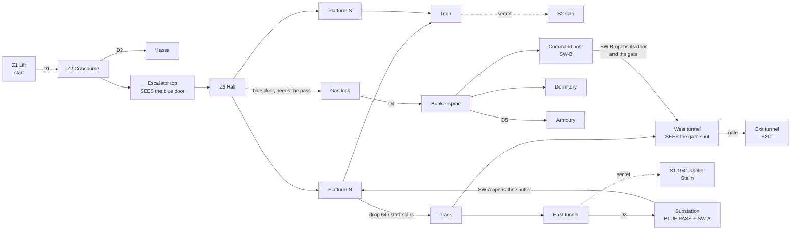

# MAP02 — Metro-Bunker

> **D62 (2026-10-14): this map is MAP02.** It was built and documented as
> MAP03 while MAP02 was the practice range (D41); the slots now follow the
> campaign (MAP01 → MAP02, the metro → MAP03, the factory «Танкоград») and
> the range is the lump `RANGE`. Paths, commands and the campaign rows below
> use the new numbers; the build and walk records (§14-§16) keep "MAP03"
> where they record what was built and seen that day, and dated evidence
> keeps its file names (`…_map03-v0-walk.*`). Wiring: `docs/engine/MOD-SPEC.md` §4.6.

Design document. Owner: `level-designer`. Status: **v1 BUILT 2026-10-14
(§16): the blue pass signposted and the map populated; not yet walked.**
v0 (§14) was walked by the CEO the same day (§15, D58): "me gusta de
momento", but the pass was not found. A working brief for the PM; the CEO's
verdict comes from walking the map, not from reading this (D28). Source:
`src/maps/MAP02/map.py`; tests: `tests/test_map02_metro.py`. Russian mirror: owed
at the phase close (D34).

> **Walk it** (the PM or the CEO; agents never start GZDoom, D26):
> `python3 tools/build.py && SD_ALLOW_ENGINE=1 MAP=MAP02 SKILL=3 tools/run.sh`.
> MAPINFO has carried this map's entry since v0's engine pass
> (`docs/qa/evidence/2026-10-14_1902_F3_map03-v0-walk.md`).

Inputs this document obeys and does not restate: `docs/product/LORE.md`
(the metro-bunker map: "first key, first heavy hybrids", texture set "tiles,
red marble, mosaics"), `docs/PRD.md` (D35 for the factions, D41 for the practice range, D62 for the numbers,
D42/D47/D48/D56 for the metro textures, D55 for the Stalin poster),
`docs/engine/BESTIARY.md`, `docs/art/TEXTURE-INDEX.md` (set "Metro", sixteen
approved lumps) and the method and lessons of `docs/levels/MAP01-zarya-7.md`.

## 1. Synopsis

The lift from Zarya-7 drops Sergeant Vilanova into a deep metro station that
doubles as a government bunker; the Liberty Legion holds the station, the
Fourth Reich has come up the tunnels and sealed itself in the bunker, and the
only way west towards Moscow is the running tunnel behind the bunker's gate.

## 2. Its place in the campaign

| | |
|---|---|
| Comes after | MAP01 Zarya-7, which ends on a service lift going **down**, in its darkest room (MAP01 §2: "MAP02 is already visible as a mood"). MAP02 starts at the bottom of that lift. |
| Its number | **MAP02 since D62**, as LORE's episode table numbers it. Built as MAP03 while MAP02 was the practice range (D41); D62 gave the slots the campaign's order and the range the lump `RANGE`. |
| What it adds | the **first key** (LORE), the first map where the player goes **down into the track and the tunnels**, and the heavies in numbers: a Panzermensch on every skill, the first one an easy-skill player meets. |
| Factions (D35) | MAP01 was Reich first with the Legion holding the hangar; the metro **inverts it**: the Legion holds the station (concourse, hall, train), the Reich holds the depths (tunnels, substation, bunker). Stormtroopers are hybrids and fight for both. |
| Comes before | MAP03, the tractor factory «Танкоград» (D63; LORE's "MAP03", the episode climax; `docs/levels/MAP03-factory.md`). Its exit is the westbound running tunnel, and since D62 it leads there through cluster 4's transition text. |
| Campaign wiring | **Done (D60, D62).** MAP01's exit leads here (cluster 3's text); this map's exit leads to MAP03, the factory (cluster 4's text, `SD_MAP02_EXIT_TEXT`), and the factory ends the episode. `docs/engine/MOD-SPEC.md` §4.6; §11 below keeps the steps as they were proposed. |

**Numbering (resolved by D62):** where `docs/engine/BESTIARY.md` says
"MAP03" (the General first placed, the 1000 HP `SD_PanzermenschSchwer`), it
means the factory, which is MAP03 again since D62. This map places neither.

## 3. What the map has to do

| Job | How the layout does it |
|---|---|
| Teach the key | the blast door is seen **first**, from the top of the escalator, at the far end of the hall between two mosaics, lit brighter than the hall; the pass is found later, in a room reached without that door; the door opens for good (`Door_LockedRaise`, delay 0). Doom's grammar: the lock before the key, the key before the switch. |
| Be a metro | an escalator down into a pylon hall (the Moscow deep-station type: central hall, arches between marble pylons, a platform each side), a train standing at one platform with its doors open, the open track at the other, and **the tunnels**: the player has to step off the platform into the track bed. |
| Be a bunker | behind the hermetic door the materials change: steel and green-dado tile instead of marble; a gas lock, a spine corridor, a refuge dormitory, an armoury, and a command post one level down whose console opens the tunnel gate. |
| End towards Moscow | the exit is west along the running tunnel, past the gate the command post opens. |

Target length: 8–10 minutes first run on skill 3 (MAP01 is 5–8); about 4
once known.

## 4. Plan

To scale, one character = 64 × 64 units, north up, x east. Generated from
the built map (§14), labels added. Floors: upper level **+160** (lift,
concourse, kassa), station **0**, track level **−64** (track, tunnels,
command post, shelter).

```
   y                                                 x 352 ........................................... 3968
 1856                                           11              S1 1941 shelter (secret), Stalin slot on the north wall
 1792                                         111111
 1600                                         111111
 1536                                            1
 1472                                            ?              S1 panel (a concrete patch in the tubbing)
 1408 ETTTTTTGTTTTTTTTTTTTTTTTTTTTTTTTTTTTTTTTTTTTT             west tunnel | open track | east tunnel
 1344 ETTTTTTGTTTTTTTTTTTTTTTTTTTTTTTTTTTTTTTTTTTTT
 1280        KKKQQK  PsssPPPPPPPPPPPPPPPPsssP  DD   kkk         D3 off the east tunnel; k = kassa
 1216        KKKKKK  PPPPPPPPPPPPPPPPPPPPPPPP  ss   kkk
 1152        KKKKKK  PPPPPPPPPPPPPPPPPPPPPPPPXSSS   DDD         X = the shutter, opened by SW-A
 1088        KKKKKK  a  aa  aa  aa  aa  aa  a SSS CCCCCCC       S = substation: the PASS and SW-A
 1024        KKssKK  pHHHHHHHHHHHHHHHHHHHHHHH SSS CC+CCCC
  960  AAA     ss    pHHHHHHHHHHHHHHHHHHHHHHH     CC+CCCC LLLL
  896  AADbbbbbbbDVVBpHHHHHHHHHHHHHHHHHHHHHHHeeeeeCCCCCCCDLLLL  <- start (L), facing west
  832  AADbbbbbbbDVVBpHHHHHHHHHHHHHHHHHHHHHHHeeeeeCCCCCCCDLLLL
  768  AAA   rr      pHHHHHHHHHHHHHHHHHHHHHHH     CC+CCCC LLLL
  704     rrrrrrrr   pHHHHHHHHHHHHHHHHHHHHHHH     CC+CCCC
  640     rrrrrrrr   a  aa  aa  aa  aa  aa  a     CCCCCCC
  576     rrrrrrrr   PPPPPPPPPPPPPPPPPPPPPPPP
  448                PPPPPPPPPPPPPPPPPPPPPPPP
  384                2?tttttttttttttttttttttt                    the train, doors open onto platform S
  320                2?tttttttttttttttttttttt
```

Legend: `L` lift (start) · `D` manual door · `C` concourse, `+` turnstiles ·
`e` escalator · `H` hall, `p` portal band · `B` **blue blast door** · `a`
arches (gaps = marble pylons) · `P` platforms, `s` stairs · `T` track bed and
tunnels · `G` **gate** · `E` exit niche · `t` train, `2` its west cab (S2) ·
`S` substation · `X` shutter · `V` gas lock · `b` bunker spine · `r` refuge
dormitory · `A` armoury · `K` command post, `Q` its door onto the tunnel ·
`1` the 1941 shelter (S1) · `?` secret panel.

| # | Zone | x | y | floor | ceil | light (v0) |
|---|---|---|---|---|---|---|
| Z1 | Lift landing (start) | 3648…3904 | 768…1024 | 160 | 288 | 128 |
| Z2 | Concourse (ticket hall), turnstile line | 3136…3584 | 640…1152 | 160 | 288 | 160 |
| Z2k | Kassa (ticket office) | 3264…3456 | 1216…1344 | 160 | 288 | 144 |
| — | Escalator, 10 steps of 16 | 2816…3136 | 832…960 | 16…160 | 288 | 144 |
| Z3 | Central hall, 5 lamps on its axis | 1344…2816 | 704…1088 | 0 | 224 | 160 / 176 |
| Z3p | Portal band before the blast door | 1280…1344 | 704…1088 | 0 | 128 | **192** |
| — | Arches, two rows, six pylons each | 1280…2816 | 640…704, 1088…1152 | 0 | 128 | 144 |
| Z4 | Platform N (open track), staff stairs at both ends | 1280…2816 | 1152…1344 | 0 | 160 | 144 |
| Z4s | Platform S (the train) | 1280…2816 | 448…640 | 0 | 160 | 144 |
| Z5 | Open track bed | 1280…2816 | 1344…1472 | −64 | 160 | 112 |
| Z6 | Train: 4 cars, 2 cabs | 1280…2816 | 320…448 | 0 | 112 | 128 |
| Z7e | East running tunnel | 2816…3200 | 1344…1472 | −64 | 64 | 96 |
| Z8 | Traction substation (SW-A), stair from D3 | 2880…3072 | 1024…1312 | −48…0 | 64 / 128 | 128 (v1: 144) |
| Z8b | *v1:* duty officer's booth (**the pass**), two steps up; its window onto the hall's east end (x 2816…2848) | 2848…2944 | 1024…1088 | 32 | 128 (window 80) | **192**, blue (§16.1) |
| S1 | 1941 shelter, with passage | 2880…3264 | 1504…1872 | −64 | 64 / 192 | 112 |
| B1 | Gas lock | 1088…1248 | 832…960 | 0 | 128 | 128 |
| B2 | Bunker spine | 576…1056 | 832…960 | 0 | 128 | 128 |
| B3 | Refuge dormitory | 576…1056 | 512…832 | 0 | 128 | 112 |
| B5 | Armoury | 384…544 | 768…1024 | 0 | 128 | 112 |
| B4 | Command post (SW-B), 3 steps down | 768…1152 | 960…1312 | −64 | 64 | 128 |
| Z7w | West running tunnel, station to gate | 832…1280 | 1344…1472 | −64 | 64 | 96 |
| Z9 | Exit tunnel and exit niche | 352…768 | 1344…1472 | −64 | 64 | 96 / 144 |

Extent 3552 × 1552 units; MAP01's is 3264 × 2048. Every height is a
multiple of 16; no step is over 16.

## 5. Progression, doors, switches and the key



**The key, according to LORE: a blue pass.** The station duty officer's
pass (пропуск), which opens the bunker's hermetic door. In the engine it is
Doom's **blue keycard** (DoomEdNum 5, lock 2 "Blue key card" in GZDoom's own
`lockdefs.txt`), drawn by Freedoom until we have a pass sprite of our own (a
request, §14.6). Blue because the station's mosaic ground is cobalt (D56) and
the door is framed by two of them: the colour of the lock is on the wall
before it is in the player's hand. Where: on the duty officer's side of the
traction substation, the room off the east tunnel. Not in a secret, not
behind the door, on every skill (tested). **Since v1 (§16.1)** it lies
alone in the duty officer's booth, a lit niche two steps up in the
substation's corner, whose window looks onto the far east end of the hall:
from the blue door, turning round, the player sees it. Since 2026-10-14
the thing number 5 spawns `SD_BluePass` ("Blue pass." / «Синий пропуск.»;
`docs/engine/MOD-SPEC.md` §6, "The blue pass"), still drawn with Freedoom's
keycard.

| Id | Where | Type | Special | Can it lock the player out? |
|---|---|---|---|---|
| D1 | Lift → concourse | manual door | `Door_Raise` (1), both faces, repeatable | no |
| D2 | Concourse → kassa | manual door | `Door_Raise` (2) | no |
| D3 | East tunnel → substation stair | manual door | `Door_Raise` (3) | no |
| **BD** | Hall portal → gas lock, 128 wide | **locked, opens for good** | `Door_LockedRaise (4, 16, 0, 2, 0)`, both faces, repeatable | no: delay 0 = open and stay; without the pass it prints the lock message and can be pressed again |
| D4 | Gas lock → bunker spine | manual door | `Door_Raise` (5) | no |
| D5 | Spine → armoury | manual door | `Door_Raise` (6) | no |
| SH | Substation passage → platform N, 64 wide | remote, opens for good | opened by SW-A, tag 10. Plain steel from the platform: it has no handle there, so it is not a door that does not open (MAP01 v0/v1) | no |
| SW-A | Substation west wall, beside the passage to SH | wall switch `SDSW1C`, one-shot | `Door_Open (10, 16, 0)` | no |
| GATE | West tunnel, 128 wide, a leaf on both faces | remote, opens for good | tag 11 | no |
| CPD | Command post → west tunnel, 128 wide | remote, opens for good | tag 11. Leaf on the post's side; **tubbing on the tunnel side**, so from the tunnel it is wall until it opens | no |
| SW-B | Command post north wall, **corner to corner with CPD** | wall switch `SDSW1B`, one-shot | `Door_Open (11, 16, 0)`: the door beside it and the gate | no |
| EXIT | Back of a 64 × 128 niche at the end of the exit tunnel | `SDSW1D` | `Exit_Normal (0)` | — |
| S1, S2 | secret panels | push, opens for good | `Door_Open` (101, 102) | no |
| PASS (V3 A2, §18) | the blue pass in the duty booth | **pickup event** | thing `Door_Open (12, 16, 0)`: the duty window's head rises, a way down into the hall | no: opens one way out, never a way in |
| RPG (V3 A2, §18) | the RPG-7 in the armoury | **pickup event** | thing `Door_Open (13, 16, 14)`: the armoury's store opens, the armoury (light tag 14) comes up to its lamp | no |

**The order, as the tests play it** (`test_the_route_is_the_designed_one`):
with only the manual doors and panels the player reaches everything but the
bunker and the exit tunnel, **including the pass and both shut gates**;
round two is SW-A and the blue door; round three is SW-B. Three gates, each
seen before it is opened:

1. **The blue door** is seen from the top of the escalator, 1800 units away
   down the hall's axis, under the lamp line (a tested sight line).
2. **The gate** is seen from the track, down the west tunnel (tested). The
   player has to be in the track to reach the east tunnel and the pass.
3. **SH** is the one exception on purpose: from the platform it is wall. It
   is a shortcut back, found from behind, Doom's oldest loop; the player who
   does not find it walks back down the tunnel.

What MAP01's walks taught, applied from v0: a switch looks like a switch
(real `SDSW1x` faces, one-shot so they stay on); a press shows its effect
(SW-B stands corner to corner with the door it opens, which frames the gate;
SW-A is two steps from the shutter it opens); a door the player cannot open
from where he stands does not wear a door leaf on that side (SH and CPD).

Rules that remove whole classes of softlock, kept from MAP01 §4:

- **No door closes behind the player.** Every remote and locked door opens
  for good; nothing in the map closes one.
- **No lift on the critical path.** Height changes by stairs only.
- **No drop without a climb back in the same zone.** The one designed drop,
  platform N into the track (64), is served by a three-step staff stair at
  each end of the platform; the exit tunnel and the east tunnel are at track
  level and lead back to it.
- **No secret and no shortcut is needed.** The pass is reached without SH.
- Tested statically at **every stage** of the progression, not only at the
  end: from every sector the player can reach there is a way back to the
  start, and at the end a way on to the exit (`test_no_trap_at_any_stage`,
  `test_from_everywhere_the_exit_can_be_reached_at_the_end`).

## 6. Intensity curve

```
  high |                                                         ####   <- SW-B wave in the
       |                       ####                      ####    ####      west tunnel; the
 press |            ####       ####       ####    ####   ####    ####      Panzermensch at
  ure  |            ####  ##   ####  ##   ####    ####   ####    ####  ##  the post
       |   ##  ##   ####  ##   ####  ##   ####    ####   ####    ####  ##
   low |   ##  ##   ####  ##   ####  ##   ####    ####   ####    ####  ##
       +-------------------------------------------------------------------->
         lift conc  hall  train track sub-  SW-A  bunker  post   tunnel exit
              esc         plat  tunnel stn  closets              wave
         0:00                                                            ~9:00
```

| Beat | Space | Feeling | Mechanic introduced |
|---|---|---|---|
| 1 | Lift, concourse | arrival underground; the Legion's picket at the turnstiles | the metro's look; cover behind waist-high barriers |
| 2 | Escalator top | **the view**: the whole hall, the lamp line, the lit blast door at the end | the goal, shown before it can be had |
| 3 | Hall, platforms, train | the first big fight in the most beautiful room of the episode | pylons as cover; the train as a parallel corridor |
| 4 | Track, east tunnel | stepping off the platform, darkness, hounds | going down where a passenger never goes; the staff stairs |
| 5 | Substation | the pass, a switch, the shortcut | the key; a shortcut opened from behind |
| 6 | Platform N, on the way back | **spike**: SW-A's closets open on the platform | fighting on ground already cleared |
| 7 | Bunker | the Reich at home: tight, tiled, steel | the key used; close quarters, the RPG-7 in the armoury |
| 8 | Command post | a Panzermensch guarding the console | the heavy on every skill |
| 9 | West tunnel | **climax**: the gate opens and the tunnel's closets with it | fighting in a 128-wide tube |
| 10 | Exit tunnel | release, a straggler, the lit exit niche | the exit |

## 7. Textures by zone

v0 already wears the approved set where it was free to do so (the brief);
v1 is the alignment pass. Every name is in `docs/art/TEXTURE-INDEX.md` as
approved and packed from `assets/` (tested).

| Zone | Walls | Floor | Ceiling | v1 note |
|---|---|---|---|---|
| Lift | `SDSTEL1` (MAP01's steel: the cage that brought him) | `SDFLR2` | `SDCEIL2` | |
| Concourse | `SDTILE3` (the frieze); **`SDPOSTR2`, the cosmonautics mural**, on the west wall beside the escalator's mouth (§7.1) | `SDMFLR1` | `SDMCEIL1` | the station's name in our alphabet, later (needs a sign texture) |
| Kassa | `SDTILE1` | `SDFLR3` | `SDCEIL2` | |
| Escalator | `SDMARB1` | `SDMFLR1` | `SDMCEIL1` | balustrade lamps are things (v2) |
| Hall | `SDMARB2` (tile over marble, brass rail) | `SDMFLR2` checker | `SDMCEIL1`, five `SDMCEIL2` lamps on the axis | 224 high: the marble band repeats above 128; v1 decides between a 128 wainscot sector and accepting it (MAP01's D30 precedent) |
| Portal and blast door | `SDMARB1` lintel, **two `SDMOSA1`** either side of the `SDDOOR1` leaf, each one whole tile on a 128-high wall | `SDMFLR2` | `SDMCEIL1` | |
| Pylons, arches | `SDMARB1` | `SDMFLR2` | `SDMCEIL1` | brass `SDBRAS1` pilasters on the pylon ends (v1) |
| Platforms | `SDMARB2` | `SDMFLR1`; the open edge `SDMFLR3` coping | `SDMCEIL1` | coping turned 180° so the lip is on the track side: **NOT VERIFIED** (K7) |
| Platform face | `SDMEDG1`, one whole 64 × 64 tile on the 64 drop (tested) | | | |
| Track bed | `SDTILE1` outer wall | v1: the walkway half (platform side) **`SDFLR1`, the yellow lane**, the outer half `SDRAIL1`, both 64 wide and turned 90° (v0: rails in the middle) | | which way the rails run is K8; which edge of the strip the lane's line falls on, L6 |
| Staff stairs | | v1: `SDFLR1`, turned 90°: the lane comes down them | east stair `SDMCEIL2` lamp | |
| Tunnels | `SDTUBB1`: exactly one 128 tile floor to ceiling | `SDFLR2` + `SDRAIL1`; the east tunnel's walkway `SDFLR1` up to D3 | `SDCEIL2`; `SDCEIL1` lamp over D3 | `SDTUNL1` (cables) on the service passages |
| Duty booth (v1) | `SDTILE1`; the window's frame `SDMARB2` on the hall side | `SDFLR3` | `SDCEIL1` (lit panel) | |
| Train | `SDSTEL1` | `SDFLR2` | `SDCEIL1` (lit panel) | no car texture exists; a request if the train stays (§14.6) |
| Substation | `SDTUNL1` | `SDFLR2` | `SDCEIL2` | |
| Gas lock, armoury, command post | `SDSTEL1` | `SDFLR2` | `SDCEIL2` | |
| Bunker spine, dormitory | `SDTILE2` (green dado: one tile, 128 high) | `SDFLR2` | `SDCEIL2` | |
| S1 shelter | `SDTILE2`; the portraits of §7.1: `SDPOSTR3` (north niche), `SDPOSTR1` (west wall), `SDPOSTR4` Marx (east wall) and `SDPOSTR5` Engels (south wall) | `SDFLR3` | `SDCEIL2` | 256 high: the dado repeats once; the 1941 look wants its own piece, maybe |
| Doors | `SDDOOR1`, every leaf one tile, 128 × 128 (tested) | | | |
| Switches | `SDSW1C` (SW-A), `SDSW1B` (SW-B), `SDSW1D` (exit), each drawn once | | | |

### 7.1 Posters (CEO, 2026-10-22: «que esos posters puedan aparecer en cualquier nivel»)

The approved pictures, declared in `POSTERS` in `src/maps/MAP02/map.py` and
checked by `tests/test_posters.py` (each whole: one one-sided line exactly
128 long, in a sector exactly the picture's height, pegged to the floor, at
offset 0). Texture changes on existing walls only: no new sector, no line
moved.

A 128 × 256 portrait needs a wall exactly 256 high, and the station has one
room that tall: the 1941 shelter. The hall is 224, the platforms 160, the
concourse, bunker and command post 128; a niche taller than its room would
show the poster's head only from close by. So the portraits are the
shelter's red corner, and the route gets the 128 × 128 mural where a wall
is exactly 128.

| Name | Picture | Line | Room | Why |
|---|---|---|---|---|
| `concourse_mural` | `SDPOSTR2` mural | x 3136, y 960…1088 | concourse (128 high, light 160) | the vestibule's mosaic panel, beside the escalator's mouth: straight ahead of the player as he steps out of the lift |
| `shelter_stalin` | `SDPOSTR3` Stalin | y 1872, x 3008…3136 (the niche) | S1 | §8: alone on the north wall, facing the passage |
| `shelter_lenin` | `SDPOSTR1` Lenin | x 2880, y 1664…1792 | S1 | the west wall, on the left as the player comes in: a 1941 red corner |
| `shelter_east_slot` | `SDPOSTR4` **Marx** (Marx-Engels slot) | x 3264, y 1664…1792 | S1 | faces Lenin across the room |
| `shelter_south_slot` | `SDPOSTR5` **Engels** (Marx-Engels slot) | y 1600, x 3136…3264 | S1 | beside the passage's mouth, faces Stalin; round the corner to Marx's right |

**The Marx-Engels pair (D117, 2026-10-22)** hangs in the two slots
(`POSTER_SLOTS_MARX_ENGELS`, Marx's first): `SDPOSTR4` Marx «ПРОЛЕТАРИИ /
ВСЕХ СТРАН,» and `SDPOSTR5` Engels «СОЕДИНЯЙТЕСЬ!», mirrored so he looks at
Marx; `MARX_ENGELS = ("SDPOSTR4", "SDPOSTR5")` lists them in
`WALL_TEXTURES`. The two walls meet at the shelter's south-east corner:
facing the east wall, the south wall is on the right, so Marx is on the
east wall and Engels round the corner, and the sentence reads left to right
as the player turns. The shelter is now the full red corner: Marx and
Engels, Lenin and Stalin, one on each wall (`tests/test_posters.py`,
`PAIR`).

Not used yet: `SDBRAS1` (pilasters, v2 since D58). `SDMOSA1` is replaced in place by its
palette-v2 rendering (D56); the lump name, and so this map, do not change.

## 8. Secrets

Two built in v0, one proposed for v3. MAP01's rule (§7 there): a clue is a
**comparison or a question, never a sign**, and each secret has a way back.

| # | Where | Clue | Reward (v3) | Opens with |
|---|---|---|---|---|
| **S1** | **The sealed 1941 shelter** behind the east tunnel's north wall: a short passage, then a 384 × 256 room, 256 high | one 64-wide segment of the tubbing tunnel is board-cast concrete (`SDTUNL1`): a patch where a doorway was bricked up | blue armour, backpack, 2 medikits, a box of rounds: the shelter's own stores | push (`Door_Open` 101, stays open) |
| **S2** | The train's west driver's cab | of the two cabs, the east one's gangway stands open and the west one's is shut by a panel | 1 box of shells, 2 armour bonuses | push (`Door_Open` 102) |
| S3 *(v3, proposed)* | the escalator's machine room, under the steps | a grille in the escalator shaft where the balustrade has none | to decide at v3 | push |

**The Stalin poster (`SDPOSTR3`, approved in D55, cell 4C, «СЛАВА
СТАЛИНУ!», 128 × 256).** Proposed place: **the north wall of S1.** A war
shelter sealed in 1941 and never reopened is the one place in a 1977 station
where a Stalin poster can still hang: everywhere else it came down after
1956, so finding it is finding a room that time skipped. It is the reward
of the secret as much as the armour is (D12: poster iconography, no
character). It faces the player as he comes out of the passage, 256 high,
alone on that wall.

**The slot is built and the poster hangs in it:** a 128-long wall at the
back of a 16-deep niche (x 3008…3136, y 1856…1872), exactly 256 from floor
to ceiling, so the poster is one whole tile (tested:
`test_the_stalin_poster_slot_fits_the_poster_whole`). `SDPOSTR3` is in
`assets/` and `STALIN_SLOT_TEXTURE = STALIN_POSTER`; seen in engine on the
v0 pass (K9, `docs/qa/evidence/2026-10-14_1902_F3_map03-v0-walk.md`). Light:
v2 gives the niche a light of its own (MAP01's Lenin lesson, §17.6 there).

## 9. Enemies and resources by skill (placed in v1, §16.4)

The plan was written for v3; D58's brief brought it forward to v1, and it
is placed as written but for two cells (§16.4). The bestiary as it stands
(D35, `docs/engine/BESTIARY.md`). **v1 places the bestiary's own editor
numbers** from MAPINFO's `DoomEdNums` (21100–21105), not the Doom stand-ins
MAP01 places: the classes exist and each `replaces` its stand-in too, so
both numbers spawn the same actor, and ours say what is meant (tested
against MAPINFO). `SD_General` (21106) and `SD_PanzermenschSchwer` (21107,
1000 HP) are kept for the factory.

| EdNum | Was planned as | Faction | Class | Role here |
|---|---|---|---|---|
| 21100 | Zombieman 3004 | Reich | `SD_ReichRifleman`, 20 HP | the tunnels, the substation, the bunker |
| 21101 | Shotgun guy 9 | Legion | `SD_LegionTrooper`, 30 HP | the concourse, the hall, the train |
| 21102 | Imp 3001 | both | `SD_Stormtrooper`, 60 HP | everywhere; SW-A's closets |
| 21103 | Demon 3002 | Reich | `SD_ReichHound`, 150 HP | the dark of the tunnels; the bunker |
| 21104 | Cacodemon 3005 | Legion | `SD_Doughboy`, 400 HP | the escalator shaft (288 high, the map's vertical room) |
| 21105 | Hell Knight 69 | Reich | `SD_Panzermensch`, 500 HP | the command post on every skill; the exit tunnel on 4 |

The plan as written (v1 changes two cells, marked †; §16.4 has the table as
built):

| Beat / zone | Skill 2 | Skill 3 | Skill 4 |
|---|---|---|---|
| Lift (behind D1) | — | — | 1 trooper † |
| Concourse, kassa | 2 troopers | 3 troopers | 3 troopers + 1 stormtrooper |
| Escalator shaft | — | 1 Doughboy | 1 Doughboy |
| Hall, arches (first contact) | 4 troopers + 1 stormtrooper | 5 troopers + 2 stormtroopers | 6 troopers + 3 stormtroopers |
| Train | 2 troopers | 3 troopers | 4 troopers + 1 stormtrooper |
| Track, east tunnel | 1 hound + 1 rifleman | 2 hounds + 2 riflemen | 3 hounds + 2 riflemen |
| Substation | 2 riflemen | 2 riflemen + 1 stormtrooper | 3 riflemen + 1 stormtrooper |
| SW-A's closets on platform N | 2 stormtroopers | 2 stormtroopers + 1 hound | 3 stormtroopers + 1 hound + 1 trooper |
| Bunker (gas lock to armoury) | 3 riflemen + 1 hound | 4 riflemen + 1 hound + 1 stormtrooper | 5 riflemen + 2 hounds + 1 stormtrooper |
| Command post | 1 Panzermensch | 1 Panzermensch | 1 Panzermensch + 1 rifleman |
| SW-B's closets in the west tunnel | 2 riflemen | 2 riflemen + 1 hound | 3 riflemen + 2 hounds |
| Exit tunnel | 1 rifleman | 2 riflemen | 1 rifleman + 1 Panzermensch † |
| **Total** | **23** | **36** | **51** |

Against MAP01's 21 / 33 / 46: a little more, in a map a little longer, and
with heavier weight: two Panzermenschen and a Doughboy on skill 4, and a
Panzermensch even on skill 2 (LORE: "first heavy hybrids"). Monsters are
nested (whatever fights on an easier skill fights on a harder one), placed in
Doom's skill pairs (`skill_tier`). Closets follow MAP01 v3: wall panels on
the switch's own tag (one line, one special), open for good, each a dead end
with its door open.

**Resources (placed in v1, §16.5).** Principle unchanged from MAP01 §8: monsters scale up,
consumables scale down, weapon availability never changes, and the map is
finishable **from a pistol start** (Doom convention: `+map MAP02` gives the
TT-33 only). So the weapons are on the route on every skill: the IZh in the
kassa, the PPSh-41 on a seat of the train, the RPG-7 in the bunker's armoury
(before the Panzermensch). The ROKS-3 waits for the factory. The ammunition
budget follows G3-8's ruler (placed ammo on skill 4 ≥ 1.35 × what it takes
to kill every skill-4 monster with the intended weapon, no secret counted),
computed when the things are placed. Health in every nook as in MAP01, scaled
2 > 3 > 4.

## 10. Engine elements used

| Need | Emitted | Status |
|---|---|---|
| Manual door, both faces | `Door_Raise` 12 (tag, 16, 150, 0), `playeruse` + `repeatspecial` | VERIFIED on MAP01 |
| Push panel, remote door, one-shot switch | `Door_Open` 11 (tag, 16, 0) | VERIFIED on MAP01 |
| Exit | `Exit_Normal` 243 | VERIFIED on MAP01 |
| **Locked door that stays open** | `Door_LockedRaise` **13** (tag, 16, **0**, **2**, 0), `playeruse` + `repeatspecial`, both faces | argument shape from `gzdoom.pk3 → xlat/base.txt` (Doom line 133, the blue "open and stay" door: `Door_LockedRaise (tag, D_FAST, 0, BCard …)`); lock 2 = `BlueCard` from `gzdoom.pk3 → lockdefs.txt`. **VERIFIED in engine on the v0 pass** (K2: without the pass the lock-2 line printed and the door stayed shut; with it the door opened and stayed open) |
| *v1:* **Coloured sector light** | sector field `lightcolor = 0x90A8FF` (`PASS_BLUE`) on the portal, the booth and its window | field name from the UDMF zdoom spec (as Ultimate Doom Builder writes it); **NOT VERIFIED** in our engine runs: L4. If ignored, nothing breaks; the two places stay the map's only 192s |
| *v1:* Monster closets | door sectors with no use line, on the switch's tag (`Door_Open` opens every sector with the tag) | VERIFIED on MAP01 v3 (V19–V20) |
| *v1:* Things | bestiary 21100–21105, arsenal 21003–21005 (MAPINFO `DoomEdNums`); ammo, health, armour by Doom number (our classes replace them, MOD-SPEC §6.4) | the 211xx numbers are first placed in a campaign map here: L12 |
| The pass | thing 5, `BlueCard` | Doom/Freedoom actor; the status bar is `DoomStatusBar`'s (MOD-SPEC 6.5.1), which draws keys: K2 |
| Secret sector | `special = 1024` | VERIFIED on MAP01 |
| Turned flats | sector `rotationfloor` (UDMF zdoom) 180 on the coping, 90 on the rails | field name from the UDMF zdoom spec; **which way the picture turns NOT VERIFIED**: K7, K8 |

Tag plan: **1** D1 · **2** D2 · **3** D3 · **4** blue door · **5** D4 ·
**6** D5 · **10** SH and, since v1, the platform closets `closet_pw` and
`closet_pe` (SW-A) · **11** gate, CPD and, since v1, the west-tunnel closets
`closet_t1` and `closet_t2` (SW-B) · **101/102** S1/S2. Free: 7–9, 12–100;
v2 may want a light tag for the gate.

`Door_LockedRaise` is not in `tools/sdbuild/udmf.py`; `map.py` defines it
locally (`SPECIAL_DOOR_LOCKED_RAISE`, `locked_door_style`). It is confirmed
in engine (K2), so it can move into the builder with the others (my file to
change, in a later task; not done in v1 to keep the change to this map).

## 11. MAPINFO: the entry this map needs (for `mod-engineer`)

> **Superseded by D60 and D62** (2026-10-14): MAPINFO has `map MAP02` in
> cluster 4 with `next = "MAP03"`; MAP01 leads here; the factory holds
> cluster 1 and the ending (`docs/engine/MOD-SPEC.md` §4.6). The steps below
> are kept as proposed, with the numbers of their day (this map was MAP03,
> the range MAP02, the factory MAP04).

This role does not touch MAPINFO or LANGUAGE. Two steps, the second only
when the CEO opens the campaign beyond MAP01 (D5). **Status 2026-10-14:**
step 1 is in `src/lumps/MAPINFO` and was seen in engine (the intermission
named «Метро-бункер»); step 2 is decided (D60: MAP01 now leads into MAP03,
with a transition text in both languages) and is `mod-engineer`'s.

**Step 1, now (v0–v3):** MAP03 loads with a title and leaves cleanly; the
campaign is untouched (MAP01 still ends on `endtitle`).

```
// MAP03, the metro-bunker (docs/levels/MAP03-metro.md). LORE's second
// campaign map, numbered 03 because MAP02 is the practice range (D41).
// D5 holds: MAP01 is still the whole campaign, so no map's `next` names
// MAP03 yet; it is reached with `map MAP03` / MAP=MAP03 tools/run.sh.
// No cluster on purpose: leaving it must not print the campaign's ending
// (cluster 1) or the range's (cluster 2).
map MAP03 lookup "SD_MAP03_NAME"
{
	next = endtitle
	music = ""
	sky1 = "SKY1"
	par = 300
}
```

`LANGUAGE` (D21, both languages in the same task): `SD_MAP03_NAME` =
"Metro-Bunker" / «Метро-бункер», LORE's own words, as the working title
(a proper station name is open point 2 in §13). `par = 300` is this role's
estimate for a player who knows the route (§3), a display value as on MAP01.
`music = ""` until `sound-designer` has a metro piece (the MAPINFO music
test requires the key). **Without step 1, K12 cannot pass:** GZDoom's
default `next` for MAP03 is MAP04, which does not exist.

**Step 2, when the CEO decides the campaign is MAP01 → MAP03:** MAP01's
`next = "MAP03"`; MAP03 gets `cluster = 1` and keeps `next = endtitle`, so
cluster 1's ending moves to MAP03's exit. Its current text
(`SD_END01_TEXT`, "Zarya-7 is yours again…") then reads wrong, and the
transition MAP01 → MAP03 wants a text of its own (a new cluster for MAP03
with `entertext`, or a rewritten ending); that is writing for the CEO, not
geometry.

## 12. Version plan

Each version loads in GZDoom and is walkable from start to exit (MAP01 §12).

| Version | Content | Done when |
|---|---|---|
| **v0 — grey box** ✅ **BUILT and WALKED 2026-10-14** (§14, §15) | the whole plan of §4, every door, switch, the key, the gate, the exit, both secrets, heights and stairs; the approved metro set where it was free (§7); light by zone; **no monsters, no items** but the start and the pass | the CEO walks it and judges the shape: "me gusta de momento"; the pass not found (D58) |
| **v1 — the pass signposted, populated** ✅ **BUILT 2026-10-14** (§16) | redefined by D58 and the PM's brief: the duty booth and its window, the blue light, the yellow lane, the lit stair and D3; §9 placed with the four closets, the weapons, the ammo and health budget | **a first-time player finds the pass without being told** (MAP01 v1's criterion, failed there twice before v2 met it); `tests/test_map03.py` green |
| v2 — textured, light and detail | what v1 was going to be (the hall's 224 walls, pylon pilasters `SDBRAS1`, the station name, the concourse, the train's look) plus lamps, the gate signal, flicker in the tunnels, the poster's light, props | the CEO can judge the station as a station |
| v3 — density | S3, the density of a median map (D33: ~240 sectors, ~1860 lines), balance from the playtests (D60: after the MVP) | G3-style criteria for this map, written at v3 |

## 13. Open points for the CEO

1. ~~**Walk v0** (D28)~~: walked 2026-10-14 (§15, D58). Now: **walk v1**
   without being told the route (§16.9).
2. **The station's name.** Working title "Metro-Bunker" / «Метро-бункер».
   A proposal with the period in it: **«60 лет Октября»** ("60 Years of
   October"), the anniversary of 1977 (LORE's logline), as station names of
   the time were. One word.
3. **The key as a blue pass** (§5) and its look: a keycard in 1977 is a
   paper pass with a photo and a stamp. Yes/no to the idea; the sprite is
   `art-director`'s.
4. **The Stalin poster in the sealed shelter** (§8). Yes/no to the place.
5. ~~**Campaign wiring** (§11 step 2): when MAP01 should lead into MAP03, and
   what the player reads between them.~~ **Decided:** D60 (MAP01 leads
   here, `SD_MAP01_EXIT_TEXT`) and D62 (this map is MAP02 and leads to the
   factory, `SD_MAP02_EXIT_TEXT`).
6. **The train**: a parallel path through four cars, built in v0 in plain
   steel. If it stays, it wants a car-side texture; if it goes, platform S
   faces an open track like platform N.

## 14. v0 build record (2026-10-14)

Source: `src/maps/MAP03/map.py` (`src/maps/MAP02/map.py` since D62), painted with `GridMap` like MAP01. **73
sectors, 418 linedefs, 318 vertices, 2 things** (the start and the pass).
MAP01's v0 was 44 sectors and 179 lines.

### 14.1 What is in it

Everything of §4 and §5: lift, concourse with its turnstile line and kassa,
the ten-step escalator, the pylon hall with its portal and lamp line, two
rows of arches, both platforms with the coping and the staff stairs, the open
track, the train (four cars, two cabs, eight open doors, three gangways), the
east tunnel with D3, the substation stair and room, SW-A and the shutter,
the 1941 shelter and its passage with the poster slot, the blue door, the gas
lock, the spine, the dormitory, the armoury, the command post and its stair,
SW-B, the command post's tunnel door, the west tunnel, the gate, the exit
tunnel and the exit niche.

### 14.2 What is deliberately not in it

Monsters, weapons, ammo, health, closets (v3); lamps as light sources,
beacons and light tags (v2); pilasters and the station sign (v1); the third
secret (v3); the Stalin poster itself (slot only, §8).

### 14.3 Verification actually run

| Check | Result |
|---|---|
| `tests/test_map03.py` | **27 tests, all green**: closed clockwise sectors, no duplicate vertex, no sector painted away; every texture approved and in `assets/`; the poster slot 128 × 256; every door leaf one tile; the mosaics either side of the blue door; the platform face one edge tile; light range and lamps; v0 scope (start and pass only, every skill); **everything reachable** at the end but the turnstiles; **the exit reached and not before SW-B**; **no trap at any stage**; from everywhere the exit at the end; the track left by the staff stairs; the route in three rounds; one blue pass outside the bunker and the secrets; the blue door's special, lock and stay-open delay on both faces; **sight lines** from the escalator's top to the blue door and from the track to the gate; real, distinct, one-shot switch faces drawn once; each switch opens what §5 says; SW-B corner to corner with its door; SW-A two steps from the shutter; every door tall enough; no press consumes a gate; two secrets flagged, open before any switch and left again |
| `tools/check_pk3.py` (map part) | `maps/MAP03.wad: MAP03/TEXTMAP/ENDMAP, 318 vertices, 418 linedefs, 73 sectors, 2 things`; every texture name resolved |
| `tools/verify.py fast` (Windows PC, `.venv/Scripts/python.exe`, 2026-10-14) | **VERDICT: PASS** in 99 s: docs PASS (mirror warnings, D34), build PASS, `check_pk3` 0 errors 0 warnings, **1595 tests**, 112 skipped (slow art). A run minutes earlier failed in `check_pk3` on `SDMOSA1`'s colours while another agent was mid-way through D56's palette-v2 mosaic; the rerun was clean |
| GZDoom | **not run** (D26). Owed: §14.5 |

The tests found two faults in the first build, both fixed before delivery:
the west tunnel was one sector on both sides of the gate, so the exit was
"reachable" without SW-B (the model and, worse, any future light or sound
would treat the two halves as one room); and the rail strip split the
gate's faces into three linedefs, which would have drawn the leaf in pieces
(a texture restarts at every linedef).

### 14.4 What I want the CEO to judge while walking it

v0 cannot signpost everything (MAP01 §14), so the route is told:
**lift → D1 → concourse → escalator down → hall (look west: the blue door)
→ either platform, the train if you like → platform N, drop into the track
→ east, into the tunnel → the door on the right (D3) → up into the
substation: the pass on the floor, SW-A on the wall → the shutter is now
open onto platform N → back across the hall → the blue door → bunker →
down the steps into the command post → SW-B → through the door that opened
beside it → west through the gate → the exit switch at the end.**

1. **The view from the top of the escalator.** Does the blast door at the
   far end read as *the* goal, and the hall as a metro station?
2. **Scale.** The hall is 1472 × 384 and 224 high, the station block 1536 ×
   1152. A station or a car park?
3. **Stepping into the track.** Does dropping off the platform feel allowed?
   Are the staff stairs found as the way back up?
4. **The east tunnel.** 384 long to D3: too short to be scary, or right?
5. **SW-A and the shutter.** Does the player see what it opened?
6. **The bunker after the station.** Is the change of world felt?
7. **SW-B.** Does the door opening beside it, with the gate behind, say
   "this opened the way out"?
8. **The train.** Worth keeping (§13, point 6)?

### 14.5 Engine checklist for the PM (D26: this role does not start GZDoom)

Method as on MAP01 §16.9: `warp x y`, turn to the facing (Doom angles: 0
east, 90 north, 180 west, 270 south), `+use`, `wait`, `screenshot`. Skill 3. Every warp
is within use range (64) of the line it presses.
Log and screenshots to `docs/qa/evidence/`. K12 needs §11 step 1.

| # | Warp to (x y) | Facing | Do | What must show |
|---|---|---|---|---|
| K1 | 3776 896 | 180 | — | the start: lift in steel, D1's leaf whole ahead |
| K2 | 1312 896 | 180 | `+use`; then `give BlueCard`, `+use`; screenshot at `wait 35` and `wait 350` | without the pass: the door stays shut and the engine prints its blue-card message (proves special 13 is `Door_LockedRaise`); with it: open, and **still open** 10 s later (delay 0); the blue card on the status bar |
| K3 | 3120 896 | 180 | — | from the escalator top: the hall, the lamp line, the bright portal, the blue door's leaf between two whole mosaics |
| K4 | 1600 1408 | 180 | — | in the track: the west staff stair on the left, the tunnel mouth ahead and the gate shut at its end |
| K5 | 3008 1376 | 270 | `+use` | D3 opens; the substation stair behind it |
| K6 | 2912 1120 | 180 | `+use`, `wait 10`, then turn to 90 | `SDSW1C` → `SDSW2C` and stays; the shutter open beyond the passage |
| K7 | 2048 1216 | 90 | — | the coping on platform N: its painted line and lip on the **track** side. If on the hall side, `rotationfloor` goes to 0 (one constant) |
| K8 | 2048 1408 | 180 | — | the rail strip: rails running along the track, not across it |
| K9 | 3104 1440 | 90 | `+use`; then warp 3072 1650 facing 90 | S1 opens; "A secret is revealed!"; the slot on the north wall, one whole marble placeholder 128 × 256 tall |
| K10 | 1392 376 | 180 | `+use`; then warp 1312 376 | S2 opens; the secret message |
| K11 | 1120 1280 | 90 | `+use`; screenshot; then warp 1024 1400 facing 180 | `SDSW1B` → `SDSW2B`, the door beside it rising; from the tunnel, the gate open |
| K12 | 400 1408 | 180 | screenshot, then `+use` | the exit niche, `SDSW1D`; on use, the intermission (secrets x of 2), then the title |
| K13 | the log | — | — | zero lines matching the G3-2 failure patterns of MAP01 §11; nothing about `rotationfloor`, special 13, `BlueCard` or any `SD` texture |

If K2 shows the door opening without the pass, or not at all, the number 13
is wrong: tell this role; the fallback is the locked-door form GZDoom
translates from Doom line 133 (a `Door_Open` with a lock in the line's
`locknumber` field), a one-line change.

### 14.6 What I need from other roles

- **`mod-engineer`:** the MAPINFO entry and the `SD_MAP03_NAME` strings of
  §11 step 1 (blocking K12 only; done, `SD_MAP02_NAME` since D62). Later, optionally, an `SD_` class for the
  pass replacing `BlueCard` with its own pickup line in both languages
  (D17/D21), and confirming `Door_LockedRaise` = 13 into MOD-SPEC §4.2 after
  K2.
- **`art-director`:** the pass sprite (open point 3); a car-side texture if
  the train stays (open point 6); nothing blocks v0 or v1.
- **PM:** commit `SDPOSTR3` to `assets/` and `TEXTURE-INDEX.md` when it is
  ready (another agent's work), then the slot's constant flips. (The
  renumbering asked here was done the other way round by D62: the maps took
  LORE's numbers.)

## 15. v0 walk, CEO 2026-10-14: the pass was not found (D58)

The PM's engine pass came first
(`docs/qa/evidence/2026-10-14_1902_F3_map03-v0-walk.md`): K1–K4, K7, K9,
K11 and K12 seen, the blue door locked without the pass and open for good
with it (special 13 confirmed), S1 with the Stalin poster, the exit and the
intermission; nothing in the log. K7/K8 (the coping's and the rails'
orientation) were too dark to judge.

Then the CEO walked it. **Verdict, D58: "me gusta de momento"; but the
blue pass was not found, and the CEO crossed the blue door with `idclip`.**

It is MAP01's v0/v1 failure again (MAP01 §14 end, §15 end): the map shows
the goal and does not show the way to what opens it. Diagnosis, against
v0 as built:

| # | What v0 did | Why it was not enough |
|---|---|---|
| 1 | the pass lay on the substation's floor, a room reached through D3 in the east tunnel's wall | nothing in the station pointed at the substation: from the hall it does not exist |
| 2 | the way there was: drop off platform N into the track, go east into a tunnel lit 96, find a door in its wall | three steps a passenger never takes, each in the dark, none marked |
| 3 | the blue door is seen from the escalator (the lock before the key, §5) | the lock was signposted and the key was not: at the door the player knew what he needed and had no idea where it was |

The criterion v1 has to meet, as MAP01 v1 had to: **a player who has never
seen the map finds the pass without being told.** And the CEO's own form of
it: arriving at the blue door without the pass, he sees, or remembers,
where it is.

## 16. v1 build record (2026-10-14)

Source: `src/maps/MAP03/map.py`; tests: `tests/test_map03.py` (since D62
`src/maps/MAP02/map.py` and `tests/test_map02_metro.py`; v0's 27
kept, one replaced and two updated; **23 new**). Builder unchanged. **87 sectors, 467
linedefs, 354 vertices, 130 things** (v0: 73 / 418 / 318 / 2). Not walked in
GZDoom by this role (D26): the engine pass is the PM's, §16.8.

```sh
python3 tools/verify.py fast                                                   # build + check_pk3 + suite, no window
python3 tools/build.py && SD_ALLOW_ENGINE=1 MAP=MAP02 SKILL=3 tools/run.sh      # walk it (PM or CEO only; MAP03 before D62)
```

### 16.1 The pass, signposted by sight

What worked on MAP01, applied (MAP01 §16.1: a window onto the goal, light
that leads, a lit niche, a sign on the floor), in the order the player
meets it:

| # | Where | What is built | What it says |
|---|---|---|---|
| 1 | the blue door | the portal round it at 192 and, new, in a **pale blue light** (`lightcolor` 0x90A8FF, `PASS_BLUE`) | the lock, in the pass's colour |
| 2 | turning round at the door | at the far east end of the hall, right of the escalator mouth, **the duty officer's booth**: a window in the hall's east wall (x 2816, y 1024…1088), a 48-high slot at chest height, and behind it a lit niche at **192 in the same blue light**, **the pass alone on its floor** | "that is what opens this door, and it is over there". The booth is the station's *дежурная по станции*, the duty post every Moscow hall has at its end; the pass is the duty officer's |
| 3 | the hall | the booth is the brightest thing at the hall's east end, as the portal is at the west end. **192 is now kept for these two and nothing else** (tested) | the two ends of the hall are the lock and the key |
| 4 | the booth's window | sill 32 above the hall (not a step), opening 48 (under the player's 56), the pass 80 units inside (more than a player's 16 and a pickup's 20) | seen through, never climbed, jumped or reached through (tested): the way in is round the back |
| 5 | platform N's east end | the **east staff stair lit as a beacon** (176 under a `SDMCEIL2` lamp; the west stair stays 144) | the way down is at this end |
| 6 | the staff stairs and the track bed | **a yellow lane** (`SDFLR1`, MAP01's word for "go here", learnt in its hangar) down both staff stairs and along the walkway half of the track bed, from the west stair's foot (x 1344) into the east tunnel | wherever he drops into the track, the line on the floor leads east |
| 7 | D3 | the lane **ends at D3 in a pool of light**: 176 under a `SDCEIL1` lamp in a tunnel at 96, the leaf lit by it | the door in the tunnel's wall is the one |
| 8 | the substation | 128 → 144; the booth at 192 two steps up in its corner, the window onto the hall seen from inside | the pass, and the hall it was seen from |

**Why the booth and not the other options.** The pass could have stayed
where it was with only lights and a lane leading to it; that answers "how
do I get there" but not the CEO's own form of the criterion, "at the blue
door, where is it?". The only place in the station the player looks back
at from the blue door is the hall's east end, and the substation's corner is
64 units behind its wall: a window there turns the room nobody knew about
into the end of the hall's axis. Moving the pass into the station instead
would have made the track, the tunnel and D3 pointless.

**Sight lines, tested** (`tests/test_map02_metro.py`): from three points in front
of the blue door, from the middle of the hall and from the window itself to
eight points of the pass on the booth floor; and from the foot of both
staff stairs down the lane to nine points of D3's leaf. Negative controls
(run once by hand, not kept as tests): a point of the booth below the sill
is hidden from the door, the wall beside the window blocks, and D3 is
**not** visible from platform N (the platform's east wall is in the way): it
is the stair's beacon and the lane that carry the player down to where D3
shows.

**The blue light is NOT VERIFIED** (L4). If GZDoom ignores the field, the
portal and the booth are still the only two 192s of the map and the rest
stands.

### 16.2 Changes to v0's geometry

| # | v0 | v1 | Why |
|---|---|---|---|
| 1 | the pass at (2976, 1088) on the substation floor | at (2896, 1056) in `z8_booth` | §16.1 |
| 2 | — | `z8_booth_step` (floor 16), `z8_booth` (floor 32, x 2848…2944, y 1024…1088), `duty_window` (x 2816…2848, floor 32, ceiling 80), painted over the substation's south-west corner | §16.1 |
| 3 | the rails down the middle of the 128-wide track bed (y 1376…1440), 32 of plain concrete either side | rails on the outer half (y 1408…1472), the lane on the platform half (y 1344…1408), in the track and all three tunnels | a 32-wide strip of `SDFLR1` shows its line or not depending on which way the quarter turn goes (NOT VERIFIED); a 64-wide strip on the 64 grid shows it either way |
| 4 | staff stairs in `SDFLR2` at 144 | `SDFLR1` turned 90°; the east one at 176 under `SDMCEIL2` | §16.1 |
| 5 | — | `lane_track`, `lane_tunnel_e`, `lane_d3` (176, `SDCEIL1`) | §16.1 |
| 6 | — | four monster closets: `closet_pw` (platform N's west wall) and `closet_pe` (its east wall, beside the shutter) on tag 10; `closet_t1`, `closet_t2` (the west tunnel's north wall) on tag 11 | §9's plan, MAP01 v3's method (§17.3 there): the closets ride the switches' own tags, one line, one special |
| 7 | `LIGHT_SUBSTATION` 128 | 144 | the light rises from the tunnel (96) to D3 (176), the stair and the substation (144), the booth (192) |

The closets' panels wear the wall they are cut into: marble tile
(`SDMARB2`) on the platform, one tubbing ring (`SDTUBB1`, 128 wide) in the
tunnel. A sharp eye sees the seam (MAP01 §17.3's rule: deliberate and
fair). Each is a dead end the player can walk out of; nothing closes them.

### 16.3 What the switches now do

| Switch | Opens (tag) | So that |
|---|---|---|
| SW-A (substation) | the shutter onto platform N **and** `closet_pw`, `closet_pe` (10) | the player comes back through the shutter onto a platform he cleared, and it fills from both ends: §6's beat 6, the spike |
| SW-B (command post) | the gate, the command post's door **and** `closet_t1`, `closet_t2` (11) | the door beside the switch opens onto the tunnel as its north wall opens: §6's beat 9, the climax |

### 16.4 Enemies, as placed

The plan of §9, with two cells changed (†):

| Beat / zone | Skill 2 | Skill 3 | Skill 4 |
|---|---|---|---|
| Lift (behind D1) | — | — | — † |
| Concourse, kassa | 2 troopers | 3 troopers | 3 troopers + 1 stormtrooper |
| Escalator shaft | — | 1 Doughboy | 1 Doughboy |
| Hall | 4 troopers + 1 stormtrooper | 5 troopers + 2 stormtroopers | 6 troopers + 3 stormtroopers |
| Train | 2 troopers | 3 troopers | 4 troopers + 1 stormtrooper |
| Track, east tunnel | 1 hound + 1 rifleman | 2 hounds + 2 riflemen | 3 hounds + 2 riflemen |
| Substation | 2 riflemen | 2 riflemen + 1 stormtrooper | 3 riflemen + 1 stormtrooper |
| SW-A's closets, platform N | 2 stormtroopers | 2 stormtroopers + 1 hound | 3 stormtroopers + 1 hound + 1 trooper |
| Bunker | 3 riflemen + 1 hound | 4 riflemen + 1 hound + 1 stormtrooper | 5 riflemen + 2 hounds + 1 stormtrooper |
| Command post | 1 Panzermensch | 1 Panzermensch | 1 Panzermensch + 1 rifleman |
| SW-B's closets, west tunnel | 2 riflemen | 2 riflemen + 1 hound | 3 riflemen + 2 hounds |
| Exit tunnel | 1 rifleman | 2 riflemen | 2 riflemen + 1 Panzermensch † |
| **Total** | **23** | **36** | **51** |

† The plan put a trooper behind D1 on skill 4 and gave the exit tunnel one
rifleman on skill 4 against two on skill 3. The first is an ambush at the
start door of a pistol start (a 30 HP trooper firing three pellets at
point blank before the TT-33 is raised); the second broke the rule that
whatever fights on an easier skill fights on a harder one (tested). Both
fixed by moving the lift's trooper to the exit tunnel as its second
rifleman; the total stays 51.

**On the numbers.** The PM's brief quoted "23/33/51"; §9's table sums to
**36** on skill 3 (11 troopers, 12 riflemen, 6 stormtroopers, 5 hounds, 1
Doughboy, 1 Panzermensch), and that is what is placed. MAP01 is 21 / 33 /
46. If the CEO wants 33 on skill 3, the three cheapest cuts are the third
trooper in the train, the hall's second stormtrooper and the substation's
stormtrooper (all tier 3, nothing else moves).

By class on skill 4: riflemen 16, troopers 14, stormtroopers 10, hounds 8,
Doughboy 1, Panzermensch 2. Both factions as D35 inverted it: **the Legion
holds the station, the Reich the depths** (tested on the standing
garrison; the closets are the counter-attack and mix). The Panzermensch is
at the command post on every skill, the first one an easy-skill player
meets (LORE: "first heavy hybrids"); the second, on skill 4, in the exit
tunnel. Every body fits where it stands (corners on walkable floor within a
step, headroom read from each class's own `RADIUS`/`HEIGHT` constants), and
no two start inside each other (Doom's square boxes; tested).

### 16.5 Weapons, ammunition, health

Pistol start (`+map MAP02` gives the TT-33 and 50 rounds; D60 now leads
MAP01 into this map, so a campaign player arrives better armed, which only
makes it easier). The weapons are on the route, on every skill, never in a
secret (tested): **the IZh in the kassa** (behind D2, beside the first
fight), **the PPSh-41 on a seat of the train** (car 2), **the RPG-7 and a
rocket box in the armoury**, before the command post's Panzermensch. The
ROKS-3 waits for the factory.

Counts outside the secrets, as placed:

| Item | Skill 2 | Skill 3 | Skill 4 | Where |
|---|---|---|---|---|
| IZh / PPSh / RPG-7 + rocket box | 1 / 1 / 1+1 | same | same | kassa / train / armoury |
| Shells (4) (D119, §17) | 1 | 2 | 4 | kassa, hall ×2, gas lock |
| Box of shells (20) | — | — | — | none on the route since D119 |
| Clips (10) | 1 | 1 | 1 | concourse |
| Box of rounds (50) (D119) | 6 | 9 | 13 | hall, train, substation, track, east tunnel, platform S, dorm, command post, spine, exit tunnel |
| Rocket box (5), besides the armoury's (D119) | — | 1 | 1 | armoury |
| Stimpack | 8 | 6 | 4 | kassa, east cab, substation, spine |
| Medikit | 5 | 4 | 3 | substation, armoury, command post |
| Health bonus | 10 | 10 | 10 | one in each nook: lift, both staff stairs, the portal's corners, the substation stair and passage, the dorm doorway, the east cab, the kassa |
| Armour bonus | 8 | 8 | 6 | the portal ×2, kassa, dorm ×2, the substation stair |
| Green armour | 1 | 1 | 1 | armoury |
| *S1 (shelter)* | blue armour, backpack, 2 medikits, a box of rounds | | | on every skill |
| *S2 (west cab)* | a box of shells, 2 armour bonuses | | | on every skill |

**G3-8, measured** (`test_g3_8_the_ammo_budget`, MAP01's ruler: rifleman
and trooper 1 shell, stormtrooper 2, hound 3, Doughboy 6, Panzermensch 8;
10 rounds = 1 shell; no secret, no drop and no rocket counted):

| | Skill 2 | Skill 3 | Skill 4 |
|---|---|---|---|
| needed | 37 | 64 | 96 |
| × 1.35 (G3-8) | 50.0 | 86.4 | 129.6 |
| placed | 162.5 | 147.5 | **137.5 (1.43×)** |
| **placed since D119** (§17, PG-7V counted; band 1.5–2.0 / 1.3–1.6 / 1.2–1.45) | **60.5 (1.64×)** | **89.5 (1.40×)** | **117.5 (1.22×)** |

MAP01's skill 4 is 1.41×. And stage by stage (MAP01's G3-readiness test,
ported): before any switch, after SW-A and the blue door, after SW-B, the
damage placed so far plus the starting rounds is at least 1.35 × the hit
points met so far, on every skill. On top of it, what the dead drop (D35:
a trooper drops an IZh with 4 shells, a rifleman a clip of 5 rounds):
about +64 shell-equivalents on skill 4, not counted. Health: 7 stimpacks
and medikits outside the secrets on skill 4 (MAP01 asks 5), 6 armour
bonuses and the flak vest.

**D60, MVP first:** these numbers are a first cut that meets G3-8; the
balance proper (the Doughboy at the escalator on a pistol start, the
platform spike, two Panzermenschen on skill 4) is for the playtests after
the MVP.

### 16.6 Deviations from §3–§12

| # | Said | Built | Why |
|---|---|---|---|
| 1 | §12: v1 = texture alignment, v2 = light and beacons ("a first-time player finds the pass"), v3 = §9 placed | v1 = the pass signposted and §9 placed; alignment moves to v2 | D58 and the PM's brief |
| 2 | §5: the pass on the substation floor | in the booth | §16.1 |
| 3 | §7: rails down the middle | rails on the outer half, lane on the platform half | §16.2 row 3 |
| 4 | §9: the Doom stand-ins (3004, 9, …), "as MAP01 does" | the bestiary's numbers 21100–21105 | the PM's brief ("los números de editor de MAPINFO"); the classes exist now, MAP01 predates them |
| 5 | §9: a trooper behind D1 on skill 4; 1 rifleman + 1 Panzermensch in the exit tunnel on skill 4 | none behind D1; 2 riflemen + 1 Panzermensch | §16.4 † |
| 6 | §10: "v2 will want a light tag for the portal" | no light tag; the portal is 192 and blue from the start | the lock is shown from the first frame; nothing switches it |

### 16.7 Verification actually run

| Check | Result |
|---|---|
| `tests/test_map03.py` | **50 tests, all green**: v0's 27, of which the v0-scope test is replaced (the start and the pass on every skill) and two are updated (the track left by the stairs from the lane; each switch also opens its closets); 23 new: §16.1's signs and sight lines, §16.4–§16.5's population and budget |
| `tools/verify.py fast` (Windows PC, `.venv/Scripts/python.exe`, 2026-10-14) | **VERDICT: PASS** in 174.5 s: docs PASS (mirror warnings, D34), build PASS, `check_pk3` 0 errors 0 warnings (`maps/MAP03.wad`: 354 vertices, 467 linedefs, 87 sectors, 130 things), **1734 tests**, 112 skipped (slow art). Two runs minutes earlier failed outside this work, each in a file another agent was editing at the time (`tests/test_route.py`, MAP03's critical path in `tools/route.py`; then `tests/test_hand_study.py`); the rerun was clean |
| GZDoom | **not run** (D26). Owed: §16.8 |

### 16.8 Engine checklist for the PM (D26: this role does not start GZDoom)

Method as on §14.5 and MAP01 §17.10: `warp x y`, turn to the facing (0
east, 90 north, 180 west, 270 south), `+use`, `wait`, `screenshot`. **Two
sessions**: geometry with `-nomonsters` on skill 3 (L1–L11), then monsters
with `god` on skill 3 and once on skill 4 (L12–L14). Log and screenshots to
`docs/qa/evidence/`. K7 and K8 of §14.5, too dark on the v0 pass, are
folded into L5 and L6.

| # | Warp to (x y) | Facing | Do | What must show |
|---|---|---|---|---|
| L1 | 1312 896 | 180 | `+use` (no pass); then turn to 0 and screenshot | the lock-2 line ("You need a blue pass…"); then, **the deliverable**: down the whole hall, at its far end right of the escalator mouth, a lit window, and in it the pass |
| L2 | 2780 1056 | 0 | screenshot; then `+forward` 35 tics, screenshot | the window close up: a slot at chest height, the booth lit beyond, the pass on its floor (Freedoom's blue keycard); after walking, the player still in the hall, nothing picked up |
| L3 | 2048 1000 | 0 | — | from mid-hall: the booth's window is the brightest thing at the east end |
| L4 | 1400 896 | 180 | — | the portal and the blue door in blue light; compare L2's booth. If both are white, `lightcolor` is ignored: tell this role (nothing breaks) |
| L5 | 2400 1250 | 0 | — | platform N's east end: the staff stair lit under its lamp, the yellow line on its steps; K7: the coping's painted line and lip on the **track** side |
| L6 | 1376 1376 | 0 | — | in the track at the west stair's foot: the yellow lane along the platform face running east, the rails on the left, and far ahead in the tunnel, D3 lit; K8: rails running along the track |
| L7 | 3008 1400 | 270 | `+use` | D3 under its lamp, the leaf lit, the lane ending at it; on use, the substation stair behind it |
| L8 | 3008 1150 | 210 | — | the substation: the booth two steps up in the corner, the pass on its floor, the window onto the hall beyond it |
| L9 | 2960 1056 | 180 | `+forward` 20 tics | "Blue pass." / «Синий пропуск.»; the blue key on the status bar |
| L10 | 2912 1120 | 180 | `+use`, `wait 70`; then warp 2700 1250 facing 0; then warp 1400 1250 facing 180 | `SDSW1C` → `SDSW2C`; the shutter open **and** `closet_pe`'s marble panel open beside it; then `closet_pw` open in the platform's west wall |
| L11 | 1120 1280 | 90 | `+use`, `wait 70`; then warp 1150 1400 facing 90 | `SDSW1B` → `SDSW2B`, the door beside it rising; from the tunnel, `closet_t2`'s tubbing ring open ahead and `closet_t1` to its left |
| L12 | 3120 896 | 180 | skill 3, monsters | from the escalator top: the Doughboy in the shaft, the Legion's troopers in the hall *(engine: the 211xx numbers spawn our classes)* |
| L13 | 700 1400 | 180 | skill 4, monsters | the second Panzermensch in the exit tunnel, two riflemen |
| L14 | 400 1408 | 180 | `+use` | the intermission: kills of 36 on skill 3 (51 on skill 4), secrets of 2 |
| L15 | the log | — | — | zero lines matching the G3-2 failure patterns; nothing about `lightcolor`, `rotationfloor`, things 21100–21105, 21003–21005, or `SDFLR1` |

If L1 shows the window but not the pass (too small at 1500 units), the
criterion still holds by the window; if it shows neither, the sight line
is wrong in the engine and the test is wrong: tell this role.

### 16.9 For the CEO's walk of v1

`python3 tools/build.py && SD_ALLOW_ENGINE=1 MAP=MAP02 SKILL=3 tools/run.sh`
(MAP03 before D62), from the start, **without being told the route this time**: that is the
test. What to judge:

1. **The pass.** Did you find it without help? When you reached the blue
   door, did you see where it was?
2. **The blue light.** Does it tie the door and the booth together, or is
   it too much?
3. **The yellow line in the track.** Did it take you to D3?
4. **The fights.** The hall, the Doughboy over the escalator, the platform
   filling from both ends after SW-A, the tunnel's walls opening after
   SW-B. Fair or not (D60: gameplay polish comes after the MVP; this is the
   first cut).
5. **Length.** The intermission prints the time; §3 aims at 8–10 minutes.

### 16.10 What is left, and what other roles hold

- **PM:** the engine pass (§16.8) and the CEO's walk (§16.9).
- **`mod-engineer`:** nothing blocks v1. D60's campaign wiring (§11 step 2)
  is theirs (done, with D62's numbers); and the lock-2 line in GZDoom's tag-0 case (MOD-SPEC T25)
  does not apply here, the blue door works by tag.
- **`art-director`:** the pass sprite (open point 3; Freedoom's `BKEY`
  meanwhile), a car-side texture if the train stays (open point 6). Nothing
  blocks v1.
- **For BESTIARY §11** (the PM's to carry): the metro (MAP02) places, on skill 4,
  riflemen 16, troopers 14, stormtroopers 10, hounds 8, Doughboy 1,
  Panzermensch 2.
- **For MOD-SPEC §5** (the PM's to carry): a campaign map now places the
  bestiary's numbers 21100–21105 directly, and the sector field
  `lightcolor` (NOT VERIFIED, L4).
- v2: the alignment §12 moved there, the gate's signal, the poster's light;
  v3: S3 and density.
- Russian mirror: synced in a batch at the phase close (D34).

## 17. D119 (2026-10-23): less ammunition, a mix by weapon

The CEO, after Episodes 2 and 3: ammunition "siempre sale de sobras" and
"siempre acabas con la escopeta". MAP02 was approved and played; this pass
takes ammunition away and changes its kind, nothing else.

The rule is `docs/engine/BALANCE.md` §8 (owner `mod-engineer`): placed
ammunition on the route over what killing every monster takes (G3-8's
ruler, in shells) inside a band per skill — **skill 2 1.5–2.0, skill 3
1.3–1.6, skill 4 1.2–1.45**; shells, counting what the Legion troopers'
dropped IZhs carry (2 shells each since D119), **no more than 35 %** of the
ammunition placed plus every drop; at every stage of the readiness check the
**newest weapon's pool leads** the ammunition other than shells (largest
share, at least 40 %) and no pool lies before its weapon — with the PM's
amendment: fuel never leads (at most 15 % of the map's ammunition; the
weapon before the ROKS-3 leads), and outside a boss's (or mini-boss's)
stage the PG-7V are at most 30 % of the stage and the newest bullet
weapon's rounds lead; in the boss's stage the PG-7V and fuel together cover
at least the boss's shells. Ammunition now
scales **up** with skill, with the monsters (the other consumables still
scale down): a pickup's last field in the `AMMO` table is the lowest tier it
appears on. Every spot is one an earlier version already used for
ammunition, so every pickup still stands where it was checked to be
walkable and reachable; no monster, weapon, door or room moved.
The PG-7V now count (2 shells each, BALANCE §8.1), as on MAP03.

| Ammunition on the route | Skill 2 | Skill 3 | Skill 4 | Where |
|---|---|---|---|---|
| Shells (4) | 1 | 2 | 4 | kassa (by the IZh), hall ×2, gas lock |
| Box of shells (20) | — | — | — | (v1: 3) |
| Clips (10) | 1 | 1 | 1 | concourse (the TT-33 alone) |
| Box of rounds (50) | 6 | 9 | 13 | hall, train ×2, substation ×2, track, east tunnel, platform S; dorm, command post, spine ×2; exit tunnel |
| Rocket box (5) | 1 | 2 | 2 | armoury (with the RPG-7; a second from skill 3) |
| **pickups** | **9** (v1: 34) | **14** (v1: 28) | **20** (v1: 24) | |

S1 and S2 keep what they had (not counted).

| | Skill 2 | Skill 3 | Skill 4 |
|---|---|---|---|
| needed (shells) | 37 | 64 | 96 |
| placed before D119 (no PG-7V counted) | 162.5 (4.39×) | 147.5 (2.30×) | 137.5 (1.43×) |
| **placed now** (PG-7V counted) | **60.5 (1.64×)** | **89.5 (1.40×)** | **117.5 (1.22×)** |
| band | 1.5–2.0 | 1.3–1.6 | 1.2–1.45 |
| shell share, drops counted (≤ 0.35) | 0.35 | 0.32 | 0.34 |
| shell share of what is placed, before → now | 73 % → 20 % | 73 % → 18 % | 72 % → 20 % |

**By stage.** Before the blue door (the station: TT-33, IZh, PPSh-41) the
non-shell ammunition is rounds only. In the bunker the RPG-7 is the newest
and the stage is the **command post's Panzermensch's**, on every skill the
map's heavy set piece, so it counts as a mini-boss's stage and its PG-7V
lead: skill 2 14 against 10 of rounds, skill 4 24 against 20. After SW-B
(the west tunnel, the exit) the PG-7V would be capped at 30 %, so skill 4's
extra there is a box of rounds. Stage floors (damage so far plus the
starting rounds over the hit points met so far) on skill 4: 3.3, 3.0, 2.4;
by weapon stretch 4.0 / 3.2 / 2.8 / 2.4. (Treating the command post as a
mini-boss is this map's reading of the amendment, `MINI_BOSS_ZONE` in the
test; if the rule's owner disagrees, the fix is the armoury's second box
of PG-7V turned into rounds.)

**Tests** (`tests/test_map02_metro.py`): `test_g3_8_the_ammo_budget`,
`test_ammunition_scales_up_and_there_is_less_of_it`,
`test_the_newest_weapons_pool_leads_every_stage`,
`test_every_weapon_stretch_is_paid_for`, and
`test_ammo_against_hit_points_by_skill_and_by_stage` at each skill's floor.

**Engine checklist for the PM** (D26): `metro-critical` still PASSes on
skills 2–4 (no pickup the route walks onto moved; the weapons stand where
they stood).

## 18. V3 A2 (2026-10-23): the pass opens a way back, the RPG-7 the armoury

Built in a V3 worktree (not in v1.2). The pattern, the specials and the
safety rules are `docs/levels/PICKUP-EVENTS.md`; this section is MAP02's
use of it. **NOT WALKED**: the PM's engine pass is pending (D26).

| Event | Rides on | Thing special | Tag: what it moves | What the player meets |
|---|---|---|---|---|
| `pass_window` | the blue pass in the duty booth (2896, 1056) | `Door_Open (12, 16, 0)` | 12: `duty_window`, whose head (80) rises like a door to the booth's ceiling less 4 (124) | the station wall over the window slides up: the booth drops 32 into the hall on the blue door's axis, the way back with the pass in hand. From the hall the booth is still 32 up: the way **in** stays the track and D3 (tested) |
| `rpg_alarm` | the RPG-7 in the armoury (420, 800) | `Door_Open (13, 16, 14)` | 13: `closet_armoury_door`, a steel panel in the armoury's north wall (x 400…528, y 1024…1040; the store x 384…544, y 1040…1152); light tag 14: `b5_armoury` | the armoury is dark (96) but for a lamp panel (`b5_lamp`, 144) over the launcher; taking it opens the store, the Reich's two guards come out in view (tested), and as the panel rises the armoury comes up to the lamp's 144 |

The light tag brings each tagged sector to its **brightest neighbour**, so
the dark room is tagged and the lamp is its neighbour (PICKUP-EVENTS §4.3).
Sinking the window's sill instead of raising its head was tried first and
makes no passage: the gap at the booth's floor stays 48 (§4.5 there).

Neither event is needed: the route is the same without them
(`progression()` plays none; `Map02PickupEventsTest` plays both: nothing
reachable is lost, the store is reached). Both are more than 768 from the
start (R5). Nothing drops an RPG-7, so the armoury's is always taken (R7).

**Monsters**: the store's rifleman and stormtrooper, every skill: **25 / 38
/ 53** (was 23 / 36 / 51). **Ammunition**: one box of 50 rounds in the store
from skill 3: placed against needed **1.51 / 1.41 / 1.24**; shells 34 / 31 /
33 %; pickups on the route 9 / 15 / 21 (ceilings 34 / 28 / 24). The RPG-7's
row is now in zone `b5_lamp` (same spot).

**Route** (`tools/route.py`, metro-critical): `TAG_EVENT_PASS` joins
`METRO_CONSTANTS`; the window is shut (48) at BD0 and open (a body high) at
BD1, the blue door's wait after the pass.

**Engine checklist for the PM** (D26):

| # | Check | How |
|---|---|---|
| V3-1 | Taking the pass raises the duty window's head; the player drops through into the hall and cannot climb back in | `metro-critical`: BD1 reports tag 12 open; by hand from the booth |
| V3-2 | Taking the RPG-7 opens the store and the armoury's light comes up from 96 to the lamp's 144 as it opens (the light tag on a thing's special) | by hand, skill 3; screenshots before and after |
| V3-3 | The window's marble moves up with its head, no hall of mirrors | screenshot from the hall after the pass |
