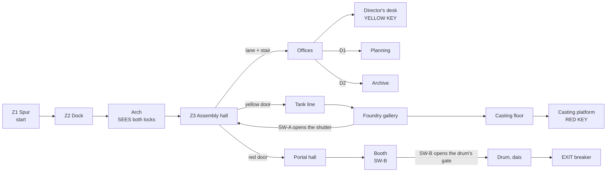

# MAP03 — «Танкоград» (Tankograd), the tractor factory

> **D62 and D63 (2026-10-14): this map is MAP03, named «Танкоград» /
> Tankograd.** It was built and documented as MAP04 while MAP02 was the
> practice range (D41); the slots now follow the campaign (MAP01 → MAP02 the
> metro → MAP03 this factory) and the range is the lump `RANGE`. "MAP02" in
> this document is the metro. Dated evidence keeps its file names (a `map03`
> there is the metro). Wiring: `docs/engine/MOD-SPEC.md` §4.6.

Design document. Owner: `level-designer`. Status: **v1.1 BUILT 2026-10-14
(§16): v1 (§15, textured with the Tankograd set, populated, the General in
the portal hall) plus D68's three points: the Hand Katyusha in secret S1,
the molten channel hurts, the General's death opens his stores; not yet
walked** (v0, §14, was not walked either). A working brief for the PM; the CEO's verdict comes
from walking the map, not from reading this (D28). Built MVP first (D60): a
complete, walkable map from start to exit, gameplay polish later. Source:
`src/maps/MAP03/map.py`; tests: `tests/test_map03_factory.py`. Russian mirror: owed
at the phase close (D34).

> **Walk it** (the PM or the CEO; agents never start GZDoom, D26):
> `python3 tools/build.py && SD_ALLOW_ENGINE=1 MAP=MAP03 SKILL=3 tools/run.sh`.
> MAPINFO wires it since D62 (§11): the metro's exit leads here, and this
> map's exit ends the episode.

Inputs this document obeys and does not restate: `docs/product/LORE.md` (the
factory: "Tractor factory (actually tanks) — episode climax: the portal",
texture set "industry: brick, rust, chains"), `docs/PRD.md` (D28, D35 for
the factions, D58 for MAP02's unfound pass, D60 for MVP first and the
campaign), `docs/engine/BESTIARY.md` (the General and the heavy Panzermensch
are kept for this map), `docs/art/TEXTURE-INDEX.md` (approved lumps only) and
the method of `docs/levels/MAP02-metro.md`.

## 1. Synopsis

Out of the metro's westbound tunnel, Sergeant Vilanova surfaces in the goods
spur of a tractor works whose tractors are tanks: the invaders have taken
the factory for its tank line and its foundry, and behind its closed shop
they have built the portal both factions came through; he takes the two
keys of the works, crosses the factory floor, and cuts the portal's power.

## 2. Its place in the campaign

| | |
|---|---|
| Comes after | MAP02 Metro-Bunker, which ends walking west along a running tunnel past its gate (MAP02 §5). MAP03 starts at the other end of that tunnel: the factory's goods spur, on the same tubbing and the same rails. |
| Its number | **MAP03 since D62**, as LORE's table numbers it. Built as MAP04 while MAP02 was the practice range (D41). |
| What it adds | **two keys** (MAP02 taught one), a hub that shows both locks at once, the first map where the player **sees the enemy's purpose** (the tanks), and the **episode boss**: the General in the portal hall (v3). |
| Climax | the portal (LORE). It sits in a containment drum in the factory's closed shop; the exit is the breaker that feeds it. Cutting it ends the episode. |
| Factions (D35, BESTIARY Q7) | MAP01 Reich first, MAP02 inverted, the factory **mixes**: both flags side by side over the works (LORE). The Legion holds the public face (assembly hall, offices), the Reich the tank line and the foundry, both guard the portal under the General. |
| Campaign wiring | **Done (D62).** The campaign is MAP01 → MAP02 → MAP03; this map holds cluster 1 and the ending (`MOD-SPEC` 4.6), and the metro's exit leads here through cluster 4's text. §11. |

## 3. What the map has to do

| Job | How the layout does it |
|---|---|
| Teach two keys | the hub shows **both locked doors at once** from the dock's arch: red at the far west end, yellow in the south wall, each lit in its colour, each leaf trimmed in its key's colour (v1; the yellow between two star plaques, the red between plain whitewashed brick, §15.2). The yellow key is **seen from the factory floor** up the office stair; the red key is seen **from the foundry's door**. Doom's grammar: lock before key, key before the lock it opens. |
| Answer MAP02's walk (D58) | the CEO never found MAP02's pass. Here no key is in a side room: each lies alone on a lit pedestal on the route, in its lock's colour of light, and is seen from the doorway of its room (tested). A yellow lane on the factory floor joins the yellow door to the stair that leads to the yellow key. Light 192 is spent on five places only: two locks, two keys, the exit. |
| Be a tractor factory that makes tanks | the assembly hall is the works' public face: two assembly lines, red-striped walls, offices above. Behind the yellow door (the "closed shop") the line is a **tank line**, with inspection pits; behind it the foundry casts the hulls. |
| Be the climax | the portal hall is the biggest volume of the episode (1024 × 896, 384 high), the portal in a steel drum at its centre on a stepped dais, the General's arena (v3). |
| End the episode | the exit is the breaker at the top of the dais, inside the drum: the portal's power cut. |

Target length: 10–12 minutes first run on skill 3 (MAP02 is 8–10); about 5
once known.

## 4. Plan

To scale, one character = 64 × 64 units, north up, x east. Generated from
the built map (§14); a 32-unit piece (a door, the lane, a niche) shows in the
cell it touches. Floors: ground **0**, offices **+64**, foundry casting floor
**−64**, tank pits **−48**.

```
     y   x 384 ............................................................ 4160
   2176                         OOOO YYYY OOOO
   2112                         OOOO YYYY OOOO
   2048                         OOOO Y11Y OOOO  1 = the YELLOW KEY on the desk
   1984                         OOOO Y11Y OOOO
   1920                         O##O YYYY O##O
   1856                         OOOOOOOOOOOOOO
   1792                         OOOOOOOOOOOOOO
   1728             BBBB              ss  B = control booth, SW-B
   1664             BBBB              ss
   1600  WWWWWWWWWWWWWWWW   HHHHHHHHHH||HHHHHHHHHHH
   1536  WWWWWWWWWWWWWWWW   HHHHHHHHHH||HHHHHHHHHHH
   1472  WWWWWWWWWWWWWWWW   HHHHHHHHHH||HHHHHHHHHHH
   1408  WWWWWWWWWWWWWWWW   HHH=======||========HHH KKKKKKKK
   1344  WWWW      WWWWWW   rHHHHHHHHH||HHHHHHHHHHH KKKKKKKK
   1280  WWWW sssU WWWWWW   rHHHHHHHHH||HHHHHHHHHHH KKKKKKKK
   1216  WWWWEsssu#uWWWWWnn#rHHHHHHHHH||HHHHHHHHHHHkKKKKKKKKSSSSSSSS  <- start (S), facing west
   1152  WWWWEsssu#uWWWWWnn#rHHHHHHHHH||HHHHHHHHHHHkKKKKKKKKSSSSSSSS  E = exit; # in the ring = the drum's gate
   1088  WWWW sssU WWWWWWnn#rHHHHHHHHH||HHHHHHHHHHHkKKKKKKKKSSSSSSSS
   1024  WWWW      WWWWWW   rHHHHHHHHH||HHHHHHHHHHH KKKKKKKK
    960  WWWWWWWWWWWWWWWW   rHHHHHHHHH||HHHHHHHHHHH KKKKKKKK
    896  WWWWWWWWWWWWWWWW   HHH=======||========HHH KKKKKKKK
    832  WWWWWWWWWWWWWWWW   HHHHHHHHHH||HHHHHHHHHHH
    768  WWWWWWWWWWWWWWWW   HHHHHHHHHH||HHHHHHHHHHH
    704                     HHHHHHHHyyyyyyHHHHHHHHH
    640                     AXX       ##  A = SW-A, X = the shutter; ## = the yellow door
    576  FFFFFFFFFFFFFFFFGGGGGG       vv
    512  FFFFFFFFFFFFFFFFGGGGGG       vv
    448  PPPPFFFFFFFFFFFFGGGGGG       vv
    384  P22PssFFFFFFFFFFGGGGGG TTTTTTTTTTTTTTTTTTTTTTT
    320  P22PssFFFFFFFFssGGGGGG TTTTTTTTTTTTTTTTTTTTTTT  2 = the RED KEY on its pedestal
    256  P22PssFFFFFFFFssGGGGGGaTTTTTTTTTsppppsTsppppsT
    192  PPPPFFFFFFFFFFFFGGGGGGaTTTTTTTTTsppppsTsppppsT
    128  FFFFFF~~~~~~FFFFGGGGGG TTTTTTTTTTTTTTTTTTTTTTT
     64  FFFFFFFFFFFFFFFFGGGGGG TTTTTTTTTTTTTTTTTTTTTTT
```

Legend: `S` goods spur (start) and its rails · `K` loading dock, `k` arch ·
`H` assembly hall, `=` assembly lines (waist-high, cover), `|` the yellow
lane · `r` the red door's portal band, `y` the yellow door's · `#` doors:
the **red door** (west of `r`), the **yellow door** (south of `y`), D1 and
D2 in the offices, the drum's **gate** · `s` stairs, steps and the dais ·
`O` offices, `Y` director's office, `1` the **yellow key** on the desk · `v`
vestibule, `T` tank line, `p` inspection pits · `a` pouring arch · `G`
foundry gallery (0), `F` casting floor (−64), `~` metal channel, `P`
casting platform, `2` the **red key** on its pedestal · `A` SW-A's niche,
`X` the shutter (its passage under it) · `n` antechamber, `W` portal hall,
blank inside `W` the drum's steel ring, `U` inside the drum, `u` porches,
`E` the **exit** at the top of the dais · `B` control booth.

v1 adds, without moving any of the above (§15.3): two monster closets in the
hall's walls (south, east of the shutter; north, at the west end), shallow
recesses for the dock's and the tank line's shut gates and for the two flags
at the drum, clerestory sills in the hall's long walls, the banner over the
hall's axis and a hoist over each pit.

| # | Zone | x | y | floor | ceil | light (v0) |
|---|---|---|---|---|---|---|
| Z1 | Goods spur (start), tubbing, rails | 3648…4160 | 1120…1248 | 0 | 128 | 112 |
| Z2 | Loading dock | 3136…3648 | 896…1472 | 0 | 256 | 144 |
| — | Arch, dock → hall | 3072…3136 | 1120…1248 | 0 | 192 | 160 |
| Z3 | Assembly hall (hub) | 1600…3072 | 704…1664 | 0 | 320 | 160 |
| — | Assembly lines, four runs (props) | 1792…2240, 2368…2880 | 896…960, 1408…1472 | 32 | 320 | 160 |
| — | Yellow lane (SDFLR1) | 2272…2336 | 768…1664 | 0 | 320 | 160 |
| Z3r | Red door's portal band | 1600…1664 | 992…1376 | 0 | 128 | **192**, red |
| Z3y | Yellow door's portal band | 2112…2496 | 704…768 | 0 | 128 | **192**, yellow |
| — | Office stair, 4 steps of 16 | 2240…2368 | 1664…1792 | 16…64 | 192 | 128 |
| O1 | Office corridor | 1856…2752 | 1792…1920 | 64 | 192 | 128 |
| O2 | Director's office (doorway, no door) | 2176…2432 | 1920…2208 | 64 | 192 | 176, yellow |
| — | Director's desk, the yellow key | 2240…2368 | 2016…2080 | 80 | 192 | **192**, yellow |
| O3 | Planning office, D1 | 1856…2112 | 1920…2208 | 64 | 192 | 128 |
| O4 | Archive, D2 | 2496…2752 | 1920…2208 | 64 | 192 | 128 |
| T1 | Vestibule behind the yellow door | 2240…2368 | 448…672 | 0 | 128 | 128 |
| T2 | Tank line | 1856…3328 | 64…448 | 0 | 256 | 144 |
| — | Inspection pits A and B, 2 steps each end | 2432…2816, 2880…3264 | 192…320 | −48 | 256 | 144 |
| — | Pouring arch, tank line → foundry | 1792…1856 | 192…320 | 0 | 128 | 144 |
| F1 | Foundry gallery | 1408…1792 | 64…640 | 0 | 256 | 144 |
| F2 | Casting floor, 3 steps down from the gallery | 384…1408 | 64…640 | −64 | 256 | 128 |
| — | Metal channel | 768…1152 | 128…192 | −80 | 256 | 128 |
| F3 | Casting platform, 3 steps up | 384…640 | 192…512 | 0 | 256 | 128 |
| — | Ingot pedestal, the red key | 448…576 | 288…416 | 16 | 256 | **192**, red |
| F4 | SW-A niche · passage · shutter | 1600…1664 · 1664…1792 | 640…656 · 640…672 · 672…704 | 0 | 128 | 144 |
| P1 | Antechamber behind the red door | 1408…1568 | 1120…1248 | 0 | 128 | 128 |
| P2 | Portal hall | 384…1408 | 768…1664 | 0 | 384 | 128 |
| P3 | Control booth, SW-B | 1088…1344 | 1664…1792 | 0 | 128 | 144 |
| P4 | Containment drum (ring 640…1024 × 1024…1408), gate in its east face | 704…960 | 1088…1344 | 0 | 256 | 144 |
| — | Porches either side of the gate | 1024…1088, 896…960 | 1152…1280 | 0 | 128 | 128 / 144 |
| — | Dais, 3 steps of 16 | 704…896 | 1088…1344 | 16…48 | 256 | 144 |
| E | Exit niche (the breaker) | 688…704 | 1184…1248 | 48 | 176 | **192** |

Extent 3776 × 2144 units (MAP02: 3552 × 1552). Every height is a multiple
of 16; no step up is over 16 (tested).

## 5. Progression, keys, switches and the exit



**The keys.** Doom's yellow and red keycards, drawn by Freedoom until we have
our own: editor numbers **6** and **13**, locks **3** ("Yellow key card")
and **1** ("Red key card"), both read from shipped text (`gzdoom.pk3 →
lockdefs.txt`, g4.14.2). In the fiction: the **yellow pass** to the closed
shop, kept on the works director's desk, and the **red pass** to the portal
shop, dropped on the casting platform where the foundry's foreman fell (v3:
his body, a decoration). `mod-engineer` can give them Soviet names the way
MAP02's blue pass got one (`SD_BluePass`, `Species` trick, MOD-SPEC §6, "The
blue pass"); the map does not change when that lands.

| Id | Where | Type | Special | Can it lock the player out? |
|---|---|---|---|---|
| D1 | Office corridor → planning office | manual door | `Door_Raise` (1), both faces | no |
| D2 | Office corridor → archive | manual door | `Door_Raise` (2), both faces | no |
| **YD** | Hall's south wall → vestibule, 128 wide | **locked, opens for good** | `Door_LockedRaise (4, 16, 0, 3, 0)`, both faces, repeatable | no |
| **RD** | Hall's west end → antechamber, 128 wide | **locked, opens for good** | `Door_LockedRaise (5, 16, 0, 1, 0)`, both faces, repeatable | no |
| SH | Foundry passage → hall, 128 wide | remote, opens for good | tag 10. Steel from the foundry; **the hall's own striped wall from the hall**, so it is wall until it opens | no |
| SW-A | Foundry gallery, a 64-wide niche in its north wall, beside the passage to SH | `SDSW1B` (push button), one-shot | `Door_Open (10, 16, 0)` | no |
| GATE | Drum's east face, 128 wide, a leaf on both faces | remote, opens for good | tag 11 | no |
| SW-B | Control booth, back wall | `SDSW1A` (knife switch), one-shot | `Door_Open (11, 16, 0)` | no |
| EXIT | Back of a 64 × 128 niche at the top of the dais, inside the drum | `SDSW1D`, the hazard panel every map's exit wears | `Exit_Normal (0)` | — |

**The order, as the tests play it** (`test_the_route_is_the_designed_one`),
four rounds:

1. With the manual doors only: spur, dock, hall, offices, **the yellow
   key**; both locked doors seen on the way in (from the arch, tested).
2. The yellow door: the tank line, the foundry, **the red key**, SW-A.
3. The red door (and SW-A's shutter, a shortcut): the portal hall, the booth.
4. SW-B: the drum's gate, the dais, **the exit**.

Each gate is seen before it opens: both locks from the arch (tested); the
drum's gate from the antechamber, as the player enters the portal hall, and
again from SW-B in the booth, so the press shows its effect (both tested);
the exit from the gate (tested). The shutter is the deliberate exception,
as MAP02's SH: a shortcut found from behind, wall from the hall.

**Signposting, MAP02's lesson applied from v0** (D58):

- **Each key lies alone, lit, on the route.** The yellow key is on the
  director's desk, straight up the office stair from the hall's centre aisle:
  from the middle of the factory floor the player sees it, small and lit,
  framed by the stairwell and the office doorway (tested from two points of
  the aisle). The red key is on an ingot pedestal on the casting platform,
  straight across the casting floor from the foundry's door (tested from the
  pouring arch and the gallery).
- **The lock's colour is the key's colour.** `lightcolor` yellow on the
  yellow door's portal and on the director's office and desk; red on the red
  door's portal and on the pedestal. Nothing else in the map wears either
  colour (tested). NOT VERIFIED in our engine runs (K4); without it both
  places are still among the five 192s.
- **A lane joins the yellow lock to its key.** A strip of `SDFLR1` (the
  hangar's yellow line, MAP01's "go here") runs from the yellow door's portal
  up the centre aisle to the office stair (tested adjacency).
- **Real faces.** Every door wears `SDDOOR1`, one whole tile (tested); every
  switch its own `SDSW1x` face, one-shot so it stays ON (tested). Since v1
  the two locked doors wear their key's trim, `SDDOORY` and `SDDOORR`
  (§15.2).

Rules that remove whole classes of softlock, kept from MAP01 §4 and MAP02 §5:

- **No door closes behind the player.** Locks and remote doors open for
  good; the two manual doors reopen from both sides.
- **No lift.** Height changes by stairs only.
- **No drop without a climb back in the same zone.** The gallery and the
  casting platform drop 64 to the casting floor (stairs back up to both);
  the tank line drops 48 into its pits (two steps at each end of each pit).
- **No secret and no shortcut is needed** (tested: with every tag but the
  shutter's, the exit is reached).
- Tested at **every stage**: from every sector the player can reach there is
  a way back to the start, and at the end a way on to the exit.

## 6. Intensity curve

```
  high |                                                            ######
       |                                    ####                    ######  <- the General
 press |              ####        ####      ####     ####   ##      ######     in the portal
  ure  |              ####  ##    ####      ####     ####   ##      ######     hall
       |   ##   ##    ####  ##    ####  ##  ####  ## ####   ##  ##  ######  ##
   low |   ##   ##    ####  ##    ####  ##  ####  ## ####   ##  ##  ######  ##
       +--------------------------------------------------------------------------->
         spur dock   hall offices tank  pits foundry SW-A  return red booth  portal  exit
                                  line                closets door           hall
         0:00                                                                   ~11:00
```

| Beat | Space | Feeling | Mechanic introduced |
|---|---|---|---|
| 1 | Spur, dock | out of the dark of the metro into a works yard; a picket | continuity: same tubbing, same rails |
| 2 | The arch | **the view**: the whole factory floor, two lit locks, the yellow key up the stair | two goals at once, and the first answer |
| 3 | Assembly hall | the big fight on the factory floor, Legion first | the assembly lines as cover |
| 4 | Offices | close quarters upstairs; the key on the desk | a key taken where it was seen |
| 5 | Tank line | **the reveal**: the tractors are tanks; the Reich at work | the pits, the heavies |
| 6 | Foundry | heat, height, a pit to cross; Doughboys in the tall room | the drop and the climb back; the red key |
| 7 | SW-A | the shutter opens onto the hall beside the red door | a shortcut from behind |
| 8 | Hall, again | **spike**: SW-A's closets on ground already cleared | MAP02's pattern |
| 9 | Portal hall | **climax**: the General and his escort round the drum | the boss |
| 10 | Booth, drum | the gate opens; the portal at the top of the dais | — |
| 11 | Exit | the breaker thrown; the episode ends | — |

## 7. Textures

### 7.1 By zone (v0, all approved and packed, tested)

Superseded by v1 for most zones: the set as built is §15.1.

No industrial set exists yet. v0 dresses the factory in the Soviet base set
and two metro pieces where they fit; v1 swaps in the industrial pieces of
§7.2 as they are approved.

| Zone | Walls | Floor | Ceiling | v1 intention |
|---|---|---|---|---|
| Goods spur | `SDTUBB1`, one tile floor to ceiling (MAP02's tunnels) | `SDFLR2` + `SDRAIL1` strip | `SDCEIL2` | the tunnel mouth in brick |
| Loading dock | `SDCONC1` | `SDFLR2` + `SDRAIL1` strip | `SDCEIL2` | brick, a buffer stop, crates (`SDCRAT1/2`) |
| Assembly hall | `SDCONC2` in three bands (MAP01's hangar, D30) | `SDFLR2`, the lane `SDFLR1` | `SDCEIL1` | brick, clerestory windows, the slogan banner, the two flags (LORE) |
| Assembly lines | `SDSTEL1` | `SDFLR2` | | the tractors on them (props) |
| Lock portals | `SDSTAR1` plaques either side of each leaf, each one whole 128 × 128 tile (tested) | `SDFLR2` | `SDCEIL1` | key-trimmed door leaves (§7.2) |
| Offices | `SDTILE2` (green dado, one tile, 128 high) | `SDFLR3` | `SDCEIL1` / `SDCEIL2` | the Lenin poster `SDPOSTR1` behind the director's desk (a 256-high niche), lockers `SDLOCK1` in the archive. **Superseded by §17**: the offices are 128 high, so the mural `SDPOSTR2` hangs there and the portraits went to the dock and the hall |
| Director's desk | `SDCRAT1` front | `SDCRTOP1` | | |
| Tank line | `SDSTEL1` | `SDFLR2` | `SDCEIL1` | rust, chains and hooks over the pits; `SDMEDG1` (the metro's chevron edge) on the pit edges |
| Pits | `SDCONC1` | `SDFLR2` | | |
| Foundry | `SDCONC1` | `SDFLR2` | `SDCEIL2` | brick, molten channel, cast-iron floor |
| Portal hall, booth | `SDCONC1`, booth `SDSTEL1` | `SDFLR3` | `SDCEIL2`, booth `SDCEIL1` | the portal (§7.2); the two flags over the drum |
| Drum | `SDSTEL1` | `SDFLR2` | `SDCEIL2` | |
| Doors, switches | `SDDOOR1`; `SDSW1B` (SW-A), `SDSW1A` (SW-B), `SDSW1D` (exit) | | | |

### 7.2 Industrial pieces to commission from `art-director`

LORE's set is "industry: brick, rust, chains". Proposed lump names (≤ 8
characters, the `SD` prefix), in priority order; none blocks v0.

| # | Lump | Kind, size | What | Where |
|---|---|---|---|---|
| 1 | `SDBRCK1` | wall 64×128 | soot-stained red factory brick, Stalin-era works | hall, dock, foundry, the spur's mouth |
| 2 | `SDBRCK2` | wall 64×128 | the same brick, whitewashed to 64 with a dark rule (the works' dado) | hall's lower walls, offices' stair |
| 3 | `SDRUST1` | wall 64×128 | rusted corrugated sheet | tank line partitions, the closed shop |
| 4 | `SDCHAN1` | wall 64×128, **masked** (transparent ground) | hanging chain with a hook, as a mid-texture on two-sided lines | over the pits, the foundry's crane |
| 5 | `SDFLR4` | flat 64×64 | cast-iron chequer plate | foundry gallery, tank line |
| 6 | `SDGRAT1` | flat 64×64 | steel grating | v1 catwalks over the casting floor |
| 7 | `SDMOLT1`…`4` | flat 64×64, **animated** (ANIMDEFS, `mod-engineer`) | molten metal | the channel, ladles (v2) |
| 8 | `SDDOORY`, `SDDOORR` | wall 128×128 | `SDDOOR1` with a yellow / red trim (already a candidate in the index) | the two locked doors |
| 9 | `SDPORT1`… | wall 128×128, animated | the portal's surface | the drum, behind the dais |
| 10 | `SDGATE1` | wall 128×128 | sliding factory gate, corrugated | the dock's road gate, the tank line's export gate (both shut, set dressing) |
| 11 | `SDWIND1` | wall 64×128 | industrial glazing, night outside | the hall's clerestory |
| 12 | `SDSLOG1` | wall 256×64, text-bearing (D27: render on one machine) | a works banner, e.g. «ТРАКТОРЫ — КОЛХОЗАМ!» ("Tractors for the collective farms") | over the assembly lines; the irony is the map's |
| 13 | `SDFLAG1`, `SDFLAG2` | wall 64×128 | the Reich's and the Legion's banners (D12), to hang **side by side** (LORE) | over the hall and the drum |

Sprites (art-director's, the classes `mod-engineer`'s): a tractor and a tank
hull as decorations (or v1 builds the tanks from sectors), the foreman's
body, the yellow and red pass pickups.

## 8. Secrets (v3; none in v0, D60)

MAP01's rule: a clue is a comparison or a question, never a sign; each
secret has a way back.

| # | Where | Clue | Reward (proposed) |
|---|---|---|---|
| S1 | Behind the archive's lockers | one locker of the row is a different colour | the **Hand Katyusha** (slot 7, D13) and its plans: Doom's tradition, the BFG in the episode's last map |
| S2 | A drain under pit B, into the foundry's floor | one pit has a grate the other lacks | armour, a backpack |
| S3 | The foundry's flue, above the casting platform | a draught of light in a dark corner (v2) | health, rockets |

**S1 is built in v1.1 (D68, §16.1)**, with its clue made of light rather
than colour (there is one approved locker lump): the locker that is the
panel stands 16 back from the row, in shadow. S2 and S3 stay v3's.

## 9. Enemies and resources by skill (placed in v1, §15.4)

The plan as written for v3; the PM's v1 brief brought it forward, as D58 did
for MAP02. v1 places it with the bestiary's own numbers (21100-21107, not
the stand-ins below) and changes the cells marked in §15.4.

Doom stand-ins, so nothing renumbers when sprites change (MAP01, MAP02).
The General and the heavy Panzermensch make their first appearance here
(BESTIARY §8, §9).

| Stand-in | DoomEdNum | Faction | Class | Role here |
|---|---|---|---|---|
| Zombieman | 3004 | Reich | `SD_ReichRifleman` | dock, tank line |
| Shotgun guy | 9 | Legion | `SD_LegionTrooper` | hall, offices, SW-A's closets |
| Imp | 3001 | both | `SD_Stormtrooper` | everywhere |
| Demon | 3002 | Reich | `SD_ReichHound` | tank line, portal hall |
| Cacodemon | 3005 | Legion | `SD_Doughboy` | the foundry (320 high), the drum on 4 |
| Hell Knight | 69 | Reich | `SD_Panzermensch`, 500 HP | the tank line on every skill |
| Baron | 3003 | Reich | `SD_PanzermenschSchwer`, 1000 HP | tank line and portal hall on 4 |
| Cyberdemon | 16 | Legion | `SD_General`, 3000 HP, boss | the portal hall on **every** skill |

| Beat / zone | Skill 2 | Skill 3 | Skill 4 |
|---|---|---|---|
| Spur, dock | 2 riflemen | 3 riflemen | 3 riflemen + 1 trooper |
| Assembly hall | 4 troopers + 2 riflemen + 1 stormtrooper | 5 troopers + 3 riflemen + 2 stormtroopers | 6 troopers + 4 riflemen + 3 stormtroopers |
| Offices | 2 troopers + 1 rifleman | 3 troopers + 1 rifleman | 3 troopers + 1 rifleman + 1 stormtrooper |
| Tank line | 1 hound + 2 riflemen + 1 Panzermensch | 2 hounds + 4 riflemen + 1 Panzermensch | 2 hounds + 5 riflemen + 1 Panzermensch + 1 heavy |
| Foundry | 2 stormtroopers + 1 Doughboy | 3 stormtroopers + 1 Doughboy | 3 stormtroopers + 2 Doughboys + 1 hound |
| SW-A's closets in the hall | 2 troopers | 2 troopers + 1 stormtrooper | 3 troopers + 2 stormtroopers |
| Portal hall | the General + 2 hounds | the General + 2 hounds + 2 stormtroopers | the General + 2 hounds + 2 stormtroopers + 1 Panzermensch + 1 heavy |
| Drum (behind the gate) | 1 stormtrooper | 2 stormtroopers | 2 stormtroopers + 1 Doughboy |
| **Total** | **25** | **38** | **52** |

Against MAP02's 23 / 36 / 51: a little more in numbers, much more in
weight (the boss on every skill). Nested by skill pairs (`skill_tier`), as
MAP01 and MAP02. The General is 40 × 100 (BESTIARY §9): the portal hall is
384 high and he never has to pass a door.

**The General's death and the exit** (v3, open point 4): BESTIARY gives him
`+BOSSDEATH` "so the exit can be tied to his death". Proposed, not built:
the drum's gate opens on SW-B **or** on his death (MAPINFO `SpecialAction`,
NOT VERIFIED), never only on his death, so a player who runs past him is not
locked out. **Superseded by D68 (§16.3):** his death opens a reward, his
stores, by his own thing special; the gate stays SW-B's alone.

**Resources (v3).** Pistol-start finishable (`+map MAP03` gives the TT-33
only): the IZh in the dock, the PPSh-41 in the offices, the RPG-7 on the
tank line (before the heavies), the **ROKS-3 flamethrower in the foundry**
(MAP02 §9 kept it for the factory), all on the route on every skill; the
Hand Katyusha in S1. Ammunition by G3-8's ruler (skill-4 ammo ≥ 1.35 × what
the skill-4 monsters need), the General included; health scaled 2 > 3 > 4.

## 10. Engine elements used

| Need | Emitted | Status |
|---|---|---|
| Manual door | `Door_Raise` 12 (tag, 16, 150, 0), `playeruse` + `repeatspecial` | VERIFIED on MAP01 |
| Remote door, one-shot switch | `Door_Open` 11 (tag, 16, 0) | VERIFIED on MAP01 |
| Locked door that stays open | `Door_LockedRaise` 13 (tag, 16, 0, lock, 0), both faces | VERIFIED on MAP02 (the blue door, `docs/qa/evidence/2026-10-14_1902_F3_map03-v0-walk.md`); locks 1 and 3 read from `lockdefs.txt`, not yet seen in engine: K5, K9 |
| Exit | `Exit_Normal` 243 | VERIFIED on MAP01 |
| Keys | things 6 (`YellowCard`), 13 (`RedCard`) | Doom actors, drawn by Freedoom |
| Coloured light | sector `lightcolor` (0xRRGGBB, UDMF zdoom), yellow `0xFFD860`, red `0xFF6048` | field name from the UDMF zdoom spec, as MAP02 v1 uses it; **NOT VERIFIED** in our engine runs: K4 |
| Turned flats | `rotationfloor` 90 on the rail strips | as MAP02 (its K8) |
| Secret (v1.1) | sector `special` 1024 (`SECRET_MASK`, `xlat/defines.i`) on S1's store; panel line flag `secret` | as MAP01 and MAP02 |
| Damaging floor (v1.1) | sector `damageamount` 10, `damageinterval` 32 (UDMF zdoom) | field names **VERIFIED** in the spec; damage in play NOT VERIFIED: §16.5 V2 |
| Thing special on death (v1.1) | thing `special` 11, `arg0` 12, `arg1` 16 (UDMF base) on the General | **VERIFIED** in the spec and GZDoom's source; in play NOT VERIFIED: §16.5 V4 |

Tag plan: **1** D1 · **2** D2 · **4** yellow door · **5** red door · **6**
S1's locker panel (v1.1) · **10** shutter and, since v1, the hall's two
closets (SW-A) · **11** the drum's gate (SW-B; the drum needs no closet, its
guard is behind the gate) · **12** the General's stores, opened by his death
only (v1.1). Free: 3, 7–9, 13 and up.

## 11. MAPINFO and LANGUAGE (for `mod-engineer`)

**Done (D62, 2026-10-14), both steps at once.** `map MAP03 lookup "SD_MAP03_NAME"`, `cluster = 1`, `next = endtitle`,
`music = ""`, `par = 360`: this map ends the episode. The metro (MAP02) is in cluster 4 with
`next = "MAP03"` and the transition text `SD_MAP02_EXIT_TEXT`, from the draft below with the
map's name added; `SD_END01_TEXT` is rewritten for the portal's fall; the title is
`SD_MAP03_NAME` = "Tankograd" / «Танкоград» (D63). Contract: `docs/engine/MOD-SPEC.md` §4.6.

The proposal as written, with the numbers of its day (this map was MAP04, the
metro MAP03, the range MAP02):

> This role does not touch MAPINFO or LANGUAGE.
>
> **Step 1, now (v0–v3):** MAP04 loads with a title and its exit leaves
> cleanly; the campaign is untouched.
>
> ```
> // MAP04, the tractor factory (docs/levels/MAP04-factory.md). LORE's third
> // campaign map and the episode's climax, numbered 04 because MAP02 is the
> // practice range (D41). Not wired into the campaign yet: reached with
> // `map MAP04` / MAP=MAP04 tools/run.sh. No cluster on purpose, so leaving it
> // prints neither the campaign's ending (cluster 1) nor the range's (2).
> map MAP04 lookup "SD_MAP04_NAME"
> {
> 	next = endtitle
> 	music = ""
> 	sky1 = "SKY1"
> 	par = 360
> }
> ```
>
> `LANGUAGE` (D21, both languages in the same task): `SD_MAP04_NAME` =
> "Tractor Factory" / «Тракторный завод», LORE's words, as the working title
> (a proper name is open point 2). `par = 360` is this role's estimate for a
> player who knows the route (§3). `music = ""` until `sound-designer` picks a
> public-domain piece for it (D59). Without step 1, K12 cannot pass: GZDoom's
> default `next` for MAP04 is MAP05, which does not exist.
>
> **Step 2, when the CEO wires the factory in (D60 says it is next), by
> MOD-SPEC 4.6's rule** (cluster 1 holds the campaign's last map; one chapter
> cluster per earlier map):
>
> - MAP03: `cluster = 4`, `next = "MAP04"` (it gives cluster 1 to MAP04).
> - a new `cluster 4 { exittext = lookup, "SD_MAP03_EXIT_TEXT" flat = "SDFLR1" music = "" }`:
>   the transition from the metro to the factory.
> - MAP04: `cluster = 1`, `next = endtitle`: its exit prints the campaign's
>   ending.
> - `LANGUAGE`: `SD_MAP03_EXIT_TEXT` (new), and `SD_END01_TEXT` **rewritten**:
>   it speaks of Zarya-7 retaken and would then follow the portal's fall. That
>   is writing for the CEO; a draft of the transition, for him to change:
>   - en: "The westbound tunnel climbs into daylight at a goods spur. Beyond
>     the buffers stand the sheds of a tractor works, and the tracks in the
>     yard are too wide for tractors."
>   - ru: «Западный тоннель выходит на свет у подъездного пути. За тупиком —
>     цеха тракторного завода, и колея во дворе слишком широка для тракторов.»

## 12. Version plan

Each version loads in GZDoom and is walkable from start to exit.

| Version | Content | Done when |
|---|---|---|
| **v0 — grey box** ✅ **BUILT 2026-10-14** (§14) | the whole plan of §4, every door, both keys, both locks, both switches, the gate, the exit, stairs and drops; the approved sets where they fit (§7.1); the signposting of §5 (lit keys, coloured light, the lane, the plaques); light by zone; **no monsters, no items, no secrets** but the start and the two keys | the CEO walks it, finds both keys unaided and judges the shape (§14.4); `tests/test_map03_factory.py` (`test_map04.py` then) green |
| **v1 — textured and populated** ✅ **BUILT 2026-10-14** (§15) | the Tankograd set of §7.2 as approved (D66), the red lock's plaques removed, the clerestory, the flags, the banner, the chains; **§9 placed** (brought forward from v3 like MAP02's, the PM's brief), SW-A's closets, the General, the weapons and G3-8's budget | the CEO walks it on skill 3 and finishes the episode (§15.9) |
| **v1.1 — D68** ✅ **BUILT 2026-10-14** (§16) | S1 with the Hand Katyusha (brought forward from v3), the molten channel's damage, the General's death opening his stores | the CEO walks it (§16.6) |
| v2 — light and detail | the foundry's glow and molten channel (animated once `ANIMDEFS` lands), the portal's light, flicker in the tank line; the tanks and tractors, the Lenin poster in the director's office, lockers, the buffer stop | a first-time player finds both keys and the exit without being told |
| v3 — secrets and balance | the secrets of §8 (the Hand Katyusha in S1), the General's death and the gate (open point 4), balance after the playtests (D60) | the episode is played through on skill 3 |

## 13. Open points for the CEO

1. ~~**Walk v0** (D28).~~ v1 was built without the walk, under D60 and the
   PM's brief; walk **v1** instead (§15.9), which asks §14.4's questions too.
2. ~~**The factory's name.** Working title "Tractor Factory" / «Тракторный
   завод».~~ **Decided (D63): «Танкоград» / Tankograd.** A proposal with the history in it: the works that made tanks in
   the war were nicknamed **«Танкоград»** ("Tankograd"); a fictional works in
   the Urals, named in the period's way, e.g. «Уральский тракторный завод
   имени 60-летия Октября».
3. **The two keys as passes**, yellow to the closed shop and red to the
   portal shop (§5), and their look (art-director, as for the blue pass).
4. ~~**The General's death and the gate** (§9): SW-B only, or SW-B or his
   death.~~ **Decided (D68): "que abra algo"**: his death opens his stores
   (§16.3); the gate stays SW-B's alone.
5. **The ending.** The exit is the portal's breaker; the episode's ending
   text has to be rewritten for it (§11, step 2).
6. ~~**The portal's look** (§7.2, item 9).~~ Decided (D66): cobalt with
   white filaments, `SDPORT1`-`4`; v1 places frame 1 on the drum's back wall.
7. ~~**The Hand Katyusha** (new, v1). §8 puts it in S1, a v3 secret; until v3
   the episode never hands the player slot 7. Keep it for the secret (Doom's
   way, the BFG hidden in the last map) or put it on the route now?~~
   **Decided (D68): "ok secreto"**; S1 is built in v1.1 (§16.1).
8. ~~**The molten channel** (new, v1). It wears molten metal but does not
   hurt. A damaging floor (sector special) is a one-line change and a
   trap-free one (the channel is 16 deep, a step): wanted, and how much?~~
   **Decided (D68): "que haga daño"**; 10 every 32 tics (§16.2).

## 14. v0 build record (2026-10-14)

Source: `src/maps/MAP03/map.py`, painted with `GridMap` like MAP01 and
MAP02. **65 sectors, 273 linedefs, 214 vertices, 3 things** (the start and
the two keys). MAP02's v0 was 73 sectors and 418 lines; this v0 is leaner on
purpose (D60), with the larger volumes of a climax.

### 14.1 What is in it

Everything of §4 and §5: the goods spur and its rails, the dock, the arch,
the assembly hall with its four assembly-line runs, the yellow lane and the
two lock portals with their star plaques; the office stair, corridor,
director's office and desk (the yellow key), the planning office and the
archive behind D1 and D2; the yellow door, vestibule, tank line and its two
pits; the pouring arch, the foundry gallery, its stair, the casting floor and
the metal channel, the casting platform and its stair, the pedestal (the red
key); SW-A, its passage and the shutter; the red door, the antechamber, the
portal hall, the booth and SW-B, the containment drum, its gate and porches,
the dais and the exit niche.

### 14.2 What is deliberately not in it

Monsters, weapons, ammo, health, closets, secrets (v3); the industrial
textures (v1, §7.2); lamps, glow, molten metal and flicker (v2); the tanks,
the tractors and the posters (v1).

### 14.3 Verification actually run

| Check | Result |
|---|---|
| `tests/test_map03_factory.py` (`test_map04.py` then) | **33 tests, all green**: closed clockwise sectors, no duplicate vertex, no sector painted away; no step up over 16; every texture approved and packed; every door leaf one tile (ten faces); the star plaques, two at each lock, each one tile; light range; **light 192 only at the two locks, the two keys and the exit**; **each key in its lock's colour, and nothing else in it**; v0 scope (start and two keys, every skill; no secret); **everything reachable** at the end but the assembly lines; **the exit reached, and only in the last round**; **no trap at any stage**; from everywhere the exit at the end; the drops left by stairs; **the route in four rounds**; the shortcut not needed; one yellow and one red key in their zones; both locked doors' specials, locks and stay-open delay on both faces; **sight lines**: both locks from the arch, the yellow key from two points of the factory floor, the red key from the pouring arch and the gallery, the drum's gate from the antechamber and from SW-B, the exit from the gate; the lane joins the yellow portal to the stair; real, distinct, one-shot switch faces and the exit's hazard panel; each switch opens what §5 says; SW-A beside the shutter's passage; the shutter wall-faced from the hall; every door tall enough; no press consumes a gate |
| Mutation check (scratch script, not committed) | each of five planted faults turns the suite red: the red door asking for the yellow key (2 tests), the foundry stair removed (3), the platform's last step too high (6), the red key behind the red door (10), the yellow key off the desk (4) |
| `tools/check_pk3.py` | `maps/MAP03.wad: MAP03/TEXTMAP/ENDMAP, 214 vertices, 273 linedefs, 65 sectors, 3 things`; 0 errors, 0 warnings |
| `tools/verify.py fast` (Windows PC, `.venv/Scripts/python.exe`, 2026-10-14) | **VERDICT: PASS** in 174 s: docs PASS (the only MAP03 warning is its Russian mirror, D34), build PASS, `check_pk3` 0 errors 0 warnings, **1734 tests**, 112 skipped (slow art). A run minutes earlier failed in `test_route` and `test_hand_study`, files other agents had open in the working tree; the rerun was clean |
| GZDoom | **not run** (D26). Owed: §14.5 |

The first run of the suite found two things, both fixed before delivery:
from the arch the near assembly line hides the bottom 32 units of the yellow
door's leaf (the test now asks for the leaf above waist height, which is what
cover should do), and the colour test had to follow the yellow light through
the office doorway, not stop at the desk.

### 14.4 What I want the CEO to judge while walking it

The route is **not told** this time, on purpose: MAP02's walk showed that
the map has to tell it (D58). The judgement that blocks v1 is the first one.

1. **Did you find both keys without help?** If not, where did you look?
2. **The arch.** Do the two lit doors read as the two goals, and the yellow
   light up the stair as the answer to the first?
3. **Scale.** The hall is 1472 × 960 and 320 high; the portal hall 1024 ×
   896 and 384 high. A factory, or a car park?
4. **The tank line and the foundry.** Do the pits and the drop to the
   casting floor feel allowed, and the stairs back up found?
5. **SW-A.** Does the shutter opening onto the hall read as a shortcut home?
6. **The drum and the breaker.** Does pressing SW-B, then climbing to the
   exit, feel like the end of an episode? (In v0 it is grey; the portal is v1.)

### 14.5 Engine checklist for the PM (D26: this role does not start GZDoom)

Method as MAP02 §14.5: `warp x y`, turn to the facing (Doom angles: 0 east,
90 north, 180 west, 270 south), `+use`, `wait`, `screenshot`. Skill 3. Every
use warp is within 64 of the line it presses. Log and screenshots to
`docs/qa/evidence/`. K12 needs §11 step 1.

| # | Warp to (x y) | Facing | Do | What must show |
|---|---|---|---|---|
| K1 | 4096 1184 | 180 | — | the start: the tubbing spur, rails, the dock beyond |
| K2 | 3104 1184 | 180, then 211 | — | from the arch: the red door at the hall's far end between two star plaques; turned, the yellow door in the south wall the same way |
| K3 | 2304 1024 | 90 | — | up the lane and the stair: the director's office lit, the yellow key on the desk |
| K4 | 2304 1184 | 90 | — | the yellow tint on the office and desk, the red tint at the red portal (turn to 180) and the yellow at the yellow portal (turn to 270). If there is no tint, `lightcolor` is not read: tell this role |
| K5 | 2304 740 | 270 | `+use`; then `give YellowCard`, `+use`; screenshots at `wait 35` and `wait 350` | without the key: shut, and the yellow-key line printed (proves lock 3); with it: open, and still open 10 s later |
| K6 | 1760 256 | 180 | — | from the foundry gallery: the red key on its lit pedestal across the casting floor, the stair down on the left |
| K7 | 1632 610 | 90 | `+use`, `wait 10`, then turn to 0 | `SDSW1B` → `SDSW2B` and stays; the shutter risen beyond the passage |
| K8 | 1728 768 | 270 | screenshot before K7 and after | from the hall: before, striped wall; after, the opening into the foundry |
| K9 | 1632 1184 | 180 | `+use`; then `give RedCard`, `+use` | as K5, the red-key line (proves lock 1); open and staying open |
| K10 | 1440 1184 | 180 | — | the portal hall, the drum ahead, its gate's leaf in the porch |
| K11 | 1216 1760 | 90 | `+use`, screenshot; turn to 250 | `SDSW1A` → `SDSW2A`; the drum's gate open |
| K12 | 736 1216 | 180 | screenshot, then `+use` | the exit niche lit, `SDSW1D`; on use, the intermission, then `SD_END01_TEXT` (the ending, since D62), then the title |
| K13 | the log | — | — | zero lines matching the G3-2 failure patterns of MAP01 §11; nothing about `lightcolor`, `rotationfloor`, special 13 or any `SD` texture |

### 14.6 What I need from other roles

- **`mod-engineer`:** ~~the MAPINFO entry and `SD_MAP03_NAME` of §11, step 1
  (blocking K12 only); step 2 when the PM wires the campaign.~~ Done (D62). Optionally,
  `SD_` classes for the two passes, as for MAP02's blue pass, with their
  pickup and locked-door lines in both languages (`PD_YELLOWCO`,
  `PD_REDCO`, and Freedoom's DEHACKED caveat of MOD-SPEC §6). Later: the
  ANIMDEFS for the molten metal and the portal (§7.2).
- **`art-director`:** the industrial pieces of §7.2, items 1–5 first (they
  are what v1 needs); the pass sprites; the portal (open point 6).
- **`sound-designer`:** a public-domain piece for the factory (D59).
- ~~**PM:** renumber LORE's episode table and BESTIARY's references.~~ Not
  needed: D62 gave the maps LORE's numbers, so BESTIARY's "MAP03" (the
  General, the heavy Panzermensch) is this map again.

## 15. v1 build record (2026-10-14)

Source: `src/maps/MAP03/map.py`; tests: `tests/test_map03_factory.py`.
Builder unchanged (`GridMap`), plus one helper, `hang`, that puts a middle
texture on a built two-sided line (the banner, the chains). **85 sectors, 366
linedefs, 289 vertices, 130 things** (v0: 65 / 273 / 214 / 3). Not walked in
GZDoom by this role (D26): the engine pass is the PM's, §15.8.

```sh
python3 tools/verify.py fast                                                   # build + check_pk3 + suite, no window
python3 tools/build.py && SD_ALLOW_ENGINE=1 MAP=MAP03 SKILL=3 tools/run.sh      # walk it (PM or CEO only)
```

The brief (N7, the factory's half; D60: complete and playable, balance
later): the Tankograd textures where the design asked for them, the red
lock's plaques, §9 placed by skill with MAPINFO's 211xx numbers, the General
as the boss in the portal hall, weapons, ammunition and health on G3-8's
budget, no music (the sound-designer's).

### 15.1 Textures, as built

All 19 lumps of batch 4 installed at the brief (D66) are used, the two
animations by their first frame (`SDMOLT1`, `SDPORT1`, which `ANIMDEFS`
cycles since N6c); the two held lumps, `SDCHAN1` and `SDSLOG1`, were
installed by another agent during this build (N6b) and are placed too.
Each sits behind a constant (`CHAIN`, `SLOGAN`); set either to `None` and
the map builds without it and its test skips.

| Zone | Walls | Floor | Ceiling | What changed from v0 |
|---|---|---|---|---|
| Goods spur | `SDTUBB1` | `SDFLR2` + `SDRAIL1` | `SDCEIL2` | the mouth into the dock is brick (the tunnel ends in the works' wall) |
| Loading dock, arch | `SDBRCK1` | `SDFLR2` + `SDRAIL1` | `SDCEIL2` | brick; **the yard's road gate** `SDGATE1`, shut, one tile in a recess of the north wall |
| Assembly hall | `SDBRCK1` (the hall is 320 high, so the whitewashed `SDBRCK2` would repeat its band; it is kept for walls exactly 128 high) | `SDFLR2`, the lane `SDFLR1` | `SDCEIL1` | brick; **the clerestory**: nine 64-wide windows `SDWIND1` on 16-deep sills at 192, one pane tile under the roof, five in the north wall and four in the south, east of the stair and of the yellow door; **the works banner** `SDSLOG1` «ТРАКТОРЫ — КОЛХОЗАМ!» hung from the roof across the hall's axis, x 2624…2640, y 1056…1312, its bottom edge at 256, read the right way from both ends |
| Assembly lines | `SDSTEL1` | `SDFLR4` | | the tops in chequer plate |
| Yellow lock | `SDBRCK1`; `SDSTAR1` either side of the leaf | `SDFLR2` | `SDCEIL1` | the leaf is **`SDDOORY`** |
| Red lock | `SDBRCK1`; **`SDBRCK2`** either side of the leaf | `SDFLR2` | `SDCEIL1` | the leaf is **`SDDOORR`**; the star plaques are gone (§15.2) |
| Offices | `SDTILE2` | `SDFLR3` | `SDCEIL1` / `SDCEIL2` | unchanged |
| Vestibule, tank line | **`SDRUST1`** | **`SDFLR4`** | `SDCEIL1` | the closed shop in corrugated rust; **the export gate** `SDGATE1`, shut, in a recess of the east wall; **a chain and hook** `SDCHAN1` over the middle of each pit (the four faces of a 64 × 64 hoist, hanging from the roof to 128) |
| Pits | `SDCONC1` | `SDFLR2` | | unchanged |
| Foundry | `SDBRCK1` | casting floor and platform **`SDFLR4`**, the gallery **`SDGRAT1`**, the channel **`SDMOLT1`** | `SDCEIL2` | brick, grating, molten metal (animated by `ANIMDEFS`; it does not hurt, open point 8) |
| SW-A's passage | `SDBRCK2` (128 high) | `SDFLR2` | | |
| Antechamber | `SDBRCK2` (128 high) | `SDFLR2` | `SDCEIL2` | |
| Portal hall | `SDBRCK1` | **`SDFLR4`** | `SDCEIL2` | brick; the drum's ring is **steel** outside now, as it is inside; **the two flags** `SDFLAG1` (Reich) and `SDFLAG2` (Legion), each one tile in a recess of the ring's east face, either side of the gate |
| Drum | `SDSTEL1`; **`SDPORT1`** on the wall behind the dais, either side of the exit niche | `SDFLR2` | `SDCEIL2` | the portal's cobalt field (animated by `ANIMDEFS`) |
| Doors, switches | `SDDOOR1` (D1, D2, the gate), `SDDOORY`, `SDDOORR`; `SDSW1B`, `SDSW1A`, `SDSW1D` | | | |

`SDCONC2`, the hall's red stripe in v0, is no longer used: the stripe was
MAP01's hangar, and red bands round the factory floor would compete with the
red lock. `SDCONC1` stays in the pits only.

**Not in v1** (v2, §12): the tanks and tractors as props, the Lenin poster in
the director's office (it needs a 256-high niche; the offices are 128; §17
hangs the posters elsewhere and the mural there), lockers
in the archive, the metro's chevron edge on the pits, the buffer stop.

### 15.2 The red lock, signposted again

The art-director's note on v0: the red star plaques either side of the red
door camouflaged it, and with `SDDOORR` (a red-trimmed leaf) it would be
worse. The plaques are taken off **that lock only**: the red leaf now stands
between two panels of whitewashed brick (`SDBRCK2`, light, one tile each),
so the only red on that wall is the leaf and the red light. The yellow lock
keeps its pair (red plaques beside a yellow leaf contrast; nothing there to
hide). Tested: two `SDSTAR1` faces in the map, both at the yellow lock; the
red lock's wall is `SDBRCK2` either side of `SDDOORR` and nothing else; each
lock wears its own key's trim on both faces.

### 15.3 Changes to v0's geometry

None to the route or the floor plan of §4; every v0 test of reachability,
softlock, the four rounds and the sight lines passes unchanged. Added:

| # | What | Where | Why |
|---|---|---|---|
| 1 | `closet_hs`, `closet_hn` and their panels (tag 10) | the hall's south wall east of the shutter (x 1856…2048), its north wall at the west end (x 1664…1856) | §9's SW-A closets, MAP02's method: the panel wears the hall's brick, so it is wall until it moves; each a dead end the player walks out of |
| 2 | `z2_road_gate`, `t_export_gate` | the dock's north wall, the tank line's east wall | the shut gates, one tile each |
| 3 | `p_flag_reich`, `p_flag_legion` | the drum's east face, either side of the gate | the flags side by side (LORE) |
| 4 | `prop_clerestory_n1`…`n5`, `_s1`…`_s4` | the hall's long walls | the clerestory; sills at 192, never walked (props) |
| 5 | `z3_banner` | across the hall's axis | carries the banner on its two long faces |
| 6 | `t_pit_a_hoist`, `t_pit_b_hoist` | the middle of each pit | carry the chains |

### 15.4 Enemies, as placed

The bestiary's own editor numbers from MAPINFO's `DoomEdNums`: 21100
rifleman, 21101 trooper, 21102 stormtrooper, 21103 hound, 21104 Doughboy,
21105 Panzermensch, **21106 the General**, **21107 the heavy Panzermensch**
(tested against MAPINFO; every class of the bestiary fights here). The plan
of §9 with the cells marked † changed:

| Beat / zone | Skill 2 | Skill 3 | Skill 4 |
|---|---|---|---|
| Dock | 2 riflemen | 3 riflemen | 4 riflemen † |
| Assembly hall | 6 troopers † + 1 stormtrooper | 8 troopers † + 2 stormtroopers | 10 troopers † + 3 stormtroopers |
| Offices | 3 troopers † | 4 troopers † | 4 troopers † + 1 stormtrooper |
| Tank line | 1 hound + 2 riflemen + 1 Panzermensch | 2 hounds + 4 riflemen + 1 Panzermensch | 2 hounds + 5 riflemen + 1 Panzermensch + 1 heavy |
| Foundry | 2 stormtroopers + 1 Doughboy | 3 stormtroopers + 1 Doughboy | 3 stormtroopers + 2 Doughboys + 1 hound |
| SW-A's closets in the hall | 2 troopers | 2 troopers + 1 stormtrooper | 3 troopers + 2 stormtroopers |
| Portal hall | **the General** + 2 hounds | the General + 2 hounds + 2 stormtroopers | the General + 2 hounds + 2 stormtroopers + 1 Panzermensch + 1 heavy |
| Drum (behind the gate) | 1 stormtrooper | 2 stormtroopers | 2 stormtroopers + 1 Doughboy |
| **Total** | **25** | **38** | **52** |

† §9 put Reich riflemen in the hall (2/3/4) and the offices (1), and a
Legion trooper in the dock on skill 4, against §2's own rule (the Legion the
public face, the Reich the tank line). v1 follows §2, so the factions can be
tested: those riflemen are troopers and the dock's trooper is a rifleman.
Same counts, same ruler cost (one shell each). §2 also gave the foundry to
the Reich, but §9 and §6 put the Doughboys (Legion) in its tall room: v1
makes the foundry, like the portal hall, **ground both factions share**.

**The factions, tested** (D35, the factory mixes): from each class's own
ZScript (`SD_Monster.Faction`), the standing garrison of the hall and the
offices is Legion and hybrids, that of the spur, the dock and the tank line
Reich and hybrids, and both factions stand in the foundry and in the portal
hall, where the Legion's General and the Reich's hounds are together on
every skill. The closets are the counter-attack and are not a garrison.

**The General** (`SD_General`, 3000 HP, 40 × 100, BESTIARY §9): one, on every
skill, at (480, 1216), behind the drum as seen from the antechamber, so the
player meets the escort first and the boss comes round the drum. The portal
hall is 384 high and he never has to pass a door (tested: his box fits).
His `+BOSSDEATH` triggers nothing yet (open point 4): the gate opens on SW-B
only, so a player who runs past him is not locked out.

Every body fits where it stands (corners on walkable floor within a step,
headroom from each class's `RADIUS`/`HEIGHT`; the heavy Panzermensch's from
its parent's file, which it inherits); no two start inside each other; and
no body stands, at spawn, on the lines from which the keys are tested to be
seen (new test).

By class on skill 4: troopers 17, stormtroopers 13, riflemen 9, hounds 5,
Doughboys 3, Panzermenschen 2, heavy Panzermenschen 2, the General 1.

### 15.5 Weapons, ammunition, health

Pistol start (`+map MAP03` gives the TT-33 and 50 rounds; the campaign player
arrives better armed). The weapons are on the route, on every skill, never in
a secret (tested), each before the fight it is for:

| Weapon | Where | Reached in round |
|---|---|---|
| IZh-58 | the dock, beside the first picket | 1 (no key) |
| PPSh-41 | the office corridor's east end | 1 |
| RPG-7 + a rocket box | the tank line, at the yellow door's foot, nearer the door than either heavy (tested) | 2 (yellow door) |
| **ROKS-3** | the foundry gallery (MAP02 §9 kept it for the factory) | 2 |
| Hand Katyusha | not placed: §8's S1, v3 (open point 7) | — |

Counts, as placed (no secret in v1):

| Item | Skill 2 | Skill 3 | Skill 4 | Where |
|---|---|---|---|---|
| Shell box (20) | 7 | 7 | 7 | hall ×2, planning office, gallery, booth, portal hall, antechamber |
| Shells (4) | 11 | 9 | 5 | dock, hall, tank line, casting floor, portal hall; more, and the vestibule, on easier skills |
| Box of rounds (50) | 4 | 4 | 4 | hall, archive, tank line, portal hall |
| Clip (10) | 5 | 4 | 3 | dock, hall, casting floor |
| Rocket box (5) | 3 | 3 | 3 | tank line, antechamber, booth |
| Rocket (1) | 4 | 4 | 4 | round the drum |
| Fuel canister (20) | 2 | 2 | 2 | gallery, antechamber |
| Stimpack | 9 | 8 | 5 | dock, hall, tank line, gallery, portal hall |
| Medikit | 6 | 6 | 5 | hall, archive, tank line, casting platform, booth |
| Health bonus | 10 | 10 | 10 | one in each nook: spur, arch, office stair, vestibule, both pits, pouring arch, SW-A's passage, the porch, the dais |
| Armour bonus | 8 | 8 | 7 | both locks ×2, the director's office ×2, the casting platform |
| Green armour | 1 | 1 | 1 | tank line |
| **Blue armour** | 1 | 1 | 1 | antechamber, before the General (tested: reached with the red door, not before) |

**G3-8, measured** (`test_g3_8_the_ammo_budget`). MAP01's ruler (rifleman and
trooper 1 shell, stormtrooper 2, hound 3, Doughboy 6, Panzermensch 8; about
62.5 HP a shell), extended by hit points to this map's two: **heavy
Panzermensch 16, the General 48**. Placed ammunition in shell-equivalents: 10
rounds = 1 shell, as before; and, new here because this is the map of the
heavy weapons, **a PG-7V = 2 shells** (135 direct, BALANCE §2; the General
takes no blast) and **a unit of fuel = 0.25 shell** (a ROKS-3 jet averages
18). No drop counted.

| | Skill 2 | Skill 3 | Skill 4 |
|---|---|---|---|
| needed | 94 | 115 | 181 |
| × 1.35 (G3-8) | 126.9 | 155.3 | 244.4 |
| placed | 282.5 | 273.5 | **256.5 (1.42×)** |

MAP01's skill 4 is 1.41×, MAP02's 1.43×. Two more checks: **without the
heavy weapons** (shells and rounds only) the placed ammunition still covers
every monster but the General at 1.35×, so the RPG-7 and the ROKS-3 are his;
and **stage by stage** (MAP01's readiness test, ported, with the PG-7V and
the fuel at their average damage): before any lock, after the yellow door,
after the red door and SW-A, after SW-B, the damage placed so far plus the
starting rounds is at least 1.35 × the hit points met so far, on every
skill. Health on skill 4: 10 stimpacks and medikits (MAP02: 7), 7 armour
bonuses, both vests.

**D60, MVP first:** these numbers are a first cut that meets G3-8; the
balance proper (the General's fight, two heavies on skill 4, the foundry's
Doughboys on a pistol start) is for the playtests after the MVP.

### 15.6 Deviations from §3–§12

| # | Said | Built | Why |
|---|---|---|---|
| 1 | §12: v1 = textures; v3 = §9 placed | v1 = textures and §9 placed; v3 = secrets and balance | the PM's brief (N7), as MAP02's v1 |
| 2 | §5, §7.1: each lock between two star plaques | the yellow lock only; the red between whitewashed brick | the art-director's note, §15.2 |
| 3 | §9: riflemen in the hall and offices, a trooper in the dock | troopers in the hall and offices, a rifleman in the dock | §2's factions, §15.4 † |
| 4 | §2: the Reich holds the foundry | the foundry is shared (Doughboys and stormtroopers, a hound on 4) | §9 and §6 already put the Doughboys there |
| 5 | §9: Doom stand-ins (3004, 9, …, 16) | the bestiary's numbers 21100-21107 | the brief; MAP02 does the same |
| 6 | §9: the Hand Katyusha in S1 | not placed | no secrets in v1 (D60); open point 7 |
| 7 | §9: the PPSh "in the offices" | the corridor's east end | on the route, not behind D1 or D2 |
| 8 | MAP02's G3-8: no rocket counted | PG-7V and fuel counted at a stated rate | the General's 3000 HP is the RPG-7's and the ROKS-3's job (§15.5) |
| 9 | §7.1 v1 intentions: tanks, tractors, poster, lockers, buffer stop | not built | v2, §12 |

### 15.7 Verification actually run

| Check | Result |
|---|---|
| `tests/test_map03_factory.py` | **64 tests, all green**: v0's 33, of which two are replaced (the start and the keys on every skill; no secret in v1) and four updated (the leaves in three trims; the plaques at the yellow lock only; SW-A also opens the closets; the shutter and the closets are wall from the hall); **31 new**: the Tankograd set placed, the red lock's wall, every wall picture one whole tile, the flags at the drum, the banner and the chains, the steel drum and the portal wall, each lock in its key's trim, each key alone on its pedestal, the banner under the arch's sight line, no body on a key's sight line; and §15.4–§15.5's population, factions (read from ZScript), the General, the heavies, the closets, the weapons, the RPG before the heavies, consumables scaled down, G3-8, the budget without the heavy weapons, ammunition by stage, health and armour |
| Mutation check (scratch script, not committed) | each of eight planted faults turns the suite red: the red plaques put back (2 tests), the red leaf in yellow trim (3), the General removed (4), a trooper on the yellow key's sight line (1), a Reich rifleman in the hall (1), a shell box on skill 2 only (2), the closets on SW-B's tag (2), the heavy moved into a pit (2) |
| `tools/check_pk3.py` | `maps/MAP03.wad: MAP03/TEXTMAP/ENDMAP, 289 vertices, 366 linedefs, 85 sectors, 130 things`; 0 errors, 0 warnings |
| `tools/verify.py fast` (Windows PC, `.venv/Scripts/python.exe`, 2026-10-14) | **VERDICT: PASS** in 16.8 s: docs PASS (mirror warnings, D34), build PASS, `check_pk3` 0 errors 0 warnings, **1402 tests**, 136 skipped (the slow art tier) |
| GZDoom | **not run** (D26). Owed: §15.8 |

### 15.8 Engine checklist for the PM (D26: this role does not start GZDoom)

Method as §14.5 and MAP02 §16.8: `warp x y`, turn to the facing (0 east, 90
north, 180 west, 270 south), `+use`, `wait`, `screenshot`. **Two sessions**:
geometry and textures with `-nomonsters` on skill 3 (T1–T10), then monsters
with `god` on skill 3 and once on skill 4 (T11–T14). Log and screenshots to
`docs/qa/evidence/`. v0's checklist (§14.5) was never run; T1–T10 cover its
K1–K3, K6–K8 and K10–K12, and **K4, K5 and K9 still stand as written** (the
key tints, and locks 3 and 1 in the engine).

| # | Warp to (x y) | Facing | Do | What must show |
|---|---|---|---|---|
| T1 | 3104 1184 | 180 | — | from the arch: the brick hall, the banner high across it («ТРАКТОРЫ — КОЛХОЗАМ!» readable, not mirrored), under it at the far end the **red door, `SDDOORR`, between two plain whitewashed panels, no star plaques**, in red light; the clerestory high on both walls |
| T2 | 3104 1184 | 211 | — | the yellow door, `SDDOORY`, between its two star plaques |
| T3 | 3400 1300 | 90 | — | the dock: brick, the shut road gate whole in its recess, the IZh on the floor |
| T4 | 2304 1184 | 0 | — | the banner's west face, readable from this side too; the arch beyond it |
| T5 | 2304 400 | 0 | — | the tank line: rust walls, chequer floor, a chain and hook over pit A, the export gate whole at the far end; the RPG-7 at the feet |
| T6 | 1760 256 | 180 | — | the foundry: grating underfoot, brick, the molten channel (`SDMOLT1`, cycling through its four frames), the red key lit on its pedestal (K6) |
| T7 | 1632 610 | 90 | `+use`, `wait 70`; then warp 1728 900 facing 270, then 1952 900 facing 270, then 1760 1500 facing 90 | `SDSW1B` → `SDSW2B`; from the hall: the shutter open, **`closet_hs`'s brick panel open** east of it, **`closet_hn`'s** open in the north wall |
| T8 | 1488 1184 | 180 | — | the antechamber: whitewashed brick, the blue armour; ahead the steel drum, the gate's leaf, **`SDFLAG1` on the left and `SDFLAG2` on the right**, each whole in its recess |
| T9 | 1216 1760 | 90 | `+use`, `wait 70`; then warp 1056 1216 facing 180 | `SDSW1A` → `SDSW2A`; through the gate the dais and, behind it, **the portal wall in cobalt (`SDPORT1`, cycling)** either side of the lit exit niche |
| T10 | 2592 256 | 90 | — | in pit A under the hoist: the chain's gaps are see-through (masked; check_pk3's `MASKED_TEXTURES`). If they show black or a colour, tell `mod-engineer` and this role |
| T11 | 2950 1184 | 180 | skill 3, monsters, `god` | the hall's Legion troopers and stormtroopers between the lines *(engine: 21101 and 21102 spawn our classes)* |
| T12 | 1350 1500 | 225 | skill 3, monsters, `god`; `wait 140` | the portal hall: the hounds, the stormtroopers, **the General** coming round the drum (Freedoom's placeholder sprite, BESTIARY) *(21106)* |
| T13 | 2400 380 | 0 | skill 4, monsters, `god` | the tank line on skill 4: the Panzermensch, riflemen, **the heavy Panzermensch** at the export gate *(21107)* |
| T14 | 736 1216 | 180 | skill 3, played through or after `kill monsters`; `+use` | the intermission: kills of 38 (52 on skill 4) when SW-A was pressed; then `SD_END01_TEXT`, then the title |
| T15 | the log | — | — | zero lines matching the G3-2 failure patterns of MAP01 §11; nothing about `SDCHAN1`, `SDSLOG1`, `SDPORT1`, `SDMOLT1`, `SDDOORY`, `SDDOORR`, things 21100–21107 or 21006, `lightcolor` or `rotationfloor` |

If T1 shows the banner cutting across the red door, the banner's height or
place is wrong in the engine and the test that keeps it out of the sight
line is wrong: tell this role.

### 15.9 For the CEO's walk of v1

`python3 tools/build.py && SD_ALLOW_ENGINE=1 MAP=MAP03 SKILL=3 tools/run.sh`,
or the campaign from MAP01. From the start, **without being told the
route**: that is the test. What to judge:

1. **Both keys.** Did you find them without help? At each locked door, did
   you know where its key was?
2. **The red door.** Does it read as the red lock now, without the star
   plaques?
3. **The factory.** Brick, rust, the banner over the floor, the chains, the
   flags at the drum: a tank works, or a car park?
4. **The fights.** The factory floor, the tank line's heavies, the
   Doughboys over the casting floor, the hall's closets after SW-A, **the
   General**. Fair or not (D60: balance comes after the MVP; this is the
   first cut).
5. **The end.** SW-B, the gate, the portal, the breaker: does it end the
   episode?
6. Open points 7 (the Hand Katyusha) and 8 (the molten channel).

### 15.10 What is left, and what other roles hold

- **PM:** the engine pass (§15.8) and the CEO's walk (§15.9).
- **`mod-engineer`:** nothing blocks v1 (the `ANIMDEFS` this map's two
  animations need landed in N6c). The General's death and the gate (open
  point 4) when the CEO decides. Optionally `SD_` classes for the two
  passes (§14.6).
- **`art-director`:** nothing blocks v1. The General's, the Doughboy's and
  the Panzermensch's own sprites (F5), the pass sprites.
- **`sound-designer`:** the factory's music (D59, N8). This role did not
  touch MAPINFO.
- **For BESTIARY §11** (the PM's to carry): the factory (MAP03) places, on
  skill 4, troopers 17, stormtroopers 13, riflemen 9, hounds 5, Doughboys 3,
  Panzermenschen 2, heavy Panzermenschen 2 and the General.
- v2: the light pass, the tanks and tractors, the poster; v3: the secrets
  of §8 (S1 with the Hand Katyusha) and balance.
- Russian mirror: synced in a batch at the phase close (D34).

## 16. v1.1 build record (2026-10-14): D68

The CEO on open points 7, 8 and 4 (D68): the Hand Katyusha stays in a secret
("ok secreto"); the molten channel hurts ("que haga daño"); the General's
death opens something ("que abra algo"), a reward the player earns by the
kill, while the exit still depends on SW-B so nobody is locked out.

Source `src/maps/MAP03/map.py`; tests `tests/test_map03_factory.py`.
**92 sectors, 395 linedefs, 311 vertices, 137 things** (v1: 85 / 366 / 289 /
130). Nothing of v1 moved: the keys, the locks, the three switches, the
exit and every v1 constant are where they were (QA's `tankograd-critical`
route reads them). Not walked in GZDoom by this role (D26): §16.5 is the PM's.

### 16.1 S1, the Hand Katyusha (open point 7)

§8's S1, where §8 put it: **behind the archive's lockers.** The archive's
east wall (x 2752, y 1952…2208) is now a row of four `SDLOCK1` lockers, one
tile each. The third from the south is the panel: it stands **16 back**
from the other three, in a niche lit **96** against the archive's 128, so
it reads as the one locker in shadow. §8's clue was "a different colour";
there is one approved locker lump, so the comparison is made with depth and
light instead (MAP01's rule: a comparison, never a sign). No new texture.

| Zone | x | y | floor / ceil | light | What |
|---|---|---|---|---|---|
| `s1_niche` | 2752…2768 | 2080…2144 | 64 / 192 | 96 | the locker set back |
| `s1_panel` | 2768…2784 | 2080…2144 | 64 / 64, tag **6** | 96 | the locker itself: `Door_Open (6, 16, 0)`, `playeruse` + `repeatspecial`, both faces, line flag `secret` (one-sided on the automap); opens for good |
| `s1_passage` | 2784…2848 | 2080…2144 | 64 / 192 | 112 | |
| `s1_store` | 2848…3040 | 1984…2240 | 64 / 192 | 112 | **sector special 1024**, counted as a secret |

In the store, on every skill: **the Hand Katyusha** (21007, `SD_HandKatyusha`,
slot 7; its pickup gives 40 fuel, one volley) and a fuel canister (20)
towards a second. Neither counts in G3-8: as on MAP02, the budget is
measured on what the route hands out.

**When it can be had.** The archive is behind D2 on the office corridor, so
S1 is open in the first round, before either key, after the hall's fight.
A player who finds it carries Doom's BFG through the tank line, the foundry
and the General; that is the tradition D68 kept (the BFG hidden in the last
map), and the reason it is hidden. If the playtests find it spoils the
General, the store can move later on the route (S3, the foundry's flue)
without touching the rest.

Tested: the Katyusha is in S1 only, on every skill, and MAPINFO gives 21007
to `SD_HandKatyusha`; S1 is the one sector with a `special`, and it is
1024; the panel is pressed from the archive's side, flagged `secret`, open
for good; S1 is reached in the first round with no key and no switch, is
shut without the panel, and has a way back to the start; three lockers
flush, the fourth set back 16, darker than the archive, one tile high;
the exit is reached without it.

### 16.2 The molten channel hurts (open point 8)

**How.** The UDMF sector fields of GZDoom's `zdoom` namespace, on `f_channel`:
`damageamount = 10; damageinterval = 32;` (`CHANNEL_HURTS`). No sector
`special`.

**Field names and meanings: VERIFIED.**

- `specs/udmf_zdoom.txt` in GZDoom's repository (header "v1.33", changelog
  to 1.38): `damageamount` is the damage per application, default 0;
  `damageinterval` is the interval in tics between applications, default
  32; `damagetype` defaults to "None"; `leakiness` (radiation suit)
  defaults to 0; `hurtmonsters` defaults to off.
- The engine has them: `gzdoom.pk3` g4.14.2, `zscript/mapdata.zs`, struct
  `Sector`: `damagetype`, `damageamount`, `damageinterval`, `leakydamage`.
- Why not a sector special number: `gzdoom.pk3` → `xlat/defines.i` gives
  **115 = `Damage_InstantDeath`** (the number the brief half-remembered; it
  would kill on contact), 69 = `dDamage_Hellslime`, 71 = `dDamage_Nukage`,
  80 = `dDamage_SuperHellslime`, and Boom's damage bits as `DAMAGE_MASK
  (0x0300)`; `xlat/doom.txt` maps Doom's types 5, 7 and 16 to those three.
  The fields state the amount in the map, in words, and leave the `special`
  field to the secret bit.

**How much: 10 every 32 tics** (about 19 HP a second standing in it), Doom's
hellslime (type 5): twice nukage (5), half super hellslime (20). Molten
metal should hurt more than slime, so not 5; and 20 is the damage of Doom's
end-of-level pools and of lava meant as a wall, while this channel lies in
the middle of the casting floor where three to six bodies fight on skill 4
(the Doughboys among them). At 10, stepping across it is a warning, standing
in it a mistake. Tested to stay between 5 and 20 per 32 tics.

**No trap.** The channel is 16 below the casting floor (a step; `MAX_STEP_UP`
is 24), 64 across, and every line round it is two-sided onto `f_floor`: no
wall, no lip, out in any direction within 32 units. Nothing to pick up and
no monster stands in it. Tested (`test_the_molten_channel_is_no_one_way_trap`):
all of that, plus a way back from it to the start. Monsters walk it
unharmed (`hurtmonsters` off), as in Doom.

NOT VERIFIED in play (§16.5 V3): the damage per tick in the engine, and
whether walking straight across costs one tick or none (hypothesis: the
period runs on the level clock, so a quick crossing may cost nothing).

### 16.3 The General's death opens his stores (open point 4)

**What.** A steel shutter in the portal hall's north wall, west of the
booth, in a porch one tile high; behind it **the General's stores**:

| Zone | x | y | floor / ceil | light | What |
|---|---|---|---|---|---|
| `p_stores_porch` | 640…768 | 1664…1696 | 0 / 128 | 128 | the recess in the hall's wall; steel |
| `p_stores_door` | 640…768 | 1696…1728 | 0 / 0, tag **12** | 144 | the shutter: `SDSTEL1` on both faces and **no special on either**: pressing it does nothing, and the player is not shown a door leaf he is meant to open (MAP01's lesson) |
| `p_stores` | 576…832 | 1728…1920 | 0 / 128 | 144 | two medikits, a shell box (20), a rocket box (5), a flak vest (green armour); every skill |

**How.** The General's thing carries the UDMF thing special
`special = 11; arg0 = 12; arg1 = 16; arg2 = 0;`, that is `Door_Open (12, 16,
0)`, the special SW-A and SW-B use, on a tag no line carries. When he dies
the shutter rises (with the door's sound) wherever the player is.

**VERIFIED:**

- Thing fields `special` and `arg0`…`arg4`: `specs/udmf.txt` (UDMF 1.1),
  thing block.
- A monster runs its special when it dies: GZDoom's source (its
  repository's p_interaction.cpp, under src/playsim), `AActor::Die` ("If the thing has a
  special, execute and remove it"): it runs when the thing has a special
  and is a monster (or not a pickup), unless its activation has
  `THINGSPEC_NoDeathSpecial`. `gzdoom.pk3` → `zscript/constants.zs` defines
  `THINGSPEC_NoDeathSpecial = 64`, so the default runs it; our `general.zs`
  and `monster.zs` set no `Activation` and do not override `Die`. The
  activator is the killer, which `Door_Open` with a tag ignores.
- His `+BOSSDEATH` (`A_BossDeath` on his last frame) has nothing to act on:
  MAP03's MAPINFO block has no special action (read 2026-10-14).

**The exit does not depend on him.** The drum's gate (tag 11) has one
opener, SW-B in the booth; his special names tag 12; the critical route,
played with nobody killed, reaches the exit the round SW-B is pressed. A
player who runs past him finishes the map and only misses the stores. With
`-nomonsters` the stores never open: they are a reward, not the route. If
another monster kills him, they still open (the special runs on any death).
The two riflemen he summons carry nothing.

Tested: his thing carries `Door_Open (12, 16, 0)` and no other thing has a
special; no line carries tag 12 and only the shutter's sector is tagged 12;
played with the kill (the model treats his death as a switch the player
works once his sector is reachable) the stores open in the round after he
is met and never before; played without it they never open, and every
sector but the props, the shutter and the stores is still reached; from the
hall the shutter is steel with no special in a 128-high porch; the gate has
SW-B as its only opener and the exit is reached the round SW-B opens it;
the stores hold health, ammunition and armour on every skill and no monster.

### 16.4 Verification actually run

| Check | Result |
|---|---|
| `tests/test_map03_factory.py` | **74 tests, all green** (v1: 64). Ten new (§16.1–§16.3) and nine changed: the progression model plays the General's death when asked (`kills=True`), and the reachability and no-trap tests run both ways; round 0 now also opens S1's panel; v1's "no secret" became "the only special sectors are the secret and the channel"; G3-8, the budget without heavy weapons, ammunition by stage and the health count are measured on the route only (outside S1 and the stores, MAP02's `outside_secrets`); the zone test covers `SECRET_ITEMS` and `STORES_ITEMS` |
| Mutation check (scratch script, not committed) | each of nine planted faults turns the suite red: the General without his special (5 tests), his special on the gate's tag (6), the channel harmless (2), the channel at instant-death rates (1), the channel 64 deep (3), the Katyusha out of S1 (1), the Katyusha on the route (1), the niche lit like the archive (1), the stores on SW-A's tag (5) |
| `tools/check_pk3.py` | `maps/MAP03.wad: MAP03/TEXTMAP/ENDMAP, 311 vertices, 395 linedefs, 92 sectors, 137 things`; 0 errors, 0 warnings |
| `tools/verify.py fast` (Windows PC, `.venv/Scripts/python.exe`, 2026-10-14) | **VERDICT: PASS** in 20.5 s: docs PASS (mirror and dead-path warnings), build PASS, `check_pk3` 0 errors 0 warnings, **1450 tests**, 136 skipped (the slow art tier) |
| GZDoom | **not run** (D26). Owed: §16.5 |

### 16.5 Engine checklist for the PM (D26: this role does not start GZDoom)

Method as §15.8. V1–V4 with `-nomonsters` on skill 3 (`buddha` for V3, so
the damage shows on the HUD); V5–V6 with monsters on skill 3 and `god`; V7
at the end of a played run. Log and screenshots to `docs/qa/evidence/`.

| # | Warp to (x y) | Facing | Do | What must show |
|---|---|---|---|---|
| V1 | 2600 2080 | 0 | — | the archive's east wall: four lockers, the third from the left **set back and darker** than the other three; whole, not tiled or cut |
| V2 | 2720 2112 | 0 | `+use`, `wait 70`; walk in to 2944 2112 | the locker rises; the passage; on entering the store the engine's secret message; the Hand Katyusha's pickup line on taking it; slot 7 selectable; the automap shows the panel as a wall |
| V3 | 960 160 | 0 | `buddha`; stand still 5 s, then walk north out | **health drops by 10 about once a second** while in the channel (not one-shot, not zero); stepping north onto the casting floor works from anywhere along it; the damage stops on leaving |
| V4 | 704 1600 | 90 | — | the stores' porch in the portal hall's north wall: a steel shutter, one tile, nothing that looks pressable; `+use` on it does nothing |
| V5 | 1350 1500 | 225 | skill 3, monsters, `god`; kill the General (fight him, or `kill SD_General`) | **the shutter at 704 1712 rises** when he dies (its sound from the north wall); the stores lit, two medikits, shells, rockets, the flak vest |
| V6 | 1216 1760 | 90 | skill 3, monsters, `god`, `notarget`, the General **alive**; `+use`; then warp 736 1216 facing 180, `+use` | SW-B opens the gate with the General standing; the exit ends the episode: **nothing needs his death** |
| V7 | the intermission | — | — | secrets **0/1** if S1 was not entered (v1 showed 0/0), 1/1 if it was; kills as §15.8 T14 |
| V8 | the log | — | — | nothing about `damageamount`, `damageinterval`, thing `special`/`arg0`, `SDLOCK1` or 21007; §15.8 T15's other patterns still zero |

§15.8 (T1–T15) and its K4, K5 and K9 still stand; V1–V8 are in addition. If
V3 shows no damage, doubt the field names first (the spec states them; the
engine has not yet been seen to read them) and tell this role.

### 16.6 For the CEO's walk of v1.1

§15.9 as written, and:

1. **S1.** Did the locker in shadow read as something to try, without
   being told? Too easy, or never found?
2. **The Hand Katyusha that early** (before either key, if S1 is found):
   does it spoil the General, or is it the right reward for looking?
3. **The channel.** Does 10 a tick feel like molten metal, or too soft?
4. **The stores.** When the General fell, did you notice the shutter open,
   and go in?

### 16.7 What is left, and what other roles hold

- **PM:** the engine pass (§16.5 with §15.8) and the CEO's walk (§16.6).
- **`qa-engineer`:** the critical route (`tankograd-critical`) needs neither
  tag 6 nor tag 12, and no v1 constant moved; MAP03 now has one secret
  (V7), so a route that reads `secrets=0/N` sees N = 1.
- **`mod-engineer`:** nothing blocks v1.1 (no ZScript touched; 21007 is
  already in MAPINFO). Optionally later, a `damagetype` for the channel
  (the map would add `damagetype = "Fire"`) with a burn death.
- **`art-director`:** nothing. A second locker colour would let S1's clue be
  §8's literal "different colour"; not needed.
- §15.10's other items stand; S1 is no longer v3's (S2 and S3 are).
- Russian mirror: synced in a batch at the phase close (D34).

## 17. The posters (2026-10-22)

The CEO, 2026-10-22: «reutiliza cuadros, mételos en niveles anteriores y en
los nuevos el de Lenin y Stalin, que esos posters puedan aparecer en
cualquier nivel». Textures only, plus two niches 16 deep; no route, key,
secret or door moved. The contract every map shares (`POSTERS`,
`POSTER_SLOTS_MARX_ENGELS`, `MARX_ENGELS`, `poster_faces()`) is tested in
`tests/test_posters.py`: each picture is one line exactly its width, in a
sector exactly its height, pegged to the floor, at offset 0.

| Name | Texture | Where (line) | Room | Why there |
|---|---|---|---|---|
| `dock_lenin` | `SDPOSTR1` Lenin | x 3136, y 960…1088 | loading dock (256 high), west wall, south of the arch | the player comes off the spur facing west: the works' wall, the arch into the hall, Lenin beside it. The dock is the Reich's ground (§9): he still hangs over them |
| `dock_slot_n` | `SDPOSTR4` **Marx** | x 3136, y 1280…1408 | the same wall, north of the arch, symmetric about it | **Marx-Engels slot**: the first of the pair on the route, beside Lenin |
| `hall_stalin` | `SDPOSTR3` Stalin | x 1584, y 1472…1600, niche `z3_poster_n` (1584…1600) | assembly hall, west wall, north of the red door's portal | the wall a player faces from the arch, down the whole hall: the works' red corner, now held by the Legion |
| `hall_slot_s` | `SDPOSTR5` **Engels** | x 1584, y 768…896, niche `z3_poster_s` | the same wall, south of the portal, symmetric about the door's axis (y 1184) | **Marx-Engels slot**: the second, beside Stalin |
| `director_mural` | `SDPOSTR2` mural | y 2208, x 2240…2368 | director's office (128 high), north wall, centred behind the desk | §7.1 wanted a portrait behind the desk; the office is 128 high and a 256 niche with a ceiling over the room's would cut the head off at any distance, so the mural, which fits whole, takes the place |

**The hall's niches.** The hall is 320 high; a 128 × 256 poster on its
wall would tile. Each portrait hangs at the back of a niche 16 deep, 128
wide, floor 0 and ceiling 256 (`POSTER_NICHES`), the pattern of the flags'
and the gates' recesses; the 64 of brick above the niche is the hall's
wall. The niches copy the hall's light (160) and lit ceiling. Both stand
96 clear of the red portal band (y 992…1376), so the red leaf stays the
only red thing at the end of the hall (§15.2's lesson).

**Marx-Engels (D117, 2026-10-22).** The pair hangs in the two slots
(`POSTER_SLOTS_MARX_ENGELS`, Marx's first): `SDPOSTR4` Marx «ПРОЛЕТАРИИ /
ВСЕХ СТРАН,» on the dock, the first the player sees, and `SDPOSTR5` Engels
«СОЕДИНЯЙТЕСЬ!» (mirrored, looking towards Marx) in the hall;
`MARX_ENGELS = ("SDPOSTR4", "SDPOSTR5")` lists them in `WALL_TEXTURES`. The
dock shows Lenin and Marx, the hall Engels and Stalin (`tests/test_posters.py`,
`PAIR`).

**Engine checklist for the PM** (D26: this role does not start GZDoom): the
two portraits in the hall read whole from the arch (x 3072) and are not
cut at the top by the hall's ceiling (their niche ceiling is 256, under the
hall's 320); the dock pair reads from the spur's mouth; the mural is whole
behind the desk and does not hide the yellow key's beacon; `tankograd-critical`
still PASSes on skills 2-4.
