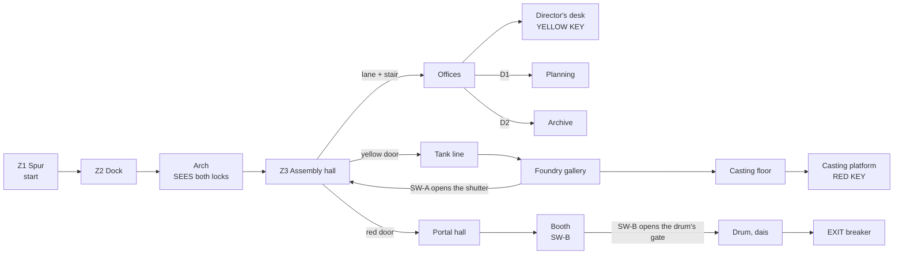

# MAP04 — Tractor Factory

Design document. Owner: `level-designer`. Status: **v0 BUILT 2026-10-14
(§14), not yet walked.** A working brief for the PM; the CEO's verdict comes
from walking the map, not from reading this (D28). Built MVP first (D60): a
complete, walkable map from start to exit, gameplay polish later. Source:
`src/maps/MAP04/map.py`; tests: `tests/test_map04.py`. Russian mirror: owed
at the phase close (D34).

> **Walk it** (the PM or the CEO; agents never start GZDoom, D26):
> `python3 tools/build.py && SD_ALLOW_ENGINE=1 MAP=MAP04 tools/run.sh`.
> Until `mod-engineer` adds the MAPINFO entry of §11 the map has no title and
> its exit switch leads to a MAP05 that does not exist (checklist K12).

Inputs this document obeys and does not restate: `docs/product/LORE.md` (the
factory: "Tractor factory (actually tanks) — episode climax: the portal",
texture set "industry: brick, rust, chains"), `docs/PRD.md` (D28, D35 for
the factions, D58 for MAP03's unfound pass, D60 for MVP first and the
campaign), `docs/engine/BESTIARY.md` (the General and the heavy Panzermensch
are kept for this map), `docs/art/TEXTURE-INDEX.md` (approved lumps only) and
the method of `docs/levels/MAP03-metro.md`.

## 1. Synopsis

Out of the metro's westbound tunnel, Sergeant Vilanova surfaces in the goods
spur of a tractor works whose tractors are tanks: the invaders have taken
the factory for its tank line and its foundry, and behind its closed shop
they have built the portal both factions came through; he takes the two
keys of the works, crosses the factory floor, and cuts the portal's power.

## 2. Its place in the campaign

| | |
|---|---|
| Comes after | MAP03 Metro-Bunker, which ends walking west along a running tunnel past its gate (MAP03 §5). MAP04 starts at the other end of that tunnel: the factory's goods spur, on the same tubbing and the same rails. |
| Why MAP04 | MAP02 is the practice range (D41). LORE's table numbers the factory MAP03; built, it is **MAP04**. |
| What it adds | **two keys** (MAP03 taught one), a hub that shows both locks at once, the first map where the player **sees the enemy's purpose** (the tanks), and the **episode boss**: the General in the portal hall (v3). |
| Climax | the portal (LORE). It sits in a containment drum in the factory's closed shop; the exit is the breaker that feeds it. Cutting it ends the episode. |
| Factions (D35, BESTIARY Q7) | MAP01 Reich first, MAP03 inverted, the factory **mixes**: both flags side by side over the works (LORE). The Legion holds the public face (assembly hall, offices), the Reich the tank line and the foundry, both guard the portal under the General. |
| Campaign wiring | **not changed by this task.** D60 runs MAP01 → MAP03 and says the factory is designed next; MAP03 holds cluster 1 (the ending) until MAP04 takes it (`MOD-SPEC` 4.6). §11 gives the entry and both steps. |

## 3. What the map has to do

| Job | How the layout does it |
|---|---|
| Teach two keys | the hub shows **both locked doors at once** from the dock's arch: red at the far west end, yellow in the south wall, each lit in its colour between two star plaques. The yellow key is **seen from the factory floor** up the office stair; the red key is seen **from the foundry's door**. Doom's grammar: lock before key, key before the lock it opens. |
| Answer MAP03's walk (D58) | the CEO never found MAP03's pass. Here no key is in a side room: each lies alone on a lit pedestal on the route, in its lock's colour of light, and is seen from the doorway of its room (tested). A yellow lane on the factory floor joins the yellow door to the stair that leads to the yellow key. Light 192 is spent on five places only: two locks, two keys, the exit. |
| Be a tractor factory that makes tanks | the assembly hall is the works' public face: two assembly lines, red-striped walls, offices above. Behind the yellow door (the "closed shop") the line is a **tank line**, with inspection pits; behind it the foundry casts the hulls. |
| Be the climax | the portal hall is the biggest volume of the episode (1024 × 896, 384 high), the portal in a steel drum at its centre on a stepped dais, the General's arena (v3). |
| End the episode | the exit is the breaker at the top of the dais, inside the drum: the portal's power cut. |

Target length: 10–12 minutes first run on skill 3 (MAP03 is 8–10); about 5
once known.

## 4. Plan

To scale, one character = 64 × 64 units, north up, x east. Generated from
the built map (§14); a 32-unit piece (a door, the lane, a niche) shows in the
cell it touches. Floors: ground **0**, offices **+64**, foundry casting floor
**−64**, tank pits **−48**.

```
     y   x 384 ............................................................ 4160
   2176                         OOOO YYYY OOOO
   2112                         OOOO YYYY OOOO
   2048                         OOOO Y11Y OOOO  1 = the YELLOW KEY on the desk
   1984                         OOOO Y11Y OOOO
   1920                         O##O YYYY O##O
   1856                         OOOOOOOOOOOOOO
   1792                         OOOOOOOOOOOOOO
   1728             BBBB              ss  B = control booth, SW-B
   1664             BBBB              ss
   1600  WWWWWWWWWWWWWWWW   HHHHHHHHHH||HHHHHHHHHHH
   1536  WWWWWWWWWWWWWWWW   HHHHHHHHHH||HHHHHHHHHHH
   1472  WWWWWWWWWWWWWWWW   HHHHHHHHHH||HHHHHHHHHHH
   1408  WWWWWWWWWWWWWWWW   HHH=======||========HHH KKKKKKKK
   1344  WWWW      WWWWWW   rHHHHHHHHH||HHHHHHHHHHH KKKKKKKK
   1280  WWWW sssU WWWWWW   rHHHHHHHHH||HHHHHHHHHHH KKKKKKKK
   1216  WWWWEsssu#uWWWWWnn#rHHHHHHHHH||HHHHHHHHHHHkKKKKKKKKSSSSSSSS  <- start (S), facing west
   1152  WWWWEsssu#uWWWWWnn#rHHHHHHHHH||HHHHHHHHHHHkKKKKKKKKSSSSSSSS  E = exit; # in the ring = the drum's gate
   1088  WWWW sssU WWWWWWnn#rHHHHHHHHH||HHHHHHHHHHHkKKKKKKKKSSSSSSSS
   1024  WWWW      WWWWWW   rHHHHHHHHH||HHHHHHHHHHH KKKKKKKK
    960  WWWWWWWWWWWWWWWW   rHHHHHHHHH||HHHHHHHHHHH KKKKKKKK
    896  WWWWWWWWWWWWWWWW   HHH=======||========HHH KKKKKKKK
    832  WWWWWWWWWWWWWWWW   HHHHHHHHHH||HHHHHHHHHHH
    768  WWWWWWWWWWWWWWWW   HHHHHHHHHH||HHHHHHHHHHH
    704                     HHHHHHHHyyyyyyHHHHHHHHH
    640                     AXX       ##  A = SW-A, X = the shutter; ## = the yellow door
    576  FFFFFFFFFFFFFFFFGGGGGG       vv
    512  FFFFFFFFFFFFFFFFGGGGGG       vv
    448  PPPPFFFFFFFFFFFFGGGGGG       vv
    384  P22PssFFFFFFFFFFGGGGGG TTTTTTTTTTTTTTTTTTTTTTT
    320  P22PssFFFFFFFFssGGGGGG TTTTTTTTTTTTTTTTTTTTTTT  2 = the RED KEY on its pedestal
    256  P22PssFFFFFFFFssGGGGGGaTTTTTTTTTsppppsTsppppsT
    192  PPPPFFFFFFFFFFFFGGGGGGaTTTTTTTTTsppppsTsppppsT
    128  FFFFFF~~~~~~FFFFGGGGGG TTTTTTTTTTTTTTTTTTTTTTT
     64  FFFFFFFFFFFFFFFFGGGGGG TTTTTTTTTTTTTTTTTTTTTTT
```

Legend: `S` goods spur (start) and its rails · `K` loading dock, `k` arch ·
`H` assembly hall, `=` assembly lines (waist-high, cover), `|` the yellow
lane · `r` the red door's portal band, `y` the yellow door's · `#` doors:
the **red door** (west of `r`), the **yellow door** (south of `y`), D1 and
D2 in the offices, the drum's **gate** · `s` stairs, steps and the dais ·
`O` offices, `Y` director's office, `1` the **yellow key** on the desk · `v`
vestibule, `T` tank line, `p` inspection pits · `a` pouring arch · `G`
foundry gallery (0), `F` casting floor (−64), `~` metal channel, `P`
casting platform, `2` the **red key** on its pedestal · `A` SW-A's niche,
`X` the shutter (its passage under it) · `n` antechamber, `W` portal hall,
blank inside `W` the drum's steel ring, `U` inside the drum, `u` porches,
`E` the **exit** at the top of the dais · `B` control booth.

| # | Zone | x | y | floor | ceil | light (v0) |
|---|---|---|---|---|---|---|
| Z1 | Goods spur (start), tubbing, rails | 3648…4160 | 1120…1248 | 0 | 128 | 112 |
| Z2 | Loading dock | 3136…3648 | 896…1472 | 0 | 256 | 144 |
| — | Arch, dock → hall | 3072…3136 | 1120…1248 | 0 | 192 | 160 |
| Z3 | Assembly hall (hub) | 1600…3072 | 704…1664 | 0 | 320 | 160 |
| — | Assembly lines, four runs (props) | 1792…2240, 2368…2880 | 896…960, 1408…1472 | 32 | 320 | 160 |
| — | Yellow lane (SDFLR1) | 2272…2336 | 768…1664 | 0 | 320 | 160 |
| Z3r | Red door's portal band | 1600…1664 | 992…1376 | 0 | 128 | **192**, red |
| Z3y | Yellow door's portal band | 2112…2496 | 704…768 | 0 | 128 | **192**, yellow |
| — | Office stair, 4 steps of 16 | 2240…2368 | 1664…1792 | 16…64 | 192 | 128 |
| O1 | Office corridor | 1856…2752 | 1792…1920 | 64 | 192 | 128 |
| O2 | Director's office (doorway, no door) | 2176…2432 | 1920…2208 | 64 | 192 | 176, yellow |
| — | Director's desk, the yellow key | 2240…2368 | 2016…2080 | 80 | 192 | **192**, yellow |
| O3 | Planning office, D1 | 1856…2112 | 1920…2208 | 64 | 192 | 128 |
| O4 | Archive, D2 | 2496…2752 | 1920…2208 | 64 | 192 | 128 |
| T1 | Vestibule behind the yellow door | 2240…2368 | 448…672 | 0 | 128 | 128 |
| T2 | Tank line | 1856…3328 | 64…448 | 0 | 256 | 144 |
| — | Inspection pits A and B, 2 steps each end | 2432…2816, 2880…3264 | 192…320 | −48 | 256 | 144 |
| — | Pouring arch, tank line → foundry | 1792…1856 | 192…320 | 0 | 128 | 144 |
| F1 | Foundry gallery | 1408…1792 | 64…640 | 0 | 256 | 144 |
| F2 | Casting floor, 3 steps down from the gallery | 384…1408 | 64…640 | −64 | 256 | 128 |
| — | Metal channel | 768…1152 | 128…192 | −80 | 256 | 128 |
| F3 | Casting platform, 3 steps up | 384…640 | 192…512 | 0 | 256 | 128 |
| — | Ingot pedestal, the red key | 448…576 | 288…416 | 16 | 256 | **192**, red |
| F4 | SW-A niche · passage · shutter | 1600…1664 · 1664…1792 | 640…656 · 640…672 · 672…704 | 0 | 128 | 144 |
| P1 | Antechamber behind the red door | 1408…1568 | 1120…1248 | 0 | 128 | 128 |
| P2 | Portal hall | 384…1408 | 768…1664 | 0 | 384 | 128 |
| P3 | Control booth, SW-B | 1088…1344 | 1664…1792 | 0 | 128 | 144 |
| P4 | Containment drum (ring 640…1024 × 1024…1408), gate in its east face | 704…960 | 1088…1344 | 0 | 256 | 144 |
| — | Porches either side of the gate | 1024…1088, 896…960 | 1152…1280 | 0 | 128 | 128 / 144 |
| — | Dais, 3 steps of 16 | 704…896 | 1088…1344 | 16…48 | 256 | 144 |
| E | Exit niche (the breaker) | 688…704 | 1184…1248 | 48 | 176 | **192** |

Extent 3776 × 2144 units (MAP03: 3552 × 1552). Every height is a multiple
of 16; no step up is over 16 (tested).

## 5. Progression, keys, switches and the exit



**The keys.** Doom's yellow and red keycards, drawn by Freedoom until we have
our own: editor numbers **6** and **13**, locks **3** ("Yellow key card")
and **1** ("Red key card"), both read from shipped text (`gzdoom.pk3 →
lockdefs.txt`, g4.14.2). In the fiction: the **yellow pass** to the closed
shop, kept on the works director's desk, and the **red pass** to the portal
shop, dropped on the casting platform where the foundry's foreman fell (v3:
his body, a decoration). `mod-engineer` can give them Soviet names the way
MAP03's blue pass got one (`SD_BluePass`, `Species` trick, MOD-SPEC §6, "The
blue pass"); the map does not change when that lands.

| Id | Where | Type | Special | Can it lock the player out? |
|---|---|---|---|---|
| D1 | Office corridor → planning office | manual door | `Door_Raise` (1), both faces | no |
| D2 | Office corridor → archive | manual door | `Door_Raise` (2), both faces | no |
| **YD** | Hall's south wall → vestibule, 128 wide | **locked, opens for good** | `Door_LockedRaise (4, 16, 0, 3, 0)`, both faces, repeatable | no |
| **RD** | Hall's west end → antechamber, 128 wide | **locked, opens for good** | `Door_LockedRaise (5, 16, 0, 1, 0)`, both faces, repeatable | no |
| SH | Foundry passage → hall, 128 wide | remote, opens for good | tag 10. Steel from the foundry; **the hall's own striped wall from the hall**, so it is wall until it opens | no |
| SW-A | Foundry gallery, a 64-wide niche in its north wall, beside the passage to SH | `SDSW1B` (push button), one-shot | `Door_Open (10, 16, 0)` | no |
| GATE | Drum's east face, 128 wide, a leaf on both faces | remote, opens for good | tag 11 | no |
| SW-B | Control booth, back wall | `SDSW1A` (knife switch), one-shot | `Door_Open (11, 16, 0)` | no |
| EXIT | Back of a 64 × 128 niche at the top of the dais, inside the drum | `SDSW1D`, the hazard panel every map's exit wears | `Exit_Normal (0)` | — |

**The order, as the tests play it** (`test_the_route_is_the_designed_one`),
four rounds:

1. With the manual doors only: spur, dock, hall, offices, **the yellow
   key**; both locked doors seen on the way in (from the arch, tested).
2. The yellow door: the tank line, the foundry, **the red key**, SW-A.
3. The red door (and SW-A's shutter, a shortcut): the portal hall, the booth.
4. SW-B: the drum's gate, the dais, **the exit**.

Each gate is seen before it opens: both locks from the arch (tested); the
drum's gate from the antechamber, as the player enters the portal hall, and
again from SW-B in the booth, so the press shows its effect (both tested);
the exit from the gate (tested). The shutter is the deliberate exception,
as MAP03's SH: a shortcut found from behind, wall from the hall.

**Signposting, MAP03's lesson applied from v0** (D58):

- **Each key lies alone, lit, on the route.** The yellow key is on the
  director's desk, straight up the office stair from the hall's centre aisle:
  from the middle of the factory floor the player sees it, small and lit,
  framed by the stairwell and the office doorway (tested from two points of
  the aisle). The red key is on an ingot pedestal on the casting platform,
  straight across the casting floor from the foundry's door (tested from the
  pouring arch and the gallery).
- **The lock's colour is the key's colour.** `lightcolor` yellow on the
  yellow door's portal and on the director's office and desk; red on the red
  door's portal and on the pedestal. Nothing else in the map wears either
  colour (tested). NOT VERIFIED in our engine runs (K4); without it both
  places are still among the five 192s.
- **A lane joins the yellow lock to its key.** A strip of `SDFLR1` (the
  hangar's yellow line, MAP01's "go here") runs from the yellow door's portal
  up the centre aisle to the office stair (tested adjacency).
- **Real faces.** Every door wears `SDDOOR1`, one whole tile (tested); every
  switch its own `SDSW1x` face, one-shot so it stays ON (tested).

Rules that remove whole classes of softlock, kept from MAP01 §4 and MAP03 §5:

- **No door closes behind the player.** Locks and remote doors open for
  good; the two manual doors reopen from both sides.
- **No lift.** Height changes by stairs only.
- **No drop without a climb back in the same zone.** The gallery and the
  casting platform drop 64 to the casting floor (stairs back up to both);
  the tank line drops 48 into its pits (two steps at each end of each pit).
- **No secret and no shortcut is needed** (tested: with every tag but the
  shutter's, the exit is reached).
- Tested at **every stage**: from every sector the player can reach there is
  a way back to the start, and at the end a way on to the exit.

## 6. Intensity curve

```
  high |                                                            ######
       |                                    ####                    ######  <- the General
 press |              ####        ####      ####     ####   ##      ######     in the portal
  ure  |              ####  ##    ####      ####     ####   ##      ######     hall
       |   ##   ##    ####  ##    ####  ##  ####  ## ####   ##  ##  ######  ##
   low |   ##   ##    ####  ##    ####  ##  ####  ## ####   ##  ##  ######  ##
       +--------------------------------------------------------------------------->
         spur dock   hall offices tank  pits foundry SW-A  return red booth  portal  exit
                                  line                closets door           hall
         0:00                                                                   ~11:00
```

| Beat | Space | Feeling | Mechanic introduced |
|---|---|---|---|
| 1 | Spur, dock | out of the dark of the metro into a works yard; a picket | continuity: same tubbing, same rails |
| 2 | The arch | **the view**: the whole factory floor, two lit locks, the yellow key up the stair | two goals at once, and the first answer |
| 3 | Assembly hall | the big fight on the factory floor, Legion first | the assembly lines as cover |
| 4 | Offices | close quarters upstairs; the key on the desk | a key taken where it was seen |
| 5 | Tank line | **the reveal**: the tractors are tanks; the Reich at work | the pits, the heavies |
| 6 | Foundry | heat, height, a pit to cross; Doughboys in the tall room | the drop and the climb back; the red key |
| 7 | SW-A | the shutter opens onto the hall beside the red door | a shortcut from behind |
| 8 | Hall, again | **spike**: SW-A's closets on ground already cleared | MAP03's pattern |
| 9 | Portal hall | **climax**: the General and his escort round the drum | the boss |
| 10 | Booth, drum | the gate opens; the portal at the top of the dais | — |
| 11 | Exit | the breaker thrown; the episode ends | — |

## 7. Textures

### 7.1 By zone (v0, all approved and packed, tested)

No industrial set exists yet. v0 dresses the factory in the Soviet base set
and two metro pieces where they fit; v1 swaps in the industrial pieces of
§7.2 as they are approved.

| Zone | Walls | Floor | Ceiling | v1 intention |
|---|---|---|---|---|
| Goods spur | `SDTUBB1`, one tile floor to ceiling (MAP03's tunnels) | `SDFLR2` + `SDRAIL1` strip | `SDCEIL2` | the tunnel mouth in brick |
| Loading dock | `SDCONC1` | `SDFLR2` + `SDRAIL1` strip | `SDCEIL2` | brick, a buffer stop, crates (`SDCRAT1/2`) |
| Assembly hall | `SDCONC2` in three bands (MAP01's hangar, D30) | `SDFLR2`, the lane `SDFLR1` | `SDCEIL1` | brick, clerestory windows, the slogan banner, the two flags (LORE) |
| Assembly lines | `SDSTEL1` | `SDFLR2` | | the tractors on them (props) |
| Lock portals | `SDSTAR1` plaques either side of each leaf, each one whole 128 × 128 tile (tested) | `SDFLR2` | `SDCEIL1` | key-trimmed door leaves (§7.2) |
| Offices | `SDTILE2` (green dado, one tile, 128 high) | `SDFLR3` | `SDCEIL1` / `SDCEIL2` | the Lenin poster `SDPOSTR1` behind the director's desk (a 256-high niche), lockers `SDLOCK1` in the archive |
| Director's desk | `SDCRAT1` front | `SDCRTOP1` | | |
| Tank line | `SDSTEL1` | `SDFLR2` | `SDCEIL1` | rust, chains and hooks over the pits; `SDMEDG1` (the metro's chevron edge) on the pit edges |
| Pits | `SDCONC1` | `SDFLR2` | | |
| Foundry | `SDCONC1` | `SDFLR2` | `SDCEIL2` | brick, molten channel, cast-iron floor |
| Portal hall, booth | `SDCONC1`, booth `SDSTEL1` | `SDFLR3` | `SDCEIL2`, booth `SDCEIL1` | the portal (§7.2); the two flags over the drum |
| Drum | `SDSTEL1` | `SDFLR2` | `SDCEIL2` | |
| Doors, switches | `SDDOOR1`; `SDSW1B` (SW-A), `SDSW1A` (SW-B), `SDSW1D` (exit) | | | |

### 7.2 Industrial pieces to commission from `art-director`

LORE's set is "industry: brick, rust, chains". Proposed lump names (≤ 8
characters, the `SD` prefix), in priority order; none blocks v0.

| # | Lump | Kind, size | What | Where |
|---|---|---|---|---|
| 1 | `SDBRCK1` | wall 64×128 | soot-stained red factory brick, Stalin-era works | hall, dock, foundry, the spur's mouth |
| 2 | `SDBRCK2` | wall 64×128 | the same brick, whitewashed to 64 with a dark rule (the works' dado) | hall's lower walls, offices' stair |
| 3 | `SDRUST1` | wall 64×128 | rusted corrugated sheet | tank line partitions, the closed shop |
| 4 | `SDCHAN1` | wall 64×128, **masked** (transparent ground) | hanging chain with a hook, as a mid-texture on two-sided lines | over the pits, the foundry's crane |
| 5 | `SDFLR4` | flat 64×64 | cast-iron chequer plate | foundry gallery, tank line |
| 6 | `SDGRAT1` | flat 64×64 | steel grating | v1 catwalks over the casting floor |
| 7 | `SDMOLT1`…`4` | flat 64×64, **animated** (ANIMDEFS, `mod-engineer`) | molten metal | the channel, ladles (v2) |
| 8 | `SDDOORY`, `SDDOORR` | wall 128×128 | `SDDOOR1` with a yellow / red trim (already a candidate in the index) | the two locked doors |
| 9 | `SDPORT1`… | wall 128×128, animated | the portal's surface | the drum, behind the dais |
| 10 | `SDGATE1` | wall 128×128 | sliding factory gate, corrugated | the dock's road gate, the tank line's export gate (both shut, set dressing) |
| 11 | `SDWIND1` | wall 64×128 | industrial glazing, night outside | the hall's clerestory |
| 12 | `SDSLOG1` | wall 256×64, text-bearing (D27: render on one machine) | a works banner, e.g. «ТРАКТОРЫ — КОЛХОЗАМ!» ("Tractors for the collective farms") | over the assembly lines; the irony is the map's |
| 13 | `SDFLAG1`, `SDFLAG2` | wall 64×128 | the Reich's and the Legion's banners (D12), to hang **side by side** (LORE) | over the hall and the drum |

Sprites (art-director's, the classes `mod-engineer`'s): a tractor and a tank
hull as decorations (or v1 builds the tanks from sectors), the foreman's
body, the yellow and red pass pickups.

## 8. Secrets (v3; none in v0, D60)

MAP01's rule: a clue is a comparison or a question, never a sign; each
secret has a way back.

| # | Where | Clue | Reward (proposed) |
|---|---|---|---|
| S1 | Behind the archive's lockers | one locker of the row is a different colour | the **Hand Katyusha** (slot 7, D13) and its plans: Doom's tradition, the BFG in the episode's last map |
| S2 | A drain under pit B, into the foundry's floor | one pit has a grate the other lacks | armour, a backpack |
| S3 | The foundry's flue, above the casting platform | a draught of light in a dark corner (v2) | health, rockets |

## 9. Enemies and resources by skill (plan for v3; v0 places none)

Doom stand-ins, so nothing renumbers when sprites change (MAP01, MAP03).
The General and the heavy Panzermensch make their first appearance here
(BESTIARY §8, §9).

| Stand-in | DoomEdNum | Faction | Class | Role here |
|---|---|---|---|---|
| Zombieman | 3004 | Reich | `SD_ReichRifleman` | dock, tank line |
| Shotgun guy | 9 | Legion | `SD_LegionTrooper` | hall, offices, SW-A's closets |
| Imp | 3001 | both | `SD_Stormtrooper` | everywhere |
| Demon | 3002 | Reich | `SD_ReichHound` | tank line, portal hall |
| Cacodemon | 3005 | Legion | `SD_Doughboy` | the foundry (320 high), the drum on 4 |
| Hell Knight | 69 | Reich | `SD_Panzermensch`, 500 HP | the tank line on every skill |
| Baron | 3003 | Reich | `SD_PanzermenschSchwer`, 1000 HP | tank line and portal hall on 4 |
| Cyberdemon | 16 | Legion | `SD_General`, 3000 HP, boss | the portal hall on **every** skill |

| Beat / zone | Skill 2 | Skill 3 | Skill 4 |
|---|---|---|---|
| Spur, dock | 2 riflemen | 3 riflemen | 3 riflemen + 1 trooper |
| Assembly hall | 4 troopers + 2 riflemen + 1 stormtrooper | 5 troopers + 3 riflemen + 2 stormtroopers | 6 troopers + 4 riflemen + 3 stormtroopers |
| Offices | 2 troopers + 1 rifleman | 3 troopers + 1 rifleman | 3 troopers + 1 rifleman + 1 stormtrooper |
| Tank line | 1 hound + 2 riflemen + 1 Panzermensch | 2 hounds + 4 riflemen + 1 Panzermensch | 2 hounds + 5 riflemen + 1 Panzermensch + 1 heavy |
| Foundry | 2 stormtroopers + 1 Doughboy | 3 stormtroopers + 1 Doughboy | 3 stormtroopers + 2 Doughboys + 1 hound |
| SW-A's closets in the hall | 2 troopers | 2 troopers + 1 stormtrooper | 3 troopers + 2 stormtroopers |
| Portal hall | the General + 2 hounds | the General + 2 hounds + 2 stormtroopers | the General + 2 hounds + 2 stormtroopers + 1 Panzermensch + 1 heavy |
| Drum (behind the gate) | 1 stormtrooper | 2 stormtroopers | 2 stormtroopers + 1 Doughboy |
| **Total** | **25** | **38** | **52** |

Against MAP03's 23 / 36 / 51: a little more in numbers, much more in
weight (the boss on every skill). Nested by skill pairs (`skill_tier`), as
MAP01 and MAP03. The General is 40 × 100 (BESTIARY §9): the portal hall is
384 high and he never has to pass a door.

**The General's death and the exit** (v3, open point 4): BESTIARY gives him
`+BOSSDEATH` "so the exit can be tied to his death". Proposed, not built:
the drum's gate opens on SW-B **or** on his death (MAPINFO `SpecialAction`,
NOT VERIFIED), never only on his death, so a player who runs past him is not
locked out.

**Resources (v3).** Pistol-start finishable (`+map MAP04` gives the TT-33
only): the IZh in the dock, the PPSh-41 in the offices, the RPG-7 on the
tank line (before the heavies), the **ROKS-3 flamethrower in the foundry**
(MAP03 §9 kept it for the factory), all on the route on every skill; the
Hand Katyusha in S1. Ammunition by G3-8's ruler (skill-4 ammo ≥ 1.35 × what
the skill-4 monsters need), the General included; health scaled 2 > 3 > 4.

## 10. Engine elements used

| Need | Emitted | Status |
|---|---|---|
| Manual door | `Door_Raise` 12 (tag, 16, 150, 0), `playeruse` + `repeatspecial` | VERIFIED on MAP01 |
| Remote door, one-shot switch | `Door_Open` 11 (tag, 16, 0) | VERIFIED on MAP01 |
| Locked door that stays open | `Door_LockedRaise` 13 (tag, 16, 0, lock, 0), both faces | VERIFIED on MAP03 (the blue door, `docs/qa/evidence/2026-10-14_1902_F3_map03-v0-walk.md`); locks 1 and 3 read from `lockdefs.txt`, not yet seen in engine: K5, K9 |
| Exit | `Exit_Normal` 243 | VERIFIED on MAP01 |
| Keys | things 6 (`YellowCard`), 13 (`RedCard`) | Doom actors, drawn by Freedoom |
| Coloured light | sector `lightcolor` (0xRRGGBB, UDMF zdoom), yellow `0xFFD860`, red `0xFF6048` | field name from the UDMF zdoom spec, as MAP03 v1 uses it; **NOT VERIFIED** in our engine runs: K4 |
| Turned flats | `rotationfloor` 90 on the rail strips | as MAP03 (its K8) |

Tag plan: **1** D1 · **2** D2 · **4** yellow door · **5** red door · **10**
shutter (SW-A; v3 adds the hall's closets) · **11** the drum's gate (SW-B;
v3 adds the drum's closets). Free: 3, 6–9, 12 and up.

## 11. MAPINFO and LANGUAGE (for `mod-engineer`)

This role does not touch MAPINFO or LANGUAGE.

**Step 1, now (v0–v3):** MAP04 loads with a title and its exit leaves
cleanly; the campaign is untouched.

```
// MAP04, the tractor factory (docs/levels/MAP04-factory.md). LORE's third
// campaign map and the episode's climax, numbered 04 because MAP02 is the
// practice range (D41). Not wired into the campaign yet: reached with
// `map MAP04` / MAP=MAP04 tools/run.sh. No cluster on purpose, so leaving it
// prints neither the campaign's ending (cluster 1) nor the range's (2).
map MAP04 lookup "SD_MAP04_NAME"
{
	next = endtitle
	music = ""
	sky1 = "SKY1"
	par = 360
}
```

`LANGUAGE` (D21, both languages in the same task): `SD_MAP04_NAME` =
"Tractor Factory" / «Тракторный завод», LORE's words, as the working title
(a proper name is open point 2). `par = 360` is this role's estimate for a
player who knows the route (§3). `music = ""` until `sound-designer` picks a
public-domain piece for it (D59). Without step 1, K12 cannot pass: GZDoom's
default `next` for MAP04 is MAP05, which does not exist.

**Step 2, when the CEO wires the factory in (D60 says it is next), by
MOD-SPEC 4.6's rule** (cluster 1 holds the campaign's last map; one chapter
cluster per earlier map):

- MAP03: `cluster = 4`, `next = "MAP04"` (it gives cluster 1 to MAP04).
- a new `cluster 4 { exittext = lookup, "SD_MAP03_EXIT_TEXT" flat = "SDFLR1" music = "" }`:
  the transition from the metro to the factory.
- MAP04: `cluster = 1`, `next = endtitle`: its exit prints the campaign's
  ending.
- `LANGUAGE`: `SD_MAP03_EXIT_TEXT` (new), and `SD_END01_TEXT` **rewritten**:
  it speaks of Zarya-7 retaken and would then follow the portal's fall. That
  is writing for the CEO; a draft of the transition, for him to change:
  - en: "The westbound tunnel climbs into daylight at a goods spur. Beyond
    the buffers stand the sheds of a tractor works, and the tracks in the
    yard are too wide for tractors."
  - ru: «Западный тоннель выходит на свет у подъездного пути. За тупиком —
    цеха тракторного завода, и колея во дворе слишком широка для тракторов.»

## 12. Version plan

Each version loads in GZDoom and is walkable from start to exit.

| Version | Content | Done when |
|---|---|---|
| **v0 — grey box** ✅ **BUILT 2026-10-14** (§14) | the whole plan of §4, every door, both keys, both locks, both switches, the gate, the exit, stairs and drops; the approved sets where they fit (§7.1); the signposting of §5 (lit keys, coloured light, the lane, the plaques); light by zone; **no monsters, no items, no secrets** but the start and the two keys | the CEO walks it, finds both keys unaided and judges the shape (§14.4); `tests/test_map04.py` green |
| v1 — textured | the industrial pieces of §7.2 as approved; the tanks and tractors; the Lenin poster in the director's office; the hall's clerestory; anything the v0 walk moves | the CEO judges the factory as a factory from screenshots |
| v2 — light and detail | the foundry's glow and molten channel, the portal's light, chains, flicker in the tank line, the flags | a first-time player finds both keys and the exit without being told |
| v3 — density, combat, resources | §9 placed with closets on tags 10 and 11, the General, the secrets of §8, the ammo budget, MAP03-like density | the episode is played through on skill 3 |

## 13. Open points for the CEO

1. **Walk v0** (D28): the judgements of §14.4. The only one that blocks v1.
2. **The factory's name.** Working title "Tractor Factory" / «Тракторный
   завод». A proposal with the history in it: the works that made tanks in
   the war were nicknamed **«Танкоград»** ("Tankograd"); a fictional works in
   the Urals, named in the period's way, e.g. «Уральский тракторный завод
   имени 60-летия Октября».
3. **The two keys as passes**, yellow to the closed shop and red to the
   portal shop (§5), and their look (art-director, as for the blue pass).
4. **The General's death and the gate** (§9): SW-B only, or SW-B or his
   death.
5. **The ending.** The exit is the portal's breaker; the episode's ending
   text has to be rewritten for it (§11, step 2).
6. **The portal's look** (§7.2, item 9): its colour and whether it shows
   the other side.

## 14. v0 build record (2026-10-14)

Source: `src/maps/MAP04/map.py`, painted with `GridMap` like MAP01 and
MAP03. **65 sectors, 273 linedefs, 214 vertices, 3 things** (the start and
the two keys). MAP03's v0 was 73 sectors and 418 lines; this v0 is leaner on
purpose (D60), with the larger volumes of a climax.

### 14.1 What is in it

Everything of §4 and §5: the goods spur and its rails, the dock, the arch,
the assembly hall with its four assembly-line runs, the yellow lane and the
two lock portals with their star plaques; the office stair, corridor,
director's office and desk (the yellow key), the planning office and the
archive behind D1 and D2; the yellow door, vestibule, tank line and its two
pits; the pouring arch, the foundry gallery, its stair, the casting floor and
the metal channel, the casting platform and its stair, the pedestal (the red
key); SW-A, its passage and the shutter; the red door, the antechamber, the
portal hall, the booth and SW-B, the containment drum, its gate and porches,
the dais and the exit niche.

### 14.2 What is deliberately not in it

Monsters, weapons, ammo, health, closets, secrets (v3); the industrial
textures (v1, §7.2); lamps, glow, molten metal and flicker (v2); the tanks,
the tractors and the posters (v1).

### 14.3 Verification actually run

| Check | Result |
|---|---|
| `tests/test_map04.py` | **33 tests, all green**: closed clockwise sectors, no duplicate vertex, no sector painted away; no step up over 16; every texture approved and packed; every door leaf one tile (ten faces); the star plaques, two at each lock, each one tile; light range; **light 192 only at the two locks, the two keys and the exit**; **each key in its lock's colour, and nothing else in it**; v0 scope (start and two keys, every skill; no secret); **everything reachable** at the end but the assembly lines; **the exit reached, and only in the last round**; **no trap at any stage**; from everywhere the exit at the end; the drops left by stairs; **the route in four rounds**; the shortcut not needed; one yellow and one red key in their zones; both locked doors' specials, locks and stay-open delay on both faces; **sight lines**: both locks from the arch, the yellow key from two points of the factory floor, the red key from the pouring arch and the gallery, the drum's gate from the antechamber and from SW-B, the exit from the gate; the lane joins the yellow portal to the stair; real, distinct, one-shot switch faces and the exit's hazard panel; each switch opens what §5 says; SW-A beside the shutter's passage; the shutter wall-faced from the hall; every door tall enough; no press consumes a gate |
| Mutation check (scratch script, not committed) | each of five planted faults turns the suite red: the red door asking for the yellow key (2 tests), the foundry stair removed (3), the platform's last step too high (6), the red key behind the red door (10), the yellow key off the desk (4) |
| `tools/check_pk3.py` | `maps/MAP04.wad: MAP04/TEXTMAP/ENDMAP, 214 vertices, 273 linedefs, 65 sectors, 3 things`; 0 errors, 0 warnings |
| `tools/verify.py fast` (Windows PC, `.venv/Scripts/python.exe`, 2026-10-14) | **VERDICT: PASS** in 174 s: docs PASS (the only MAP04 warning is its Russian mirror, D34), build PASS, `check_pk3` 0 errors 0 warnings, **1734 tests**, 112 skipped (slow art). A run minutes earlier failed in `test_route` and `test_hand_study`, files other agents had open in the working tree; the rerun was clean |
| GZDoom | **not run** (D26). Owed: §14.5 |

The first run of the suite found two things, both fixed before delivery:
from the arch the near assembly line hides the bottom 32 units of the yellow
door's leaf (the test now asks for the leaf above waist height, which is what
cover should do), and the colour test had to follow the yellow light through
the office doorway, not stop at the desk.

### 14.4 What I want the CEO to judge while walking it

The route is **not told** this time, on purpose: MAP03's walk showed that
the map has to tell it (D58). The judgement that blocks v1 is the first one.

1. **Did you find both keys without help?** If not, where did you look?
2. **The arch.** Do the two lit doors read as the two goals, and the yellow
   light up the stair as the answer to the first?
3. **Scale.** The hall is 1472 × 960 and 320 high; the portal hall 1024 ×
   896 and 384 high. A factory, or a car park?
4. **The tank line and the foundry.** Do the pits and the drop to the
   casting floor feel allowed, and the stairs back up found?
5. **SW-A.** Does the shutter opening onto the hall read as a shortcut home?
6. **The drum and the breaker.** Does pressing SW-B, then climbing to the
   exit, feel like the end of an episode? (In v0 it is grey; the portal is v1.)

### 14.5 Engine checklist for the PM (D26: this role does not start GZDoom)

Method as MAP03 §14.5: `warp x y`, turn to the facing (Doom angles: 0 east,
90 north, 180 west, 270 south), `+use`, `wait`, `screenshot`. Skill 3. Every
use warp is within 64 of the line it presses. Log and screenshots to
`docs/qa/evidence/`. K12 needs §11 step 1.

| # | Warp to (x y) | Facing | Do | What must show |
|---|---|---|---|---|
| K1 | 4096 1184 | 180 | — | the start: the tubbing spur, rails, the dock beyond |
| K2 | 3104 1184 | 180, then 211 | — | from the arch: the red door at the hall's far end between two star plaques; turned, the yellow door in the south wall the same way |
| K3 | 2304 1024 | 90 | — | up the lane and the stair: the director's office lit, the yellow key on the desk |
| K4 | 2304 1184 | 90 | — | the yellow tint on the office and desk, the red tint at the red portal (turn to 180) and the yellow at the yellow portal (turn to 270). If there is no tint, `lightcolor` is not read: tell this role |
| K5 | 2304 740 | 270 | `+use`; then `give YellowCard`, `+use`; screenshots at `wait 35` and `wait 350` | without the key: shut, and the yellow-key line printed (proves lock 3); with it: open, and still open 10 s later |
| K6 | 1760 256 | 180 | — | from the foundry gallery: the red key on its lit pedestal across the casting floor, the stair down on the left |
| K7 | 1632 610 | 90 | `+use`, `wait 10`, then turn to 0 | `SDSW1B` → `SDSW2B` and stays; the shutter risen beyond the passage |
| K8 | 1728 768 | 270 | screenshot before K7 and after | from the hall: before, striped wall; after, the opening into the foundry |
| K9 | 1632 1184 | 180 | `+use`; then `give RedCard`, `+use` | as K5, the red-key line (proves lock 1); open and staying open |
| K10 | 1440 1184 | 180 | — | the portal hall, the drum ahead, its gate's leaf in the porch |
| K11 | 1216 1760 | 90 | `+use`, screenshot; turn to 250 | `SDSW1A` → `SDSW2A`; the drum's gate open |
| K12 | 736 1216 | 180 | screenshot, then `+use` | the exit niche lit, `SDSW1D`; on use, the intermission, then the title |
| K13 | the log | — | — | zero lines matching the G3-2 failure patterns of MAP01 §11; nothing about `lightcolor`, `rotationfloor`, special 13 or any `SD` texture |

### 14.6 What I need from other roles

- **`mod-engineer`:** the MAPINFO entry and `SD_MAP04_NAME` of §11, step 1
  (blocking K12 only); step 2 when the PM wires the campaign. Optionally,
  `SD_` classes for the two passes, as for MAP03's blue pass, with their
  pickup and locked-door lines in both languages (`PD_YELLOWCO`,
  `PD_REDCO`, and Freedoom's DEHACKED caveat of MOD-SPEC §6). Later: the
  ANIMDEFS for the molten metal and the portal (§7.2).
- **`art-director`:** the industrial pieces of §7.2, items 1–5 first (they
  are what v1 needs); the pass sprites; the portal (open point 6).
- **`sound-designer`:** a public-domain piece for the factory (D59).
- **PM:** renumber LORE's episode table (the factory is MAP04) and
  BESTIARY's "MAP03" references to the General and the heavy Panzermensch,
  which mean this map (MAP03 §2 already asked).
