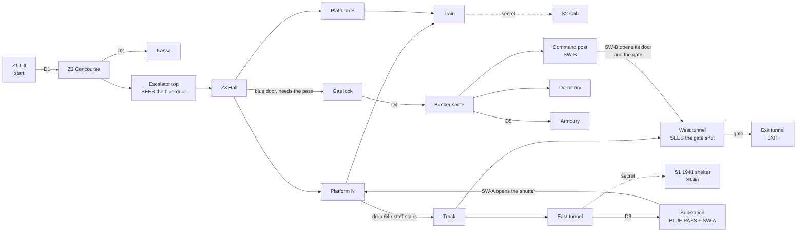

# MAP03 — Metro-Bunker

Design document. Owner: `level-designer`. Status: **v0 BUILT 2026-10-14
(§14), not yet walked.** A working brief for the PM; the CEO's verdict comes
from walking the map, not from reading this (D28). Source:
`src/maps/MAP03/map.py`; tests: `tests/test_map03.py`. Russian mirror: owed
at the phase close (D34).

> **Walk it** (the PM or the CEO; agents never start GZDoom, D26):
> `python3 tools/build.py && SD_ALLOW_ENGINE=1 MAP=MAP03 tools/run.sh`.
> Until `mod-engineer` adds the MAPINFO entry of §11 the map has no title and
> its exit switch has nowhere to go (checklist K12).

Inputs this document obeys and does not restate: `docs/product/LORE.md`
(the metro-bunker map: "first key, first heavy hybrids", texture set "tiles,
red marble, mosaics"), `docs/PRD.md` (D35 for the factions, D41 for MAP02,
D42/D47/D48/D56 for the metro textures, D55 for the Stalin poster),
`docs/engine/BESTIARY.md`, `docs/art/TEXTURE-INDEX.md` (set "Metro", sixteen
approved lumps) and the method and lessons of `docs/levels/MAP01-zarya-7.md`.

## 1. Synopsis

The lift from Zarya-7 drops Sergeant Vilanova into a deep metro station that
doubles as a government bunker; the Liberty Legion holds the station, the
Fourth Reich has come up the tunnels and sealed itself in the bunker, and the
only way west towards Moscow is the running tunnel behind the bunker's gate.

## 2. Its place in the campaign

| | |
|---|---|
| Comes after | MAP01 Zarya-7, which ends on a service lift going **down**, in its darkest room (MAP01 §2: "MAP02 is already visible as a mood"). MAP03 starts at the bottom of that lift. |
| Why MAP03 and not MAP02 | MAP02 is the practice range since D41 (its own episode, outside the campaign). LORE's episode table still numbers the metro MAP02 and the tractor factory MAP03; built, they are **MAP03 and MAP04**. |
| What it adds | the **first key** (LORE), the first map where the player goes **down into the track and the tunnels**, and the heavies in numbers: a Panzermensch on every skill, the first one an easy-skill player meets. |
| Factions (D35) | MAP01 was Reich first with the Legion holding the hangar; the metro **inverts it**: the Legion holds the station (concourse, hall, train), the Reich holds the depths (tunnels, substation, bunker). Stormtroopers are hybrids and fight for both. |
| Comes before | the tractor factory (LORE's "MAP03", the episode climax). Its exit is the westbound running tunnel. |
| Campaign wiring | **not changed by this task.** D5 still makes MAP01 the whole campaign, so MAP01's `next = endtitle` stays and MAP03 is reached with `+map MAP03` until the CEO opens the campaign. §11 gives both MAPINFO steps. |

**Numbering consequence for other documents (not touched here):** where
`docs/engine/BESTIARY.md` says "MAP03" (the General first placed, the 1000 HP
`SD_PanzermenschSchwer`), it means the factory, now MAP04. This map places
neither. LORE's table and BESTIARY §11 want the PM's one-line renumbering.

## 3. What the map has to do

| Job | How the layout does it |
|---|---|
| Teach the key | the blast door is seen **first**, from the top of the escalator, at the far end of the hall between two mosaics, lit brighter than the hall; the pass is found later, in a room reached without that door; the door opens for good (`Door_LockedRaise`, delay 0). Doom's grammar: the lock before the key, the key before the switch. |
| Be a metro | an escalator down into a pylon hall (the Moscow deep-station type: central hall, arches between marble pylons, a platform each side), a train standing at one platform with its doors open, the open track at the other, and **the tunnels**: the player has to step off the platform into the track bed. |
| Be a bunker | behind the hermetic door the materials change: steel and green-dado tile instead of marble; a gas lock, a spine corridor, a refuge dormitory, an armoury, and a command post one level down whose console opens the tunnel gate. |
| End towards Moscow | the exit is west along the running tunnel, past the gate the command post opens. |

Target length: 8–10 minutes first run on skill 3 (MAP01 is 5–8); about 4
once known.

## 4. Plan

To scale, one character = 64 × 64 units, north up, x east. Generated from
the built map (§14), labels added. Floors: upper level **+160** (lift,
concourse, kassa), station **0**, track level **−64** (track, tunnels,
command post, shelter).

```
   y                                                 x 352 ........................................... 3968
 1856                                           11              S1 1941 shelter (secret), Stalin slot on the north wall
 1792                                         111111
 1600                                         111111
 1536                                            1
 1472                                            ?              S1 panel (a concrete patch in the tubbing)
 1408 ETTTTTTGTTTTTTTTTTTTTTTTTTTTTTTTTTTTTTTTTTTTT             west tunnel | open track | east tunnel
 1344 ETTTTTTGTTTTTTTTTTTTTTTTTTTTTTTTTTTTTTTTTTTTT
 1280        KKKQQK  PsssPPPPPPPPPPPPPPPPsssP  DD   kkk         D3 off the east tunnel; k = kassa
 1216        KKKKKK  PPPPPPPPPPPPPPPPPPPPPPPP  ss   kkk
 1152        KKKKKK  PPPPPPPPPPPPPPPPPPPPPPPPXSSS   DDD         X = the shutter, opened by SW-A
 1088        KKKKKK  a  aa  aa  aa  aa  aa  a SSS CCCCCCC       S = substation: the PASS and SW-A
 1024        KKssKK  pHHHHHHHHHHHHHHHHHHHHHHH SSS CC+CCCC
  960  AAA     ss    pHHHHHHHHHHHHHHHHHHHHHHH     CC+CCCC LLLL
  896  AADbbbbbbbDVVBpHHHHHHHHHHHHHHHHHHHHHHHeeeeeCCCCCCCDLLLL  <- start (L), facing west
  832  AADbbbbbbbDVVBpHHHHHHHHHHHHHHHHHHHHHHHeeeeeCCCCCCCDLLLL
  768  AAA   rr      pHHHHHHHHHHHHHHHHHHHHHHH     CC+CCCC LLLL
  704     rrrrrrrr   pHHHHHHHHHHHHHHHHHHHHHHH     CC+CCCC
  640     rrrrrrrr   a  aa  aa  aa  aa  aa  a     CCCCCCC
  576     rrrrrrrr   PPPPPPPPPPPPPPPPPPPPPPPP
  448                PPPPPPPPPPPPPPPPPPPPPPPP
  384                2?tttttttttttttttttttttt                    the train, doors open onto platform S
  320                2?tttttttttttttttttttttt
```

Legend: `L` lift (start) · `D` manual door · `C` concourse, `+` turnstiles ·
`e` escalator · `H` hall, `p` portal band · `B` **blue blast door** · `a`
arches (gaps = marble pylons) · `P` platforms, `s` stairs · `T` track bed and
tunnels · `G` **gate** · `E` exit niche · `t` train, `2` its west cab (S2) ·
`S` substation · `X` shutter · `V` gas lock · `b` bunker spine · `r` refuge
dormitory · `A` armoury · `K` command post, `Q` its door onto the tunnel ·
`1` the 1941 shelter (S1) · `?` secret panel.

| # | Zone | x | y | floor | ceil | light (v0) |
|---|---|---|---|---|---|---|
| Z1 | Lift landing (start) | 3648…3904 | 768…1024 | 160 | 288 | 128 |
| Z2 | Concourse (ticket hall), turnstile line | 3136…3584 | 640…1152 | 160 | 288 | 160 |
| Z2k | Kassa (ticket office) | 3264…3456 | 1216…1344 | 160 | 288 | 144 |
| — | Escalator, 10 steps of 16 | 2816…3136 | 832…960 | 16…160 | 288 | 144 |
| Z3 | Central hall, 5 lamps on its axis | 1344…2816 | 704…1088 | 0 | 224 | 160 / 176 |
| Z3p | Portal band before the blast door | 1280…1344 | 704…1088 | 0 | 128 | **192** |
| — | Arches, two rows, six pylons each | 1280…2816 | 640…704, 1088…1152 | 0 | 128 | 144 |
| Z4 | Platform N (open track), staff stairs at both ends | 1280…2816 | 1152…1344 | 0 | 160 | 144 |
| Z4s | Platform S (the train) | 1280…2816 | 448…640 | 0 | 160 | 144 |
| Z5 | Open track bed | 1280…2816 | 1344…1472 | −64 | 160 | 112 |
| Z6 | Train: 4 cars, 2 cabs | 1280…2816 | 320…448 | 0 | 112 | 128 |
| Z7e | East running tunnel | 2816…3200 | 1344…1472 | −64 | 64 | 96 |
| Z8 | Traction substation (pass, SW-A), stair from D3 | 2880…3072 | 1024…1312 | −48…0 | 64 / 128 | 128 |
| S1 | 1941 shelter, with passage | 2880…3264 | 1504…1872 | −64 | 64 / 192 | 112 |
| B1 | Gas lock | 1088…1248 | 832…960 | 0 | 128 | 128 |
| B2 | Bunker spine | 576…1056 | 832…960 | 0 | 128 | 128 |
| B3 | Refuge dormitory | 576…1056 | 512…832 | 0 | 128 | 112 |
| B5 | Armoury | 384…544 | 768…1024 | 0 | 128 | 112 |
| B4 | Command post (SW-B), 3 steps down | 768…1152 | 960…1312 | −64 | 64 | 128 |
| Z7w | West running tunnel, station to gate | 832…1280 | 1344…1472 | −64 | 64 | 96 |
| Z9 | Exit tunnel and exit niche | 352…768 | 1344…1472 | −64 | 64 | 96 / 144 |

Extent 3552 × 1552 units; MAP01's is 3264 × 2048. Every height is a
multiple of 16; no step is over 16.

## 5. Progression, doors, switches and the key



**The key, according to LORE: a blue pass.** The station duty officer's
pass (пропуск), which opens the bunker's hermetic door. In the engine it is
Doom's **blue keycard** (DoomEdNum 5, lock 2 "Blue key card" in GZDoom's own
`lockdefs.txt`), drawn by Freedoom until we have a pass sprite of our own (a
request, §14.6). Blue because the station's mosaic ground is cobalt (D56) and
the door is framed by two of them: the colour of the lock is on the wall
before it is in the player's hand. Where: on the duty officer's side of the
traction substation, the room off the east tunnel. Not in a secret, not
behind the door, on every skill (tested).

| Id | Where | Type | Special | Can it lock the player out? |
|---|---|---|---|---|
| D1 | Lift → concourse | manual door | `Door_Raise` (1), both faces, repeatable | no |
| D2 | Concourse → kassa | manual door | `Door_Raise` (2) | no |
| D3 | East tunnel → substation stair | manual door | `Door_Raise` (3) | no |
| **BD** | Hall portal → gas lock, 128 wide | **locked, opens for good** | `Door_LockedRaise (4, 16, 0, 2, 0)`, both faces, repeatable | no: delay 0 = open and stay; without the pass it prints the lock message and can be pressed again |
| D4 | Gas lock → bunker spine | manual door | `Door_Raise` (5) | no |
| D5 | Spine → armoury | manual door | `Door_Raise` (6) | no |
| SH | Substation passage → platform N, 64 wide | remote, opens for good | opened by SW-A, tag 10. Plain steel from the platform: it has no handle there, so it is not a door that does not open (MAP01 v0/v1) | no |
| SW-A | Substation west wall, beside the passage to SH | wall switch `SDSW1C`, one-shot | `Door_Open (10, 16, 0)` | no |
| GATE | West tunnel, 128 wide, a leaf on both faces | remote, opens for good | tag 11 | no |
| CPD | Command post → west tunnel, 128 wide | remote, opens for good | tag 11. Leaf on the post's side; **tubbing on the tunnel side**, so from the tunnel it is wall until it opens | no |
| SW-B | Command post north wall, **corner to corner with CPD** | wall switch `SDSW1B`, one-shot | `Door_Open (11, 16, 0)`: the door beside it and the gate | no |
| EXIT | Back of a 64 × 128 niche at the end of the exit tunnel | `SDSW1D` | `Exit_Normal (0)` | — |
| S1, S2 | secret panels | push, opens for good | `Door_Open` (101, 102) | no |

**The order, as the tests play it** (`test_the_route_is_the_designed_one`):
with only the manual doors and panels the player reaches everything but the
bunker and the exit tunnel, **including the pass and both shut gates**;
round two is SW-A and the blue door; round three is SW-B. Three gates, each
seen before it is opened:

1. **The blue door** is seen from the top of the escalator, 1800 units away
   down the hall's axis, under the lamp line (a tested sight line).
2. **The gate** is seen from the track, down the west tunnel (tested). The
   player has to be in the track to reach the east tunnel and the pass.
3. **SH** is the one exception on purpose: from the platform it is wall. It
   is a shortcut back, found from behind, Doom's oldest loop; the player who
   does not find it walks back down the tunnel.

What MAP01's walks taught, applied from v0: a switch looks like a switch
(real `SDSW1x` faces, one-shot so they stay on); a press shows its effect
(SW-B stands corner to corner with the door it opens, which frames the gate;
SW-A is two steps from the shutter it opens); a door the player cannot open
from where he stands does not wear a door leaf on that side (SH and CPD).

Rules that remove whole classes of softlock, kept from MAP01 §4:

- **No door closes behind the player.** Every remote and locked door opens
  for good; nothing in the map closes one.
- **No lift on the critical path.** Height changes by stairs only.
- **No drop without a climb back in the same zone.** The one designed drop,
  platform N into the track (64), is served by a three-step staff stair at
  each end of the platform; the exit tunnel and the east tunnel are at track
  level and lead back to it.
- **No secret and no shortcut is needed.** The pass is reached without SH.
- Tested statically at **every stage** of the progression, not only at the
  end: from every sector the player can reach there is a way back to the
  start, and at the end a way on to the exit (`test_no_trap_at_any_stage`,
  `test_from_everywhere_the_exit_can_be_reached_at_the_end`).

## 6. Intensity curve

```
  high |                                                         ####   <- SW-B wave in the
       |                       ####                      ####    ####      west tunnel; the
 press |            ####       ####       ####    ####   ####    ####      Panzermensch at
  ure  |            ####  ##   ####  ##   ####    ####   ####    ####  ##  the post
       |   ##  ##   ####  ##   ####  ##   ####    ####   ####    ####  ##
   low |   ##  ##   ####  ##   ####  ##   ####    ####   ####    ####  ##
       +-------------------------------------------------------------------->
         lift conc  hall  train track sub-  SW-A  bunker  post   tunnel exit
              esc         plat  tunnel stn  closets              wave
         0:00                                                            ~9:00
```

| Beat | Space | Feeling | Mechanic introduced |
|---|---|---|---|
| 1 | Lift, concourse | arrival underground; the Legion's picket at the turnstiles | the metro's look; cover behind waist-high barriers |
| 2 | Escalator top | **the view**: the whole hall, the lamp line, the lit blast door at the end | the goal, shown before it can be had |
| 3 | Hall, platforms, train | the first big fight in the most beautiful room of the episode | pylons as cover; the train as a parallel corridor |
| 4 | Track, east tunnel | stepping off the platform, darkness, hounds | going down where a passenger never goes; the staff stairs |
| 5 | Substation | the pass, a switch, the shortcut | the key; a shortcut opened from behind |
| 6 | Platform N, on the way back | **spike**: SW-A's closets open on the platform | fighting on ground already cleared |
| 7 | Bunker | the Reich at home: tight, tiled, steel | the key used; close quarters, the RPG-7 in the armoury |
| 8 | Command post | a Panzermensch guarding the console | the heavy on every skill |
| 9 | West tunnel | **climax**: the gate opens and the tunnel's closets with it | fighting in a 128-wide tube |
| 10 | Exit tunnel | release, a straggler, the lit exit niche | the exit |

## 7. Textures by zone

v0 already wears the approved set where it was free to do so (the brief);
v1 is the alignment pass. Every name is in `docs/art/TEXTURE-INDEX.md` as
approved and packed from `assets/` (tested).

| Zone | Walls | Floor | Ceiling | v1 note |
|---|---|---|---|---|
| Lift | `SDSTEL1` (MAP01's steel: the cage that brought him) | `SDFLR2` | `SDCEIL2` | |
| Concourse | `SDTILE3` (the frieze) | `SDMFLR1` | `SDMCEIL1` | the station's name in our alphabet, later (needs a sign texture) |
| Kassa | `SDTILE1` | `SDFLR3` | `SDCEIL2` | |
| Escalator | `SDMARB1` | `SDMFLR1` | `SDMCEIL1` | balustrade lamps are things (v2) |
| Hall | `SDMARB2` (tile over marble, brass rail) | `SDMFLR2` checker | `SDMCEIL1`, five `SDMCEIL2` lamps on the axis | 224 high: the marble band repeats above 128; v1 decides between a 128 wainscot sector and accepting it (MAP01's D30 precedent) |
| Portal and blast door | `SDMARB1` lintel, **two `SDMOSA1`** either side of the `SDDOOR1` leaf, each one whole tile on a 128-high wall | `SDMFLR2` | `SDMCEIL1` | |
| Pylons, arches | `SDMARB1` | `SDMFLR2` | `SDMCEIL1` | brass `SDBRAS1` pilasters on the pylon ends (v1) |
| Platforms | `SDMARB2` | `SDMFLR1`; the open edge `SDMFLR3` coping | `SDMCEIL1` | coping turned 180° so the lip is on the track side: **NOT VERIFIED** (K7) |
| Platform face | `SDMEDG1`, one whole 64 × 64 tile on the 64 drop (tested) | | | |
| Track bed | `SDTILE1` outer wall | `SDFLR2`, a 64-wide `SDRAIL1` strip down the middle, turned 90° | | which way the rails run is K8 |
| Tunnels | `SDTUBB1`: exactly one 128 tile floor to ceiling | `SDFLR2` + `SDRAIL1` | `SDCEIL2` | `SDTUNL1` (cables) on the service passages |
| Train | `SDSTEL1` | `SDFLR2` | `SDCEIL1` (lit panel) | no car texture exists; a request if the train stays (§14.6) |
| Substation | `SDTUNL1` | `SDFLR2` | `SDCEIL2` | |
| Gas lock, armoury, command post | `SDSTEL1` | `SDFLR2` | `SDCEIL2` | |
| Bunker spine, dormitory | `SDTILE2` (green dado: one tile, 128 high) | `SDFLR2` | `SDCEIL2` | |
| S1 shelter | `SDTILE2` | `SDFLR3` | `SDCEIL2` | 256 high: the dado repeats once; the 1941 look wants its own piece, maybe |
| Doors | `SDDOOR1`, every leaf one tile, 128 × 128 (tested) | | | |
| Switches | `SDSW1C` (SW-A), `SDSW1B` (SW-B), `SDSW1D` (exit), each drawn once | | | |

Not used yet: `SDBRAS1` (pilasters, v1). `SDMOSA1` is replaced in place by its
palette-v2 rendering (D56); the lump name, and so this map, do not change.

## 8. Secrets

Two built in v0, one proposed for v3. MAP01's rule (§7 there): a clue is a
**comparison or a question, never a sign**, and each secret has a way back.

| # | Where | Clue | Reward (v3) | Opens with |
|---|---|---|---|---|
| **S1** | **The sealed 1941 shelter** behind the east tunnel's north wall: a short passage, then a 384 × 256 room, 256 high | one 64-wide segment of the tubbing tunnel is board-cast concrete (`SDTUNL1`): a patch where a doorway was bricked up | blue armour, backpack, 2 medikits, a box of rounds: the shelter's own stores | push (`Door_Open` 101, stays open) |
| **S2** | The train's west driver's cab | of the two cabs, the east one's gangway stands open and the west one's is shut by a panel | 1 box of shells, 2 armour bonuses | push (`Door_Open` 102) |
| S3 *(v3, proposed)* | the escalator's machine room, under the steps | a grille in the escalator shaft where the balustrade has none | to decide at v3 | push |

**The Stalin poster (`SDPOSTR3`, approved in D55, cell 4C, «СЛАВА
СТАЛИНУ!», 128 × 256).** Proposed place: **the north wall of S1.** A war
shelter sealed in 1941 and never reopened is the one place in a 1977 station
where a Stalin poster can still hang: everywhere else it came down after
1956, so finding it is finding a room that time skipped. It is the reward
of the secret as much as the armour is (D12: poster iconography, no
character). It faces the player as he comes out of the passage, 256 high,
alone on that wall.

**The slot is built and marked:** a 128-long wall at the back of a 16-deep
niche (x 3008…3136, y 1856…1872), exactly 256 from floor to ceiling, so the
poster is one whole tile (tested: `test_the_stalin_poster_slot_fits_the_poster_whole`).
Until the poster is committed and listed in `docs/art/TEXTURE-INDEX.md`, the
slot wears `SDMARB1` (red marble) as a visible placeholder; placing the poster
is one constant in `map.py`, `STALIN_SLOT_TEXTURE = STALIN_POSTER`. Light:
v2 gives the niche a light of its own (MAP01's Lenin lesson, §17.6 there).

## 9. Enemies and resources by skill (plan for v3; v0 places none)

The bestiary as it stands (D35, `docs/engine/BESTIARY.md`): the map will
place the Doom stand-ins each `SD_` class replaces, as MAP01 does, so nothing
renumbers when sprites change. `SD_General` and `SD_PanzermenschSchwer`
(1000 HP) are kept for the factory.

| Stand-in | DoomEdNum | Faction | Class | Role here |
|---|---|---|---|---|
| Zombieman | 3004 | Reich | `SD_ReichRifleman`, 20 HP | the tunnels, the substation, the bunker |
| Shotgun guy | 9 | Legion | `SD_LegionTrooper`, 30 HP | the concourse, the hall, the train |
| Imp | 3001 | both | `SD_Stormtrooper`, 60 HP | everywhere; SW-A's closets |
| Demon | 3002 | Reich | `SD_ReichHound`, 150 HP | the dark of the tunnels; the bunker |
| Cacodemon | 3005 | Legion | `SD_Doughboy`, 400 HP | the escalator shaft (288 high, the map's vertical room) |
| Hell Knight | 69 | Reich | `SD_Panzermensch`, 500 HP | the command post on every skill; the exit tunnel on 4 |

| Beat / zone | Skill 2 | Skill 3 | Skill 4 |
|---|---|---|---|
| Lift (behind D1) | — | — | 1 trooper |
| Concourse, kassa | 2 troopers | 3 troopers | 3 troopers + 1 stormtrooper |
| Escalator shaft | — | 1 Doughboy | 1 Doughboy |
| Hall, arches (first contact) | 4 troopers + 1 stormtrooper | 5 troopers + 2 stormtroopers | 6 troopers + 3 stormtroopers |
| Train | 2 troopers | 3 troopers | 4 troopers + 1 stormtrooper |
| Track, east tunnel | 1 hound + 1 rifleman | 2 hounds + 2 riflemen | 3 hounds + 2 riflemen |
| Substation | 2 riflemen | 2 riflemen + 1 stormtrooper | 3 riflemen + 1 stormtrooper |
| SW-A's closets on platform N | 2 stormtroopers | 2 stormtroopers + 1 hound | 3 stormtroopers + 1 hound + 1 trooper |
| Bunker (gas lock to armoury) | 3 riflemen + 1 hound | 4 riflemen + 1 hound + 1 stormtrooper | 5 riflemen + 2 hounds + 1 stormtrooper |
| Command post | 1 Panzermensch | 1 Panzermensch | 1 Panzermensch + 1 rifleman |
| SW-B's closets in the west tunnel | 2 riflemen | 2 riflemen + 1 hound | 3 riflemen + 2 hounds |
| Exit tunnel | 1 rifleman | 2 riflemen | 1 rifleman + 1 Panzermensch |
| **Total** | **23** | **36** | **51** |

Against MAP01's 21 / 33 / 46: a little more, in a map a little longer, and
with heavier weight: two Panzermenschen and a Doughboy on skill 4, and a
Panzermensch even on skill 2 (LORE: "first heavy hybrids"). Monsters are
nested (whatever fights on an easier skill fights on a harder one), placed in
Doom's skill pairs (`skill_tier`). Closets follow MAP01 v3: wall panels on
the switch's own tag (one line, one special), open for good, each a dead end
with its door open.

**Resources (v3).** Principle unchanged from MAP01 §8: monsters scale up,
consumables scale down, weapon availability never changes, and the map is
finishable **from a pistol start** (Doom convention: `+map MAP03` gives the
TT-33 only). So the weapons are on the route on every skill: the IZh in the
kassa, the PPSh-41 on a seat of the train, the RPG-7 in the bunker's armoury
(before the Panzermensch). The ROKS-3 waits for the factory. The ammunition
budget follows G3-8's ruler (placed ammo on skill 4 ≥ 1.35 × what it takes
to kill every skill-4 monster with the intended weapon, no secret counted),
computed when the things are placed. Health in every nook as in MAP01, scaled
2 > 3 > 4.

## 10. Engine elements used

| Need | Emitted | Status |
|---|---|---|
| Manual door, both faces | `Door_Raise` 12 (tag, 16, 150, 0), `playeruse` + `repeatspecial` | VERIFIED on MAP01 |
| Push panel, remote door, one-shot switch | `Door_Open` 11 (tag, 16, 0) | VERIFIED on MAP01 |
| Exit | `Exit_Normal` 243 | VERIFIED on MAP01 |
| **Locked door that stays open** | `Door_LockedRaise` **13** (tag, 16, **0**, **2**, 0), `playeruse` + `repeatspecial`, both faces | argument shape from `gzdoom.pk3 → xlat/base.txt` (Doom line 133, the blue "open and stay" door: `Door_LockedRaise (tag, D_FAST, 0, BCard …)`); lock 2 = `BlueCard` from `gzdoom.pk3 → lockdefs.txt`; the **number 13 is NOT VERIFIED** (compiled into the engine; it follows the verified 10/11/12): K2 |
| The pass | thing 5, `BlueCard` | Doom/Freedoom actor; the status bar is `DoomStatusBar`'s (MOD-SPEC 6.5.1), which draws keys: K2 |
| Secret sector | `special = 1024` | VERIFIED on MAP01 |
| Turned flats | sector `rotationfloor` (UDMF zdoom) 180 on the coping, 90 on the rails | field name from the UDMF zdoom spec; **which way the picture turns NOT VERIFIED**: K7, K8 |

Tag plan: **1** D1 · **2** D2 · **3** D3 · **4** blue door · **5** D4 ·
**6** D5 · **10** SH (SW-A; v3 adds the platform closets) · **11** gate and
CPD (SW-B; v3 adds the west-tunnel closets) · **101/102** S1/S2. Free:
7–9, 12–100; v2 will want a light tag for the portal and the gate.

`Door_LockedRaise` is not in `tools/sdbuild/udmf.py`; `map.py` defines it
locally (`SPECIAL_DOOR_LOCKED_RAISE`, `locked_door_style`). If it is
confirmed in engine, it moves into the builder with the others (my file to
change, in a later task).

## 11. MAPINFO: the entry this map needs (for `mod-engineer`)

This role does not touch MAPINFO or LANGUAGE. Two steps, the second only
when the CEO opens the campaign beyond MAP01 (D5).

**Step 1, now (v0–v3):** MAP03 loads with a title and leaves cleanly; the
campaign is untouched (MAP01 still ends on `endtitle`).

```
// MAP03, the metro-bunker (docs/levels/MAP03-metro.md). LORE's second
// campaign map, numbered 03 because MAP02 is the practice range (D41).
// D5 holds: MAP01 is still the whole campaign, so no map's `next` names
// MAP03 yet; it is reached with `map MAP03` / MAP=MAP03 tools/run.sh.
// No cluster on purpose: leaving it must not print the campaign's ending
// (cluster 1) or the range's (cluster 2).
map MAP03 lookup "SD_MAP03_NAME"
{
	next = endtitle
	music = ""
	sky1 = "SKY1"
	par = 300
}
```

`LANGUAGE` (D21, both languages in the same task): `SD_MAP03_NAME` =
"Metro-Bunker" / «Метро-бункер», LORE's own words, as the working title
(a proper station name is open point 2 in §13). `par = 300` is this role's
estimate for a player who knows the route (§3), a display value as on MAP01.
`music = ""` until `sound-designer` has a metro piece (the MAPINFO music
test requires the key). **Without step 1, K12 cannot pass:** GZDoom's
default `next` for MAP03 is MAP04, which does not exist.

**Step 2, when the CEO decides the campaign is MAP01 → MAP03:** MAP01's
`next = "MAP03"`; MAP03 gets `cluster = 1` and keeps `next = endtitle`, so
cluster 1's ending moves to MAP03's exit. Its current text
(`SD_END01_TEXT`, "Zarya-7 is yours again…") then reads wrong, and the
transition MAP01 → MAP03 wants a text of its own (a new cluster for MAP03
with `entertext`, or a rewritten ending); that is writing for the CEO, not
geometry.

## 12. Version plan

Each version loads in GZDoom and is walkable from start to exit (MAP01 §12).

| Version | Content | Done when |
|---|---|---|
| **v0 — grey box** ✅ **BUILT 2026-10-14** (§14) | the whole plan of §4, every door, switch, the key, the gate, the exit, both secrets, heights and stairs; the approved metro set where it was free (§7); light by zone; **no monsters, no items** but the start and the pass | the CEO walks it and judges the shape (§14.4); `tests/test_map03.py` green |
| v1 — textured | alignment pass: the hall's 224 walls, pylon pilasters, the station name, the concourse, the train's look; anything the v0 walk moves | the CEO can judge the station as a station from screenshots |
| v2 — light and detail | lamps, beacons (portal, gate signal, exit), a light tag on SW-A and SW-B, flicker in the tunnels, the poster's light, props | a first-time player finds the pass and the gate without being told |
| v3 — density, combat, resources | §9 placed with closets on tags 10 and 11, the ammo budget, S3, the density of a median map (D33: ~240 sectors, ~1860 lines) | G3-style criteria for this map, written at v3 |

## 13. Open points for the CEO

1. **Walk v0** (D28): the judgements of §14.4. The only one that blocks v1.
2. **The station's name.** Working title "Metro-Bunker" / «Метро-бункер».
   A proposal with the period in it: **«60 лет Октября»** ("60 Years of
   October"), the anniversary of 1977 (LORE's logline), as station names of
   the time were. One word.
3. **The key as a blue pass** (§5) and its look: a keycard in 1977 is a
   paper pass with a photo and a stamp. Yes/no to the idea; the sprite is
   `art-director`'s.
4. **The Stalin poster in the sealed shelter** (§8). Yes/no to the place.
5. **Campaign wiring** (§11 step 2): when MAP01 should lead into MAP03, and
   what the player reads between them.
6. **The train**: a parallel path through four cars, built in v0 in plain
   steel. If it stays, it wants a car-side texture; if it goes, platform S
   faces an open track like platform N.

## 14. v0 build record (2026-10-14)

Source: `src/maps/MAP03/map.py`, painted with `GridMap` like MAP01. **73
sectors, 418 linedefs, 318 vertices, 2 things** (the start and the pass).
MAP01's v0 was 44 sectors and 179 lines.

### 14.1 What is in it

Everything of §4 and §5: lift, concourse with its turnstile line and kassa,
the ten-step escalator, the pylon hall with its portal and lamp line, two
rows of arches, both platforms with the coping and the staff stairs, the open
track, the train (four cars, two cabs, eight open doors, three gangways), the
east tunnel with D3, the substation stair and room, SW-A and the shutter,
the 1941 shelter and its passage with the poster slot, the blue door, the gas
lock, the spine, the dormitory, the armoury, the command post and its stair,
SW-B, the command post's tunnel door, the west tunnel, the gate, the exit
tunnel and the exit niche.

### 14.2 What is deliberately not in it

Monsters, weapons, ammo, health, closets (v3); lamps as light sources,
beacons and light tags (v2); pilasters and the station sign (v1); the third
secret (v3); the Stalin poster itself (slot only, §8).

### 14.3 Verification actually run

| Check | Result |
|---|---|
| `tests/test_map03.py` | **27 tests, all green**: closed clockwise sectors, no duplicate vertex, no sector painted away; every texture approved and in `assets/`; the poster slot 128 × 256; every door leaf one tile; the mosaics either side of the blue door; the platform face one edge tile; light range and lamps; v0 scope (start and pass only, every skill); **everything reachable** at the end but the turnstiles; **the exit reached and not before SW-B**; **no trap at any stage**; from everywhere the exit at the end; the track left by the staff stairs; the route in three rounds; one blue pass outside the bunker and the secrets; the blue door's special, lock and stay-open delay on both faces; **sight lines** from the escalator's top to the blue door and from the track to the gate; real, distinct, one-shot switch faces drawn once; each switch opens what §5 says; SW-B corner to corner with its door; SW-A two steps from the shutter; every door tall enough; no press consumes a gate; two secrets flagged, open before any switch and left again |
| `tools/check_pk3.py` (map part) | `maps/MAP03.wad: MAP03/TEXTMAP/ENDMAP, 318 vertices, 418 linedefs, 73 sectors, 2 things`; every texture name resolved |
| `tools/verify.py fast` (Windows PC, `.venv/Scripts/python.exe`, 2026-10-14) | **VERDICT: PASS** in 99 s: docs PASS (mirror warnings, D34), build PASS, `check_pk3` 0 errors 0 warnings, **1595 tests**, 112 skipped (slow art). A run minutes earlier failed in `check_pk3` on `SDMOSA1`'s colours while another agent was mid-way through D56's palette-v2 mosaic; the rerun was clean |
| GZDoom | **not run** (D26). Owed: §14.5 |

The tests found two faults in the first build, both fixed before delivery:
the west tunnel was one sector on both sides of the gate, so the exit was
"reachable" without SW-B (the model and, worse, any future light or sound
would treat the two halves as one room); and the rail strip split the
gate's faces into three linedefs, which would have drawn the leaf in pieces
(a texture restarts at every linedef).

### 14.4 What I want the CEO to judge while walking it

v0 cannot signpost everything (MAP01 §14), so the route is told:
**lift → D1 → concourse → escalator down → hall (look west: the blue door)
→ either platform, the train if you like → platform N, drop into the track
→ east, into the tunnel → the door on the right (D3) → up into the
substation: the pass on the floor, SW-A on the wall → the shutter is now
open onto platform N → back across the hall → the blue door → bunker →
down the steps into the command post → SW-B → through the door that opened
beside it → west through the gate → the exit switch at the end.**

1. **The view from the top of the escalator.** Does the blast door at the
   far end read as *the* goal, and the hall as a metro station?
2. **Scale.** The hall is 1472 × 384 and 224 high, the station block 1536 ×
   1152. A station or a car park?
3. **Stepping into the track.** Does dropping off the platform feel allowed?
   Are the staff stairs found as the way back up?
4. **The east tunnel.** 384 long to D3: too short to be scary, or right?
5. **SW-A and the shutter.** Does the player see what it opened?
6. **The bunker after the station.** Is the change of world felt?
7. **SW-B.** Does the door opening beside it, with the gate behind, say
   "this opened the way out"?
8. **The train.** Worth keeping (§13, point 6)?

### 14.5 Engine checklist for the PM (D26: this role does not start GZDoom)

Method as on MAP01 §16.9: `warp x y`, turn to the facing (Doom angles: 0
east, 90 north, 180 west, 270 south), `+use`, `wait`, `screenshot`. Skill 3. Every warp
is within use range (64) of the line it presses.
Log and screenshots to `docs/qa/evidence/`. K12 needs §11 step 1.

| # | Warp to (x y) | Facing | Do | What must show |
|---|---|---|---|---|
| K1 | 3776 896 | 180 | — | the start: lift in steel, D1's leaf whole ahead |
| K2 | 1312 896 | 180 | `+use`; then `give BlueCard`, `+use`; screenshot at `wait 35` and `wait 350` | without the pass: the door stays shut and the engine prints its blue-card message (proves special 13 is `Door_LockedRaise`); with it: open, and **still open** 10 s later (delay 0); the blue card on the status bar |
| K3 | 3120 896 | 180 | — | from the escalator top: the hall, the lamp line, the bright portal, the blue door's leaf between two whole mosaics |
| K4 | 1600 1408 | 180 | — | in the track: the west staff stair on the left, the tunnel mouth ahead and the gate shut at its end |
| K5 | 3008 1376 | 270 | `+use` | D3 opens; the substation stair behind it |
| K6 | 2912 1120 | 180 | `+use`, `wait 10`, then turn to 90 | `SDSW1C` → `SDSW2C` and stays; the shutter open beyond the passage |
| K7 | 2048 1216 | 90 | — | the coping on platform N: its painted line and lip on the **track** side. If on the hall side, `rotationfloor` goes to 0 (one constant) |
| K8 | 2048 1408 | 180 | — | the rail strip: rails running along the track, not across it |
| K9 | 3104 1440 | 90 | `+use`; then warp 3072 1650 facing 90 | S1 opens; "A secret is revealed!"; the slot on the north wall, one whole marble placeholder 128 × 256 tall |
| K10 | 1392 376 | 180 | `+use`; then warp 1312 376 | S2 opens; the secret message |
| K11 | 1120 1280 | 90 | `+use`; screenshot; then warp 1024 1400 facing 180 | `SDSW1B` → `SDSW2B`, the door beside it rising; from the tunnel, the gate open |
| K12 | 400 1408 | 180 | screenshot, then `+use` | the exit niche, `SDSW1D`; on use, the intermission (secrets x of 2), then the title |
| K13 | the log | — | — | zero lines matching the G3-2 failure patterns of MAP01 §11; nothing about `rotationfloor`, special 13, `BlueCard` or any `SD` texture |

If K2 shows the door opening without the pass, or not at all, the number 13
is wrong: tell this role; the fallback is the locked-door form GZDoom
translates from Doom line 133 (a `Door_Open` with a lock in the line's
`locknumber` field), a one-line change.

### 14.6 What I need from other roles

- **`mod-engineer`:** the MAPINFO entry and the `SD_MAP03_NAME` strings of
  §11 step 1 (blocking K12 only). Later, optionally, an `SD_` class for the
  pass replacing `BlueCard` with its own pickup line in both languages
  (D17/D21), and confirming `Door_LockedRaise` = 13 into MOD-SPEC §4.2 after
  K2.
- **`art-director`:** the pass sprite (open point 3); a car-side texture if
  the train stays (open point 6); nothing blocks v0 or v1.
- **PM:** commit `SDPOSTR3` to `assets/` and `TEXTURE-INDEX.md` when it is
  ready (another agent's work), then the slot's constant flips; renumber
  LORE's episode table and BESTIARY's "MAP03" references (§2).
