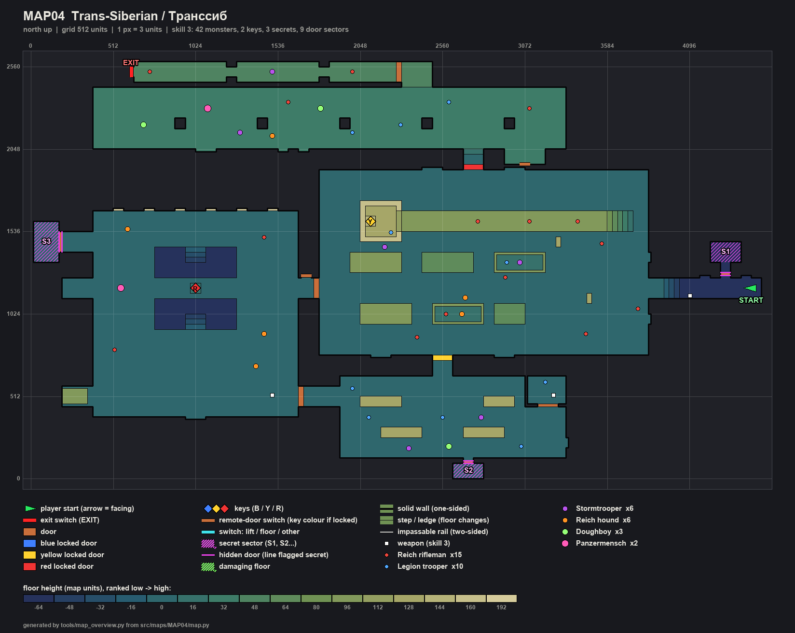
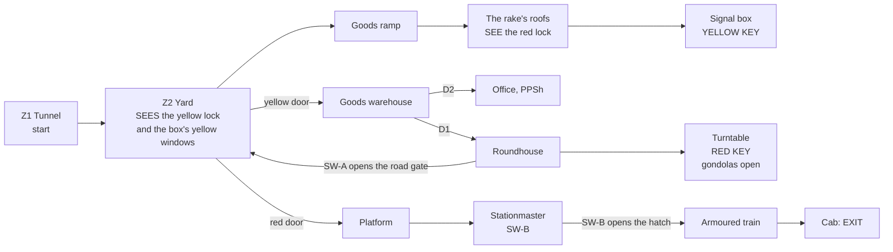

# MAP04 — «Транссиб» (Trans-Siberian), the Sverdlovsk marshalling yard

Design document. Owner: `level-designer`. Status: **v1 BUILT 2026-10-22
(§13): the whole floor plan, textured with the approved sets, populated on
skills 1-5, three secrets; not yet walked, not yet run in the engine.** Episode
2, «The Road to Moscow», opens here (D104, phase P4). Built MVP first (D60)
the way MAP02 and MAP03 reached their v1: complete and finishable, balance
after the playtests. A working brief for the PM; the CEO's verdict comes from
walking the map, not from reading this (D28). Source: `src/maps/MAP04/map.py`;
tests: `tests/test_map04_transsib.py`; route: `transsib-critical` in
`tools/route.py`; overview: `docs/levels/shots/MAP04-overview.png`. Russian
mirror: owed at the phase close (D34).

> **Walk it** (the PM or the CEO; agents never start GZDoom, D26):
> `python3 tools/build.py && SD_ALLOW_ENGINE=1 MAP=MAP04 SKILL=3 tools/run.sh`.
> **Route it:** `SD_ALLOW_ENGINE=1 python3 tools/route.py --route transsib-critical --keep-evidence`
> (skills 2, 3, 4).

Inputs this document obeys and does not restate: `docs/PRD.md` (D35 for the
factions, D58 for MAP02's unfound pass, D60 for MVP first, D104 for episode
2), `docs/product/LORE.md`, `docs/engine/BESTIARY.md`,
`docs/engine/BALANCE.md`, `docs/engine/MOD-SPEC.md` (DoomEdNums, keys,
MAPINFO), `docs/art/TEXTURE-INDEX.md` (approved lumps only) and the method of
`docs/levels/MAP03-factory.md`, whose structure this document follows.



## 1. Synopsis

November 1977. Out of Tankograd by a service tunnel, Sergeant Vilanova comes
up into the Trans-Siberian's marshalling yard at Sverdlovsk, where the Fourth
Reich holds the tracks and the roundhouse and the Liberty Legion the signal
box and the goods depot; he takes the signalman's pass from the box over the
wagons, the depot master's pass from the turntable, and boards the Soviet
armoured train waiting at the passenger platform, which carries him west.

## 2. Its place in the campaign

| | |
|---|---|
| Comes after | MAP03 Tankograd, which ends episode 1 at the portal (cluster 1, `endtitle`). Episode 2 starts a new game on MAP04 (the scaffolding's `episode MAP04` in MAPINFO): a **pistol start**, so the map hands out the IZh, the PPSh and the RPG-7 on its route. |
| Its number | MAP04, the first map of episode 2; MAP05 (the Volga dam) follows through cluster 5's text. |
| What it adds | **vertical traversal** (the boxcars' roofs are the way to the first key), the first **trap sprung by a pickup** (the red key drops the gondolas' sides), **an exit that is a vehicle** (the armoured train's cab), and a hub seen from above. |
| Factions (D35) | the Reich holds the yard and the roundhouse (the locomotives, its war machine); the Legion the signal box and the goods warehouse (the supplies); **both** on the platform and in the train, and the gondolas' counter-attack is mixed. Both banners hang side by side over the station. |
| Climax | the passenger platform, the armoured train alongside: a Panzermensch on every skill, Doughboys, both factions; the heavy Panzermensch on skill 4. |
| Exit | the regulator in the locomotive's cab (`SDSW1D`, the hazard panel every exit wears). |

## 3. What the map has to do

| Job | How the layout does it |
|---|---|
| Be a railway yard | four tracks across the yard, wagons on them (boxcars in rust, a military wagon in armour plate, flatcars a crate high, two open gondolas), two signal masts, a raised **signal box** with windows all round, a **roundhouse** with a turntable whose bridge carries a track, a goods warehouse with crate stacks, a passenger platform with a coping edge and canopy columns, and the **armoured train** on the platform's track. |
| Use the wagons | rows of wagons are **cover** in the yard (96 high: a monster behind one is hidden, the player too); a coupled **rake of four boxcars** is a raised walkway 1280 long, reached by the goods ramp at its east end, with snipers on it; the only way into the signal box is along those roofs. |
| Teach the key grammar again (D58) | the **yellow lock is the first thing seen** out of the tunnel (lit yellow in the yard's south wall); the signal box's **yellow windows glow over the wagons** from the same spot; the **red lock** is seen from the roofs, below in the north wall, in round 0. Each key lies alone, lit 192, on a pedestal in its lock's colour, and is seen from where its room is entered (tested). |
| Ritmo creciente | hit points met per round of the route grow round on round on every skill (tested): tunnel and yard, then warehouse and roundhouse, then gondolas and platform; the train is the coda. |
| End the episode's first leg | the exit is boarding the armoured train: through its rear hatch (opened by SW-B in the stationmaster's office), down the troop wagon, the gun wagon and the engine room to the cab. |

Target length: 10–12 minutes first run on skill 3 (MAP03's), about 5 once
known. Extent 4528 × 2592 units (MAP03: 3776 × 2144); tested to stay
within 1.5 × MAP03's area.

## 4. Plan

To scale, one character = 64 × 64 units, north up, x east (0 … 4544), the
row label the cell's south edge; generated from the built map. Floors: yard,
warehouse, roundhouse **0**; tunnel and turntable pit **−64**; roofs **96**;
signal box **128**; platform **32**; train **48**.

```
     y
  2496            ttttttttttttttttttttttttt#bbb
  2432            ttttttttt tttttttt tttttt#bbb      <- the armoured train; E = exit at its west end
  2368        PPPPPPPPPPPPPPPPPPPPPPPPPPPPPPPPPPPPPPPPPPPPPP
  2304        PPPPPPPPPPPPPPPPPPPPPPPPPPPPPPPPPPPPPPPPPPPPPP
  2240        PPPPPPPPPPPPPPPPPPPPPPPPPPPPPPPPPPPPPPPPPPPPPP
  2176        PPPPPPPP PPPPPPP PPPPPPP PPPPPPP PPPPPPP PPPPP   (canopy columns)
  2112        PPPPPPPPPPPPPPPPPPPPPPPPPPPPPPPPPPPPPPPPPPPPPP
  2048        PPPPPPPPPPPPPPPPPPPPPPPPPPPPPPPPPPPPPPPPPPPPPP
  1984                                            PP  BBBB   B = stationmaster, SW-B
  1920                                            ##  BBBB   ## = the RED door
  1856                              ............qqqqqq..............
  1792                              ................................
  1728                              ================================
  1664                              ....CCCC........................
  1600        HHHHHHHHHHHHHHHHHHHH  ....CCCCrrrrrrrrrrrrrrrrrrrr//..
  1536  222   HHHHHHHHHHHHHHHHHHHH  ....YCCCrrrrrrrrrrrrrrrrrrrr//..   Y = the YELLOW KEY
  1472  222LLLHHHHHHHHHHHHHHHHHHHH  ....CCCC........................
  1408  222LLLHHHHHHHHHHHHHHHHHHHH  ................................      111
  1344  222   HHHHHHppppppppHHHHHH  ...wwwww..wwwww..ggggg..........      111
  1280        HHHHHHppppppppHHHHHH  ...wwwww..wwwww..ggggg..........       1
  1216        HHHHHHppppppppHHHHHHA ................................     T T T
  1152     LLLHHHHHH---R----HHHHHHH#================================T//TTTTTTTT  <- start
  1088     LLLHHHHHH--------HHHHHHH#................................T//TTTTTTTT
  1024        HHHHHHppppppppHHHHHH  ....wwwww..ggggg.www............
   960        HHHHHHppppppppHHHHHH  ....wwwww..ggggg.www............
   896        HHHHHHppppppppHHHHHH  ................................
   832        HHHHHHHHHHHHHHHHHHHH  ................................
   768        HHHHHHHHHHHHHHHHHHHH  .........yyyyyy.................
   704        HHHHHHHHHHHHHHHHHHHH             ##                     ## = the YELLOW door
   640        HHHHHHHHHHHHHHHHHHHH             WW
   576        HHHHHHHHHHHHHHHHHHHH    WWWWWWWWWWWWWWWWWWOOOO
   512     wwLHHHHHHHHHHHHHHHHHHHHWWWWWWWWWWWWWWWWWWWWWWOOOO
   448     wwLHHHHHHHHHHHHHHHHHHHHWWWWWWwwwwWWWWWWWWwwwWOOOO
   384        HHHHHHHHHHHHHHHHHHHH    WWWWWWWWWWWWWWWWWWWWWW
   320                                WWWWWWWWWWWWWWWWWWWWWW
   256                                WWWWwwwwWWWWwwwwWWWWWW
   192                                WWWWWWWWWWWWWWWWWWWWWW
   128                                WWWWWWWWWWWWWWWWWWWWWW
    64                                            3
     0                                           333
```

Legend: `T` service tunnel (start at its east end) and its refuge niches, `/`
stairs and the goods ramp · `.` the yard, `=` its tracks, `w` wagons and
crate stacks (props), `g` the gondolas, `r` the rake's roofs (96), `y` and
`q` the yellow and red doors' portal bands · `C` the signal box (128), its
window sills, `Y` the lever frame and the **yellow key** · `W` goods
warehouse, `O` its office (D2, the PPSh) · `H` roundhouse, `p` the turntable
pit (−64), `-` its bridge, `R` the king post and the **red key**, `L` the
stalls, `A` SW-A beside the road gate (`#` at the yard's west wall) · `P`
platform, `B` stationmaster's office (SW-B), `b` the train's rear balcony,
`t` the armoured train, `#` its rear hatch, the exit at its west end ·
`1` `2` `3` the secrets.

| # | Zone | x | y | floor | ceil | light |
|---|---|---|---|---|---|---|
| Z1 | Service tunnel (start), tubbing, a track | 4032…4544 | 1120…1248 | −64 | 64 | 112 |
| — | Stair, 3 steps of 16; the mouth | 3936…4032; 3840…3936 | 1120…1248 | −48…−16; 0 | 128 | 112; 128 |
| — | Refuge niches (S1's is the middle one, 96) | 4160…4480 | 1248…1264 | −64 | 64 | 112 / 96 |
| Z2 | The yard (night; the ceiling stands in for the sky) | 1792…3840 | 768…1920 | 0 | 384 | 128 |
| — | Wagon rows 1 and 2 (boxcar 96, military wagon 96, flatcars 64, gondolas 96 with a bed at 16) | 1984…3072 | 960…1088, 1280…1408 | 64 / 96 | 384 | 128 / 112 |
| — | The rake's roofs, four boxcars coupled | 2304…3584 | 1536…1664 | 96 | 384 | 128 |
| — | The goods ramp, 5 steps of 16 | 3584…3744 | 1536…1664 | 80…16 | 384 | 128 |
| — | Yellow door's portal band | 2368…2752 | 768…832 | 0 | 128 | **192**, yellow |
| — | Red door's portal band | 2560…2944 | 1856…1920 | 0 | 128 | **192**, red |
| Z3 | Signal box (on its tower), windows 160…208 all round | 2048…2304 | 1472…1728 | 128 | 240 | 176, yellow |
| — | Step from the roofs | 2272…2304 | 1536…1664 | 112 | 240 | 176 |
| — | Lever frame, the yellow key | 2080…2144 | 1568…1632 | 144 | 240 | **192**, yellow |
| Z4 | Goods warehouse (vestibule 2496…2624 × 640…736) | 1920…3328 | 128…640 | 0 | 256 | 144 |
| — | Office (D2), the PPSh | 3088…3328 | 464…640 | 0 | 128 | 128 |
| — | Passage west (D1 at its far end) | 1696…1920 | 448…576 | 0 | 128 | 144 |
| Z5 | Roundhouse | 384…1664 | 384…1664 | 0 | 320 | 128 |
| — | Turntable pit, two halves, 3 steps out of each | 768…1280 | 928…1440 | −64 | 320 | 128 |
| — | Turntable bridge (a track on it) | 768…1280 | 1120…1248 | 0 | 320 | 128 |
| — | King post, the red key | 992…1056 | 1152…1216 | 16 | 320 | **192**, red |
| — | Road out to the yard; its gate | 1664…1760; 1760…1792 | 1120…1248 | 0 | 128 | 128 |
| — | Stalls (a loco; a shut gate; the dark one, S2) | 192…384 | 448…576, 1120…1248, 1408…1536 | 0 | 192 / 128 | 112 / 96 |
| Z6 | Passenger platform, canopy columns | 384…3328 | 2048…2432 | 32 | 256 | 160 |
| — | Red door's vestibule and step | 2688…2816 | 1952…2048 | 0, 16 | 128 | 160 |
| — | Stationmaster's office (SW-B) | 2944…3200 | 1952…2048 | 32 | 160 | 144 |
| — | The train's rear balcony | 2304…2496 | 2432…2592 | 48 | 176 | 128 |
| Z7 | Armoured train: troop wagon, gun wagon, engine room, cab | 640…2272 | 2464…2592 | 48 | 176 | 128 / 144 |
| E | Exit niche (the regulator) | 624…640 | 2496…2560 | 48 | 176 | **192** |

Every height is a multiple of 16; no step up is over 16 (tested).

## 5. Progression, keys, switches and the exit



**The keys.** Doom's yellow and red keycards (editor numbers **6** and
**13**, locks **3** and **1**, read from `gzdoom.pk3 → lockdefs.txt`, as on
MAP03), drawn by Freedoom until we have our own. In the fiction: the
**signalman's pass** on the signal box's lever frame, and the **depot
master's pass** on the turntable's king post.

| Id | Where | Type | Special | Can it lock the player out? |
|---|---|---|---|---|
| D1 | Warehouse passage → roundhouse | manual door, `SDDOOR1` | `Door_Raise` (1), both faces | no |
| D2 | Warehouse → its office | manual door, `SDDOOR1` | `Door_Raise` (2), both faces | no |
| **YD** | Yard's south wall → warehouse, 128 wide, between two star plaques | **locked, opens for good**, `SDDOORY` | `Door_LockedRaise (4, 16, 0, 3, 0)`, both faces | no |
| **RD** | Yard's north wall → platform, 128 wide, between whitewashed brick | **locked, opens for good**, `SDDOORR` | `Door_LockedRaise (5, 16, 0, 1, 0)`, both faces | no |
| GATE (SH) | Roundhouse's road → yard, 128 wide | remote, opens for good | tag 10. Steel from the road; **the yard's own brick from the yard**, wall until it opens | no |
| SW-A | The road's north wall, beside the gate | `SDSW1B` (push button), one-shot | `Door_Open (10, 16, 0)` | no |
| HATCH | The armoured train's rear end, from its balcony | remote, opens for good, `SDDOOR1` both faces | tag 11 | no |
| SW-B | Stationmaster's office, back wall | `SDSW1A` (knife switch), one-shot | `Door_Open (11, 16, 0)` | no |
| GONDOLAS | The two open wagons' sides towards the main track | lift, lowers for good | tag 12, `Floor_LowerToLowest (12, 16)` carried by **the red key's thing** (picked up) | no (never needed) |
| EXIT | West wall of the cab, a 64 × 128 niche | `SDSW1D` | `Exit_Normal (0)` | — |

**The order, as the tests play it** (`test_the_route_is_the_designed_one`),
four rounds:

1. With the push panels only: tunnel, yard, the ramp and the roofs, the
   signal box, **the yellow key** (S1 can be taken).
2. The yellow door: the warehouse (D2, its office), the passage (D1), the
   roundhouse, **the red key** (S2 and S3 can be taken).
3. The red door, SW-A's road gate (a shortcut back into the yard) and the
   gondolas (the red key's pickup): the platform, the stationmaster's office.
4. SW-B: the hatch, the train, **the exit**.

**Signposting** (MAP02's lesson, D58, and MAP03's rules):

- **The yellow lock is the first view.** From the tunnel's mouth the yellow
  door is seen lit in the yard's south wall past the end of the first row
  of wagons (tested), and above the second row the signal box's windows
  glow yellow (tested): lock and key's room in one look.
- **The red lock is seen before its key**, from the roofs, below in the
  north wall (tested, round 0).
- **Each key lies alone, lit, on the route**, in its lock's colour, and nothing
  else wears that colour (tested): the yellow key on the lever frame, seen
  along the roofs through the box's door (tested from three points); the red
  key on the king post, seen from the roundhouse's door (tested), with no
  monster on either sight line at spawn (tested).
- **Each switch is in sight of what it opens.** SW-A is in the road's own
  wall, the gate in front of it (tested); SW-B looks out of the office across
  the platform at the train's hatch (tested); from the open hatch the exit
  is seen down the train (tested).

**Softlock rules** (MAP01 §4, MAP02 §5, MAP03 §5): no door closes behind the
player (locks and remote doors open for good, manual doors reopen from both
sides); no lift the player rides (the gondolas' sides only open); every drop
has its climb back in the same zone (roofs → ramp, pit → its steps, the
tunnel's stair); the signal box's windows are 48 high, seen through, never
climbed through. Tested at every stage: from every sector the player can
reach there is a way back to the start, and at the end a way on to the exit;
**no secret, no gondola and not the road gate are needed** for the exit
(tested).

## 6. Intensity curve

```
  high |                                                     ########
       |                                       ####          ########  <- the platform,
 press |                         ####     ##   ####  ####    ########     the train alongside
  ure  |           ####  ##      ####     ##   ####  ####    ########  ##
       |   ##      ####  ##  ##  ####  ## ##   ####  ####    ########  ##  ##
   low |   ##      ####  ##  ##  ####  ## ##   ####  ####    ########  ##  ##
       +---------------------------------------------------------------------------->
        tunnel     yard  roofs box  ware- office round- turn- gondolas platform train cab
                                    house       house  table (yard)
        0:00                                                                     ~11:00
```

| Beat | Space | Feeling | Mechanic introduced |
|---|---|---|---|
| 1 | Tunnel, stair | out of Tankograd's dark; a picket at the top of the stair | continuity: tubbing and a track; the IZh in the tunnel before the first fight |
| 2 | The mouth | **the view**: the yard at night, the yellow lock, the box glowing yellow over the wagons | lock and key's room at one look |
| 3 | Yard | riflemen among the wagons, a hound in the aisles | wagons as cover |
| 4 | Ramp, roofs | **up**: snipers on the rake, the red lock below | the rake as a walkway; drops are free, the ramp is the way back |
| 5 | Signal box | close quarters in a lit glass box; the key on the frame | — |
| 6 | Warehouse | the Legion's depot, its first Doughboy among the crate stacks | the PPSh in the office |
| 7 | Roundhouse | the Reich's engines, hounds, a Panzermensch by the turntable (3+) | the RPG-7 at the door; the pit and its steps |
| 8 | Turntable | the red key on the king post: **the trap springs** in the yard behind | a pickup that does something |
| 9 | Road gate, yard again | SW-A opens the gate; the gondolas' troops are in the yard | a shortcut from behind (MAP02's SH, MAP03's shutter) |
| 10 | Platform | **climax**: both factions round the armoured train, Panzermensch, Doughboys, the heavy on 4 | — |
| 11 | Train | close quarters down the wagons to the cab | an exit that is a vehicle |

Hit points met per round (tested to rise from round 0 to round 2):

| Round | Skill 2 | Skill 3 | Skill 4 |
|---|---|---|---|
| 0 (tunnel, yard, roofs, box) | 300 | 400 | 590 |
| 1 (warehouse, roundhouse) | 920 | 1660 | 2110 |
| 2 (gondolas, platform) | 1110 | 1900 | 3070 |
| 3 (the train) | 80 | 100 | 600 |

## 7. Textures

### 7.1 By zone (all approved and packed; tested)

| Zone | Walls | Floor | Ceiling |
|---|---|---|---|
| Service tunnel | `SDTUBB1` (one tile, as MAP02 and MAP03's tunnels); niches `SDTUNL1` | `SDFLR2` + `SDRAIL1` strip (turned) | `SDCEIL2` |
| Stair, goods ramp, pit walls | `SDCONC1` | `SDFLR2` | — |
| Yard | `SDBRCK1`; signal masts `SDSTEL1`; the Reich's flag `SDFLAG1` either side of the mouth | `SDFLR2`, tracks `SDRAIL1` (turned) | `SDCEIL2` (placeholder for the night sky, §7.2) |
| Wagons | boxcars and gondolas `SDRUST1`; the military wagon `SDSTEL1`; flatcars `SDCRAT1` (one crate high) | roofs `SDFLR4`; flatcars `SDCRTOP1` | — |
| Lock portals | yellow: `SDSTAR1` plaques either side of `SDDOORY`; red: `SDBRCK2` either side of `SDDOORR` (MAP03 v1's rule) | `SDFLR2` | `SDCEIL1` |
| Signal box | `SDTILE2` inside, `SDBRCK1` tower outside; lever frame `SDSTEL1` | `SDFLR3`; frame `SDFLR4`; step `SDGRAT1` | `SDCEIL1` |
| Warehouse | `SDBRCK1`; passages `SDBRCK2`; crate stacks and S3's row `SDCRAT1`; the Legion's flag `SDFLAG2` | `SDFLR2`; stacks `SDCRTOP1` | `SDCEIL1` |
| Warehouse office | `SDTILE2` | `SDFLR3` | `SDCEIL1` |
| Roundhouse | `SDBRCK1`; clerestory `SDWIND1`; stalls' gates `SDGATE1`; the loco `SDSTEL1` | `SDFLR2`; tracks, bridge and stalls `SDRAIL1` (turned); king post `SDFLR4` | `SDCEIL2` |
| Platform | `SDMARB2` (the station's tile over red marble); the train's flank `SDSTEL1`; both flags | `SDMFLR2`; coping `SDMFLR3` (turned 180, MAP02's K7) | `SDCEIL1` |
| Stationmaster's office | `SDTILE2` | `SDFLR3` | `SDCEIL1` |
| Armoured train | `SDSTEL1` | `SDFLR4` | `SDCEIL2`; cab `SDCEIL1` |
| Doors, switches | `SDDOOR1` (D1, D2, the hatch), `SDDOORY`, `SDDOORR`; `SDSW1B` (SW-A), `SDSW1A` (SW-B), `SDSW1D` (exit) | | |
| Posters (§7.3) | `SDPOSTR1` Lenin, `SDPOSTR3` Stalin, `SDPOSTR2` the cosmonautics mural | niches: their room's floor | niches: `SDCEIL1` |

### 7.3 The posters (CEO 2026-10-22; `tests/test_posters.py`)

«Reutiliza cuadros [...] y en los nuevos el de Lenin y Stalin, que esos
posters puedan aparecer en cualquier nivel». Four pictures and two slots,
all in `POSTERS` in `map.py`; each is whole (one line exactly 128 long, in
a sector exactly the picture's height, pegged to the floor, offset 0).
Where the room is taller than the picture, the picture hangs at the back of
a 16-deep niche whose ceiling is cut to its height (the banners' method);
each niche is lit one lamp step (16) over its room so the face reads at
night. The niches are flush decoration: 16 deep, nobody stands in them,
and no route, key, lock or secret moves.

| Name | Picture | Where | Why |
|---|---|---|---|
| `yard_red_door_lenin` | Lenin | yard, north wall, niche x 2432-2560 (back at y 1936), west of the red door's portal | the station building's front on the yard: the rake's roofs look down on it with the red lock (§5) |
| `yard_red_door_stalin` | Stalin | yard, north wall, niche x 2944-3072 (back at y 1936), east of the red door's portal | Lenin's twin on the other side of the lock |
| `warehouse_legion_stalin` | Stalin | warehouse, east wall x 3328, y 320-448 (the room is 256: no niche) | **taken**: the Legion hung its banner (`SDFLAG2`, y 192-256) beside the Stalin that was already there |
| `platform_mural` | mural | platform, the building's wall, niche x 1024-1152 (back at y 2032), 128 high | the station's mural, facing the armoured train, west of the two factions' banners |
| `roundhouse_south` | Lenin (stand-in) | roundhouse, south wall, niche x 960-1088 (back at y 368), on the turntable stairs' axis | **Marx-Engels slot**: the depot's own poster |
| `warehouse_west` | Lenin (stand-in) | warehouse, west wall x 1920, y 320-448, beside the passage to the roundhouse | **Marx-Engels slot** |

**The Marx-Engels slots** (`POSTER_SLOTS_MARX_ENGELS`). `SDPOSTR4` is in
preparation and not a lump yet; both slots are built at 128×256 (the size
it is commissioned at, Lenin's and Stalin's) and wear Lenin until then. The
swap is one line in `map.py`: `MARX_ENGELS: str | None = None` becomes
`MARX_ENGELS = "SDPOSTR4"`, which also lists it in `WALL_TEXTURES`;
`tests/test_posters.py` checks that it moves the slots and nothing else.

§7.2 has no poster or propaganda row to replace: nothing pending changes.

### 7.2 Pending textures (the art-director's "Railway" set, in draft)

Where a railway piece would read better, v1 wears the nearest approved
lump. Each row is a swap in `src/maps/MAP04/map.py` (one named constant or
one zone's `wall`/`flat`) once the piece is approved; none blocks v1.

| # | Wanted | Kind | Where | v1 wears now |
|---|---|---|---|---|
| 1 | **Night sky** over the yard (a sky texture for `sky1`, and the ceiling flat `F_SKY1` on the yard, the roofs, the ramp, the gondolas and the signal box's tower) | sky | the yard is outdoors | `SDCEIL2` at 384, light 128. With a sky, the box's tower top and the yard's upper walls stop reading as a roof |
| 2 | **Boxcar side**: planked or corrugated wagon side with a sliding door, running gear below | wall 128×96 or 64×128 | boxcars and the rake | `SDRUST1` (corrugated rust) |
| 3 | **Wagon roof**: curved wagon roof seen from above, a walkway plank | flat 64 | the rake's roofs | `SDFLR4` (chequer plate) |
| 4 | **Gondola** (open wagon) side and bed | wall + flat | the two gondolas | `SDRUST1`, bed `SDFLR2` |
| 5 | **Ballast**: gravel between and under tracks; a track-on-ballast flat (`SDRAIL1` is a metro track bed on concrete) | flat 64 | yard floor, all tracks | `SDFLR2`, `SDRAIL1` |
| 6 | **Armoured train plating**: riveted armour with a gun port, a red star, «ЗА РОДИНУ» stencil (text-bearing: D27) | wall 128×128 | the train's flank on the platform, the gun wagon | `SDSTEL1` |
| 7 | **Locomotive cab**: gauges, regulator, firebox door; an exit-switch variant in the same language | wall 64×128 (+ switch pair) | the cab's walls; the exit | `SDSTEL1`; exit `SDSW1D` |
| 8 | **Signal lever frame**: a row of levers seen from above / a frame front | flat 64 + wall 64×16 | the lever frame (the yellow key's pedestal) | `SDFLR4`, `SDSTEL1` |
| 9 | **Signal box glazing** (lit from inside, seen from the yard) | wall 64×48 | the box's window openings (sills 160…208) | open: the windows are holes, `SDBRCK1` above and below |
| 10 | **Signal mast** (lattice or pole with a semaphore arm, masked mid-texture) | wall 32×128, masked | the two masts in the yard | `SDSTEL1` posts |
| 11 | **Turntable**: the pit's ring rail flat, the bridge's girder side | flat 64 + wall 64×64 | the pit floor, the bridge's flanks | `SDFLR2`, `SDSTEL1` |
| 12 | **Roundhouse stall doors**: wooden engine-shed doors | wall 128×128 | stalls 2 and 3 (S2's panel is the third) | `SDGATE1` |
| 13 | **Station sign** «СВЕРДЛОВСК-СОРТИРОВОЧНЫЙ» (text-bearing: D27, render on one machine) | wall 256×64, mid-texture | over the platform | none |
| 14 | **Platform canopy** columns (cast-iron) and canopy ceiling | wall 64×128, flat | the five canopy columns | `SDMARB2` (the columns are carved out of the platform) |
| 15 | **Loco** front (a steam engine's smokebox door) as a prop face | wall 128×96 | stall 1's locomotive | `SDSTEL1` |
| 16 | **The yard's goods sheds** wall (timber) | wall 64×128 | the yard's north wall | `SDBRCK1` |

Sprites (art-director's; classes `mod-engineer`'s), optional: buffer stops,
a water crane, lamp posts with light (v2 light pass), wagon wheel sets.

## 8. Secrets

MAP01's rule: a clue is a comparison or a question, never a sign; each
secret has its way back (tested), none is needed (tested).

| # | Where | Clue (tested) | Reward (every skill) |
|---|---|---|---|
| S1 | The service tunnel, behind the middle refuge niche | three niches; the middle one is in shadow (96 against 112) and its back is a prefab panel (`SDCONC1`) where the other two show the tunnel's boarded concrete with cables (`SDTUNL1`): a cable box that is a push panel | flak vest, two stimpacks (early help on a pistol start) |
| S2 | The roundhouse's third stall | two stalls end in a shut gate; the third is dark (96 against 112), and its gate is a push panel | **the ROKS-3** a map early, and two fuel canisters |
| S3 | The warehouse's south wall | four crates fill a stretch of it; the third stands 16 back, in shadow | heavy vest, a box of PG-7V (for the platform) |

Each panel is `Door_Open` (pushed, opens for good) on both faces, flagged
`secret`; each store is a sector with special 1024. S1 is open in round 0,
S2 and S3 in round 1 (tested).

## 9. Enemies and resources by skill

The bestiary's own numbers (21100-21107; MAPINFO DoomEdNums), every class
but the General (he fell at Tankograd). Nested by Doom's skill pairs
(`skill_tier`): 1-2, 3, 4-5.

| Zone | Skill 2 | Skill 3 | Skill 4 |
|---|---|---|---|
| Tunnel mouth | 1 rifleman | 1 rifleman | 2 riflemen |
| Yard (ground) | 3 riflemen + 1 hound | 4 riflemen + 1 hound + 1 stormtrooper | 5 riflemen + 1 hound + 2 stormtroopers |
| The rake's roofs | 2 riflemen | 3 riflemen | 3 riflemen + 1 stormtrooper |
| Signal box | 1 trooper | 1 trooper | 2 troopers |
| Warehouse + office | 4 troopers + 1 stormtrooper + 1 Doughboy | 5 troopers + 2 stormtroopers + 1 Doughboy | 6 troopers + 2 stormtroopers + 2 Doughboys |
| Roundhouse | 2 hounds + 2 riflemen | 3 hounds + 2 riflemen + 1 Panzermensch | 3 hounds + 3 riflemen + 1 Panzermensch |
| Gondolas (the red key) | 1 trooper + 1 rifleman | + 1 stormtrooper + 1 hound | 2 troopers + 1 rifleman + 2 stormtroopers + 1 hound |
| Platform | 1 Panzermensch + 2 troopers + 2 riflemen + 1 stormtrooper + 1 Doughboy | + 1 trooper + 1 Doughboy + 1 hound | 1 Panzermensch + 3 troopers + 3 riflemen + 2 stormtroopers + 2 Doughboys + 1 hound + **1 heavy Panzermensch** |
| Armoured train | 1 stormtrooper + 1 rifleman | + 1 rifleman (the cab) | + 1 Panzermensch (the gun wagon) |
| **Total** | **29** | **42** | **56** |

Against MAP03's 25 / 38 / 52 (with the General's 3000 HP on every skill):
a little more in numbers, less in weight; the first map of an episode.

**Weapons** (pistol start): the IZh in the tunnel, before the first fight;
the PPSh in the warehouse office; the RPG-7 at the roundhouse's door, nearer
it than the roundhouse's Panzermensch (tested); the ROKS-3 in S2 only. No
Hand Katyusha.

**Ammunition** (G3-8's ruler, MAP03's: shells to kill; placed on the route,
secrets not counted; tested ≥ 1.35 × on every skill, < 3 × on skill 4, and
at every stage of the route against the hit points met so far):

| | Skill 2 | Skill 3 | Skill 4 |
|---|---|---|---|
| Needed (shells) | 55 | 89 | 134 |
| Placed (shell-equivalents) | 250 | 242 | 199 (1.48 ×) |
| Shells / boxes of 20 | 10 / 7 | 8 / 7 | 5 / 6 |
| Clips / boxes of 50 | 4 / 3 | 3 / 3 | 2 / 3 |
| PG-7V / boxes of 5 | 3 / 3 | 3 / 3 | 3 / 2 |

Skills 2 and 3 are generous by design (the ruler counts rockets at two
shells each); the playtests decide (D60).

**Health and armour on the route:** stimpacks 9 / 8 / 5, medikits 6 / 6 /
4, health bonuses 9, armour bonuses 7 / 7 / 6, one flak vest (the
warehouse). The heavy vest is S3's.

## 10. Engine elements used

| Need | Emitted | Status |
|---|---|---|
| Manual door | `Door_Raise` 12 (tag, 16, 150, 0) | VERIFIED on MAP01 |
| Remote door, one-shot switch | `Door_Open` 11 (tag, 16, 0) | VERIFIED on MAP01 |
| Locked door that stays open | `Door_LockedRaise` 13 (tag, 16, 0, lock, 0), locks 3 and 1 | VERIFIED on MAP02 / MAP03 (route G6) |
| Exit | `Exit_Normal` 243 | VERIFIED on MAP01 |
| Keys | things 6 (`YellowCard`), 13 (`RedCard`) | as MAP03 |
| **A pickup's special** | thing `special` 21, `arg0` 12, `arg1` 16 on the red key | the field is UDMF base (as MAP03's General's death special); GZDoom runs an item's special on pickup (`Inventory`'s pickup path, read in g4.14.2's zscript). **NOT VERIFIED in play**: K3 |
| **Floor_LowerToLowest** | special 21 (tag, speed) | number from ZDoom's (Hexen's) special table, the action `xlat/doom.txt` maps Doom's lower-floor lines to; **NOT VERIFIED** in our engine (the numbers are compiled in): K3 |
| Coloured light | sector `lightcolor` yellow `0xFFD860`, red `0xFF6048` | as MAP03 |
| Turned flats | `rotationfloor` 90 on tracks, 180 on the coping | as MAP02 (K7, K8) |
| Secrets | sector `special` 1024; panel lines flagged `secret` | as MAP01-MAP03 |

Tag plan: **1** D1 · **2** D2 · **4** yellow door · **5** red door · **6**
S1's panel · **7** S2's panel · **8** S3's panel · **10** the road gate
(SW-A) · **11** the train's hatch (SW-B) · **12** the gondolas' sides (the red
key's pickup; no line carries it). Free: 3, 9, 13 and up.

## 11. MAPINFO, LANGUAGE and the route

MAPINFO and LANGUAGE are the scaffolding agent's (P4): `map MAP04 lookup
"SD_MAP04_NAME"`, `cluster = 5`, `next = "MAP05"`, `SD_MAP04_NAME` =
"Trans-Siberian" / «Транссиб» / "Transsiberià", and `SD_MAP04_EXIT_TEXT`
(the armoured train clears the yard and runs west). This role does not
touch them.

`transsib-critical` (`tools/route.py`) is the map's g3-auto, tankograd-
critical's method: A0 (start, no key); YD0 and RD0 (both locks pressed with
no key: shut); YKEY (walk onto the yellow key on the lever frame, no
`give`); YD1 (the yellow door opens, walk into the warehouse); RDY (the red
door shut on the yellow key alone); RKEY (walk onto the red key on the king
post); SWA (the road gate opens, the hatch still shut); RD1 (the red door,
walk onto the platform); SWB (the hatch opens); E0 (from the rear balcony,
through the hatch, down the train to the cab); E1 (the regulator). Every
position is read off the built map (keys by editor number, switches by tag,
doors by tag and lock, E0 by the ray out of the exit niche past the hatch's
tag); the map is found by its constants (`TAG_HATCH`, `TURNTABLE`), never by
its slot. Its exit is judged against MAPINFO's `next` (MAP05).

## 12. Version plan

| Version | Content | Done when |
|---|---|---|
| **v1 — complete, textured, populated** ✅ **BUILT 2026-10-22** (§13) | the whole plan of §4, both keys and locks, both switches, the hatch, the exit, the rake and the box, the turntable, the gondolas' trap, three secrets, §9's population and resources, the approved sets (§7.1) | the PM's engine pass (§13.3) and the CEO walks it on skill 3 |
| v2 — the Railway set and light | §7.2 as the art-director's pieces are approved (the sky first); floodlight pools and the box's lamp, flicker in the roundhouse; buffer stops, a water crane | a first-time player finds both keys and the train without being told |
| v3 — balance | after the playtests (D60): skills 2-3's ammunition, the platform's weight | the episode's first map is played through on skill 3 |

## 13. v1 build record (2026-10-22)

### 13.1 What is in it

Everything in §4-§9: 104 sectors, 481 lines, 132 things (the start, two
keys, 56 monsters on skill 4, 3 secrets). Built in one pass with `GridMap`,
as MAP03 v1. The posters (§7.3, 2026-10-22) add four niche sectors: 108.

### 13.2 Verification actually run

- `python -m unittest tests.test_map04_transsib -v`: 66 tests, OK (structure,
  textures, light, the four rounds, no trap, the key grammar's sight lines,
  switches, the gondolas, population, ammunition, secrets).
- `python tools/route.py --print --route transsib-critical`: the sequence
  builds (12 steps, 2741 characters, under the 8000 limit).
- `python tools/verify.py fast` (2026-10-22, with MAP05 and MAP06 landing in
  parallel): build and check_pk3 PASS; tests 2441, 3 failures, none in
  this map's files. The one that names MAP04 is
  `test_doughboy_sprites.MapFitTests.test_the_doughboy_is_placed_in_every_map`,
  which compares the maps that place a Doughboy with a fixed set
  (MAP01-MAP03, RANGE): episode 2's maps place one too, so its expected
  set needs MAP04-MAP06 (its owner's change). The same test file's fit
  checks pass on MAP04, as do the Panzermensch's and the Schwer's.
- **Not run: GZDoom** (D26). Nothing here has been seen in the engine.

### 13.3 Engine checklist for the PM (D26: this role does not start GZDoom)

| # | Check | How |
|---|---|---|
| K1 | The map loads with a clean log, MAP04 from the episode-2 New Game | `tools/smoke.py` / `run.sh` with `MAP=MAP04` |
| K2 | `transsib-critical` PASSes on skills 2, 3, 4 | `SD_ALLOW_ENGINE=1 python3 tools/route.py --route transsib-critical --keep-evidence` |
| K3 | **Picking up the red key drops both gondolas' sides** (special 21 on the key's thing) and the troops come out | walk RKEY, then look at the yard; `netevent sdtag 12` should print floor 0 for both sides |
| K4 | The windows of the signal box read as windows from the yard (48-high openings at 160) and the yellow light shows through them | a screenshot from the tunnel's mouth |
| K5 | The rake is walkable end to end (no snag at the couplings: four sectors at 96) and the drop to the yard is not fatal | walk it |
| K6 | The coping's lip lies on the train's side (`rotationfloor` 180, as MAP02's K7) | a screenshot on the platform |
| K7 | Monsters in the gondolas do not see out before the trap (their bed is 16, the sides 96) | watch from the ground; from the roofs they can be seen and shot, by design |
| K8 | The yard's ceiling at 384 reads as night, not as a low roof (until §7.2 #1) | a screenshot |
| K9 | The posters (§7.3) are whole and read: the two at the red door from the rake's roofs (light 144 in a 128 yard), the warehouse's Stalin beside the Legion banner, the platform's mural, the roundhouse's slot over the turntable; none is cut at the top or tiled, and the 16-deep niches do not snag a strafe along the walls | screenshots from the roofs, the warehouse's vestibule, the platform and the bridge |

### 13.4 Open points for the CEO

1. **Walk v1** on skill 3 (D28): is the rake of boxcars a good way to the
   signal box, and is the yellow box read from the tunnel's mouth?
2. **The night sky** (§7.2 #1): the yard is outdoors in the fiction; a sky
   is the first piece of the Railway set this map wants.
3. **The ROKS-3 in S2.** A map early, as a secret (MAP03 gave it on the
   route); or keep S2 for armour and let MAP05 hand it out?
4. **The red key's trap** (the gondolas open when it is taken): kept, or
   tied to SW-A like MAP03's closets?

### 13.5 What other roles hold

- `art-director`: the Railway set (§7.2), the sky first.
- `mod-engineer` / scaffolding: MAPINFO and LANGUAGE for MAP04 (done by the
  P4 scaffolding agent), the episode's music.
- `qa-engineer` / the PM: §13.3's engine pass.
