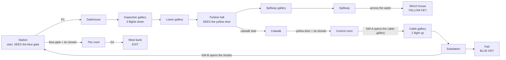

# MAP05 — «Волжская ГЭС» (Volga Dam), the hydroelectric station at Zhiguli

Design document. Owner: `level-designer`. Status: **v1 BUILT 2026-10-22
(§13): the whole map, walkable from start to exit, textured with approved
lumps only, populated, three secrets; not yet walked, no engine pass yet
(D26).** Episode 2, «The Road to Moscow» (D104, phase P4), second map. Built
MVP first (D60). Source: `src/maps/MAP05/map.py`; tests:
`tests/test_map05_dam.py` (the map) and `tests/test_map05_route.py` (its
automatic route); route `dam-critical` in `tools/route.py`; overview
`docs/levels/shots/MAP05-overview.png`. Russian mirror: owed at the phase
close (D34).

> **Walk it** (the PM or the CEO; agents never start GZDoom, D26):
> `python3 tools/build.py && SD_ALLOW_ENGINE=1 MAP=MAP05 SKILL=3 tools/run.sh`.
> Automatic run: `SD_ALLOW_ENGINE=1 python3 tools/route.py --route dam-critical --keep-evidence`.

Inputs this document obeys and does not restate: `docs/PRD.md` (D35 the
factions, D58 the unfound pass, D60 MVP first, D104 episode 2),
`docs/engine/BESTIARY.md`, `docs/engine/BALANCE.md`, `docs/engine/MOD-SPEC.md`
(DoomEdNums, locks, the passes), `docs/art/TEXTURE-INDEX.md` (approved lumps
only) and the method of `docs/levels/MAP03-factory.md`.


## 1. Synopsis

November 1977. The armoured train brings Sergeant Vilanova across the Volga
to the station on the east bank of the Zhiguli dam, level with its crest,
where a gate bars the road west; he goes down into the dam, takes back the
turbine hall, the spillway and the control room from the Fourth Reich and
the Liberty Legion, climbs the cable gallery to the substation for the
gate's pass, and fights his way west along the crest to the far bank.

## 2. Its place in the campaign

| | |
|---|---|
| Comes after | MAP04, the Trans-Siberian railway yard: its exit text (`SD_MAP04_EXIT_TEXT`) ends "Across the water stands the dam at Zhiguli… This morning the turbines are still." MAP05 starts on the station's platform, beside the armoured train (a steel block on the rails, blocking the tunnel it came out of). |
| Comes before | MAP06, Red Square. The exit text (`SD_MAP05_EXIT_TEXT`) begins "You cross the crest of the dam with the spillway roaring below. Behind you the turbines turn again": the crest is the last walk, the spillway is under it, and SW-A in the control room is the shift chief's knife switch. |
| What it adds | **verticality** (three levels 384 apart in all, a descent and a climb through the concrete), **water** (a light sting), a key behind the other key's door (yellow → blue), a **shortcut found from behind** that saves the long walk back, and two **counter-attacks on the locks' own tags**. |
| Factions (D35) | both. The Legion holds the east bank's station and the open water of the spillway (its Doughboys fly there); the Reich runs the machine: the galleries, the turbine hall, the substation. Both man the control room and both hold the crest. The General is MAP03's and is not here. |
| MAPINFO, LANGUAGE | the scaffolding agent's (P4): `map MAP05 lookup "SD_MAP05_NAME"`, `cluster = 6`, `next = "MAP06"`, `sky1 = "SKY1"`, `par = 330`; names and texts in `[enu default]`, `[ru]`, `[ca]`. This role touches neither (§11). |

## 3. What the map has to do

| Job | How the layout does it |
|---|---|
| Be a dam | the crest runs 3552 units east–west at +384, the turbine hall lies at its foot (0) downstream, the spillway's channel (−64) runs from the sluice gates under the crest's parapet; the station and the exit are on the two banks at the crest's ends. From the spillway the player looks up 448 units at the crest's parapet; from the crest's west end he looks down into the spillway. |
| Use the height | the descent is three flights of seven steps inside the concrete (the inspection gallery), the catwalk in the turbine hall is twelve rises up, the climb back is one long flight in the cable gallery. No lift (MAP01 §4). |
| Teach the order of two keys | the **blue gate** onto the crest is the first thing seen (down the platform from the start, lit blue); the **yellow door** is high on the turbine hall's north catwalk, seen from the hall's floor as the player comes in; the **yellow key** lies across the spillway's water; the **blue key** behind the yellow door's climb, in the substation. Lock before key, both times (tested). |
| Answer D58 again | each key alone on a lit place (192, its lock's colour) on the route, seen from where that place is entered (tested: the yellow key from the spillway gallery's mouth across the water, the blue key from the cable gallery's top). |
| Reward knowing the map | SW-B opens a shutter from the substation straight into the station, 200 units from the blue gate; without it the way back is the long one (the cable gallery, the control room, the hall, the three flights up: about 3000 units). Tested as not needed. |
| Rise | three thirds by hit points met, each heavier than the one before on every skill, and the crest the heaviest beat of all (tested, §6). |

Target length: 12–15 minutes first run on skill 3 (MAP03 is 10–12); about
6 once known.

## 4. Plan

Generated from the built map, 64 × 64 units per character, north up. Floors:
crest, station, substation **+384**; catwalk and control room **+192**;
turbine hall, galleries, spillway walkways **0**; the channel **−64**.

```
     y   x 384 .................................................................. 5056
  1984   XX RRRRRRRRRRRRRRRRRRRRRRccRRRRRRRRRRRRRRRRRRRRRRccRRRRRRR  SSSSSSSSS
  1920   XX#RRRRRRRRRRRRRRRRRRRRRRRRRRRRRRRRRRRRRRRRRRRRRRRRRRRRRRRBbSSSSooooo
  1856   XX#R-----------------------------------------------------RBb----ooooo   <- the train
  1792   XX RRRRRRRRRRRRRRccRRRRRRRRRRRRRRRRRRRccRRRRRRRRRRRRRRRRRR  SSSSSSSSS
  1728      ========================== RR ========== ## ===========  SSSSSSSSS   @ start (4704, 1664)
  1664    WWWWWW~~~~WWWW              RRRR          3333             SSSSSSSSS
  1600    WWWWWW~~~~WWWW              RRRR          3333  UUUUUUUUU  SSSSSSSSS
  1536    WWWWWW~~~~WWWW                                  UUooUUUUUU#SSSSSSSSSkk
  1472    WWWWWW~~~~WWWW                                  UUooUUUUUU#SSSSSSSSSkk
  1408    WWWWWW~~~~WWWW                                  UUooUUUUU  SSSSSSSSS
  1344    WWWWWWs~ssWWWW                                  UUUUUUUUU     ## kk
  1280    WWWWWWs~ssWWWW                                  UUUUU22UU    GGGGkk
  1216    WWWWWW~~~~WWWW              CCCCCCCCCC          UUUUU22UU    GGGG
  1152    WWWWWW~~~~WWWW              CCCCCCCCCC          UUUUUUUUU    GGGG
  1088    WWWWWW~~~~WWWW              CccCCCCccCKKsssssKKKUUUUUUUUU     ss
  1024    WWWWWW~~~~WWWW              CCCCCCCCCCKKsssssKKKUUooUUooU     ss
   960    W111WW~~~~WWWW           kk CCCCCCCCCC    kk    UUooUUooU     ss
   896    W111WW~~~~WWWW           kk CCCCCCCCCC    kk    UUooUUooU     ss
   832    W111WW~~~~WWWW    sssssHHHHHHHHHyyHHHHHHHHHHHH               LLLL
   768    WWWWWW~~~~WWWW    sssssHHHHHHHHHyyHHHHHHHHHHHH               LLLL
   704    WWWWWW~~~~WWWW    HHHHHHHHHHHHHHHHHHHHHHHHHHHH                ss
   640    WWWWWW~~~~WWWW    HHHHHHHHHHHHHHHHHHHHHHHHHHHH                ss
   576    WWWWWW~~~~WWWW    HHHHHHHHHHHHHHHHHHHHHHHHHHHH                ss
   512    WWWWWWs~ssWWWW    HHHHHHHHHHHHHHHHHHHHHHHHHHHHgggggggggggssssLLLL
   448    WWWWWWs~ssWWWW    HHHoooHHHoooHHHoooHHHoooHHHHgggggggggggssssLLLL
   384    WWWWWW~~~~WWWW    HHHo oHHHo oHHHo oHHHo oHHHH     #
   320    WWWWWW~~~~WWWWWWWWHHHoooHHHoooHHHoooHHHoooHHHH     2
   256    WWWWWW~~~~WWWWWWWWHHHHHHHHHHHHHHHHHHHHHHHHHHHH   22222
   192    WWWWWW~~~~WWWW    HHHHHHHHHHHHHHHHHHHHHHHHHHHH   22222
   128    WWWWWW~~~~WWWW    HHHHHHHHHHHHHHHHHHHHHHHHHHHH   22222
    64           ##
 -128          1111      (S1, the drain, down to y -224)
```

Legend: `S` station (start) · `-` rails · `o` the armoured train, the
generators (the blank in each is its solid shaft) and the transformers ·
`b` the blue gate's portal, `B` the **blue gate** · `G` gatehouse · `s`
stairs and steps · `L` the inspection gallery's landings · `g` lower gallery
· `H` turbine hall; its north strip at 768–896 is the catwalk (+192), `y`
the yellow door's portal on it (the **yellow door** is just north) · `C`
control room, `c` consoles and the crest's barricades · `K` cable gallery ·
`U` substation, `2` (in it) the **blue key's** pad · `W` spillway walkways,
`~` the channel, `1` (in it) the winch house with the **yellow key** · `R`
the crest · `=` parapets · `X` the west bank's hall, the **exit** at its
west wall · `#` doors and shutters · `k` monster closets · `1`, `2`, `3`
below and beside: the secrets S1 (the drain), S2 (the pump room), S3 (the
shut crane hut). The control room's two windows onto the hall and the
clerestory panes are 32 and 16 deep and do not show at this scale.

| # | Zone | x | y | floor | ceil | light |
|---|---|---|---|---|---|---|
| Z1 | Station (start), rails, the train (prop, +128) | 4288…4864 | 1408…2048 | 384 | sky | 128 |
| Z1b | Blue gate's portal | 4224…4288 | 1856…1984 | 384 | 512 | **192**, blue |
| — | Blue gate (lock 2) | 4192…4224 | 1856…1984 | 384 | door | |
| Z2 | Gatehouse, behind D1 | 4416…4672 | 1152…1376 | 384 | 512 | 144 |
| Z3 | Inspection gallery: 3 flights of 7 steps, 2 landings | 4416…4672 | 448…1152 | 384→0 | +128 | 112 |
| Z4 | Lower gallery | 3456…4192 | 448…576 | 0 | 128 | 112 |
| Z5 | Turbine hall, 4 generators (housing +48, shaft solid) | 1664…3456 | 128…896 | 0 | 448 | 160 |
| Z5c | Catwalk (stair of 11 from the west end) | 1664…3456 | 768…896 | 16…192 | 448 | 160 |
| Z5y | Yellow door's portal on the catwalk | 2560…2688 | 768…896 | 192 | 320 | **192**, yellow |
| Z6 | Control room (consoles +32, two windows onto the hall) | 2304…2944 | 928…1312 | 192 | 352 | 160 |
| Z7 | Spillway gallery | 1408…1664 | 256…384 | 0 | 128 | 112 |
| Z7w | Spillway: east and west walkways | 512…1408 | 128…1760 | 0 | sky | 112 |
| Z7c | The channel (water, hurts 5/32 tics), steps out at y 448–576 and 1280–1408 | 896…1152 | 128…1760 | −64 | sky | 112 |
| Z7k | Winch house, the yellow key | 576…768 | 832…1024 | 16 | 144 | **192**, yellow |
| Z8 | Cable gallery: flat, 11 steps, top corridor | 2976…3584 | 1056…1184 | 192→384 | +128 | 112 |
| Z9 | Substation (3 transformers +96, 2 pylons solid) | 3584…4160 | 896…1664 | 384 | sky | 128 |
| Z9p | Transformer pad, the blue key | 3904…4032 | 1216…1344 | 400 | sky | **192**, blue |
| Z9s | Passage to the station's shutter, SW-B | 4160…4256 | 1472…1600 | 384 | 512 | 128 |
| Z10 | The crest, road (`SDFLR1`) and rails, 4 barricades, 2 crane huts | 640…4192 | 1792…2048 | 384 | sky | 128 |
| — | Parapets (+32, impassable edge) | 640…4192, 4288…4864 | 1760…1792, 2048…2080 | 416 | sky 432 | 128 |
| Z11 | West bank's hall, behind D2 | 448…608 | 1792…2048 | 384 | 512 | 144 |
| E | Exit niche | 432…448 | 1888…1952 | 384 | 512 | **192** |

Extent 4576 × 2304 units (MAP03: 3776 × 2144). 141 sectors, 575 lines.
Every height is a multiple of 16; no step up is over 16 (tested).

## 5. Progression, keys, switches and the exit



**The keys.** Doom's blue and yellow cards, editor numbers **5** and **6**,
locks **2** and **3** (`gzdoom.pk3 → lockdefs.txt`, g4.14.2), both already
opened in the engine (MAP02's blast door, MAP03's yellow door). They spawn as
`SD_BluePass` and `SD_YellowPass` (`src/zscript/sd/keys.zs`); the map places
Doom's numbers.

| Id | Where | Type | Special | Can it lock the player out? |
|---|---|---|---|---|
| D1 | Station → gatehouse | manual door | `Door_Raise (1)`, both faces | no |
| **YD** | Catwalk → control room, 128 wide | **locked, opens for good**; also opens the catwalk's two closets (tag 4) | `Door_LockedRaise (4, 16, 0, 3, 0)`, both faces, repeatable | no |
| SH-A | Control room → cable gallery | remote, opens for good, steel both sides | tag 10 | no |
| SW-A | Control room's east wall, beside SH-A | `SDSW1A` (the knife switch), one-shot | `Door_Open (10, 16, 0)` | no |
| SH-B | Substation's passage → station | remote, opens for good. Steel from the passage; **the station's brick from the station**: a shortcut found from behind | tag 11 | no |
| SW-B | The passage's north wall, beside SH-B | `SDSW1B` (push button), one-shot | `Door_Open (11, 16, 0)` | no |
| **BG** | Station → the crest, 128 wide | **locked, opens for good**; also opens the station's two closets (tag 3) | `Door_LockedRaise (3, 16, 0, 2, 0)`, both faces, repeatable | no |
| D2 | The crest → the west bank's hall | manual door | `Door_Raise (2)`, both faces | no |
| EXIT | Back of a 64 × 128 niche in the west hall's west wall, on D2's line | `SDSW1D`, the hazard panel | `Exit_Normal (0)` | — |

**The order, as the tests play it** (`test_the_route_is_the_designed_one`),
four rounds:

1. With D1 and the push panels only: the station, the descent, the turbine
   hall and its catwalk, the spillway, **the yellow key**. The blue gate
   seen from the start, the yellow door from the hall (both tested).
2. The yellow door (and the catwalk's closets): the control room, SW-A.
3. SW-A: the cable gallery, the substation, **the blue key**, SW-B.
4. The blue gate (and the station's closets) and SW-B's shutter: the crest,
   D2, the west hall, the **exit**; S3 on the way.

**Signposting** (D58, as on MAP03): each key alone on a lit place (192) in
its lock's colour (`lightcolor` blue `0x90A8FF`, MAP02's pass; yellow
`0xFFD860`, MAP03's) and nothing else in the map wears either colour
(tested). The yellow door wears `SDDOORY`; the blue gate wears `SDDOOR1` in
blue light until a blue trim exists (§7.2). Every switch is a real switch
face, one-shot, in sight of the shutter it opens (tested).

Rules that remove whole classes of softlock (MAP01 §4, MAP03 §5), all
tested: no door closes behind the player (locks and remote doors open for
good, manual doors reopen from both sides); no lift; no drop without a climb
back (the catwalk drops 192 to the hall, its stair climbs back; the
walkways drop 64 into the water, three steps climb out on both banks at two
places); the parapets are **impassable lines** (`blocking`), so nobody
walks, falls or jumps off the dam; no secret and no shortcut is needed;
from every reachable sector at every stage there is a way back to the start
and, at the end, a way on to the exit.

## 6. Intensity curve

```
  high |                                                                 ######
       |                                                                 ######  <- the crest:
 press |                  ####                         ####              ######     Panzermensch,
  ure  |                  ####  ###                    ####   ##   ####  ######     heavy, Doughboys
       |   ##        ##   ####  ###   ##    ###        ####   ##   ####  ######
   low |   ##   ##   ##   ####  ###   ##    ###   ##   ####   ##   ####  ######   ##
       +--------------------------------------------------------------------------->
        station  galleries hall spillway catwalk control cable substation station crest  exit
                                         closets               SW-B     closets
        0:00                                                                     ~14:00
```

| Beat | Space | Feeling | Mechanic introduced |
|---|---|---|---|
| 1 | Station | off the train into the cold; a Legion picket; **the view**: the blue gate, shut | the lock shown first |
| 2 | Gatehouse, inspection gallery | down into the concrete; close quarters on the landings | the descent |
| 3 | Turbine hall | the big room: four generators as cover, riflemen on the catwalk above, the Panzermensch at the far end; **the yellow door high on the catwalk** | the RPG-7 at the door |
| 4 | Spillway | outside again, at the bottom of the dam; the crest 448 above; Doughboys over the water; the key across it | the water stings |
| 5 | Catwalk, yellow door | **spike**: the catwalk's closets open behind the player as the door opens | the lock's own counter-attack |
| 6 | Control room | both factions at the consoles; SW-A | the knife switch |
| 7 | Cable gallery, substation | the climb; heavies among the transformers; the blue key | — |
| 8 | SW-B, station | the shutter opens onto the station: **the shortcut**; the blue gate; **spike** from the station's closets | the shortcut from behind |
| 9 | The crest | **climax**: the long road west along the top of the dam, both factions, the heavy by the far door | — |
| 10 | West bank | D2, the exit | — |

Measured (hit points met, by beat; `test_the_intensity_rises`):

| Beat | Skill 2 | Skill 3 | Skill 4 |
|---|---|---|---|
| Station, gatehouse | 90 | 90 | 210 |
| Galleries | 60 | 380 | 380 |
| Turbine hall | 620 | 850 | 1060 |
| Spillway | 460 | 520 | 950 |
| Control room + catwalk closets | 280 | 330 | 450 |
| Cable gallery, substation | 690 | 840 | 1840 |
| Crest + station closets + west hall | **1090** | **2640** | **3300** |

## 7. Textures

### 7.1 By zone (v1, all approved and packed, tested)

| Zone | Walls | Floor | Ceiling |
|---|---|---|---|
| Station | `SDBRCK1` (the station's buildings), the two flags `SDFLAG1`/`SDFLAG2` in recesses either side of the blue gate's wall | `SDFLR2`, rails `SDRAIL1` | sky |
| The armoured train | `SDSTEL1` | `SDFLR4` | sky |
| Gatehouse, west hall, control room | `SDTILE2` | `SDFLR3` | `SDCEIL1` |
| Inspection, lower and cable galleries | `SDTUNL1` (board-cast concrete with cable runs) | `SDFLR2` | `SDCEIL2` |
| Turbine hall | `SDCONC2` (three and a half stripe bands), clerestory `SDWIND1` | `SDFLR3` | `SDCEIL1` |
| Generators | `SDSTEL1` | `SDFLR4` | |
| Catwalk and its stair | `SDSTEL1` faces | `SDGRAT1` | |
| Spillway | `SDCONC1`; the sluice gates over the channel `SDGATE1` | `SDFLR2`; the water `SDMFLR1` | sky |
| Substation | `SDRUST1` fence, transformers `SDSTEL1` | `SDFLR2`, pad `SDFLR4` | sky |
| Crest | `SDCONC1` parapets, barricades `SDCRAT1` / `SDCRTOP1`, crane huts `SDRUST1` | `SDFLR1` (the yellow lane line as the road's centre line), rails `SDRAIL1` | sky |
| Doors, switches | `SDDOOR1` (D1, D2, blue gate), `SDDOORY` (yellow door); `SDSW1A` (SW-A), `SDSW1B` (SW-B), `SDSW1D` (exit) | | |

The sky is `F_SKY1`, the engine's marker (MAPINFO's `SKY1`); the parapets
carry a sky ceiling 16 over their top (432), Doom's open-air trick: beyond
them the night sky, never a wall.

### 7.2 Pending textures (the "Dam" set the art-director is drawing)

None of these blocks v1: each place wears the approved lump in the second
column, and the swap is one constant in `map.py` (`PENDING_TEXTURES` lists
them; `test_pending_textures_are_named` keeps the list honest).

| Proposed lump | Kind | What | Where | Stands in now |
|---|---|---|---|---|
| `SDWATR1`…`4` | flat 64×64, animated | the Volga's water, dark, with foam lines | the spillway's channel (and, later, a reservoir seen over the north parapet) | `SDMFLR1` (dark granite) |
| `SDTURB1` | wall 64×128 | generator casing: painted steel drum, rivets, nameplate | the four generators' housings and shafts | `SDSTEL1` |
| `SDTURB2` | wall 64×128 | the turbine hall's wall: tiled dado, cream plaster above | the turbine hall | `SDCONC2` |
| `SDPANL1` | wall 64×128 | control-room mimic panel: the station's one-line diagram, dials, lamps | the control room's walls | `SDTILE2` |
| `SDPANL2` | wall 64×64 | console front: switches, meters | the two consoles | `SDSTEL1` |
| `SDSLUC1` | wall 128×128 | radial sluice gate, steel, wet | the dam's face over the channel | `SDGATE1` |
| `SDHVLT1` | wall 64×128 | substation fence with the high-voltage plate («НЕ ВЛЕЗАЙ — УБЬЁТ!») | the substation's fence | `SDRUST1` |
| `SDDOORB` | wall 128×128 | `SDDOOR1` with the blue lock's trim (the `SDDOORY`/`SDDOORR` family) | the blue gate | `SDDOOR1` in blue light |
| `SDGRIL1` | wall 64×128, masked | steel bars | the control room's windows onto the hall (v2) | — (open windows) |

Text-bearing pieces (`SDPANL1`, `SDHVLT1`) are rendered on one machine only
(D27).

## 8. Secrets (built in v1)

MAP01's rule: a clue is a comparison or a question, never a sign; each
secret has a way back; none is needed (tested).

| # | Where | Clue | Reward (every skill) |
|---|---|---|---|
| S1 | The channel's south end: the outfall | the only stretch of the channel's walls that stands 16 back, in shadow (96 against 112), where the water should run out. A push panel (tag 5) opens onto a culvert and a dry drain room at −64 | PG-7V box, medikit, shell box |
| S2 | The lower gallery's south wall | every metre of the gallery carries its cable runs (`SDTUNL1`); one 64-wide panel is plain concrete (`SDCONC1`), 16 back, in shadow. It opens (tag 6) onto a pump room | flak vest, shell box, stimpack |
| S3 | The crest's east crane hut | two crane huts alike on the crest's south side: the west one stands open (a health bonus or two, a trooper on skill 3); the east one is shut by a corrugated gate (`SDGATE1`), which is the push panel (tag 7) | the **Hand Katyusha** and two fuel canisters (one more volley): the panic button for the crest |

The panels carry the `secret` line flag (one-sided on the automap) and the
rooms sector special 1024. S1 and S2 open in round 0; S3 on the crest.

## 9. Enemies and resources by skill

Bestiary numbers (MAPINFO DoomEdNums 21100-21107), nested by Doom's skill
pairs (`skill_tier`). Every class but the General.

| Beat / zone | Skill 2 | Skill 3 | Skill 4 |
|---|---|---|---|
| Station, gatehouse | 3 troopers | 3 troopers | 3 troopers + 2 stormtroopers |
| Inspection and lower galleries | 3 riflemen | 4 riflemen + 2 hounds | 4 riflemen + 2 hounds |
| Turbine hall (catwalk included) | Panzermensch + 3 riflemen + 1 stormtrooper | Panzermensch + 4 riflemen + 2 stormtroopers + 1 hound | Panzermensch + 4 riflemen + 3 stormtroopers + 2 hounds |
| Spillway | Doughboy + 2 troopers | Doughboy + 2 troopers + 1 stormtrooper | 2 Doughboys + 3 troopers + 1 stormtrooper |
| Control room + the catwalk's closets (yellow tag) | 1 trooper + 2 riflemen + 1 stormtrooper + 1 hound | 2 troopers + 3 riflemen + 1 stormtrooper + 1 hound | 2 troopers + 3 riflemen + 3 stormtroopers + 1 hound |
| Substation | Panzermensch + 2 riflemen + 1 hound | Panzermensch + 2 riflemen + 2 hounds | Panzermensch + heavy + 2 riflemen + 2 hounds |
| Station's closets (blue tag), crest, west hall | Panzermensch + Doughboy + 3 troopers + 2 riflemen + 1 stormtrooper | Panzermensch + **heavy** + 2 Doughboys + 4 troopers + 2 riflemen + 3 stormtroopers | Panzermensch + heavy + 3 Doughboys + 5 troopers + 3 riflemen + 4 stormtroopers + 1 hound |
| **Total** | **31** | **46** | **60** |

Against MAP03's 25 / 38 / 52: a larger map with no boss, so more bodies and
three Panzermenschen on every skill (hall, substation, crest), the heavy
from skill 3. Doughboys only under the sky (spillway, crest), where they
fly (tested).

**Weapons** (pistol start: `+map MAP05` gives the TT-33 only), on every
skill, on the route, each before the fight it is for: the **IZh** on the
platform, the **PPSh-41** in the lower gallery, the **RPG-7** at the turbine
hall's door (nearer than the hall's Panzermensch, tested), the **ROKS-3** in
the control room; the **Hand Katyusha** in S3.

**Ammunition** (G3-8's ruler, MAP03's test: kills in IZh shells, PG-7V at 2
shells, fuel at ¼; route only, no drop, no secret):

| | Skill 2 | Skill 3 | Skill 4 |
|---|---|---|---|
| Needed | 69 | 116 | 165 |
| Placed | 274.5 | 261.5 | 237.5 |
| Ratio (≥ 1.35, and < 3 on skill 4) | 3.98 | 2.25 | 1.44 |

Also checked at every round of the route (damage placed so far against hit
points met so far). **Health** on skill 4: 6 stimpacks + 5 medikits, 9
health bonuses; **armour**: the flak vest up on the catwalk (for climbing
it), the heavy vest in SW-B's passage (round 2, before the station's closets
and the crest), 6 plates. Consumables scale down with skill (tested).

## 10. Engine elements used

| Need | Emitted | Status |
|---|---|---|
| Manual door | `Door_Raise` 12 (tag, 16, 150, 0), `playeruse` + `repeatspecial` | VERIFIED on MAP01 |
| Remote door, one-shot switch | `Door_Open` 11 (tag, 16, 0) | VERIFIED on MAP01 |
| Locked door that stays open | `Door_LockedRaise` 13 (tag, 16, 0, lock, 0) | VERIFIED on MAP02 (lock 2) and MAP03 (lock 3) |
| A locked door's tag opening closets too | the closets' door sectors share the lock's tag | **NOT VERIFIED**: MAP03 rides closets on a switch's `Door_Open`; here on `Door_LockedRaise`, which acts on every sector of its tag (ZDoom's `EV_DoDoor`, as `Door_Raise`). Checklist V3 |
| Keys | things 5, 6 (`SD_BluePass`, `SD_YellowPass` by `replaces`) | as MAP02, MAP03 |
| Coloured light | sector `lightcolor` | as MAP02, MAP03 |
| Damaging floor | sector `damageamount` 5, `damageinterval` 32 | field names VERIFIED in the spec (MAP03 §16.2); in play NOT VERIFIED: V4 |
| Sky | ceiling `F_SKY1`, MAPINFO `sky1 = "SKY1"` | the IWAD's sky marker; outdoor sectors of different ceiling heights side by side (the sky hack: no upper texture between two sky ceilings) NOT VERIFIED here: V2 |
| Impassable parapets | two-sided lines flagged `blocking` | Doom's impassable flag; blocks players and monsters, not projectiles |
| Turned flats | `rotationfloor` 90 on the rails and the crest's road | as MAP02, MAP03 |
| Secret | sector `special` 1024; panel lines flag `secret` | as MAP01-MAP03 |

Tag plan: **1** D1 · **2** D2 · **3** the blue gate and the station's two
closets · **4** the yellow door and the catwalk's two closets · **5** S1's
panel · **6** S2's panel · **7** S3's panel · **10** SH-A (SW-A) · **11**
SH-B (SW-B). Free: 8, 9, 12 and up.

## 11. MAPINFO and LANGUAGE (not this role's)

Written by the scaffolding agent working in parallel (P4): `map MAP05
lookup "SD_MAP05_NAME"` ("Volga Dam" / «Волжская ГЭС» / "La presa del
Volga"), `cluster = 6`, `next = "MAP06"`, `music = "D_SDFUNR"`
(provisional), `sky1 = "SKY1"`, `par = 330`; `SD_MAP04_EXIT_TEXT` leads in,
`SD_MAP05_EXIT_TEXT` leads out. Nothing in the map depends on more. A par
of 330 is fair for a player who knows the route (§3); my estimate is 360.

## 12. Version plan

| Version | Content | Done when |
|---|---|---|
| **v1 — whole, textured, populated** ✅ **BUILT 2026-10-22** (§13) | the plan of §4 with every door, both keys, both locks, both switches, the shortcut, the exit; approved lumps only (§7.1) with the pending list (§7.2); §8's three secrets; §9's population and budget | the CEO walks it on skill 3 and reaches MAP06 |
| v2 — light and the Dam set | the Dam set swapped in as it is approved (§7.2); light: the generators' glow, floodlights over the substation, the crest's lamps; bars on the control room's windows; a reservoir sector over the north parapet once `SDWATR1` exists | a first-time player finds both keys and the exit without being told |
| v3 — balance | after the playtests (D60) | the map is played through on skill 3 |

## 13. v1 build record (2026-10-22)

### 13.1 What is in it

Everything in §4–§10. Built in one pass from a placeholder (one room, a
start and an exit, written first so the build never failed for the other
P4 agents).

### 13.2 Verification actually run

- `python -m unittest tests.test_map05_dam` — 68 tests, OK: structure,
  textures, light, the four rounds, no trap at any stage, sight lines of
  both locks and both keys, switches, doors, the water, the parapets, the
  population, G3-8, the secrets.
- `python -m unittest tests.test_map05_route` — 10 tests, OK: `dam-critical`
  finds MAP05 by its constants, plays the design's order, presses each line
  from the right room within use range, walks onto both keys, ends by D2 and
  the exit switch on one line.
- `python -m unittest tests.test_route` — OK with `dam-critical` registered
  (its setup now loads every map a built-in route names).
- `python tools/verify.py fast` (2026-10-22, 2494 tests): docs, build and
  check_pk3 PASS; nothing of MAP05's fails. Three shared tests fail on the
  whole of episode 2, not on this map alone: `test_doughboy_sprites` and
  `test_general_sprites` pin the set of maps that place a Doughboy / the
  General to episode 1's (MAP04-MAP06 now place Doughboys, MAP06 the
  General), and `test_panzermensch_sprites` finds 64-high openings in
  MAP06. MAP05's own 64-high openings (the control room's windows) were
  raised to 80 for that test.
- **No engine run** (D26).

### 13.3 Engine checklist for the PM (D26: this role does not start GZDoom)

| # | Check | How |
|---|---|---|
| V1 | The map loads with a clean log; `dam-critical` PASSes on skills 2, 3, 4 | `SD_ALLOW_ENGINE=1 python3 tools/route.py --route dam-critical --keep-evidence` |
| V2 | The outdoors read as outdoors: sky over the station, spillway, substation and crest; no upper texture where two sky ceilings meet; beyond the parapets, sky | walk the crest and the spillway |
| V3 | The yellow door opens the catwalk's two closets; the blue gate the station's two | open each lock, look back |
| V4 | The channel hurts (about 5 HP a second) and the steps lead out | stand in the water |
| V5 | Nobody walks or jumps off the crest; monsters on the crest do not fall into the spillway | try to jump the parapet |
| V6 | From the spillway the crest's parapet stands 448 up; crest monsters seeing the player there do not break the fight | look up from the spillway |
| V7 | The Doughboys fly over the water and the crest and do not stick on the parapets | watch them |
| V8 | `lightcolor` blue and yellow on the locks and the keys' places | as MAP02's L4, MAP03's K4 |
| V9 | The three secrets count (3 of 3 on the intermission) | push each panel, walk in |

### 13.4 For the CEO's walk

1. Is the dam legible as a dam: the station on the crest, the descent, the
   hall at the foot, the spillway under the crest, the long crest west?
2. Is the yellow door, high on the catwalk, readable from the hall floor?
3. Is the water's sting right ("leve"), and is the spillway too big or
   empty for its fight?
4. The shortcut (SW-B into the station): found, and worth it?
5. The crest: too long a walk, or the right last fight?

### 13.5 What other roles hold

- `art-director`: the Dam set of §7.2 (`SDWATR1-4`, `SDTURB1-2`, `SDPANL1-2`,
  `SDSLUC1`, `SDHVLT1`, `SDDOORB`, `SDGRIL1`).
- `mod-engineer` / scaffolding: MAPINFO and LANGUAGE are in place (§11);
  nothing more is needed by the map.
- PM: §13.3.

## 14. Open points for the CEO

1. **Walk v1** (§13.4).
2. **The blue gate's look**: `SDDOOR1` in blue light now; a blue-trimmed
   leaf (`SDDOORB`) with the Dam set?
3. **The Hand Katyusha in S3 again** (MAP03 hid it in S1): keep it secret on
   the crest, or put it on the route for episode 2?
