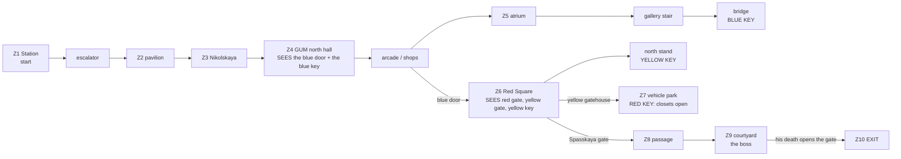

# MAP06 — «Красная площадь» (Red Square), episode 2's last map

Design document. Owner: `level-designer`. Status: **v1.1 BUILT 2026-10-22,
not yet walked, no engine pass yet** (D26: this role never starts GZDoom).
Built MVP first (D60): the whole plan, textured with approved lumps only,
populated, stocked, three keys, three secrets, the boss and the exit; v1.1
dresses it in episode 2's approved Moscow set (D107, §7 and §16). Source:
`src/maps/MAP06/map.py`; tests: `tests/test_map06_red_square.py` (the map,
59 tests) and `tests/test_map06_route.py` (the route, 12); top-down view
(v1, not regenerated for v1.1's textures):
`docs/levels/shots/MAP06-overview.png`. Russian mirror: owed at the phase
close (D34).

> **Walk it** (the PM or the CEO; agents never start GZDoom, D26):
> `python3 tools/build.py && SD_ALLOW_ENGINE=1 MAP=MAP06 SKILL=3 tools/run.sh`
> — or `-file dist/sovietdoom.pk3 +map MAP06 -skill 3` by hand.
> The automatic run: `SD_ALLOW_ENGINE=1 python3 tools/route.py --route redsquare-critical --keep-evidence`.

Inputs this document obeys and does not restate: D104 (P4, episode 2 «The
Road to Moscow»), `docs/product/LORE.md` (D12, the rules of respect),
`docs/PRD.md` (D35 factions, D58 the key lesson, D60 MVP first, D68 thing
specials), `docs/art/TEXTURE-INDEX.md` (approved lumps only),
`docs/engine/MOD-SPEC.md` §6.1 (editor numbers), `docs/engine/BALANCE.md`,
and the method of `docs/levels/MAP03-factory.md`, whose arena and boss this
map's end follows.

## 1. Synopsis

Moscow, November 1977, days before the anniversary parade (`SD_QUIT_04`):
Sergeant Vilanova comes up out of the metro at Ploshchad Revolyutsii into a
capital held by the Fourth Reich and the Liberty Legion, fights down
Nikolskaya and through the looted GUM, takes Red Square from the parade that
was staged for the invaders, and goes through the Kremlin wall's Spasskaya
gate to kill the episode's boss in the Kremlin courtyard.

## 2. Its place in the campaign

| | |
|---|---|
| Comes after | MAP05, the Volga dam (another agent's, D104). The episode's road ends in Moscow; the arrival by metro ties it to MAP02's tunnels. |
| Its number | MAP06, episode 2's last slot (MAPINFO: cluster 7, the episode's ending; mod-engineer's). |
| What it adds | **three keys** (MAP03 taught two), the campaign's **first open air at scale** (a square 1792 × 2304 under the sky), **verticality you fight across** (the GUM's gallery and bridge, the reviewing stands), and an **exit opened by a death**: the boss's. |
| Climax | the Kremlin courtyard behind the Spasskaya gate: the boss on a dais, both factions round him; his death opens the exit gate. |
| Factions (D35) | the Reich holds the station, the street and the slope (the military occupation); the Legion holds the GUM ("capital", in the department store) and springs the museum's counter-attack; both hold the square and both guard the boss (tested). |

## 3. What the map has to do

| Job | How the layout does it |
|---|---|
| Be Moscow | four recognisable places in their real order: the metro hall with bronze figures in its arches, Nikolskaya, the GUM's glass-roofed line, Red Square with the Kremlin's swallowtail-crenellated wall, the Spasskaya tower, the mausoleum and its reviewing stands, Minin and Pozharsky; the parade's vehicles halted on the square. All built from approved lumps, the Moscow set since v1.1 (§7); what is still a stand-in is §8. |
| Be the biggest and hardest map | extent 5552 × 4928 units (MAP03: 3776 × 2144); 42 / 68 / 96 monsters (MAP03: 25 / 38 / 52), every class of the bestiary, the boss on every skill. |
| Teach three keys | each lock is seen before its key (tested): the blue door from the GUM's north hall, down the arcade; the red gate, the yellow gatehouse **and the yellow key** all at once from the blue door, across the parade. Each key lies alone on its own lit spot in its lock's colour of light (D58). |
| Open space and height | the square is open air; the GUM has a gallery 128 up along its line, a bridge across it and an upper floor of shops; the stands are 7 steps to a top row 128 up. Snipers above, a Doughboy under the glass roof, the parade's vehicles as cover. |
| End the episode | the exit gate in the courtyard's west wall opens only when the boss dies (his thing special); the exit switch is behind it. |

Target length: 15–18 minutes first run on skill 3; about 7 once known
(par proposal: 420 s, §13).

## 4. Plan

The authoritative plan is the top-down render generated from the source:
`docs/levels/shots/MAP06-overview.png` (north up). Schematic (not to scale):

```
                                    +---------- STATION (z1, -128) ---------+--S1
                         pavilion<==escalator  hall, arches with statues    |
                          (z2)      (8 steps)  platforms + tracks both sides|
                  S3 yard   |                  start ->                     |
           +----------------+---- NIKOLSKAYA STREET (z3, sky) -------------+
           | Resurrection   |   barricades, a truck, three courtyard gates
           | gate (barred)  |
  +--------+----museum----------+   +--------- GUM north hall (z4) ---------+
  |  closet W   closet E        |   | arcade |shops| line (z5, glass roof) |gallery|upper shops
  |                             |   |        |     |     ...bridge+BLUE KEY|  +128 |   S2
  | stand N (YELLOW KEY, +128)  |   |        |     |                       |       |
 K| mausoleum      RED SQUARE   |[B]| blue   |atrium+fountain  stairs ---- |       |
 r| stand S (ROKS-3)  (z6, sky) |   | door   |     |                       |       |
 e|    parade vehicles as cover |   |        |     |                       |       |
 m[R] Spasskaya tower           |   +--------- GUM south hall ------------+
 l|                    [Y] gatehouse
 i|   VEHICLE PARK (z7, sky): RED KEY on the command post's plinth
 n+-----------------------------+
 |
 KREMLIN COURTYARD (z9): boss on the dais, Tsar Bell, Tsar Cannon --[gate]-- exit (z10)
 (through [R], the passage z8)
```

| # | Zone | x | y | floor | ceiling | light |
|---|---|---|---|---|---|---|
| Z1 | Station hall (start), Ploshchad Revolyutsii | 4096…5376 | 4736…4992 | −128 | 64 | 144 |
| — | Arches, 4 a side, 2 bronze figures each (props 96 high) | 4224…5120 | 4672…4736, 4992…5056 | −128 | 0 | 144 |
| — | Platforms, edges, tracks (16 down) | 4096…5376 | 4352…4736, 5056…5376 | −128 / −144 | 64 | 128 / 112 |
| — | Escalator, 8 steps of 16, rising west | 3840…4096 | 4800…4928 | −112…0 | +128 | 128 |
| Z2 | Street pavilion | 3520…3840 | 4160…4992 | 0 | 192 | 128 |
| Z3 | Nikolskaya street (sky; 384 since v1.1, three whole bays of the GUM's facade) | 2816…4352 | 3648…4096 | 0 | sky 384 | 112 |
| — | Resurrection gate: 2 arches, barricades 64 high across them | 2816…3136 | 3456…3648 | 0 / 64 | 192 | 112 / 144 |
| Z4 | GUM north hall · south hall | 3520…4352 | 3328…3584 · 1152…1408 | 0 | 256 | 128 |
| Z4 | Arcade (west line), 4 columns; facade windows (sill 112) onto the square | 3520…3776 | 1408…3328 | 0 | 192 | 128 |
| Z4 | Blue lock band (one tile) · blue door · square-side portal | 3520…3584 · 3488…3520 · 3456…3488 | 2176…2560 · 2304…2432 | 0 | 128 | **192**, blue |
| Z4 | Four looted shops (two pass through to the arcade); doorways 128 high | 3808…3936 | 1472…3264 | 0 | 160 | 112 |
| Z5 | The line under the glass roof (south, north of the bridge) | 3968…4224 | 1408…2944, 3008…3328 | 0 | glass roof 448 | 144 |
| Z5 | Atrium, fountain (prop) | 3808…4352 | 2176…2496 | 0 | glass roof 448 | 160 |
| Z5 | Gallery, south and north parts; 8-step stairs from the atrium | 4224…4352 | 1536…1920, 2752…3264 | +128 | glass roof 448 | 144 |
| Z5 | **Bridge** across the line; the **blue key** on its lit middle | 3968…4224 | 2944…3008 | +128 | glass roof 448 | 144 / **192**, blue |
| Z5 | West upper room (green armour) · three upper shops | 3808…3968 · 4384…4608 | 2880…3072 · 1600…3264 | +128 | 448 / 256 | 144 / 112 |
| Z6 | **Red Square** (sky); three granite lines across it, 64 deep, at y 1728, 2240, 2816 | 1664…3456 | 1152…3456 | 0 | sky 384 | 144 |
| Z6 | Kremlin wall: body (closed sky block) · walk 32 deep, its face the swallowtails (`SDKREM2`, middle texture, impassable line) · piers at the parapet and the flags | 1600…1632 · 1632…1664 | 448…3456 | 128 · 128 / 256 · 256 | = floor · sky 256 · = floor | 144 |
| Z6 | Spasskaya tower: base and clock stage (closed sky blocks), green tent open to the apron's sky with the ruby star on it, in an apron of sky 768 | 1600…1856 | 1216…1408 | 448 / 576 / 704 | = floor / = floor / 768 | 144 |
| Z6 | **Red lock** portal (the Spasskaya gate) in front of an apron of sky 256 | 1600…1664 | 1472…1600 | 0 | 128 | **192**, red |
| Z6 | Mausoleum, three tiers (prop) | 1664…1856 | 2176…2432 | 64 / 112 / 144 | sky | 144 |
| Z6 | Reviewing stands N and S: 7 steps of 16 up to a top row 96 deep | 1664…1984 | 2560…3008, 1856…2112 | 16…128 | sky | 144; N top **192**, yellow (the **yellow key**) |
| Z6 | Parade vehicles: 3 tanks, 2 lorries, 2 missile carriers (props) | §4.2 | | 48–96 | sky | 144 |
| Z6 | Museum's two closets (the red key's ambush) | 1920…2112, 2304…2496 | 3472…3584 | 0 | 128 | 112 |
| Z6 | **Yellow lock** portal; the gatehouse is the square's south wall | 2688…2816 | 1120…1152 | 0 | 128 | **192**, yellow |
| — | Parapet over the slope (closed sky block) | 1664…2560 | 1088…1152 | 128 | = floor | 144 |
| Z7 | Vehicle park on the slope (sky); porch behind the yellow door | 1664…2944 | 448…1088 | 0 | sky 384 | 128 |
| Z7 | Command post's plinth: the **red key** | 2112…2240 | 640…768 | 16 | sky | **192**, red |
| Z8 | Spasskaya gate's passage (blue armour, cells, rockets) | 1408…1568 | 1472…1600 | 0 | 128 | 112 |
| Z9 | **Kremlin courtyard** (sky); the Kremlin wall from inside as its east wall (walk 1344…1376, body 1376…1408, two piers flanking the gate's passage) | 512…1344 | 768…2048 | 0 | sky 512 | 144 |
| Z9 | Dais, 2 steps; the boss at `MAP06_BOSS_SPOT` (960, 1536) | 832…1088 | 1408…1664 | 16 / 32 | sky | 144 |
| Z9 | Tsar Bell (128 high), Tsar Cannon (64), four columns | | | | | |
| Z10 | Exit gate (`SDGATE1`, tag 12) · exit hall · exit niche (`SDSW1D`) | 416…448 · 192…416 · 176…192 | 1472…1600 | 0 | 128 | 128; niche **192** |

Every height is a multiple of 16; no step up is over 16 (tested).

### 4.1 The open air: skies at several heights (NOT VERIFIED in engine)

Each one-sided wall shows as tall as the ceiling of the sector it bounds; two
sky ceilings side by side draw no wall between them (Doom's sky hack, kept by
GZDoom). The map uses that to give each building its height:

- the square's sky is at **384**: the GUM's facade and the museum stand
  three storeys high; door portals (ceiling 128) show the facade above them;
- the Kremlin wall (v1.1) is a **closed sky block** 128 high (its body,
  x 1600…1632) with a **walk** in front of it (x 1632…1664): floor 128,
  sky at 256, out of reach. The line between the walk and the square (or
  the park, the stands, the mausoleum) wears the masked **`SDKREM2`** as
  its middle texture, pegged to the walk's sky: its solid lower half
  (128…192) continues the wall's face and its upper half (192…256) is the
  swallowtail merlons, with the sky between them and in their notches. The
  face below (0…128) is one tile of `SDKREM1`, the same brick pixel for
  pixel, laid with the same rows and columns (§7.2), so no seam shows where
  the parapet sits on the wall. The line is **impassable** (the stands' top
  rows are as high as the walk; nothing walks or floats onto it). Where the
  parapet over the slope meets the wall, and behind the occupiers' two
  flags, the wall is a solid pier at 256; the courtyard's east wall is the
  same wall from inside, two piers flanking the gate's passage;
- the Spasskaya tower: three closed sky blocks at 448, 576 and 704, the
  base in `SDSPAS1` (the tower's brick and white stone, its arcaded frieze
  at the top), the middle tier's four 128-high faces the clock `SDCLOK1`
  (one whole face each, since D113), the top's `SDSTEL1` (the green tent).
  The tent is no longer a closed block: its top is open to the apron's sky
  (768) in two halves, and the line between them (x 1728) carries the ruby
  star `SDRUBY1` (masked) on both sides, at half scale (`scalex_mid` /
  `scaley_mid` 2, UDMF zdoom), so the 64 × 64 star stands from the tent
  (704) to the sky (768); the line is impassable. Round the tower an apron
  of sky 768 so the stages show; in front of
  the gate an apron of sky 256, so the wall above the gate's portal is the
  wall's own height (one tile of `SDKREM1` over the portal);
- the parapet over the slope: a closed sky block 128 high, seen as a low
  wall with the sky beyond.

If the hardware renderer draws any of this wrong (a "sky wall" over a
lower sky, a tower clipped at 384), the fallback is to flatten the aprons to
the square's 384: nothing else moves (engine check E1, §12). If the
merlons' middle texture draws wrong (cut, tiled, or a slab of sky in its
holes), the fallback is to raise the walk's floor to `MERLON_TOP` (a flat
brick top at 256, as v1's merlons were blocks): one constant, nothing else
moves.

### 4.2 The parade, halted

Tanks (hull 48 high, turret 80), lorries (48) and missile carriers (64, the
missile 96), in olive armour plate (`SDARMR2`; the carriers' long flanks
`SDARMR1`, one whole red star per 128) with chequer-plate decks, in two columns along the
parade's axis and a third in the middle. Every vehicle stands clear of the
three sight lines the square must give from the blue door (red gate, yellow
gatehouse, yellow key; tested). Three more stand in the vehicle park.

## 5. Progression, keys, doors and the exit



**The keys.** Doom's three keycards under their Soviet names (MOD-SPEC §6:
`SD_BluePass` 5, `SD_YellowPass` 6, `SD_RedPass` 13), locks 2, 3 and 1
(gzdoom.pk3 `lockdefs.txt`, as MAP02 and MAP03 cite it).

| Id | Where | Type | Special | Can it lock the player out? |
|---|---|---|---|---|
| **BD** | GUM facade, arcade → square, 128 wide, `SDDOORB` (since D113) between two cobalt mosaics (MAP02's blue door) | locked, opens for good | `Door_LockedRaise (4, 16, 0, 2, 0)`, both faces | no |
| **YD** | The gatehouse, square → vehicle park, `SDDOORY` | locked, opens for good | `Door_LockedRaise (5, 16, 0, 3, 0)` | no |
| **RD** | The Spasskaya gate, square → passage, `SDDOORR` | locked, opens for good | `Door_LockedRaise (6, 16, 0, 1, 0)` | no |
| S1, S2, S3 | push panels (§9) | open for good | `Door_Open (1/2/3, 16)`, both faces, `secret` | no |
| CL | the museum's two closets | open for good | tag 10, **no line**: the red key's thing special `Door_Open (10, 16)` | no |
| GATE | courtyard → exit hall, `SDGATE1` both faces, no special | opens for good | tag 12, **no line**: the boss's thing special `Door_Open (12, 16)` | only if the boss could not die: §11 |
| EXIT | back of a 16-deep niche, `SDSW1D` | | `Exit_Normal (0)` | — |

**The order, as the tests play it** (`test_the_route_is_the_designed_one`),
five rounds: (0) station, street, GUM and its upper floor, the **blue key**
(and the three secrets' panels, never needed); (1) the blue door: the square,
the stands, the **yellow key**; (2) the yellow gatehouse: the park, the **red
key**, whose pickup opens the closets; (3) the Spasskaya gate and the closets:
the passage, the courtyard; (4) the boss's death: the exit gate, the exit.

Signposting (D58): each key is alone on its lit spot, coloured like its lock
(sector `lightcolor`, as MAP02 and MAP03), and seen before it is reached:
the blue key from the GUM's north hall and the line below the bridge; the
yellow key from the blue door; the red key through the yellow gatehouse
(tested, and no monster stands on any of those sight lines at spawn). Light
192 is spent on eight sectors only: the three portals of the locks, the blue
band, the three key spots, the exit niche (tested).

Softlock rules, MAP01's and MAP03's: no door closes behind the player; no
lift; every drop (the gallery and bridge edges, the tracks) has a way back
up; no secret is needed (tested). From every sector reachable at every
stage there is a way back to the start, with and without the boss's death
(tested), and at the end the exit is reachable from everywhere.

## 6. Intensity curve

| Beat | Space | Feeling | Mechanic |
|---|---|---|---|
| 1 | Station | the warm-up: a Reich picket among bronze figures | the IZh at once |
| 2 | Nikolskaya | night street, a checkpoint, a hound | cover behind barricades |
| 3 | GUM north hall | the department store: the blue door down the arcade, the key on the bridge above | **a key seen and out of reach** |
| 4 | GUM line, atrium, gallery | snipers above, a Doughboy under the glass | **height**: the stair, the bridge |
| 5 | Red Square | **the reveal and the open battle**: the parade, the wall, the tower, three goals at once | open space, vehicles as cover |
| 6 | The stand | climbing in the open for the yellow key | exposure |
| 7 | Vehicle park | the Reich's heavies on the slope | the red key |
| 8 | Back across the square | **spike**: the museum's closets open behind the player | MAP03's pattern, sprung by a key |
| 9 | Courtyard | **climax**: the boss and both factions | the boss |
| 10 | Exit | the gate opens on his death | — |

## 7. Textures, by zone (all approved and packed; tested)

| Zone | Walls | Floor | Ceiling |
|---|---|---|---|
| Station hall | `SDMARB1` red marble; arches with `SDBRAS1` figures; east band `SDMOSA1` | `SDMFLR2` | `SDMCEIL2` (lamps) |
| Platforms, tracks | `SDMARB2`; edge `SDMEDG1`; track walls `SDTUBB1` | `SDMFLR1`, `SDMFLR3`, `SDRAIL1` (turned) | `SDMCEIL1` |
| Escalator | `SDTILE1` | `SDFLR4` | `SDMCEIL1` |
| Pavilion, street | `SDCONC1`; the GUM's north facade `SDGUM1` (x 3520…4352); courtyard gates `SDGATE1`; barricades `SDCRAT2`, a truck `SDSTEL1` | `SDMFLR1` / `SDFLR2` | `SDMCEIL1` / sky |
| Resurrection gate, museum | `SDMUSE1` (the museum's brick with its white dressings: the museum's wall on the square, the closets' leaves, the gate's two arches) | `SDMFLR1` | — / sky |
| GUM halls, arcade | `SDMARB2`; the facade's window slits cut through `SDGUM1` | `SDMFLR2` / `SDMFLR1` | `SDMCEIL1` |
| GUM line, gallery | the shopfronts `SDGUMS1` / `SDGUMS2` / `SDGUMS3` («ТКАНИ», «ОБУВЬ», «ЧАСЫ»), one shop to each 64 of wall, below and above the gallery (§7.2) | `SDMFLR2` / `SDMFLR1` | the glass vault `SDGUMR1` |
| Shops | `SDTILE1`; loot `SDCRAT1` / `SDCRTOP1` | `SDMFLR1` | `SDMCEIL1` |
| Square | the GUM's facade `SDGUM1` (three bays high, the blue door's portal one bay), museum `SDMUSE1`; the Kremlin wall `SDKREM1` with the swallowtails `SDKREM2` (§4.1) and six parade banners `SDBANR1`; the occupiers' flags `SDFLAG3`/`SDFLAG4` (on the Kremlin's brick) side by side in the crown; tower `SDSPAS1` / `SDCLOK1` / `SDSTEL1` and the ruby star `SDRUBY1`; mausoleum, stands and Minin's plinth `SDTRIB1`, Minin `SDBRAS1`; gatehouse `SDCONC1`; parapet `SDBRCK2` | `SDCOBL1`; three lines `SDCOBL2`; stands, thresholds and monuments' tops `SDMFLR1` | sky |
| Vehicles | `SDARMR2`; the missile carriers' long flanks `SDARMR1` | `SDFLR4` | sky |
| Park | `SDCONC1`; the Kremlin wall's outer face as on the square | `SDFLR2` | sky |
| Courtyard | `SDBRCK1` (the palaces), flags `SDFLAG1`/`SDFLAG2` (on that brick); east wall the Kremlin's, `SDKREM1` + `SDKREM2`; the gate's passage `SDKREM1`; Tsar Bell and Cannon `SDBRAS1`; dais `SDMARB1` | `SDCOBL1` / `SDMFLR2` | sky |
| Doors, switch | `SDDOORB` (blue, between `SDMOSA1`), `SDDOORY`, `SDDOORR`, `SDGATE1` (exit gate); exit `SDSW1D` | | |
| Posters | `SDPOSTR1` Lenin, `SDPOSTR3` Stalin (section 7.1) | | |

### 7.1 The posters (CEO, 2026-10-22: «que esos posters puedan aparecer en cualquier nivel»)

Four pictures and the Marx-Engels pair, each a whole 128×256 poster: one one-sided
line 128 long in a sector exactly 256 high, pegged to the floor, offset 0
(`POSTERS` in `map.py`; `tests/test_posters.py`). Only texture lines and
four shallow niches; no route, key, door or sight line moves.

| Name | Poster | Where | Why |
|---|---|---|---|
| `gum_north_lenin` | Lenin | GUM north hall, south wall, x 3808-3936 at y 3328 (the hall is 256 high: no niche) | the first thing ahead coming in from Nikolskaya, beside the way on under the glass roof: the shop of the nation still has its portrait |
| `gum_north_slot` | **Marx** `SDPOSTR4` (slot) | GUM north hall, east wall, x 4352, y 3392-3520 | the first of the pair on the route, «ПРОЛЕТАРИИ / ВСЕХ СТРАН,» |
| `square_facade_lenin` | Lenin | the GUM's facade on the square, north of the blue door: niche `prop_z6_portrait_lenin` (x 3456-3472, y 2496-2624), floor 64, ceiling 320 | the parade portraits: hung high on the facade, either side of the doors, as on 7 November; the floodlights (144) are on them |
| `square_facade_stalin` | Stalin | the same, south of the blue door: `prop_z6_portrait_stalin` (y 2112-2240) | the pair, symmetric about the blue door; seen from the stands and on every crossing |
| `courtyard_stalin` | Stalin | the Kremlin courtyard's north wall, recess `z9_portrait_stalin` (x 1024-1152, y 2048-2064), 256 high | **taken**: the occupiers' two banners (D12) hang beside him in the boss's room |
| `courtyard_slot` | **Engels** `SDPOSTR5` (slot) | the same wall, recess `z9_portrait_slot` (x 576-704), the banners between the two | the last: «СОЕДИНЯЙТЕСЬ!» in the boss's room, the occupiers' banners between him and Stalin |

The facade niches are props (floor 64, above any step: never walked, never
reached; `prop_` in the reachability tests); their mouth shows the facade's
`SDGUM1` below (0-64) and above (320-384), the niche's 16-deep sides
`SDCONC1`. The courtyard's recesses are 16
deep, at the courtyard's floor, like the banners' own.

**The Marx-Engels pair (D117, 2026-10-22).** `POSTER_SLOTS_MARX_ENGELS`
names the two slots, Marx's first: `SDPOSTR4` Marx and `SDPOSTR5` Engels
(mirrored, looking towards Marx), 128×256 like Lenin and Stalin, in route
order, so each reads alone. `MARX_ENGELS = ("SDPOSTR4", "SDPOSTR5")` lists
them in `WALL_TEXTURES`; `tests/test_posters.py` holds the placement
(`PAIR`).

No row of section 8 is a poster or a propaganda piece, so none is replaced.
The parade banners `SDBANR1` (v1.1) are cloth on the Kremlin wall, not
posters: they carry no portrait and no text (D12).

### 7.2 How the Moscow set is laid (v1.1, D107)

- **World-aligned.** `SDKREM1`, `SDKREM2`, `SDBANR1`, `SDGUM1` and
  `SDSPAS1` (`ALIGNED` in `map.py`) are laid on the world, not on each
  line: `align_to_world` gives every side that wears one the `offsetx` that
  puts its column 0 on the world's grid along the line, and per part
  (`offsety_top` / `_mid` / `_bottom`, UDMF zdoom) the row offset that puts
  row 0 at the lump's height: 0 for the wall, the banners and the GUM's
  bays (so the bays stack from the cobbles, three to the 384 sky, and the
  window slits cut the same bays), 448 for the Spasskaya (its frieze at the
  tower's top). So the brick runs on unbroken from the face to the merlons
  and from one line to the next (tested).
- **The swallowtails** (§4.1): `hang_merlons` puts `SDKREM2` on the
  square's, the park's and the courtyard's side of every line between the
  wall's walk and the ground, and makes the line impassable. Its merlons
  centre on y ≡ 32 (mod 64), so a merlon stands either side of each banner
  and a gap falls on each end of a run.
- **The banners**: six `SDBANR1` on the wall's face, each exactly one span
  of 64 starting on the grid and one tile high, so the whole banner hangs
  from its pole at 128 to its fringe 15 above the cobbles: two between the
  Spasskaya gate and the south stand, one either side of the mausoleum
  (symmetric about it), two at the north end; none under the occupiers'
  flags (tested).
- **The square's floor**: `SDCOBL1`, crossed east-west by three lines of
  `SDCOBL2` (sectors `z6_line_1..3`, y 1728, 2240, 2816, 64 deep on the
  flat grid so each shows its one line of slabs; same height, sky and light
  as the square). They cross where no thing stands (tested by the zone
  table), and the monuments and the parade stand on them.
- **Granite**: `SDTRIB1` on the stands' faces (each riser and each tier
  shows its black labradorite band at the top, as the lump is pegged to
  each flank's top), the mausoleum's three tiers and Minin's plinth.
- **Round 2 (D113)**: `SDMUSE1`, `SDFLAG3` and `SDFLAG4` join `ALIGNED`
  (rows from 0, columns on the world): the museum's white band runs level
  from the museum's wall across the closets' leaves to the Resurrection
  gate, and the crown's flags meet the `SDKREM1` round them course for
  course (their brick replays `SDKREM1`'s seed). The GUM's line is built in
  `SDGUMS1`; `dress_shopfronts` then cuts each of its walls at the world's
  64 grid (new vertices on the same line: nothing moves) and gives each 64
  the sign of its column, `SHOPFRONTS[(x or y // 64) % 3]`, world-aligned,
  so the shops run «ТКАНИ», «ОБУВЬ», «ЧАСЫ» along each wall (the three tiers
  above one another show the same shop). `SDGUMR1` is the ceiling flat of
  every sector under the vault, world-aligned (its iron arches across the
  line, east-west).
- **The parade**: `SDARMR2` (the armoured train's plate, railway set) on
  every vehicle face; `dress_carriers` puts `SDARMR1` on the missile
  carriers' long flanks, one red star per 128 counted from the flank's end,
  raised 28 rows so the star (rows 29-88) is whole on the 64-high hull.

## 8. Pending textures

Each stands in for a piece the map would wear better; swapping is one
constant in `map.py` (the name in brackets), nothing moves. **Done in v1.1
(D107)**: the setts and their granite lines (old #1), the GUM's facade
(#3), the Kremlin wall and its swallowtails (#6), the mausoleum's granite
(#8), the parade vehicles' sides (#11, from the railway set's armour).
**Done in round 2 (D113, 2026-10-22, §16c)**: the GUM's shopfronts (#4,
`SDGUMS1`-`3`), its glass roof (#5, `SDGUMR1`), the Spasskaya's clock and
ruby star (#7, `SDCLOK1`, `SDRUBY1`), the museum's brick (#9, `SDMUSE1`),
the blue leaf (#10, `SDDOORB`), the night sky (#14, `SDSKY2` in MAPINFO's
`sky1`, the PM's) and the crown's flags on the Kremlin's brick (#16,
`SDFLAG3`/`SDFLAG4`).

| # | Wanted | Stand-in now | Where |
|---|---|---|---|
| 2 | Asphalt with tram rails / kerb, flat | `SDFLR2` (`FLOOR_ASPHALT`) | Nikolskaya, the park |
| 12 | **Bronze statues**, texture or sprites (Ploshchad Revolyutsii's figures, Minin and Pozharsky, the Tsar Bell and Cannon) | `SDBRAS1` blocks (`BRASS`) | the station, the square, the courtyard |
| 13 | Water flat for the fountain (MAP05's `SDWATR1-4` is the Volga's grey-blue; a basin may want its own) | `SDMFLR1` | the atrium |
| 15 | **Saint Basil's** as a skyline sprite or sky band (`SDSKY2` has Moscow's skyline, not the cathedral) | — (not built) | beyond the slope |
| 17 | Parade vehicles' turrets and missiles as sprites or their own sides | `SDARMR2` blocks | the square, the park |

## 9. Secrets

MAP01's rule: a clue is a comparison, never a sign; each has a way back
(tested).

| # | Where | Clue | Reward |
|---|---|---|---|
| S1 | Station hall, east end, behind the start | of the two mosaics in the end wall, the second stands 16 back, in shadow (light 96) | backpack, flak vest, shell box |
| S2 | GUM, upper shop U2 | its back wall is a wall of crates where the other upper shops show tile | the **Hand Katyusha** and a cell pack (Doom's BFG in the episode's last map; MAP03's S1 tradition) |
| S3 | Nikolskaya, north side | of three courtyard gates, the middle one is set twice as deep and darker | a courtyard (open sky): two medikits, rockets |

Each panel is `Door_Open` on both faces with the `secret` line flag (one-sided
on the automap); each room is a sector with special 1024. None is needed for
the exit (tested).

## 10. Enemies and resources by skill

Placed with the bestiary's own numbers (21100–21107, and since D116 21110
the Legion gunner and 21111 the Liberty Colossus); the boss on every skill.
Skill pairs nested (`skill_tier`), as MAP01–MAP03.

| Zone | Skill 2 | Skill 3 | Skill 4 |
|---|---|---|---|
| Station | 3 riflemen | +2 riflemen | +1 rifleman, 1 stormtrooper |
| Pavilion | 1 trooper | +1 trooper | +1 stormtrooper |
| Nikolskaya | 3 riflemen, 1 stormtrooper, 1 hound | +2 riflemen, 1 stormtrooper | +1 rifleman, 1 stormtrooper, 1 hound |
| GUM ground floor | 3 troopers, **1 gunner**, 1 stormtrooper | +2 troopers, 1 stormtrooper | +2 troopers, 1 Doughboy |
| GUM line and upstairs | 1 trooper, **1 gunner**, 1 stormtrooper, 1 Doughboy | +1 trooper, 1 stormtrooper | +1 trooper, 1 stormtrooper, 1 Doughboy |
| Red Square | 6 riflemen, 3 stormtroopers, 2 hounds, 1 Panzermensch, 1 Doughboy | +3 riflemen, 2 stormtroopers, 1 hound, 1 Doughboy, **1 gunner** | +3 riflemen, 2 stormtroopers, 1 hound, 1 Panzermensch, 1 heavy, **1 gunner** |
| Museum closets (red key) | 2 troopers | +1 trooper, 1 stormtrooper | +2 stormtroopers |
| Vehicle park | 3 riflemen, 1 hound, 1 Panzermensch | +2 riflemen, 1 stormtrooper | +1 stormtrooper, 1 hound, 1 heavy |
| Gate passage | — | 1 stormtrooper | — |
| Courtyard | **the boss** (the Liberty Colossus), 2 stormtroopers, 1 Doughboy | +2 hounds | +1 Panzermensch, 1 heavy, 1 Doughboy |
| **Total** | **42** | **69** | **98** |

**The Legion gunners** (`SD_LegionGunner`, 80 HP, bursts of hitscan, D116;
`docs/engine/2026-10-22_P4_ep2-enemies.md` §2): 2 / 3 / 4 on skills 2 / 3 /
4 where a burst has a long line and he has cover. On every skill two take a
trooper's place: the GUM's arcade (3600, 2900), its whole length north and
south, and the south gallery upstairs (4288, 1700), along the gallery. From
skill 3 one more stands on Red Square behind the halted parade's west
vehicle (2176, 2450), and on skill 4 another behind the east vehicle of the
north line (2810, 1900): both added, both facing the GUM's doors across the
square's width. Each drops 15 AKM rounds (not counted below). None sees the
start (`tests/test_safe_starts.py`).

**Safe start** (`tests/test_safe_starts.py`, 2026-10-22): on skills 2, 3 and 4 no monster sees the start zone (the start and a step round it) within 768 units; Doom's own sight test, run on the built map. The station hall's first rifleman moved from 4600, 4864 (616 off) to 4384, 4896, 830 down the hall: seen, but the first shot the player's. Same count, same zone.

By class on skill 4: 29 riflemen, 15 troopers, 4 gunners, 25 stormtroopers,
10 hounds, 7 Doughboys, 4 Panzermenschen, 3 heavy Panzermenschen, the boss.

**Resources.** Pistol-start finishable: the IZh in the station hall, the
PPSh in the GUM's north hall, the RPG-7 on the north gallery (before the
square's Panzermensch), the ROKS-3 on the south stand's top row (before the
slope's heavies), all on the route on every skill; the Hand Katyusha in S2.
No AKM: the rifle is MAP05's (`docs/engine/2026-10-22_P4_akm.md` §6); **AKM
magazines** (`SD_AkmAmmo`, 21020, 30 rounds) 4 / 3 / 2 on skills 2 / 3 / 4,
none in the courtyard (the boss is the RPG-7's): by the PPSh in the GUM's
north hall and on the square on every skill, in the vehicle park up to
skill 3, on the north gallery on skill 2.

G3-8 (MAP03's ruler, in IZh shells; secrets not counted), **recounted for the
colossus (D116)**: he costs 72 shells (4500 HP at the General's rate, 3000 for
48), a gunner 2; AKM rounds at 80 / 12 a shell (avg 12 a round):

| Skill | Needed | Placed | Ratio | Shells, rounds and AKM alone |
|---|---|---|---|---|
| 2 | 160 | 647.5 | 4.05 | 477.5 |
| 3 | 207 | 605.0 | 2.92 | 435.0 |
| 4 | 326 | 523.5 | 1.61 (≥ 1.35, < 3) | 368.5 (≥ 1.35 × all but the boss: 342.9) |

**The last stretch alone** (the gate's passage and the courtyard, z8 and z9,
in damage against the hit points met there, the boss included): with the
General it was 9220 against 5780 on skill 4 (1.60); the colossus's 4500 made
it 9220 against 7280 (**1.27, under G3-8's 1.35**), so **two more PG-7V boxes**
went into the courtyard on every skill, one by the gate where he is met
(1250, 1300) and one behind his dais for the player who circles him (640,
1536): 10 rockets, 1350 at the RPG-7's average impact (`+NORADIUSDMG`: the
impact only). Now 10930 / 5020 (2.18), 10930 / 5380 (2.03) and 10570 / 7280
(**1.45**) on skills 2 / 3 / 4; in the passage and the courtyard, 30 PG-7V on
every skill (34 direct hits kill him, BALANCE §7), the ROKS-3's 140-160 fuel
and 40 shells besides (`test_the_final_stretch_pays_for_the_colossus`).

Also tested at every stage of the route. Health on skill 4: 6 stimpacks, 6
medikits, 9 health bonuses; 6 armour bonuses (two at each lock), the flak
vest in the GUM's west upper room, the heavy vest in the gate's passage,
before the boss. Skills 3 and 2 add stimpacks, medikits and ammunition.

## 11. The boss: the Liberty Colossus (D116)

Episode 2's boss is **the Liberty Colossus** (`SD_LibertyColossus`, 21111,
4500 HP, radius 44, height 110, `+BOSS +NORADIUSDMG`;
`docs/engine/2026-10-22_P4_ep2-enemies.md` §3), at the named constant
**`MAP06_BOSS_SPOT = (960, 1536)`** on the courtyard's dais, facing the gate
(`BOSS_ANGLE = 0`), on every skill. **The General** (MAP03's boss,
`SD_General`, 3000 HP) stood in until D116 and is gone from the map.

- **The swap (2026-10-22):** `BOSS_KIND = "colossus"`, the class in
  `MONSTER_KINDS` / `MONSTER_CLASSES` and the test's `CLASS_FILES`; the spot,
  the facing and the death special unchanged. The route reads the class
  from the map (it is in `COUNT_CLASSES`) and hurts him past his health
  (`BOSS_HURT` 100000); `tools/route.py` needed no edit.
- **He fits:** the dais's top (`z9_dais_2`, 128 × 128) holds his 88-wide body
  with 20 to spare a side, the courtyard's sky (512) is over four times his
  height, and the gate's passage (128 × 128) lets him follow the player out
  (tested: `test_every_monster_has_room_for_its_body`,
  `test_the_courtyard_is_his_size`, `test_the_boss_is_the_liberty_colossus`).
- **His death opens the exit**, MAP03 v1.1's mechanism (D68): his thing
  carries `special = 11` (`Door_Open`), `arg0 = 12`, `arg1 = 16`; no line
  carries tag 12, so pressing the gate does nothing (tested). GZDoom runs a
  monster's special when it dies (`AActor::Die`), whoever killed it.
- **Room:** the courtyard is 832 × 1280 under a sky of 512, the dais two
  steps of 16; he never has to pass a door (the gate's passage is 128 high
  and wide, so he can follow the player onto the square; his death opens the
  gate wherever it happens).
- **The risk, said plainly:** if the death special did not fire in the
  engine, the exit would be unreachable. MAP03's stores use the same
  mechanism and it is still NOT VERIFIED in play (MAP03 §16.5 V4). Check E3
  (§12) settles it; the belt-and-braces fix is the mod-engineer's: a MAPINFO
  `SpecialAction = "SD_LibertyColossus", "Door_Open", 12, 16` in MAP06's
  block, which opens the same tag when the last colossus dies (§13; his
  `+BOSSDEATH` and final `A_BossDeath` allow it). With `-nomonsters`
  the exit cannot open, as on Doom's boss maps.

## 12. Engine elements used, and the PM's engine checklist (D26)

| Need | Emitted | Status |
|---|---|---|
| Locked doors | `Door_LockedRaise` 13, locks 1, 2, 3 | VERIFIED on MAP02 (2) and MAP03 (1, 3) |
| Push panels (secrets) | `Door_Open` 11, line flag `secret`, sector special 1024 | VERIFIED on MAP01–MAP03 |
| Exit | `Exit_Normal` 243 | VERIFIED |
| Coloured light | sector `lightcolor` | as MAP02/MAP03 (their K4) |
| Turned flats | `rotationfloor` 90 / 180 | as MAP02 |
| **Thing special on death** | the boss: `special` 11, `arg0` 12 | spec VERIFIED; **in play NOT VERIFIED** |
| **Thing special on pickup** | the red key: `special` 11, `arg0` 10 | Hexen-style item special; **NOT VERIFIED** |
| **Skies at several heights, closed sky blocks** | §4.1 | **NOT VERIFIED** |
| **Masked middle texture between two sky ceilings** (the swallowtails) | `SDKREM2` on a two-sided line, square sky 384 / walk sky 256 | masked mid VERIFIED in kind (MAP03's chain `SDCHAN1`); **under sky, NOT VERIFIED** |
| Per-part texture offsets | sidedef `offsety_top` / `offsety_mid` / `offsety_bottom` (UDMF zdoom) | first use in the campaign; **NOT VERIFIED** |
| **Scaled masked middle texture** (the ruby star, round 2) | sidedef `scalex_mid` / `scaley_mid` 2.0 (UDMF zdoom): `SDRUBY1` drawn 64 × 64 | **NOT VERIFIED**: which way GZDoom reads the scale (2.0 should halve the picture); if it doubles it, the value is 0.5 |

Engine checklist for the PM (one pass, skill 3, then the route on 2, 3, 4):

- **E1** the square: the Kremlin wall shows its **swallowtail merlons
  against the sky** (look from the blue door, from the square's middle, from
  the north stand's top row right under them, and from the courtyard at its
  east wall): the sky (not a slab of wall, not HOM, not the walk's floor)
  between the merlons and in their notches; the merlons whole, not tiled
  downwards nor cut at the top; **no seam** between the merlons' solid half
  and the brick below (same courses, same joints); the merlon line runs on
  past the tower, the gate, the parapet's pier and the flags. The tower's
  three stages show over it from the square's middle and from the blue
  door; no sky-coloured slab above a door portal, no HOM.
- **E8** the Moscow set (v1.1): the banners whole (pole at the top of the
  face, fringe just above the cobbles); the GUM's facade three whole bays
  high on the square and on Nikolskaya, the blue door's portal exactly one
  bay, the window slits reading as slots (they cut the bays at 112-160); the
  granite lines across the square straight and single; the stands' risers
  and the mausoleum's tiers each with the black band on top; the carriers'
  stars whole on their flanks.
- **E2** the red key: picking it up opens the museum's closets (the route's
  RKEY step checks tag 10 open).
- **E3** the boss: killing him opens the exit gate (the route's BOSS1 step
  checks tag 12 open after the helper's damage); and by hand once.
- **E4** the GUM: the blue key is visible on the bridge from the north hall;
  the gallery stairs climb; the bridge crosses the line.
- **E5** the window slits on the GUM's facade: seen through, never passed.
- **E6** the parade's vehicles and statues: nobody gets stuck on a corner.
- **E9** round 2 (D113), **MAP06 is now a night map** (`SDSKY2`): the
  square stays at light 144 (the art-director's 128-160 for the night; it
  was already there), so check it reads as night under the new sky and not
  as day, and lower `LIGHT_SQUARE` to 128 if not. The Spasskaya: a whole
  clock on each face of the stage (none cut, the gold hands at five to
  twelve), the **ruby star** standing on the tent against the sky, whole,
  64 wide, its stem on the tent (if it shows 256 wide or cut, the scale's
  sense is the other way: §12). The GUM's line under its glass vault (no
  sky in it now), the shopfronts one sign per 64 in turn and whole in
  height (three tiers to the vault, the top one half), the arches of the
  vault across the line. The museum's white band level from the wall over
  the closets' leaves to the Resurrection gate; the closets still look like
  wall until the red key; the crown's flags with no seam against the
  wall's brick. The blue leaf `SDDOORB` on both faces.
- **E7** the posters (section 7.1): each whole, not cut or tiled; the two
  facade portraits hang at 64-320 under the square's sky with the facade's
  stone above them (no sky slab, no HOM in the 16-deep niche) and read
  across the square at light 144; the courtyard's Stalin and slot read
  beside the banners.

## 13. MAPINFO and LANGUAGE (for the scaffolding agent / `mod-engineer`)

Not this role's files. What the map needs:

- `map MAP06 lookup "SD_MAP06_NAME"`: «Красная площадь» / "Red Square"
  (and `[ca]` «Plaça Roja»), episode 2's ending cluster (7);
- `par = 420` (level-designer's estimate for a player who knows the route);
- `sky1 = "SDSKY2"`, Moscow at night (in MAPINFO since 2026-10-22, D113);
- recommended: `SpecialAction = "SD_LibertyColossus", "Door_Open", 12, 16`
  as the fallback for the boss's death special (§11; the General's line
  until D116);
- music: the episode's, sound-designer's.

## 14. The automatic route: `redsquare-critical`

`tools/route.py`, read off the built map like `tankograd-critical` (nothing
copied: tags, locks, keys, the boss's class and spot come from `map.py`):
A0 start (no key) → BD0 the blue door refused → BKEY the blue key walked onto
on the bridge → BD1 the blue door, onto the square → YD0, RD0 the yellow and
red gates refused on one key → YKEY up the stand onto the yellow key → YD1
the gatehouse → RDY the red gate refused on two keys → RKEY the red key (and
tag 10 must be open: the closets) → RD1 the Spasskaya gate → BOSS0 in the
courtyard, the exit gate shut → BOSS1 the boss hurt past his health (helper
damage), the exit gate open → E0 through the gate to the switch → E1 pressed.
Its geometry is tested in `tests/test_map06_route.py` (no engine).

## 15. Rules of respect (D12)

The map shows real places of the capital as the setting of an invasion, and
treats them as architecture. The mausoleum is a closed block: nothing
stands, lies or fights on it (tested), no key or reward is there; the
occupiers' banners hang on the Kremlin wall and in its courtyard (LORE: both
flags side by side over taken Soviet buildings); no poster, text or joke
touches real victims.

## 16. v1 build record (2026-10-22)

**Verification actually run** (no engine, D26): `tests/test_map06_red_square.py`
53 tests OK; `tests/test_map06_route.py` 12 OK; `tests/test_route.py` 107 OK with
the new route registered; `tools/check_pk3.py` on a fresh build: 0 errors, 0
warnings (MAP06: 886 vertices, 1180 linedefs, 197 sectors, 215 things).
`tools/verify.py fast` could not replace `dist/sovietdoom.pk3` while a GZDoom
process held it (the PM's engine run); the same pieces were run separately
(build to a scratch path, check_pk3, `tests/_tiers.py fast`). The fast tier
found one geometry fault of this map, fixed: a stack of crates 64 high under
a 128 ceiling left a 64-high space a Panzermensch fits and the heavy one does
not (`test_panzermensch_sprites`); the shops are now 160 high and the crates
stand clear of the doorways. Two cross-map tests still name the maps a class
may stand in and do not know episode 2 yet (`test_doughboy_sprites`,
`test_general_sprites`: the General stood in MAP06 by design until D116,
§11); their owners update the expected sets.

## 16b. v1.1 build record (2026-10-22): the Moscow set

The CEO approved episode 2's textures 25/25 (D107); v1.1 puts the Moscow set
(and the railway set's armour) on the map, per §7 and §7.2. **Geometry
changed only where the swallowtails need it**: the Kremlin wall's v1 strip of
merlon and crenel blocks (288/256) became a body at 128, a walk 32 deep with
its sky at 256 and two-sided impassable face lines carrying `SDKREM2`, and
three piers at 256 (the parapet's junction, behind the flags, either side of
the courtyard's gate passage); so `MERLON_TOP` went from 288 to 256 and with
it the gate aprons' sky and the flags' sill. Two cosmetic heights more:
Nikolskaya's sky 320 → 384 (three whole bays of the GUM's facade), and three
`z6_line_*` strips in the square's floor (same height, sky and light). No
door, key, lock, tag, secret, sight line, poster, monster or item moved;
the route and every reachability round are the same (tested).

**Verification actually run** (no engine, D26): `tests/test_map06_red_square.py`
59 tests OK (the old crenel test replaced by the swallowtails' and the walk's;
new: the world alignment, the banners, the setts, the monuments' stone, the
parade's armour); `tests/test_map06_route.py` 12 OK; `tools/verify.py fast`
PASS (build, `check_pk3` 0 errors 0 warnings, 2779 tests). MAP06 now 745
vertices, 961 linedefs, 206 sectors, 215 things. The engine pass (E1, E8)
is the PM's.

**Open points for the CEO** (judged by walking it, D28):

1. Is the square the right size? (1792 × 2304; Doom's open areas rarely
   pass 2048 a side.)
2. The GUM: is the bridge-and-gallery enough height, or should the upper
   floor run the whole length (one more stair)?
3. The tower (since round 2): the clock stage and the ruby star on the
   tent, the star at half scale (64 wide on a 64 tent): big enough?
4. The red key's ambush from the museum: keep, or also wake the square's
   survivors?

## 16c. Round 2 (2026-10-22, D113): the Moscow set's second batch, the night

The second round of episode 2's textures (`docs/art/TEXTURE-INDEX.md`
"Episode 2, round 2") applied where §8 asked for them; MAPINFO's `sky1` is
`SDSKY2` (the PM's). Piece by piece:

| Piece | Where | How |
|---|---|---|
| `SDCLOK1` clock | the Spasskaya's clock stage, all four faces | the stage's wall (`CLOCK`); each face one line 128 long, 128 high, whole |
| `SDRUBY1` ruby star (masked) | on the tent: the line halving its top (x 1728) | the tent opened to the apron's sky (768) in two halves; the star on both sides of the line, `scalex_mid` / `scaley_mid` 2 (64 × 64), hung from the sky down to the tent; the line impassable |
| `SDGUMS1`-`3` shopfronts | every wall of the GUM's line, atrium, gallery and upper west room, and the gallery's front over the line (where `SDWIND1` was) | `dress_shopfronts` (§7.2): one sign per 64 of wall, in turn by the world's column, world-aligned |
| `SDGUMR1` glass vault | the ceiling of the line, the atrium (and the fountain), the gallery, its stairs, the bridge and the upper west room (where the sky was) | world-aligned flat, same height (448) |
| `SDMUSE1` museum brick | the museum's wall on the square, its two closets' leaves and jambs, the Resurrection gate's two arches (square and street sides) | `ALIGNED` from 0: the white band level throughout |
| `SDFLAG3` / `SDFLAG4` | the occupiers' two flags in the Kremlin wall's crown (in place of `SDFLAG1`/`SDFLAG2` there) | `ALIGNED` from 0, as `SDKREM1`; the courtyard's pair stays `SDFLAG1`/`SDFLAG2` (it hangs on `SDBRCK1`) |
| `SDDOORB` blue leaf | the blue door, both faces | replaces `SDDOOR1`, which this map no longer wears |

**Light.** The art-director recommends 128-160 for the open air at night;
the square is 144, the park 128, the courtyard 144, Nikolskaya 112: all
already in (or under) that range, so **nothing was lowered** (tested:
`test_the_square_is_lit_for_a_night`). Whether 144 reads as night under
`SDSKY2` is E9.

**Geometry.** Only the tent's top changed: one closed block at 704 became
two halves open to the apron's sky at 768 (decoration, out of reach) so the
star has room. The shopfront cuts add vertices on existing lines (823
vertices, 1040 linedefs, 207 sectors, 215 things). No door, key, lock, tag,
secret, sight line, poster, monster, item or the boss moved; the route and
the reachability rounds are unchanged (tested). `SDSTAR1`, `SDWIND1` and
`SDDOOR1` are off this map.

**Verification actually run** (no engine, D26):
`tests/test_map06_red_square.py` 64 tests OK (new: the glass roof, the
shopfronts dealt and aligned, the clocks and the ruby star, the museum's
brick, the night's light; updated: the blue leaf, the flags on their own
brick, the open air); `tests/test_map06_route.py` 12 OK;
`tests/test_posters.py` 54 OK; `tools/verify.py fast`: build and
`check_pk3` PASS (0 errors, 0 warnings); the test stage's only failures are
outside this map (the redrawn enemy sprites' byte-identity and blood tests,
`test_gen_shells`' docs). The engine pass is the PM's: §12 E9.

## 16d. D116 (2026-10-22): the colossus, the Legion gunners, the AKM's magazines

- **The boss:** `BOSS_KIND = "colossus"`, `SD_LibertyColossus` (21111) on
  `MAP06_BOSS_SPOT`, the General gone (§11). His death special unchanged
  (`Door_Open (12, 16)` on his thing); he fits the dais and the courtyard
  (tested). `tools/route.py` unchanged: `redsquare-critical` reads the class
  from `BOSS_KIND` and hurts him (`netevent sdhurt 11`, his index in
  `COUNT_CLASSES`).
- **The gunners** 2 / 3 / 4 (§10): two troopers became gunners (the arcade,
  the south gallery), two gunners added on the square (skill 3, skill 4):
  totals 42 / 69 / 98.
- **AKM magazines** 4 / 3 / 2, none in the courtyard; no rifle (MAP05's).
- **Ammunition recounted** for 4500 HP (§10): two PG-7V boxes added in the
  courtyard on every skill; the last stretch from 1.27 to 1.45 on skill 4.
- **Tests:** `tests/test_map06_red_square.py` (new: the boss is the
  colossus, the last stretch pays for him, the gunners and the magazines;
  `_class_facts` now keeps a class's first body constants, since the
  colossus's file also has `SD_STOMP_RADIUS` and `SD_STOMP_QUAKE_RADIUS`),
  `tests/test_map06_route.py` (the boss's health from his own file, the
  hurt index his), `tests/test_safe_starts.py` green.
- **Engine pass owed (D26, the PM):** E3 with the colossus (his death opens
  tag 12); `redsquare-critical` on skills 2-4.
