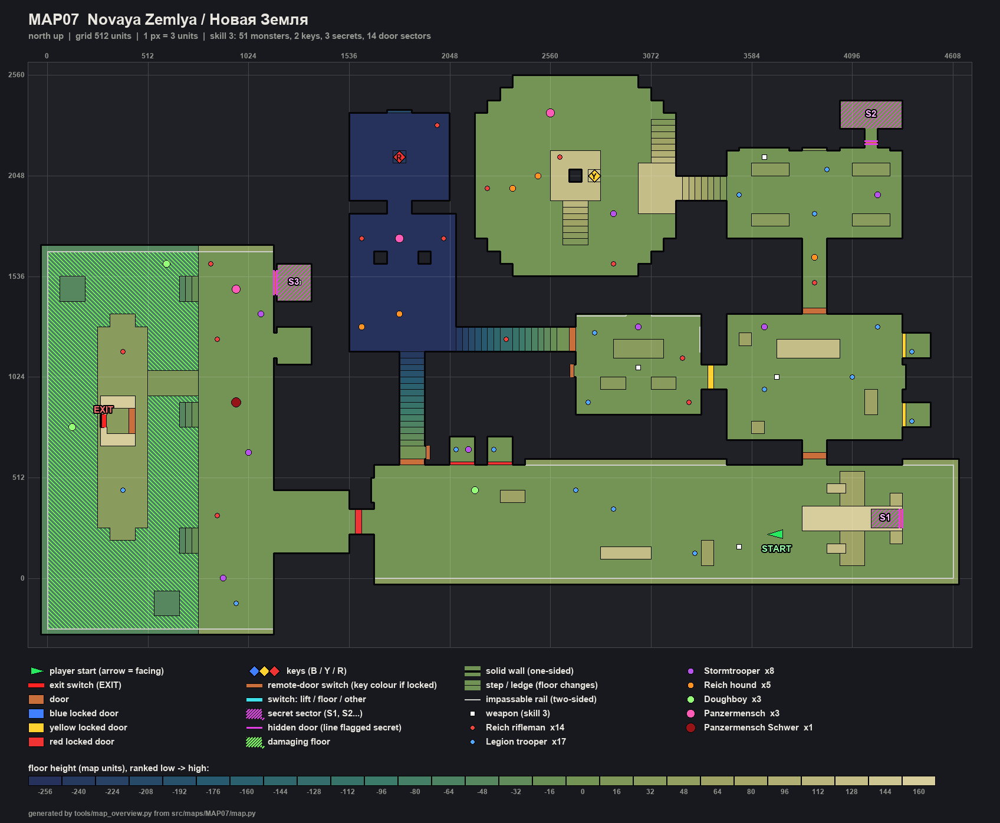
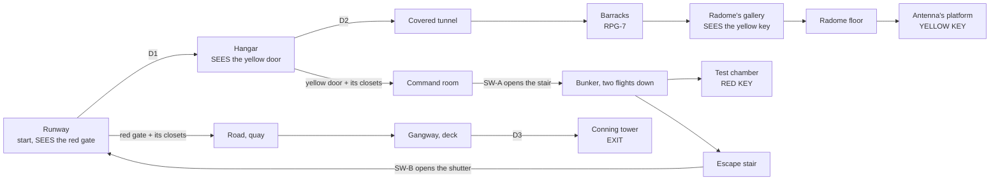

# MAP07 — «Новая Земля» (Novaya Zemlya), the Arctic radar station

Design document. Owner: `level-designer`. Status: **v1 BUILT 2026-10-22
(§13): the whole map, walkable from start to exit, textured with approved
lumps only, populated, three secrets; since 2026-10-22 (D113) it wears
Episode 3's Arctic set and the Naval set's submarine (§7.1), three
undrawn lumps resolved with stand-ins (§7.2); v1.2 (D116) adds the
Legion's machine-gunners and the AKM (§9); not yet walked, no engine
pass yet (D26).** Episode 3, «The
Portal» (D112), first map. Built MVP first (D60). Source:
`src/maps/MAP07/map.py`; tests: `tests/test_map07_novaya_zemlya.py` (the
map), `tests/test_map07_route.py` (its automatic route) and the `Map07Posters`
block of `tests/test_posters.py`; route `zemlya-critical` in `tools/route.py`;
overview `docs/levels/shots/MAP07-overview.png`. Russian mirror: owed at the
phase close (D34).

> **Walk it** (the PM or the CEO; agents never start GZDoom, D26):
> `python3 tools/build.py && SD_ALLOW_ENGINE=1 MAP=MAP07 SKILL=3 tools/run.sh`.
> Automatic run: `SD_ALLOW_ENGINE=1 python3 tools/route.py --route zemlya-critical --keep-evidence`.

Inputs this document obeys and does not restate: `docs/PRD.md` (D35 the
factions, D58 the unfound pass, D60 MVP first, D112 episode 3),
`docs/engine/BESTIARY.md`, `docs/engine/BALANCE.md`, `docs/engine/MOD-SPEC.md`
(DoomEdNums, locks, the passes), `docs/art/TEXTURE-INDEX.md` (approved lumps
only) and the method of `docs/levels/MAP05-volga-dam.md`.



## 1. Synopsis

November 1977, the polar night. A polar-aviation Il-14 sets Sergeant
Vilanova down on the iced runway of the radar station on Novaya Zemlya,
which the invaders have turned into a beacon that guides their
reinforcements to the portal. He crosses the hangar and the covered service
tunnels to the radome, takes the antenna's pass, opens the command room,
goes down into the nuclear-test bunker for the harbour's pass, and fights
his way onto the frozen quay and down the conning tower of the submarine
that takes him to MAP08.

## 2. Its place in the campaign

| | |
|---|---|
| Comes after | MAP06 (episode 2's end). Episode 3 opens here: the player arrives by air, the Il-14 standing on the runway behind him. |
| Comes before | MAP08: the exit is the submarine's conning tower; the transition text is the scaffolding agent's (`SD_MAP07_EXIT_TEXT`, cluster 8). |
| What it adds | an **outdoor arrival under the polar night**, a **domed hall with a hanging dish** (the radome, the key on the antenna's platform seen across the drop from the gallery), an **underground bunker with a glowing core** (the inquietante touch), a **harbour with open water and a boarding** (the gangway, the submarine), the same grammar as MAP05: two keys, two locks seen first, a shortcut found from behind, counter-attacks on the locks' own tags. |
| Factions (D35) | both. The Liberty Legion came by air: it holds the airfield (runway, hangar) and sleeps in the barracks; the Fourth Reich runs the beacon: the tunnels, the radome, the bunker. Both man the command room and both hold the harbour. Doughboys fly over the runway and the open water. The General is not here. |
| MAPINFO, LANGUAGE | the scaffolding agent's (in place at the time of writing: `map MAP07 lookup "SD_MAP07_NAME"`, `cluster = 8`, `next = "MAP08"`). This role touches neither (§11). |

## 3. What the map has to do

| Job | How the layout does it |
|---|---|
| Be an Arctic radar station | an airfield (runway, Il-14, fuel bowser, hangar), barracks joined by **covered tunnels** (nobody walks outside between buildings), a **radome** (a stepped octagon, a crown, the dish hanging over the antenna's platform), a command room with boards, consoles and a plotting table, a **nuclear-test bunker** under the station, and a **harbour** with open water, floes, pack ice and a submarine at the quay. |
| Use the height | the radome's gallery and the antenna's platform 128 over its floor; the bunker 256 under the runway (two flights down from the command room, one long escape stair up); the sea 64 under the quay; the submarine's deck 32 over it. No lift. |
| Teach the order of two keys | the **red gate** is the first thing seen, at the far end of the runway, lit red; the **yellow door** in the hangar's west wall is seen on entering the hangar; the **yellow key** lies on the antenna's platform; the **red key** in the bunker, behind the yellow door's command room. Lock before key, both times (tested). |
| Answer D58 again | each key alone on a lit place (192, its lock's colour) on the route, seen from where its room is entered (tested: the yellow key from the radome's gallery across the drop, the red key from the test chamber's door). |
| Reward knowing the map | SW-B at the head of the bunker's escape stair opens a shutter straight onto the runway, 200 units from the red gate; without it the way back is the long one (the bunker's stair, the command room, the hangar, the runway: about 2500 units). Tested as not needed. |
| Rise | three thirds by hit points met, each heavier than the one before on every skill, and the harbour the heaviest beat of all (tested, §6). |

Target length: 13–16 minutes first run on skill 3; about 6 once known.

## 4. Plan

From the built map, 64 × 64 units per character, north up. Floors: runway,
hangar, barracks, command room, radome's floor, quay **0**; the radome's
gallery and the antenna's platform **+128**; the bunker **−256**; the sea
**−64**; the submarine's deck **+32**.

```
     y   x 0 ............................................................... 4608
  2496                                      RRRRRRRRR
  2368          CCCCCCC                   RRRRRRRRRRRRR                22222
  2240          CCC!CCC                  RRRRRRRRRRRRRR                  2
  2112          CCCCCCC                  RRRRpppyRRRggggg    BBBBBBBBBBBBBB
  1984          ccc                      RRRRpPppRRRgggg~~~~BBBBBBBBBBBBBB
  1856                                   RRRRRsRRRRRgg      BBBBBBBBBBBBBB
  1792  ~~~~~~~QQQQQQ   UUUUUUUUUU       RRRRRsRRRRRRRR      BBBBBBBBBBBBBB
  1600  ~~~~~~~QQQQQQ3  UUUUUUUUUU        RRRRRRRRRRRR             tt
  1472  ~~~~~~~QQQQQQ3  UUUUUUUUUU          RRRRRRRR               tt
  1280  ~~SSSS~QQQQQQ   UUUUUUUUUUssssssssssss    MMMMMMMMMMM       #
  1152  ~~SSSSsssQQQQqq UUUUUUUUUU           #MMMMMMMMMMMyHHHHHHHHHHHHkk
  1024  ~~SSSSsssQQQQqq    ee                MMMMMMMMMMMyHHHHHHHHHHHHkk
   896  ~~SSSS~QQQQQQ      ee                MMMMMMMMMMM HHHHHHHHHHHHkk
   768  ~~E#SS~QQQQQQ      ee                            HHHHHHHHHHHH
   640  ~~SSSS~QQQQQQ      ee#  kk kk                   #
   448  ~~SSSS~QQQQQQrrrrrr    ==================      ===========
   320  ~~SSSS~QQQQQQrrrrr#rWWWWWWWWWWWWWWWWWWWWWWWWWWWWWWWWWWWWWWWWW
   192  ~~SSSS~QQQQQQrrrrrr  WWWWWWWWWWWWWWWWWWWWWWWWWWWWWW@ooooooooo1
    64  ~~~~~~~QQQQQQ        WWWWWWWWWWWWWWWWWWWWWWWWWWWWWWWWWWWWWWWWW
  -128  ~~~~~~~QQQQQQ        =============================================
```

Legend: `W` runway (start `@` beside the Il-14, `o` the plane) · `#` doors
and shutters · `H` hangar, `y` the yellow door's portal · `k` closets ·
`t` covered tunnel · `B` barracks · `g` the tunnel's stair up to the
radome's gallery · `R` radome, `p` the antenna's platform with the pedestal
`P` and the yellow key `y` on its pad, `s` its stair · `M` command room ·
`s` (row 1280) the bunker's two flights · `U` bunker hall, `C` test chamber
with the red key `!` and the core's slot `c` · `e` the escape stair up to
SW-B's shutter onto the runway · `r` the harbour road through the red gate
· `Q` quay, `q` the open shed, `3` S3 the shut shed · `~` sea, `S` the
submarine, `E` its conning tower (exit) · `=` kerbs and pack ice · `1`, `2`,
`3`: secrets S1 (the plane's hold), S2 (behind the lockers), S3. The
overview PNG is exact; this sketch is not to scale.

| # | Zone | x | y | floor | ceil | light |
|---|---|---|---|---|---|---|
| Z1 | Runway (start), centreline, the Il-14 (props), fuel bowser, crates | 1664…4608 | 0…576 | 0 | sky 512 | 128 |
| Z1r | Red gate's portal (in the gatehouse) | 1600…1664 | 224…352 | 0 | 128 | **192**, red |
| — | Red gate (lock 1) | 1568…1600 | 224…352 | 0 | door | |
| Z2 | Hangar (crates, an Il-14 airframe under repair) | 3456…4352 | 704…1344 | 0 | 320 | 144 |
| Z2y | Yellow door's portal | 3392…3456 | 960…1088 | 0 | 128 | **192**, yellow |
| — | Yellow door (lock 3) | 3360…3392 | 960…1088 | 0 | door | |
| Z3 | Covered tunnel north; the tunnel's stair west (8 rises) | 3840…3968; 3200…3456 | 1376…1728; 1920…2048 | 0; 16…128 | +128 | 112 |
| Z4 | Barracks (bunks, locker alcoves, the mural's sill) | 3456…4352 | 1728…2176 | 0 | 160 | 128 |
| Z5 | Radome (stepped octagon; crown 704; dish 640 over the centre) | 2176…3200 | 1536…2560 | 0 | 512 / 704 / 640 | 144 / 128 |
| Z5g | Gallery (the tunnel arrives here), stair down north (7 steps) | 3008…3200 | 1856…2336 | 128…16 | 512 | 144 |
| Z5p | Antenna's platform, stair up from the south (7 steps), pedestal solid | 2560…2816 | 1696…2176 | 128 | 640 | 128 |
| Z5k | Key pad on the platform's east edge | 2752…2816 | 2016…2080 | 144 | 640 | **192**, yellow |
| Z6 | Command room (2 consoles, map table, 3 boards) | 2688…3328 | 832…1344 | 0 | 256 | 160 |
| Z7 | Bunker stair: 7 steps, landing, 7 steps | 2080…2656 | 1152…1280 | 0 → −256 | +128 | 112 |
| Z7h | Bunker hall (2 pillars, the flickering lamp) | 1536…2080 | 1152…1856 | −256 | −32 | 112 (lamp 144, flicker) |
| Z7c | Test chamber; the core's slot (prop, SDPORT1) | 1536…2048 | 1920…2368 | −256 | −32 | 96 (core 176) |
| Z7k | Plinth, the red key | 1760…1824 | 2112…2176 | −240 | −32 | **192**, red |
| Z7e | Escape stair (15 steps) and its head, SW-B | 1792…1920 | 608…1152 | 0 → −240 | +128 | 112 |
| Z8 | Harbour road | 1152…1536 | 128…448 | 0 | sky | 128 |
| Z9 | Quay, the open shed, S3's shed | 768…1344 | −256…1664 | 0 | sky / 128 | 128 / 112 |
| Z10 | The sea (hurts 5/32 tics), steps up at y 128, 768, 1408, two floes | 0…768 | −256…1664 | −64 | sky | 112 |
| Z11 | Submarine's deck, gangway (+16), the hatch's porch | 256…768 | 192…1344 | 32 | sky / 160 | 128 |
| Z12 | Conning tower; exit niche | 288…416 | 736…864 | 32 | 160 | 112; **192** |

Extent 4672 × 2848 units (MAP05: 4576 × 2304). 169 sectors, 697 lines.
Every height is a multiple of 16; no step up is over 16 (tested).

## 5. Progression, keys, switches and the exit



**The keys.** Doom's yellow and red cards, editor numbers **6** and **13**,
locks **3** and **1** (`gzdoom.pk3 → lockdefs.txt`, g4.14.2), both opened in
the engine on MAP03. They spawn as `SD_YellowPass` and `SD_RedPass`.

| Id | Where | Type | Special | Can it lock the player out? |
|---|---|---|---|---|
| D1 | Runway → hangar | manual door | `Door_Raise (1)`, both faces | no |
| D2 | Hangar → covered tunnel | manual door | `Door_Raise (2)`, both faces | no |
| **YD** | Hangar → command room | **locked, opens for good**; also the hangar's two closets (tag 4) | `Door_LockedRaise (4, 16, 0, 3, 0)`, both faces | no |
| SH-A | Command room → the bunker's stair | remote, opens for good, steel both sides | tag 10 | no |
| SW-A | Command room's west wall, beside SH-A | `SDSW1A`, one-shot | `Door_Open (10, 16, 0)` | no |
| SH-B | Escape stair's head → runway | remote, opens for good. Steel from the stair; **the bunker block's concrete from the runway** (found from behind) | tag 11 | no |
| SW-B | Escape stair's head, east wall | `SDSW1B`, one-shot | `Door_Open (11, 16, 0)` | no |
| **RG** | Runway → harbour road | **locked, opens for good**; also the runway's two closets (tag 5) | `Door_LockedRaise (5, 16, 0, 1, 0)`, both faces | no |
| D3 | Deck → conning tower (the hatch) | manual door | `Door_Raise (3)`, both faces | no |
| EXIT | The tower's west wall, on D3's line | `SDSW1D` | `Exit_Normal (0)` | — |

**The order, as the tests play it** (`test_the_route_is_the_designed_one`),
four rounds:

1. With D1, D2 and the push panels: runway, hangar, tunnel, barracks,
   radome, **the yellow key**. The red gate seen from the start, the yellow
   door from the hangar (both tested).
2. The yellow door (and the hangar's closets): the command room, SW-A.
3. SW-A: the bunker, **the red key**, the escape stair, SW-B.
4. The red gate (and the runway's closets) and SW-B's shutter: the road, the
   quay, the submarine, D3, the **exit**; S3 on the way.

**Signposting** (D58): each key alone on a lit place (192) in its lock's
colour (`lightcolor` yellow `0xFFD860`, red `0xFF6048`, MAP03's) and nothing
else wears either colour (tested). The yellow door wears `SDDOORY`, the red
gate `SDDOORR`. Every switch is a real face, one-shot, in sight of what it
opens (tested).

No softlock, all tested: no door closes behind the player; no lift the
player rides (V3's radar lift only brings monsters down, §17); no drop
without a climb back (the gallery's stair, the platform's stair, three
steps up the quay wall at three places, the floes a step out of the water);
the kerbs and the pack ice are **impassable lines** (`blocking`); no secret
and no shortcut is needed; from every reachable sector at every stage there
is a way back to the start and, at the end, a way on to the exit.

## 6. Intensity curve

```
  high |                                                              ######
       |                                                              ######  <- the harbour:
 press |                          ####                 ####   ##     ######     Panzermensch,
  ure  |   ##                     ####          ##     ####   ##     ######     heavy, Doughboys,
       |   ##   ##    ##          ####   ##     ##     ####   ##     ######     both factions
   low |   ##   ##    ##     ##   ####   ##     ##     ####   ##     ######  ##
       +------------------------------------------------------------------------>
        runway hangar tunnel barracks radome command bunker chamber  road harbour sub
                                          closets               closets
        0:00                                                                 ~15:00
```

| Beat | Space | Feeling | Mechanic introduced |
|---|---|---|---|
| 1 | Runway | off the plane into the polar night; a Legion picket; **the view**: the red gate at the far end, shut | the lock shown first |
| 2 | Hangar | the Legion's ground crew; **the yellow door** in the west wall | — |
| 3 | Tunnels, barracks | close quarters; the RPG-7 | — |
| 4 | Radome | the big domed room, the dish overhead; **the yellow key across the drop** from the gallery; the Panzermensch under the crown | the key seen, not reached |
| 5 | Yellow door, command room | **spike**: the hangar's closets open behind; both factions at the map table; SW-A | the lock's own counter-attack |
| 6 | Bunker | down into the dark; hounds; the flickering lamp; **the core glowing cobalt** behind the red key | the inquietante touch |
| 7 | Escape stair, SW-B | the shutter opens onto the runway: **the shortcut** | the shortcut from behind |
| 8 | Red gate, road, harbour | **spike** from the runway's closets; then the **climax** on the quay: both factions, the heavy by the gangway, Doughboys over the water | — |
| 9 | Submarine | the gangway, the deck, D3, the exit | — |

Measured (hit points met, by beat; `test_the_intensity_rises`):

| Beat | Skill 2 | Skill 3 | Skill 4 |
|---|---|---|---|
| Runway, hangar | 180 | 640 | 730 |
| Tunnels, barracks | 110 | 320 | 350 |
| Radome | 710 | 920 | 1090 |
| Command room + hangar closets | 170 | 220 | 340 |
| Bunker | 710 | 880 | 2030 |
| Runway closets, road, harbour, submarine | **1170** | **2740** | **3500** |

## 7. Textures

### 7.1 By zone (all approved and packed, tested)

Episode 3's lumps (D113, `docs/art/TEXTURE-INDEX.md`, "Arctic" and
"Naval") in **bold**.

| Zone | Walls | Floor | Ceiling |
|---|---|---|---|
| Runway | the bunker block's front `SDCONC1`; the hangar's front `SDRUST1`; the gatehouse `SDBRCK1` with two Soviet flags `SDFLAG1`/`SDFLAG2` (D119: redrawn as Soviet flags); snowbanks (kerbs) **`SDICE2`** | **`SDRWY1`**, the centre strip **`SDRWY2`**, both turned 90° (`rotationfloor`); the snowbanks' tops **`SDSNOW1`** | sky |
| The Il-14 | `SDSTEL1` (fuselage, wings, nacelles, tailplane, the tail over the ramp; no `SDPLAN1` drawn, §7.2); the cargo ramp `SDGATE1` (S1) | `SDFLR4`; the porch under the tail **`SDRWY1`** turned | sky |
| Fuel bowser | `SDTANK1` («НЕФТЬ»), one tile high | `SDFLR4` | sky |
| Hangar | `SDRUST1`; crates `SDCRAT1`/`SDCRTOP1`; Lenin `SDPOSTR1` in a recess | `SDFLR2`; D1's porch outside **`SDSNOW1`** | `SDCEIL1` |
| Tunnels | `SDTUNL1` | `SDFLR2` | `SDCEIL2` |
| Barracks | `SDCONC2`; locker alcoves `SDLOCK1`; bunks `SDSTEL1`; the mural `SDPOSTR2` on a sill | `SDFLR3` | `SDCEIL1` |
| Radome | **`SDRADM1`** (the walls, the chamfers and the crown); dish rim, platform, gallery `SDSTEL1` | `SDFLR2`; platform `SDGRAT2`; gallery `SDFLR4` | `SDCEIL2`; the dish's underside `SDGRAT2` (the mesh) |
| Command room | `SDTILE1`; the two boards flanking Stalin **`SDRADR1`** (two PPI scopes each, animated `SDRADR1-4`), the east board `SDCTRL1`, all standing on the floor; consoles `SDCTRL1`'s desk; Stalin `SDPOSTR3`; Marx `SDPOSTR4` and Engels `SDPOSTR5` on the south wall | `SDFLR3`; consoles and map table `SDFLR4` | `SDCEIL1` |
| Bunker | `SDTUBB1`; the chamber's passage `SDMEDG1` (hazard chevrons); the core `SDPORT1` (animated); the shutter from the command room **`SDHERM1`** both faces, the escape shutter **`SDHERM1`** on the stair's face (from the runway it stays `SDCONC1`, wall) | `SDFLR4` | `SDCEIL2`, lamp `SDCEIL1` |
| Harbour | warehouses `SDBRCK3`; the two sheds inside **`SDHUT1`** (alike, S3's comparison); the quay wall `SDDAM2` (tide mark on the water); ice faces **`SDICE2`**; snowbanks **`SDICE2`**; S3's door `SDGATE2` | road, quay, porches, snowbanks **`SDSNOW1`**; the sea `SDWATR1` (animated); floes and pack ice **`SDICE1`** | sky |
| Submarine | hull and tower **`SDHULL1`** (Naval set), «471» **`SDHULL2`** once on the tower's south face, one `SDARMR1` star on its north face; inside the tower **`SDNAVC1`**; gangway `SDSTEL1` | deck and the hatch's porch **`SDRUBR1`** (Naval set; the worn path along y, the boat lies along y); inside `SDFLR4` | sky; tower `SDFLR4` |
| Doors, switches | `SDDOOR1` (D1, D2), D3 **`SDBULK1`** (the watertight door «3», Naval set), `SDDOORY`, `SDDOORR`; `SDSW1A`, `SDSW1B`, `SDSW1D`. No blue lock on this map, so no `SDDOORB` | | |

**Alignment (tested).** `SDRADM1` on one grid from the radome's floor:
whole 128 panels to the 512 rim and to the 704 crown. `SDHULL1` with its
deck edge on the deck (32) and on the tower's top (160): from the water
the hull shows the tile's upper 96 rows, deck edge up. `SDICE2` from the
ground on the snowbanks, from the water (-64) on the floes and the pack
ice. The three run on the world's x/y grid (`LUMP_WIDTH`), so a split line
shows no seam. `SDRWY1` and `SDRWY2` are twins turned alike: the dash
(tile columns 27-36) lands on world y 283-293, the middle of the 64-wide
strip at y 256-320, whichever way the engine turns it. `SDRADR1` hangs on
256- and 128-long boards from their start: two whole scopes each. The
single pieces (`SDHERM1`, `SDBULK1`, `SDHULL2`, the star) on lines exactly
128 long, offset 0.

### 7.2 The Arctic set: what was asked, what is worn

The request to the art-director, as built v1 (`ARCTIC_SET` in `map.py`,
tested: where the proposed lump exists the map wears it; where it does
not, the stand-in is worn, and the day the proposed lump appears in
`assets/` the test turns red until the map wears it).

| Proposed | Kind | What | Worn now | Where |
|---|---|---|---|---|
| `SDSNOW1` | flat | packed snow | **`SDSNOW1`** | road, quay, porches, snowbanks' tops (the runway wears `SDRWY1`, drawn for it) |
| `SDSNOW2` | wall 64×128 | snowbank face | `SDICE2` (not drawn; the glacier ice is the nearest) | the snowbanks round the runway and the quay |
| `SDICE1` | flat | sea ice | **`SDICE1`** | floes, pack ice |
| `SDICE2` | wall 64×128 | the ice's edge at the water | **`SDICE2`** | floes' and pack ice's faces |
| `SDRADM1` | wall | radome skin | **`SDRADM1`** (drawn 128×128) | radome walls and crown |
| `SDPLAN1` | wall 64×128 | Il-14 skin in polar aviation's red and silver | `SDSTEL1` (not drawn; S1's clue is the plane's steel against its corrugated ramp) | the plane |
| `SDSUBH1` | wall | submarine hull | `SDHULL1` (drawn under that name in the Naval set) | hull, tower |
| `SDMAPT1` | flat | plotting table with the Arctic on it | `SDFLR4` (not drawn; no installed flat is a map) | command room's table |
| `SDRADR1` | wall 128×128 | radar console with a round PPI scope | **`SDRADR1`** | the two north boards |
| `SDAURO1` | sky | the polar night with an aurora | — (MAPINFO's sky, scaffolding's: Freedoom's `SKY1`) | `PENDING_TEXTURES` |

Still for the `art-director`, if the CEO wants them: `SDPLAN1`, `SDMAPT1`,
`SDAURO1`. Drawn but not used here: `SDRUBR1`'s twin `SDRUBR2` (a flush
deck hatch; MAP07's hatch is a door in the tower) and the rest of the
Naval set (MAP08's).

### 7.3 Posters (CEO, 2026-10-22: «que esos posters puedan aparecer en cualquier nivel»)

Each whole: one one-sided line exactly the poster's width, in a sector
exactly its height, pegged to the floor, offset 0 (`tests/test_posters.py`,
block `Map07Posters`).

| Name | Lump | Where |
|---|---|---|
| `z2_lenin` | `SDPOSTR1` Lenin | hangar, east wall, x 4368, y 960…1088, a recess 16 deep and 256 high; faces the yellow door across the hangar |
| `z6_stalin` | `SDPOSTR3` Stalin | command room, north wall, y 1344, x 2944…3072, between the two boards (the room is 256 high) |
| `z4_mural` | `SDPOSTR2` cosmonautics | barracks' red corner, north wall, y 2192, x 3840…3968, on a 32 sill between the locker alcoves |
| `z6_slot_e` | `SDPOSTR4` **Marx** (Marx-Engels slot) | command room, south wall, y 832, x 3136…3264: the left one seen from the room (facing south) |
| `z6_slot_w` | `SDPOSTR5` **Engels** (Marx-Engels slot) | command room, south wall, y 832, x 2752…2880: the right one |

**The Marx-Engels pair (D117, 2026-10-22).** `POSTER_SLOTS_MARX_ENGELS =
("z6_slot_e", "z6_slot_w")`, Marx's first: `SDPOSTR4` Marx «ПРОЛЕТАРИИ / ВСЕХ СТРАН,» and `SDPOSTR5` Engels «СОЕДИНЯЙТЕСЬ!» (mirrored, looking at Marx), 128×256 like Lenin and Stalin; `MARX_ENGELS = ("SDPOSTR4", "SDPOSTR5")` lists them in `WALL_TEXTURES`. The wall is
the room's south wall, so seen from inside east is on the left: Marx east,
Engels west, and the two bands read the Manifesto's line left to right
across the room's axis (`tests/test_posters.py` checks it).

## 8. Secrets (built in v1)

MAP01's rule: a clue is a comparison, never a sign; each secret has a way
back; none is needed (tested).

| # | Where | Clue | Reward (every skill) |
|---|---|---|---|
| S1 | The Il-14's hold | the plane the player stepped off is riveted steel on every face but one: the corrugated cargo ramp (`SDGATE1`) under its tail, which is the push panel (tag 6) | shell box, medikit, box of rounds |
| S2 | Behind the barracks' lockers | in the east alcove of lockers one 64-wide bay stands 16 further back, in shadow (96 against 128); it is a locker like the rest and the push panel (tag 7) to the commissar's store | PG-7V box, stimpack, shell box |
| S3 | The quay's second shed | two sheds alike on the quay; the south one stands open (two health bonuses), the north one is shut by a goods door «СКЛАД» (`SDGATE2`), the push panel (tag 8) | the **Hand Katyusha** and two fuel canisters: the panic button for the harbour |

Panels carry the `secret` flag; rooms the sector special 1024. S1 and S2
open in round 0, S3 in round 3.

## 9. Enemies and resources by skill

Bestiary numbers (MAPINFO DoomEdNums 21100-21107, and 21110 the gunner
since D116), nested by Doom's skill pairs. Every class but the General,
the colossus and the Consortium.

| Beat / zone | Skill 2 | Skill 3 | Skill 4 |
|---|---|---|---|
| Runway, hangar | 4 troopers + 1 stormtrooper | 6 troopers + 1 stormtrooper + Doughboy | 7 troopers + 2 stormtroopers + Doughboy |
| Tunnel, barracks | 1 rifleman + 3 troopers | + 1 hound + 1 stormtrooper | + 1 trooper |
| Radome | Panzermensch + 3 riflemen + 1 hound | + 1 hound + 1 stormtrooper | + 1 rifleman + 1 hound |
| Command room + hangar closets (yellow tag) | 3 troopers + 1 rifleman + 1 stormtrooper | + 1 trooper + 1 rifleman | + 2 stormtroopers |
| Bunker | Panzermensch + 3 riflemen + 1 hound | + 1 hound + 1 rifleman | + 1 hound + **heavy** before the core |
| Runway closets (red tag), road, harbour, submarine | Panzermensch + Doughboy + 3 troopers + 3 riflemen + 2 stormtroopers | + **heavy** + Doughboy + 1 trooper + 1 rifleman + 2 stormtroopers | + Doughboy + 3 troopers + 1 hound + 2 stormtroopers |
| Gunners (D116) | 3: runway, hangar, quay | + 1 on the deck | + 1 by the red gate |
| **Total** | **37** | **55** | **72** |

The Legion's machine-gunners (D116, `SD_LegionGunner`, 21110, 80 HP; they
drop half an AKM magazine), 3 / 4 / 5 on skills 2 / 3 / 4, each by cover
with a long line down ground the player must cross (tested: none in a
closet, each with a prop, a wall or a step within 128; the safe start
holds):

| Skill | Where | Line | Cover |
|---|---|---|---|
| 2 | the runway, (2240, 416), facing east | the runway's length east to the plane (1480 from the start) | the west crates |
| 2 | the hangar, (3872, 1264), facing south | the hangar's floor to its door | the airframe under repair |
| 2 | the quay's south end, (1056, -192), facing north | the whole quay | the quay's kerb |
| 3 | the submarine's deck, (320, 1216), facing south | down the hull | the hull's edge |
| 4 | the runway's west end, (1792, 96), facing east | the runway's length | the kerb and the gate's wall |

**Safe start** (`tests/test_safe_starts.py`, 2026-10-22): on skills 2, 3 and 4 no monster sees the start zone (the start and a step round it) within 768 units; Doom's own sight test, run on the built map. The PM's engine pass (2026-10-22 14:13, skill 3, no god mode) found the runway's two nearest troopers (3456, 384 and 3136, 192: 300 and 580 off) taking the player from 100 % to 3 % in about 1.3 s. The first now crouches behind the crates west of the plane (3296, 128), out of sight until the player walks round them; the second stands on the runway 840 off (2880, 352), seen, the first shot the player's. Same count, same zone, same round.

Against MAP05's 31 / 46 / 60: episode 3 opens a notch above (tested). Three
Panzermenschen on every skill (radome, bunker, quay), the heavy from skill 3
(quay) and on skill 4 also before the core. Doughboys only under the sky
(runway, open water; tested).

**Weapons** (pistol start), on every skill, on the route, each before its
fight: the **IZh** by the plane, the **PPSh-41** in the hangar, the **AKM**
(D116, `SD_Akm` 21008) in the hangar's racks after it (episode 3 starts here
with the pistol, so it is on the route even for whoever took one at the dam),
the **RPG-7** in the barracks (the only way into the radome crosses them,
tested), the **ROKS-3** in the command room (for the bunker); the **Hand
Katyusha** in S3. **AKM magazines** (`SD_AkmAmmo` 21020, 30 rounds) 11 / 14 / 19
on skills 2 / 3 / 4 since D119 (§16; D116's 4 / 3 / 2 went with the scaling
down).

**Ammunition, D119** (`docs/engine/BALANCE.md` §8: G3-8's ruler, kills in
IZh shells, a gunner 2, PG-7V at 2 shells, fuel at 13.5 / 80, an AKM
magazine 4.5; route only, no drop, no secret). The route's ammunition is
`AMMO` in `map.py`, apart from `ITEMS`: it appears from its lowest skill tier
up, like the monsters it pays for (§16).

| | Skill 2 | Skill 3 | Skill 4 |
|---|---|---|---|
| Needed | 74 | 128 | 177 |
| Placed | 122.6 | 187.5 | 229.0 |
| Ratio (band 1.5-2.0 / 1.3-1.6 / 1.2-1.45) | 1.66 | 1.46 | 1.29 |
| Before D119 (placed, ratio) | 343.0, 4.64 | 325.5, 2.54 | 275.0, 1.55 |
| Ammunition pickups on the route (before D119) | 22 (49) | 31 (44) | 39 (33) |
| Shell share, troopers' drops counted (≤ 35 %) | 28.6 % | 34.5 % | 32.9 % |
| Damage by pool: shells / PPSh / AKM / PG-7V / fuel | 17 / 15 / 45 / 14 / 8 % | 26 / 10 / 37 / 19 / 7 % | 24 / 11 / 41 / 19 / 6 % |

Also checked at every round of the route against the skill's floor, each
pool only after its weapon, the AKM's magazines leading every stage and
PG-7V at most 30 % of any (the map has no boss; §16). **Health** on skill 4: 6 stimpacks + 5 medikits,
9 health bonuses; **armour**: the flak vest in the hangar (for the radome),
the heavy vest at the escape stair's head (round 2, before the runway's
closets and the harbour), 6 plates. Health and armour scale down with skill
(tested).

## 10. Engine elements used

| Need | Emitted | Status |
|---|---|---|
| Manual door | `Door_Raise` 12 (tag, 16, 150, 0) | VERIFIED on MAP01 |
| Remote door, one-shot switch | `Door_Open` 11 (tag, 16, 0) | VERIFIED on MAP01 |
| Locked door that stays open | `Door_LockedRaise` 13 (tag, 16, 0, lock, 0) | VERIFIED on MAP02/MAP03 |
| A locked door's tag opening closets | closets share the lock's tag | NOT VERIFIED in the engine (as MAP05's V3): V3 |
| Keys | things 6, 13 (`SD_YellowPass`, `SD_RedPass`) | as MAP03 |
| Coloured light | sector `lightcolor` | as MAP02-MAP06 |
| Flickering light | sector special 65 on the bunker's lamp | as MAP01 |
| Damaging floor | `damageamount` 5, `damageinterval` 32 on the sea | as MAP05 (in play NOT VERIFIED there either): V4 |
| Sky and the open-air trick | `F_SKY1`; kerbs and pack ice with a sky 16 over their top | as MAP05's parapets: V2 |
| Impassable kerbs | two-sided lines `blocking` | Doom's flag |
| Middle textures | three boards (two `SDRADR1`, one `SDCTRL1`), `blocking` + `dontpegbottom` | as MAP05: V13 |
| Animated textures | `SDWATR1` (flat), `SDPORT1` (wall), `SDRADR1` (wall, a middle texture, 12 tics) through ANIMDEFS | all in ANIMDEFS already; NOT VERIFIED here: V11, V15 |
| Texture offsets | `SDDAM2` on the quay wall, `SDCTRL1` on the consoles, `SDRADM1`, `SDHULL1`, `SDICE2` on their grids | MAP05's helper; V12, V16 |
| Flat rotation | `rotationfloor` 90 on the runway (`SDRWY1`) and its centre strip (`SDRWY2`) | GZDoom UDMF; NOT VERIFIED here: V17 |
| Event on pickup (V3, §17) | thing `special` 21 `Floor_LowerToLowest` (tag, speed) on the yellow key, the red key and the road's medikit | the field as MAP04's red key; the number NOT VERIFIED in our engine (MAP04's K3): V19-V21 |

Tag plan: **1** D1 · **2** D2 · **3** D3 · **4** yellow door + hangar
closets · **5** red gate + runway closets · **6** S1 · **7** S2 · **8** S3 ·
**10** SH-A · **11** SH-B · **12** the radar's lift (yellow key) · **13**
the bunker's cells (red key) · **14** the snowbank (medikit). Free: 9, 15
and up.

## 11. MAPINFO and LANGUAGE (not this role's)

The scaffolding agent's: `map MAP07 lookup "SD_MAP07_NAME"`, `cluster = 8`,
`next = "MAP08"`, the sky and the music. Nothing in the map depends on
more. A par of about 360 is fair for a player who knows the route.

## 12. Version plan

| Version | Content | Done when |
|---|---|---|
| **v1 — whole, textured, populated** ✅ **BUILT 2026-10-22** (§13) | §4-§10 with approved lumps; the Arctic set and the submarine applied the same day (D113, §7) | the CEO walks it on skill 3 and reaches MAP08 |
| v2 — light and the rest | the aurora sky (`SDAURO1`, if drawn); floodlight pools on the runway and the quay; `SDPLAN1`/`SDMAPT1` if drawn (one line each in `ARCTIC_SET`) | a first-time player finds both keys and the exit without being told |
| v3 — balance | after the playtests (D60) | played through on skill 3 |

## 13. v1 build record (2026-10-22)

### 13.1 What is in it

Everything in §4-§10, built in one pass from a placeholder (one room, a
start and an exit, written first so the build never failed for the other
episode-3 agents).

### 13.2 Verification actually run

- `python -m unittest tests.test_map07_novaya_zemlya` — 77 tests, OK.
- `python -m unittest tests.test_posters` (`Map07Posters`, 6) — OK.
- `python -m unittest tests.test_map07_route tests.test_route` — 117 tests,
  OK (`zemlya-critical` registered; MAPINFO's `next` for MAP07 is MAP08).
- `python tools/verify.py fast` (2026-10-22, 3094 tests): docs, build and
  check_pk3 PASS; one failure, shared and not MAP07's alone:
  `test_doughboy_sprites` pins the maps that place a Doughboy to MAP01-MAP06
  and RANGE, and MAP07, MAP08 and MAP09 now place them (13.5).
- **No engine run** (D26).
- 2026-10-22, D113, the Arctic and Naval sets applied (§7):
  `python -m unittest tests.test_map07_novaya_zemlya tests.test_map07_route`
  — 92 tests, OK.

### 13.3 Engine checklist for the PM (D26)

| # | Check | How |
|---|---|---|
| V1 | Loads with a clean log; `zemlya-critical` PASSes on skills 2, 3, 4 | `SD_ALLOW_ENGINE=1 python3 tools/route.py --route zemlya-critical --keep-evidence` |
| V2 | Outdoors read as outdoors: sky over the runway and the harbour, no upper texture between two skies, beyond the kerbs and the pack ice the sky | walk the runway and the quay |
| V3 | The yellow door opens the hangar's two closets; the red gate the runway's two | open each lock, look back |
| V4 | The sea hurts (~5 HP a second), the steps and the floes lead out | stand in the water |
| V5 | Nobody crosses a kerb or the pack ice; Doughboys over the water do not stick on the pack ice | try; watch |
| V6 | The radome reads as a dome: the crown, the dish hanging over the platform (its mesh underside), the key seen from the gallery | stand on the gallery |
| V7 | The bunker: the lamp flickers, the core's slot shows `SDPORT1` animated, whole, cobalt | stand in the chamber |
| V8 | `lightcolor` yellow and red on the locks and the keys' places | as MAP05's V8 |
| V9 | The three secrets count (3 of 3) | push each panel |
| V10 | The posters whole (Lenin's recess, Stalin on the wall, the mural on its sill, the slots) | walk the hangar, the command room, the barracks |
| V11 | The sea moves (`SDWATR1`-`4`) | stand at the quay |
| V12 | `SDDAM2`'s tide mark just under the quay's edge; the consoles show the desk | look |
| V13 | The command room's three boards stand on the floor, drawn once, stop the player | walk into one |
| V14 | The Il-14 reads as a plane (fuselage, low wings, nacelles, the tail over the ramp) | arrive |
| V15 | The radar consoles' scopes sweep (`SDRADR1`-`4`, a middle texture) | stand before the north boards |
| V16 | Episode 3's walls on their grids: the radome's panels whole to rim and crown, the hull's deck edge on the deck from the water, the ice faces without seams | look at the radome, the submarine from the quay, the floes |
| V17 | The runway's slabs and centre line run down the runway (east-west), the dash in the middle of its strip, no seam between `SDRWY1` and `SDRWY2` | arrive, look west |
| V18 | The conning tower from the deck: above the tower's top (160), round its inner room and over the hatch's porch, the upper texture against the sky (the room's and the porch's ceilings are `SDFLR4`, not sky) shows as a box up to 512 (`SDHULL1` over the porch, `SDSTEL1` round the room, as v1). If so, the porch's and the room's ceilings want the sky (a design call: the bridge open to the night) | look at the tower from the gangway |

### 13.4 For the CEO's walk

1. Does the arrival read: the plane, the runway in the polar night, the red
   gate at the far end?
2. The radome: is the yellow key across the drop readable, and the dish?
3. The bunker: inquietante enough (the flicker, the core)?
4. The harbour: the right last fight; the submarine as the way out?
5. The shortcut (SW-B onto the runway): found, and worth it?

### 13.5 What other roles hold

- `art-director`: what is left of the Arctic request, §7.2 (`SDPLAN1`,
  `SDMAPT1`, `SDAURO1`), if the CEO wants them.
- Scaffolding / `mod-engineer`: MAPINFO and LANGUAGE for MAP07 are in place.
- **Shared tests not this role's**: `tests/test_doughboy_sprites.py`
  (`test_the_doughboy_is_placed_in_every_map`) pins the set of maps that
  place a Doughboy and needs `"MAP07"` added (MAP07 places four).
- A trap for every new map: a map that defines both `MURAL_NICHE` and
  `LENIN` answers to MAP01's route markers (`ZARYA_MARKERS`) and
  `tools/route.py` raises on import. MAP07 calls its niche
  `RED_CORNER_NICHE`.
- PM: §13.3.

## 14. Open points for the CEO

1. **Walk v1** (§13.4).
2. **The exit vehicle**: a submarine (as built) or an icebreaker? The quay
   takes either; the conning tower becomes a bridge door.
3. **The Hand Katyusha in S3 again** (as MAP05): keep it secret, or give it
   on the route at the start of episode 3?

## 15. v1.2 record: the gunners and the AKM (2026-10-22, D116)

Population and pickups only: no geometry, door, key, secret or poster moved.

- **Five Legion machine-gunners** (`SD_LegionGunner`, 21110), 3 / 4 / 5 on
  skills 2 / 3 / 4 (§9): totals 37 / 55 / 72 (were 34 / 51 / 67). The
  intensity still rises through the three thirds, the harbour the
  heaviest beat; the safe start holds.
- **The AKM** (`SD_Akm`, 21008) in the hangar, after the PPSh and before
  the RPG-7, in `ROUTE_WEAPONS`; **magazines** (`SD_AkmAmmo`, 21020)
  4 / 3 / 2 by skill.
- Tests (`tests/test_map07_novaya_zemlya.py`): the gunners (count by skill,
  never in a closet, cover within 128), the magazines 4 / 3 / 2, the AKM on
  the route, its rounds in G3-8 (30 a magazine, avg 12 a round); the class
  reader takes each constant's first value.
- Engine checks for the PM: **V19** the gunners' bursts from cover at range
  (runway, hangar, quay); **V20** the AKM in the hangar picks up and fires
  (MOD-SPEC §6.12: it still wears the PPSh's frames until Gemini's are drawn).

## 16. v1.3 record: D119's ammunition (2026-10-23)

The CEO's playtest of Episodes 2 and 3: ammunition "siempre sale de sobras",
"siempre acabas con la escopeta". Pickups only: no geometry, door, key,
secret, monster or poster moved; the secrets' rewards are unchanged.

- **The route's ammunition moved out of `ITEMS` into `AMMO`**, read as
  (zone, editor number, x, y, *lowest* skill tier): every skill gets the
  every-skill stock, skills 3-5 add what the medium monsters cost and skills
  4-5 what the hard ones cost. Nested the other way (Doom's consumables,
  more on easy) no skill-2 band could hold: skill 4 needs 2.4 times skill
  2's kills, so skill 2 got 4.6 times its need.
- **Removed, not only shrunk** on skills 2 and 3: 27 / 13 pickups fewer
  (§9). Skill 4 was already the leanest: its stock fell from 275 to 229
  shell-equivalents, but it holds 39 pickups against 33, because the AKM,
  which now leads every stage, comes 30 rounds a magazine (a box of
  magazines would need an actor: `mod-engineer`). By kind, skill 2 / 3 / 4,
  before -> after: shell boxes 8 / 8 / 7 -> 0 / 1 / 1; shells 17 / 14 / 9 ->
  3 / 5 / 6; clips 7 / 6 / 4 -> 0; boxes of rounds 3 -> 3 / 3 / 4; loose
  PG-7V 5 / 5 / 3 -> 3; PG-7V boxes 2 -> 1 / 3 / 4; canisters 3 -> 1 / 2 / 2;
  AKM magazines 4 / 3 / 2 -> 11 / 14 / 19.
- **The mix** (BALANCE §8.3-8.4 with the PM's amendment of
  2026-10-23): shells at most 35 % with the troopers' dropped IZhs counted;
  each pool only once its weapon is met; outside a boss's or a mini-boss's
  stage the newest bullet weapon leads (the AKM, else the PPSh: the largest
  share of the stage's non-shell ammunition, at least 40 %) and PG-7V are
  the strong second, at most 30 % of the stage's damage, so the shotgun is
  not swapped for the rocket launcher; fuel never needs to lead and stays
  at most 15 % of the map's damage (the ROKS-3 is toned down). Two magazines lie in the command
  room beside the ROKS-3's own 40, so the AKM still leads there.
- Tests (`tests/test_map07_novaya_zemlya.py`): the band per skill, every
  stage at the skill's floor, the shell share with drops, each pool after
  its weapon, the bullets leading and PG-7V ≤ 30 % of each stage, fuel ≤
  15 % and the AKM ahead of the PPSh, the ammunition following the monsters
  (fewer pickups on skills 2-3, less stock on skill 4);
  `ROKS_AVERAGE` 13.5. The magazines' 4 / 3 / 2 test is gone.
- BALANCE §8.4.3's second half (every monster but the boss on shells and
  rounds alone) was dropped by the PM; the ROKS-3 exception is the PM's
  amendment. The engine pass is the PM's (D26).

## 17. V3: events on pickup and the set pieces (2026-10-23, D120's A2 and A3)

V3 work, not in v1.2. Three events, each fired by **picking a thing up**:
the thing carries a UDMF `special` and `arg0..`, which GZDoom runs when the
item is picked up (MAP04's red key and the gondolas are the model; the
`Door_Open` form is VERIFIED in the engine by `tunguska-critical`'s RKEY,
2026-10-23). Each tag is carried by **no line**: only the pickup moves those
sectors. The table is `PICKUP_EVENTS` in `map.py`; `tests/_pickup_events_e3.py`
holds the checks MAP07-MAP09 share (the PM unifies the pattern with
`docs/levels/PICKUP-EVENTS.md`).

| Event | Thing (where) | Special | Tag | What moves | Who waits | Warning |
|---|---|---|---|---|---|---|
| **A3 the radar's cargo lift** | the yellow key (antenna's platform) | `Floor_LowerToLowest (12, 8)` | 12 | the car `z5_lift_car` (2064-2144 x 2096-2256), up at 128 behind a gate a door high in the radome's west wall, comes down to the floor (~3.7 s) | 1 / 2 / 3 Reich (rifleman; + hound; + rifleman) | the gate `z5_lift_gate` flickers (65, 160 against the car's 112); the winch (the floor's move sound) |
| **A2 the bunker's cells** | the red key (the plinth before the core) | `Floor_LowerToLowest (13, 32)` | 13 | two wall panels `z7_cell_s_wall`, `z7_cell_n_wall` in the test chamber's west wall, floor at the chamber's ceiling (-32), sink to its floor (~1.6 s) | 2 / 3 / 4 Reich (two riflemen; + hound; + hound) in `z7_cell_s`, `z7_cell_n` | the chamber's strip before each panel flickers (65, 160 against the chamber's 96) |
| **A3 the snowbank that sinks** | the medikit on the harbour road (1344, 432), under a broken floodlight | `Floor_LowerToLowest (14, 16)` | 14 | the bank `z8_snowbank` (1280-1408 x 448-480), 128 high against a warehouse's front, sinks into the road (~1.8 s) | 1 / 2 / 3 (rifleman; + rifleman; + trooper) in the warehouse's ground floor `z8_snowbank_pocket` | the floodlight's patch `z8_snowbank_lamp` flickers (65, 160 against the road's 128); the medikit lies in it |

**Why these, and how they hide.** The brief asked for the ice or the
ground sinking when a key is taken; both keys lie indoors (the antenna's
platform, the test chamber), so the sinking ice is the road's medikit, an
"object" (A2's "llaves y objetos"), and the keys get the lift and the cells.
Before the pickup no line from where the monsters wait has an opening (the
car's floor is the gate's ceiling; a panel is shut floor-to-ceiling; the
bank's top meets the warehouse's lintel): nothing sees them or hears the
player through it (Doom's sound stops at a closed line), so they wait;
they wake when it opens, on sight or the first shot (tested).

**The monsters moved, not added**: the totals (37 / 55 / 72), every beat's
hit points, the ammunition and its bands are unchanged (all tested again).
The lift holds the radome's west rifleman (skill 2), the dish's hound (3)
and the south-west rifleman (4); the cells the hall's two riflemen (2), its
west hound (3) and its east hound (4); the warehouse the quay's riflemen at
(864, 320) (2) and (832, 1600) (3) and its trooper at (1088, 448) (4). The
medikit moved from (1408, 384) on the road onto the floodlight's patch.

**Rules held (tested):** never on the critical path (the exit with every
event tag left shut); never a trap (from every event's room a way back to
the start, at every round); the thing's place reached without its event,
the event's rooms never reached without it; the safe start (every released
monster farther than 768 from the start; `tests/test_safe_starts.py` runs on
the built map); the four rounds of §5 unchanged (each pickup fires in the
round its thing is reached: the lift in round 0, the cells in round 2, the
snowbank in round 3). The lift is not a player's lift: the car comes down
and stays down, a dead end walked out of.

**Route** (`tools/route.py`, `zemlya-critical`): RKEY now waits a door's
time and expects tag 13 open (a sunk panel is a player's height open), the
first engine proof of `Floor_LowerToLowest` on an item. The lift is not
asked (its car is always a body high, so "open" proves nothing); the
medikit is never taken by the route.

**Engine checklist additions (the PM's, D26):**

| # | Check | How |
|---|---|---|
| V19 | Taking the yellow key brings the radar's lift down to the radome's floor with its Reich; the gate's lamp flickers before; the car's steel face reads as a lift gate under the gate's lintel | walk YKEY, look west from the platform; `netevent sdtag 12` prints floor 0 |
| V20 | Taking the red key sinks both cell panels in the chamber's west wall; the hounds and riflemen come out; the strips before them flicker | route step RKEY (tag 13 open) and look west |
| V21 | Taking the road's medikit sinks the snowbank; the warehouse's ground floor opens under its brick lintel; the floodlight's patch flickers; the bank's face reads as packed ice (`SDICE2`) | walk onto the medikit on the road; `netevent sdtag 14` prints floor 0 |
