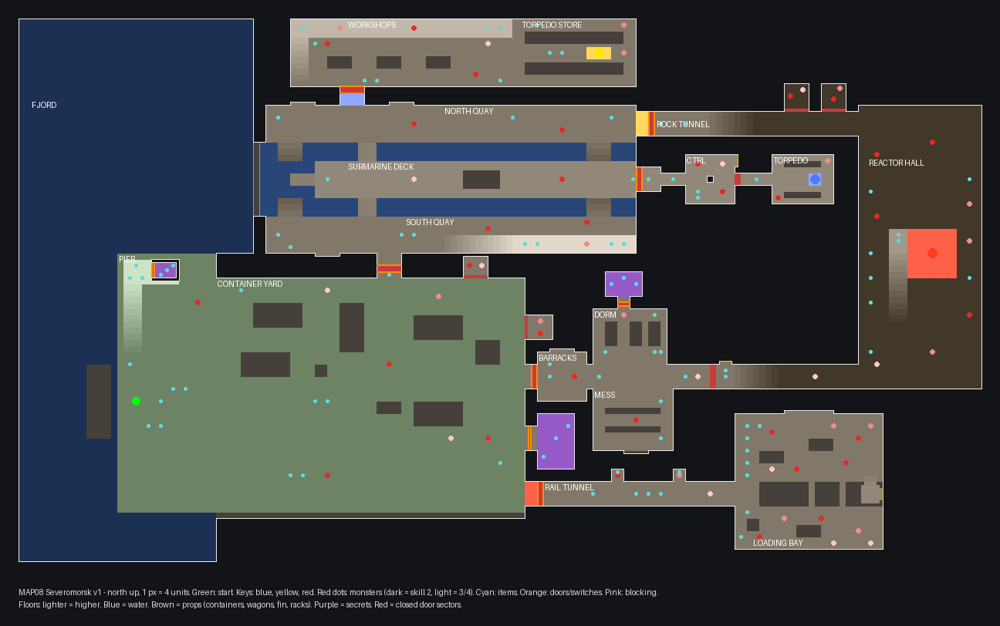
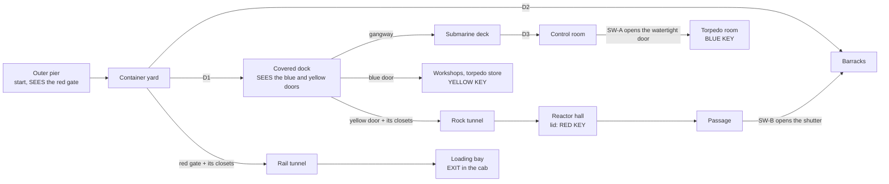

# MAP08 — «Североморск» (Severomorsk), the Northern Fleet's submarine base

Design document. Owner: `level-designer`. Status: **v1 BUILT 2026-10-22
(§13): the whole map, walkable from start to exit, textured with approved
lumps only (the naval pieces nobody has drawn wear the nearest approved lump,
§7.2), populated, three secrets; not yet walked, no engine pass yet (D26).**
Episode 3, «The Portal» (D112), second map. Built MVP first (D60). Source:
`src/maps/MAP08/map.py`; tests: `tests/test_map08_severomorsk.py` (the map),
`tests/test_map08_route.py` (its automatic route) and the `Map08Posters`
block of `tests/test_posters.py`; route `severomorsk-critical` in
`tools/route.py`; overview `docs/levels/shots/MAP08-overview.png`. Russian
mirror: owed at the phase close (D34).

> **Walk it** (the PM or the CEO; agents never start GZDoom, D26):
> `python3 tools/build.py && SD_ALLOW_ENGINE=1 MAP=MAP08 SKILL=3 tools/run.sh`.
> Automatic run: `SD_ALLOW_ENGINE=1 python3 tools/route.py --route severomorsk-critical --keep-evidence`.

Inputs this document obeys and does not restate: `docs/PRD.md` (D35 the
factions, D58 the unfound pass, D60 MVP first, D112 episode 3),
`docs/engine/BESTIARY.md`, `docs/engine/BALANCE.md`, `docs/engine/MOD-SPEC.md`
(DoomEdNums, locks, the passes), `docs/art/TEXTURE-INDEX.md` (approved lumps
only) and the method of `docs/levels/MAP05-volga-dam.md`, whose structure
this document follows.



## 1. Synopsis

November 1977, the polar night. A patrol launch brings Sergeant Vilanova up
the Kola fjord from Novaya Zemlya to the outer pier of Severomorsk, where
the Liberty Legion, which came by sea, is unloading a cargo bound for the
portal at Tunguska, and the Fourth Reich, which came by rail, holds the base
cut into the granite; he boards the nuclear submarine moored in the covered
dock, takes the keys of the workshops, the rock tunnel and the reactor hall,
and leaves east through the rail tunnel on the goods train that was to carry
the cargo.

## 2. Its place in the campaign

| | |
|---|---|
| Comes after | MAP07, the Arctic radar station on Novaya Zemlya. The sergeant arrives by sea: the launch moored at the pier, beside the player start. |
| Comes before | MAP09, the invaders' portal at Tunguska. The exit is the regulator in the cab of the goods train standing in the rail tunnel, its locomotive facing east. |
| What it adds | **a vehicle to board and walk inside** (the submarine: gangways onto the deck, a hatch, a control room with its periscope, a torpedo room), **three keys** in a chain, **water** that does not hurt, a **descent into the rock** (the reactor hall 128 under the quays), a **crane** climbed for a secret, a **shortcut found from behind**, and two counter-attacks on the locks' own tags. |
| Factions (D35) | both. The Legion came by sea: the pier, the yard, the dock, the boat and the barracks it made its quarters. The Reich came by rail: the workshops, the rock tunnel, the reactor, the passage. Both guard the cargo in the rail tunnel and the loading bay, the last fight. The General is not here. |
| MAPINFO, LANGUAGE | the scaffolding agent's (D112): `map MAP08`, `next = "MAP09"` (read by the route). This role touches neither (§11). |

## 3. What the map has to do

| Job | How the layout does it |
|---|---|
| Be a submarine base | an outer pier on the fjord with a crane, a container yard in front of the cliff, a **covered dock cut into the rock** (a basin 384 wide between two quays, a boom across its mouth, a crane gallery on its south wall), the **submarine** moored in it (hull, deck, fin with the red star, its bow run into a covered berth in the rock), workshops and a torpedo store, the fleet's barracks, a reactor hall deep in the rock, a rail tunnel to a loading bay with a goods train. |
| Board the boat | gangways from both quays onto the deck (+32); the deck is the dry crossing between the quays; D3, the bulkhead hatch at the deck's east end, opens into the boat: a trunk, a narrow passage, the control room (the periscope's well in the middle, SDCTRL1 boards on both long walls), the watertight door (SW-A), the forward passage, the torpedo room (racks, the tubes on the bow wall). The boat's inside touches the dock only through D3 (tested): nothing of it shows outside. |
| Use the height | the crane's stair to its deck (+192), the dock's crane gallery (+192), the workshop's gantry (+128), the rock tunnel and the passage down to the reactor hall (−128), the stair up to the reactor's lid (+64): stairs only, no lift (MAP01 §4). |
| Teach three keys | **all three locks are seen in round 0**: the red gate across the yard from the start (lit red at the end of the track), the blue and yellow doors across the basin from where D1 brings the player onto the south quay (tested). The keys come one per round: blue (the boat), yellow (behind blue), red (behind yellow). |
| Answer D58 again | each key alone on a lit place (192, its lock's colour) on the route, seen from where its place is entered; the reactor's red lid glows from both ways into the hall (tested). |
| Reward knowing the map | SW-B opens a shutter from the reactor's passage straight into the barracks, a door from the yard and the red gate; without it the way back is the rock tunnel, the dock and D1 (tested as not needed). |
| Rise | the approach, then the dock and the workshops, then the reactor and the bay, each heavier than the one before on every skill; the bay the heaviest beat of all (tested, §6). |

Target length: 13–16 minutes first run on skill 3 (MAP05 is 12–15); about 6
once known.

## 4. Plan

Generated from the built map, one character = 64 × 64 units sampled at its
centre, north up, the row label the cell's south edge. Floors: quays, yard,
pier, barracks, workshops, rail tunnel, bay **0**; the dock's water **−64**;
the deck **+32** (the boat's inside too); the crane and the dock's gallery
**+192**; the workshop's gantry **+128**; the reactor hall **−128**, its lid
**+64**.

```
     y   x 0                                    x 2496                              x 4928
  2752  ~~~~~~~~~~~~~~~~~~~   ggggggggggggggggggWWWWWWWWWW
  2688  ~~~~~~~~~~~~~~~~~~~   ggggggggggggggggggWooooooooW
  2624  ~~~~~~~~~~~~~~~~~~~   gWWWWWWWWWWWWWWWWWWWWWWWCCWW
  2560  ~~~~~~~~~~~~~~~~~~~   gWWooWWooWWooWWWWWWWWWWWWWWW
  2496  ~~~~~~~~~~~~~~~~~~~   gWWWWWWWWWWWWWWWWWWooooooooW
  2432  ~~~~~~~~~~~~~~~~~~~   WWWWWWWWWWWWWWWWWWWWWWWWWWWW            kk kk
  2368  ~~~~~~~~~~~~~~~~~~~       bb                                  kk kk
  2304  ~~~~~~~~~~~~~~~~~~~ QQQQQQQQQQQQQQQQQQQQQQQQQQQQQQ            kk kk HHHHHHHHHH
  2240  ~~~~~~~~~~~~~~~~~~~ QQQQQQQQQQQQQQQQQQQQQQQQQQQQQQytttttttttttttttttHHHHHHHHHH
  2176  ~~~~~~~~~~~~~~~~~~~ QQQQQQQQQQQQQQQQQQQQQQQQQQQQQQytttttttttttttttttHHHHHHHHHH
  2112  ~~~~~~~~~~~~~~~~~~~wwsswwwwsswwwwwwwwwwwwwwwwwssww                  HHHHHHHHHH
  2048  ~~~~~~~~~~~~~~~~~~~wwsswwwwsswwwwwwwwwwwwwwwwwssww    SSSS   SSSSS  HHHHHHHHHH
  1984  ~~~~~~~~~~~~~~~~~~~wwwwwDDDDDDDDDDDDFFFDDDDDDDDDDSSS  SSSS   SSSSS  HHHHHHHHHH
  1920  ~~~~~~~~~~~~~~~~~~~wwwDDDDDDDDDDDDDDFFFDDDDDDDDDDSSSSSSSSSSSSSSSTS  HHHHHHHHHH
  1856  ~~~~~~~~~~~~~~~~~~~wwwwwDDDDDDDDDDDDDDDDDDDDDDDDDD    SSSS   SoooS  HHHHHHHHHH
  1792  ~~~~~~~~~~~~~~~~~~~wwsswwwwsswwwwwwwwwwwwwwwwwssww                  HHHHHHHHHH
  1728  ~~~~~~~~~~~~~~~~~~~ QQQQQQQQQQQQQQQQQQQQQQQQQQQQQQ                  HHHHHHHHHH
  1664  ~~~~~~~~~~~~~~~~~~~ QQQQQQQQQQQQQQQQQQQQQQQQQQQQQQ                  HHssKKKKHH
  1600  ~~~~~~~~~~~~~~~~~~~ QQQQQQQQQQQQQQgggggggggggggggg                  HHssKKKKHH
  1536  ~~~~~~~~PPPPPPPP             QQ     kk                              HHssKKKKHH
  1472  ~~~~~~~~ccc33PPP             ##     kk                              HHssKKKKHH
  1408  ~~~~~~~~cccccPPPYYYYYYYYYYYYYYYYYYYYYYYYY      222                  HHssHHHHHH
  1344  ~~~~~~~~ccPPPPPPYYYYYYYYYYYYYYYYYYYYYYYYY      222                  HHssHHHHHH
  1280  ~~~~~~~~ccPPPPPPYYYooooYYYooYYYYYYYYYYYYY       2                   HHssHHHHHH
  1216  ~~~~~~~~ccPPPPPPYYYooooYYYooYYYYooooYYYYYkk   BBBBBB                HHssHHHHHH
  1152  ~~~~~~~~ccPPPPPPYYYYYYYYYYooYYYYooooYYYYYkk   BoBoBo                HHHHHHHHHH
  1088  ~~~~~~~~ccPPPPPPYYYYYYYYYYooYYYYYYYYYooYY     BoBoBo                HHHHHHHHHH
  1024  ~~~~~~~~PPPPPPPPYYooooYYYYYYYYYYYYYYYooYY BBBBBBBBBB                HHHHHHHHHH
   960  ~~~~~LL~PPPPPPPPYYooooYYoYYYYYYYYYYYYYYYY#BBBBBBBBBBBBBBppppppppppppHHHHHHHHHH
   896  ~~~~~LL~PPPPPPPPYYYYYYYYYYYYYYYYYYYYYYYYY#BBBBBBBBBBBBBBppppppppppppHHHHHHHHHH
   832  ~~~~~LL~PPPPPPPPYYYYYYYYYYYYYYYYYYYYYYYYY BBBBBBBBBBB
   768  ~~~~~LL~PPPPPPPPYYYYYYYYYYYYYooYooooYYYYY     BBBBBBB
   704  ~~~~~LL~PPPPPPPPYYYYYYYYYYYYYYYYooooYYYYY 111 BBBBBBB     XXXXXXXXXXXX
   640  ~~~~~LL~PPPPPPPPYYYYYYYYYYYYYYYYYYYYYYYYY1111 BoooooB     XXXXXXXXXXXX
   576  ~~~~~~~~PPPPPPPPYYYYYYYYYYYYYYYYYYYYYYYYY1111 BBBBBBB     XXXXXXooXXXX
   512  ~~~~~~~~PPPPPPPPYYYYYYYYYYYYYYYYYYYYYYYYY 111             XXooXXXXXXXX
   448  ~~~~~~~~PPPPPPPPYYYYYYYYYYYYYYYYYYYYYYYYY 111             XXXXXXXXXXXX
   384  ~~~~~~~~PPPPPPPPYYYYYYYYYYYYYYYYYYYYYYYYY       t    t    XXXXXXXXXXcX
   320  ~~~~~~~~PPPPPPPP=========================rttttttttttttttttXXooooooXocc
   256  ~~~~~~~~PPPPPPPPYYYYYYYYYYYYYYYYYYYYYYYYYrttttttttttttttttXXooooooXooo
   192  ~~~~~~~~~~~~~~~~-------------------------                 XXXXXXXXXXXX
   128  ~~~~~~~~~~~~~~~~                                          XoXXXooXXXXX
    64  ~~~~~~~~~~~~~~~~                                          XXXXXXXXXXXX
     0  ~~~~~~~~~~~~~~~~
```

Legend: `~` the fjord and the dock's mouth (props: water under a low sky,
never entered) · `L` the patrol launch · `P` the outer pier (start), `c` the
crane (its stair, deck and solid tower), `3` S3, the crane's cab · `Y` the
container yard, `=` its track, `-` its fence, `o` containers, crates,
wagons, bunks, tables, lathes, racks · `r` the red gate's portal (the **red
gate** just east) · `#` doors and shutters · `k` monster closets · `1` S1 ·
`B` the barracks (hall, corridor, dormitory, mess), `2` S2 · `p` the passage
from the reactor (SW-B; the shutter into the barracks at its west end) · `Q`
the dock's quays, `g` its crane gallery (+192) and the workshop's gantry,
`w` the basin, `s` steps and stairs · `D` the submarine's deck, `F` its fin ·
`S` inside the boat (trunk, passages, control room, torpedo room), `T` the
**blue key's** tray · `b` the blue door's portal (the **blue door** just
north) · `y` the yellow door's portal (the **yellow door** just east) · `W`
the workshops and the torpedo store, `C` the **yellow key's** cart · `t` the
rock tunnel and the rail tunnel · `H` the reactor hall, `K` the lid with the
**red key** · `X` the loading bay, `c` (in it) the locomotive's cab with the
**exit**. The boom, the gangways and the 16-deep recesses do not show at
this scale.

| # | Zone | x | y | floor | ceil | light |
|---|---|---|---|---|---|---|
| — | Fjord, the dock's mouth (props, water) | 0…1216 | 0…2816 | −64 | sky 48 / 768 | 112 |
| Z1 | Outer pier (start), the launch (prop) | 512…1024 | 256…1600 | 0 | sky | 112 |
| Z1c | Crane: stair of 11, deck, solid tower | 544…832 | 1088…1568 | 16…192 | sky | 112 |
| Z2 | Container yard, track, 5 containers (+128), 3 crates (+64) | 1024…2624 | 256…1472 | 0 | sky | 112 |
| Z2r | Red gate's portal | 2624…2688 | 288…416 | 0 | 128 | **192**, red |
| — | Red gate (lock 1) | 2688…2720 | 288…416 | 0 | door | |
| Z6 | Barracks: hall (256), corridor, dormitory (128), mess | 2688…3584 | 576…1312 | 0 | 128…256 | 144 |
| Z11 | Passage: 7 steps down to the reactor, SW-B | 3616…4352 | 896…1024 | 0→−128 | +128 | 112 |
| Z3 | The covered dock: south and north quays | 1280…3200 | 1600…1792, 2176…2368 | 0 | 448 | 128 |
| Z3w | The basin (water, harmless), steps out at x 1344 and 2944 on both quays | 1248…3200 | 1792…2176 | −64 | 448 | 128 |
| Z3g | Crane gallery (stair of 11 from x 2208) | 2560…3200 | 1600…1696 | 192 | 448 | 128 |
| Z3b, Z3y | Blue door's portal (north quay, north wall); yellow door's (east wall) | 1664…1792; 3200…3264 | 2368…2432; 2208…2336 | 0 | 128 | **192**, blue; yellow |
| Z4 | Submarine: gangways (+16), deck, stern (+16), fin (prop +160) | 1408…3200 | 1888…2080 | 32 | 448 | 128 |
| Z4i | Inside the boat: trunk, passages, control room, torpedo room | 3232…4224 | 1856…2112 | 32 | 160 | 128 |
| Z4t | Torpedo room's tray, the blue key | 4096…4160 | 1952…2016 | 48 | 160 | **192**, blue |
| Z5 | Workshops (gantry +128), torpedo store | 1408…3200 | 2464…2816 | 0 | 320 / 256 | 144 |
| Z5c | Torpedo cart, the yellow key | 2944…3072 | 2608…2672 | 16 | 256 | **192**, yellow |
| Z7 | Rock tunnel: 7 steps down, two closets | 3296…4352 | 2208…2336 | 0→−128 | +128 | 112 |
| Z8 | Reactor hall; stair of 11 to the lid | 4352…4992 | 896…2368 | −128 | 384 | 112 |
| Z8k | Reactor's lid, the red key | 4608…4864 | 1472…1728 | 64 | 384 | **192**, red |
| Z9 | Rail tunnel, two refuges | 2720…3712 | 288…416 | 0 | 128 | 112 |
| Z10 | Loading bay: goods wagon, tank wagon, locomotive (props), crates, banners | 3712…4480 | 64…768 | 0 | 320 | 128 |
| E | Locomotive's cab, the exit on its east wall | 4368…4480 | 304…416 | 32 | 160 | 128; niche **192** |

Extent 4992 × 2816 units (MAP05: 4576 × 2304; tested within 1.5 × its
area). 186 sectors, 736 lines. Every height is a multiple of 16; no step up
is over 16 (tested).

## 5. Progression, keys, switches and the exit



**The keys.** Doom's cards, editor numbers **5** blue, **6** yellow, **13**
red, locks **2**, **3**, **1** (`gzdoom.pk3 → lockdefs.txt`, g4.14.2), all
three opened in the engine before (MAP02, MAP03, MAP04). They spawn as our
passes (`src/zscript/sd/keys.zs`).

| Id | Where | Type | Special | Can it lock the player out? |
|---|---|---|---|---|
| D1 | Yard → dock (south quay) | manual door, roofed porches both sides | `Door_Raise (1)`, both faces | no |
| D2 | Yard → barracks | manual door, porches | `Door_Raise (2)`, both faces | no |
| D3 | Deck → inside the boat (the bulkhead hatch) | manual door | `Door_Raise (3)`, both faces | no |
| SH-A | Control room → forward passage (the watertight door) | remote, opens for good, steel both sides | tag 10 | no |
| SW-A | Control room's east wall, beside SH-A | `SDSW1A` (knife switch), one-shot | `Door_Open (10, 16, 0)` | no |
| **BD** | North quay → workshops, 128 wide | **locked, opens for good** | `Door_LockedRaise (4, 16, 0, 2, 0)`, both faces | no |
| **YD** | North quay → rock tunnel | **locked, opens for good**; also the tunnel's two closets (tag 5) | `Door_LockedRaise (5, 16, 0, 3, 0)` | no |
| SH-B | Passage → barracks corridor | remote, opens for good. Steel from the passage; **the corridor's concrete from the barracks**: found from behind | tag 11 | no |
| SW-B | The passage's north wall, beside SH-B | `SDSW1B` (push button), one-shot | `Door_Open (11, 16, 0)` | no |
| **RG** | Yard → rail tunnel | **locked, opens for good**; also the yard's two closets (tag 6) | `Door_LockedRaise (6, 16, 0, 1, 0)` | no |
| EXIT | The cab's east wall, 64 × 128 niche | `SDSW1D` | `Exit_Normal (0)` | — |

**The order, as the tests play it** (`test_the_route_is_the_designed_one`),
five rounds:

1. With D1, D2, D3 and the push panels: the pier and the crane, the yard,
   the barracks, the dock, the deck, the boat up to its control room. All
   three locks seen (tested).
2. SW-A: the torpedo room, **the blue key**.
3. The blue door: the workshops and the torpedo store, **the yellow key**.
4. The yellow door (and the tunnel's closets): the rock tunnel, the reactor
   hall, **the red key**, the passage and SW-B.
5. The red gate (and the yard's closets) and SW-B's shutter: the rail
   tunnel, the bay, the **exit**.

**Signposting** (D58): each key alone on a lit place (192) in its lock's
colour (`lightcolor` blue `0x90A8FF`, yellow `0xFFD860`, red `0xFF6048`) and
nothing else in the map wears those colours (tested). The yellow door wears
`SDDOORY`, the red gate `SDDOORR`; the blue door `SDDOOR1` in blue light
(no blue trim drawn, §7.2). Every switch is a real switch face, one-shot,
in sight of the door it opens (tested). Every door and lock that faces the
sky or the dock's 448 has a roofed porch or portal one tile high in front of
it, so its leaf is one door high (tested).

Rules that remove whole classes of softlock (MAP05 §5), all tested: no door
closes behind the player; no lift; no drop without a climb back (the crane,
the gallery, the gantry, the lid and the deck all have their stairs or
gangways; the basin has three steps out on each quay at two places); the
fjord cannot be entered (its opening over the pier is 48, lower than any
body) and the boom across the dock's mouth is impassable; no secret and no
shortcut is needed; from every reachable sector at every stage there is a
way back to the start and, at the end, a way on to the exit.

## 6. Intensity curve

| Beat | Space | Feeling | Mechanic introduced |
|---|---|---|---|
| 1 | Pier, yard | off the launch into the polar night; the Legion unloading the cargo; **the red gate across the yard** | the lock shown first |
| 2 | Barracks | the Legion's quarters, close rooms; the PPSh and the flak vest | — |
| 3 | The dock | the great rock-cut hall, the boat in it; **both other locks across the water** | the gangway, the harmless water |
| 4 | Inside the boat | narrow passages, the control room, SW-A, the torpedo room; the blue key | the watertight door |
| 5 | Workshops, torpedo store | the Reich's Panzermensch among the lathes, riflemen on the gantry; the yellow key, the ROKS-3 | — |
| 6 | Rock tunnel, reactor hall | **spike**: the tunnel's closets open as the yellow door opens; down into the dark; the heavy among the machinery; the red lid | the lock's own counter-attack |
| 7 | Passage, SW-B | the shortcut into the barracks | the shortcut from behind |
| 8 | Yard, rail tunnel | **spike** from the yard's closets behind the player at the red gate; the refuges | — |
| 9 | The loading bay | **climax**: both factions round the train, the Panzermensch, the heavy, Doughboys | — |
| 10 | The cab | the regulator | — |

Measured (hit points met, by beat; `test_the_intensity_rises`):

| Beat | Skill 2 | Skill 3 | Skill 4 |
|---|---|---|---|
| Pier, yard, barracks | 210 | 670 | 790 |
| Dock and boat | 670 | 760 | 820 |
| Workshops, torpedo store | 560 | 790 | 940 |
| Rock tunnel (closets), reactor, passage | 860 | 2050 | 2190 |
| Yard's closets, rail tunnel, bay | **1120** | **2410** | **2980** |

## 7. Textures

### 7.1 By zone (all approved and packed, tested)

| Zone | Walls | Floor | Ceiling |
|---|---|---|---|
| Fjord, cliffs, the dock's rock, the reactor hall | `SDDAM1` (stand-in for granite) | `SDWATR1` (animated) on the water | sky; the dock `SDCEIL2` |
| Pier, yard | the cliff `SDDAM1`, fence and containers `SDRUST1`, crates `SDCRAT1`/`SDCRTOP1` | `SDFLR2`, track `SDTRAK1` | sky |
| Crane | stair and deck `SDSTEL1`, tower and cab `SDRUST1`, S3's gate `SDGATE1` | `SDGRAT2` | sky; cab `SDCEIL1` |
| Submarine | hull and fin `SDARMR2`, the fin's star `SDARMR1` (once on each face, exactly one tile over the deck) | deck `SDFLR4`, gangways `SDGRAT2` | |
| Inside the boat | `SDSTEL1`; the control room's long walls `SDCTRL1` (the room is one tile high); the bow `SDTUBB1` (the tubes) | `SDFLR4` | `SDCEIL1` |
| Barracks | hall and mess `SDCONC2`, corridor `SDCONC1`, the dormitory's north wall `SDLOCK1` (one locker high) | `SDFLR3` | `SDCEIL1` |
| Workshops, torpedo store | `SDBRCK1`, `SDCONC1`; lathes and racks `SDSTEL1` | `SDFLR2`, gantry `SDGRAT2` | `SDCEIL1` |
| Tunnels, passage | `SDTUNL1` | `SDFLR2`; the rail tunnel `SDBLST1` + `SDTRAK1` | `SDCEIL2` |
| Loading bay | `SDBRCK3`; wagons `SDWAGN1`, `SDTANK1`; locomotive `SDARMR2`; banners `SDFLAG1`/`SDFLAG2` side by side; the cab's desk `SDCTRL1` | `SDBLST1`, track `SDTRAK1` | `SDCEIL2` |
| Doors, switches | `SDDOOR1` (D1-D3, blue door), `SDDOORY`, `SDDOORR`; `SDSW1A`, `SDSW1B`, `SDSW1D` | | |

### 7.2 Pending: the "Naval" set (D112, the art-director's draft)

Nothing naval is drawn yet. `NAVAL_SET` in `map.py` maps each piece the
design wants to the approved lump it wears meanwhile (tested: the stand-in
is packed, the proposed name is not; the day it is, the test names the line
to change):

| Proposed | What | Worn meanwhile |
|---|---|---|
| `SDROCK1` | living Kola granite: the cliffs, the dock, the tunnels, the reactor hall | `SDDAM1` |
| `SDHULL1` | the submarine's black rubber-tiled hull and fin | `SDARMR2` |
| `SDHULL2` | the fin with the red star (a tactical number would be text: D27) | `SDARMR1` |
| `SDBULK1` | the boat's inside: bulkheads, pipes, valves, gauges | `SDSTEL1` |
| `SDHTCH1` | the oval watertight hatch (D3) | `SDDOOR1` |
| `SDTORP1` | the torpedo tubes' doors on the bow wall | `SDTUBB1` |
| `SDCONT1` | a shipping container's side | `SDRUST1` |
| `SDLOCO1` | the diesel locomotive's body | `SDARMR2` |
| `SDREAC1` | the reactor vessel's jacket | `SDSTEL1` |
| `SDDOORB` | a blue-trimmed leaf for the blue door | `SDDOOR1` in blue light |

Also pending with nothing standing in (`PENDING_TEXTURES`): `SDPERI1` (the
periscope's tube, masked; the well is a solid steel column meanwhile) and
the polar night sky with the aurora (MAPINFO's sky, the scaffolding's call).

### 7.3 Posters (CEO, 2026-10-22: «que esos posters puedan aparecer en cualquier nivel»)

Three pictures and two Marx-Engels slots, each whole: one one-sided line
exactly the poster's width, in a recess exactly its height, pegged to the
floor, offset 0 (`tests/test_posters.py`, `Map08Posters`).

| Name | Lump | Where | Why |
|---|---|---|---|
| `z6_lenin` | `SDPOSTR1` Lenin | barracks hall, north wall, x 2752…2880 (recess 16 deep, 256 high) | the fleet's hall, the first wall seen through D2 |
| `z3_stalin` | `SDPOSTR3` Stalin | the dock's south wall, x 1536…1664, beside D1 (recess 256 high) | facing the boat across the water |
| `z6_mural` | `SDPOSTR2` cosmonautics mural | the mess's south wall, x 3136…3264, on a 32 sill | the mess's «red corner» |
| `z3_slot_w` | `SDPOSTR3` (Marx-Engels slot) | north quay's north wall, x 1408…1536 | flanks the blue door with its twin, 256 from its axis |
| `z3_slot_e` | `SDPOSTR1` (Marx-Engels slot) | north quay's north wall, x 1920…2048 | the mirror of the west one |

`POSTER_SLOTS_MARX_ENGELS = ("z3_slot_w", "z3_slot_e")`; the swap is the one
line `MARX_ENGELS = "SDPOSTR4"` (tested to move only the two slots).

## 8. Secrets (built in v1)

MAP01's rule: a clue is a comparison or a question, never a sign; each
secret has a way back; none is needed (tested). All three open in round 0.

| # | Where | Clue | Reward (every skill) |
|---|---|---|---|
| S1 | The yard's east cliff, south of D2: the 1941 air-raid shelter | the one 128 stretch of the cliff that stands 16 back, in shadow (96 against 112); the push panel (tag 7) is the cliff itself | flak vest, shell box, stimpack |
| S2 | The dormitory's lockers: the political officer's office | one locker of the north wall's row stands 16 back, in shadow; it is the panel (tag 8) | PG-7V box, medikit, box of rounds |
| S3 | The crane's cab on the pier | the crane has a stair and a deck that lead nowhere; its cab is shut by a corrugated gate (`SDGATE1`), the panel (tag 9) | the **Hand Katyusha** and two fuel canisters (one more volley): for the bay |

## 9. Enemies and resources by skill

Bestiary numbers (MAPINFO DoomEdNums 21100-21107), nested by Doom's skill
pairs. Every class but the General.

| | Skill 2 | Skill 3 | Skill 4 |
|---|---|---|---|
| Legion troopers | 14 | 17 | 22 |
| Stormtroopers | 4 | 8 | 13 |
| Doughboys (yard, deck, bay: rooms ≥ 256 high, tested) | 2 | 3 | 4 |
| Reich riflemen | 8 | 12 | 14 |
| Hounds | 2 | 5 | 6 |
| Panzermenschen (workshops, reactor, bay) | 3 | 3 | 3 |
| Heavy Panzermenschen (reactor, bay) | 0 | 2 | 2 |
| **Total** | **33** | **50** | **64** |

Against MAP05's 31 / 46 / 60: one key more, one map further.

**Weapons** (pistol start), on every skill, on the route, each before the
fight it is for: the **IZh** on the pier beside the start, the **PPSh-41**
in the barracks hall, the **RPG-7** on the dock's crane gallery (round 0,
before the first Panzermensch, round 2, tested), the **ROKS-3** in the
torpedo store (for the reactor and the bay); the **Hand Katyusha** in S3.

**Ammunition** (G3-8's ruler, MAP05's test: kills in IZh shells, PG-7V at 2
shells, fuel at ¼; route only, no drop, no secret):

| | Skill 2 | Skill 3 | Skill 4 |
|---|---|---|---|
| Needed | 72 | 134 | 160 |
| Placed | 270.5 | 257.5 | 233.5 |
| Ratio (≥ 1.35, and < 3 on skill 4) | 3.76 | 1.92 | 1.46 |

Also checked at every round of the route. **Health** on skill 4: 7
stimpacks + 6 medikits, 8 health bonuses; **armour**: the flak vest in the
dormitory (round 0), the heavy vest in the passage (round 3, before the
yard's closets and the bay), 6 plates. Consumables scale down with skill.

## 10. Engine elements used

| Need | Emitted | Status |
|---|---|---|
| Manual door | `Door_Raise` 12 (tag, 16, 150) | VERIFIED on MAP01 |
| Remote door, one-shot switch | `Door_Open` 11 (tag, 16, 0) | VERIFIED on MAP01 |
| Locked door that stays open | `Door_LockedRaise` 13 (tag, 16, 0, lock, 0), locks 1-3 | VERIFIED on MAP02-MAP04 |
| A lock's tag opening closets too | the closets' door sectors share the lock's tag | as MAP05 (its V3, NOT VERIFIED there either): checklist V3 |
| Keys | things 5, 6, 13 | as MAP04-MAP06 |
| Coloured light | sector `lightcolor` | as MAP02-MAP05 |
| Sky | ceiling `F_SKY1`; the fjord's low sky (48) beside the pier's (768) | the sky hack between two sky ceilings, as MAP05; the fjord seen under a low sky NOT VERIFIED: V2 |
| Impassable boom | two-sided lines flagged `blocking` | Doom's impassable flag |
| Closed vehicle interiors | the locomotive's body (floor 160) closes over the cab's ceiling (160); the boat's inside is walled from the dock | standard Doom geometry; NOT VERIFIED in this engine pass: V5 |
| Turned flats | `rotationfloor` 90 on every track | as MAP04 |
| Secret | sector `special` 1024; panels flagged `secret` | as MAP01-MAP05 |
| Animated water | floor `SDWATR1` (ANIMDEFS, 4 frames) | as MAP05 |

Tag plan: **1** D1 · **2** D2 · **3** D3 · **4** the blue door · **5** the
yellow door and the tunnel's two closets · **6** the red gate and the yard's
two closets · **7**-**9** S1-S3's panels · **10** SH-A (SW-A) · **11** SH-B
(SW-B). Free: 12 and up.

## 11. MAPINFO and LANGUAGE (not this role's)

Written by the scaffolding agent (D112): `map MAP08`, `next = "MAP09"` (the
route reads it and leads there). The map depends on nothing else. My par
estimate: 390 seconds.

## 12. Version plan

| Version | Content | Done when |
|---|---|---|
| **v1 — whole, textured, populated** ✅ **BUILT 2026-10-22** (§13) | §4-§10 | the CEO walks it on skill 3 and reaches MAP09 |
| v2 — light and detail | the "Naval" set swapped in (`NAVAL_SET`, one line each); light: floodlights over the yard, the dock's lamps, the reactor's glow, a flicker in the tunnel; the periscope's tube; the aurora sky; a crane jib | a first-time player finds the three keys and the exit without being told |
| v3 — balance | after the playtests (D60) | the map is played through on skill 3 |

## 13. v1 build record (2026-10-22)

### 13.1 What is in it

Everything in §4-§10, built in one pass from a placeholder (one room, a
start and an exit, written first so the build never failed for the other
episode-3 agents).

### 13.2 Verification actually run

- `python -m unittest tests.test_map08_severomorsk` — 74 tests, OK.
- `python -m unittest tests.test_map08_route` — 10 tests, OK:
  `severomorsk-critical` finds MAP08 by its constants, plays the design's
  order, presses each line from the right room within use range facing it,
  walks onto the three keys, ends in the cab facing the regulator.
- `python -m unittest tests.test_posters` — OK with the `Map08Posters` block.
- `python tools/verify.py fast`: see the PM's report (§13.3's V1 is the
  engine's part).
- **No engine run** (D26).

### 13.3 Engine checklist for the PM (D26: this role does not start GZDoom)

| # | Check | How |
|---|---|---|
| V1 | The map loads with a clean log; `severomorsk-critical` PASSes on skills 2, 3, 4 | `SD_ALLOW_ENGINE=1 python3 tools/route.py --route severomorsk-critical --keep-evidence` |
| V2 | The fjord reads as water to a far shore under the night sky (its sky ceiling is 48, the pier's 768): no hall of mirrors, no wall where the water should be; the dock's mouth shows the rock face above it from the pier | stand on the pier, look west and north |
| V3 | The yellow door opens the tunnel's two closets; the red gate the yard's two | open each lock, look back |
| V4 | The basin's water does not hurt; the steps lead out; the boom stops the player | jump in, swim west |
| V5 | The boat's inside shows nothing of the dock and vice versa; the cab is closed by the locomotive's body; the fin's star is whole on both faces | board the boat; look at the fin from the deck and the quays |
| V6 | The locks' leaves are one door high from both sides (porches, portals), the closets in the yard's cliff are cliff until they open | walk the yard and the dock |
| V7 | `lightcolor` blue, yellow, red on the locks and the keys' places | as MAP02's L4 |
| V8 | The three secrets count (3 of 3) | push each panel, walk in |
| V9 | The posters (7.3) whole and readable | the barracks, the dock, the mess |
| V10 | The Doughboys float in the yard, over the deck and in the bay without sticking | watch them |

### 13.4 For the CEO's walk

1. Does the dock read as cut into the rock, and the boat as a boat (a fin,
   a deck, a hatch into it)?
2. Is the inside of the boat claustrophobic enough, or too short?
3. Three keys in a chain: clear, or too much walking (the shortcut SW-B
   helps on the way back to the red gate)?
4. The bay: the right last fight?

### 13.5 What other roles hold

- `art-director`: the "Naval" set (§7.2), first the hull and the rock.
- Scaffolding (D112): MAPINFO and LANGUAGE for MAP08 (§11).
- Shared tests not this role's: `tests/test_doughboy_sprites.py` pins the
  set of maps that place a Doughboy; MAP08 places them (§9).
- PM: §13.3.

## 14. Open points for the CEO

1. **Walk v1** (§13.4).
2. **The blue door's look**: `SDDOOR1` in blue light until a blue trim exists.
3. **The Hand Katyusha in S3** (the crane's cab), as MAP05 kept it in a secret.
