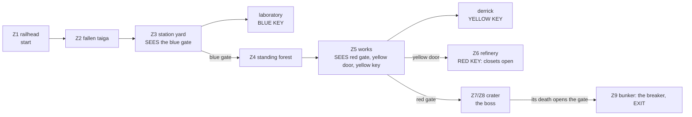

# MAP09 — «Тунгуска» (Tunguska), episode 3's last map

Design document. Owner: `level-designer`. Status: **v1.1 BUILT 2026-10-22
(textured in the episode's own set, D113), not yet walked, no engine pass
yet** (D26: this role never starts GZDoom). Built MVP first (D60): the whole
plan, approved and packed lumps only, populated, stocked, three keys, three
secrets, the boss and the exit; v1.1 swaps the stand-ins for the
"Taiga/Alien" set (§7; what it does not draw, §8); **v1.2 (D116, 2026-10-22)
puts episode 3's own final boss, the Consortium, in the General's place,
the Legion's machine-gunners in the forest, the works, the refinery and the
crater, the AKM beside the PPSh, and recounts the crater's stock for a
9000 HP boss** (§10, §11, §16.2). Source: `src/maps/MAP09/map.py`;
tests: `tests/test_map09_tunguska.py` (the map, 63 tests) and
`tests/test_map09_route.py` (the route, 13); posters:
`tests/test_posters.py` (`Map09Posters`); top-down view:
`docs/levels/shots/MAP09-overview.png`. Russian mirror: owed at the phase
close (D34).

> **Walk it** (the PM or the CEO; agents never start GZDoom, D26):
> `python3 tools/build.py && SD_ALLOW_ENGINE=1 MAP=MAP09 SKILL=3 tools/run.sh`
> — or `-file dist/sovietdoom.pk3 +map MAP09 -skill 3` by hand.
> The automatic run: `SD_ALLOW_ENGINE=1 python3 tools/route.py --route tunguska-critical --keep-evidence`.

Inputs this document obeys and does not restate: D112 (episode 3, «The
Portal»), `docs/product/LORE.md` (D12, the rules of respect; D35 factions),
`docs/PRD.md` (D58 the key lesson, D60 MVP first, D68 thing specials),
`docs/art/TEXTURE-INDEX.md` (approved lumps only; D107: `SDSIGL1` single
use), `docs/engine/MOD-SPEC.md` §6.1, `docs/engine/BALANCE.md`, and the
method of `docs/levels/MAP06-red-square.md`, whose boss, ambush and route
this map's end follows.

## 1. Synopsis

The Podkamennaya Tunguska, central Siberia, November 1977: Sergeant
Vilanova comes in by the railway from MAP08 to a railhead in the dead taiga,
walks the old forest road through the trees the 1908 blast laid flat, takes
the pass to the epicentre from the abandoned Soviet research station, crosses
the standing dead forest at the epicentre and the invaders' works that are
eating it, raids their refinery, and goes down into the crater, where the
invaders keep their **main portal** (Tankograd's was a secondary one,
`SD_END03_TEXT`'s hook), to kill the boss and throw the breaker that shuts it.

## 2. Its place in the campaign

| | |
|---|---|
| Comes after | MAP08, the Northern Fleet's base (another agent's, D112); he arrives by rail. |
| Its number | MAP09, episode 3's last slot (MAPINFO: the episode's ending cluster; the scaffolding agent's / mod-engineer's, §13). |
| What it adds | the campaign's **largest map** (extent 7040 × 5504; MAP06 5552 × 4928) and **hardest** (57 / 88 / 122 monsters; MAP06 42 / 68 / 96); **quiet before the storm** (the railhead, the taiga and the standing forest are sparse and dark; the works, the refinery and the crater are not); **pits that hurt** (acid in the works and the crater, MAP03's molten channel in the refinery); a **crater you fight down into**, seven terraces to the portal. |
| Climax | the crater: the boss, the Consortium (D116), on its floor before the portal, both factions on the terraces; its death opens the control bunker; its breaker shuts the portal and ends the episode. |
| Factions (D35) | the Reich holds the railhead, the taiga and the station's yard (the military occupation); the Legion holds the laboratory (capital takes the science) and springs the closets; both hold the forest, the works, the refinery and the crater, and both guard the boss (tested). |

## 3. What the map has to do

| Job | How the layout does it |
|---|---|
| Be Tunguska | the 1908 blast's real signature: in the outer ring the trees lie **flat and radial**, every trunk pointing away from the epicentre (`LOGS`, oriented by `log_direction` from `CRATER_CENTRE`, tested); at the epicentre they still **stand, stripped** (the "telegraph forest": columns of void rising out of sight into a sky at 448). A Soviet research station in the manner of Kulik's expeditions (log izbas, a concrete laboratory). |
| Be the invaders' main portal | their works sprawl into the dead forest (towers of their organic metal with glowing cores of the portal's field, conduits, acid pits); their refinery; the crater ringed by a containment wall, terraced down to the portal, a column of the cobalt field two tiles high. |
| Be the biggest and hardest map | see §2; every class of the bestiary, the boss on every skill. |
| Teach three keys again | each lock is seen before its key (tested): the blue gate from the station's yard before the laboratory; the red gate, the yellow door **and the yellow key** all at once from the forest's edge in the works; the red key from the yellow door. Each key alone on its lit spot in its lock's colour of light (D58). |
| Calm, then hell | §6: 2 + 4 monsters on skill 2 from the start to the station; the works alone hold 15. |
| End the episode | the bunker's gate opens only when the boss dies (his thing special); the exit switch behind it is the portal's breaker. |

Target length: 20–25 minutes first run on skill 3; about 9 once known
(par proposal: 540 s, §13).

## 4. Plan

The authoritative plan is the top-down render generated from the source:
`docs/levels/shots/MAP09-overview.png` (north up). Schematic (not to scale):

```
                 S3
     +-----------++------------------------------+   +---------------------+
     |  Z5 THE INVADERS' WORKS (sky 512)         |   | Z6 REFINERY (320)   |
     |  towers (cores), conduits, acid pits      [Y]=| vats, turbines,     |
     |  derrick + stair: YELLOW KEY (+128)       |   | molten channel,     |
     |  closets W   [R] red gate   closets E     |   | bridge; RED KEY dais|
+----+----------------++-------------------------+   +---------------------+
| Z4 STANDING FOREST  ||  Z7 rim / Z8 seven terraces down (-128)
| (sky 448) stripped  ||        CRATER (sky 512)
| trunks, a clearing  ||        the PORTAL, the boss before it
| RPG-7               ||
+-------[B]-----------+|____________[gate]__________
| Z3 RESEARCH STATION |   Z9 bunker: the breaker (EXIT)
| izbas, laboratory:  +====+-----------------------------------+--------------+
| BLUE KEY, S2        gate |  Z2 FALLEN TAIGA (sky 320)        | Z1 RAILHEAD  |
|                     |    |  trunks lying away from the crater| halt (S1)    |
+---------------------+    +-----------------------------------+ train, start |
                                                               +--------------+
```

| # | Zone | x | y | floor | ceiling | light |
|---|---|---|---|---|---|---|
| Z1 | Railhead: ballast, track (turned `SDTRAK1`), the train (goods wagon, armoured wagon, the locomotive's boiler: props 128) | 5888…7552 | 384…576 | 0 | sky 320 | 128 |
| Z1 | The locomotive's cab: a shell 144 square (block 160, walls 8), the cab inside 128 square (16…144), its doorway at the back of the north side, towards the platform | 7344…7488 | 416…560 | 16 | 144 / sky 160 | 112 |
| Z1 | Yard; platform (start at 7296, 640, facing west); the halt (roof block 160, room 16…144) | 5888…7488 | 576…1152 | 0 / 16 | sky 320 / 144 | 128 / 112 |
| Z2 | Fallen taiga: 15 trunks (props 32 high, 256 long, radial; the diagonal ones staircases of 48-unit blocks) | 2304…5888 | 384…1408 | 0 | sky 320 | 112 |
| Z3 | Station yard (palisade) and its gate from the taiga | 512…2304 | 448…1856 | 0 | sky 256 | 128 |
| Z3 | Three izbas (roof blocks 160, rooms 16…144, doorways whose sky sits on the roof line) | 640…1024 | 576…1792 | 16 | 144 | 112 |
| Z3 | Laboratory: hall a poster high, instrument room, vestibule; **blue key** on the bench (32) | 1312…2048 | 896…1600 | 16 / 32 | 272 / 144 | 144 / 128; bench **192**, blue |
| Z3/Z4 | **Blue gate** in the invaders' fence: portal · door · porch | 1920…2048 | 1856…1952 | 0 | 128 | portal **192**, blue |
| Z4 | Standing forest: 56 trunks (32-unit columns of void), a clearing | 1024…2752 | 1952…4608 | 0 | sky 448 | 104 |
| Z5 | Works; scorched edge (`SDBURN1`) towards the forest | 2752…5440 | 3968…5632 | 0 | sky 512 | 144 / 120 |
| Z5 | Two acid pits (damage), three towers (256, cores 384), four conduits (96) | | | −16 | | 176 |
| Z5 | Derrick: stair of 7 × 16 north from y 4768, platform 128; **yellow key** at the stair's head | 4000…4256 | 4768…5184 | 16…128 | sky 512 | key **192**, yellow |
| Z5 | Four pipe recesses in the north wall (S3 the third) | 3584…4480 | 5632…5648 | 0 | 128 | 144 / 96 |
| Z5/Z7 | **Red gate** in the containment wall: portal · door · porch; the two **closets** either side | 3456…4480 | 3840…3968 | 0 | 128 | portal **192**, red |
| Z5/Z6 | **Yellow door**: portal · door · porch | 5440…5536 | 4672…4800 | 0 | 128 | portal **192**, yellow |
| Z6 | Refinery: four vats (96, molten tops), two turbines (`SDTURB1`, 128), a console (`SDCTRL1`), the molten channel (−16, damage) and its bridge; the banners | 5536…7296 | 3968…5376 | 0 | 320 | 128 |
| Z6 | Dais: the **red key** | 7104…7232 | 4672…4800 | 16 | 320 | **192**, red |
| Z7 | Crater rim, 128 wide, inside the containment wall | 2944…4992 | 1792…3840 | 0 | sky 512 | 160 |
| Z8 | Seven terraces (64 wide, 16 down each) and the floor; four acid pits, four pylons; the portal (plinth −96, field to 160, framed by four posts 32 square to 192 in its corners) | 3520…4416 | 2368…3264 | −16…−128 | sky 512 | 160; field and frame 176 |
| Z9 | Exit porch · bunker gate (`SDGATE1`, tag 12) · hall · niche (`SDSW1D`) | 3840…4096 | 1520…1792 | 0 | 128 | 128; niche **192** |

Every height is a multiple of 16; no step up is over 16 (tested).

### 4.1 The open air (NOT VERIFIED in engine)

MAP06's sky hack, at five heights: railhead and taiga 320, station 256,
forest 448 (the stripped trunks are void columns: their faces rise to that
sky, out of sight), works and crater 512 (the towers' cores at 384 stand
against it). Roofed wooden buildings are **closed sky blocks** at 160 (floor
= ceiling, sky), their rooms at 16…144 inside, and their doorways' ceilings
are sky at 160, so no slab of wall is drawn over a doorway. Fallback if a
renderer draws a "sky wall": level the skies to one height (constants
`*_SKY`); nothing else moves.

## 5. Progression, keys, doors and the exit



Keys: `SD_BluePass` 5, `SD_YellowPass` 6, `SD_RedPass` 13; locks 2, 3, 1.

| Id | Where | Type | Special | Can it lock the player out? |
|---|---|---|---|---|
| **BD** | the invaders' fence north of the station, `SDDOORB` | locked, opens for good | `Door_LockedRaise (4, 16, 0, 2, 0)`, both faces | no |
| **YD** | the refinery's west wall, `SDDOORY` | locked, opens for good | `Door_LockedRaise (5, 16, 0, 3, 0)` | no |
| **RD** | the crater's containment wall, `SDDOORR` | locked, opens for good | `Door_LockedRaise (6, 16, 0, 1, 0)` | no |
| S1, S2, S3 | push panels (§9) | open for good | `Door_Open (1/2/3, 16)`, both faces, `secret` | no |
| CL | the works' two closets in the containment wall | open for good | tag 10, **no line**: the red key's thing special `Door_Open (10, 16)` | no |
| GATE | rim → bunker, `SDGATE1` both faces, no special | opens for good | tag 12, **no line**: the boss's thing special `Door_Open (12, 16)` | only if the boss could not die: §11 |
| EXIT | back of a 16-deep niche, `SDSW1D` | | `Exit_Normal (0)` | — |

**The order, as the tests play it** (`test_the_route_is_the_designed_one`),
five rounds: (0) railhead, taiga, station, the **blue key** (S1's and S2's
panels open, never needed); (1) the blue gate: the forest, the works, the
**yellow key** (S3); (2) the yellow door: the refinery, the **red key**,
whose pickup opens the closets; (3) the red gate and the closets: the crater;
(4) the boss's death: the bunker, the exit.

Signposting (D58): the blue gate is seen from the yard by the laboratory's
door; the blue key from the laboratory's vestibule; the red gate's lit
mouth, the yellow door and the yellow key all from the forest's edge
(`EDGE_VIEW`); the red key from the yellow porch, straight down the
refinery's bridge. No monster stands on any key's sight line at spawn
(tested). Light 192 is spent on seven sectors only: three lock portals,
three key spots, the exit niche (tested).

Softlock rules: no door closes behind the player; no lift; every drop (the
derrick, the terraces) has a way back up; every pit, acid or molten, is one step deep
(tested); no secret is needed. From every sector reachable at every stage
there is a way back to the start, with and without the boss's death, and at
the end the exit is reachable from everywhere (tested).

## 6. Intensity curve

| Beat | Space | Feeling | Mechanic |
|---|---|---|---|
| 1 | Railhead | arrival, a picket on the line; the halt | the IZh |
| 2 | Fallen taiga | **uneasy calm**: dead silence, trunks flat in rows, hounds | weave between trunks |
| 3 | Station yard | the Reich's guard among the izbas; the blue gate | the PPSh in an izba |
| 4 | Laboratory | the Legion has taken the science; Lenin over the bench | **the blue key**; S2's prototype |
| 5 | Standing forest | **the eeriest place**: bare poles to the sky, heads drifting in the clearing | the RPG-7 at its far edge |
| 6 | The works | **the reveal and the battle**: towers, acid pits, three goals in sight | the ROKS-3; height (the derrick) |
| 7 | Refinery | the heavies; the molten channel or the guarded bridge | the red key |
| 8 | Back through the works | **spike**: the closets open behind the player | MAP06's pattern |
| 9 | Crater | **climax**: down seven terraces to the portal, the boss, both factions | the boss |
| 10 | Bunker | the gate opens on its death; the breaker shuts the portal | — |

## 7. Textures, by zone (all approved and packed; tested)

v1.1 (D113): the episode's "Taiga/Alien" set (`docs/art/TEXTURE-INDEX.md`),
`SDDOORB` and the cab `SDCAB1`/`SDCAB2` from episode 2's second round.

| Zone | Walls | Floor | Ceiling |
|---|---|---|---|
| Railhead | treeline `SDBARK2` (a birch `SDBARK1` here and there); goods wagon `SDWAGN1`, armoured wagon `SDARMR1` flanks (a star per 128) / `SDARMR2`, the locomotive's boiler and cab outside `SDARMR2`; buffer `SDSTEL1`; the signal `SDSIGL1` once (D107); the platform's edge `SDWAGN1`, its back wall `SDLOGW1` | `SDBLST1` under the train, track `SDTRAK1` (turned 90), the yard `SDMOSS1`, platform `SDCRTOP1` | sky |
| The cab | forward `SDCAB1` (one 128 face, whole), sides and back `SDCAB2` (whole windows) | `SDFLR4` | `SDFLR4` |
| Halt, izbas | `SDLOGW1` inside and out; the halt's lockers `SDLOCK1` | `SDCRTOP1` | `SDCRTOP1` |
| Taiga | treeline `SDBARK2` (birches); its west wall the palisade `SDLOGW1`; fallen trunks `SDBARK2` with `SDBURN1` tops, three birch (`SDBARK1`, `SDMOSS1` tops: logs 3, 8, 13) | `SDBURN1`, turned 90 (`BURNT_TURN`) | sky |
| Station yard | palisade `SDLOGW1`; the invaders' fence `SDALNM1`; the laboratory's outside `SDCONC1`; radio mast `SDSTEL1` | `SDMOSS1` | sky |
| Laboratory | hall `SDTILE1`, instrument room `SDTILE2`, boards `SDCTRL1`, vestibule `SDCONC1`, bench `SDSTEL1` | `SDFLR3` | `SDCEIL1` |
| Forest | trunks `SDBARK2`, every seventh `SDBARK1` (`birch_trunks`); treeline `SDBARK2`; fence and containment `SDALNM1` | `SDPEAT1` (the Southern Swamp) | sky |
| Works | `SDALNM1` (walls, towers, conduits, recesses, closets), a strip of `SDGLYP1` up the middle of each tower face and a plate either side of the red gate, cores `SDPORT1`, derrick `SDSTEL1`, the edge's west wall `SDBARK2`; acid pits `SDACID1` | `SDFLR4`, edge `SDBURN1`, derrick `SDGRAT1` | sky |
| Refinery | `SDBRCK1`; vats `SDRUST1`; turbines `SDTURB1`; console `SDCTRL1`; banners `SDFLAG1`/`SDFLAG2` side by side | `SDFLR4`, bridge `SDGRAT1`, channel and vats `SDMOLT1` | `SDCEIL2` |
| Crater | containment and terraces `SDALNM1`; pylons `SDGLYP1` (one plate a face); plinth `SDALNM1`; the portal `SDPORT1` (two tiles, one wide between the posts) in a frame of `SDPRTE1`; a glyph plate either side of the bunker's gate | rim and terraces `SDBURN1`, floor `SDFLR4`, pits `SDACID1` | sky |
| Bunker | `SDSTEL1`; porch `SDALNM1`; gate `SDGATE1`; exit `SDSW1D` | `SDFLR4` | `SDCEIL1` |
| Doors | `SDDOORB` (blue, jambs `SDALNM1`), `SDDOORY`, `SDDOORR` (jambs `SDALNM1`); thresholds `SDFLR4` | | |

**Acid or molten, decided:** green acid wherever the invaders work: the
works' two pits and the crater's four round the portal (the colour of their
veins and glyphs). Molten metal where they smelt: the refinery's channel and
its four vats (Tankograd's look, MAP03). Both hurt alike: the sector's
`damageamount` 10 every 32 tics, not the flat's (tested).

**Alignment.** `align_to_world` (MAP05's method) pegs every face of
`SDLOGW1`, `SDBARK1`/`2`, `SDALNM1`, `SDGLYP1` and `SDARMR2` to rows from the
ground (the logs' joints, every 16, meet the huts' floor one step up as well
as the ground) and to the map's columns, so a wall split by its neighbours
shows no seam and every glyph plate starts on its edge (they all stand on
multiples of 64; tested). The cab's pictures sit on its floor and start at
each wall's left end (`SDCAB1` whole, `SDCAB2` whole windows); each frame post
shows the middle 32 of `SDPRTE1`, its cobalt channel (tested).

### 7.1 The posters (CEO, 2026-10-22: «que esos posters puedan aparecer en cualquier nivel»)

All in the research station: one one-sided line 128 long, in a room exactly
the picture's height, pegged to the floor (`POSTERS`; `tests/test_posters.py`).

| Name | Picture | Where | Why |
|---|---|---|---|
| `lab_hall_lenin` | Lenin | the hall's north wall, x 1504-1632 (the hall is 256 high) | over the bench where the blue key lies: the first thing seen from the vestibule |
| `lab_hall_stalin` | Stalin | the hall's west wall, y 1360-1488 | the station's other portrait |
| `lab_instr_mural` | cosmonautics mural (128×128) | the instrument room's west wall (128 high) | a science station's own picture, beside the boards |
| `lab_hall_slot_n` | **Marx** `SDPOSTR4` (slot) | the hall's north wall, x 1664-1792 | beside Lenin over the bench: the founders' line on one wall |
| `lab_hall_slot_s` | **Engels** `SDPOSTR5` (slot) | the hall's south wall, x 1344-1472 | facing Marx across the hall |

**The Marx-Engels pair (D117, 2026-10-22).** `POSTER_SLOTS_MARX_ENGELS`,
Marx's first: `SDPOSTR4` Marx «ПРОЛЕТАРИИ / ВСЕХ СТРАН,» and `SDPOSTR5` Engels «СОЕДИНЯЙТЕСЬ!» (mirrored, looking at Marx), 128×256 like Lenin and Stalin; `MARX_ENGELS = ("SDPOSTR4", "SDPOSTR5")` lists them in `WALL_TEXTURES`. The two slots face each other across the
hall, so each reads alone (`tests/test_posters.py`, `PAIR`).

## 8. Pending textures

What the "Taiga/Alien" set (D113) does not draw; each is still a stand-in,
swapped by one constant in `map.py`.

| # | Wanted | Stand-in now | Where |
|---|---|---|---|
| 1 | **Dead-taiga treeline**, wall 128×256: standing burnt trunks with the sky between them (a masked or sky-topped wall) | `SDBARK2` tiled (`BARK`): reads as one wall of bark | every outdoor boundary |
| 2 | **Bark along a lying trunk** (furrows running along it): GZDoom cannot turn a wall texture, and `SDBARK1`/`2` are standing bark | `SDBARK2` / `SDBARK1` (a 32 strip of their top rows) | the taiga's 15 fallen trunks |
| 3 | **Sawn or broken trunk ends** (flat) | `SDBURN1` / `SDMOSS1` | the fallen trunks' tops |
| 4 | **Alien floor** (plating) | `SDFLR4` (`PLATE`) | the works, the refinery, the crater's floor, the cab |
| 5 | **Fused crater earth** (glassy, cracked) for the terraces | `SDBURN1` | the crater |
| 6 | **Steam locomotive, outside** (boiler, smokebox, wheels) | `SDARMR2` (an armoured locomotive) | the boiler and the cab's shell |
| 7 | **Siberian night sky** (MAPINFO `sky1`, mod-engineer's) | Freedoom's `SKY1` | everywhere outdoors |

## 9. Secrets

MAP01's rule: a clue is a comparison, never a sign; each has a way back (tested).

| # | Where | Clue | Reward |
|---|---|---|---|
| S1 | the halt, east wall | of three lockers the middle one stands 16 back, in shadow (light 96) | backpack, flak vest, shell box |
| S2 | the laboratory's instrument room | of three instrument boards the middle one stands back, in shadow | the **Hand Katyusha**, the laboratory's prototype, and a cell pack |
| S3 | the works' north wall | of four recesses in the invaders' metal the third is twice as deep and darker | two medikits, a box of PG-7V |

## 10. Enemies and resources by skill

| Zone | Skill 2 | Skill 3 | Skill 4 |
|---|---|---|---|
| Railhead | 2 riflemen | +1 hound | +1 rifleman |
| Fallen taiga | 2 hounds, 2 riflemen | +1 stormtrooper, 1 hound | +1 rifleman, 1 stormtrooper, 1 hound |
| Station yard, izbas | 4 riflemen, 1 stormtrooper | +2 riflemen, 1 hound | +1 rifleman, 1 stormtrooper, 1 Panzermensch |
| Laboratory | 4 troopers | +1 trooper, 1 stormtrooper | +1 trooper, 1 stormtrooper, 1 Doughboy |
| Standing forest | 2 hounds, 1 Doughboy, 1 trooper, 1 rifleman | +1 Doughboy, 1 hound, 1 stormtrooper | +1 Doughboy, 1 hound, 1 stormtrooper |
| Works | 4 riflemen, 5 troopers, 2 stormtroopers, 2 hounds, 1 Panzermensch, 1 Doughboy | +2 riflemen, 2 troopers, 2 stormtroopers, 1 hound, 1 Doughboy | +2 riflemen, 1 trooper, 2 stormtroopers, 1 hound, 1 Doughboy, 1 Panzermensch, 1 heavy |
| Works' closets (red key) | 2 troopers | +1 trooper, 1 stormtrooper | +2 stormtroopers |
| Refinery | 2 riflemen, 3 troopers, 3 stormtroopers, 1 hound, 1 Panzermensch, 1 Doughboy | +1 rifleman, 1 trooper, 1 stormtrooper, 1 hound, 1 heavy, 1 Doughboy | +1 rifleman, 1 trooper, 1 stormtrooper, 1 hound, 1 heavy, 1 Panzermensch |
| Crater | **the boss**, 2 riflemen, 1 trooper, 2 stormtroopers, 1 hound, 1 Panzermensch, 1 Doughboy, 1 gunner | +2 troopers, 1 hound, 1 heavy | +2 stormtroopers, 1 Doughboy, 1 heavy, 1 gunner |
| **Total** | **60** | **92** | **127** |

The Legion's machine-gunners (D116, `SD_LegionGunner`, 21110, 80 HP; they
drop half an AKM magazine), 3 / 4 / 5 on skills 2 / 3 / 4, each by cover
with a long line down ground the player must cross (tested: none in a
closet, each with a prop, a wall or a step within 128):

| Skill | Where | Line | Cover |
|---|---|---|---|
| 2 | the works, (5184, 4800), facing west | the works' width to the forest's edge | the east conduit at his back |
| 2 | the refinery, (6720, 4416), facing west | across the channel: the bridge and the yellow door | a vat at his shoulder |
| 2 | the crater's second terrace, south, (4480, 2016), facing north | up the terraces to the red gate | the terrace's step |
| 3 | the standing forest, (2400, 3104), the clearing's east edge, facing north | the clearing and the forest back to the blue gate | a trunk at his shoulder |
| 4 | the crater's sixth terrace, south, (3712, 2272), facing north | across the crater floor and the portal | the terrace's step |

By class on skill 4: 28 riflemen, 26 troopers, 26 stormtroopers, 19 hounds,
11 Doughboys, 6 Panzermenschen, 5 gunners, 5 heavy Panzermenschen, the boss.
The boss's servants (§11) are not in the totals: they arrive in the fight.

**Resources.** Pistol-start finishable: the IZh in the halt, the PPSh and
the **AKM** (D116, `SD_Akm` 21008) in the first izba, the RPG-7 at the
standing forest's far edge, the ROKS-3 on the works' scorched edge, all on
the route on every skill; the Hand Katyusha in S2. AKM magazines
(`SD_AkmAmmo` 21020, 30 rounds) on the route before the crater **4 / 3 / 2**
on skills 2 / 3 / 4 (the laboratory's hall, the forest, the works, the
refinery), plus the arena's (below). G3-8 (MAP03's ruler, in IZh shells at
~62.5 HP a shell, the AKM's 30 rounds 4.5 shells; secrets not counted;
**the Consortium is 144 shells, and its servants 39 more**, see §11):

| Skill | Needed | Placed | Ratio | Shells and rounds alone |
|---|---|---|---|---|
| 2 | 310 | 978.5 | 3.16 | 717.5 |
| 3 | 409 | 916.0 | 2.24 | 659.0 |
| 4 | 550 | 759.0 | 1.38 (≥ 1.35, < 3) | 572.0 (≥ 1.35 × all but the boss: 548.1) |

Also tested at every stage of the route, the boss's servants' hit points
counted with its own. **The arena's own stock (the rim, the red gate's
porch and the crater's first terrace, the ring the fight circles on)**,
tested to cover the Consortium's 9000 HP and its servants' 1700 on every
skill by itself, with rockets and fuel a third of that:

| Skill | PG-7V | ROKS-3 fuel | AKM magazines | Shells | Stimpacks + medikits | Damage, all of it (avg) |
|---|---|---|---|---|---|---|
| 2 | 48 | 360 | 3 | 160 | 7 + 6 | 28 040 |
| 3 | 46 | 360 | 3 | 160 | 6 + 6 | 27 770 |
| 4 | 31 | 240 | 2 | 160 | 4 + 4 | 23 225 |

v1.2 added to the first terrace: 2 rocket boxes and 2 rockets on every
skill (+2 boxes skill 3 and easier, +2 rockets skill 2), a fuel pack and a
canister (+a pack skill 3 and easier), 2 AKM magazines (+1 skill 3 and
easier), 3 shell boxes and a box of rounds, 2 stimpacks and 2 medikits (+1
of each skill 3 and easier, +1 stimpack skill 2).

Health on skill 4: 9 stimpacks, 9 medikits, 7 health bonuses; 6 armour
bonuses (two at each lock), the flak vest in the third izba, the heavy vest
at the red gate's porch, before the crater. Skills 3 and 2 add stimpacks,
medikits and ammunition.

## 11. The boss: the Consortium (D112, placed D116)

Episode 3's final boss, **the Consortium** (`SD_Consortium`, 21112, 9000
HP, radius 56, height 128; its design and behaviour:
`docs/engine/2026-10-22_P4_ep3-final-boss.md`), stands at the named
constant **`MAP09_BOSS_SPOT = (3968, 3136)`** on the crater's floor before
the portal, facing the red gate (`BOSS_ANGLE = 90`), on every skill
(`BOSS_KIND = "consortium"`). Until D116 the General (`SD_General`, 21106,
3000 HP) stood in; the spot, the facing and the death special did not move,
and the General is no longer placed here.

- **The portal at its back.** Rooted in phase 1, it calls its servants
  through the portal behind it: 144 behind and 80 to either side, then
  straight behind. Facing north, those spots are (3888, 2992), (4048, 2992)
  and (3968, 2992): on the crater's floor between it and the portal's base
  (which ends at y 2944), clear of the acid pits, with room for a hound or
  a Doughboy (tested: `test_the_portal_is_at_the_bosss_back`).
- **Its death opens the exit**: its thing carries `special = 11`
  (`Door_Open`), `arg0 = 12`, `arg1 = 16`; no line carries tag 12 (tested).
  Its death also kills its servants (`A_KillChildren`).
- **Room:** the crater is 2048 square under a sky of 512 (640 over its
  floor, five times its 128); terraces of 16, so once free (phase 2) it
  walks anywhere in it. Its 112-wide body fits the floor at its spot.
- **The bill.** 9000 HP (`+NORADIUSDMG`: 67 RPG-7 impacts, or 13-14 full
  hand-Katyusha salvoes) and its servants, counted as a long fight's worth
  (H): four rooted pairs (rifleman and trooper, 50 HP a pair), the Breach's
  wave of four (600) and five free pairs (hound and trooper, 180 a pair),
  1700 HP, 39 shells on G3-8's ruler. The arena's stock (§10) is tested to
  pay for both on its own.
- **The risk, said plainly:** if the death special did not fire, the exit
  would be unreachable. The belt-and-braces fix is the mod-engineer's: a
  MAPINFO `SpecialAction = "SD_Consortium", "Door_Open", 12, 16` in MAP09's
  block (§13; not there on 2026-10-22).

## 12. Engine elements used, and the PM's engine checklist (D26)

| Need | Emitted | Status |
|---|---|---|
| Locked doors | `Door_LockedRaise` 13, locks 1, 2, 3 | VERIFIED (MAP02, MAP03) |
| Push panels | `Door_Open` 11, `secret`, sector special 1024 | VERIFIED |
| Exit | `Exit_Normal` 243 | VERIFIED |
| Coloured light, turned flat | `lightcolor`, `rotationfloor` 90 | as MAP02/MAP06 |
| Damaging floor | `damageamount` 10, `damageinterval` 32 | fields VERIFIED (MAP03 §16.2); in play NOT VERIFIED |
| Thing special on death / on pickup | the boss (tag 12), the red key (tag 10) | NOT VERIFIED in play (MAP06 E2, E3) |
| Skies at five heights, closed sky blocks as roofs, sky doorways | §4.1 | **NOT VERIFIED** |
| Animated walls and flats | `SDPORT1`, `SDMOLT1` (ANIMDEFS) | VERIFIED (MAP03) |
| Animated acid | `SDACID1-4` (ANIMDEFS, 8 tics) | NOT VERIFIED (never on a map before) |
| A turned flat that is not a track | `SDBURN1`, `rotationfloor` 90 on the taiga | NOT VERIFIED which way the trunks lie |

Engine checklist (one pass on skill 3, then the route on 2, 3, 4):

- **E1** the huts: the halt and the izbas read as low wooden buildings (wall
  to 160, sky above); no slab of wall or HOM over their doorways.
- **E2** the standing forest: the trunks rise out of sight; no HOM where 56
  columns meet a sky at 448.
- **E3** the works: the towers' cores (`SDPORT1`) whole on top of the
  invaders' metal; the yellow key visible on the derrick from the forest's edge.
- **E4** the red key opens the works' closets (route step RKEY).
- **E5** the boss's death opens the bunker's gate (route step BOSS1).
- **E6** the acid pits and the molten channel hurt and are walked out of; the refinery's channel
  is crossed on the bridge without harm.
- **E7** the posters whole in the laboratory; the signal whole on its post.
- **E8** the acid pits animate and hurt like the molten channel; green and
  orange read as two different things.
- **E9** the cab: `SDCAB1` whole forward, the windows whole, no slab over its
  doorway (the huts' sky trick again); the shell reads as the loco's cab.
- **E10** the logs' joints meet the floor in the huts and on the palisade;
  the glyph strips and plates whole; the portal's posts show their cobalt
  channel; the taiga's charred trunks lie roughly towards the crater.

## 13. MAPINFO and LANGUAGE (for the scaffolding agent / `mod-engineer`)

Not this role's files. What the map needs:

- `map MAP09 lookup "SD_MAP09_NAME"`: «Тунгуска» / "Tunguska" (`[ca]`
  «Tunguska»), episode 3's ending cluster;
- `par = 540`;
- `sky1`: a Siberian night sky when one exists (§8 #12);
- recommended: `SpecialAction = "SD_Consortium", "Door_Open", 12, 16` as
  the fallback for the boss's death special (§11; it was the General's
  until D116);
- the ending text: the portal shut (the episode's last text is the
  scaffolding agent's).

## 14. The automatic route: `tunguska-critical`

`tools/route.py`, read off the built map like `redsquare-critical` (tags,
locks, keys, the boss's class and spot come from `map.py`): A0 start → BD0
the blue gate refused → BKEY the blue key → BD1 the blue gate, into the
forest → YD0, RD0 the yellow door and red gate refused on one key → YKEY the
yellow key on the derrick → YD1 the yellow door → RDY the red gate refused
on two keys → RKEY the red key (tag 10 must be open: the closets) → RD1 the
red gate → BOSS0 on the crater's first terrace, the bunker's gate shut →
BOSS1 the boss hurt past its health, the gate open → E0 through the gate to
the breaker → E1 pressed. Geometry tested in `tests/test_map09_route.py`.

**The Consortium in BOSS1 (D116).** The helper's `hurt` is 100 000, past
ten times its 9000. At full health one hurt kills it: its Breach (phase 2,
65 tics invulnerable) is checked in its chase, never in its damage, and
nothing else on the route hurts it (monsters cannot; the route does not
shoot). Should it ever be mid-Breach when BOSS1 runs, the first hurt does
nothing, so BOSS1 waits `TUNGUSKA_BREACH_WAIT` (70 tics) and hurts it again
before it reads the gate (a dead boss is not hurt twice: the helper skips
health ≤ 0). NOT VERIFIED in engine until the PM runs the route.

## 15. Rules of respect (D12)

The site of a real natural event, treated as landscape: no victims (the 1908
event killed none that history records), no joke. The Soviet station is
honoured, not mocked; Lenin and Stalin appear as posters only; the
occupiers' two banners hang side by side on the refinery's brick.

## 16. v1 build record (2026-10-22)

**Verification actually run** (no engine, D26):
`tests/test_map09_tunguska.py` 54 tests OK; `tests/test_map09_route.py` 12
OK; `tests/test_posters.py` (`Map09Posters`) and `tests/test_general_sprites.py`
(MAP09 added to the General's maps: he stands in here by design, §11) OK.
`tools/verify.py fast`: build, `check_pk3` (0 errors, 0 warnings) PASS; the
suite 3094 tests, one failure not this map's alone:
`test_doughboy_sprites.test_the_doughboy_is_placed_in_every_map` lists the
maps a Doughboy may stand in and does not know MAP07, MAP08 or MAP09 yet (its
owner adds them). MAP09: 883 vertices, 962 linedefs, 133 sectors, 249
things. The engine pass (§12) is the PM's.

### 16.1 v1.1, the episode's textures (2026-10-22, D113)

Every stand-in of §8 v1 the set covers is swapped (§7); the blue door wears
`SDDOORB`; the locomotive gained a cab one can step into (the only geometry
added: a shell, a room and a doorway at the railhead, off the route) and the
portal a frame (four posts in the field's corners, inside its footprint: no
walkable cell changed). No door, key, secret, monster, item, light, poster or
the boss moved. Tests: 59 in `tests/test_map09_tunguska.py` (five new: the
set where the design puts it, whole glyph plates, the world grid, the
portal's frame, the cab; the pits' test now tells acid from molten), the
route's 12 unchanged, all OK. MAP09: 962 vertices, 1048 linedefs, 140
sectors, 249 things. `tools/verify.py fast` the same day: build and
`check_pk3` PASS (0 errors, 0 warnings); the suite, 3127 tests, 23 failures
and 1 error, none of them MAP09's (the redrawn enemies' sprite tests and
MAP05's door leaves, other work in progress on the same tree). The engine
pass (§12, E1-E10) is the PM's.

### 16.2 v1.2, the episode's own boss, the gunners and the AKM (2026-10-22, D116)

- **The boss:** `BOSS_KIND` from `"general"` to `"consortium"` (21112);
  the General left `MONSTER_KINDS` / `MONSTER_CLASSES`. Spot, facing and
  death special unchanged (§11).
- **The gunners:** five `SD_LegionGunner` (21110), 3 / 4 / 5 by skill (§10).
- **The AKM:** `SD_Akm` (21008) in the first izba beside the PPSh, in
  `ROUTE_WEAPONS`; magazines (21020) 4 / 3 / 2 on the route, 3 / 3 / 2 in
  the arena.
- **The arena recounted** for 9000 HP and the servants (§10, §11): rockets,
  fuel, magazines, shells, health on the crater's first terrace.
- **The route:** BOSS1 hurts the boss twice, 70 tics apart (§14).
- Totals 60 / 92 / 127 (were 57 / 88 / 122); 284 things.
- Tests: `tests/test_map09_tunguska.py` 63 (new: the portal at the boss's
  back, the crater pays for the boss, the gunners, the AKM's magazines; the
  class reader takes each constant's first value, since the boss's file
  also declares a quake's radius; the crater's height check now measures
  sky minus floor, 640); `tests/test_map09_route.py` 13 (new: the second
  hurt past the Breach; the boss's health read from its own file);
  `tests/test_safe_starts.py` unchanged and green. The engine pass (E5 with
  the Consortium, and its E1-E10 in `2026-10-22_P4_ep3-final-boss.md`) is
  the PM's.

## 17. Open points

1. Done: `test_doughboy_sprites` lists MAP07-MAP09.
4. D116: is the Consortium fight the right length? 9000 HP is the brief's
   number; the arena's stock is counted for it plus ~1700 HP of servants
   (H). The PM's play measures it; the first lever is the boss's health
   (mod-engineer), the second the arena's rockets here.
2. For the CEO, by walking it: is the taiga calm enough (or too empty)? Is
   the crater's descent the right finale, or should the portal itself be
   reachable (a platform round it)?
3. The portal could visibly close when the breaker is thrown (a script: the
   mod-engineer's), before the end text.
