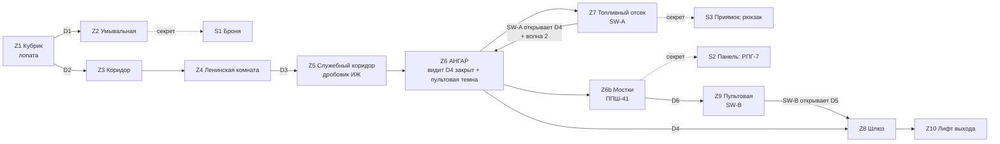

# MAP01 — Космодром «Заря-7»

Проектный документ. Владелец: `level-designer`. Статус: **текст одобрен PM
в написанном виде (2026-10-12, `docs/PENDING-CEO-DECISIONS.md` §6); вердикт
CEO по прохождению v1 ожидается. v0 (серый план этажа) ПОСТРОЕНА — §14; v1
(текстурирована и размечена) ПОСТРОЕНА — §15; v2 (свет и детали) — СЛЕДУЮЩАЯ.**
v3 (баланс) — после неё. Открытые для CEO пункты — в §13, решённое там
помечено как таковое. Английский оригинал (канонический):
`docs/levels/MAP01-zarya-7.md`.

> **Пройти карту:** `python3 tools/build.py && SD_ALLOW_ENGINE=1 MAP=MAP01 tools/run.sh`
> (гейт движка, `SD_ALLOW_ENGINE=1`, выставляет PM или CEO: агенты никогда
> не запускают GZDoom). Построенный план, с подписями:
> `docs/levels/shots/2026-10-13_0045_F3_map01-v0-plan.png`; скриншоты v1
> перечислены в §15.
Вводные данные, которым подчиняется этот документ и которые он не повторяет:
`docs/PRD.md` (D1–D15), `docs/product/LORE.md` (MAP01 = космодром, казармы и
ангар, обучение оружию, вторжение только началось), `docs/engine/MOD-SPEC.md`
(UDMF `zdoom`, карта генерируется `src/maps/MAP01/map.py`),
`docs/art/TEXTURE-INDEX.md` (единственные существующие текстуры) и
`docs/art/ART-BIBLE.md` §4 (предложение по композиции и свету).

## 1. Синопсис

Тревога застаёт сержанта Виланову в казармах секретного космодрома: он
вооружается на ходу, пересекает базу, которую его товарищи уже потеряли, и
прорывается через ангар к служебному лифту, спускающемуся в тоннели метро.

## 2. Что должна делать карта

| Задача | Как это реализует планировка |
|---|---|
| Обучить оружию (лор: MAP01 = обучающий уровень) | одно оружие на акт, за каждым следует враг, который является ответом на него: лопата → одиночный пёс; дробовик ИЖ → рекруты на близкой дистанции; ППШ-41 → вторая волна в ангаре. РПГ-7 — секретная награда, а не обязательное условие. |
| Обучить словарю базы | красная полоса (`SDCONC2`) — это **маршрут**; жёлтая полоса (`SDFLR1`) — это **трафик ангара**, и она указывает на выход и на один секрет. Обе объясняются за первые 90 секунд и никогда не лгут. |
| «Вторжение только началось» | база цела, освещена и чиста (ART-BIBLE §1: грязь — это *использование*, а не разруха). Врагов немного, в начале они разрозненны, скоплены только в ангаре, где они приземлились. |
| Финал в метро | выход — это служебный лифт, идущий **вниз**, с самым тёмным значением освещённости на карте (96): MAP02 уже угадывается по настроению. |

Целевая длительность: 5–8 мин при первом прохождении на сложности 3; ~3 мин
при повторном.

## 3. План

Схема, не в масштабе. Север наверху, x растёт на восток, y растёт на север.

```
                                                                 N
                                      +---------------+      +-----------------+
                                      |   Z7 FUEL BAY |      | Z9 CONTROL BOOTH|
                      +---------+     |    [SW-A]     |      |  [SW-B]  window |
                      | S3 SUMP |=====|  ~~~ drums ~~~|      +--------+--------+
                      | (secret)| up  +-------+-------+               | D6
                      +---------+             |                       |
    +-----------------+--------------------------------------------------------+
    |                 |                 Z6  H A N G A R               [catwalk] |
    |                 |                                          ===============|
    |                 |            #### transporter cradle ####        /\ stairs|
    |                 |                                                         |
    |   Z5 SERVICE  ->| stair down                                              |
    |   CORRIDOR      |  - - - - yellow lane (SDFLR1) - - - - - - - - -> [D4]===[airlock]===[D5]-> Z10 EXIT LIFT
    |  [guard post:   |                                                         |
    |   IZh shotgun]  +--------------------------------------------------------+
    +--------+--------+
             |
    +--------+--------+
    | Z4 LENINSKAYA   |   political room + mess: mural wall (SDPOSTR2),
    |    KOMNATA      |   emblem plaque (SDSTAR1, if approved)
    +--------+--------+
             |
       Z3 CORRIDOR  (red stripe starts here)
             |
    +--------+--------+       +-----------+     +--------+
    |  Z1 DORM        |---D1--| Z2 WASHRM |-----| S1     |
    |  [player start] |       |           | (secret panel)
    |  [shovel rack]  |       +-----------+     +--------+
    +-----------------+
```

Рабочие координаты (сетка 64; при постройке они могут сместиться на одну
ячейку, но отношения между ними — нет):

| # | Зона | x | y | пол | потолок | освещённость сектора |
|---|---|---|---|---|---|---|
| Z1 | Кубрик (старт) | 0…640 | 0…448 | 0 | 128 | 144 |
| Z2 | Умывальная | 640…896 | 0…192 | 0 | 96 | 112 |
| S1 | Шкафчики (секрет 1) | 896…1024 | 32…160 | 0 | 96 | 96 |
| Z3 | Коридор казармы | 192…320 | 448…960 | 0 | 96 | 120 / 144 пятна |
| Z4 | Ленинская комната | 0…640 | 960…1408 | 0 | 192 | 160 / 176 у мурала |
| Z5 | Служебный коридор | 640…1152 | 1088…1216 | 0 | 112 | 112 / 144 пятна / 96–144 мерцание |
| Z5b | Пост охраны | 896…1024 | 1216…1344 | 8 | 112 | 128 |
| Z6 | Ангар | 1152…2688 | 320…1600 | −32 | 288 | 176 (192 под лампами, 144 в тени отсека) |
| Z6a | Люлька транспортёра (проходимая) | 1600…2240 | 832…1216 | 32 | 288 | 176 |
| Z6b | Мостки (+ полоса парапета) | 1280…2560 | 1440…1600 | 96 / 128 | 288 | 160 |
| Z7 | Топливный отсек | 1152…1600 | 1600…1920 | −32 | 160 | 112 / 160 у SW-A |
| S3 | Топливный приямок (секрет 3) | 896…1152 | 1664…1856 | −96 | 0 | 96 |
| Z9 | Пультовая | 2560…2816 | 1600…1856 | 96 | 224 | 144 |
| Z8 | Шлюз | 2688…2944 | 544…800 | −32 | 96 | 128 |
| Z10 | Зал лифта выхода | 2944…3264 | 480…864 | −32 → 0 | 224 | 96 / 144 на выходном рычаге |

Площадь карты ≈ 3264 × 2048 юнитов. Каждая высота кратна 16; ни одна ступень
пола не выше 24, если её не несёт лестница.

## 4. Прогрессия и гейты



**Один гейт, два шага, оба обозначены.**

1. Игрок входит в ангар на уровне пола и видит вдоль жёлтой полосы
   **гермодверь D4**, закрытую, обрамлённую красной полосой и погашенным
   индикатором. Единственный другой проём с красной полосой на уровне пола —
   топливный отсек на северо-западе. Маршрут считывается, а не объясняется.
2. **SW-A** (топливный отсек) открывает D4 навсегда, зажигает индикатор,
   зажигает окно пультовой в дальнем конце ангара и открывает комнаты-ловушки
   второй волны. Теперь у игрока есть освещённая цель, которую он раньше не
   замечал.
3. За D4 находится **шлюз** глубиной 256, внутренняя дверь которого **D5**
   обесточена. Освещённое окно пультовой — это ответ; рядом с ним лестница на
   мостки, а по пути лежит ППШ-41.
4. **SW-B** (пультовая) открывает D5 навсегда. Выход через шлюз.

### Ключи и двери

**В MAP01 нет ключей.** `docs/product/LORE.md` отдаёт первый ключ эпизода
MAP02, да и сами MAP01/E1M1 оригинального Doom без ключей: первая карта учит
стрельбе и чтению пространства, а не инвентарю. *Грамматика* ключей («каждый
ключ показывает свою дверь прежде, чем ты её найдёшь») всё равно соблюдается,
только перенесена на рычаги: запертый объект (D4, затем D5) всегда виден
**до** рычага, который его открывает, а эффект рычага виден с того места, где
его дёргают.

> **Нужно решение CEO (в одну строку):** подтвердить MAP01 без ключей. Если
> вы хотите здесь ключ-карту, место для неё — пост охраны (Z5b): жёлтая карта
> на столе убитого охранника, её дверь заменяет D4, видна от входа в ангар.
> На v0 это изменение на 20 минут, не позже.

| Id | Где | Тип | Special (подтвердить, §9) | Может ли запереть игрока? |
|---|---|---|---|---|
| D1 | Кубрик → умывальная | ручная дверь, с обеих сторон | `Door_Raise`, повторяемая | нет |
| D2 | Кубрик → коридор | ручная дверь, с обеих сторон | `Door_Raise`, повторяемая | нет |
| D3 | Комната → служебный коридор | ручная дверь, с обеих сторон | `Door_Raise`, повторяемая | нет |
| D4 | Ангар → шлюз (ширина 256, две створки) | дистанционная, открывается навсегда | `Door_Open` tag 10, рычагом SW-A | нет: открывается и остаётся открытой |
| D5 | Шлюз → выход (ширина 128) | дистанционная, открывается навсегда | `Door_Open` tag 11, рычагом SW-B | нет |
| D6 | Мостки → пультовая | ручная дверь, с обеих сторон | `Door_Raise`, повторяемая | нет |
| SW-A | Топливный отсек, освещённая ниша | рычаг на стене, **повторяемый** | `Door_Open` 10 + `Door_Open` 20 + `Light_ChangeToValue` 30 | нет |
| SW-B | Пультовая | рычаг на стене, **повторяемый** | `Door_Open` 11 | нет |
| EXIT | Зал лифта, восточная стена | рычаг на стене | `Exit_Normal` | — |

Правила, исключающие целые классы софтлоков (мёртвых блокировок), применены
везде:

- **Ни одна дверь никогда не закрывается за игроком.** Засада в топливном
  отсеке — это открывающиеся стеновые панели, а не закрывающаяся дверь.
- **На критическом пути нет лифтов.** Высота меняется только лестницами (в
  ангар ведёт лестница на 3 ступени, на мостки — на 8 ступеней), поэтому
  ничто не может остаться в неправильном положении.
- **Каждый рычаг — `repeatspecial`**, а каждая дистанционная дверь —
  `Door_Open` (открыть и остаться), поэтому неудачное по времени или
  повторное использование никогда не может «израсходовать» гейт.
- **Нет перепада высоты больше 24 юнитов без обратного пути в той же зоне.**
  Оба намеренных изменения высоты (ангар −32, приямок −96) обслужены
  двусторонними лестницами.
- Комнаты-ловушки с монстрами открываются и остаются открытыми; игрок,
  который в неё зашёл, может из неё выйти.

## 5. Кривая интенсивности

```
  high |                                              ####  <- climax: wave 2
       |                                   ####       ####     across the
 press |                        ####       ####       ####     hangar with
  ure  |             ####       ####  ##   ####  ##   ####     the PPSh
       |   ##   ##   ####  ##   ####  ##   ####  ##   ####  ##
   low |   ##   ##   ####  ##   ####  ##   ####  ##   ####  ##   #
       +------------------------------------------------------------>
         Z1    Z3    Z4    Z5    Z6    Z7    Z6b   Z9    Z6    Z8/Z10
        dorm  corr  komn  corr  hangar fuel  cat-  booth hangar exit
                               first   bay   walk        wave2
                              contact (trap)
         0:00                                                    ~7:00
```

| Бит | Пространство | Ощущение | Вводимая механика |
|---|---|---|---|
| 1 | Кубрик, умывальная | тревога, смятение, три тела и два врага | движение, лопата, первая секретная панель |
| 2 | Коридор, комната | база теперь их; первая открытая комната | перекрёстный огонь в комнате с укрытиями; красная полоса |
| 3 | Служебный коридор | напряжение, мерцающий свет, угол | ИЖ и стрельба на близкой дистанции |
| 4 | Ангар, первый контакт | карта раскрывается: высота, лампы, дальность | длинные линии обзора, люлька как укрытие, бочки |
| 5 | Топливный отсек | всплеск: засада из трёх панелей | бой спиной к дверному проёму |
| 6 | Мостки, пультовая | облегчение и награда, вид сверху на то, что грядёт | ППШ-41, стрельба вниз |
| 7 | Ангар, волна 2 | **кульминация**: комната, которую ты уже знаешь, заполненная | использование всей арены, которую ты выучил в бите 4 |
| 8 | Шлюз, лифт | разрядка, один-два отставших врага, темнота | выход |

## 6. Текстуры по зонам

Только текстуры, **утверждённые** в `docs/art/TEXTURE-INDEX.md`, несут
нагрузку. Всё условное указано вместе со своим запасным вариантом, поэтому
карта собирается и выходит независимо от решения CEO.

| Зона | Стены | Пол | Потолок | Свет | Примечание |
|---|---|---|---|---|---|
| Z1 Кубрик | `SDCONC1`; `SDSTEL1` на рамах коек и стойке с лопатами | `SDFLR3` | `SDCEIL2`, один `SDCEIL1` | 144 | чистая, освещённая, обычная комната: «до» для игрока |
| Z2 Умывальная | `SDCONC1` | `SDFLR3` | `SDCEIL2` | 112 | темнее кубрика, чтобы читался шов S1 |
| S1 Шкафчики | `SDSTEL1` | `SDFLR2` | `SDCEIL2` | 96 | |
| Z3 Коридор казармы | `SDCONC1` + **`SDCONC2`** на уровне глаз на правой стене, непрерывно | `SDFLR3` | `SDCEIL2`, `SDCEIL1` через каждые 256 | 120, пятна 144 | **здесь рождается красная полоса**: она будет вести игрока всю карту |
| Z4 Ленинская комната | `SDCONC1`; на северной стене мурал `SDPOSTR2` (128×128, один раз, на уровне глаз, на бетоне согласно ART-BIBLE §4); табличка `SDSTAR1` на восточном пилоне *если утверждена*, иначе `SDCONC1` | `SDFLR3` | `SDCEIL2` + 2 `SDCEIL1` | 160, 176 у мурала | единственная «красивая» комната; мурал освещён ярче, чем всё вокруг, чтобы читаться как смысл, а не украшение |
| Z5 Служебный коридор | `SDCONC1` + полоса **`SDCONC2`** продолжается | `SDFLR2` | `SDCEIL2`, 2 `SDCEIL1` | 112, пятна 144, один мерцающий участок 96–144 | |
| Z5b Пост охраны | `SDSTEL1` | `SDFLR2` | `SDCEIL2` | 128 | сталь = функция: здесь находится оружие |
| Z6 Ангар | `SDCONC1` выше 128, `SDSTEL1` ниже 128 (цоколь из зелёных панелей) на всех четырёх стенах; **`SDCONC2`** обрамляет D4 и проём топливного отсека | `SDFLR2`, с полосой `SDFLR1` шириной 64 от входной лестницы до D4 и второй полосой в западный отсек (та, что указывает на S3) | `SDCEIL2`, `SDCEIL1` сеткой 6 × 2 ламповых панелей | 176; 192 прямо под каждой лампой; 144 в тенях отсека и под мостками | соблюдается правило ≥ 70 % бетона (ART-BIBLE §4): сталь только до 128 из 320 стены |
| Z6a Люлька | `SDSTEL1` | `SDFLR2` | — | 176 | |
| Z6b Мостки | `SDSTEL1`, парапет `SDSTEL1` | `SDFLR2` | `SDCEIL2` | 160 | |
| Z7 Топливный отсек | `SDSTEL1` до 128, выше `SDCONC1` | `SDFLR2` | `SDCEIL2`, 1 `SDCEIL1` над SW-A | 112, 160 у SW-A | рычаг — самый яркий предмет в комнате |
| S3 Приямок | `SDCONC1` | `SDFLR2` | `SDCEIL2` | 96 | |
| Z9 Пультовая | `SDSTEL1` | `SDFLR3` | `SDCEIL1` | 144 (96 до нажатия SW-A) | её окно — маяк, зажигаемый SW-A |
| Z8 Шлюз | `SDSTEL1`, створки `SDDOOR1` | `SDFLR2` | `SDCEIL2` | 128 | |
| Z10 Лифт выхода | `SDCONC1`, цоколь `SDSTEL1` | `SDFLR2` | `SDCEIL2` | 96, 144 на рычаге | самая тёмная комната карты: здесь начинается MAP02 |

Политика освещения, которую я фиксирую как владелец этого значения (ART-BIBLE
§4 предлагает 112–144 для коридоров / 128–160 для казарм / 160–192 для
ангара; я сохраняю диапазоны и закрепляю конкретные числа):

- Допустимый диапазон **96 … 192**. 96 — только в S1, S3 и Z10; 192 — только
  под лампами ангара. Нигде не абсолютная темнота: на базе всё ещё есть
  электричество.
- Соседние секторы, которые должны читаться как разные пространства,
  отличаются на **≥ 16**. Ламповый сектор ровно на +16 ярче своей комнаты.
- Один флэт `SDCEIL1` = один ламповый сектор 64×64 на +16 (ART-BIBLE §4).
- Карта становится *светлее* по направлению к ангару, а затем *темнее* к
  выходу: кривая освещения следует кривой истории.

Текстурные соглашения для постройки (закреплены постройкой v1, §15):

- **Всё привязано к полу.** Doom выравнивает текстуру стены по потолку,
  поэтому в любой комнате, высота которой не кратна точно 128, отрезанная
  панель оказывается у пола с «плавающей» линией грязи. Поэтому `GridMap`
  выставляет `dontpegbottom` на каждой линии, которую он создаёт, кроме
  дверной створки, которая должна подниматься вместе с дверью. Следствие: в
  карте **вообще нет `offsetx` и `offsety`** — всё выравнивание в ней идёт от
  сетки 64 и этого единственного правила, поэтому при смещении комнаты
  ничего не нужно перепроверять.
- Каждая дверная **створка** ровно 128 высотой, потому что `SDDOOR1` —
  128×128, а створка выше этого размера начинает повторяться узором стены.
  Там, где комната перед дверью выше, дверь получает **нишу-карман**: короткий
  сектор перед ней на том же полу с потолком на 128 выше (D3 в комнате, D4 в
  ангаре, D5 в зале лифта, D6 на мостках). D4 шириной 256 = две створки,
  каждая по одному `SDDOOR1`. Тест проверяет 128 повсюду.
- Сайддеф несёт материал сектора **по другую сторону** линии, поэтому
  128-высотная грань под мостками и 64-высотный борт люльки — это панели, а
  стена позади них — бетон, а перемычка над проёмом сделана из материала
  комнаты, в которую она ведёт.
- Жёлтая линия `SDFLR1` укладывается **полосами** (трафик ангара, маршрут к
  D4, указатель на S3), никогда как сплошное покрытие пола (ART-BIBLE §4).
  Полоса — **128 шириной, а не 64**: флэт несёт свою линию на столбцах 2–8
  64-ширинного тайла, поэтому 128 даёт две параллельные линии на расстоянии
  64 друг от друга — размеченную транспортную полосу, а не одну царапину,
  читаемую с другого конца ангара, независимо от того, в какую сторону
  `rotationfloor` поворачивает флэт.

## 7. Секреты

Три штуки, ни один не обязателен, каждый — *награда за внимательное чтение
комнаты*, у каждого есть двусторонний выход.

| # | Где | Подсказка, которую может прочитать игрок | Награда | Открывается |
|---|---|---|---|---|
| S1 | Панель шкафчика в умывальной (Z2) | одна панель `SDSTEL1` имеет видимый шов и находится в секторе темнее, чем соседние | зелёная броня, 2 аптечки | нажатие (`Door_Open`, остаётся открытой) |
| S2 | Шатающаяся панель мостков за пультовой (Z6b) | с пола ангара видна освещённая щель под мостками, которой там не должно быть | **РПГ-7** + 1 коробка ракет + схема базы (карта на компьютере) | нажатие |
| S3 | Топливный приямок под стопкой бочек (Z7) | вторая жёлтая полоса в западном отсеке ангара упирается в стену топливного отсека и обрывается — она указывает на бочки | рюкзак, 1 коробка патронов для дробовика, 2 аптечки | нажатие |

Все три сектора несут флаг секрета; все три достижимы на любой сложности; ни
один не стоит здоровья.

## 8. Враги и ресурсы

**Своего пока ничего не существует (F5).** Карта населена акторами Freedoom
как заглушками, и у каждого из них есть объявленный преемник. Позиции
выбраны исходя из поведения *преемника*, поэтому F5 — это замена DoomEdNum'ов,
а не редизайн.

| Заглушка (Freedoom / IWAD) | DoomEdNum | Станет (F5) | Почему находится именно здесь |
|---|---|---|---|---|
| Zombieman | 3004 | **рекрут Четвёртого рейха** (болтовая винтовка) | основная масса; урон хитсканом по чуть-чуть, используется по одному-двое в начале, шеренгами на мостках позже |
| Shotgun guy | 9 | **боец Легиона Свободы** | карает за открытое пространство; охраняет проходы и люльку |
| Imp | 3001 | **гибридный штурмовик** | первый враг, переживающий один заряд дробовика; ангар и топливный отсек |
| Demon | 3002 | **пёс Рейха** | коридоры и засада: вынуждает двигаться, отвечает на лопату |
| Chaingun guy | 65 | **тяжёлый стрелок Легиона** | только на сложности 4, один, в окне пультовой: причина отнестись к мосткам серьёзно |
| Explosive barrel | 2035 | топливная бочка (свой спрайт позже) | отсеки ангара и топливный отсек; часть арены, а не декорация |
| Chainsaw | 2005 | **сапёрная лопатка** (слот 1) | стойка в кубрике |
| Shotgun | 2001 | **двуствольный ИЖ** (слот 3) | пост охраны, на критическом пути |
| Chaingun | 2002 | **ППШ-41** (слот 4) | мостки, по пути к SW-B |
| Rocket launcher | 2003 | **РПГ-7** (слот 5) | только секрет S2 |
| Clip / box, shells / box, rockets | 2007/2048, 2008/2049, 2010/2046 | обойма ТТ, патроны для ИЖ, снаряды РПГ | см. бюджет |
| Stimpack / medikit / health bonus | 2011 / 2012 / 2014 | перевязка / аптечка / ампула | |
| Green armour / armour bonus | 2018 / 2015 | бронежилет / пластина | |
| Backpack | 8 | подсумок с патронами | секрет S3 |
| Floor lamp | 2028 | напольная лампа | Z4, Z10 |

Намеренно не используется в MAP01: супердробовик (в слоте 3 только одно
оружие, ИЖ), слоты плазмы/BFG (огнемёт и «Катюша» появятся позже в эпизоде),
какодемоны/бароны (лор: вторжение только началось), ключи.

### Враги по сложности

Сложности Doom: 1–2 делят флаги вещей «лёгкая», 3 — средняя, 4–5 делят
«тяжёлая». Каждый монстр размещается с явными флагами `skill1…skill5`
(`sdbuild.udmf` по умолчанию ставит все пять в true, поэтому каждое
добавление нужно задавать осознанно).

| Бит / зона | Сложность 2 (HNTR) | Сложность 3 (HMP) | Сложность 4 (UV) |
|---|---|---|---|
| Z1 Кубрик | 2 рекрута | 3 рекрута | 3 рекрута + 1 боец |
| Z2 Умывальная | — | 1 пёс | 1 пёс |
| Z3 Коридор | 2 рекрута | 2 рекрута + 1 пёс | 3 рекрута + 1 пёс |
| Z4 Комната | 2 рекрута + 1 боец | 3 рекрута + 1 боец | 3 рекрута + 2 бойца + 1 штурмовик |
| Z5 Коридор + пост охраны | 1 рекрут + 1 боец | 2 рекрута + 1 боец | 2 рекрута + 2 бойца |
| Z6 Ангар, первый контакт | 3 рекрута + 1 боец + 1 штурмовик | 4 рекрута + 2 бойца + 2 штурмовика | 5 рекрутов + 3 бойца + 3 штурмовика |
| Z7 Засада в топливном отсеке | 2 штурмовика + 1 пёс | 2 штурмовика + 2 пса | 3 штурмовика + 2 пса + 1 боец |
| Z6 Ангар, волна 2 | 2 рекрута + 1 боец | 3 рекрута + 2 бойца | 3 рекрута + 2 бойца + 1 штурмовик + 1 тяжёлый стрелок |
| Z8/Z10 Выход | 1 рекрут | 1 рекрут + 1 боец | 2 рекрута + 1 боец |
| **Всего** | **21** | **33** | **46** |

Строго возрастает (21 < 33 < 46), что G3 проверяет механически.

### Ресурсы по сложности

| Предмет | Сложность 2 | Сложность 3 | Сложность 4 | Где |
|---|---|---|---|---|
| Лопата (chainsaw) | 1 | 1 | 1 | стойка Z1 |
| ИЖ (shotgun) | 1 | 1 | 1 | пост охраны Z5b |
| ППШ (chaingun) | 1 | 1 | 1 | мостки Z6b |
| РПГ-7 + 1 коробка ракет | секрет | секрет | секрет | S2 |
| Патроны ×4 | 8 | 6 | 5 | разбросаны Z5 → Z10 |
| Коробка патронов (20) | 2 | 2 | 2 | Z6, S3 |
| Обойм (10) | 6 | 5 | 4 | разбросаны от Z1 |
| Коробка пуль (50) | 2 | 2 | 3 | Z6b, Z6, Z7 |
| Перевязка | 6 | 4 | 3 | |
| Аптечка | 4 | 3 | 2 | Z5, Z7, S3 |
| Бонус здоровья | 10 | 10 | 10 | добивка по углам |
| Зелёная броня | 1 (S1) | 1 (S1) | 1 (S1) | S1 |
| Бонус брони | 8 | 8 | 6 | |
| Рюкзак | секрет | секрет | секрет | S3 |

Принцип: **монстров со сложностью становится больше, расходников — меньше,
доступность оружия не меняется никогда.** Игрок на сложности 4, который не
находит ни одного секрета, всё равно должен быть способен закончить карту —
это измеримый критерий G3 (§11, G3-5 — сам прогон, G3-8 — бюджет
боеприпасов), а не надежда.

## 9. Используемые элементы движка

*Формы* аргументов берутся из собственных поставляемых таблиц трансляции
GZDoom (`gzdoom.pk3 → xlat/base.txt`, `xlat/doom.txt`, `xlat/defines.i`),
которые представляют собой обычный текст: `Door_Raise (tag, speed, delay,
lighttag)`, `Door_Open (tag, speed, lighttag)`, `Exit_Normal (pos)`,
`D_SLOW = 16`, `VDOORWAIT = 150`.

*Номера* спешлов не содержатся ни в одном файле, который поставляет GZDoom —
таблица ZDoom вкомпилирована в бинарник — поэтому их проверили единственным
оставшимся способом: пройдя v0 и наблюдая, что происходит. Доказательства в
`docs/levels/shots/`.

| Нужно | Выдаётся | Статус |
|---|---|---|
| Ручная дверь, с обеих сторон | `Door_Raise` **12** (tag, 16, 150, 0), `playeruse` + `repeatspecial` | **ПРОВЕРЕНО в движке** 2026-10-13: D2 нажата из кубрика, открылась, виден коридор (`…_d2-closed.png` → `…_d2-open-corridor.png`) |
| Нажимная панель, открывается навсегда | `Door_Open` **11** (tag, 16, 0), `playeruse` + `repeatspecial` | **ПРОВЕРЕНО**: панель мостков S2 нажата и осталась открытой (`…_s2-panel-open.png`) |
| Рычаг на стене, открывающий дистанционную дверь | `Door_Open` **11** на **односторонней** линии, тег несоседнего сектора | **ПРОВЕРЕНО**: SW-A дёрнут, D4 обнаружена открытой со стороны ангара, а за ней шлюз и всё ещё закрытая D5 (`…_d4-closed.png` → `…_d4-open-airlock-d5.png`) |
| Выход с уровня | `Exit_Normal` **243** на линии рычага | **ПРОВЕРЕНО**: движок вышел и вновь вошёл в MAP01 (MAPINFO `next = "MAP01"`), две строки `MAP01 - …` в одном логе |
| Теги секторов / линий | UDMF `id` на секторе; `arg0` на линии | **ПРОВЕРЕНО** косвенно всем вышеперечисленным |
| Свет пультовой включается | `Light_ChangeToValue` (110) tag 30, arg 144 | **НЕ ПРОВЕРЕНО** — v2 |
| Мерцающий участок коридора | sector special или `Light_Flicker` (113) | **НЕ ПРОВЕРЕНО** — v2 |
| Секретный сектор | sector `special = 1024` | **НЕ ПРОВЕРЕНО** — v2 |

Два факта о движке, которые стоит записать, оба выучены на собственном опыте:

- Спешл `playeruse` срабатывает **только с передней стороны линии**. Поэтому
  сектору двери нужен спешл на *обеих* обрамляющих линиях, каждая закручена
  так, что дверь оказывается стороной BACK. `LineStyle.back_sector` в
  `tools/sdbuild/udmf.py` делает это, и `tests/test_udmf.py` это проверяет.
- `Door_Raise` / `Door_Open` поднимают дверь до **(самый низкий соседний
  потолок − 4)**. Приямок по проекту (пол −96, потолок 0), открытый с пола
  −32, дал бы проём высотой 28 юнитов, то есть непроходимый. Исправлено в v0
  (§14); зазор каждой двери теперь проверяется тестом.

План тегов, обновлённый по v0: **1** D1 · **2** D2 · **3** D3 · **6** D6 ·
**10** D4 · **11** D5 · **20** комнаты-ловушки второй волны в ангаре · **21**
панели засады в топливном отсеке · **30** свет пультовой · **101/102/103**
секретные панели S1/S2/S3. 4, 5, 7–9 и 12–19 остаются свободными для
детализации v2. Ручные двери тегированы, а не оставлены на теге 0, чтобы их
открывала любая из обрамляющих линий.

Текстуры переключателей: `SDSW1A-D` (выкл) и `SDSW2A-D` (вкл), 64×128,
одобрены 2026-10-13 и лежат в `assets/textures/soviet_base/`. Ламп, который
заставляет переключатель менять вид, уже на месте: `src/lumps/ANIMDEFS` с
2026-10-13 сопоставляет каждый `SDSW1x` его `SDSW2x` (MOD-SPEC §4.3). Карта
по-прежнему носит `SDDOOR1` (`SWITCH_PLACEHOLDER` в `map.py`) на SW-A, SW-B и
выходе, потому что v1 строилась до него; v2 убирает заглушку — см. §10,
запрос A3.

## 10. Что мне нужно, прежде чем я смогу строить

### От `mod-engineer` (блокирующее)

- **M1 — РЕШЕНО 2026-10-12 силами `mod-engineer`.** `tools/build.py` теперь
  упаковывает `assets/`; двенадцать утверждённых текстур в PK3, и v0 уже
  использует одну из них (`SDDOOR1`, §14).
- **M2 — РЕШЕНО 2026-10-13 силами `level-designer`** (эта роль вела файл для
  этой задачи). `tools/sdbuild/udmf.py` теперь моделирует `Sector.id` /
  `Sector.special`, `Linedef.special` + `arg0..arg4`, проверяемый набор
  флагов линий, `TextMap.add_room_rect()` и `GridMap` — отрисовщик
  прямоугольников, который выводит все общие грани, разрезы и закрутку из
  списка прямоугольников. Тесты в `tests/test_udmf.py`.
- **M3, M4, M5 — всё ЗАКРЫТО 2026-10-13 силами `mod-engineer`**, см. ниже.
  Ничто со стороны `mod-engineer` не блокирует v2: ламп анимации
  переключателей (A3) поставлен как `src/lumps/ANIMDEFS` 2026-10-13
  (MOD-SPEC §4.3).

<details><summary>Исходная формулировка M1 и M2 (сохранена для истории)</summary>

- **M1 — утверждённые текстуры не попадают в PK3.**
  `assets/textures/soviet_base/` и `assets/flats/soviet_base/` существуют, но
  `tools/build.py` упаковывает только `src/`, а `src/textures/` или
  `src/flats/` не существует. Сегодня карта, называющая `SDCONC1`, выдала бы
  `Unknown texture`. Подключите `assets/` к сборке (или определите шаг
  копирования) и зафиксируйте это в MOD-SPEC §2/§3. **v1 блокирован этим; v0
  — нет** (v0 может работать на текстурах IWAD).
- **M2 — в `sdbuild.udmf` не хватает того, что нужно этой карте.** Сегодня у
  `Sector` нет `id`/`special`, у `Linedef` нет `special`/`arg0…arg4` и полей
  флагов, и нет хелпера для двусторонних линий или прямоугольников. Всё это
  достижимо через `extra={}`, но карта на 60 секторов, написанная так,
  нерецензируема. Пожалуйста, добавьте: `Sector.id`, `Sector.special`,
  сквозной проход в стиле `Sector.xpanningfloor` (уже доступен через
  `extra`), `Linedef.special` + `arg0…arg4`, флаги `twosided`, `playeruse`,
  `playercross`, `repeatspecial`, `monsteractivate`, `blockmonsters`,
  `dontpegtop`, `dontpegbottom`, `secret`, и `TextMap.add_room_rect()`,
  который выдаёт прямоугольный сектор с четырьмя правильно закрученными
  линиями.

</details>

- **M3 — ЗАКРЫТ 2026-10-13 силами `mod-engineer`,
  `docs/engine/MOD-SPEC.md` §4.1.** `Exit_Normal` теперь завершает игру: у
  MAP01 `next = endtitle`, `cluster = 1` с текстом конца на кластере, а
  `nointermission` убран, так что экран статистики — первое, что сообщает,
  что уровень пройден. (Исходная формулировка: выход возвращал на MAP01, что
  годилось для проверки `Exit_Normal` в v0 и неверно для релиза.)
- **M4 — ЗАКРЫТ 2026-10-13 силами `mod-engineer`, MOD-SPEC §4.** В движке
  карта называется «Zarya-7 Cosmodrome» / «Космодром "Заря-7"» (лог выводит
  `MAP01 - Zarya-7 Cosmodrome`); `par = 210`. НЕ ПРОВЕРЕНО никем пока: что
  интермишн выводит 3:30 (MOD-SPEC T15, `qa-engineer`).
- **M5 — ЗАКРЫТ 2026-10-13 силами `mod-engineer`, MOD-SPEC §4.2.** Три
  проверенных спешла из §9 (`Door_Raise` 12, `Door_Open` 11, `Exit_Normal`
  243), формы их аргументов, соглашение о тегах и два факта о движке теперь
  контракт; три непроверенных (`Light_ChangeToValue`, `Light_Flicker`,
  секретный `special = 1024`) перечислены там как *пока не контракт, v2*.
  Заглушки Freedoom из §8 попадут в MOD-SPEC §5, когда их разместит v3.

### От `art-director` (одно блокирующее, остальное формирует v2)

- **A1 — ОТВЕЧЕНО как механизм, вердикт открыт.** `SDCONC2` в `assets/` и в
  PK3 (M1, 2026-10-12), а сборка v1 (§15) — её проверка в карте: полоса —
  это язык навигации Z3, Z5, рамки D4 и проёма топливного отсека. **CEO ещё
  не проходил v1**, поэтому её строка в `TEXTURE-INDEX.md` остаётся
  «ожидает проверки в карте». **Запасной вариант при отказе:** маршрут
  вместо этого обозначается пилястрами `SDSTEL1`, карта всё равно работает,
  а теряет она свой лучший указатель.
- **A2 — `SDSTAR1`, вердикт открыт.** v5 встроена в v1 на одной стене
  (кубрик, рядом с D2 — §15, отклонение 2, а не восточный пилон Z4, как
  планировалось). Если v5 будет отвергнута, одна константа в `map.py`
  меняется на `SDCONC1`; от неё ничего структурного не зависит.
- **A3 — текстура ГОТОВА, ламп анимации ГОТОВ (2026-10-13); остальное моё, в
  v2.** Текстуры переключателей существуют: `SDSW1A-D` (выкл) и `SDSW2A-D`
  (вкл), 64×128, все четыре варианта одобрены CEO 2026-10-13 («así tenemos
  diversidad»), лежат в `assets/textures/soviet_base/`, строка лицензии — в
  `docs/art/LICENSES.md`. Ламп, который заставляет движок менять «выкл» на
  «вкл», — `src/lumps/ANIMDEFS` (`mod-engineer`, долг T16 погашен): четыре
  пары `switch` `SDSW1x → SDSW2x`, и `SDSW1A` в тот же день был замечен
  переключающимся в `SDSW2A` в движке. Синтаксис, его источник и
  свидетельство ведёт MOD-SPEC §4.3; бинарный ламп `SWITCHES` из Boom не
  используется. Остаётся моё: v2 убирает `SWITCH_PLACEHOLDER` (`SDDOOR1` на
  SW-A, SW-B и выходе, оставленный в v1, потому что v1 строилась до этого
  лампа) и выбирает по одному варианту на каждый переключатель. Щелчок пока
  не слышен; подтвердится он на первой прогулке CEO с настоящими
  переключателями. (Заменённая исходная формулировка, для истории: запрос
  просил пару с именами `SDSWT1`/`SDSWT2`; одобренные лампы следуют
  собственному доомовскому именованию `1` = выкл / `2` = вкл.)
- **A4 — `SDDOOR2`, вторая створка двери (партия 2, желательно, но не
  критично).** D4 — это гермодверь шириной 256, собранная из двух створок
  `SDDOOR1`, поэтому запорное колесо и трафаретная «7» появляются дважды
  рядом. Это читается как двойная дверь, что правдоподобно, но зеркальная
  или простая половинная створка читалась бы лучше. Решить после того, как
  CEO увидит это в v1.
- **A5 — текстура ящика / шкафчика (уже кандидат в партию 2).** Кубрику,
  посту охраны и отсекам ангара нужна грань ящика; сегодня это просто ящики
  из `SDSTEL1`.
- **A6 — нет экстерьера.** Нет утверждённой текстуры экстерьера или неба,
  поэтому MAP01 v1 целиком внутренняя, а ворота стартовой площадки в ангаре
  остаются закрытыми. Если CEO хочет полосу ночного неба над ангаром,
  `SKY1` уже объявлена в MOD-SPEC §5, и я могу открыть щель в крыше в v2 —
  только скажите.

### Сознательно не запрошено

Звук (пока нет `SNDINFO`; двери и рычаги используют дефолты движка), музыка
(`music = ""`), собственный HUD, скрипты ACS (дизайн намеренно построен на
простых linedef specials, чтобы ни один скрипт не мог сломаться).

## 11. Гейт G3 — измеримое определение

`docs/ROADMAP.md` формулирует G3 как «карта проходима на сложностях 2, 3 и 4
без ошибок в логе и без софтлоков; вердикт CEO «on point»» (map finishable on
skills 2, 3 and 4 with zero log errors and zero softlocks; CEO verdict 'on
point'). Ниже то, что фактически запускает `qa-engineer`. **Все пункты
G3-1…G3-8 должны быть зелёными; G3-9 — за CEO.**

| # | Критерий | Как измеряется | Прохождение |
|---|---|---|---|
| G3-1 | Карта собирается и упаковывается | `python3 tools/build.py` завершается с кодом 0; `maps/MAP01.wad` содержит `MAP01`, `TEXTMAP`, `ENDMAP` в этом порядке; `python3 -m unittest discover -s tests` зелёный, и число тестов в суите не ниже, чем при последнем закрытии | точно |
| G3-2 | Нулевые ошибки движка | `logs/gzdoom.log` полного прохождения не содержит совпадений ни с одним из: `Script error`, `Unknown texture`, `Unknown flat`, `Missing sprite`, `Unknown line special`, `Bad sector`, `Texture .* not found`, `is not a valid` | 0 совпадений |
| G3-3 | Каждая текстура легитимна | статическая проверка по `TEXTMAP`: каждое значение `texture*` либо `approved` в `TEXTURE-INDEX.md`, либо явно «ожидает проверки в карте» (только `SDCONC2`, и только если A1 был предоставлен), либо указано в `MOD-SPEC.md` §5 | 0 неизвестных названий |
| G3-4 | Проходима на 2, 3 и 4 | три записанных прохождения от старта игрока до выходного рычага; доказательство: скриншот интермиссии + лог на каждую сложность, в `docs/qa/evidence/` | 3/3 |
| G3-5 | Проходима без монстров и без секретов | один прогон с `-nomonsters` и один прогон без единого секрета — оба доходят до выхода | 2/2 |
| G3-6 | Без софтлока, статически | проверка достижимости по `TEXTMAP`: каждый сектор достижим от старта игрока, и из каждого сектора есть путь до выхода, использующий только двери, которые `repeatspecial` либо уже постоянно открыты; нет односторонних перепадов > 24 юнитов | 0 нарушений |
| G3-7 | Без софтлока, враждебно | враждебный прогон QA на сложности 4: дёрнуть каждый рычаг два раза, повторно войти в каждую дверь, зайти в каждую комнату-ловушку и выйти обратно, зайти в каждый секрет и выйти, спрыгнуть с мостков и с люльки со всех четырёх сторон, и пройти карту в обратном порядке начиная с ангара | «не удалось застрять» |
| G3-8 | Здравость вещей и ресурсов | скрипт по `TEXTMAP`: ни одной вещи со всеми пятью флагами сложности false; число монстров строго 2 < 3 < 4 и совпадает с §8 ±2; 3 секретных сектора; размещённые патроны на сложности 4 ≥ 1,35 × патронов, нужных, чтобы убить каждого монстра сложности 4 предназначенным оружием (рекрут/боец 1 патрон дробовика, штурмовик 2, пёс 3, стрелок 4), не считая секретных предметов | всё верно |
| G3-9 | Вердикт CEO | CEO играет или смотрит v3 и говорит «on point» (или нет), **а также** даёт вердикт по `SDCONC2`, увиденной в Z3/Z5/Z6, что закрывает её строку в `TEXTURE-INDEX.md` | явное «да» |

Провал любого из G3-1…G3-8 — это баг с номером, а не повод для дискуссии.

## 12. План версий

Каждая версия загружается в GZDoom, проходима от старта до выхода и
скриншотится в `docs/levels/shots/`.

| Версия | Содержание | Готово, когда |
|---|---|---|
| **v0 — серая** ✅ **ПОСТРОЕНА 2026-10-13** (§14) | полный план этажа: каждый сектор, каждая дверь, оба рычага, выход, правильные высоты и лестницы. Одна текстура стен и одна пара пол/потолок повсюду (`STARTAN2`/`FLOOR4_8`/`CEIL3_5`), плоский свет 160, без врагов, без предметов. | можно пройти старт → выход; нет HOM, нет застревающей геометрии; G3-1, G3-2, G3-6 проходят |
| **v1 — текстурированная** ✅ **ПОСТРОЕНА 2026-10-13** (§15) | §6 применён зона за зоной, проход выравнивания (дверные ниши, привязка к полу, непрерывность полос), размещены мурал `SDPOSTR2` и Ленин `SDPOSTR1`, D4/D5/D6 как `SDDOOR1`, маршрут `SDCONC2` построен и сфотографирован. | G3-3 проходит; CEO может оценить `SDCONC2` по скриншотам |
| **v2 — свет и детали** — **СЛЕДУЮЩАЯ**, начинается, когда CEO пройдёт v1 и вынесет вердикт (§13) | таблица света §6, ламповые секторы, мерцающий коридор, свет пультовой, который включает SW-A, парапеты, пилястры, ступени, бочки, напольные лампы, три секрета построены и отмечены флагом; настоящие текстуры переключателей, по одному варианту на переключатель, с уходом `SWITCH_PLACEHOLDER` (A3; пары `ANIMDEFS` уже в сборке, MOD-SPEC §4.3). | карта читается без компаса: игрок, попавший сюда впервые, находит ангар, топливный отсек и D4 без подсказок |
| **v3 — баланс** | §8 размещён с флагами по сложности, бюджет патронов и здоровья, обе волны и засада выверены по времени, плейтесты на 2/3/4 с заметками. | все G3-1…G3-8 зелёные; готова к G3-9 от CEO |

Запуск любой версии, когда она уже в сборке:

```sh
python3 tools/build.py
SD_ALLOW_ENGINE=1 MAP=MAP01 SKILL=3 tools/run.sh      # любая машина; гейт выставляет PM или CEO
# or, directly — macOS:
/Applications/GZDoom.app/Contents/MacOS/gzdoom -iwad iwads/freedoom2.wad \
  -file dist/sovietdoom.pk3 +map MAP01 -skill 3
# Windows (рабочая машина с 2026-10-13):
"%LOCALAPPDATA%\Programs\GZDoom\gzdoom.exe" -iwad iwads\freedoom2.wad \
  -file dist\sovietdoom.pk3 +map MAP01 -skill 3
```

## 13. Открытые вопросы для CEO

Статус на 2026-10-13. То, что **решено**, говорит где; то, что **открыто**,
PM ведёт в `docs/PENDING-CEO-DECISIONS.md`. CEO ещё не проходил v1, чего
ждут пункты 2 и 6.

1. **MAP01 без ключей** (§4) — **ОТКРЫТО, действуем по умолчанию.** v0 и v1
   построены без ключей (PM одобрил дизайн в написанном виде, 2026-10-12);
   альтернатива с жёлтой картой на посту охраны всё ещё дёшево меняется, но
   с каждой версией дорожает. Рекомендация прежняя: без ключей, поскольку
   лор отдаёт первый ключ MAP02. Нужно одно слово от CEO.
2. **`SDCONC2`** (A1) — **механизм РЕШЁН, вердикт ОТКРЫТ.** Полоса
   поставляется в PK3 (M1, 2026-10-12), а v1 — её проверка в карте (§15).
   Вердикт CEO — в казарме это одна полоса, в ангаре — три — закроет строку
   в `TEXTURE-INDEX.md`. Вариант, если он хочет одну полосу в ангаре:
   цоколь высотой 128 в v2 (§15).
3. **Текстура переключателя** (A3) — **РЕШЕНО 2026-10-13**: все четыре варианта
   `SDSW1A-D` / `SDSW2A-D` одобрены и установлены (коммит `4083883`,
   `docs/art/LICENSES.md`). Альтернатива с заглушкой из IWAD потеряла смысл, а
   пары переключателей `ANIMDEFS` поставлены в тот же день (MOD-SPEC §4.3).
   Остаётся работа v2, а не решение: настоящие переключатели встают на место,
   а `SWITCH_PLACEHOLDER` убирается. От CEO здесь ничего не требуется.
4. **Длительность и сложность** — **ОТКРЫТО.** 5–8 минут и 21/33/46 врагов
   по сложностям — это современный MAP01, длиннее, чем MAP01 Doom II (~2
   мин), и короче, чем открывающая карта современного мегавада. Скажите,
   если хотите короче; это важно до того, как v3 расставит монстров, но не
   раньше.
5. **Полоса ночного неба** над ангаром в v2 (A6) — **ОТКРЫТО.** Да или нет;
   `SKY1` уже есть в MOD-SPEC §5, так что «да» — это щель в крыше в v2 и
   никакого нового ассета.
6. **Пройти v1** (добавлено находкой плейтеста v0, §14) — **ОТКРЫТО, это
   сам критерий гейта.** С нижней ступени ангара доходит ли игрок до
   топливного отсека без подсказок? Именно на этот вопрос должны были
   ответить красная полоса и жёлтая дорожка, и ответить на него может
   только прохождение CEO. Двенадцать скриншотов v1 в §15 — запасной
   вариант, если он предпочтёт смотреть, а не играть.

Пункты 2, 4, 5 и 6 — те же, что CEO должен оценить, проходя v1; на пункт 1
можно ответить, не играя.

## 14. Отчёт о постройке v0 (2026-10-13)

Источник: `src/maps/MAP01/map.py`, собрано `GridMap` из
`tools/sdbuild/udmf.py`. 44 сектора, 179 линий (linedefs), 137 вершин, 1
предмет (thing).

```sh
python3 tools/build.py && SD_ALLOW_ENGINE=1 MAP=MAP01 tools/run.sh      # walk it
python3 tools/build.py --print-textmap MAP01                            # read the UDMF
```

### Что в ней есть

Все помещения, коридоры, лестницы, двери, рычаги и секреты из §3 и §4, на
высотах §3: кубрик, умывальная и секрет в шкафчике, коридор казармы,
Ленинская комната, служебный коридор и пост охраны, лестница на 3 ступени,
ведущая в ангар, сам ангар с люлькой транспортёра (на неё можно забраться, с
неё можно спрыгнуть с любой из четырёх сторон), лестница на 8 ступеней на
мостки, мостки и их секретная панель, топливный отсек с SW-A и секретом
приямка под ним, пультовая с окном над ангаром и SW-B, двухстворчатый шлюз
(D4 → камера → D5) и лифт выхода с выходным рычагом.

### Чего в ней намеренно нет

Нет врагов, нет оружия, нет патронов, нет аптечек, нет украшений, нет флагов
секретов, нет полосовой разметки, нет мурала, нет ламп. Повсюду плоский свет
160, так что ничего пока не «атмосферно» — карта должна выглядеть никак,
чтобы оценивалась только *форма*. Это задачи v1, v2 и v3.

### Отклонения от §3 и почему

| # | Сказано в проекте | Построено | Почему |
|---|---|---|---|
| 1 | одна текстура повсюду | одна текстура **плюс `SDDOOR1` на каждой нажимаемой поверхности** (6 дверных створок, SW-A, SW-B, выход) | с одной серой стеной закрытая дверь *и есть* серая стена. Первый скриншот из движка показал кубрик, чей единственный выход был невидим. `SDDOOR1` уже утверждена, и именно её v1 ставит на те же двери. Больше ничего текстурировано не было, и тест проверяет, что она никогда не просачивается на обычную стену. |
| 2 | пультовая Z9 на x 2560…2816 | x 2432…2688 | на 2560 пультовая касалась мостков только углом: у D6 не было стены, в которой жить. |
| 3 | топливный отсек Z7 на y 1600…1920 | y 1664…1984, доступ через проход шириной 128 и глубиной 64 | если бы отсек делил со всей 448-юнитовой стеной ангара, это была бы недостающая стена, а не дверной проём. |
| 4 | приямок S3: пол −96, потолок 0 | приямок без изменений; его **лестничная клетка** имеет потолок на 64 | дверь между полом −32 и потолком 0 открывается до 28 юнитов. Туда никто не проходит. |
| 5 | ручные двери на теге 0 | один тег на дверь (§9) | тегированная дверь открывается с любой из обрамляющих линий; тег 0 зависит от того, какую сторону движок называет «передней». |
| 6 | спуск в ангар на 3 ступени | 3 ступени по 8 юнитов + перепад на 8 юнитов в ангар | каждая ступень остаётся далеко в пределах лимита 24 юнита. |

### Фактически выполненная проверка

| Проверка | Результат |
|---|---|
| `python3 tools/build.py` | OK — 34 файла, `maps/MAP01.wad` 60 КБ |
| `python3 tools/check_pk3.py` | **PASS**, 0 ошибок 0 предупреждений; 5 названий текстур упомянуто, все найдены |
| `python3 tools/smoke.py --map MAP01 --skill 3` | **PASS** — GZDoom 4.14.2, карта загружена, скриншот записан, 0 строк с ошибками |
| `python3 -m unittest discover -s tests` | **OK**, 190 тестов (34 из них новые, в `tests/test_udmf.py`) |
| прохождение в движке | D2, панель S2, SW-A → D4 и выход — всё проверено вручную (§9) |

Статические проверки теперь выполняются при каждой сборке `tests/test_udmf.py`,
что покрывает большую часть критерия G3-6: каждый сектор замкнут и закручен
по часовой стрелке, нет дублирующихся вершин или линий, каждая односторонняя
линия блокирующая, а каждая двусторонняя — нет, каждый сектор достижим от
старта игрока (кроме окна пультовой, которое и есть окно), **путь обратно к
старту из каждого достижимого сектора**, порядок гейтов (кубрик запечатан →
всё, кроме шлюза → +SW-A → +SW-B), каждая дверь открывается минимум на 56
юнитов зазора, и каждый тег рычага указывает на существующий сектор.

### Известные грубые места, которые нужно исправить в v1/v2

- `SDDOOR1` имеет размер 128×128, а проём D4 высотой 320, поэтому створка
  повторяется по вертикали 2½ раза. v1 даёт большим дверям нормальный
  надверный карниз.
- Южная половина ангара (y 320…1088) — это 1536 × 768 пустого пола. v2
  размещает там отсеки, бочки и сетку ламп — но см. вопрос ниже, потому что
  возможно, она просто слишком большая.
- Сектор окна пультовой недостижим по замыслу; это единственный сектор
  карты, в котором ни один игрок не может стоять.

### Что я хочу, чтобы CEO оценил, проходя её

1. **Размер ангара.** Он 1536 × 1536 юнитов с потолком высотой 320 —
   примерно в шесть раз больше площади пола, чем в кубрике. Проходить его
   пустым — худший случай; он будет казаться меньше, когда появятся отсеки
   люльки, бочки и лампы. Это *впечатляет* или это *долгая прогулка*? Если
   это долгая прогулка, я уменьшу его с южной стороны до v1 — сейчас это
   дёшево, позже будет дорого.
2. **Пробег по казармам.** Кубрик → коридор → комната → служебный коридор —
   это около 1900 юнитов ходьбы, в которых пока ничего нет. В v3 здесь будет
   три боя. Это ощущается как *база* или как *лобби*?
3. **Драматургия высоты.** Спуск в ангар (3 ступени, потолок поднимается
   112 → 160 → 224 → 288) задуман как момент «вау». Раскрывается ли
   пространство, когда спускаешься по ступеням?
4. **Лестница на мостки.** Восемь ступеней, длина 256 юнитов, в v3 на неё
   поднимаются под обстрелом. Подъём слишком долгий?
5. **Гейт.** С пола ангара очевидно ли, что большая закрытая дверь на
   востоке (D4) — это то, куда нужно идти, и что топливный отсек на
   северо-западе — единственный другой путь вперёд? Это прочтение — весь
   замысел; если оно не считывается в сером, никакое количество красной
   полосы в v1 это не спасёт.
6. Пункты §13 в том виде, как они стояли на v0 (MAP01 без ключей, `SDCONC2`
   в сборке, текстура рычага, длительность и сложность, полоса ночного
   неба). Их текущий статус — в §13; два из них были решены до того, как
   CEO прошёл v0.

### Что ещё нужно от других ролей (на момент v0; всё с тех пор закрыто)

- `mod-engineer`: **M3**, **M4**, **M5** — все три **ЗАКРЫТЫ 2026-10-13**,
  MOD-SPEC §4, §4.1 и §4.2 (подробности — в §10).
- `art-director`: **A3**, текстура переключателя — **текстура ЗАКРЫТА 2026-10-13**
  (`SDSW1A-D` / `SDSW2A-D`); половина с анимацией **ЗАКРЫТА в тот же день**
  как `src/lumps/ANIMDEFS` (`mod-engineer`, MOD-SPEC §4.3; §10, A3).


## Находка плейтеста v0, CEO 2026-10-13: гейт читается как тупик

**Veredicto literal:** "no pude probar el nivel porque las paredes no se
abrían. Utilicé IDCLIP. Pero tenía buena pinta."

Двери не сломаны. Проверено в движке и аналитически:
- Все 12 линий активации дверей несут `Door_Raise` (12) со скоростью 16,
  `playeruse`, `repeatspecial`, а сектор двери находится со стороны **back**,
  поэтому они открываются из любой комнаты. У каждого тега есть свой сектор.
  Доказательство:
  `docs/qa/evidence/2026-10-13_0910_F3_door-d2-{closed,open}.png` — одна и та
  же дверь до и после одного нажатия.
- Каждая дверь открывается на зазор 92–124 юнита; игроку нужно 56.
- Две линии без стороны back — это SW-A и SW-B, рычаги на стене, что верно.

Почти наверняка CEO наткнулся на **D4, ворота ангара, которые по замыслу не
несут собственного спешла**: их открывает SW-A в топливном отсеке. Нажимаешь
на них — и ничего не происходит, что в сером боксе без света и без указателей
читается как «стены не открываются».

Это и есть находка, и она дизайнерская, а не баг: **v0 не способна указывать
путь.** Замысел опирается на красную полосу как язык маршрута и на свет,
который тянет игрока к топливному отсеку, а в v0 нет ни того, ни другого. Два
следствия:

1. Чтобы оценивать v0, маршрут нужно рассказать, а не дать открыть самому.
   Кубрик → северная дверь → коридор → Ленинская комната → служебный коридор
   и пост охраны → три ступени вниз в ангар → **игнорировать большие ворота,
   идти на северо-запад в топливный отсек** → SW-A открывает ворота →
   лестница на мостки → пультовая → SW-B → обратно через ангар → шлюз → лифт
   → выход.
2. Для v1 это вопрос, на который карта должна ответить одной текстурой и
   светом, и теперь это критерий гейта: игрок, который никогда не видел эту
   карту, должен дойти до топливного отсека без подсказок.

## 15. Отчёт о постройке v1 (2026-10-13)

Источник: `src/maps/MAP01/map.py`, инструментарий не изменился, кроме трёх
добавлений в `tools/sdbuild/udmf.py` (ниже). **54 сектора, 218 линий
(linedefs), 165 вершин, 1 предмет (thing).** Свет всё ещё плоский 160, и в
карте до сих пор нет ничего, кроме старта игрока: v1 — это только текстуры и
выравнивание.

```sh
python3 tools/build.py && SD_ALLOW_ENGINE=1 MAP=MAP01 tools/run.sh      # walk it (PM or CEO)
python3 tools/verify.py fast                                            # 6 s, no window
python3 tools/verify.py full                                            # + the engine (PM only)
```

### Для чего был нужен v1

Не «стены покрасивее». Находка плейтеста v0 в конце §14 теперь — критерий
гейта: **игрок, который никогда не видел эту карту, должен дойти до
топливного отсека без подсказок.** Всё, что ниже, служит этому, и
единственный скриншот, который имеет значение — это
`…_map01-v1-hangar-to-fuel-mouth.png`.

### Три указателя и что каждый из них фактически делает

| Указатель | Где | Что он должен был обеспечить |
|---|---|---|
| **Красная полоса** `SDCONC2` | обе стены Z3 и Z5, восточная стена комнаты по обе стороны D3, западная стена ангара от подножия входной лестницы до северо-западного угла, перемычка над устьем топливного отсека и рамка D4 | одна разметка, за которой игрок идёт с самых казарм, и она не прерывается там, где кончаются казармы |
| **Жёлтая полоса** `SDFLR1` | развилка у нижней ступени: одна ветвь на восток к D4, одна на северо-запад к устью; третий отрезок внутри топливного отсека указывает на S3 | два пути вперёд, оба на полу, оба видны прежде, чем игрок сделает шаг в комнату |
| **Дверные ниши-карманы** | D3, D4, D5, D6 | закрытая дверь, которая выглядит закрытой. В v0 створка D4 должна была закрывать 320 юнитов стены ангара и повторялась два с половиной раза, что с пола читалось как узорчатый бетон. Теперь она высотой 128 под перемычкой. |

### Вердикт по каждому пункту — по итогам прохождения

Это собственные вердикты `level-designer` по прохождению сборки на Mac
2026-10-13. **CEO не проходил v1**: PM остановил поставку посреди утра,
потому что окна движка мешали ему, и вердикт CEO по трём указателям, по
`SDCONC2` и по `SDSTAR1` ещё впереди (§13), на ПК с Windows.

- **Полоса работает, и это самое сильное место в карте.** В коридоре
  казармы высотой 96 это одна полоса на уровне груди на обеих стенах, и она
  обрамляет мурал в конце пробега. В ангаре высотой 320 та же текстура
  повторяется два с половиной раза, поэтому полоса превращается в три полосы
  вместо одной. Это не дефект текстуры, это 128 против 320 — и на стене
  ангара это читается как промышленная предупредительная разметка, а не как
  ошибка. **Это и есть проверка `SDCONC2` в карте (A1, и вторая половина
  G3-9): у CEO она есть в двух совершенно разных комнатах, и он может
  решить.** Если он хочет одну полосу в ангаре, v2 даёт ангару цоколь
  высотой 128, и полоса пойдёт по нему.
- **Жёлтая полоса работает.** Две параллельные линии на расстоянии 64 друг
  от друга читаются как размеченная транспортная полоса с другого конца
  комнаты и не теряются в перспективе.
- **Ворота в нише работают.** D4 теперь безошибочно читается как пара
  закрытых гермодверей под перемычкой, в которую упирается полоса. Что бы ещё
  игрок ни делал, за стену он их не примет.

### Единственное, что не сработало, и что с этим сделали

Мостки были длиной 1280 юнитов, начинаясь на x 1280 — и их западный конец
оказался точно на линии взгляда от пола ангара к устью топливного отсека. С
любой точки восточнее примерно x 1350 единственный путь вперёд оказывался за
стеной из зелёных панелей: тот же изъян v0 в другом костюме. Доказательство:
`docs/levels/shots/2026-10-13_1009_F3_map01-v1-catwalk-screens-the-mouth.png`.

Теперь мостки начинаются на **x 1472**. Они отдают 192 юнита, линия взгляда
со всего пола ангара до устья свободна, а северо-западный угол перед
топливным отсеком становится шире, чем и так хотел быть. Это геометрия, а не
текстура, и поэтому формально выходит за заявленные рамки v1; это здесь,
потому что альтернативой было выпустить v1, который не проходит собственный
критерий гейта. **Отклонение от §3: Z6b — это x 1472…2560, а не
1280…2560.**

### Отклонения от §6 и почему

| # | Сказано в §6 | Построено | Почему |
|---|---|---|---|
| 1 | стены ангара: цоколь `SDSTEL1` ниже 128, `SDCONC1` выше | `SDCONC1` повсюду; панели только там, где геометрия уже даёт полосу — 128-высотная передняя грань мостков и 64-высотный борт люльки | стена из двух материалов требует либо составной текстуры (art-director), либо сектора-цоколя по всему периметру ангара. Оба варианта — v2. Цоколь отмечен как пункт v2, а не отброшен. |
| 2 | табличка `SDSTAR1` на восточном пилоне комнаты | северная стена кубрика, рядом с D2 | комната высотой 192, а табличка — 128: на её стене она бы повторилась узором. Кубрик — ровно 128, поэтому табличка — один чистый тайл, и это первое, что видит игрок, проснувшись, рядом с дверью, которой он сейчас воспользуется. |
| 3 | мурал `SDPOSTR2` «на северной стене комнаты, один раз» | в нише 128×128, прорезанной в этой стене | та же арифметика, то же решение: 128 мурала в комнате высотой 192 повторяется полтора раза. Ниша делает его одним тайлом и превращает украшение в святыню. |
| 4 | — (`SDPOSTR1` была отклонена на момент написания §6) | Ленин на северной стене зала лифта | `SDPOSTR1` утверждена 2026-10-12 размером 128×**256**, а Z10 — единственная комната на карте высотой ровно 256 от пола до потолка. К тому же это удачно по смыслу: последнее советское лицо перед метро. |
| 5 | секретные панели несут маркер, чтобы их можно было найти | секретные панели несут `SDSTEL1`, как и стена, в которой они находятся | в v0 их помечали текстурой двери, чтобы CEO мог их найти. Секрет, который сам себя рекламирует — это коридор; подсказка §7 — это шов. |
| 6 | полосы шириной 64 | шириной 128 | см. §6: одна линия против двух. |
| 7 | потолки: ламповые панели `SDCEIL1` сеткой, `SDCEIL2` остальное | `SDCEIL1` как весь потолок четырёх маленьких комнат, которые должны читаться как освещённые (умывальная, пост охраны, пультовая, ниша мурала); `SDCEIL2` везде остальное | одна лампа = один сектор 64×64 со светом +16, а свет — это v2. Вырезать сейчас двенадцать ламповых секторов в потолке ангара — это работа v2 без самого света, который придаёт ей смысл. |

### Статус текстур, от которого зависит эта сборка

Все двенадцать лампов партии 1 лежат в `assets/` и в PK3, поэтому карта
собирается, и `check_pk3` находит каждое название. Две строки
`docs/art/TEXTURE-INDEX.md` (владелец: `art-director`) пока не закрыты, и
каждая используется ровно в одном, легко обратимом месте:

| Ламп | Статус в индексе | Где используется | Если CEO скажет «нет» |
|---|---|---|---|
| `SDCONC2` | *ожидает проверки в карте* | весь красный маршрут | эта сборка **и есть** проверка. Если текстура будет отклонена, маршрут откатится на пилястры `SDSTEL1` (§10, запасной вариант A1), и карта потеряет свой лучший указатель. |
| `SDSTAR1` | *предложена v5* | одна стена: кубрик, рядом с D2 | одна константа в `map.py` меняется на `SDCONC1`. От неё ничего структурного не зависит. |

### Три добавления в `tools/sdbuild/udmf.py`

Во владении `level-designer` с M2 (§10). Все три протестированы.

1. **Привязка к полу по умолчанию.** `GridMap` выставляет `dontpegbottom` на
   каждой линии, которую создаёт, кроме случаев, когда `LineStyle` явно
   отказывается от этого — так делают стили дверей, потому что створка — это
   верхняя текстура, которая должна подниматься вместе с потолком двери.
   Результат: панели складываются от земли, разрез прячется у потолка, а
   красная полоса находится на одной высоте в каждой комнате. **В карте
   вообще нет смещений текстур.**
2. **Материал стены по сектору** (`GridMap.set_wall`). Односторонняя стена
   несёт материал своей собственной комнаты; двусторонняя линия несёт
   материал сектора **с другой стороны**, потому что она рисует структуру
   именно этого сектора. Первая сборка v1 сделала это наоборот, и люлька
   транспортёра вышла как бетонный постамент в стальном ангаре.
3. **`LineStyle.texture` используется для отдельных отрезков стен**, не
   только для дверей: именно так красный маршрут наносится на четыре стены
   иначе простого бетона без того, чтобы придавать этим комнатам собственный
   материал.

### Фактически выполненная проверка

| Проверка | Результат |
|---|---|
| `python3 tools/build.py` | OK — `maps/MAP01.wad`, 54 сектора |
| `python3 tools/check_pk3.py` | **PASS**, 0 ошибок 0 предупреждений; все названия текстур найдены |
| `python3 -m unittest discover -s tests` | `tests/test_udmf.py` **43 теста, все зелёные** (9 из них новые) |
| GZDoom 4.14.2 на Mac, одиннадцать точек обзора | 0 строк, совпадающих с шаблонами сбоев G3-2 — **но лог не сохранён**: он ушёл в `logs/`, который в gitignore, и поставка была остановлена раньше, чем копия попала в `docs/qa/evidence/`. Двенадцать скриншотов ниже — единственное сохранившееся свидетельство того прохождения. |
| `tools/smoke.py --map MAP01`, ПК с Windows, 2026-10-13 (запустил PM) | **VERDICT PASS.** Прогон в 11:28 (259 лампов) был доложен, но его лог не подшит. PM повторил его в 14:48 и подшил лог и скриншот: `docs/qa/evidence/2026-10-13_1448_F3_smoke-map01-windows.log` / `.png` (шаблон `2026-10-13_*_F3_smoke-map01-windows.*`) — GZDoom g4.14.2 на Freedoom 0.13.0, PK3 из 260 лампов, `MAP01 - Zarya-7 Cosmodrome`, скриншот снят, ноль строк, совпадающих с шаблонами сбоев или предупреждений `tools/smoke.py`. Это инженерное свидетельство, на котором держится v1. Это smoke (одна точка обзора), а не повтор прохода по одиннадцати точкам обзора. |

Новые тесты, все они касаются именно этого прохода, а не UDMF в целом: каждое
название текстуры входит в утверждённый набор (G3-3, статически); свет всё
ещё плоский (v1 не должен начинать делать работу v2); **ни один сектор не
был «закрашен» в несуществование** — ниша-карман D5 была невидима, пока
перед ней не был нарисован зал лифта, и она собиралась и проходила
`check_pk3` всё это время; приподнятая структура показывает комнате свой
собственный борт; красный маршрут доходит до каждой зоны маршрута, включая
ангар; жёлтая полоса разветвляется у нижней ступени, и каждая ветвь кончается
там, где обещано; каждая дверная створка ровно 128 (это и есть ниши-карманы,
выраженные числом); и каждый плакат точно подходит по размеру своей стене.

### Скриншоты

Все в `docs/levels/shots/`, GZDoom 4.14.2 на базе Freedoom 0.13.0, сложность
3.

| Файл | На что смотреть |
|---|---|
| `2026-10-13_1015_F3_map01-v1-dorm-start.png` | стартовый кадр: бетон, тайл, D2 и табличка |
| `…-barracks-stripe.png` | здесь рождается полоса, на обеих стенах, и указывает на мурал |
| `…-komnata-mural.png` | `SDPOSTR2` в своей нише, один тайл |
| `…-service-corridor.png` | полоса продолжается; пост охраны читается как сталь |
| `…-hangar-arrival-east.png` | с нижней ступени, лицом к воротам |
| `…-hangar-arrival-northwest.png` | с нижней ступени, поворот к топливному отсеку |
| `…-hangar-to-fuel-mouth.png` | **главный результат.** С нижней ступени, лицом на северо-запад: красная стена, жёлтая полоса, устье |
| `…-hangar-mid-to-mouth.png` | то же прочтение из середины комнаты, после того как мостки укоротили |
| `…-gate-d4.png` | ворота в нише с полосой, упирающейся в них |
| `…-fuelbay-switch-placeholder.png` | SW-A носит текстуру дверной створки, 1,5 тайла: заглушка (`SWITCH_PLACEHOLDER`), которую v2 уберёт теперь, когда `ANIMDEFS` сопоставляет переключатели парами (A3) |
| `…-exit-lenin.png` | `SDPOSTR1`, один тайл в комнате высотой 256 |
| `…-catwalk-down.png` | ангар с мостков |
| `2026-10-13_1009_F3_map01-v1-catwalk-screens-the-mouth.png` | изъян, из-за которого передвинули мостки |

### Что ещё нужно от других ролей (статус на 2026-10-13, после аудита PMO)

- `art-director`: **текстурная половина A3 готова.** `SDSW1A-D` (выкл) и
`SDSW2A-D` (вкл), 64×128, все четыре одобрены 2026-10-13. Три переключателя
  карты по-прежнему носят `SDDOOR1`, что говорит «пройди сквозь меня», пока v2
  не уберёт `SWITCH_PLACEHOLDER`; ламп анимации уже на месте (ниже). Для v2 SW-A хочет нишу **64
  шириной × 128 высотой**, чтобы один рычаг укладывался один раз
  (топливный отсек высотой 192, поэтому на обычной стене этого не будет);
  стена пультовой SW-B и стена выхода получают ту же обработку. Какой
  вариант на какой рычаг — выбирать мне в v2: три рычага, четыре варианта,
  так что совпадать двум не нужно. **На A1 дан ответ как на механизм**:
  `SDCONC2` в `assets/` и в PK3, и эта сборка — её проверка; вердикт — за
  CEO (§13). A4 (вторая створка двери для D4) теперь можно оценить по
  `…-gate-d4.png`; две одинаковые створки читаются приемлемо. A5 (грани
  ящиков) и цоколь ангара — это v2.
- `mod-engineer`: **M3, M4 и M5 ЗАКРЫТЫ 2026-10-13** (MOD-SPEC §4, §4.1,
  §4.2; подробности — в §10) — выход завершает игру, карта несёт своё
  название, спешлы §9 — контракт. **Ламп переключателей тоже на месте:**
  `src/lumps/ANIMDEFS` сопоставляет каждый `SDSW1x` его `SDSW2x` с
  2026-10-13, и `SDSW1A` переключается в движке (MOD-SPEC §4.3, долг T16
  погашен). От `mod-engineer` для v2 ничего не осталось; то, что T16
  оставляет открытым, — моё (убрать `SWITCH_PLACEHOLDER`, выбрать варианты).
- `qa-engineer` / PM: лог движка по прохождению v1 не сохранён (таблица
  выше). smoke на Windows теперь подшит в `docs/qa/evidence/`
  (`2026-10-13_1448_F3_smoke-map01-windows.log` / `.png`); полный проход с
  сохранённым логом по-прежнему остаётся за нами до подписания G3.

### Что осталось для гейта

G3-1 и G3-3 зелёные, а G3-2 зелёный для каждой пройденной точки обзора (лог
не сохранён; подшитое инженерное свидетельство — smoke на Windows,
`docs/qa/evidence/2026-10-13_1448_F3_smoke-map01-windows.log` / `.png`).
G3-4, G3-5, G3-7 и G3-8 — всё это о том, чего пока не существует
(враги, предметы, полное прохождение), и относится к v3. G3-6 зелёный
статически. Следующий проход — это **v2: таблица света из §6, ламповые
секторы, свет пультовой, который включает SW-A, мерцание, парапеты и
бочки, три секретных сектора, фактически отмеченных флагом, и настоящие
переключатели (по одному варианту на каждый, `SWITCH_PLACEHOLDER` убран;
пары `ANIMDEFS` уже на месте, MOD-SPEC §4.3)** — он начнётся, когда CEO
пройдёт v1 на этой машине и вынесет вердикт по §13, — и самое полезное,
что сделает свет — это завершит работу, начатую этим проходом, потому что
освещённое устье топливного отсека в конце тёмной красной стены — это
аргумент, который не пропустит ни один игрок.
