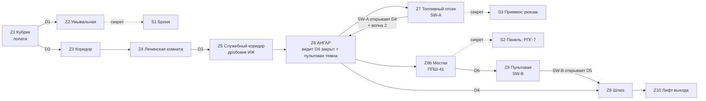

# MAP01 — Космодром «Заря-7»

Проектный документ. Владелец: `level-designer`. Статус: **предложен, ожидает
одобрения CEO. Геометрия не строится, пока CEO не одобрит этот документ**
(F3). Английский оригинал (канонический): `docs/levels/MAP01-zarya-7.md`.

Вводные данные, которым подчиняется этот документ и которые он не повторяет:
`docs/PRD.md` (D1–D15), `docs/product/LORE.md` (MAP01 = космодром, казармы и
ангар, обучение оружию, вторжение только началось), `docs/engine/MOD-SPEC.md`
(UDMF `zdoom`, карта генерируется `src/maps/MAP01/map.py`),
`docs/art/TEXTURE-INDEX.md` (единственные существующие текстуры) и
`docs/art/ART-BIBLE.md` §4 (предложение по композиции и свету).

## 1. Синопсис

Тревога застаёт сержанта Виланову в казармах секретного космодрома: он
вооружается на ходу, пересекает базу, которую его товарищи уже потеряли, и
прорывается через ангар к служебному лифту, спускающемуся в тоннели метро.

## 2. Что должна делать карта

| Задача | Как это реализует планировка |
|---|---|
| Обучить оружию (лор: MAP01 = обучающий уровень) | одно оружие на акт, за каждым следует враг, который является ответом на него: лопата → одиночный пёс; дробовик ИЖ → рекруты на близкой дистанции; ППШ-41 → вторая волна в ангаре. РПГ-7 — секретная награда, а не обязательное условие. |
| Обучить словарю базы | красная полоса (`SDCONC2`) — это **маршрут**; жёлтая полоса (`SDFLR1`) — это **трафик ангара**, и она указывает на выход и на один секрет. Обе объясняются за первые 90 секунд и никогда не лгут. |
| «Вторжение только началось» | база цела, освещена и чиста (ART-BIBLE §1: грязь — это *использование*, а не разруха). Врагов немного, в начале они разрозненны, скоплены только в ангаре, где они приземлились. |
| Финал в метро | выход — это служебный лифт, идущий **вниз**, с самым тёмным значением освещённости на карте (96): MAP02 уже угадывается по настроению. |

Целевая длительность: 5–8 мин при первом прохождении на сложности 3; ~3 мин
при повторном.

## 3. План

Схема, не в масштабе. Север наверху, x растёт на восток, y растёт на север.

```
                                                                 N
                                      +---------------+      +-----------------+
                                      |   Z7 FUEL BAY |      | Z9 CONTROL BOOTH|
                      +---------+     |    [SW-A]     |      |  [SW-B]  window |
                      | S3 SUMP |=====|  ~~~ drums ~~~|      +--------+--------+
                      | (secret)| up  +-------+-------+               | D6
                      +---------+             |                       |
    +-----------------+--------------------------------------------------------+
    |                 |                 Z6  H A N G A R               [catwalk] |
    |                 |                                          ===============|
    |                 |            #### transporter cradle ####        /\ stairs|
    |                 |                                                         |
    |   Z5 SERVICE  ->| stair down                                              |
    |   CORRIDOR      |  - - - - yellow lane (SDFLR1) - - - - - - - - -> [D4]===[airlock]===[D5]-> Z10 EXIT LIFT
    |  [guard post:   |                                                         |
    |   IZh shotgun]  +--------------------------------------------------------+
    +--------+--------+
             |
    +--------+--------+
    | Z4 LENINSKAYA   |   political room + mess: mural wall (SDPOSTR2),
    |    KOMNATA      |   emblem plaque (SDSTAR1, if approved)
    +--------+--------+
             |
       Z3 CORRIDOR  (red stripe starts here)
             |
    +--------+--------+       +-----------+     +--------+
    |  Z1 DORM        |---D1--| Z2 WASHRM |-----| S1     |
    |  [player start] |       |           | (secret panel)
    |  [shovel rack]  |       +-----------+     +--------+
    +-----------------+
```

Рабочие координаты (сетка 64; при постройке они могут сместиться на одну
ячейку, но отношения между ними — нет):

| # | Зона | x | y | пол | потолок | освещённость сектора |
|---|---|---|---|---|---|---|
| Z1 | Кубрик (старт) | 0…640 | 0…448 | 0 | 128 | 144 |
| Z2 | Умывальная | 640…896 | 0…192 | 0 | 96 | 112 |
| S1 | Шкафчики (секрет 1) | 896…1024 | 32…160 | 0 | 96 | 96 |
| Z3 | Коридор казармы | 192…320 | 448…960 | 0 | 96 | 120 / 144 пятна |
| Z4 | Ленинская комната | 0…640 | 960…1408 | 0 | 192 | 160 / 176 у мурала |
| Z5 | Служебный коридор | 640…1152 | 1088…1216 | 0 | 112 | 112 / 144 пятна / 96–144 мерцание |
| Z5b | Пост охраны | 896…1024 | 1216…1344 | 8 | 112 | 128 |
| Z6 | Ангар | 1152…2688 | 320…1600 | −32 | 288 | 176 (192 под лампами, 144 в тени отсека) |
| Z6a | Люлька транспортёра (проходимая) | 1600…2240 | 832…1216 | 32 | 288 | 176 |
| Z6b | Мостки (+ полоса парапета) | 1280…2560 | 1440…1600 | 96 / 128 | 288 | 160 |
| Z7 | Топливный отсек | 1152…1600 | 1600…1920 | −32 | 160 | 112 / 160 у SW-A |
| S3 | Топливный приямок (секрет 3) | 896…1152 | 1664…1856 | −96 | 0 | 96 |
| Z9 | Пультовая | 2560…2816 | 1600…1856 | 96 | 224 | 144 |
| Z8 | Шлюз | 2688…2944 | 544…800 | −32 | 96 | 128 |
| Z10 | Зал лифта выхода | 2944…3264 | 480…864 | −32 → 0 | 224 | 96 / 144 на выходном рычаге |

Площадь карты ≈ 3264 × 2048 юнитов. Каждая высота кратна 16; ни одна ступень
пола не выше 24, если её не несёт лестница.

## 4. Прогрессия и гейты



**Один гейт, два шага, оба обозначены.**

1. Игрок входит в ангар на уровне пола и видит вдоль жёлтой полосы
   **гермодверь D4**, закрытую, обрамлённую красной полосой и погашенным
   индикатором. Единственный другой проём с красной полосой на уровне пола —
   топливный отсек на северо-западе. Маршрут считывается, а не объясняется.
2. **SW-A** (топливный отсек) открывает D4 навсегда, зажигает индикатор,
   зажигает окно пультовой в дальнем конце ангара и открывает комнаты-ловушки
   второй волны. Теперь у игрока есть освещённая цель, которую он раньше не
   замечал.
3. За D4 находится **шлюз** глубиной 256, внутренняя дверь которого **D5**
   обесточена. Освещённое окно пультовой — это ответ; рядом с ним лестница на
   мостки, а по пути лежит ППШ-41.
4. **SW-B** (пультовая) открывает D5 навсегда. Выход через шлюз.

### Ключи и двери

**В MAP01 нет ключей.** `docs/product/LORE.md` отдаёт первый ключ эпизода
MAP02, да и сами MAP01/E1M1 оригинального Doom без ключей: первая карта учит
стрельбе и чтению пространства, а не инвентарю. *Грамматика* ключей («каждый
ключ показывает свою дверь прежде, чем ты её найдёшь») всё равно соблюдается,
только перенесена на рычаги: запертый объект (D4, затем D5) всегда виден
**до** рычага, который его открывает, а эффект рычага виден с того места, где
его дёргают.

> **Нужно решение CEO (в одну строку):** подтвердить MAP01 без ключей. Если
> вы хотите здесь ключ-карту, место для неё — пост охраны (Z5b): жёлтая карта
> на столе убитого охранника, её дверь заменяет D4, видна от входа в ангар.
> На v0 это изменение на 20 минут, не позже.

| Id | Где | Тип | Special (подтвердить, §9) | Может ли запереть игрока? |
|---|---|---|---|---|
| D1 | Кубрик → умывальная | ручная дверь, с обеих сторон | `Door_Raise`, повторяемая | нет |
| D2 | Кубрик → коридор | ручная дверь, с обеих сторон | `Door_Raise`, повторяемая | нет |
| D3 | Комната → служебный коридор | ручная дверь, с обеих сторон | `Door_Raise`, повторяемая | нет |
| D4 | Ангар → шлюз (ширина 256, две створки) | дистанционная, открывается навсегда | `Door_Open` tag 10, рычагом SW-A | нет: открывается и остаётся открытой |
| D5 | Шлюз → выход (ширина 128) | дистанционная, открывается навсегда | `Door_Open` tag 11, рычагом SW-B | нет |
| D6 | Мостки → пультовая | ручная дверь, с обеих сторон | `Door_Raise`, повторяемая | нет |
| SW-A | Топливный отсек, освещённая ниша | рычаг на стене, **повторяемый** | `Door_Open` 10 + `Door_Open` 20 + `Light_ChangeToValue` 30 | нет |
| SW-B | Пультовая | рычаг на стене, **повторяемый** | `Door_Open` 11 | нет |
| EXIT | Зал лифта, восточная стена | рычаг на стене | `Exit_Normal` | — |

Правила, исключающие целые классы софтлоков (мёртвых блокировок), применены
везде:

- **Ни одна дверь никогда не закрывается за игроком.** Засада в топливном
  отсеке — это открывающиеся стеновые панели, а не закрывающаяся дверь.
- **На критическом пути нет лифтов.** Высота меняется только лестницами (в
  ангар ведёт лестница на 3 ступени, на мостки — на 8 ступеней), поэтому
  ничто не может остаться в неправильном положении.
- **Каждый рычаг — `repeatspecial`**, а каждая дистанционная дверь —
  `Door_Open` (открыть и остаться), поэтому неудачное по времени или
  повторное использование никогда не может «израсходовать» гейт.
- **Нет перепада высоты больше 24 юнитов без обратного пути в той же зоне.**
  Оба намеренных изменения высоты (ангар −32, приямок −96) обслужены
  двусторонними лестницами.
- Комнаты-ловушки с монстрами открываются и остаются открытыми; игрок,
  который в неё зашёл, может из неё выйти.

## 5. Кривая интенсивности

```
  high |                                              ####  <- climax: wave 2
       |                                   ####       ####     across the
 press |                        ####       ####       ####     hangar with
  ure  |             ####       ####  ##   ####  ##   ####     the PPSh
       |   ##   ##   ####  ##   ####  ##   ####  ##   ####  ##
   low |   ##   ##   ####  ##   ####  ##   ####  ##   ####  ##   #
       +------------------------------------------------------------>
         Z1    Z3    Z4    Z5    Z6    Z7    Z6b   Z9    Z6    Z8/Z10
        dorm  corr  komn  corr  hangar fuel  cat-  booth hangar exit
                               first   bay   walk        wave2
                              contact (trap)
         0:00                                                    ~7:00
```

| Бит | Пространство | Ощущение | Вводимая механика |
|---|---|---|---|
| 1 | Кубрик, умывальная | тревога, смятение, три тела и два врага | движение, лопата, первая секретная панель |
| 2 | Коридор, комната | база теперь их; первая открытая комната | перекрёстный огонь в комнате с укрытиями; красная полоса |
| 3 | Служебный коридор | напряжение, мерцающий свет, угол | ИЖ и стрельба на близкой дистанции |
| 4 | Ангар, первый контакт | карта раскрывается: высота, лампы, дальность | длинные линии обзора, люлька как укрытие, бочки |
| 5 | Топливный отсек | всплеск: засада из трёх панелей | бой спиной к дверному проёму |
| 6 | Мостки, пультовая | облегчение и награда, вид сверху на то, что грядёт | ППШ-41, стрельба вниз |
| 7 | Ангар, волна 2 | **кульминация**: комната, которую ты уже знаешь, заполненная | использование всей арены, которую ты выучил в бите 4 |
| 8 | Шлюз, лифт | разрядка, один-два отставших врага, темнота | выход |

## 6. Текстуры по зонам

Только текстуры, **утверждённые** в `docs/art/TEXTURE-INDEX.md`, несут
нагрузку. Всё условное указано вместе со своим запасным вариантом, поэтому
карта собирается и выходит независимо от решения CEO.

| Зона | Стены | Пол | Потолок | Свет | Примечание |
|---|---|---|---|---|---|
| Z1 Кубрик | `SDCONC1`; `SDSTEL1` на рамах коек и стойке с лопатами | `SDFLR3` | `SDCEIL2`, один `SDCEIL1` | 144 | чистая, освещённая, обычная комната: «до» для игрока |
| Z2 Умывальная | `SDCONC1` | `SDFLR3` | `SDCEIL2` | 112 | темнее кубрика, чтобы читался шов S1 |
| S1 Шкафчики | `SDSTEL1` | `SDFLR2` | `SDCEIL2` | 96 | |
| Z3 Коридор казармы | `SDCONC1` + **`SDCONC2`** на уровне глаз на правой стене, непрерывно | `SDFLR3` | `SDCEIL2`, `SDCEIL1` через каждые 256 | 120, пятна 144 | **здесь рождается красная полоса**: она будет вести игрока всю карту |
| Z4 Ленинская комната | `SDCONC1`; на северной стене мурал `SDPOSTR2` (128×128, один раз, на уровне глаз, на бетоне согласно ART-BIBLE §4); табличка `SDSTAR1` на восточном пилоне *если утверждена*, иначе `SDCONC1` | `SDFLR3` | `SDCEIL2` + 2 `SDCEIL1` | 160, 176 у мурала | единственная «красивая» комната; мурал освещён ярче, чем всё вокруг, чтобы читаться как смысл, а не украшение |
| Z5 Служебный коридор | `SDCONC1` + полоса **`SDCONC2`** продолжается | `SDFLR2` | `SDCEIL2`, 2 `SDCEIL1` | 112, пятна 144, один мерцающий участок 96–144 | |
| Z5b Пост охраны | `SDSTEL1` | `SDFLR2` | `SDCEIL2` | 128 | сталь = функция: здесь находится оружие |
| Z6 Ангар | `SDCONC1` выше 128, `SDSTEL1` ниже 128 (цоколь из зелёных панелей) на всех четырёх стенах; **`SDCONC2`** обрамляет D4 и проём топливного отсека | `SDFLR2`, с полосой `SDFLR1` шириной 64 от входной лестницы до D4 и второй полосой в западный отсек (та, что указывает на S3) | `SDCEIL2`, `SDCEIL1` сеткой 6 × 2 ламповых панелей | 176; 192 прямо под каждой лампой; 144 в тенях отсека и под мостками | соблюдается правило ≥ 70 % бетона (ART-BIBLE §4): сталь только до 128 из 320 стены |
| Z6a Люлька | `SDSTEL1` | `SDFLR2` | — | 176 | |
| Z6b Мостки | `SDSTEL1`, парапет `SDSTEL1` | `SDFLR2` | `SDCEIL2` | 160 | |
| Z7 Топливный отсек | `SDSTEL1` до 128, выше `SDCONC1` | `SDFLR2` | `SDCEIL2`, 1 `SDCEIL1` над SW-A | 112, 160 у SW-A | рычаг — самый яркий предмет в комнате |
| S3 Приямок | `SDCONC1` | `SDFLR2` | `SDCEIL2` | 96 | |
| Z9 Пультовая | `SDSTEL1` | `SDFLR3` | `SDCEIL1` | 144 (96 до нажатия SW-A) | её окно — маяк, зажигаемый SW-A |
| Z8 Шлюз | `SDSTEL1`, створки `SDDOOR1` | `SDFLR2` | `SDCEIL2` | 128 | |
| Z10 Лифт выхода | `SDCONC1`, цоколь `SDSTEL1` | `SDFLR2` | `SDCEIL2` | 96, 144 на рычаге | самая тёмная комната карты: здесь начинается MAP02 |

Политика освещения, которую я фиксирую как владелец этого значения (ART-BIBLE
§4 предлагает 112–144 для коридоров / 128–160 для казарм / 160–192 для
ангара; я сохраняю диапазоны и закрепляю конкретные числа):

- Допустимый диапазон **96 … 192**. 96 — только в S1, S3 и Z10; 192 — только
  под лампами ангара. Нигде не абсолютная темнота: на базе всё ещё есть
  электричество.
- Соседние секторы, которые должны читаться как разные пространства,
  отличаются на **≥ 16**. Ламповый сектор ровно на +16 ярче своей комнаты.
- Один флэт `SDCEIL1` = один ламповый сектор 64×64 на +16 (ART-BIBLE §4).
- Карта становится *светлее* по направлению к ангару, а затем *темнее* к
  выходу: кривая освещения следует кривой истории.

Текстурные соглашения для постройки:

- Каждая дверная ниша — **128 шириной × 128 высотой**, чтобы `SDDOOR1`
  (128×128) укладывалась ровно один раз. Там, где коридор высотой 96, сектор
  ниши локально поднимается до 128. D4 шириной 256 = две створки, каждая по
  одному `SDDOOR1` (см. §10).
- Стены по умолчанию выровнены по верху; в секторах не 128 высотой сайддефный
  `offsety` задаётся в проходе v1, чтобы бетонный стык приходился на пол.
- Жёлтая линия `SDFLR1` укладывается **полосами** (трафик ангара, маршрут к
  D4, указатель на S3), никогда как сплошное покрытие пола (ART-BIBLE §4).

## 7. Секреты

Три штуки, ни один не обязателен, каждый — *награда за внимательное чтение
комнаты*, у каждого есть двусторонний выход.

| # | Где | Подсказка, которую может прочитать игрок | Награда | Открывается |
|---|---|---|---|---|
| S1 | Панель шкафчика в умывальной (Z2) | одна панель `SDSTEL1` имеет видимый шов и находится в секторе темнее, чем соседние | зелёная броня, 2 аптечки | нажатие (`Door_Open`, остаётся открытой) |
| S2 | Шатающаяся панель мостков за пультовой (Z6b) | с пола ангара видна освещённая щель под мостками, которой там не должно быть | **РПГ-7** + 1 коробка ракет + схема базы (карта на компьютере) | нажатие |
| S3 | Топливный приямок под стопкой бочек (Z7) | вторая жёлтая полоса в западном отсеке ангара упирается в стену топливного отсека и обрывается — она указывает на бочки | рюкзак, 1 коробка патронов для дробовика, 2 аптечки | нажатие |

Все три сектора несут флаг секрета; все три достижимы на любой сложности; ни
один не стоит здоровья.

## 8. Враги и ресурсы

**Своего пока ничего не существует (F5).** Карта населена акторами Freedoom
как заглушками, и у каждого из них есть объявленный преемник. Позиции
выбраны исходя из поведения *преемника*, поэтому F5 — это замена DoomEdNum'ов,
а не редизайн.

| Заглушка (Freedoom / IWAD) | DoomEdNum | Станет (F5) | Почему находится именно здесь |
|---|---|---|---|---|
| Zombieman | 3004 | **рекрут Четвёртого рейха** (болтовая винтовка) | основная масса; урон хитсканом по чуть-чуть, используется по одному-двое в начале, шеренгами на мостках позже |
| Shotgun guy | 9 | **боец Легиона Свободы** | карает за открытое пространство; охраняет проходы и люльку |
| Imp | 3001 | **гибридный штурмовик** | первый враг, переживающий один заряд дробовика; ангар и топливный отсек |
| Demon | 3002 | **пёс Рейха** | коридоры и засада: вынуждает двигаться, отвечает на лопату |
| Chaingun guy | 65 | **тяжёлый стрелок Легиона** | только на сложности 4, один, в окне пультовой: причина отнестись к мосткам серьёзно |
| Explosive barrel | 2035 | топливная бочка (свой спрайт позже) | отсеки ангара и топливный отсек; часть арены, а не декорация |
| Chainsaw | 2005 | **сапёрная лопатка** (слот 1) | стойка в кубрике |
| Shotgun | 2001 | **двуствольный ИЖ** (слот 3) | пост охраны, на критическом пути |
| Chaingun | 2002 | **ППШ-41** (слот 4) | мостки, по пути к SW-B |
| Rocket launcher | 2003 | **РПГ-7** (слот 5) | только секрет S2 |
| Clip / box, shells / box, rockets | 2007/2048, 2008/2049, 2010/2046 | обойма ТТ, патроны для ИЖ, снаряды РПГ | см. бюджет |
| Stimpack / medikit / health bonus | 2011 / 2012 / 2014 | перевязка / аптечка / ампула | |
| Green armour / armour bonus | 2018 / 2015 | бронежилет / пластина | |
| Backpack | 8 | подсумок с патронами | секрет S3 |
| Floor lamp | 2028 | напольная лампа | Z4, Z10 |

Намеренно не используется в MAP01: супердробовик (в слоте 3 только одно
оружие, ИЖ), слоты плазмы/BFG (огнемёт и «Катюша» появятся позже в эпизоде),
какодемоны/бароны (лор: вторжение только началось), ключи.

### Враги по сложности

Сложности Doom: 1–2 делят флаги вещей «лёгкая», 3 — средняя, 4–5 делят
«тяжёлая». Каждый монстр размещается с явными флагами `skill1…skill5`
(`sdbuild.udmf` по умолчанию ставит все пять в true, поэтому каждое
добавление нужно задавать осознанно).

| Бит / зона | Сложность 2 (HNTR) | Сложность 3 (HMP) | Сложность 4 (UV) |
|---|---|---|---|
| Z1 Кубрик | 2 рекрута | 3 рекрута | 3 рекрута + 1 боец |
| Z2 Умывальная | — | 1 пёс | 1 пёс |
| Z3 Коридор | 2 рекрута | 2 рекрута + 1 пёс | 3 рекрута + 1 пёс |
| Z4 Комната | 2 рекрута + 1 боец | 3 рекрута + 1 боец | 3 рекрута + 2 бойца + 1 штурмовик |
| Z5 Коридор + пост охраны | 1 рекрут + 1 боец | 2 рекрута + 1 боец | 2 рекрута + 2 бойца |
| Z6 Ангар, первый контакт | 3 рекрута + 1 боец + 1 штурмовик | 4 рекрута + 2 бойца + 2 штурмовика | 5 рекрутов + 3 бойца + 3 штурмовика |
| Z7 Засада в топливном отсеке | 2 штурмовика + 1 пёс | 2 штурмовика + 2 пса | 3 штурмовика + 2 пса + 1 боец |
| Z6 Ангар, волна 2 | 2 рекрута + 1 боец | 3 рекрута + 2 бойца | 3 рекрута + 2 бойца + 1 штурмовик + 1 тяжёлый стрелок |
| Z8/Z10 Выход | 1 рекрут | 1 рекрут + 1 боец | 2 рекрута + 1 боец |
| **Всего** | **21** | **33** | **46** |

Строго возрастает (21 < 33 < 46), что G3 проверяет механически.

### Ресурсы по сложности

| Предмет | Сложность 2 | Сложность 3 | Сложность 4 | Где |
|---|---|---|---|---|
| Лопата (chainsaw) | 1 | 1 | 1 | стойка Z1 |
| ИЖ (shotgun) | 1 | 1 | 1 | пост охраны Z5b |
| ППШ (chaingun) | 1 | 1 | 1 | мостки Z6b |
| РПГ-7 + 1 коробка ракет | секрет | секрет | секрет | S2 |
| Патроны ×4 | 8 | 6 | 5 | разбросаны Z5 → Z10 |
| Коробка патронов (20) | 2 | 2 | 2 | Z6, S3 |
| Обойм (10) | 6 | 5 | 4 | разбросаны от Z1 |
| Коробка пуль (50) | 2 | 2 | 3 | Z6b, Z6, Z7 |
| Перевязка | 6 | 4 | 3 | |
| Аптечка | 4 | 3 | 2 | Z5, Z7, S3 |
| Бонус здоровья | 10 | 10 | 10 | добивка по углам |
| Зелёная броня | 1 (S1) | 1 (S1) | 1 (S1) | S1 |
| Бонус брони | 8 | 8 | 6 | |
| Рюкзак | секрет | секрет | секрет | S3 |

Принцип: **монстров со сложностью становится больше, расходников — меньше,
доступность оружия не меняется никогда.** Игрок на сложности 4, который не
находит ни одного секрета, всё равно должен быть способен закончить карту —
это измеримый критерий G3 (§11, G3-5 — сам прогон, G3-8 — бюджет
боеприпасов), а не надежда.

## 9. Используемые элементы движка (подтверждает `mod-engineer`)

Номера ZDoom action-special и lock/sector specials ниже **НЕ ПРОВЕРЕНЫ** мной
в движке; это то, что я собираюсь использовать. Мне нужно, чтобы
`mod-engineer` подтвердил их в `MOD-SPEC.md` (или исправил) до постройки v0 —
это единственная поверхность движка, которую затрагивает эта карта.

| Нужно | Планируется | Статус |
|---|---|---|
| Ручная дверь | `Door_Raise` (12), tag 0, `playeruse`, `repeatspecial` | НЕ ПРОВЕРЕНО |
| Дистанционная, открыть-и-остаться | `Door_Open` (11), tags 10/11/20/21 | НЕ ПРОВЕРЕНО |
| Рычаг на стене | те же спешлы с `playeruse` + `repeatspecial` на односторонней линии | НЕ ПРОВЕРЕНО |
| Выход с уровня | `Exit_Normal` (243) на линии рычага | НЕ ПРОВЕРЕНО |
| Свет пультовой включается | `Light_ChangeToValue` (110) tag 30, arg 144 | НЕ ПРОВЕРЕНО |
| Мерцающий участок коридора | sector special (Doom 1 «random off» или ZDoom `Light_Flicker`) | НЕ ПРОВЕРЕНО |
| Секретный сектор | sector `special = 1024`, либо поле UDMF `secret`, если GZDoom его принимает | НЕ ПРОВЕРЕНО |
| Теги секторов / линий | поле UDMF `id` на sector и linedef | НЕ ПРОВЕРЕНО |

План тегов (чтобы ничего не столкнулось позже): **10** створки D4 · **11**
D5 · **20** комнаты-ловушки второй волны в ангаре (6 секторов, один
`Door_Open` открывает все) · **21** панели засады в топливном отсеке (3
сектора) · **30** сектор света пультовой · **0** каждая ручная дверь. 1–9 и
12–19 остаются свободными для детализации v2.

**Текстур рычагов не существует в утверждённом наборе** — см. §10, запрос A3.

## 10. Что мне нужно, прежде чем я смогу строить

### От `mod-engineer` (блокирующее)

- **M1 — утверждённые текстуры не попадают в PK3.**
  `assets/textures/soviet_base/` и `assets/flats/soviet_base/` существуют, но
  `tools/build.py` упаковывает только `src/`, а `src/textures/` или
  `src/flats/` не существует. Сегодня карта, называющая `SDCONC1`, выдала бы
  `Unknown texture`. Подключите `assets/` к сборке (или определите шаг
  копирования) и зафиксируйте это в MOD-SPEC §2/§3. **v1 блокирован этим; v0
  — нет** (v0 может работать на текстурах IWAD).
- **M2 — в `sdbuild.udmf` не хватает того, что нужно этой карте.** Сегодня у
  `Sector` нет `id`/`special`, у `Linedef` нет `special`/`arg0…arg4` и полей
  флагов, и нет хелпера для двусторонних линий или прямоугольников. Всё это
  достижимо через `extra={}`, но карта на 60 секторов, написанная так,
  нерецензируема. Пожалуйста, добавьте: `Sector.id`, `Sector.special`,
  сквозной проход в стиле `Sector.xpanningfloor` (уже доступен через
  `extra`), `Linedef.special` + `arg0…arg4`, флаги `twosided`, `playeruse`,
  `playercross`, `repeatspecial`, `monsteractivate`, `blockmonsters`,
  `dontpegtop`, `dontpegbottom`, `secret`, и `TextMap.add_room_rect()`,
  который выдаёт прямоугольный сектор с четырьмя правильно закрученными
  линиями.
- **M3 — у выхода нет куда вести.** MAPINFO говорит `next = "MAP01"`, а MAP02
  не существует. Решите, что делает `Exit_Normal` в v1 (петля на MAP01 или
  кластер конца эпизода с текстом), и внесите это в MAPINFO; мне нужно это
  знать прежде, чем я размещу выходной рычаг.
- **M4 — название карты и пар-тайм.** `SD_MAP01_NAME` до сих пор «Test
  Range». Предложение: EN «Zarya-7 Cosmodrome», RU «Космодром "Заря-7"».
  Пар-тайм 210 с.
- **M5 — подтвердить §9** (specials, tags, секретный сектор) и добавить
  акторов Freedoom из §8 в MOD-SPEC §5, где сегодня перечислены только четыре
  названия текстур. Монстры-заглушки, оружие и предметы — это тоже отсылки к
  IWAD.

### От `art-director` (одно блокирующее, остальное формирует v2)

- **A1 — `SDCONC2` должна попасть в PK3, чтобы её можно было оценить.** Её
  статус — «ожидает проверки в карте», а эта карта и есть проверка: полоса —
  это язык навигации Z3, Z5, рамки D4 и проёма топливного отсека. Её нельзя
  оценить в карте, пока она лежит в `work/` вне `assets/`. Мне нужен путь,
  который включает её в сборку со статусом «ожидает» (art-director +
  mod-engineer + PM должны согласовать механизм). **Запасной вариант при
  отказе:** маршрут вместо этого обозначается пилястрами `SDSTEL1`, карта
  всё равно работает, а CEO теряет возможность оценить полосу там, где это
  важно.
- **A2 — `SDSTAR1`.** Восточный пилон Z4 и рамка D4 в ангаре зарезервированы
  под табличку. Если v5 не будет утверждена к моменту постройки v1, эти
  поверхности останутся `SDCONC1`, а табличка добавится позже; от неё ничего
  структурного не зависит.
- **A3 — нет текстуры рычага (запрос в партию 2).** На карте два рычага и
  один выходной рычаг, а в утверждённом наборе нет ничего, что читалось бы
  как рычаг. Мне нужны либо `SDSWT1`/`SDSWT2` (пара выкл/вкл, 64×128 или
  32×64, зелёный стальной корпус с красным рычажком, плюс
  `SWITCHES`/`ANIMDEFS` от `mod-engineer`), **либо** разрешение сослаться на
  текстуру рычага из IWAD как на заглушку, объявленную в MOD-SPEC §5. Без
  одного из двух у v0 и v1 нечитаемые рычаги.
- **A4 — `SDDOOR2`, вторая створка двери (партия 2, желательно, но не
  критично).** D4 — это гермодверь шириной 256, собранная из двух створок
  `SDDOOR1`, поэтому запорное колесо и трафаретная «7» появляются дважды
  рядом. Это читается как двойная дверь, что правдоподобно, но зеркальная
  или простая половинная створка читалась бы лучше. Решить после того, как
  CEO увидит это в v1.
- **A5 — текстура ящика / шкафчика (уже кандидат в партию 2).** Кубрику,
  посту охраны и отсекам ангара нужна грань ящика; сегодня это просто ящики
  из `SDSTEL1`.
- **A6 — нет экстерьера.** Нет утверждённой текстуры экстерьера или неба,
  поэтому MAP01 v1 целиком внутренняя, а ворота стартовой площадки в ангаре
  остаются закрытыми. Если CEO хочет полосу ночного неба над ангаром,
  `SKY1` уже объявлена в MOD-SPEC §5, и я могу открыть щель в крыше в v2 —
  только скажите.

### Сознательно не запрошено

Звук (пока нет `SNDINFO`; двери и рычаги используют дефолты движка), музыка
(`music = ""`), собственный HUD, скрипты ACS (дизайн намеренно построен на
простых linedef specials, чтобы ни один скрипт не мог сломаться).

## 11. Гейт G3 — измеримое определение

`docs/ROADMAP.md` формулирует G3 как «карта проходима на сложностях 2, 3 и 4
без ошибок в логе и без софтлоков; вердикт CEO «on point»» (map finishable on
skills 2, 3 and 4 with zero log errors and zero softlocks; CEO verdict 'on
point'). Ниже то, что фактически запускает `qa-engineer`. **Все пункты
G3-1…G3-8 должны быть зелёными; G3-9 — за CEO.**

| # | Критерий | Как измеряется | Прохождение |
|---|---|---|---|
| G3-1 | Карта собирается и упаковывается | `python3 tools/build.py` завершается с кодом 0; `maps/MAP01.wad` содержит `MAP01`, `TEXTMAP`, `ENDMAP` в этом порядке; `python3 -m unittest discover -s tests` зелёный, и число тестов в суите не ниже, чем при последнем закрытии | точно |
| G3-2 | Нулевые ошибки движка | `logs/gzdoom.log` полного прохождения не содержит совпадений ни с одним из: `Script error`, `Unknown texture`, `Unknown flat`, `Missing sprite`, `Unknown line special`, `Bad sector`, `Texture .* not found`, `is not a valid` | 0 совпадений |
| G3-3 | Каждая текстура легитимна | статическая проверка по `TEXTMAP`: каждое значение `texture*` либо `approved` в `TEXTURE-INDEX.md`, либо явно «ожидает проверки в карте» (только `SDCONC2`, и только если A1 был предоставлен), либо указано в `MOD-SPEC.md` §5 | 0 неизвестных названий |
| G3-4 | Проходима на 2, 3 и 4 | три записанных прохождения от старта игрока до выходного рычага; доказательство: скриншот интермиссии + лог на каждую сложность, в `docs/qa/evidence/` | 3/3 |
| G3-5 | Проходима без монстров и без секретов | один прогон с `-nomonsters` и один прогон без единого секрета — оба доходят до выхода | 2/2 |
| G3-6 | Без софтлока, статически | проверка достижимости по `TEXTMAP`: каждый сектор достижим от старта игрока, и из каждого сектора есть путь до выхода, использующий только двери, которые `repeatspecial` либо уже постоянно открыты; нет односторонних перепадов > 24 юнитов | 0 нарушений |
| G3-7 | Без софтлока, враждебно | враждебный прогон QA на сложности 4: дёрнуть каждый рычаг два раза, повторно войти в каждую дверь, зайти в каждую комнату-ловушку и выйти обратно, зайти в каждый секрет и выйти, спрыгнуть с мостков и с люльки со всех четырёх сторон, и пройти карту в обратном порядке начиная с ангара | «не удалось застрять» |
| G3-8 | Здравость вещей и ресурсов | скрипт по `TEXTMAP`: ни одной вещи со всеми пятью флагами сложности false; число монстров строго 2 < 3 < 4 и совпадает с §8 ±2; 3 секретных сектора; размещённые патроны на сложности 4 ≥ 1,35 × патронов, нужных, чтобы убить каждого монстра сложности 4 предназначенным оружием (рекрут/боец 1 патрон дробовика, штурмовик 2, пёс 3, стрелок 4), не считая секретных предметов | всё верно |
| G3-9 | Вердикт CEO | CEO играет или смотрит v3 и говорит «on point» (или нет), **а также** даёт вердикт по `SDCONC2`, увиденной в Z3/Z5/Z6, что закрывает её строку в `TEXTURE-INDEX.md` | явное «да» |

Провал любого из G3-1…G3-8 — это баг с номером, а не повод для дискуссии.

## 12. План версий

Каждая версия загружается в GZDoom, проходима от старта до выхода и
скриншотится в `docs/levels/shots/`.

| Версия | Содержание | Готово, когда |
|---|---|---|
| **v0 — серая** | полный план этажа: каждый сектор, каждая дверь, оба рычага, выход, правильные высоты и лестницы. Одна текстура стен и одна пара пол/потолок повсюду (`SDCONC1`/`SDFLR2`/`SDCEIL2`, либо IWAD `STARTAN2`/`FLOOR4_8`/`CEIL3_5`, если M1 ещё не решён), плоский свет 160, без врагов, без предметов, 2 маркера. | можно пройти старт → выход; нет HOM, нет застревающей геометрии; G3-1, G3-2, G3-6 проходят |
| **v1 — текстурированная** | §6 применён зона за зоной, проход выравнивания (дверные ниши, `offsety`, непрерывность полос), размещён мурал `SDPOSTR2`, D4/D5/D6 как `SDDOOR1`, маршрут `SDCONC2`, если A1 предоставлен. | G3-3 проходит; CEO может оценить `SDCONC2` по скриншотам |
| **v2 — свет и детали** | таблица света §6, ламповые секторы, мерцающий коридор, свет пультовой, который включает SW-A, парапеты, пилястры, ступени, бочки, напольные лампы, три секрета построены и отмечены флагом. | карта читается без компаса: игрок, попавший сюда впервые, находит ангар и D4 без подсказок |
| **v3 — баланс** | §8 размещён с флагами по сложности, бюджет патронов и здоровья, обе волны и засада выверены по времени, плейтесты на 2/3/4 с заметками. | все G3-1…G3-8 зелёные; готова к G3-9 от CEO |

Запуск любой версии, когда она уже в сборке:

```sh
python3 tools/build.py
MAP=MAP01 SKILL=3 tools/run.sh
# or, directly:
/Applications/GZDoom.app/Contents/MacOS/gzdoom -iwad iwads/freedoom2.wad \
  -file dist/sovietdoom.pk3 +map MAP01 -skill 3
```

## 13. Открытые вопросы для CEO

1. **MAP01 без ключей** (§4): подтвердить, либо запросить жёлтую карту на
   посту охраны. Рекомендация: без ключей, поскольку лор отдаёт первый ключ
   MAP02.
2. **`SDCONC2` в сборке** (A1): полоса — это язык навигации этой карты; её
   нужно включить в PK3, чтобы оценить. Если вы предпочитаете вообще не
   включать неутверждённую текстуру, скажите это, и я использую стальные
   пилястры.
3. **Текстура рычага** (A3): заказать `SDSWT1`/`SDSWT2` в партию 2, либо
   разрешить рычаг из IWAD как заглушку для F3.
4. **Длительность и сложность**: 5–8 минут и 21/33/46 врагов — это
   современный MAP01, длиннее, чем MAP01 Doom II (~2 мин), и короче, чем
   открывающая карта современного мегавада. Скажите, если хотите короче.
5. **Полоса ночного неба** над ангаром в v2 (A6): да или нет.
