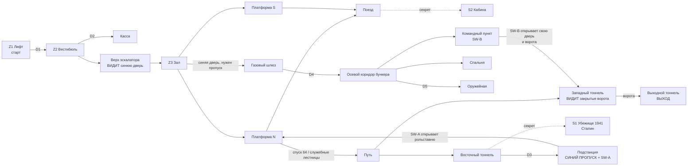

# MAP02 — Метро-бункер

Каноническая версия: `docs/levels/MAP02-metro.md` (английский).

Синхронизировано с оригиналом: 2026-10-27.

> **D62 (2026-10-14): эта карта — MAP02.** Она строилась и документировалась
> как MAP03, пока MAP02 был полигоном (D41); теперь слоты следуют за
> кампанией (MAP01 → MAP02, метро → MAP03, завод «Танкоград»), а полигон —
> ламп `RANGE`. Пути, команды и строки кампании ниже используют новые номера;
> записи о постройке и прохождении (§14–§16) сохраняют «MAP03» там, где
> фиксируют, что было построено и увидено в тот день, а датированные
> свидетельства сохраняют свои имена файлов (`…_map03-v0-walk.*`). Подключение:
> `docs/engine/MOD-SPEC.md` §4.6.

Проектный документ. Владелец: `level-designer`. Статус: **v1 ПОСТРОЕНА
2026-10-14 (§16): синий пропуск обозначен, карта населена; ещё не пройдена.**
v0 (§14) CEO прошёл в тот же день (§15, D58): «me gusta de
momento» («пока нравится»), но пропуск найден не был. Рабочее задание для PM; вердикт
CEO выносится по прохождению карты, а не по чтению этого документа (D28).
Источник: `src/maps/MAP02/map.py`; тесты: `tests/test_map02_metro.py`.
Русское зеркало: этот документ, тот же путь под `docs/ru/`.

> **Пройти её** (PM или CEO; агенты не запускают GZDoom, D26):
> `python3 tools/build.py && SD_ALLOW_ENGINE=1 MAP=MAP02 SKILL=3 tools/run.sh`.
> MAPINFO несёт запись этой карты с прохода v0 в движке
> (`docs/qa/evidence/2026-10-14_1902_F3_map03-v0-walk.md`).

Входы, которым подчиняется этот документ и которые не пересказывает:
`docs/product/LORE.md` (карта метро-бункера: «первый ключ, первые тяжёлые
гибриды», набор текстур «плитка, красный мрамор, мозаики»), `docs/PRD.md`
(D35 — фракции, D41 — полигон, D62 — номера, D42/D47/D48/D56 — текстуры
метро, D55 — плакат Сталина), `docs/engine/BESTIARY.md`,
`docs/art/TEXTURE-INDEX.md` (набор «Метро», шестнадцать одобренных лампов) и
метод и уроки `docs/levels/MAP01-zarya-7.md`.

## 1. Синопсис

Лифт из «Зари-7» опускает сержанта Виланову на глубокую станцию метро, которая
одновременно служит правительственным бункером; Легион Свободы держит
станцию, Четвёртый рейх поднялся по тоннелям и запечатал себя в бункере, а
единственный путь на запад, к Москве, — перегонный тоннель за воротами бункера.

## 2. Место в кампании

| | |
|---|---|
| Идёт после | MAP01 «Заря-7», которая заканчивается служебным лифтом, идущим **вниз**, в самой тёмной комнате (MAP01 §2: «MAP02 уже угадывается по настроению»). MAP02 начинается в низу этого лифта. |
| Её номер | **MAP02 с D62**, как нумерует таблица эпизодов LORE. Строилась как MAP03, пока MAP02 был полигоном (D41); D62 вернул слотам порядок кампании, а полигону дал ламп `RANGE`. |
| Что добавляет | **первый ключ** (LORE), первую карту, где игрок спускается **на пути и в тоннели**, и тяжёлых в числе: Panzermensch на каждой сложности, первый, кого встречает игрок лёгкой сложности. |
| Фракции (D35) | MAP01 была Рейх первым, с Легионом в ангаре; метро **переворачивает это**: Легион держит станцию (вестибюль, зал, поезд), Рейх держит глубины (тоннели, подстанцию, бункер). Штурмовики — гибриды и сражаются за обе стороны. |
| Идёт перед | MAP03, тракторный завод «Танкоград» (D63; «MAP03» из LORE, кульминация эпизода; `docs/levels/MAP03-factory.md`). Её выход — перегонный тоннель на запад, и с D62 он ведёт туда через переходный текст кластера 4. |
| Подключение кампании | **Сделано (D60, D62).** Выход MAP01 ведёт сюда (текст кластера 3); выход этой карты ведёт в MAP03, на завод (текст кластера 4, `SD_MAP02_EXIT_TEXT`), а завод заканчивает эпизод. `docs/engine/MOD-SPEC.md` §4.6; §11 ниже сохраняет шаги в том виде, в каком они были предложены. |

**Нумерация (решено D62):** там, где `docs/engine/BESTIARY.md` говорит
«MAP03» (место первого появления Генерала, `SD_PanzermenschSchwer` на
1000 HP), имеется в виду завод, который с D62 снова MAP03. Эта карта не
размещает ни того, ни другого.

## 3. Что карта должна делать

| Задача | Как её решает планировка |
|---|---|
| Научить ключу | гермодверь видна **первой**, с верха эскалатора, в дальнем конце зала между двух мозаик, освещённая ярче зала; пропуск находят позже, в комнате, в которую попадают, не проходя эту дверь; дверь открывается навсегда (`Door_LockedRaise`, задержка 0). Грамматика Doom: замок раньше ключа, ключ раньше переключателя. |
| Быть метро | эскалатор вниз в зал пилонов (тип московской глубокой станции: центральный зал, арки между мраморными пилонами, платформа с каждой стороны), поезд, стоящий у одной платформы с открытыми дверями, открытый путь у другой, и **тоннели**: игрок должен сойти с платформы на путевое полотно. |
| Быть бункером | за герметичной дверью материалы меняются: сталь и плитка с зелёной панелью вместо мрамора; газовый шлюз, осевой коридор, убежище-спальня, оружейная и командный пункт этажом ниже, консоль которого открывает ворота тоннеля. |
| Закончиться в сторону Москвы | выход — на запад по перегонному тоннелю, за воротами, которые открывает командный пункт. |

Целевая длительность: 8–10 минут при первом прохождении на сложности 3
(MAP01 — 5–8); около 4 при знании карты.

## 4. План

В масштабе, один символ = 64 × 64 единицы, север вверху, x на восток.
Сгенерирован из построенной карты (§14), подписи добавлены. Полы: верхний
уровень **+160** (лифт, вестибюль, касса), станция **0**, уровень путей
**−64** (путь, тоннели, командный пункт, убежище).

```
   y                                                 x 352 ........................................... 3968
 1856                                           11              S1 1941 shelter (secret), Stalin slot on the north wall
 1792                                         111111
 1600                                         111111
 1536                                            1
 1472                                            ?              S1 panel (a concrete patch in the tubbing)
 1408 ETTTTTTGTTTTTTTTTTTTTTTTTTTTTTTTTTTTTTTTTTTTT             west tunnel | open track | east tunnel
 1344 ETTTTTTGTTTTTTTTTTTTTTTTTTTTTTTTTTTTTTTTTTTTT
 1280        KKKQQK  PsssPPPPPPPPPPPPPPPPsssP  DD   kkk         D3 off the east tunnel; k = kassa
 1216        KKKKKK  PPPPPPPPPPPPPPPPPPPPPPPP  ss   kkk
 1152        KKKKKK  PPPPPPPPPPPPPPPPPPPPPPPPXSSS   DDD         X = the shutter, opened by SW-A
 1088        KKKKKK  a  aa  aa  aa  aa  aa  a SSS CCCCCCC       S = substation: the PASS and SW-A
 1024        KKssKK  pHHHHHHHHHHHHHHHHHHHHHHH SSS CC+CCCC
  960  AAA     ss    pHHHHHHHHHHHHHHHHHHHHHHH     CC+CCCC LLLL
  896  AADbbbbbbbDVVBpHHHHHHHHHHHHHHHHHHHHHHHeeeeeCCCCCCCDLLLL  <- start (L), facing west
  832  AADbbbbbbbDVVBpHHHHHHHHHHHHHHHHHHHHHHHeeeeeCCCCCCCDLLLL
  768  AAA   rr      pHHHHHHHHHHHHHHHHHHHHHHH     CC+CCCC LLLL
  704     rrrrrrrr   pHHHHHHHHHHHHHHHHHHHHHHH     CC+CCCC
  640     rrrrrrrr   a  aa  aa  aa  aa  aa  a     CCCCCCC
  576     rrrrrrrr   PPPPPPPPPPPPPPPPPPPPPPPP
  448                PPPPPPPPPPPPPPPPPPPPPPPP
  384                2?tttttttttttttttttttttt                    the train, doors open onto platform S
  320                2?tttttttttttttttttttttt
```

Легенда: `L` лифт (старт) · `D` ручная дверь · `C` вестибюль, `+` турникеты ·
`e` эскалатор · `H` зал, `p` портальная полоса · `B` **синяя гермодверь** · `a`
арки (просветы = мраморные пилоны) · `P` платформы, `s` лестницы · `T` путевое
полотно и тоннели · `G` **ворота** · `E` ниша выхода · `t` поезд, `2` его
западная кабина (S2) · `S` подстанция · `X` рольставня · `V` газовый шлюз · `b`
осевой коридор бункера · `r` убежище-спальня · `A` оружейная · `K` командный
пункт, `Q` его дверь в тоннель · `1` убежище 1941 года (S1) · `?` секретная панель.

| # | Зона | x | y | пол | потолок | свет (v0) |
|---|---|---|---|---|---|---|
| Z1 | Площадка лифта (старт) | 3648…3904 | 768…1024 | 160 | 288 | 128 |
| Z2 | Вестибюль (кассовый зал), линия турникетов | 3136…3584 | 640…1152 | 160 | 288 | 160 |
| Z2k | Касса (билетная) | 3264…3456 | 1216…1344 | 160 | 288 | 144 |
| — | Эскалатор, 10 ступеней по 16 | 2816…3136 | 832…960 | 16…160 | 288 | 144 |
| Z3 | Центральный зал, 5 ламп на оси | 1344…2816 | 704…1088 | 0 | 224 | 160 / 176 |
| Z3p | Портальная полоса перед гермодверью | 1280…1344 | 704…1088 | 0 | 128 | **192** |
| — | Арки, два ряда, по шесть пилонов | 1280…2816 | 640…704, 1088…1152 | 0 | 128 | 144 |
| Z4 | Платформа N (открытый путь), служебные лестницы на обоих концах | 1280…2816 | 1152…1344 | 0 | 160 | 144 |
| Z4s | Платформа S (поезд) | 1280…2816 | 448…640 | 0 | 160 | 144 |
| Z5 | Открытое путевое полотно | 1280…2816 | 1344…1472 | −64 | 160 | 112 |
| Z6 | Поезд: 4 вагона, 2 кабины | 1280…2816 | 320…448 | 0 | 112 | 128 |
| Z7e | Восточный перегонный тоннель | 2816…3200 | 1344…1472 | −64 | 64 | 96 |
| Z8 | Тяговая подстанция (SW-A), лестница от D3 | 2880…3072 | 1024…1312 | −48…0 | 64 / 128 | 128 (v1: 144) |
| Z8b | *v1:* будка дежурного (**пропуск**), две ступени вверх; её окно в восточный конец зала (x 2816…2848) | 2848…2944 | 1024…1088 | 32 | 128 (окно 80) | **192**, синий (§16.1) |
| S1 | Убежище 1941 года, с проходом | 2880…3264 | 1504…1872 | −64 | 64 / 192 | 112 |
| B1 | Газовый шлюз | 1088…1248 | 832…960 | 0 | 128 | 128 |
| B2 | Осевой коридор бункера | 576…1056 | 832…960 | 0 | 128 | 128 |
| B3 | Убежище-спальня | 576…1056 | 512…832 | 0 | 128 | 112 |
| B5 | Оружейная | 384…544 | 768…1024 | 0 | 128 | 112 |
| B4 | Командный пункт (SW-B), 3 ступени вниз | 768…1152 | 960…1312 | −64 | 64 | 128 |
| Z7w | Западный перегонный тоннель, от станции до ворот | 832…1280 | 1344…1472 | −64 | 64 | 96 |
| Z9 | Выходной тоннель и ниша выхода | 352…768 | 1344…1472 | −64 | 64 | 96 / 144 |

Протяжённость 3552 × 1552 единицы; у MAP01 — 3264 × 2048. Каждая высота кратна
16; ни одна ступень не выше 16.

## 5. Прогрессия, двери, переключатели и ключ



**Ключ по LORE: синий пропуск.** Пропуск дежурного по станции (пропуск), который
открывает герметичную дверь бункера. В движке это **синяя ключ-карта** Doom
(DoomEdNum 5, замок 2 "Blue key card" в собственном `lockdefs.txt` GZDoom),
которую рисует Freedoom, пока у нас нет собственного спрайта пропуска (запрос,
§14.6). Синяя, потому что мозаичный фон станции кобальтовый (D56), а дверь
обрамляют две такие мозаики: цвет замка на стене раньше, чем в руке игрока. Где:
на стороне дежурного тяговой подстанции, в комнате у восточного тоннеля. Не в
секрете, не за дверью, на каждой сложности (проверено тестом). **С v1 (§16.1)**
он лежит один в будке дежурного, освещённой нише на две ступени выше в углу
подстанции, окно которой выходит на дальний восточный конец зала: от синей
двери, обернувшись, игрок видит его. С 2026-10-14 вещь номер 5 порождает
`SD_BluePass` ("Blue pass." / «Синий пропуск.»; `docs/engine/MOD-SPEC.md` §6,
«Синий пропуск»), по-прежнему рисуемый ключ-картой Freedoom.

| Id | Где | Тип | Special | Может ли запереть игрока? |
|---|---|---|---|---|
| D1 | Лифт → вестибюль | ручная дверь | `Door_Raise` (1), обе грани, повторяемая | нет |
| D2 | Вестибюль → касса | ручная дверь | `Door_Raise` (2) | нет |
| D3 | Восточный тоннель → лестница подстанции | ручная дверь | `Door_Raise` (3) | нет |
| **BD** | Портал зала → газовый шлюз, ширина 128 | **запертая, открывается навсегда** | `Door_LockedRaise (4, 16, 0, 2, 0)`, обе грани, повторяемая | нет: задержка 0 = открыть и оставить; без пропуска печатает сообщение о замке, и её можно нажать снова |
| D4 | Газовый шлюз → осевой коридор бункера | ручная дверь | `Door_Raise` (5) | нет |
| D5 | Коридор → оружейная | ручная дверь | `Door_Raise` (6) | нет |
| SH | Проход подстанции → платформа N, ширина 64 | дистанционная, открывается навсегда | открывается SW-A, тег 10. Простая сталь со стороны платформы: там нет ручки, так что это не дверь, которая не открывается (MAP01 v0/v1) | нет |
| SW-A | Западная стена подстанции, рядом с проходом к SH | переключатель на стене `SDSW1C`, одноразовый | `Door_Open (10, 16, 0)` | нет |
| GATE | Западный тоннель, ширина 128, створка на обеих гранях | дистанционная, открывается навсегда | тег 11 | нет |
| CPD | Командный пункт → западный тоннель, ширина 128 | дистанционная, открывается навсегда | тег 11. Створка со стороны пункта; **тюбинги со стороны тоннеля**, так что из тоннеля это стена, пока не откроется | нет |
| SW-B | Северная стена командного пункта, **по диагонали от CPD** | переключатель на стене `SDSW1B`, одноразовый | `Door_Open (11, 16, 0)`: дверь рядом и ворота | нет |
| EXIT | Задняя стена ниши 64 × 128 в конце выходного тоннеля | `SDSW1D` | `Exit_Normal (0)` | — |
| S1, S2 | секретные панели | нажатие, открывается навсегда | `Door_Open` (101, 102) | нет |
| PASS (V3 A2, §18) | синий пропуск в будке дежурного | **событие подбора** | special вещи `Door_Open (12, 16, 0)`: верх окна дежурного поднимается, спуск в зал | нет: открывает путь только наружу, никогда внутрь |
| RPG (V3 A2, §18) | РПГ-7 в оружейной | **событие подбора** | special вещи `Door_Open (13, 16, 14)`: открывается склад оружейной, оружейная (тег света 14) разгорается до своей лампы | нет |

**Порядок, как его играют тесты** (`test_the_route_is_the_designed_one`):
только с ручными дверьми и панелями игрок достигает всего, кроме бункера и
выходного тоннеля, **включая пропуск и обе закрытые створки**; второй раунд —
SW-A и синяя дверь; третий — SW-B. Три гейта, каждый виден до того, как открыт:

1. **Синяя дверь** видна с верха эскалатора, в 1800 единицах по оси зала, под
   линией ламп (проверенная линия обзора).
2. **Ворота** видны с пути, вдоль западного тоннеля (проверено тестом).
   Игроку нужно быть на пути, чтобы достичь восточного тоннеля и пропуска.
3. **SH** — намеренное исключение: с платформы это стена. Это короткий путь
   назад, найденный сзади, старейшая петля Doom; игрок, не нашедший её, идёт
   назад по тоннелю.

Чему научили проходы MAP01, применено с v0: переключатель выглядит как
переключатель (настоящие грани `SDSW1x`, одноразовые, чтобы оставаться
включёнными); нажатие показывает свой эффект (SW-B стоит по диагонали от
двери, которую открывает и которая обрамляет ворота; SW-A в двух шагах от
рольставни, которую открывает); дверь, которую игрок не может открыть оттуда,
где стоит, не носит дверной створки с этой стороны (SH и CPD).

Правила, убирающие целые классы софтлоков, сохранённые из MAP01 §4:

- **Ни одна дверь не закрывается за игроком.** Каждая дистанционная и
  запертая дверь открывается навсегда; ничто на карте их не закрывает.
- **Ни одного лифта на критическом пути.** Высота меняется только лестницами.
- **Ни одного спуска без подъёма обратно в той же зоне.** Единственный
  спроектированный спуск, платформа N на путь (64), обслуживается
  трёхступенчатой служебной лестницей на каждом конце платформы; выходной и
  восточный тоннели на уровне пути и ведут обратно к ней.
- **Ни секрет, ни короткий путь не нужны.** Пропуск достигается без SH.
- Проверяется статически на **каждом этапе** прогрессии, а не только в
  конце: из каждого сектора, достижимого игроку, есть путь назад к старту, а
  в конце — путь дальше к выходу (`test_no_trap_at_any_stage`,
  `test_from_everywhere_the_exit_can_be_reached_at_the_end`).

## 6. Кривая интенсивности

```
  high |                                                         ####   <- SW-B wave in the
       |                       ####                      ####    ####      west tunnel; the
 press |            ####       ####       ####    ####   ####    ####      Panzermensch at
  ure  |            ####  ##   ####  ##   ####    ####   ####    ####  ##  the post
       |   ##  ##   ####  ##   ####  ##   ####    ####   ####    ####  ##
   low |   ##  ##   ####  ##   ####  ##   ####    ####   ####    ####  ##
       +-------------------------------------------------------------------->
         lift conc  hall  train track sub-  SW-A  bunker  post   tunnel exit
              esc         plat  tunnel stn  closets              wave
         0:00                                                            ~9:00
```

| Бит | Пространство | Ощущение | Вводимая механика |
|---|---|---|---|
| 1 | Лифт, вестибюль | прибытие под землю; пикет Легиона у турникетов | вид метро; укрытие за барьерами по пояс |
| 2 | Верх эскалатора | **вид**: весь зал, линия ламп, освещённая гермодверь в конце | цель, показанная раньше, чем её можно получить |
| 3 | Зал, платформы, поезд | первый большой бой в самой красивой комнате эпизода | пилоны как укрытие; поезд как параллельный коридор |
| 4 | Путь, восточный тоннель | схождение с платформы, темнота, гончие | спуск туда, куда пассажир никогда не ходит; служебные лестницы |
| 5 | Подстанция | пропуск, переключатель, короткий путь | ключ; короткий путь, открытый сзади |
| 6 | Платформа N, на обратном пути | **всплеск**: комнаты-ловушки SW-A открываются на платформе | бой на уже зачищенной земле |
| 7 | Бункер | Рейх дома: тесно, плитка, сталь | ключ использован; тесный бой, РПГ-7 в оружейной |
| 8 | Командный пункт | Panzermensch, охраняющий консоль | тяжёлый на любой сложности |
| 9 | Западный тоннель | **кульминация**: ворота открываются, и вместе с ними комнаты-ловушки тоннеля | бой в трубе шириной 128 |
| 10 | Выходной тоннель | разрядка, отставший, освещённая ниша выхода | выход |

## 7. Текстуры по зонам

v0 уже носит одобренный набор там, где это было свободно (задание); v1 —
проход выравнивания. Каждое имя есть в `docs/art/TEXTURE-INDEX.md` как
одобренное и упаковано из `assets/` (проверено тестом).

| Зона | Стены | Пол | Потолок | Примечание v1 |
|---|---|---|---|---|
| Лифт | `SDSTEL1` (сталь MAP01: клеть, которая его привезла) | `SDFLR2` | `SDCEIL2` | |
| Вестибюль | `SDTILE3` (фриз); **`SDPOSTR2`, мурал о космонавтике**, на западной стене у устья эскалатора (§7.1) | `SDMFLR1` | `SDMCEIL1` | название станции нашим алфавитом, позже (нужна текстура вывески) |
| Касса | `SDTILE1` | `SDFLR3` | `SDCEIL2` | |
| Эскалатор | `SDMARB1` | `SDMFLR1` | `SDMCEIL1` | лампы балюстрады — вещи (v2) |
| Зал | `SDMARB2` (плитка по мрамору, латунный поручень) | `SDMFLR2` шашечный | `SDMCEIL1`, пять ламп `SDMCEIL2` на оси | высота 224: мраморная полоса повторяется выше 128; v1 выбирает между сектором-цоколем 128 и принятием этого (прецедент D30 в MAP01) |
| Портал и гермодверь | перемычка `SDMARB1`, **две `SDMOSA1`** по обе стороны створки `SDDOOR1`, каждая — один целый тайл на стене высотой 128 | `SDMFLR2` | `SDMCEIL1` | |
| Пилоны, арки | `SDMARB1` | `SDMFLR2` | `SDMCEIL1` | латунные пилястры `SDBRAS1` на концах пилонов (v1) |
| Платформы | `SDMARB2` | `SDMFLR1`; открытый край — бордюр `SDMFLR3` | `SDMCEIL1` | бордюр повёрнут на 180°, чтобы кромка была со стороны пути: **НЕ ПРОВЕРЕНО** (K7) |
| Грань платформы | `SDMEDG1`, один целый тайл 64 × 64 на спуске 64 (проверено тестом) | | | |
| Путевое полотно | внешняя стена `SDTILE1` | v1: половина прохода (со стороны платформы) **`SDFLR1`, жёлтая дорожка**, внешняя половина `SDRAIL1`, обе шириной 64 и повёрнуты на 90° (v0: рельсы посередине) | | в какую сторону идут рельсы — K8; на какой край полосы падает линия дорожки — L6 |
| Служебные лестницы | | v1: `SDFLR1`, повёрнут на 90°: дорожка спускается по ним | лампа `SDMCEIL2` восточной лестницы | |
| Тоннели | `SDTUBB1`: ровно один тайл 128 от пола до потолка | `SDFLR2` + `SDRAIL1`; проход восточного тоннеля `SDFLR1` до D3 | `SDCEIL2`; лампа `SDCEIL1` над D3 | `SDTUNL1` (кабели) на служебных проходах |
| Будка дежурного (v1) | `SDTILE1`; рама окна `SDMARB2` со стороны зала | `SDFLR3` | `SDCEIL1` (светящаяся панель) | |
| Поезд | `SDSTEL1` | `SDFLR2` | `SDCEIL1` (светящаяся панель) | текстуры вагона нет; запрос, если поезд остаётся (§14.6) |
| Подстанция | `SDTUNL1` | `SDFLR2` | `SDCEIL2` | |
| Газовый шлюз, оружейная, командный пункт | `SDSTEL1` | `SDFLR2` | `SDCEIL2` | |
| Осевой коридор бункера, спальня | `SDTILE2` (зелёная панель: один тайл, высота 128) | `SDFLR2` | `SDCEIL2` | |
| Убежище S1 | `SDTILE2`; портреты §7.1: `SDPOSTR3` (северная ниша), `SDPOSTR1` (западная стена), `SDPOSTR4` Маркс (восточная стена) и `SDPOSTR5` Энгельс (южная стена) | `SDFLR3` | `SDCEIL2` | высота 256: панель повторяется один раз; облику 1941 года, возможно, нужен свой кусок |
| Двери | `SDDOOR1`, каждая створка — один тайл, 128 × 128 (проверено тестом) | | | |
| Переключатели | `SDSW1C` (SW-A), `SDSW1B` (SW-B), `SDSW1D` (выход), каждый нарисован один раз | | | |

### 7.1 Плакаты (CEO, 2026-10-22: «que esos posters puedan aparecer en cualquier nivel» («чтобы эти плакаты могли появляться в любом уровне»))

Одобренные картины, объявленные в `POSTERS` в `src/maps/MAP02/map.py` и
проверяемые `tests/test_posters.py` (каждая целая: одна односторонняя линия
ровно длиной 128, в секторе ровно по высоте картины, привязка к полу,
смещение 0). Меняются только текстуры существующих стен: ни одного нового
сектора, ни одной сдвинутой линии.

Портрет 128 × 256 требует стены ровно высотой 256, а на станции одна такая
комната: убежище 1941 года. Зал 224, платформы 160, вестибюль, бункер и
командный пункт 128; ниша выше своей комнаты показала бы голову плаката
только вблизи. Поэтому портреты — красный уголок убежища, а на маршруте
висит мурал 128 × 128 там, где стена ровно 128.

| Название | Картина | Линия | Комната | Почему |
|---|---|---|---|---|
| `concourse_mural` | `SDPOSTR2` мурал | x 3136, y 960…1088 | вестибюль (высота 128, свет 160) | мозаичная панель вестибюля у устья эскалатора: прямо перед игроком, когда он выходит из лифта |
| `shelter_stalin` | `SDPOSTR3` Сталин | y 1872, x 3008…3136 (ниша) | S1 | §8: один на северной стене, лицом к проходу |
| `shelter_lenin` | `SDPOSTR1` Ленин | x 2880, y 1664…1792 | S1 | западная стена, слева, когда игрок входит: красный уголок 1941 года |
| `shelter_east_slot` | `SDPOSTR4` **Маркс** (слот Маркс–Энгельс) | x 3264, y 1664…1792 | S1 | лицом к Ленину через комнату |
| `shelter_south_slot` | `SDPOSTR5` **Энгельс** (слот Маркс–Энгельс) | y 1600, x 3136…3264 | S1 | рядом с устьем прохода, лицом к Сталину; за углом справа от Маркса |

**Пара Маркс–Энгельс (D117, 2026-10-22)** висит в двух слотах
(`POSTER_SLOTS_MARX_ENGELS`, слот Маркса первым): `SDPOSTR4` Маркс «ПРОЛЕТАРИИ /
ВСЕХ СТРАН,» и `SDPOSTR5` Энгельс «СОЕДИНЯЙТЕСЬ!», зеркальный, чтобы он смотрел на
Маркса; `MARX_ENGELS = ("SDPOSTR4", "SDPOSTR5")` перечисляет их в
`WALL_TEXTURES`. Две стены сходятся в юго-восточном углу убежища: если
смотреть на восточную стену, южная справа, поэтому Маркс на восточной стене,
а Энгельс за углом, и фраза читается слева направо, пока игрок поворачивается.
Теперь убежище — полный красный уголок: Маркс и Энгельс, Ленин и Сталин, по
одному на каждой стене (`tests/test_posters.py`, `PAIR`).

Пока не использованы: `SDBRAS1` (пилястры, v2 с D58). `SDMOSA1` заменена на
месте своей версией для палитры v2 (D56); имя лампа, а значит и эта карта, не
меняются.

## 8. Секреты

Два построены в v0, один предложен для v3. Правило MAP01 (её §7): подсказка —
это **сравнение или вопрос, но никогда не знак**, и у каждого секрета есть
путь назад.

| # | Где | Подсказка | Награда (v3) | Открывается |
|---|---|---|---|---|
| **S1** | **Запечатанное убежище 1941 года** за северной стеной восточного тоннеля: короткий проход, затем комната 384 × 256, высота 256 | один сегмент шириной 64 тюбингового тоннеля — бетон, залитый в опалубке (`SDTUNL1`): заплата там, где был заложен кирпичом дверной проём | синяя броня, рюкзак, 2 аптечки, коробка пуль: собственные припасы убежища | нажатие (`Door_Open` 101, остаётся открытой) |
| **S2** | Западная кабина машиниста поезда | из двух кабин у восточной переход открыт, а у западной закрыт панелью | 1 коробка патронов для дробовика, 2 бонуса брони | нажатие (`Door_Open` 102) |
| S3 *(v3, предложен)* | машинное отделение эскалатора, под ступенями | решётка в шахте эскалатора там, где у балюстрады её нет | решить в v3 | нажатие |

**Плакат Сталина (`SDPOSTR3`, одобрен в D55, ячейка 4C, «СЛАВА
СТАЛИНУ!», 128 × 256).** Предложенное место: **северная стена S1.** Военное
убежище, запечатанное в 1941 году и никогда не вскрывавшееся, — единственное
место на станции 1977 года, где плакат Сталина ещё может висеть: везде в
другом месте его сняли после 1956 года, так что найти его — значит найти
комнату, которую время пропустило. Это награда секрета не меньше, чем броня
(D12: иконография плаката, не персонаж). Он обращён к игроку, когда тот выходит
из прохода, высота 256, один на этой стене.

**Слот построен, и плакат висит в нём:** стена длиной 128 в глубине ниши
глубиной 16 (x 3008…3136, y 1856…1872), ровно 256 от пола до потолка, так что
плакат — один целый тайл (проверено тестом:
`test_the_stalin_poster_slot_fits_the_poster_whole`). `SDPOSTR3` лежит в
`assets/`, и `STALIN_SLOT_TEXTURE = STALIN_POSTER`; увиден в движке на проходе
v0 (K9, `docs/qa/evidence/2026-10-14_1902_F3_map03-v0-walk.md`). Свет: v2
даёт нише собственный свет (урок Ленина из MAP01, её §17.6).

## 9. Враги и ресурсы по сложностям (размещены в v1, §16.4)

План был написан для v3; задание D58 перенесло его в v1, и он размещён как
написан, кроме двух ячеек (§16.4). Бестиарий в нынешнем виде (D35,
`docs/engine/BESTIARY.md`). **v1 ставит собственные редакторские номера
бестиария** из `DoomEdNums` в MAPINFO (21100–21105), а не заглушки Doom,
которые ставит MAP01: классы существуют, и каждый `replaces` свою заглушку
тоже, так что оба номера порождают одного и того же актора, а наши говорят то,
что имеется в виду (проверено тестом по MAPINFO). `SD_General` (21106) и
`SD_PanzermenschSchwer` (21107, 1000 HP) оставлены для завода.

| EdNum | Планировался как | Фракция | Класс | Роль здесь |
|---|---|---|---|---|
| 21100 | Zombieman 3004 | Рейх | `SD_ReichRifleman`, 20 HP | тоннели, подстанция, бункер |
| 21101 | Shotgun guy 9 | Легион | `SD_LegionTrooper`, 30 HP | вестибюль, зал, поезд |
| 21102 | Imp 3001 | обе | `SD_Stormtrooper`, 60 HP | везде; комнаты-ловушки SW-A |
| 21103 | Demon 3002 | Рейх | `SD_ReichHound`, 150 HP | темнота тоннелей; бункер |
| 21104 | Cacodemon 3005 | Легион | `SD_Doughboy`, 400 HP | шахта эскалатора (высота 288, вертикальная комната карты) |
| 21105 | Hell Knight 69 | Рейх | `SD_Panzermensch`, 500 HP | командный пункт на каждой сложности; выходной тоннель на 4 |

План, как написан (v1 меняет две ячейки, помечены †; §16.4 содержит таблицу
как построено):

| Бит / зона | Сложность 2 | Сложность 3 | Сложность 4 |
|---|---|---|---|
| Лифт (за D1) | — | — | 1 легионер † |
| Вестибюль, касса | 2 легионера | 3 легионера | 3 легионера + 1 штурмовик |
| Шахта эскалатора | — | 1 Doughboy | 1 Doughboy |
| Зал, арки (первый контакт) | 4 легионера + 1 штурмовик | 5 легионеров + 2 штурмовика | 6 легионеров + 3 штурмовика |
| Поезд | 2 легионера | 3 легионера | 4 легионера + 1 штурмовик |
| Путь, восточный тоннель | 1 гончая + 1 стрелок | 2 гончие + 2 стрелка | 3 гончие + 2 стрелка |
| Подстанция | 2 стрелка | 2 стрелка + 1 штурмовик | 3 стрелка + 1 штурмовик |
| Комнаты-ловушки SW-A на платформе N | 2 штурмовика | 2 штурмовика + 1 гончая | 3 штурмовика + 1 гончая + 1 легионер |
| Бункер (от газового шлюза до оружейной) | 3 стрелка + 1 гончая | 4 стрелка + 1 гончая + 1 штурмовик | 5 стрелков + 2 гончие + 1 штурмовик |
| Командный пункт | 1 Panzermensch | 1 Panzermensch | 1 Panzermensch + 1 стрелок |
| Комнаты-ловушки SW-B в западном тоннеле | 2 стрелка | 2 стрелка + 1 гончая | 3 стрелка + 2 гончие |
| Выходной тоннель | 1 стрелок | 2 стрелка | 1 стрелок + 1 Panzermensch † |
| **Всего** | **23** | **36** | **51** |

В сравнении с 21 / 33 / 46 у MAP01: немного больше, в карте немного длиннее и
с более тяжёлым весом: два Panzermensch и Doughboy на сложности 4 и
Panzermensch даже на сложности 2 (LORE: «первые тяжёлые гибриды»). Монстры
вложены (кто сражается на более лёгкой сложности, сражается и на более
тяжёлой), размещены в парах сложностей Doom (`skill_tier`). Комнаты-ловушки
следуют MAP01 v3: панели стен на собственном теге переключателя (одна линия,
один special), открываются навсегда, каждая — тупик с открытой дверью.

**Ресурсы (размещены в v1, §16.5).** Принцип без изменений с MAP01 §8:
монстров со сложностью становится больше, расходников — меньше, доступность
оружия не меняется никогда, и карта проходима **со старта с пистолетом**
(конвенция Doom: `+map MAP02` даёт только ТТ-33). Поэтому оружие лежит на
маршруте на каждой сложности: ИЖ в кассе, ППШ-41 на сиденье поезда, РПГ-7 в
оружейной бункера (перед Panzermensch). РОКС-3 ждёт завода. Бюджет
боеприпасов следует линейке G3-8 (размещённых боеприпасов на сложности 4 ≥
1,35 × того, что нужно, чтобы убить каждого монстра сложности 4 задуманным
оружием, без учёта секретов), считается при расстановке вещей. Здоровье в
каждом закутке, как в MAP01, убывает 2 > 3 > 4.

## 10. Используемые элементы движка

| Потребность | Выдаётся | Статус |
|---|---|---|
| Ручная дверь, обе грани | `Door_Raise` 12 (tag, 16, 150, 0), `playeruse` + `repeatspecial` | ПРОВЕРЕНО на MAP01 |
| Панель-нажатие, дистанционная дверь, одноразовый переключатель | `Door_Open` 11 (tag, 16, 0) | ПРОВЕРЕНО на MAP01 |
| Выход | `Exit_Normal` 243 | ПРОВЕРЕНО на MAP01 |
| **Запертая дверь, остающаяся открытой** | `Door_LockedRaise` **13** (tag, 16, **0**, **2**, 0), `playeruse` + `repeatspecial`, обе грани | форма аргументов из `gzdoom.pk3 → xlat/base.txt` (линия Doom 133, синяя дверь «открыть и оставить»: `Door_LockedRaise (tag, D_FAST, 0, BCard …)`); замок 2 = `BlueCard` из `gzdoom.pk3 → lockdefs.txt`. **ПРОВЕРЕНО в движке на проходе v0** (K2: без пропуска напечаталась линия замка 2, и дверь осталась закрытой; с ним дверь открылась и осталась открытой) |
| *v1:* **Цветной свет сектора** | поле сектора `lightcolor = 0x90A8FF` (`PASS_BLUE`) на портале, будке и её окне | имя поля из спецификации UDMF zdoom (как пишет Ultimate Doom Builder); **НЕ ПРОВЕРЕНО** в наших прогонах движка: L4. Если проигнорируется, ничего не ломается; два места остаются единственными 192 карты |
| *v1:* Комнаты-ловушки | секторы дверей без линии использования, на теге переключателя (`Door_Open` открывает каждый сектор с тегом) | ПРОВЕРЕНО на MAP01 v3 (V19–V20) |
| *v1:* Вещи | бестиарий 21100–21105, арсенал 21003–21005 (MAPINFO `DoomEdNums`); боеприпасы, здоровье, броня по номерам Doom (наши классы их заменяют, MOD-SPEC §6.4) | номера 211xx впервые ставятся на карте кампании здесь: L12 |
| Пропуск | вещь 5, `BlueCard` | актор Doom/Freedoom; строка состояния — `DoomStatusBar` (MOD-SPEC 6.5.1), которая рисует ключи: K2 |
| Секретный сектор | `special = 1024` | ПРОВЕРЕНО на MAP01 |
| Повёрнутые флэты | `rotationfloor` сектора (UDMF zdoom) 180 на бордюре, 90 на рельсах | имя поля из спецификации UDMF zdoom; **в какую сторону поворачивается картинка, НЕ ПРОВЕРЕНО**: K7, K8 |

План тегов: **1** D1 · **2** D2 · **3** D3 · **4** синяя дверь · **5** D4 ·
**6** D5 · **10** SH и, с v1, комнаты-ловушки платформы `closet_pw` и
`closet_pe` (SW-A) · **11** ворота, CPD и, с v1, комнаты-ловушки западного
тоннеля `closet_t1` и `closet_t2` (SW-B) · **101/102** S1/S2. Свободны: 7–9,
12–100; v2 может захотеть тег света для ворот.

`Door_LockedRaise` отсутствует в `tools/sdbuild/udmf.py`; `map.py` определяет
его локально (`SPECIAL_DOOR_LOCKED_RAISE`, `locked_door_style`). Он подтверждён
в движке (K2), так что может переехать в построитель к остальным (мой файл для
правки, в более поздней задаче; в v1 не сделано, чтобы ограничить изменение
этой картой).

## 11. MAPINFO: запись, которая нужна этой карте (для `mod-engineer`)

> **Заменено D60 и D62** (2026-10-14): в MAPINFO есть `map MAP02` в кластере 4
> с `next = "MAP03"`; MAP01 ведёт сюда; завод держит кластер 1 и концовку
> (`docs/engine/MOD-SPEC.md` §4.6). Шаги ниже сохранены как предложены, с
> номерами их дня (эта карта была MAP03, полигон — MAP02, завод — MAP04).

Эта роль не трогает MAPINFO и LANGUAGE. Два шага, второй — только когда CEO
откроет кампанию за пределами MAP01 (D5). **Статус на 2026-10-14:** шаг 1
находится в `src/lumps/MAPINFO` и был увиден в движке (интермиссия, названная
«Метро-бункер»); шаг 2 решён (D60: MAP01 теперь ведёт в MAP03, с переходным
текстом на обоих языках) и принадлежит `mod-engineer`.

**Шаг 1, сейчас (v0–v3):** MAP03 загружается с названием и чисто покидается;
кампания не тронута (MAP01 по-прежнему заканчивается на `endtitle`).

```
// MAP03, the metro-bunker (docs/levels/MAP03-metro.md). LORE's second
// campaign map, numbered 03 because MAP02 is the practice range (D41).
// D5 holds: MAP01 is still the whole campaign, so no map's `next` names
// MAP03 yet; it is reached with `map MAP03` / MAP=MAP03 tools/run.sh.
// No cluster on purpose: leaving it must not print the campaign's ending
// (cluster 1) or the range's (cluster 2).
map MAP03 lookup "SD_MAP03_NAME"
{
	next = endtitle
	music = ""
	sky1 = "SKY1"
	par = 300
}
```

`LANGUAGE` (D21, оба языка в одной задаче): `SD_MAP03_NAME` =
"Metro-Bunker" / «Метро-бункер», собственные слова LORE, как рабочее название
(настоящее название станции — открытый пункт 2 в §13). `par = 300` — оценка
этой роли для игрока, знающего маршрут (§3), отображаемое значение, как на
MAP01. `music = ""`, пока у `sound-designer` нет пьесы для метро (тест музыки
MAPINFO требует ключ). **Без шага 1 K12 не может пройти:** значение `next` по
умолчанию в GZDoom для MAP03 — MAP04, которой не существует.

**Шаг 2, когда CEO решит, что кампания — MAP01 → MAP03:** `next = "MAP03"` у
MAP01; MAP03 получает `cluster = 1` и сохраняет `next = endtitle`, так что
концовка кластера 1 переезжает на выход MAP03. Её нынешний текст
(`SD_END01_TEXT`, "Zarya-7 is yours again…") тогда читается неверно, а
переходу MAP01 → MAP03 нужен собственный текст (новый кластер для MAP03 с
`entertext` или переписанная концовка); это текст для CEO, а не геометрия.

## 12. План версий

Каждая версия загружается в GZDoom и проходима от старта до выхода (MAP01 §12).

| Версия | Содержание | Готово, когда |
|---|---|---|
| **v0 — серый бокс** ✅ **ПОСТРОЕНА и ПРОЙДЕНА 2026-10-14** (§14, §15) | весь план §4, каждая дверь, переключатель, ключ, ворота, выход, оба секрета, высоты и лестницы; одобренный набор метро там, где это было свободно (§7); свет по зонам; **ни монстров, ни предметов**, кроме старта и пропуска | CEO проходит её и судит о форме: "me gusta de momento" («пока нравится»); пропуск не найден (D58) |
| **v1 — пропуск обозначен, карта населена** ✅ **ПОСТРОЕНА 2026-10-14** (§16) | переопределена D58 и заданием PM: будка дежурного и её окно, синий свет, жёлтая дорожка, освещённая лестница и D3; §9 расставлен с четырьмя комнатами-ловушками, оружием, бюджетом боеприпасов и здоровья | **игрок, впервые видящий карту, находит пропуск, не будучи предупреждён** (критерий MAP01 v1, дважды проваленный там до того, как v2 его выполнила); `tests/test_map03.py` зелёные |
| v2 — текстуры, свет и детали | то, чем собиралась быть v1 (стены зала высотой 224, пилястры пилонов `SDBRAS1`, название станции, вестибюль, вид поезда) плюс лампы, сигнал ворот, мерцание в тоннелях, свет плаката, реквизит | CEO может судить о станции как о станции |
| v3 — плотность | S3, плотность средней карты (D33: ~240 секторов, ~1860 линий), баланс по плейтестам (D60: после MVP) | критерии вида G3 для этой карты, написанные в v3 |

## 13. Открытые вопросы для CEO

1. ~~**Пройти v0** (D28)~~: пройдена 2026-10-14 (§15, D58). Теперь: **пройти
   v1**, не говоря маршрута (§16.9).
2. **Название станции.** Рабочее название "Metro-Bunker" / «Метро-бункер».
   Предложение с эпохой внутри: **«60 лет Октября»** ("60 Years of
   October"), юбилей 1977 года (логлайн LORE), как называли станции того
   времени. Одно слово.
3. **Ключ как синий пропуск** (§5) и его вид: ключ-карта в 1977 году — это
   бумажный пропуск с фотографией и печатью. Да/нет идее; спрайт — за
   `art-director`.
4. **Плакат Сталина в запечатанном убежище** (§8). Да/нет месту.
5. ~~**Подключение кампании** (§11 шаг 2): когда MAP01 должна вести в MAP03 и
   что игрок читает между ними.~~ **Решено:** D60 (MAP01 ведёт сюда,
   `SD_MAP01_EXIT_TEXT`) и D62 (эта карта — MAP02 и ведёт на завод,
   `SD_MAP02_EXIT_TEXT`).
6. **Поезд**: параллельный путь через четыре вагона, построенный в v0 из
   простой стали. Если он остаётся, ему нужна текстура борта вагона; если
   уходит, платформа S смотрит на открытый путь, как платформа N.

## 14. Запись о постройке v0 (2026-10-14)

Источник: `src/maps/MAP03/map.py` (с D62 `src/maps/MAP02/map.py`), нарисована
через `GridMap`, как MAP01. **73 сектора, 418 линий, 318 вершин, 2 вещи**
(старт и пропуск). v0 у MAP01 была 44 сектора и 179 линий.

### 14.1 Что в ней есть

Всё из §4 и §5: лифт, вестибюль с линией турникетов и кассой, десятиступенчатый
эскалатор, зал пилонов с порталом и линией ламп, два ряда арок, обе платформы
с бордюром и служебными лестницами, открытый путь, поезд (четыре вагона, две
кабины, восемь открытых дверей, три перехода), восточный тоннель с D3,
лестница и комната подстанции, SW-A и рольставня, убежище 1941 года и его
проход со слотом для плаката, синяя дверь, газовый шлюз, осевой коридор,
спальня, оружейная, командный пункт и его лестница, SW-B, дверь командного
пункта в тоннель, западный тоннель, ворота, выходной тоннель и ниша выхода.

### 14.2 Чего в ней намеренно нет

Монстров, оружия, боеприпасов, здоровья, комнат-ловушек (v3); ламп как
источников света, маяков и тегов света (v2); пилястр и вывески станции (v1);
третьего секрета (v3); самого плаката Сталина (только слот, §8).

### 14.3 Фактически выполненная проверка

| Проверка | Результат |
|---|---|
| `tests/test_map03.py` | **27 тестов, все зелёные**: замкнутые секторы по часовой стрелке, нет дублирующихся вершин, ни один сектор не стёрт; каждая текстура одобрена и лежит в `assets/`; слот плаката 128 × 256; каждая створка двери — один тайл; мозаики по обе стороны синей двери; грань платформы — один краевой тайл; диапазон света и лампы; объём v0 (только старт и пропуск, любая сложность); **всё достижимо** в конце, кроме турникетов; **выход достижим и не раньше SW-B**; **нет ловушки ни на одном этапе**; из любого места в конце достижим выход; путь покидается по служебным лестницам; маршрут в три раунда; один синий пропуск вне бункера и секретов; special синей двери, замок и задержка «оставить открытой» на обеих гранях; **линии обзора** от верха эскалатора к синей двери и от пути к воротам; настоящие, различимые, одноразовые грани переключателей, нарисованные один раз; каждый переключатель открывает то, что говорит §5; SW-B по диагонали от своей двери; SW-A в двух шагах от рольставни; каждая дверь достаточно высока; ни одно нажатие не расходует гейт; два секрета помечены, открыты до любого переключателя и покидаются |
| `tools/check_pk3.py` (часть карты) | `maps/MAP03.wad: MAP03/TEXTMAP/ENDMAP, 318 vertices, 418 linedefs, 73 sectors, 2 things`; каждое имя текстуры разрешено |
| `tools/verify.py fast` (ПК с Windows, `.venv/Scripts/python.exe`, 2026-10-14) | **VERDICT: PASS** за 99 с: docs PASS (предупреждения зеркал, D34), build PASS, `check_pk3` 0 ошибок 0 предупреждений, **1595 тестов**, 112 пропущено (медленное арт). Прогон за несколько минут до этого упал в `check_pk3` на цветах `SDMOSA1`, пока другой агент был на полпути с мозаикой палитры v2 из D56; повторный прогон был чистым |
| GZDoom | **не запускался** (D26). Должно быть: §14.5 |

Тесты нашли два дефекта в первой постройке, оба исправлены до сдачи: западный
тоннель был одним сектором по обе стороны ворот, так что выход был
«достижим» без SW-B (модель и, хуже того, любой будущий свет или звук
восприняли бы две половины как одну комнату); а полоса рельсов раскалывала
грани ворот на три линии, из-за чего створка рисовалась бы кусками (текстура
перезапускается на каждой линии).

### 14.4 Что я хочу, чтобы CEO оценил при прохождении

v0 не может обозначить всё (MAP01 §14), поэтому маршрут рассказан:
**лифт → D1 → вестибюль → эскалатор вниз → зал (посмотреть на запад: синяя
дверь) → любая платформа, поезд — по желанию → платформа N, спуск на путь →
на восток, в тоннель → дверь справа (D3) → вверх в подстанцию: пропуск на
полу, SW-A на стене → рольставня теперь открыта на платформу N → обратно через
зал → синяя дверь → бункер → вниз по ступеням в командный пункт → SW-B → через
дверь, открывшуюся рядом → на запад через ворота → переключатель выхода в
конце.**

1. **Вид с верха эскалатора.** Читается ли гермодверь в дальнем конце как
   *та самая* цель, а зал — как станция метро?
2. **Масштаб.** Зал 1472 × 384 и высотой 224, блок станции 1536 × 1152.
   Станция или автостоянка?
3. **Схождение на путь.** Чувствуется ли спуск с платформы разрешённым?
   Находятся ли служебные лестницы как путь обратно наверх?
4. **Восточный тоннель.** 384 в длину до D3: слишком коротко, чтобы быть
   страшным, или как надо?
5. **SW-A и рольставня.** Видит ли игрок, что она открыла?
6. **Бункер после станции.** Чувствуется ли смена мира?
7. **SW-B.** Говорит ли открывающаяся рядом дверь с воротами позади «это
   открыло путь на выход»?
8. **Поезд.** Стоит ли его оставлять (§13, пункт 6)?

### 14.5 Чек-лист движка для PM (D26: эта роль не запускает GZDoom)

Метод как в MAP01 §16.9: `warp x y`, повернуться в нужную сторону (углы Doom:
0 восток, 90 север, 180 запад, 270 юг), `+use`, `wait`, `screenshot`. Сложность
3. Каждый warp в пределах дальности использования (64) от линии, которую
нажимает.
Лог и скриншоты — в `docs/qa/evidence/`. K12 требует §11 шаг 1.

| № | Warp в (x y) | Лицом | Сделать | Что должно быть видно |
|---|---|---|---|---|
| K1 | 3776 896 | 180 | — | старт: лифт из стали, створка D1 целиком впереди |
| K2 | 1312 896 | 180 | `+use`; затем `give BlueCard`, `+use`; скриншот на `wait 35` и `wait 350` | без пропуска: дверь остаётся закрытой, движок печатает сообщение о синей карте (доказывает, что special 13 — `Door_LockedRaise`); с ним: открыта и **всё ещё открыта** через 10 с (задержка 0); синяя карта в строке состояния |
| K3 | 3120 896 | 180 | — | с верха эскалатора: зал, линия ламп, яркий портал, створка синей двери между двух целых мозаик |
| K4 | 1600 1408 | 180 | — | на пути: западная служебная лестница слева, устье тоннеля впереди и закрытые ворота в его конце |
| K5 | 3008 1376 | 270 | `+use` | D3 открывается; за ней лестница подстанции |
| K6 | 2912 1120 | 180 | `+use`, `wait 10`, затем повернуться на 90 | `SDSW1C` → `SDSW2C` и остаётся; рольставня открыта за проходом |
| K7 | 2048 1216 | 90 | — | бордюр на платформе N: его нарисованная линия и кромка со стороны **пути**. Если со стороны зала, `rotationfloor` переходит в 0 (одна константа) |
| K8 | 2048 1408 | 180 | — | полоса рельсов: рельсы идут вдоль пути, а не поперёк |
| K9 | 3104 1440 | 90 | `+use`; затем warp 3072 1650 лицом 90 | S1 открывается; "A secret is revealed!"; слот на северной стене, один целый мраморный заполнитель высотой 128 × 256 |
| K10 | 1392 376 | 180 | `+use`; затем warp 1312 376 | S2 открывается; секретное сообщение |
| K11 | 1120 1280 | 90 | `+use`; скриншот; затем warp 1024 1400 лицом 180 | `SDSW1B` → `SDSW2B`, дверь рядом поднимается; из тоннеля ворота открыты |
| K12 | 400 1408 | 180 | скриншот, затем `+use` | ниша выхода, `SDSW1D`; при использовании — интермиссия (секретов x из 2), затем титульный экран |
| K13 | лог | — | — | ноль строк, совпадающих с шаблонами сбоев G3-2 из MAP01 §11; ничего о `rotationfloor`, special 13, `BlueCard` или любой текстуре `SD` |

Если K2 покажет, что дверь открывается без пропуска или не открывается вовсе,
то номер 13 неверен: сообщить этой роли; запасной вариант — форма запертой
двери, в которую GZDoom переводит линию Doom 133 (`Door_Open` с замком в поле
`locknumber` линии), правка в одну строку.

### 14.6 Что мне нужно от других ролей

- **`mod-engineer`:** запись MAPINFO и строки `SD_MAP03_NAME` из §11 шаг 1
  (блокирует только K12; сделано, `SD_MAP02_NAME` с D62). Позже, по желанию,
  класс `SD_` для пропуска, заменяющий `BlueCard` собственной строкой подбора
  на обоих языках (D17/D21), и подтверждение `Door_LockedRaise` = 13 в
  MOD-SPEC §4.2 после K2.
- **`art-director`:** спрайт пропуска (открытый пункт 3); текстура борта вагона,
  если поезд остаётся (открытый пункт 6); ничто не блокирует v0 или v1.
- **PM:** закоммитить `SDPOSTR3` в `assets/` и `TEXTURE-INDEX.md`, когда он
  будет готов (работа другого агента), после чего константа слота
  переключится. (Перенумерацию, запрошенную здесь, D62 сделал наоборот: карты
  приняли номера LORE.)

## 15. Проход v0, CEO 2026-10-14: пропуск не найден (D58)

Первым был проход PM в движке
(`docs/qa/evidence/2026-10-14_1902_F3_map03-v0-walk.md`): увидены K1–K4, K7, K9,
K11 и K12, синяя дверь заперта без пропуска и открыта навсегда с ним (special
13 подтверждён), S1 с плакатом Сталина, выход и интермиссия; в логе ничего.
K7/K8 (ориентация бордюра и рельсов) были слишком тёмными для оценки.

Затем её прошёл CEO. **Вердикт, D58: "me gusta de momento" («пока нравится»); но
синий пропуск не найден, и CEO прошёл синюю дверь с `idclip`.**

Это снова провал v0/v1 MAP01 (MAP01 §14 конец, §15 конец): карта показывает
цель и не показывает путь к тому, что её открывает. Диагноз, против v0 как
построено:

| # | Что сделала v0 | Почему этого оказалось мало |
|---|---|---|
| 1 | пропуск лежал на полу подстанции, комнаты, в которую входят через D3 в стене восточного тоннеля | ничто на станции не указывало на подстанцию: из зала её не существует |
| 2 | путь туда был: спуститься с платформы N на путь, идти на восток в тоннель с освещением 96, найти дверь в его стене | три шага, которых пассажир никогда не делает, каждый в темноте, ни один не обозначен |
| 3 | синяя дверь видна с эскалатора (замок раньше ключа, §5) | замок был обозначен, а ключ — нет: у двери игрок знал, что ему нужно, и понятия не имел, где это |

Критерий, которому должна соответствовать v1, как и v1 у MAP01: **игрок,
никогда не видевший карту, находит пропуск, не будучи предупреждён.** И
собственная форма CEO: подходя к синей двери без пропуска, он видит или
вспоминает, где тот лежит.

## 16. Запись о постройке v1 (2026-10-14)

Источник: `src/maps/MAP03/map.py`; тесты: `tests/test_map03.py` (с D62
`src/maps/MAP02/map.py` и `tests/test_map02_metro.py`; 27 тестов v0 сохранены,
один заменён и два обновлены; **23 новых**). Построитель не менялся. **87
секторов, 467 линий, 354 вершины, 130 вещей** (v0: 73 / 418 / 318 / 2). Не
пройдена в GZDoom этой ролью (D26): проход в движке за PM, §16.8.

```sh
python3 tools/verify.py fast                                                   # build + check_pk3 + suite, no window
python3 tools/build.py && SD_ALLOW_ENGINE=1 MAP=MAP02 SKILL=3 tools/run.sh      # walk it (PM or CEO only; MAP03 before D62)
```

### 16.1 Пропуск, обозначенный на виду

То, что сработало на MAP01, применено (MAP01 §16.1: окно на цель, ведущий
свет, освещённая ниша, знак на полу), в порядке, в котором игрок с ним
встречается:

| # | Где | Что построено | Что это говорит |
|---|---|---|---|
| 1 | синяя дверь | портал вокруг неё при 192 и, нововведение, в **бледно-синем свете** (`lightcolor` 0x90A8FF, `PASS_BLUE`) | замок, цвета пропуска |
| 2 | обернувшись у двери | в дальнем восточном конце зала, справа от устья эскалатора, **будка дежурного**: окно в восточной стене зала (x 2816, y 1024…1088), щель высотой 48 на уровне груди, а за ней освещённая ниша при **192 в том же синем свете**, **один пропуск на её полу** | «вот что открывает эту дверь, и он вон там». Будка — это *дежурная по станции*, пост дежурного, который есть в конце каждого московского зала; пропуск принадлежит дежурному |
| 3 | зал | будка — самое яркое на восточном конце зала, как портал на западном. **192 теперь оставлено для этих двух и больше ни для чего** (проверено тестом) | два конца зала — это замок и ключ |
| 4 | окно будки | подоконник на 32 выше зала (не ступень), проём 48 (ниже 56 игрока), пропуск в 80 единицах внутри (больше 16 игрока и 20 предмета) | виден сквозь, но не достаётся ни лазанием, ни прыжком, ни рукой через окно (проверено тестом): путь внутрь — вокруг сзади |
| 5 | восточный конец платформы N | **восточная служебная лестница освещена как маяк** (176 под лампой `SDMCEIL2`; западная остаётся 144) | спуск — на этом конце |
| 6 | служебные лестницы и путевое полотно | **жёлтая дорожка** (`SDFLR1`, слово MAP01 для «иди сюда», выученное в её ангаре) вниз по обеим служебным лестницам и вдоль половины прохода путевого полотна, от подножия западной лестницы (x 1344) в восточный тоннель | где бы он ни спустился на путь, линия на полу ведёт на восток |
| 7 | D3 | дорожка **заканчивается у D3 в луже света**: 176 под лампой `SDCEIL1` в тоннеле при 96, створка освещена ею | дверь в стене тоннеля — та самая |
| 8 | подстанция | 128 → 144; будка при 192 на две ступени выше в её углу, окно в зал видно изнутри | пропуск, и зал, из которого он был виден |

**Почему будка, а не другие варианты.** Пропуск мог остаться там, где был,
с одними лишь огнями и дорожкой к нему; это отвечает на «как туда попасть», но
не на собственную форму критерия CEO, «у синей двери — где он?». Единственное
место на станции, на которое игрок оглядывается от синей двери, — восточный
конец зала, а угол подстанции лежит в 64 единицах за его стеной: окно там
превращает комнату, о которой никто не знал, в конец оси зала. Перенести
пропуск на саму станцию сделало бы путь, тоннель и D3 бессмысленными.

**Линии обзора, проверены тестами** (`tests/test_map02_metro.py`): из трёх
точек перед синей дверью, из середины зала и из самого окна к восьми точкам
пропуска на полу будки; и от подножия обеих служебных лестниц вдоль дорожки к
девяти точкам створки D3. Отрицательные контроли (прогнаны один раз вручную,
не сохранены как тесты): точка будки ниже подоконника скрыта от двери, стена
рядом с окном блокирует, а D3 **не** видна с платформы N (мешает восточная
стена платформы): её показывают маяк лестницы и дорожка, которые ведут игрока
вниз, туда, откуда D3 видна.

**Синий свет НЕ ПРОВЕРЕН** (L4). Если GZDoom проигнорирует это поле, портал и
будка всё равно останутся двумя единственными 192 карты, а остальное стоит.

### 16.2 Изменения геометрии v0

| # | v0 | v1 | Почему |
|---|---|---|---|
| 1 | пропуск в (2976, 1088) на полу подстанции | в (2896, 1056) в `z8_booth` | §16.1 |
| 2 | — | `z8_booth_step` (пол 16), `z8_booth` (пол 32, x 2848…2944, y 1024…1088), `duty_window` (x 2816…2848, пол 32, потолок 80), нарисованы поверх юго-западного угла подстанции | §16.1 |
| 3 | рельсы посередине путевого полотна шириной 128 (y 1376…1440), по 32 простого бетона с каждой стороны | рельсы на внешней половине (y 1408…1472), дорожка на половине со стороны платформы (y 1344…1408), на пути и во всех трёх тоннелях | полоса `SDFLR1` шириной 32 показывает свою линию или нет в зависимости от направления поворота на четверть (НЕ ПРОВЕРЕНО); полоса шириной 64 на сетке 64 показывает её в любом случае |
| 4 | служебные лестницы из `SDFLR2` при 144 | `SDFLR1`, повёрнут на 90°; восточная при 176 под `SDMCEIL2` | §16.1 |
| 5 | — | `lane_track`, `lane_tunnel_e`, `lane_d3` (176, `SDCEIL1`) | §16.1 |
| 6 | — | четыре комнаты-ловушки: `closet_pw` (западная стена платформы N) и `closet_pe` (её восточная стена, рядом с рольставней) на теге 10; `closet_t1`, `closet_t2` (северная стена западного тоннеля) на теге 11 | план §9, метод MAP01 v3 (её §17.3): комнаты-ловушки едут на собственных тегах переключателей, одна линия, один special |
| 7 | `LIGHT_SUBSTATION` 128 | 144 | свет растёт от тоннеля (96) к D3 (176), лестнице и подстанции (144), будке (192) |

Панели комнат-ловушек носят стену, в которую врезаны: мраморная плитка
(`SDMARB2`) на платформе, одно кольцо тюбинга (`SDTUBB1`, ширина 128) в
тоннеле. Острый глаз видит шов (правило MAP01 §17.3: намеренный и честный).
Каждая — тупик, из которого игрок может выйти; ничто их не закрывает.

### 16.3 Что теперь делают переключатели

| Переключатель | Открывает (тег) | Чтобы |
|---|---|---|
| SW-A (подстанция) | рольставню на платформу N **и** `closet_pw`, `closet_pe` (10) | игрок возвращался через рольставню на платформу, которую зачистил, и она наполнялась с обоих концов: бит 6 из §6, всплеск |
| SW-B (командный пункт) | ворота, дверь командного пункта **и** `closet_t1`, `closet_t2` (11) | дверь рядом с переключателем открывается на тоннель, когда открывается его северная стена: бит 9 из §6, кульминация |

### 16.4 Враги, как расставлены

План §9 с двумя изменёнными ячейками (†):

| Бит / зона | Сложность 2 | Сложность 3 | Сложность 4 |
|---|---|---|---|
| Лифт (за D1) | — | — | — † |
| Вестибюль, касса | 2 легионера | 3 легионера | 3 легионера + 1 штурмовик |
| Шахта эскалатора | — | 1 Doughboy | 1 Doughboy |
| Зал | 4 легионера + 1 штурмовик | 5 легионеров + 2 штурмовика | 6 легионеров + 3 штурмовика |
| Поезд | 2 легионера | 3 легионера | 4 легионера + 1 штурмовик |
| Путь, восточный тоннель | 1 гончая + 1 стрелок | 2 гончие + 2 стрелка | 3 гончие + 2 стрелка |
| Подстанция | 2 стрелка | 2 стрелка + 1 штурмовик | 3 стрелка + 1 штурмовик |
| Комнаты-ловушки SW-A, платформа N | 2 штурмовика | 2 штурмовика + 1 гончая | 3 штурмовика + 1 гончая + 1 легионер |
| Бункер | 3 стрелка + 1 гончая | 4 стрелка + 1 гончая + 1 штурмовик | 5 стрелков + 2 гончие + 1 штурмовик |
| Командный пункт | 1 Panzermensch | 1 Panzermensch | 1 Panzermensch + 1 стрелок |
| Комнаты-ловушки SW-B, западный тоннель | 2 стрелка | 2 стрелка + 1 гончая | 3 стрелка + 2 гончие |
| Выходной тоннель | 1 стрелок | 2 стрелка | 2 стрелка + 1 Panzermensch † |
| **Всего** | **23** | **36** | **51** |

† План ставил легионера за D1 на сложности 4 и давал выходному тоннелю одного
стрелка на сложности 4 против двух на сложности 3. Первое — засада у стартовой
двери старта с пистолетом (легионер на 30 HP, стреляющий тремя дробинами в упор,
пока ТТ-33 ещё не поднят); второе нарушало правило, что кто сражается на
более лёгкой сложности, сражается и на более тяжёлой (проверено тестом).
Оба исправлены переносом легионера лифта в выходной тоннель вторым стрелком;
сумма остаётся 51.

**О числах.** Задание PM цитировало «23/33/51»; таблица §9 даёт на сложности 3
в сумме **36** (11 легионеров, 12 стрелков, 6 штурмовиков, 5 гончих, 1
Doughboy, 1 Panzermensch), и именно это расставлено. У MAP01 — 21 / 33 / 46.
Если CEO хочет 33 на сложности 3, три самых дешёвых сокращения — третий
легионер в поезде, второй штурмовик в зале и штурмовик подстанции (все ярус 3,
больше ничего не сдвигается).

По классам на сложности 4: стрелков 16, легионеров 14, штурмовиков 10, гончих
8, Doughboy 1, Panzermensch 2. Обе фракции, как их перевернул D35: **Легион
держит станцию, Рейх — глубины** (проверено тестом по стоящему гарнизону;
комнаты-ловушки — контратака и смешаны). Panzermensch в командном пункте на
каждой сложности, первый, кого встречает игрок лёгкой сложности (LORE:
«первые тяжёлые гибриды»); второй, на сложности 4, — в выходном тоннеле. Каждое
тело помещается там, где стоит (углы на проходимом полу в пределах ступени,
запас по высоте читается из констант `RADIUS`/`HEIGHT` каждого класса), и
никакие двое не стартуют внутри друг друга (квадратные коробки Doom; проверено
тестом).

### 16.5 Оружие, боеприпасы, здоровье

Старт с пистолетом (`+map MAP02` даёт ТТ-33 и 50 патронов; D60 теперь ведёт
MAP01 в эту карту, так что игрок кампании прибывает лучше вооружённым, что
только облегчает). Оружие лежит на маршруте, на каждой сложности, никогда в
секрете (проверено тестом): **ИЖ в кассе** (за D2, рядом с первым боем),
**ППШ-41 на сиденье поезда** (вагон 2), **РПГ-7 и коробка ракет в
оружейной**, перед Panzermensch командного пункта. РОКС-3 ждёт завода.

Количества вне секретов, как расставлены:

| Предмет | Сложность 2 | Сложность 3 | Сложность 4 | Где |
|---|---|---|---|---|
| ИЖ / ППШ / РПГ-7 + коробка ракет | 1 / 1 / 1+1 | то же | то же | касса / поезд / оружейная |
| Патроны ×4 (D119, §17) | 1 | 2 | 4 | касса, зал ×2, газовый шлюз |
| Коробка патронов (20) | — | — | — | на маршруте нет с D119 |
| Обойм (10) | 1 | 1 | 1 | вестибюль |
| Коробка пуль (50) (D119) | 6 | 9 | 13 | зал, поезд, подстанция, путь, восточный тоннель, платформа S, спальня, командный пункт, коридор, выходной тоннель |
| Коробка ракет (5), кроме оружейной (D119) | — | 1 | 1 | оружейная |
| Перевязка | 8 | 6 | 4 | касса, восточная кабина, подстанция, коридор |
| Аптечка | 5 | 4 | 3 | подстанция, оружейная, командный пункт |
| Бонус здоровья | 10 | 10 | 10 | по одному в каждом закутке: лифт, обе служебные лестницы, углы портала, лестница и проход подстанции, дверной проём спальни, восточная кабина, касса |
| Бонус брони | 8 | 8 | 6 | портал ×2, касса, спальня ×2, лестница подстанции |
| Зелёная броня | 1 | 1 | 1 | оружейная |
| *S1 (убежище)* | синяя броня, рюкзак, 2 аптечки, коробка пуль | | | на каждой сложности |
| *S2 (западная кабина)* | коробка патронов для дробовика, 2 бонуса брони | | | на каждой сложности |

**G3-8, измерено** (`test_g3_8_the_ammo_budget`, линейка MAP01: стрелок и
легионер 1 заряд, штурмовик 2, гончая 3, Doughboy 6, Panzermensch 8; 10
патронов = 1 заряд; ни секрета, ни дропа, ни ракеты не считается):

| | Сложность 2 | Сложность 3 | Сложность 4 |
|---|---|---|---|
| нужно | 37 | 64 | 96 |
| × 1,35 (G3-8) | 50,0 | 86,4 | 129,6 |
| размещено | 162,5 | 147,5 | **137,5 (1,43×)** |
| **размещено с D119** (§17, ПГ-7В считаются; диапазон 1,5–2,0 / 1,3–1,6 / 1,2–1,45) | **60,5 (1,64×)** | **89,5 (1,40×)** | **117,5 (1,22×)** |

Сложность 4 у MAP01 — 1,41×. И этап за этапом (тест готовности G3 MAP01,
перенесён): до любого переключателя, после SW-A и синей двери, после SW-B
размещённый на данный момент урон плюс стартовые патроны составляет не менее
1,35 × встреченных к этому моменту очков здоровья, на каждой сложности. Сверху
то, что роняют убитые (D35: легионер роняет ИЖ с 4 зарядами, стрелок — обойму
из 5 патронов): около +64 эквивалентов заряда на сложности 4, не учтены.
Здоровье: 7 перевязок и аптечек вне секретов на сложности 4 (MAP01 требует 5),
6 бонусов брони и бронежилет.

**D60, сначала MVP:** эти числа — первый срез, удовлетворяющий G3-8; сам
баланс (Doughboy у эскалатора при старте с пистолетом, всплеск на платформе,
два Panzermensch на сложности 4) — для плейтестов после MVP.

### 16.6 Отклонения от §3–§12

| # | Сказано | Построено | Почему |
|---|---|---|---|
| 1 | §12: v1 = выравнивание текстур, v2 = свет и маяки («игрок, впервые видящий карту, находит пропуск»), v3 = §9 расставлен | v1 = пропуск обозначен и §9 расставлен; выравнивание переезжает в v2 | D58 и задание PM |
| 2 | §5: пропуск на полу подстанции | в будке | §16.1 |
| 3 | §7: рельсы посередине | рельсы на внешней половине, дорожка на половине со стороны платформы | §16.2 строка 3 |
| 4 | §9: заглушки Doom (3004, 9, …), «как MAP01» | номера бестиария 21100–21105 | задание PM («los números de editor de MAPINFO», «редакторские номера из MAPINFO»); классы теперь существуют, MAP01 их старше |
| 5 | §9: легионер за D1 на сложности 4; 1 стрелок + 1 Panzermensch в выходном тоннеле на сложности 4 | никого за D1; 2 стрелка + 1 Panzermensch | §16.4 † |
| 6 | §10: «v2 захочет тег света для портала» | тега света нет; портал 192 и синий с самого начала | замок показан с первого кадра; ничто его не переключает |

### 16.7 Фактически выполненная проверка

| Проверка | Результат |
|---|---|
| `tests/test_map03.py` | **50 тестов, все зелёные**: 27 тестов v0, из которых тест объёма v0 заменён (старт и пропуск на любой сложности), а два обновлены (путь покидается по лестницам от дорожки; каждый переключатель открывает и свои комнаты-ловушки); 23 новых: знаки и линии обзора §16.1, расстановка и бюджет §16.4–§16.5 |
| `tools/verify.py fast` (ПК с Windows, `.venv/Scripts/python.exe`, 2026-10-14) | **VERDICT: PASS** за 174,5 с: docs PASS (предупреждения зеркал, D34), build PASS, `check_pk3` 0 ошибок 0 предупреждений (`maps/MAP03.wad`: 354 вершины, 467 линий, 87 секторов, 130 вещей), **1734 теста**, 112 пропущено (медленное арт). Два прогона за несколько минут до этого упали вне этой работы, каждый в файле, который в тот момент правил другой агент (`tests/test_route.py`, критический путь MAP03 в `tools/route.py`; затем `tests/test_hand_study.py`); повторный прогон был чистым |
| GZDoom | **не запускался** (D26). Должно быть: §16.8 |

### 16.8 Чек-лист движка для PM (D26: эта роль не запускает GZDoom)

Метод как в §14.5 и MAP01 §17.10: `warp x y`, повернуться в нужную сторону (0
восток, 90 север, 180 запад, 270 юг), `+use`, `wait`, `screenshot`. **Две
сессии**: геометрия с `-nomonsters` на сложности 3 (L1–L11), затем монстры с
`god` на сложности 3 и раз на сложности 4 (L12–L14). Лог и скриншоты — в
`docs/qa/evidence/`. K7 и K8 из §14.5, слишком тёмные на проходе v0, влиты в L5
и L6.

| № | Warp в (x y) | Лицом | Сделать | Что должно быть видно |
|---|---|---|---|---|
| L1 | 1312 896 | 180 | `+use` (без пропуска); затем повернуться на 0 и скриншот | строка замка 2 ("You need a blue pass…"); затем, **главное**: вдоль всего зала, в его дальнем конце справа от устья эскалатора, освещённое окно, а в нём пропуск |
| L2 | 2780 1056 | 0 | скриншот; затем `+forward` 35 тиков, скриншот | окно вблизи: щель на уровне груди, освещённая будка за ней, пропуск на её полу (синяя ключ-карта Freedoom); после хода игрок всё ещё в зале, ничего не подобрано |
| L3 | 2048 1000 | 0 | — | из середины зала: окно будки — самое яркое на восточном конце |
| L4 | 1400 896 | 180 | — | портал и синяя дверь в синем свете; сравнить с будкой из L2. Если обе белые, `lightcolor` игнорируется: сообщить этой роли (ничего не ломается) |
| L5 | 2400 1250 | 0 | — | восточный конец платформы N: служебная лестница, освещённая под лампой, жёлтая линия на её ступенях; K7: нарисованная линия бордюра и кромка со стороны **пути** |
| L6 | 1376 1376 | 0 | — | на пути у подножия западной лестницы: жёлтая дорожка вдоль грани платформы, идущая на восток, рельсы слева, а далеко впереди в тоннеле освещённая D3; K8: рельсы идут вдоль пути |
| L7 | 3008 1400 | 270 | `+use` | D3 под лампой, створка освещена, дорожка кончается у неё; при использовании за ней лестница подстанции |
| L8 | 3008 1150 | 210 | — | подстанция: будка на две ступени выше в углу, пропуск на её полу, за ним окно в зал |
| L9 | 2960 1056 | 180 | `+forward` 20 тиков | "Blue pass." / «Синий пропуск.»; синий ключ в строке состояния |
| L10 | 2912 1120 | 180 | `+use`, `wait 70`; затем warp 2700 1250 лицом 0; затем warp 1400 1250 лицом 180 | `SDSW1C` → `SDSW2C`; рольставня открыта **и** мраморная панель `closet_pe` рядом открыта; затем открыта `closet_pw` в западной стене платформы |
| L11 | 1120 1280 | 90 | `+use`, `wait 70`; затем warp 1150 1400 лицом 90 | `SDSW1B` → `SDSW2B`, дверь рядом поднимается; из тоннеля кольцо тюбинга `closet_t2` впереди открыто и `closet_t1` слева от него |
| L12 | 3120 896 | 180 | сложность 3, монстры | с верха эскалатора: Doughboy в шахте, легионеры в зале *(движок: номера 211xx порождают наши классы)* |
| L13 | 700 1400 | 180 | сложность 4, монстры | второй Panzermensch в выходном тоннеле, два стрелка |
| L14 | 400 1408 | 180 | `+use` | интермиссия: убийств 36 на сложности 3 (51 на сложности 4), секретов из 2 |
| L15 | лог | — | — | ноль строк, совпадающих с шаблонами сбоев G3-2; ничего о `lightcolor`, `rotationfloor`, вещах 21100–21105, 21003–21005 или `SDFLR1` |

Если L1 покажет окно, но не пропуск (слишком мал на 1500 единицах), критерий
по окну всё равно выполняется; если не покажет ни того, ни другого, линия
обзора в движке неверна, и неверен тест: сообщить этой роли.

### 16.9 Для прохождения v1 CEO

`python3 tools/build.py && SD_ALLOW_ENGINE=1 MAP=MAP02 SKILL=3 tools/run.sh`
(MAP03 до D62), со старта, **на этот раз не говоря маршрута**: в этом и состоит
тест. Что оценить:

1. **Пропуск.** Нашли ли вы его без помощи? Когда вы дошли до синей двери,
   видели ли вы, где он?
2. **Синий свет.** Связывает ли он дверь и будку или это слишком?
3. **Жёлтая линия на пути.** Привела ли она вас к D3?
4. **Бои.** Зал, Doughboy над эскалатором, платформа, наполняющаяся с обоих
   концов после SW-A, стены тоннеля, открывающиеся после SW-B. Честно или нет
   (D60: шлифовка геймплея идёт после MVP; это первый срез).
5. **Длительность.** Интермиссия печатает время; §3 целится в 8–10 минут.

### 16.10 Что осталось и что держат другие роли

- **PM:** проход в движке (§16.8) и прохождение CEO (§16.9).
- **`mod-engineer`:** ничто не блокирует v1. Подключение кампании D60 (§11
  шаг 2) — за ними (сделано, с номерами D62); а строка замка 2 в случае тега 0
  в GZDoom (MOD-SPEC T25) здесь не применяется, синяя дверь работает по тегу.
- **`art-director`:** спрайт пропуска (открытый пункт 3; пока `BKEY` Freedoom),
  текстура борта вагона, если поезд остаётся (открытый пункт 6). Ничто не
  блокирует v1.
- **Для BESTIARY §11** (нести PM): метро (MAP02) расставляет на сложности 4
  стрелков 16, легионеров 14, штурмовиков 10, гончих 8, Doughboy 1,
  Panzermensch 2.
- **Для MOD-SPEC §5** (нести PM): карта кампании теперь прямо расставляет
  номера бестиария 21100–21105 и поле сектора `lightcolor` (НЕ ПРОВЕРЕНО, L4).
- v2: выравнивание, которое §12 перенёс туда, сигнал ворот, свет плаката;
  v3: S3 и плотность.
- Русское зеркало: синхронизируется пакетом при закрытии фазы (D34).

## 17. D119 (2026-10-23): меньше боеприпасов, набор по оружию

CEO, после Эпизодов 2 и 3: боеприпасы «siempre sale de sobras» («всегда остаётся с избытком») и
«siempre acabas con la escopeta» («всегда в итоге остаёшься с дробовиком»). MAP02 была одобрена и сыграна; этот проход
забирает боеприпасы и меняет их вид, больше ничего.

Правило — `docs/engine/BALANCE.md` §8 (владелец `mod-engineer`): размещённые
на маршруте боеприпасы сверх того, что нужно, чтобы убить каждого монстра (линейка
G3-8, в зарядах), внутри диапазона на сложность — **сложность 2: 1,5–2,0, сложность 3:
1,3–1,6, сложность 4: 1,2–1,45**; заряды, считая то, что несут выпавшие ИЖ
легионеров (по 2 заряда каждый с D119), **не более 35 %** от размещённых
боеприпасов плюс все дропы; на каждом этапе проверки готовности
пул **новейшего оружия лидирует** среди боеприпасов, кроме зарядов (наибольшая
доля, не менее 40 %), и ни один пул не лежит раньше своего оружия — с поправкой
PM: топливо никогда не лидирует (не более 15 % боеприпасов карты;
лидирует оружие перед РОКС-3), а вне этапа босса (или мини-босса) ПГ-7В составляют не более
30 % этапа, и патроны новейшего пулевого оружия лидируют; на этапе
босса ПГ-7В и топливо вместе покрывают как минимум заряды босса. Боеприпасы теперь
растут **вверх** со сложностью, вместе с монстрами (остальные расходники по-прежнему
убывают): последнее поле пикапа в таблице `AMMO` — самая низкая сложность, на
которой он появляется. Каждая точка — та, что одна из прежних версий уже использовала
под боеприпасы, так что каждый пикап по-прежнему стоит там, где была проверена его
проходимость и достижимость; ни монстр, ни оружие, ни дверь, ни комната не сдвинулись.
ПГ-7В теперь считаются (по 2 заряда каждый, BALANCE §8.1), как на MAP03.

| Боеприпасы на маршруте | Сложность 2 | Сложность 3 | Сложность 4 | Где |
|---|---|---|---|---|
| Патроны ×4 | 1 | 2 | 4 | касса (у ИЖ), зал ×2, газовый шлюз |
| Коробка патронов (20) | — | — | — | (v1: 3) |
| Обойм (10) | 1 | 1 | 1 | вестибюль (один ТТ-33) |
| Коробка пуль (50) | 6 | 9 | 13 | зал, поезд ×2, подстанция ×2, путь, восточный тоннель, платформа S; спальня, командный пункт, коридор ×2; выходной тоннель |
| Коробка ракет (5) | 1 | 2 | 2 | оружейная (с РПГ-7; вторая со сложности 3) |
| **пикапы** | **9** (v1: 34) | **14** (v1: 28) | **20** (v1: 24) | |

S1 и S2 сохраняют то, что имели (не считаются).

| | Сложность 2 | Сложность 3 | Сложность 4 |
|---|---|---|---|
| нужно (заряды) | 37 | 64 | 96 |
| размещено до D119 (ПГ-7В не считались) | 162,5 (4,39×) | 147,5 (2,30×) | 137,5 (1,43×) |
| **размещено теперь** (ПГ-7В считаются) | **60,5 (1,64×)** | **89,5 (1,40×)** | **117,5 (1,22×)** |
| диапазон | 1,5–2,0 | 1,3–1,6 | 1,2–1,45 |
| доля зарядов, дропы учтены (≤ 0,35) | 0,35 | 0,32 | 0,34 |
| доля зарядов от размещённого, до → теперь | 73 % → 20 % | 73 % → 18 % | 72 % → 20 % |

**По этапам.** До синей двери (станция: ТТ-33, ИЖ, ППШ-41) небазовые заряды —
только патроны. В бункере новейшим является РПГ-7, а этап — **этап Panzermensch
командного пункта**, на каждой сложности главной срежиссированной сцены карты,
так что он считается этапом мини-босса и его ПГ-7В лидируют: сложность 2 — 14
против 10 патронов, сложность 4 — 24 против 20. После SW-B (западный тоннель,
выход) ПГ-7В были бы ограничены 30 %, поэтому дополнение сложности 4 там —
коробка патронов. Пороги этапов (урон на данный момент плюс стартовые патроны
над встреченными очками здоровья) на сложности 4: 3,3, 3,0, 2,4; по участкам
оружия 4,0 / 3,2 / 2,8 / 2,4. (Считать командный пункт мини-боссом — это
прочтение поправки этой картой, `MINI_BOSS_ZONE` в тесте; если владелец правила
не согласен, исправление — вторая коробка ПГ-7В оружейной, превращённая в
патроны.)

**Тесты** (`tests/test_map02_metro.py`): `test_g3_8_the_ammo_budget`,
`test_ammunition_scales_up_and_there_is_less_of_it`,
`test_the_newest_weapons_pool_leads_every_stage`,
`test_every_weapon_stretch_is_paid_for` и
`test_ammo_against_hit_points_by_skill_and_by_stage` на пороге каждой сложности.

**Список проверки в движке для PM** (D26): `metro-critical` по-прежнему PASS на
сложностях 2–4 (ни один пикап, на который наступает маршрут, не сдвинулся;
оружие стоит там, где стояло).

## 18. V3 A2 (2026-10-23): пропуск открывает путь назад, РПГ-7 — оружейную

Построено в рабочем дереве V3 (не в v1.2). Схема, specials и правила безопасности —
в `docs/levels/PICKUP-EVENTS.md`; этот раздел — применение её в MAP02.
**НЕ ПРОЙДЕНО**: проход PM в движке ожидается (D26).

| Событие | Привязано к | Special вещи | Тег: что он двигает | Что встречает игрок |
|---|---|---|---|---|
| `pass_window` | синий пропуск в будке дежурного (2896, 1056) | `Door_Open (12, 16, 0)` | 12: `duty_window`, верх которого (80) поднимается, как дверь, до потолка будки минус 4 (124) | стена станции над окном уезжает вверх: будка опускается на 32 в зал на оси синей двери, путь назад с пропуском в руке. Из зала будка по-прежнему на 32 выше: путь **внутрь** остаётся через путь и D3 (проверено тестом) |
| `rpg_alarm` | РПГ-7 в оружейной (420, 800) | `Door_Open (13, 16, 14)` | 13: `closet_armoury_door`, стальная панель в северной стене оружейной (x 400…528, y 1024…1040; склад x 384…544, y 1040…1152); тег света 14: `b5_armoury` | оружейная тёмная (96), кроме ламповой панели (`b5_lamp`, 144) над пусковой установкой; взятие её открывает склад, двое охранников Рейха выходят на виду (проверено тестом), и пока панель поднимается, оружейная разгорается до 144 лампы |

Тег света подтягивает каждый помеченный сектор до его **самого яркого
соседа**, поэтому тёмная комната помечена, а лампа — её сосед (PICKUP-EVENTS
§4.3). Сначала пробовали опустить подоконник окна вместо подъёма его верха, и
это не даёт прохода: зазор у пола будки остаётся 48 (§4.5 там же).

Ни одно из событий не нужно: маршрут тот же и без них (`progression()` не
играет ни одного; `Map02PickupEventsTest` играет оба: ничего достижимого не
теряется, склад достигается). Оба дальше 768 от старта (R5). Никто не
дропает РПГ-7, так что РПГ-7 оружейной всегда берётся (R7).

**Монстры**: стрелок и штурмовик склада, на каждой сложности: **25 / 38 / 53**
(было 23 / 36 / 51). **Боеприпасы**: одна коробка из 50 патронов на складе со
сложности 3: размещено против нужного **1,51 / 1,41 / 1,24**; заряды 34 / 31 /
33 %; пикапов на маршруте 9 / 15 / 21 (потолки 34 / 28 / 24). Строка РПГ-7
теперь в зоне `b5_lamp` (та же точка).

**Маршрут** (`tools/route.py`, metro-critical): `TAG_EVENT_PASS` входит в
`METRO_CONSTANTS`; окно закрыто (48) в BD0, открыто (на рост тела) в PASS,
сразу после подбора, и в BD1. PASS заканчивается в зале: ход к пропуску
продолжается сквозь окно, которое он открывает (см. ниже).

**Проход PM в движке 2026-10-23 12:20 (`logs/route/20261023-1220*-metro-critical-*`)**
провалил один шаг на сложностях 2–4: `PASS expect Z8 got Z3 z3_hall @ (2789,
1056, 27)`. Причина: **событие сработало, маршрут его не ожидал**. В будку
входят только со ступени, поэтому ход к пропуску (`pass_walk`) стартует на
ступени (2960, 1056) и смотрит на запад, прямо в окно дежурного. До v1.2
щель высотой 48 в окне была той «стеной», что останавливала перелёт и
скольжение хода в будке. В V3 взятие пропуска поднимает верх окна (на рост
тела через 4 тика), поэтому тот же ход пронёс тело сквозь него, за край будки
и вниз в зал: z 27 — тело, всё ещё падающее с 32 будки, когда была прочитана
его позиция. Ни warp, ни сектор окна, ни пропуск, ни семейства зон не
менялись; лог читает тег 12 на 32/124 в BD1 и пропуск в инвентаре в PASS. Это
**первое доказательство движка, что special вещи срабатывает при подборе**
(первая половина V3-1: верх поднимается, и игрок проходит).

Исправление (2026-10-24, только `tools/route.py`; карта и короткий путь не
тронуты): `pass_event_exit` следует за полосой хода, и когда она пересекает
сектор, который открывает собственное событие пропуска (тег 12), шаг PASS
ожидает комнату за ним (Z3, зал) и читает тег 12 открытым сразу после
подбора. Пропуск, сдвинутый с полосы окна, по-прежнему ожидает собственную зону
(`test_a_moved_pass_is_followed`). BD1 по-прежнему переносит обратно к синей
двери. `tests/test_route.py`,
`test_the_pass_walk_runs_through_the_window_it_opens`: окно до этого — щель, а
ход плюс его скольжение на константах Doom идут через будку, окно, зал.
**Повторить в движке**: `metro-critical` на сложностях 2–4: PASS должен
заканчиваться в Z3 с открытым тегом 12 и ключом в руках; BD1 как раньше.

**Список проверки в движке для PM** (D26):

| # | Проверка | Как |
|---|---|---|
| V3-1 | Взятие пропуска поднимает верх окна дежурного; игрок падает через него в зал и не может залезть обратно | `metro-critical`: PASS заканчивается в зале сквозь окно с открытым тегом 12 (подъём верха и падение: УВИДЕНО в проходе PM 2026-10-23, ход закончился в z3_hall); BD1 сообщает тег 12 открыт; вручную из зала: будка на 32 выше, пути внутрь нет |
| V3-2 | Взятие РПГ-7 открывает склад, и свет оружейной растёт с 96 до 144 лампы по мере открытия (тег света на special вещи) | вручную, сложность 3; скриншоты до и после |
| V3-3 | Мрамор окна движется вверх вместе с его верхом, без «зала зеркал» | скриншот из зала после пропуска |

## 19. V3 (2026-10-24): РГД-5 (A4) и пропагандистское радио (B5)

PM назначил Эпизод 1 на обе вещи на 2026-10-24 (V3), как в тот же день MAP04–MAP09
их получили: `BALANCE.md` §8.6, `docs/engine/2026-10-23_V3_rgd5.md`
§6, `docs/sound/2026-10-23_V3_propaganda-radio.md` §5.4. Геометрия не
менялась, другие вещи не сдвигались.

**РГД-5** (ADR 012). Гранаты — расходники в `ITEMS`, поэтому они убывают
**вниз** со сложностью: **3 / 3 / 2** гранаты на сложностях 2 / 3 / 4 (сложности
1 и 5 удваивают их). Старту с пистолетом нужен подсумок до зала, первого
большого боя карты: Легион между мраморными пилонами, лицом к эскалатору.
Он лежит в кассе рядом с ИЖ, в боковой комнате вне линии пикета. Без ящика
(21022).

| Где | Что | Сложности | Для чего |
|---|---|---|---|
| `z2_kassa` (3350, 1240), рядом с ИЖ | подсумок (21009): оружие и 2 | любая сложность | Легион зала за пилонами |
| `b2_spine` (880, 940), осевой коридор бункера | граната россыпью (21021) | сложности 1–3 | дверной проём убежища-спальни, лестница командного пункта |

**Бюджет** (BALANCE §8, 1,25 эквивалента заряда на гранату, считается только
в целом для диапазона и доли зарядов): отношение размещённого к нужному на
сложностях 2 / 3 / 4 идёт **1,512 → 1,606 / 1,410 → 1,466 / 1,237 → 1,263**,
внутри 1,5–2,0 / 1,3–1,6 / 1,2–1,45. Готовность этапов, лидерство новейшего
оружия и Panzermensch командного пункта (этап мини-босса) гранаты не учитывают.

**Громкоговоритель** (`SD_Loudspeaker`, 21201; MOD-SPEC §6.14; D124), таблица
`LOUDSPEAKERS` в `map.py`, на любой сложности: `z3_hall` (2080, 1070), у
северных арок, радиус 512 (зал длиной 1472): реплики **3, 4, 12, 14, 8** —
сигнал воздушной тревоги (метро — то убежище, куда он отправляет людей),
сообщение об упавших объектах, сообщение о касках, призыв сдавать кровь и
водопроводная вода. Один громкоговоритель: накладываться нечему, а `SD_Radio`
на карте нет.

**Маршруты:** `metro-critical` не изменился; ближайшая к любому из его ходов
граната — в осевом коридоре, в 189 от хода BD1 на запад. Тесты: тесты этой
карты (`test_g3_8_the_ammo_budget` считает гранаты), `tests/test_rgd5_maps.py`,
`tests/test_rgd5.py`, `tests/test_loudspeaker.py`.

**Список проверки в движке (PM, D26; не запускался):** гранаты лежат там, где говорит
таблица, и подбираются (`printinv`: `SD_Rgd5` и `SD_Rgd5Ammo`; подсумок сам себя
не выбирает, NO_AUTO_SWITCH, а слот 8 бросает); брошенная граната летит дугой над
названным выше укрытием, и её взрыв убивает то, для чего предназначена по таблице
(от подножия эскалатора над пилонами); громкоговоритель звонит джинглом при
приближении, читает реплики поверх музыки уровня, замолкает при удалении
(начатая реплика договаривается) и не слышен из соседней комнаты; чистый лог;
`metro-critical` на сложностях 2–4 по-прежнему PASS.
