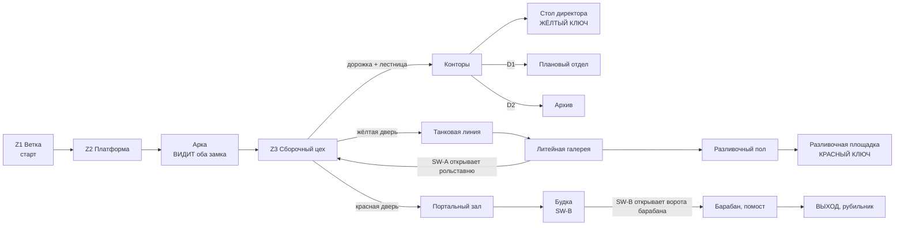

# MAP03 — «Танкоград» (Tankograd), тракторный завод

Каноническая версия: `docs/levels/MAP03-factory.md` (английский).

Синхронизировано с оригиналом: 2026-10-27.

> **D62 и D63 (2026-10-14): эта карта — MAP03, названная «Танкоград» /
> Tankograd.** Она строилась и документировалась как MAP04, пока MAP02 был
> полигоном (D41); теперь слоты следуют за кампанией (MAP01 → MAP02 метро →
> MAP03 этот завод), а полигон — ламп `RANGE`. «MAP02» в этом документе — метро.
> Датированные свидетельства сохраняют свои имена файлов (`map03` там — это
> метро). Подключение: `docs/engine/MOD-SPEC.md` §4.6.

Проектный документ. Владелец: `level-designer`. Статус: **v1.1 ПОСТРОЕНА
2026-10-14 (§16): v1 (§15, текстурирована набором Танкограда, населена,
Генерал в портальном зале) плюс три пункта D68: Ручная «Катюша» в секрете S1,
жёлоб с расплавом наносит урон, смерть Генерала открывает его склады; ещё не
пройдена** (v0, §14, тоже не была пройдена). Рабочее задание для PM; вердикт
CEO выносится по прохождению карты, а не по чтению этого документа (D28).
Построена MVP-первой (D60): полная, проходимая от старта до выхода карта,
шлифовка геймплея позже. Источник: `src/maps/MAP03/map.py`; тесты:
`tests/test_map03_factory.py`. Русское зеркало: этот документ, тот же путь под
`docs/ru/`.

> **Пройти её** (PM или CEO; агенты не запускают GZDoom, D26):
> `python3 tools/build.py && SD_ALLOW_ENGINE=1 MAP=MAP03 SKILL=3 tools/run.sh`.
> MAPINFO подключает её с D62 (§11): выход метро ведёт сюда, а выход этой
> карты заканчивает эпизод.

Входы, которым подчиняется этот документ и которые не пересказывает:
`docs/product/LORE.md` (завод: "Tractor factory (actually tanks) — episode
climax: the portal", набор текстур "industry: brick, rust, chains"),
`docs/PRD.md` (D28, D35 — фракции, D58 — ненайденный пропуск MAP02, D60 — MVP
первым и кампания), `docs/engine/BESTIARY.md` (Генерал и тяжёлый Panzermensch
оставлены для этой карты), `docs/art/TEXTURE-INDEX.md` (только одобренные
лампы) и метод `docs/levels/MAP02-metro.md`.

## 1. Синопсис

Из западного тоннеля метро сержант Виланова выходит на поверхность в
грузовой ветке тракторного завода, чьи тракторы — танки: захватчики заняли
завод ради его танковой линии и литейного цеха, а за его закрытым цехом
построили портал, через который прошли обе фракции; он берёт два ключа завода,
пересекает заводской пол и обрывает питание портала.

## 2. Место в кампании

| | |
|---|---|
| Идёт после | MAP02 Метро-бункер, которая заканчивается ходьбой на запад по перегонному тоннелю мимо её ворот (MAP02 §5). MAP03 начинается на другом конце этого тоннеля: в грузовой ветке завода, на тех же тюбингах и тех же рельсах. |
| Её номер | **MAP03 с D62**, как нумерует таблица LORE. Строилась как MAP04, пока MAP02 был полигоном (D41). |
| Что добавляет | **два ключа** (MAP02 научила одному), хаб, показывающий оба замка сразу, первую карту, где игрок **видит цель врага** (танки), и **босса эпизода**: Генерала в портальном зале (v3). |
| Кульминация | портал (LORE). Он сидит в удерживающем барабане в закрытом цехе завода; выход — рубильник, который его питает. Его отключение заканчивает эпизод. |
| Фракции (D35, BESTIARY Q7) | MAP01 — Рейх первым, MAP02 перевернула, завод **смешивает**: оба флага рядом над заводом (LORE). Легион держит публичное лицо (сборочный цех, конторы), Рейх — танковую линию и литейный цех, обе стороны охраняют портал под началом Генерала. |
| Подключение кампании | **Сделано (D62).** Кампания — MAP01 → MAP02 → MAP03; эта карта держит кластер 1 и концовку (`MOD-SPEC` 4.6), а выход метро ведёт сюда через текст кластера 4. §11. |

## 3. Что карта должна делать

| Задача | Как её решает планировка |
|---|---|
| Научить двум ключам | хаб показывает **обе запертые двери сразу** из арки погрузочной платформы: красная в дальнем западном конце, жёлтая в южной стене, каждая освещена своим цветом, каждая створка обрамлена цветом своего ключа (v1; жёлтая между двумя табличками со звездой, красная между простым побелённым кирпичом, §15.2). Жёлтый ключ **виден с заводского пола** по конторской лестнице; красный ключ виден **от двери литейного цеха**. Грамматика Doom: замок раньше ключа, ключ раньше замка, который он открывает. |
| Ответить на проход MAP02 (D58) | CEO так и не нашёл пропуск MAP02. Здесь ни один ключ не лежит в боковой комнате: каждый лежит один на освещённом постаменте на маршруте, в цвете света своего замка, и виден из дверного проёма своей комнаты (проверено тестом). Жёлтая дорожка на заводском полу соединяет жёлтую дверь с лестницей, ведущей к жёлтому ключу. Свет 192 тратится лишь в пяти местах: два замка, два ключа, выход. |
| Быть тракторным заводом, делающим танки | сборочный цех — публичное лицо завода: две сборочные линии, стены в красную полосу, конторы наверху. За жёлтой дверью («закрытый цех») линия — **танковая линия**, со смотровыми ямами; за ней литейный цех отливает корпуса. |
| Быть кульминацией | портальный зал — самый большой объём эпизода (1024 × 896, высота 384), портал в стальном барабане в его центре на ступенчатом помосте, арена Генерала (v3). |
| Закончить эпизод | выход — рубильник на верху помоста, внутри барабана: отключение питания портала. |

Целевая длительность: 10–12 минут при первом прохождении на сложности 3
(MAP02 — 8–10); около 5 при знании карты.

## 4. План

В масштабе, один символ = 64 × 64 единицы, север вверху, x на восток.
Сгенерирован из построенной карты (§14); деталь в 32 единицы (дверь, дорожка,
ниша) показана в ячейке, которой касается. Полы: земля **0**, конторы **+64**,
литейный разливочный пол **−64**, танковые ямы **−48**.

```
     y   x 384 ............................................................ 4160
   2176                         OOOO YYYY OOOO
   2112                         OOOO YYYY OOOO
   2048                         OOOO Y11Y OOOO  1 = the YELLOW KEY on the desk
   1984                         OOOO Y11Y OOOO
   1920                         O##O YYYY O##O
   1856                         OOOOOOOOOOOOOO
   1792                         OOOOOOOOOOOOOO
   1728             BBBB              ss  B = control booth, SW-B
   1664             BBBB              ss
   1600  WWWWWWWWWWWWWWWW   HHHHHHHHHH||HHHHHHHHHHH
   1536  WWWWWWWWWWWWWWWW   HHHHHHHHHH||HHHHHHHHHHH
   1472  WWWWWWWWWWWWWWWW   HHHHHHHHHH||HHHHHHHHHHH
   1408  WWWWWWWWWWWWWWWW   HHH=======||========HHH KKKKKKKK
   1344  WWWW      WWWWWW   rHHHHHHHHH||HHHHHHHHHHH KKKKKKKK
   1280  WWWW sssU WWWWWW   rHHHHHHHHH||HHHHHHHHHHH KKKKKKKK
   1216  WWWWEsssu#uWWWWWnn#rHHHHHHHHH||HHHHHHHHHHHkKKKKKKKKSSSSSSSS  <- start (S), facing west
   1152  WWWWEsssu#uWWWWWnn#rHHHHHHHHH||HHHHHHHHHHHkKKKKKKKKSSSSSSSS  E = exit; # in the ring = the drum's gate
   1088  WWWW sssU WWWWWWnn#rHHHHHHHHH||HHHHHHHHHHHkKKKKKKKKSSSSSSSS
   1024  WWWW      WWWWWW   rHHHHHHHHH||HHHHHHHHHHH KKKKKKKK
    960  WWWWWWWWWWWWWWWW   rHHHHHHHHH||HHHHHHHHHHH KKKKKKKK
    896  WWWWWWWWWWWWWWWW   HHH=======||========HHH KKKKKKKK
    832  WWWWWWWWWWWWWWWW   HHHHHHHHHH||HHHHHHHHHHH
    768  WWWWWWWWWWWWWWWW   HHHHHHHHHH||HHHHHHHHHHH
    704                     HHHHHHHHyyyyyyHHHHHHHHH
    640                     AXX       ##  A = SW-A, X = the shutter; ## = the yellow door
    576  FFFFFFFFFFFFFFFFGGGGGG       vv
    512  FFFFFFFFFFFFFFFFGGGGGG       vv
    448  PPPPFFFFFFFFFFFFGGGGGG       vv
    384  P22PssFFFFFFFFFFGGGGGG TTTTTTTTTTTTTTTTTTTTTTT
    320  P22PssFFFFFFFFssGGGGGG TTTTTTTTTTTTTTTTTTTTTTT  2 = the RED KEY on its pedestal
    256  P22PssFFFFFFFFssGGGGGGaTTTTTTTTTsppppsTsppppsT
    192  PPPPFFFFFFFFFFFFGGGGGGaTTTTTTTTTsppppsTsppppsT
    128  FFFFFF~~~~~~FFFFGGGGGG TTTTTTTTTTTTTTTTTTTTTTT
     64  FFFFFFFFFFFFFFFFGGGGGG TTTTTTTTTTTTTTTTTTTTTTT
```

Легенда: `S` грузовая ветка (старт) и её рельсы · `K` погрузочная платформа, `k`
арка · `H` сборочный цех, `=` сборочные линии (по пояс, укрытие), `|` жёлтая
дорожка · `r` портальная полоса красной двери, `y` жёлтой · `#` двери:
**красная дверь** (к западу от `r`), **жёлтая дверь** (к югу от `y`), D1 и
D2 в конторах, **ворота** барабана · `s` лестницы, ступени и помост ·
`O` конторы, `Y` кабинет директора, `1` **жёлтый ключ** на столе · `v`
вестибюль, `T` танковая линия, `p` смотровые ямы · `a` разливочная арка · `G`
литейная галерея (0), `F` разливочный пол (−64), `~` жёлоб с расплавом, `P`
разливочная площадка, `2` **красный ключ** на постаменте · `A` ниша SW-A,
`X` рольставня (проход под ней) · `n` тамбур, `W` портальный зал,
пустота внутри `W` — стальное кольцо барабана, `U` внутри барабана, `u`
площадки · `E` **выход** на верху помоста · `B` диспетчерская будка.

v1 добавляет, ничего из перечисленного не сдвигая (§15.3): две
комнаты-ловушки в стенах зала (южная, к востоку от рольставни; северная, на
западном конце), неглубокие ниши для закрытых ворот платформы и танковой
линии и для двух флагов у барабана, подоконники верхних окон в длинных стенах
зала, транспарант над осью зала и тельфер над каждой ямой.

| # | Зона | x | y | пол | потолок | свет (v0) |
|---|---|---|---|---|---|---|
| Z1 | Грузовая ветка (старт), тюбинги, рельсы | 3648…4160 | 1120…1248 | 0 | 128 | 112 |
| Z2 | Погрузочная платформа | 3136…3648 | 896…1472 | 0 | 256 | 144 |
| — | Арка, платформа → цех | 3072…3136 | 1120…1248 | 0 | 192 | 160 |
| Z3 | Сборочный цех (хаб) | 1600…3072 | 704…1664 | 0 | 320 | 160 |
| — | Сборочные линии, четыре участка (реквизит) | 1792…2240, 2368…2880 | 896…960, 1408…1472 | 32 | 320 | 160 |
| — | Жёлтая дорожка (SDFLR1) | 2272…2336 | 768…1664 | 0 | 320 | 160 |
| Z3r | Портальная полоса красной двери | 1600…1664 | 992…1376 | 0 | 128 | **192**, красный |
| Z3y | Портальная полоса жёлтой двери | 2112…2496 | 704…768 | 0 | 128 | **192**, жёлтый |
| — | Конторская лестница, 4 ступени по 16 | 2240…2368 | 1664…1792 | 16…64 | 192 | 128 |
| O1 | Конторский коридор | 1856…2752 | 1792…1920 | 64 | 192 | 128 |
| O2 | Кабинет директора (проём, без двери) | 2176…2432 | 1920…2208 | 64 | 192 | 176, жёлтый |
| — | Стол директора, жёлтый ключ | 2240…2368 | 2016…2080 | 80 | 192 | **192**, жёлтый |
| O3 | Плановый отдел, D1 | 1856…2112 | 1920…2208 | 64 | 192 | 128 |
| O4 | Архив, D2 | 2496…2752 | 1920…2208 | 64 | 192 | 128 |
| T1 | Вестибюль за жёлтой дверью | 2240…2368 | 448…672 | 0 | 128 | 128 |
| T2 | Танковая линия | 1856…3328 | 64…448 | 0 | 256 | 144 |
| — | Смотровые ямы A и B, по 2 ступени на каждом конце | 2432…2816, 2880…3264 | 192…320 | −48 | 256 | 144 |
| — | Разливочная арка, танковая линия → литейный цех | 1792…1856 | 192…320 | 0 | 128 | 144 |
| F1 | Литейная галерея | 1408…1792 | 64…640 | 0 | 256 | 144 |
| F2 | Разливочный пол, 3 ступени вниз от галереи | 384…1408 | 64…640 | −64 | 256 | 128 |
| — | Жёлоб с расплавом | 768…1152 | 128…192 | −80 | 256 | 128 |
| F3 | Разливочная площадка, 3 ступени вверх | 384…640 | 192…512 | 0 | 256 | 128 |
| — | Постамент слитка, красный ключ | 448…576 | 288…416 | 16 | 256 | **192**, красный |
| F4 | Ниша SW-A · проход · рольставня | 1600…1664 · 1664…1792 | 640…656 · 640…672 · 672…704 | 0 | 128 | 144 |
| P1 | Тамбур за красной дверью | 1408…1568 | 1120…1248 | 0 | 128 | 128 |
| P2 | Портальный зал | 384…1408 | 768…1664 | 0 | 384 | 128 |
| P3 | Диспетчерская будка, SW-B | 1088…1344 | 1664…1792 | 0 | 128 | 144 |
| P4 | Удерживающий барабан (кольцо 640…1024 × 1024…1408), ворота в его восточной грани | 704…960 | 1088…1344 | 0 | 256 | 144 |
| — | Площадки по обе стороны ворот | 1024…1088, 896…960 | 1152…1280 | 0 | 128 | 128 / 144 |
| — | Помост, 3 ступени по 16 | 704…896 | 1088…1344 | 16…48 | 256 | 144 |
| E | Ниша выхода (рубильник) | 688…704 | 1184…1248 | 48 | 176 | **192** |

Протяжённость 3776 × 2144 единицы (MAP02: 3552 × 1552). Каждая высота кратна
16; ни одна ступень вверх не выше 16 (проверено тестом).

## 5. Прогрессия, ключи, переключатели и выход



**Ключи.** Жёлтая и красная ключ-карты Doom, рисуемые Freedoom, пока у нас нет
своих: редакторские номера **6** и **13**, замки **3** ("Yellow key card") и
**1** ("Red key card"), оба прочитаны из поставляемого текста (`gzdoom.pk3 →
lockdefs.txt`, g4.14.2). В вымысле: **жёлтый пропуск** в закрытый цех, хранимый
на столе директора завода, и **красный пропуск** в портальный цех, оброненный
на разливочной площадке, где пал мастер литейного цеха (v3: его тело —
украшение). `mod-engineer` может дать им советские названия так, как синий
пропуск MAP02 получил своё (`SD_BluePass`, приём `Species`, MOD-SPEC §6,
«Синий пропуск»); карта от этого не изменится.

| Id | Где | Тип | Special | Может ли запереть игрока? |
|---|---|---|---|---|
| D1 | Конторский коридор → плановый отдел | ручная дверь | `Door_Raise` (1), обе грани | нет |
| D2 | Конторский коридор → архив | ручная дверь | `Door_Raise` (2), обе грани | нет |
| **YD** | Южная стена цеха → вестибюль, ширина 128 | **запертая, открывается навсегда** | `Door_LockedRaise (4, 16, 0, 3, 0)`, обе грани, повторяемая | нет |
| **RD** | Западный конец цеха → тамбур, ширина 128 | **запертая, открывается навсегда** | `Door_LockedRaise (5, 16, 0, 1, 0)`, обе грани, повторяемая | нет |
| SH | Проход литейного цеха → цех, ширина 128 | дистанционная, открывается навсегда | тег 10. Сталь со стороны литейного цеха; **собственная полосатая стена цеха со стороны цеха**, так что это стена, пока не откроется | нет |
| SW-A | Литейная галерея, ниша шириной 64 в её северной стене, рядом с проходом к SH | `SDSW1B` (кнопка), одноразовый | `Door_Open (10, 16, 0)` | нет |
| GATE | Восточная грань барабана, ширина 128, створка на обеих гранях | дистанционная, открывается навсегда | тег 11 | нет |
| SW-B | Диспетчерская будка, задняя стена | `SDSW1A` (рубильник), одноразовый | `Door_Open (11, 16, 0)` | нет |
| YKEY (V3 A2, §19) | жёлтый ключ на столе директора | **событие подбора** | special вещи `Door_Open (13, 16, 0)`: две конторские комнаты-ловушки у верха лестницы | нет: только открывает |
| LIFT (V3 A3, §19) | красный ключ на постаменте слитка | **событие подбора, срежиссированная сцена** | special вещи `FloorAndCeiling_RaiseByValue (14, 16, 192)`: грузовой подъёмник литейного цеха поднимается со своей бригадой | нет: тупиковая кабина, заканчивающаяся вровень с разливочным полом |
| EXIT | Задняя стена ниши 64 × 128 на верху помоста, внутри барабана | `SDSW1D`, панель предупредительной разметки, которую носит выход каждой карты | `Exit_Normal (0)` | — |

**Порядок, как его играют тесты** (`test_the_route_is_the_designed_one`),
четыре раунда:

1. Только с ручными дверьми: ветка, платформа, цех, конторы, **жёлтый ключ**;
   обе запертые двери видны по пути внутрь (из арки, проверено тестом).
2. Жёлтая дверь: танковая линия, литейный цех, **красный ключ**, SW-A.
3. Красная дверь (и рольставня SW-A, короткий путь): портальный зал, будка.
4. SW-B: ворота барабана, помост, **выход**.

Каждый гейт виден до того, как открыт: оба замка из арки (проверено тестом);
ворота барабана из тамбура, когда игрок входит в портальный зал, и снова из
SW-B в будке, так что нажатие показывает свой эффект (оба проверены тестами);
выход из ворот (проверено тестом). Рольставня — намеренное исключение, как SH в
MAP02: короткий путь, найденный сзади, стена со стороны цеха.

**Обозначения, урок MAP02 применён с v0** (D58):

- **Каждый ключ лежит один, освещённый, на маршруте.** Жёлтый ключ на столе
  директора, прямо вверх по конторской лестнице от центрального прохода цеха:
  с середины заводского пола игрок видит его, маленький и освещённый, в раме
  лестничной клетки и конторского проёма (проверено тестом из двух точек
  прохода). Красный ключ на постаменте слитка на разливочной площадке, прямо
  через разливочный пол от двери литейного цеха (проверено тестом из
  разливочной арки и галереи).
- **Цвет замка — это цвет ключа.** `lightcolor` жёлтый на портале жёлтой двери и
  на кабинете директора и столе; красный на портале красной двери и на
  постаменте. Ничто другое на карте не носит ни тот, ни другой цвет (проверено
  тестом). НЕ ПРОВЕРЕНО в наших прогонах движка (K4); без него оба места всё
  равно входят в пять 192.
- **Дорожка соединяет жёлтый замок с его ключом.** Полоса `SDFLR1` (жёлтая
  линия ангара, «иди сюда» MAP01) идёт от портала жёлтой двери вверх по
  центральному проходу к конторской лестнице (смежность проверена тестом).
- **Настоящие грани.** Каждая дверь носит `SDDOOR1`, один целый тайл (проверено
  тестом); каждый переключатель — свою грань `SDSW1x`, одноразовый, чтобы
  оставаться ВКЛЮЧЁННЫМ (проверено тестом). С v1 две запертые двери носят
  обрамление цвета своего ключа, `SDDOORY` и `SDDOORR` (§15.2).

Правила, убирающие целые классы софтлоков, сохранённые из MAP01 §4 и MAP02 §5:

- **Ни одна дверь не закрывается за игроком.** Замки и дистанционные двери
  открываются навсегда; две ручные двери открываются снова с обеих сторон.
- **Ни одного лифта.** Высота меняется только лестницами.
- **Ни одного спуска без подъёма обратно в той же зоне.** Галерея и разливочная
  площадка спускаются на 64 к разливочному полу (лестницы обратно наверх к
  обеим); танковая линия спускается на 48 в свои ямы (две ступени на каждом
  конце каждой ямы).
- **Ни секрет, ни короткий путь не нужны** (проверено тестом: со всеми тегами,
  кроме тега рольставни, выход достигается).
- Проверяется на **каждом этапе**: из каждого сектора, достижимого игроку, есть
  путь назад к старту, а в конце — путь дальше к выходу.

## 6. Кривая интенсивности

```
  high |                                                            ######
       |                                    ####                    ######  <- the General
 press |              ####        ####      ####     ####   ##      ######     in the portal
  ure  |              ####  ##    ####      ####     ####   ##      ######     hall
       |   ##   ##    ####  ##    ####  ##  ####  ## ####   ##  ##  ######  ##
   low |   ##   ##    ####  ##    ####  ##  ####  ## ####   ##  ##  ######  ##
       +--------------------------------------------------------------------------->
         spur dock   hall offices tank  pits foundry SW-A  return red booth  portal  exit
                                  line                closets door           hall
         0:00                                                                   ~11:00
```

| Бит | Пространство | Ощущение | Вводимая механика |
|---|---|---|---|
| 1 | Ветка, платформа | из тьмы метро на заводской двор; пикет | непрерывность: те же тюбинги, те же рельсы |
| 2 | Арка | **вид**: весь заводской пол, два освещённых замка, жёлтый ключ вверх по лестнице | две цели сразу и первый ответ |
| 3 | Сборочный цех | большой бой на заводском полу, Легион первым | сборочные линии как укрытие |
| 4 | Конторы | тесный бой наверху; ключ на столе | ключ взят там, где был увиден |
| 5 | Танковая линия | **откровение**: тракторы — это танки; Рейх за работой | ямы, тяжёлые |
| 6 | Литейный цех | жара, высота, яма, которую нужно пересечь; Doughboy в высоком помещении | спуск и подъём обратно; красный ключ |
| 7 | SW-A | рольставня открывается в цех рядом с красной дверью | короткий путь сзади |
| 8 | Цех снова | **всплеск**: комнаты-ловушки SW-A на уже зачищенной земле | схема MAP02 |
| 9 | Портальный зал | **кульминация**: Генерал и его эскорт вокруг барабана | босс |
| 10 | Будка, барабан | ворота открываются; портал на верху помоста | — |
| 11 | Выход | рубильник брошен; эпизод заканчивается | — |

## 7. Текстуры

### 7.1 По зонам (v0, все одобрены и упакованы, проверено тестами)

Для большинства зон заменено v1: набор как построен — §15.1.

Промышленного набора пока нет. v0 одевает завод в набор советской базы и две
детали метро там, где они подходят; v1 подставляет промышленные детали §7.2 по
мере их одобрения.

| Зона | Стены | Пол | Потолок | Намерение v1 |
|---|---|---|---|---|
| Грузовая ветка | `SDTUBB1`, один тайл от пола до потолка (тоннели MAP02) | `SDFLR2` + полоса `SDRAIL1` | `SDCEIL2` | устье тоннеля в кирпиче |
| Погрузочная платформа | `SDCONC1` | `SDFLR2` + полоса `SDRAIL1` | `SDCEIL2` | кирпич, упор тупика, ящики (`SDCRAT1/2`) |
| Сборочный цех | `SDCONC2` тремя полосами (ангар MAP01, D30) | `SDFLR2`, дорожка `SDFLR1` | `SDCEIL1` | кирпич, верхние окна, транспарант с лозунгом, два флага (LORE) |
| Сборочные линии | `SDSTEL1` | `SDFLR2` | | тракторы на них (реквизит) |
| Порталы замков | таблички `SDSTAR1` по обе стороны каждой створки, каждая — один целый тайл 128 × 128 (проверено тестом) | `SDFLR2` | `SDCEIL1` | створки с обрамлением цвета ключа (§7.2) |
| Конторы | `SDTILE2` (зелёная панель, один тайл, высота 128) | `SDFLR3` | `SDCEIL1` / `SDCEIL2` | плакат Ленина `SDPOSTR1` за столом директора (ниша высотой 256), шкафчики `SDLOCK1` в архиве. **Заменено §17**: конторы высотой 128, поэтому там висит мурал `SDPOSTR2`, а портреты ушли на платформу и в цех |
| Стол директора | передняя панель `SDCRAT1` | `SDCRTOP1` | | |
| Танковая линия | `SDSTEL1` | `SDFLR2` | `SDCEIL1` | ржавчина, цепи и крюки над ямами; `SDMEDG1` (шевронный край метро) на краях ям |
| Ямы | `SDCONC1` | `SDFLR2` | | |
| Литейный цех | `SDCONC1` | `SDFLR2` | `SDCEIL2` | кирпич, жёлоб с расплавом, чугунный пол |
| Портальный зал, будка | `SDCONC1`, будка `SDSTEL1` | `SDFLR3` | `SDCEIL2`, будка `SDCEIL1` | портал (§7.2); два флага над барабаном |
| Барабан | `SDSTEL1` | `SDFLR2` | `SDCEIL2` | |
| Двери, переключатели | `SDDOOR1`; `SDSW1B` (SW-A), `SDSW1A` (SW-B), `SDSW1D` (выход) | | | |

### 7.2 Промышленные детали, заказываемые у `art-director`

Набор LORE — "industry: brick, rust, chains". Предложенные имена лампов (≤ 8
символов, префикс `SD`), в порядке приоритета; ни одна не блокирует v0.

| # | Ламп | Вид, размер | Что | Где |
|---|---|---|---|---|
| 1 | `SDBRCK1` | стена 64×128 | закопчённый красный заводской кирпич сталинской эпохи | цех, платформа, литейный цех, устье ветки |
| 2 | `SDBRCK2` | стена 64×128 | тот же кирпич, побелённый до 64 с тёмной линией (панель завода) | нижние стены цеха, лестница контор |
| 3 | `SDRUST1` | стена 64×128 | ржавый гофрированный лист | перегородки танковой линии, закрытый цех |
| 4 | `SDCHAN1` | стена 64×128, **маскированная** (прозрачный фон) | висящая цепь с крюком, как средняя текстура на двусторонних линиях | над ямами, кран литейного цеха |
| 5 | `SDFLR4` | флэт 64×64 | чугунная рифлёная плита | литейная галерея, танковая линия |
| 6 | `SDGRAT1` | флэт 64×64 | стальная решётка | мостики v1 над разливочным полом |
| 7 | `SDMOLT1`…`4` | флэт 64×64, **анимированный** (ANIMDEFS, `mod-engineer`) | расплавленный металл | жёлоб, ковши (v2) |
| 8 | `SDDOORY`, `SDDOORR` | стена 128×128 | `SDDOOR1` с жёлтым / красным обрамлением (уже кандидат в индексе) | две запертые двери |
| 9 | `SDPORT1`… | стена 128×128, анимированная | поверхность портала | барабан, за помостом |
| 10 | `SDGATE1` | стена 128×128 | раздвижные заводские ворота, гофрированные | дорожные ворота платформы, экспортные ворота танковой линии (обе закрыты, оформление) |
| 11 | `SDWIND1` | стена 64×128 | промышленное остекление, снаружи ночь | верхние окна цеха |
| 12 | `SDSLOG1` | стена 256×64, несёт текст (D27: рендерить на одной машине) | заводской транспарант, напр. «ТРАКТОРЫ — КОЛХОЗАМ!» ("Tractors for the collective farms") | над сборочными линиями; ирония — карты |
| 13 | `SDFLAG1`, `SDFLAG2` | стена 64×128 | знамёна Рейха и Легиона (D12), которые вешаются **рядом** (LORE) | над цехом и барабаном |

Спрайты (за art-director, классы за `mod-engineer`): трактор и корпус танка как
украшения (или v1 строит танки из секторов), тело мастера, пикапы жёлтого и
красного пропусков.

## 8. Секреты (v3; в v0 нет, D60)

Правило MAP01: подсказка — сравнение или вопрос, но никогда не знак; у каждого
секрета есть путь назад.

| # | Где | Подсказка | Награда (предложена) |
|---|---|---|---|
| S1 | За шкафчиками архива | один шкафчик ряда другого цвета | **Ручная «Катюша»** (слот 7, D13) и её чертежи: традиция Doom, BFG на последней карте эпизода |
| S2 | Слив под ямой B, в пол литейного цеха | у одной ямы есть решётка, которой нет у другой | броня, рюкзак |
| S3 | Дымоход литейного цеха, над разливочной площадкой | струя света в тёмном углу (v2) | здоровье, ракеты |

**S1 построен в v1.1 (D68, §16.1)**, с подсказкой из света, а не цвета (есть
один одобренный лампа шкафчика): шкафчик-панель стоит на 16 глубже ряда, в
тени. S2 и S3 остаются за v3.

## 9. Враги и ресурсы по сложностям (размещены в v1, §15.4)

План, как он был написан для v3; задание PM для v1 перенесло его вперёд, как
D58 для MAP02. v1 расставляет его собственными номерами бестиария
(21100–21107, а не заглушками ниже) и меняет ячейки, отмеченные в §15.4.

Заглушки Doom, чтобы ничто не перенумеровывалось, когда меняются спрайты
(MAP01, MAP02). Генерал и тяжёлый Panzermensch впервые появляются здесь
(BESTIARY §8, §9).

| Заглушка | DoomEdNum | Фракция | Класс | Роль здесь |
|---|---|---|---|---|
| Zombieman | 3004 | Рейх | `SD_ReichRifleman` | платформа, танковая линия |
| Shotgun guy | 9 | Легион | `SD_LegionTrooper` | цех, конторы, комнаты-ловушки SW-A |
| Imp | 3001 | обе | `SD_Stormtrooper` | везде |
| Demon | 3002 | Рейх | `SD_ReichHound` | танковая линия, портальный зал |
| Cacodemon | 3005 | Легион | `SD_Doughboy` | литейный цех (высота 320), барабан на 4 |
| Hell Knight | 69 | Рейх | `SD_Panzermensch`, 500 HP | танковая линия на каждой сложности |
| Baron | 3003 | Рейх | `SD_PanzermenschSchwer`, 1000 HP | танковая линия и портальный зал на 4 |
| Cyberdemon | 16 | Легион | `SD_General`, 3000 HP, босс | портальный зал на **каждой** сложности |

| Бит / зона | Сложность 2 | Сложность 3 | Сложность 4 |
|---|---|---|---|
| Ветка, платформа | 2 стрелка | 3 стрелка | 3 стрелка + 1 легионер |
| Сборочный цех | 4 легионера + 2 стрелка + 1 штурмовик | 5 легионеров + 3 стрелка + 2 штурмовика | 6 легионеров + 4 стрелка + 3 штурмовика |
| Конторы | 2 легионера + 1 стрелок | 3 легионера + 1 стрелок | 3 легионера + 1 стрелок + 1 штурмовик |
| Танковая линия | 1 гончая + 2 стрелка + 1 Panzermensch | 2 гончие + 4 стрелка + 1 Panzermensch | 2 гончие + 5 стрелков + 1 Panzermensch + 1 тяжёлый |
| Литейный цех | 2 штурмовика + 1 Doughboy | 3 штурмовика + 1 Doughboy | 3 штурмовика + 2 Doughboy + 1 гончая |
| Комнаты-ловушки SW-A в цехе | 2 легионера | 2 легионера + 1 штурмовик | 3 легионера + 2 штурмовика |
| Портальный зал | Генерал + 2 гончие | Генерал + 2 гончие + 2 штурмовика | Генерал + 2 гончие + 2 штурмовика + 1 Panzermensch + 1 тяжёлый |
| Барабан (за воротами) | 1 штурмовик | 2 штурмовика | 2 штурмовика + 1 Doughboy |
| **Всего** | **25** | **38** | **52** |

В сравнении с 23 / 36 / 51 у MAP02: немного больше числом, гораздо больше весом
(босс на каждой сложности). Вложены по парам сложностей (`skill_tier`), как
MAP01 и MAP02. Генерал 40 × 100 (BESTIARY §9): портальный зал высотой 384, и
ему никогда не нужно проходить дверь.

**Смерть Генерала и выход** (v3, открытый пункт 4): BESTIARY даёт ему
`+BOSSDEATH` «чтобы выход можно было привязать к его смерти». Предложено, не
построено: ворота барабана открываются по SW-B **или** по его смерти (MAPINFO
`SpecialAction`, НЕ ПРОВЕРЕНО), никогда только по его смерти, чтобы игрок,
пробежавший мимо него, не оказался запертым. **Заменено D68 (§16.3):** его
смерть открывает награду, его склады, собственным special вещи; ворота остаются
только за SW-B.

**Ресурсы (v3).** Проходима со старта с пистолетом (`+map MAP03` даёт только
ТТ-33): ИЖ на платформе, ППШ-41 в конторах, РПГ-7 на танковой линии (перед
тяжёлыми), **огнемёт РОКС-3 в литейном цехе** (MAP02 §9 оставила его для
завода), всё на маршруте на каждой сложности; Ручная «Катюша» в S1.
Боеприпасы по линейке G3-8 (боеприпасы сложности 4 ≥ 1,35 × того, что нужно
монстрам сложности 4), Генерал включён; здоровье убывает 2 > 3 > 4.

## 10. Используемые элементы движка

| Потребность | Выдаётся | Статус |
|---|---|---|
| Ручная дверь | `Door_Raise` 12 (tag, 16, 150, 0), `playeruse` + `repeatspecial` | ПРОВЕРЕНО на MAP01 |
| Дистанционная дверь, одноразовый переключатель | `Door_Open` 11 (tag, 16, 0) | ПРОВЕРЕНО на MAP01 |
| Запертая дверь, остающаяся открытой | `Door_LockedRaise` 13 (tag, 16, 0, lock, 0), обе грани | ПРОВЕРЕНО на MAP02 (синяя дверь, `docs/qa/evidence/2026-10-14_1902_F3_map03-v0-walk.md`); замки 1 и 3 прочитаны из `lockdefs.txt`, в движке ещё не видены: K5, K9 |
| Выход | `Exit_Normal` 243 | ПРОВЕРЕНО на MAP01 |
| Ключи | вещи 6 (`YellowCard`), 13 (`RedCard`) | акторы Doom, рисуемые Freedoom |
| Цветной свет | `lightcolor` сектора (0xRRGGBB, UDMF zdoom), жёлтый `0xFFD860`, красный `0xFF6048` | имя поля из спецификации UDMF zdoom, как его использует MAP02 v1; **НЕ ПРОВЕРЕНО** в наших прогонах движка: K4 |
| Повёрнутые флэты | `rotationfloor` 90 на полосах рельсов | как MAP02 (её K8) |
| Секрет (v1.1) | `special` сектора 1024 (`SECRET_MASK`, `xlat/defines.i`) на складе S1; флаг линии панели `secret` | как MAP01 и MAP02 |
| Наносящий урон пол (v1.1) | `damageamount` сектора 10, `damageinterval` 32 (UDMF zdoom) | имена полей **ПРОВЕРЕНЫ** в спецификации; урон в игре НЕ ПРОВЕРЕН: §16.5 V2 |
| Special вещи при смерти (v1.1) | `special` вещи 11, `arg0` 12, `arg1` 16 (UDMF base) на Генерале | **ПРОВЕРЕНО** в спецификации и в исходниках GZDoom; в игре НЕ ПРОВЕРЕНО: §16.5 V4 |

План тегов: **1** D1 · **2** D2 · **4** жёлтая дверь · **5** красная дверь · **6**
панель шкафчика S1 (v1.1) · **10** рольставня и, с v1, две комнаты-ловушки цеха
(SW-A) · **11** ворота барабана (SW-B; барабану комната-ловушка не нужна, его
охрана за воротами) · **12** склады Генерала, открываемые только его смертью
(v1.1). Свободны: 3, 7–9, 13 и далее.

## 11. MAPINFO и LANGUAGE (для `mod-engineer`)

**Сделано (D62, 2026-10-14), оба шага разом.** `map MAP03 lookup "SD_MAP03_NAME"`, `cluster = 1`, `next = endtitle`,
`music = ""`, `par = 360`: эта карта заканчивает эпизод. Метро (MAP02) в кластере 4 с
`next = "MAP03"` и переходным текстом `SD_MAP02_EXIT_TEXT`, из черновика ниже с
добавленным названием карты; `SD_END01_TEXT` переписан под падение портала; название —
`SD_MAP03_NAME` = "Tankograd" / «Танкоград» (D63). Контракт: `docs/engine/MOD-SPEC.md` §4.6.

Предложение как написано, с номерами его дня (эта карта была MAP04, метро —
MAP03, полигон — MAP02):

> Эта роль не трогает MAPINFO и LANGUAGE.
>
> **Шаг 1, сейчас (v0–v3):** MAP04 загружается с названием, и её выход чисто
> покидается; кампания не тронута.
>
> ```
> // MAP04, the tractor factory (docs/levels/MAP04-factory.md). LORE's third
> // campaign map and the episode's climax, numbered 04 because MAP02 is the
> // practice range (D41). Not wired into the campaign yet: reached with
> // `map MAP04` / MAP=MAP04 tools/run.sh. No cluster on purpose, so leaving it
> // prints neither the campaign's ending (cluster 1) nor the range's (2).
> map MAP04 lookup "SD_MAP04_NAME"
> {
> 	next = endtitle
> 	music = ""
> 	sky1 = "SKY1"
> 	par = 360
> }
> ```
>
> `LANGUAGE` (D21, оба языка в одной задаче): `SD_MAP04_NAME` =
> "Tractor Factory" / «Тракторный завод», слова LORE, как рабочее название
> (настоящее название — открытый пункт 2). `par = 360` — оценка этой роли для
> игрока, знающего маршрут (§3). `music = ""`, пока `sound-designer` не выберет
> для неё пьесу из общественного достояния (D59). Без шага 1 K12 не может
> пройти: значение `next` по умолчанию в GZDoom для MAP04 — MAP05, которой не
> существует.
>
> **Шаг 2, когда CEO подключит завод (D60 говорит, что он следующий), по
> правилу MOD-SPEC 4.6** (кластер 1 держит последнюю карту кампании; по одному
> кластеру-главе на каждую более раннюю карту):
>
> - MAP03: `cluster = 4`, `next = "MAP04"` (отдаёт кластер 1 карте MAP04).
> - новый `cluster 4 { exittext = lookup, "SD_MAP03_EXIT_TEXT" flat = "SDFLR1" music = "" }`:
>   переход от метро к заводу.
> - MAP04: `cluster = 1`, `next = endtitle`: её выход печатает концовку
>   кампании.
> - `LANGUAGE`: `SD_MAP03_EXIT_TEXT` (новый) и `SD_END01_TEXT`
>   **переписан**: он говорит о возвращённой «Заре-7» и тогда следовал бы за
>   падением портала. Это текст для CEO; черновик перехода, чтобы он его
>   изменил:
>   - en: "The westbound tunnel climbs into daylight at a goods spur. Beyond
>     the buffers stand the sheds of a tractor works, and the tracks in the
>     yard are too wide for tractors."
>   - ru: «Западный тоннель выходит на свет у подъездного пути. За тупиком —
>     цеха тракторного завода, и колея во дворе слишком широка для тракторов.»

## 12. План версий

Каждая версия загружается в GZDoom и проходима от старта до выхода.

| Версия | Содержание | Готово, когда |
|---|---|---|
| **v0 — серый бокс** ✅ **ПОСТРОЕНА 2026-10-14** (§14) | весь план §4, каждая дверь, оба ключа, оба замка, оба переключателя, ворота, выход, лестницы и спуски; одобренные наборы там, где они подходят (§7.1); обозначения §5 (освещённые ключи, цветной свет, дорожка, таблички); свет по зонам; **ни монстров, ни предметов, ни секретов**, кроме старта и двух ключей | CEO проходит её, находит оба ключа без помощи и судит о форме (§14.4); `tests/test_map03_factory.py` (тогда `test_map04.py`) зелёные |
| **v1 — текстурирована и населена** ✅ **ПОСТРОЕНА 2026-10-14** (§15) | набор Танкограда из §7.2 как одобрен (D66), таблички красного замка убраны, верхние окна, флаги, транспарант, цепи; **§9 расставлен** (перенесён вперёд из v3, как у MAP02, задание PM), комнаты-ловушки SW-A, Генерал, оружие и бюджет G3-8 | CEO проходит её на сложности 3 и заканчивает эпизод (§15.9) |
| **v1.1 — D68** ✅ **ПОСТРОЕНА 2026-10-14** (§16) | S1 с Ручной «Катюшей» (перенесён вперёд из v3), урон жёлоба с расплавом, смерть Генерала открывает его склады | CEO проходит её (§16.6) |
| v2 — свет и детали | свечение литейного цеха и жёлоб с расплавом (анимированный, когда появится `ANIMDEFS`), свет портала, мерцание на танковой линии; танки и тракторы, плакат Ленина в кабинете директора, шкафчики, упор тупика | игрок, впервые видящий карту, находит оба ключа и выход, не будучи предупреждён |
| v3 — секреты и баланс | секреты §8 (Ручная «Катюша» в S1), смерть Генерала и ворота (открытый пункт 4), баланс после плейтестов (D60) | эпизод пройден на сложности 3 |

## 13. Открытые вопросы для CEO

1. ~~**Пройти v0** (D28).~~ v1 построена без прохождения, по D60 и заданию PM;
   пройти вместо этого **v1** (§15.9), которая задаёт и вопросы §14.4.
2. ~~**Название завода.** Рабочее название "Tractor Factory" / «Тракторный
   завод».~~ **Решено (D63): «Танкоград» / Tankograd.** Предложение с историей внутри: завод, делавший танки в
   войну, называли **«Танкоград»** ("Tankograd"); вымышленный завод на Урале,
   названный на манер эпохи, напр. «Уральский тракторный завод
   имени 60-летия Октября».
3. **Два ключа как пропуска**, жёлтый в закрытый цех и красный в портальный
   цех (§5), и их вид (art-director, как для синего пропуска).
4. ~~**Смерть Генерала и ворота** (§9): только SW-B или SW-B либо его
   смерть.~~ **Решено (D68): "que abra algo" («пусть что-нибудь откроется»)**: его смерть открывает его склады
   (§16.3); ворота остаются только за SW-B.
5. **Концовка.** Выход — рубильник портала; текст концовки эпизода должен быть
   для него переписан (§11, шаг 2).
6. ~~**Вид портала** (§7.2, пункт 9).~~ Решено (D66): кобальт с белыми
   нитями, `SDPORT1`–`4`; v1 ставит кадр 1 на заднюю стену барабана.
7. ~~**Ручная «Катюша»** (новое, v1). §8 помещает её в S1, секрет v3; до v3
   эпизод никогда не выдаёт игроку слот 7. Оставить для секрета (путь Doom, BFG
   спрятан на последней карте) или положить на маршрут сейчас?~~
   **Решено (D68): "ok secreto" («ок, секрет»)**; S1 построен в v1.1 (§16.1).
8. ~~**Жёлоб с расплавом** (новое, v1). Он носит расплавленный металл, но не
   ранит. Наносящий урон пол (special сектора) — правка в одну строку и без
   ловушек (жёлоб глубиной 16, одна ступень): нужен ли, и насколько?~~
   **Решено (D68): "que haga daño" («пусть наносит урон»)**; 10 каждые 32 тика (§16.2).

## 14. Запись о постройке v0 (2026-10-14)

Источник: `src/maps/MAP03/map.py`, нарисована через `GridMap`, как MAP01 и
MAP02. **65 секторов, 273 линии, 214 вершин, 3 вещи** (старт и два ключа). v0
у MAP02 была 73 сектора и 418 линий; эта v0 нарочно скромнее (D60), с
большими объёмами кульминации.

### 14.1 Что в ней есть

Всё из §4 и §5: грузовая ветка и её рельсы, платформа, арка, сборочный цех с
четырьмя участками сборочных линий, жёлтая дорожка и два портала замков с их
табличками со звездой; конторская лестница, коридор, кабинет директора и стол
(жёлтый ключ), плановый отдел и архив за D1 и D2; жёлтая дверь, вестибюль,
танковая линия и две её ямы; разливочная арка, литейная галерея, её лестница,
разливочный пол и жёлоб с расплавом, разливочная площадка и её лестница,
постамент (красный ключ); SW-A, его проход и рольставня; красная дверь, тамбур,
портальный зал, будка и SW-B, удерживающий барабан, его ворота и площадки,
помост и ниша выхода.

### 14.2 Чего в ней намеренно нет

Монстров, оружия, боеприпасов, здоровья, комнат-ловушек, секретов (v3);
промышленных текстур (v1, §7.2); ламп, свечения, расплавленного металла и
мерцания (v2); танков, тракторов и плакатов (v1).

### 14.3 Фактически выполненная проверка

| Проверка | Результат |
|---|---|
| `tests/test_map03_factory.py` (тогда `test_map04.py`) | **33 теста, все зелёные**: замкнутые секторы по часовой стрелке, нет дублирующихся вершин, ни один сектор не стёрт; ни одной ступени вверх выше 16; каждая текстура одобрена и упакована; каждая створка двери — один тайл (десять граней); таблички со звездой, по две у каждого замка, каждая — один тайл; диапазон света; **свет 192 только у двух замков, двух ключей и выхода**; **каждый ключ в цвете своего замка, и ничто другое в нём**; объём v0 (старт и два ключа, любая сложность; ни секрета); **всё достижимо** в конце, кроме сборочных линий; **выход достигается, и только в последнем раунде**; **нет ловушки ни на одном этапе**; из любого места в конце достижим выход; спуски покидаются по лестницам; **маршрут в четыре раунда**; короткий путь не нужен; один жёлтый и один красный ключ в своих зонах; special, замки и задержка «оставить открытой» обеих запертых дверей на обеих гранях; **линии обзора**: оба замка из арки, жёлтый ключ из двух точек заводского пола, красный ключ из разливочной арки и галереи, ворота барабана из тамбура и из SW-B, выход из ворот; дорожка соединяет жёлтый портал с лестницей; настоящие, различимые, одноразовые грани переключателей и панель предупредительной разметки выхода; каждый переключатель открывает то, что говорит §5; SW-A рядом с проходом рольставни; рольставня со стороны цеха — стена; каждая дверь достаточно высока; ни одно нажатие не расходует гейт |
| Проверка мутациями (черновой скрипт, не закоммичен) | каждая из пяти внесённых неисправностей краснит набор: красная дверь просит жёлтый ключ (2 теста), убрана лестница литейного цеха (3), последняя ступень площадки слишком высока (6), красный ключ за красной дверью (10), жёлтый ключ не на столе (4) |
| `tools/check_pk3.py` | `maps/MAP03.wad: MAP03/TEXTMAP/ENDMAP, 214 vertices, 273 linedefs, 65 sectors, 3 things`; 0 ошибок, 0 предупреждений |
| `tools/verify.py fast` (ПК с Windows, `.venv/Scripts/python.exe`, 2026-10-14) | **VERDICT: PASS** за 174 с: docs PASS (единственное предупреждение MAP03 — её русское зеркало, D34), build PASS, `check_pk3` 0 ошибок 0 предупреждений, **1734 теста**, 112 пропущено (медленное арт). Прогон за несколько минут до этого упал в `test_route` и `test_hand_study`, файлах, которые другие агенты держали открытыми в рабочем дереве; повторный прогон был чистым |
| GZDoom | **не запускался** (D26). Должно быть: §14.5 |

Первый прогон набора нашёл две вещи, обе исправлены до сдачи: из арки ближняя
сборочная линия скрывает нижние 32 единицы створки жёлтой двери (тест теперь
спрашивает про створку выше пояса, что и должно делать укрытие), а тест цвета
должен был следовать за жёлтым светом через конторский проём, а не
останавливаться у стола.

### 14.4 Что я хочу, чтобы CEO оценил при прохождении

Маршрут на этот раз **не рассказан**, намеренно: прохождение MAP02 показало,
что карта должна рассказывать его сама (D58). Оценка, блокирующая v1, —
первая.

1. **Нашли ли вы оба ключа без помощи?** Если нет, где вы искали?
2. **Арка.** Читаются ли две освещённые двери как две цели, а жёлтый свет вверх
   по лестнице — как ответ на первую?
3. **Масштаб.** Цех 1472 × 960 и высотой 320; портальный зал 1024 × 896 и
   высотой 384. Завод или автостоянка?
4. **Танковая линия и литейный цех.** Чувствуются ли ямы и спуск к разливочному
   полу разрешёнными, и находятся ли лестницы обратно наверх?
5. **SW-A.** Читается ли открывающаяся в цех рольставня как короткий путь домой?
6. **Барабан и рубильник.** Похоже ли нажатие SW-B, а затем подъём к выходу на
   конец эпизода? (В v0 он серый; портал — v1.)

### 14.5 Чек-лист движка для PM (D26: эта роль не запускает GZDoom)

Метод как MAP02 §14.5: `warp x y`, повернуться в нужную сторону (углы Doom: 0
восток, 90 север, 180 запад, 270 юг), `+use`, `wait`, `screenshot`. Сложность
3. Каждый warp на использование в пределах 64 от линии, которую нажимает. Лог и
скриншоты — в `docs/qa/evidence/`. K12 требует §11 шаг 1.

| № | Warp в (x y) | Лицом | Сделать | Что должно быть видно |
|---|---|---|---|---|
| K1 | 4096 1184 | 180 | — | старт: ветка из тюбингов, рельсы, платформа за ней |
| K2 | 3104 1184 | 180, затем 211 | — | из арки: красная дверь в дальнем конце цеха между двух табличек со звездой; повернувшись, жёлтая дверь в южной стене так же |
| K3 | 2304 1024 | 90 | — | вверх по дорожке и лестнице: освещённый кабинет директора, жёлтый ключ на столе |
| K4 | 2304 1184 | 90 | — | жёлтый оттенок на кабинете и столе, красный оттенок у красного портала (повернуться на 180) и жёлтый у жёлтого портала (повернуться на 270). Если оттенка нет, `lightcolor` не читается: сообщить этой роли |
| K5 | 2304 740 | 270 | `+use`; затем `give YellowCard`, `+use`; скриншоты на `wait 35` и `wait 350` | без ключа: закрыта, и напечатана строка жёлтого ключа (доказывает замок 3); с ним: открыта и всё ещё открыта через 10 с |
| K6 | 1760 256 | 180 | — | с литейной галереи: красный ключ на освещённом постаменте через разливочный пол, лестница вниз слева |
| K7 | 1632 610 | 90 | `+use`, `wait 10`, затем повернуться на 0 | `SDSW1B` → `SDSW2B` и остаётся; рольставня поднялась за проходом |
| K8 | 1728 768 | 270 | скриншот до K7 и после | из цеха: до — полосатая стена; после — проём в литейный цех |
| K9 | 1632 1184 | 180 | `+use`; затем `give RedCard`, `+use` | как K5, строка красного ключа (доказывает замок 1); открыта и остаётся открытой |
| K10 | 1440 1184 | 180 | — | портальный зал, впереди барабан, створка его ворот на площадке |
| K11 | 1216 1760 | 90 | `+use`, скриншот; повернуться на 250 | `SDSW1A` → `SDSW2A`; ворота барабана открыты |
| K12 | 736 1216 | 180 | скриншот, затем `+use` | ниша выхода освещена, `SDSW1D`; при использовании — интермиссия, затем `SD_END01_TEXT` (концовка, с D62), затем титульный экран |
| K13 | лог | — | — | ноль строк, совпадающих с шаблонами сбоев G3-2 из MAP01 §11; ничего о `lightcolor`, `rotationfloor`, special 13 или любой текстуре `SD` |

### 14.6 Что мне нужно от других ролей

- **`mod-engineer`:** ~~запись MAPINFO и `SD_MAP03_NAME` из §11, шаг 1
  (блокирует только K12); шаг 2, когда PM подключит кампанию.~~ Сделано (D62).
  По желанию, классы `SD_` для двух пропусков, как для синего пропуска MAP02, с
  их строками подбора и запертых дверей на обоих языках (`PD_YELLOWCO`,
  `PD_REDCO` и оговорка Freedoom о DEHACKED из MOD-SPEC §6). Позже: ANIMDEFS
  для расплавленного металла и портала (§7.2).
- **`art-director`:** промышленные детали §7.2, пункты 1–5 первыми (они нужны
  v1); спрайты пропусков; портал (открытый пункт 6).
- **`sound-designer`:** пьеса из общественного достояния для завода (D59).
- ~~**PM:** перенумеровать таблицу эпизодов LORE и ссылки BESTIARY.~~ Не нужно:
  D62 дал картам номера LORE, так что «MAP03» из BESTIARY (Генерал, тяжёлый
  Panzermensch) снова эта карта.

## 15. Запись о постройке v1 (2026-10-14)

Источник: `src/maps/MAP03/map.py`; тесты: `tests/test_map03_factory.py`.
Построитель не менялся (`GridMap`), плюс один хелпер, `hang`, который ставит
среднюю текстуру на построенную двустороннюю линию (транспарант, цепи). **85
секторов, 366 линий, 289 вершин, 130 вещей** (v0: 65 / 273 / 214 / 3). Не
пройдена в GZDoom этой ролью (D26): проход в движке за PM, §15.8.

```sh
python3 tools/verify.py fast                                                   # build + check_pk3 + suite, no window
python3 tools/build.py && SD_ALLOW_ENGINE=1 MAP=MAP03 SKILL=3 tools/run.sh      # walk it (PM or CEO only)
```

Задание (N7, доля завода; D60: полная и играбельная, баланс позже): текстуры
Танкограда там, где их просил проект, таблички красного замка, §9 расставлен по
сложностям номерами 211xx из MAPINFO, Генерал как босс в портальном зале,
оружие, боеприпасы и здоровье по бюджету G3-8, без музыки (за sound-designer).

### 15.1 Текстуры, как построено

Все 19 лампов партии 4, установленных по заданию (D66), используются, две
анимации — по первому кадру (`SDMOLT1`, `SDPORT1`, которые `ANIMDEFS` циклит с
N6c); два задержанных ламп, `SDCHAN1` и `SDSLOG1`, были установлены другим
агентом во время этой постройки (N6b) и тоже расставлены. Каждый стоит за
константой (`CHAIN`, `SLOGAN`); если задать любую `None`, карта строится без
него, а его тест пропускается.

| Зона | Стены | Пол | Потолок | Что изменилось с v0 |
|---|---|---|---|---|
| Грузовая ветка | `SDTUBB1` | `SDFLR2` + `SDRAIL1` | `SDCEIL2` | устье в платформу — кирпич (тоннель кончается в стене завода) |
| Погрузочная платформа, арка | `SDBRCK1` | `SDFLR2` + `SDRAIL1` | `SDCEIL2` | кирпич; **дорожные ворота двора** `SDGATE1`, закрытые, один тайл в нише северной стены |
| Сборочный цех | `SDBRCK1` (цех высотой 320, поэтому побелённая `SDBRCK2` повторила бы свою полосу; она оставлена для стен ровно высотой 128) | `SDFLR2`, дорожка `SDFLR1` | `SDCEIL1` | кирпич; **верхние окна**: девять окон шириной 64 `SDWIND1` на подоконниках глубиной 16 на высоте 192, один тайл стекла под крышей, пять в северной стене и четыре в южной, к востоку от лестницы и жёлтой двери; **заводской транспарант** `SDSLOG1` «ТРАКТОРЫ — КОЛХОЗАМ!» подвешен от крыши поперёк оси цеха, x 2624…2640, y 1056…1312, его нижний край на 256, читается правильно с обоих концов |
| Сборочные линии | `SDSTEL1` | `SDFLR4` | | верхи из рифлёной плиты |
| Жёлтый замок | `SDBRCK1`; `SDSTAR1` по обе стороны створки | `SDFLR2` | `SDCEIL1` | створка — **`SDDOORY`** |
| Красный замок | `SDBRCK1`; **`SDBRCK2`** по обе стороны створки | `SDFLR2` | `SDCEIL1` | створка — **`SDDOORR`**; таблички со звездой убраны (§15.2) |
| Конторы | `SDTILE2` | `SDFLR3` | `SDCEIL1` / `SDCEIL2` | без изменений |
| Вестибюль, танковая линия | **`SDRUST1`** | **`SDFLR4`** | `SDCEIL1` | закрытый цех в гофрированной ржавчине; **экспортные ворота** `SDGATE1`, закрытые, в нише восточной стены; **цепь с крюком** `SDCHAN1` над серединой каждой ямы (четыре грани тельфера 64 × 64, свисающего с крыши до 128) |
| Ямы | `SDCONC1` | `SDFLR2` | | без изменений |
| Литейный цех | `SDBRCK1` | разливочный пол и площадка **`SDFLR4`**, галерея **`SDGRAT1`**, жёлоб **`SDMOLT1`** | `SDCEIL2` | кирпич, решётка, расплавленный металл (анимирован `ANIMDEFS`; не ранит, открытый пункт 8) |
| Проход SW-A | `SDBRCK2` (высота 128) | `SDFLR2` | | |
| Тамбур | `SDBRCK2` (высота 128) | `SDFLR2` | `SDCEIL2` | |
| Портальный зал | `SDBRCK1` | **`SDFLR4`** | `SDCEIL2` | кирпич; кольцо барабана теперь **стальное** и снаружи, как и внутри; **два флага** `SDFLAG1` (Рейх) и `SDFLAG2` (Легион), каждый — один тайл в нише восточной грани кольца, по обе стороны ворот |
| Барабан | `SDSTEL1`; **`SDPORT1`** на стене за помостом, по обе стороны ниши выхода | `SDFLR2` | `SDCEIL2` | кобальтовое поле портала (анимировано `ANIMDEFS`) |
| Двери, переключатели | `SDDOOR1` (D1, D2, ворота), `SDDOORY`, `SDDOORR`; `SDSW1B`, `SDSW1A`, `SDSW1D` | | | |

`SDCONC2`, красная полоса цеха в v0, больше не используется: полоса была из
ангара MAP01, а красные полосы вокруг заводского пола конкурировали бы с
красным замком. `SDCONC1` остаётся только в ямах.

**Не в v1** (v2, §12): танки и тракторы как реквизит, плакат Ленина в кабинете
директора (ему нужна ниша высотой 256; конторы высотой 128; §17 вешает
плакаты в другом месте, а мурал — там), шкафчики в архиве, шевронный край
метро на ямах, упор тупика.

### 15.2 Красный замок, снова обозначенный

Замечание art-director о v0: красные таблички со звездой по обе стороны
красной двери её маскировали, а с `SDDOORR` (створка с красным обрамлением)
было бы хуже. Таблички сняты **только с этого замка**: красная створка теперь
стоит между двух панелей побелённого кирпича (`SDBRCK2`, светлых, по одному
тайлу), так что единственное красное на этой стене — створка и красный свет.
Жёлтый замок сохраняет свою пару (красные таблички рядом с жёлтой створкой
контрастны; скрывать там нечего). Проверено тестом: две грани `SDSTAR1` на
карте, обе у жёлтого замка; стена красного замка — `SDBRCK2` по обе стороны
`SDDOORR` и ничего больше; каждый замок носит обрамление своего ключа на обеих
гранях.

### 15.3 Изменения геометрии v0

Ни одного — к маршруту или плану этажа §4; каждый тест v0 на достижимость,
софтлок, четыре раунда и линии обзора проходит без изменений. Добавлено:

| # | Что | Где | Почему |
|---|---|---|---|
| 1 | `closet_hs`, `closet_hn` и их панели (тег 10) | южная стена цеха к востоку от рольставни (x 1856…2048), его северная стена на западном конце (x 1664…1856) | комнаты-ловушки SW-A из §9, метод MAP02: панель носит кирпич цеха, так что это стена, пока не сдвинется; каждая — тупик, из которого игрок выходит |
| 2 | `z2_road_gate`, `t_export_gate` | северная стена платформы, восточная стена танковой линии | закрытые ворота, по тайлу каждые |
| 3 | `p_flag_reich`, `p_flag_legion` | восточная грань барабана, по обе стороны ворот | флаги рядом (LORE) |
| 4 | `prop_clerestory_n1`…`n5`, `_s1`…`_s4` | длинные стены цеха | верхние окна; подоконники на 192, никогда не проходимы (реквизит) |
| 5 | `z3_banner` | поперёк оси цеха | несёт транспарант на двух длинных гранях |
| 6 | `t_pit_a_hoist`, `t_pit_b_hoist` | середина каждой ямы | несут цепи |

### 15.4 Враги, как расставлены

Собственные редакторские номера бестиария из `DoomEdNums` в MAPINFO: 21100
стрелок, 21101 легионер, 21102 штурмовик, 21103 гончая, 21104 Doughboy, 21105
Panzermensch, **21106 Генерал**, **21107 тяжёлый Panzermensch** (проверено
тестом по MAPINFO; здесь сражается каждый класс бестиария). План §9 с
изменёнными ячейками, помеченными †:

| Бит / зона | Сложность 2 | Сложность 3 | Сложность 4 |
|---|---|---|---|
| Платформа | 2 стрелка | 3 стрелка | 4 стрелка † |
| Сборочный цех | 6 легионеров † + 1 штурмовик | 8 легионеров † + 2 штурмовика | 10 легионеров † + 3 штурмовика |
| Конторы | 3 легионера † | 4 легионера † | 4 легионера † + 1 штурмовик |
| Танковая линия | 1 гончая + 2 стрелка + 1 Panzermensch | 2 гончие + 4 стрелка + 1 Panzermensch | 2 гончие + 5 стрелков + 1 Panzermensch + 1 тяжёлый |
| Литейный цех | 2 штурмовика + 1 Doughboy | 3 штурмовика + 1 Doughboy | 3 штурмовика + 2 Doughboy + 1 гончая |
| Комнаты-ловушки SW-A в цехе | 2 легионера | 2 легионера + 1 штурмовик | 3 легионера + 2 штурмовика |
| Портальный зал | **Генерал** + 2 гончие | Генерал + 2 гончие + 2 штурмовика | Генерал + 2 гончие + 2 штурмовика + 1 Panzermensch + 1 тяжёлый |
| Барабан (за воротами) | 1 штурмовик | 2 штурмовика | 2 штурмовика + 1 Doughboy |
| **Всего** | **25** | **38** | **52** |

† §9 ставил стрелков Рейха в цех (2/3/4) и конторы (1), а легионера — на
платформу на сложности 4, вопреки собственному правилу §2 (Легион —
публичное лицо, Рейх — танковая линия). v1 следует §2, чтобы фракции можно
было проверить: эти стрелки — легионеры, а легионер платформы — стрелок. Те же
числа, та же цена по линейке (по одному заряду). §2 также отдавал литейный цех
Рейху, но §9 и §6 ставят Doughboy (Легион) в его высокое помещение: v1 делает
литейный цех, как и портальный зал, **землёй, которую делят обе фракции**.

**Фракции, проверено** (D35, завод смешивает): по собственному ZScript каждого
класса (`SD_Monster.Faction`), стоящий гарнизон цеха и контор — Легион и
гибриды, ветки, платформы и танковой линии — Рейх и гибриды, а в литейном цехе
и портальном зале стоят обе фракции, где Генерал Легиона и гончие Рейха вместе
на каждой сложности. Комнаты-ловушки — контратака, а не гарнизон.

**Генерал** (`SD_General`, 3000 HP, 40 × 100, BESTIARY §9): один, на каждой
сложности, в (480, 1216), за барабаном, если смотреть из тамбура, так что игрок
сначала встречает эскорт, а босс выходит из-за барабана. Портальный зал высотой
384, и ему никогда не нужно проходить дверь (проверено тестом: его коробка
помещается). Его `+BOSSDEATH` пока ничего не запускает (открытый пункт 4):
ворота открываются только по SW-B, так что игрок, пробежавший мимо него, не
окажется запертым.

Каждое тело помещается там, где стоит (углы на проходимом полу в пределах
ступени, запас по высоте из `RADIUS`/`HEIGHT` каждого класса; у тяжёлого
Panzermensch — из файла его родителя, который он наследует); никакие двое не
стартуют внутри друг друга; и ни одно тело при появлении не стоит на линиях, с
которых проверена видимость ключей (новый тест).

По классам на сложности 4: легионеров 17, штурмовиков 13, стрелков 9, гончих 5,
Doughboy 3, Panzermensch 2, тяжёлых Panzermensch 2, Генерал 1.

### 15.5 Оружие, боеприпасы, здоровье

Старт с пистолетом (`+map MAP03` даёт ТТ-33 и 50 патронов; игрок кампании
прибывает лучше вооружённым). Оружие лежит на маршруте, на каждой сложности,
никогда в секрете (проверено тестом), каждое — перед боем, для которого оно:

| Оружие | Где | Достигается в раунде |
|---|---|---|
| ИЖ-58 | платформа, рядом с первым пикетом | 1 (без ключа) |
| ППШ-41 | восточный конец конторского коридора | 1 |
| РПГ-7 (+ коробка ракет до D119, которая перенесла её в портальный зал, §18.1) | танковая линия, у подножия жёлтой двери, ближе к двери, чем любой из тяжёлых (проверено тестом) | 2 (жёлтая дверь) |
| **РОКС-3** | литейная галерея (MAP02 §9 оставила его для завода) | 2 |
| Ручная «Катюша» | не размещена: S1 из §8, v3 (открытый пункт 7) | — |

Количества, как расставлены (секретов в v1 нет):

| Предмет | Сложность 2 | Сложность 3 | Сложность 4 | Где |
|---|---|---|---|---|
| Коробка патронов для дробовика (20) (D119, §18.1) | 1 | 1 | 2 | цех; портальный зал |
| Патроны ×4 | 2 | 2 | 2 | платформа, разливочный пол |
| Коробка пуль (50) | 8 | 10 | 14 | цех, архив, платформа, плановый отдел, танковая линия, разливочный пол, вестибюль, портальный зал, тамбур |
| Обойма (10) | — | — | — | нет с D119 |
| Коробка ракет (5) | 5 | 5 | 6 | тамбур, будка, портальный зал |
| Ракета (1) | — | — | — | нет с D119 |
| Канистра топлива (20) (D119) | 2 | 2 | 2 | тамбур, будка |
| Ранец топлива (100) (D119) | — | — | 1 | портальный зал |
| Перевязка | 9 | 8 | 5 | платформа, цех, танковая линия, галерея, портальный зал |
| Аптечка | 6 | 6 | 5 | цех, архив, танковая линия, разливочная площадка, будка |
| Бонус здоровья | 10 | 10 | 10 | по одному в каждом закутке: ветка, арка, конторская лестница, вестибюль, обе ямы, разливочная арка, проход SW-A, площадка, помост |
| Бонус брони | 8 | 8 | 7 | оба замка ×2, кабинет директора ×2, разливочная площадка |
| Зелёная броня | 1 | 1 | 1 | танковая линия |
| **Синяя броня** | 1 | 1 | 1 | тамбур, перед Генералом (проверено тестом: достигается с красной дверью, не раньше) |

**G3-8, измерено** (`test_g3_8_the_ammo_budget`). Линейка MAP01 (стрелок и
легионер 1 заряд, штурмовик 2, гончая 3, Doughboy 6, Panzermensch 8; около 62,5
HP на заряд), продолженная по очкам здоровья на двух классов этой карты:
**тяжёлый Panzermensch 16, Генерал 48**. Размещённые боеприпасы в эквивалентах
заряда: 10 патронов = 1 заряд, как раньше; и, нововведение, потому что это
карта тяжёлого оружия, **ПГ-7В = 2 заряда** (135 прямым попаданием, BALANCE §2;
Генерал не получает урона от взрыва) и **единица топлива = 0,25 заряда** (струя
РОКС-3 в среднем 18). Дроп не учитывается.

| | Сложность 2 | Сложность 3 | Сложность 4 |
|---|---|---|---|
| нужно | 94 | 115 | 181 |
| × 1,35 (G3-8) | 126,9 | 155,3 | 244,4 |
| размещено | 282,5 | 273,5 | **256,5 (1,42×)** |
| **размещено с D119** (§18.1, топливо по 13,5 / 80; диапазон 1,5–2,0 / 1,3–1,6 / 1,2–1,45) | **147,0 (1,56×)** | **157,0 (1,37×)** | **223,9 (1,24×)** |

Сложность 4 у MAP01 — 1,41×, у MAP02 — 1,43×. Ещё две проверки: **без тяжёлого
оружия** (только заряды и патроны) размещённые боеприпасы всё равно покрывают
всех монстров, кроме Генерала, на 1,35×, так что РПГ-7 и РОКС-3 — его; и **этап
за этапом** (тест готовности MAP01, перенесён, с ПГ-7В и топливом по среднему
урону): до любого замка, после жёлтой двери, после красной двери и SW-A, после
SW-B размещённый на данный момент урон плюс стартовые патроны составляет не
менее 1,35 × встреченных к этому моменту очков здоровья, на каждой сложности.
Здоровье на сложности 4: 10 перевязок и аптечек (MAP02: 7), 7 бонусов брони, оба
бронежилета.

**D60, сначала MVP:** эти числа — первый срез, удовлетворяющий G3-8; сам
баланс (бой с Генералом, два тяжёлых на сложности 4, Doughboy литейного цеха
при старте с пистолетом) — для плейтестов после MVP.

### 15.6 Отклонения от §3–§12

| # | Сказано | Построено | Почему |
|---|---|---|---|
| 1 | §12: v1 = текстуры; v3 = §9 расставлен | v1 = текстуры и §9 расставлен; v3 = секреты и баланс | задание PM (N7), как v1 у MAP02 |
| 2 | §5, §7.1: каждый замок между двух табличек со звездой | только жёлтый замок; красный между побелённым кирпичом | замечание art-director, §15.2 |
| 3 | §9: стрелки в цехе и конторах, легионер на платформе | легионеры в цехе и конторах, стрелок на платформе | фракции §2, §15.4 † |
| 4 | §2: Рейх держит литейный цех | литейный цех общий (Doughboy и штурмовики, гончая на 4) | §9 и §6 уже ставят туда Doughboy |
| 5 | §9: заглушки Doom (3004, 9, …, 16) | номера бестиария 21100–21107 | задание; MAP02 делает так же |
| 6 | §9: Ручная «Катюша» в S1 | не размещена | в v1 секретов нет (D60); открытый пункт 7 |
| 7 | §9: ППШ «в конторах» | восточный конец коридора | на маршруте, не за D1 или D2 |
| 8 | G3-8 у MAP02: ни одна ракета не считалась | ПГ-7В и топливо считаются по указанному курсу | 3000 HP Генерала — задача РПГ-7 и РОКС-3 (§15.5) |
| 9 | §7.1 намерения v1: танки, тракторы, плакат, шкафчики, упор тупика | не построены | v2, §12 |

### 15.7 Фактически выполненная проверка

| Проверка | Результат |
|---|---|
| `tests/test_map03_factory.py` | **64 теста, все зелёные**: 33 теста v0, из которых два заменены (старт и ключи на любой сложности; ни секрета в v1) и четыре обновлены (створки в трёх обрамлениях; таблички только у жёлтого замка; SW-A открывает и комнаты-ловушки; рольставня и комнаты-ловушки — стена со стороны цеха); **31 новый**: набор Танкограда расставлен, стена красного замка, каждая настенная картина — один целый тайл, флаги у барабана, транспарант и цепи, стальной барабан и стена портала, каждый замок в обрамлении своего ключа, каждый ключ один на постаменте, транспарант под линией обзора арки, ни одного тела на линии обзора ключа; и население §15.4–§15.5, фракции (читаются из ZScript), Генерал, тяжёлые, комнаты-ловушки, оружие, РПГ перед тяжёлыми, расходники убывают, G3-8, бюджет без тяжёлого оружия, боеприпасы по этапам, здоровье и броня |
| Проверка мутациями (черновой скрипт, не закоммичен) | каждая из восьми внесённых неисправностей краснит набор: красные таблички возвращены (2 теста), красная створка в жёлтом обрамлении (3), Генерал убран (4), легионер на линии обзора жёлтого ключа (1), стрелок Рейха в цехе (1), коробка патронов только на сложности 2 (2), комнаты-ловушки на теге SW-B (2), тяжёлый перенесён в яму (2) |
| `tools/check_pk3.py` | `maps/MAP03.wad: MAP03/TEXTMAP/ENDMAP, 289 vertices, 366 linedefs, 85 sectors, 130 things`; 0 ошибок, 0 предупреждений |
| `tools/verify.py fast` (ПК с Windows, `.venv/Scripts/python.exe`, 2026-10-14) | **VERDICT: PASS** за 16,8 с: docs PASS (предупреждения зеркал, D34), build PASS, `check_pk3` 0 ошибок 0 предупреждений, **1402 теста**, 136 пропущено (медленный арт-уровень) |
| GZDoom | **не запускался** (D26). Должно быть: §15.8 |

### 15.8 Чек-лист движка для PM (D26: эта роль не запускает GZDoom)

Метод как §14.5 и MAP02 §16.8: `warp x y`, повернуться в нужную сторону (0
восток, 90 север, 180 запад, 270 юг), `+use`, `wait`, `screenshot`. **Две
сессии**: геометрия и текстуры с `-nomonsters` на сложности 3 (T1–T10), затем
монстры с `god` на сложности 3 и раз на сложности 4 (T11–T14). Лог и
скриншоты — в `docs/qa/evidence/`. Чек-лист v0 (§14.5) так и не был прогнан;
T1–T10 покрывают его K1–K3, K6–K8 и K10–K12, а **K4, K5 и K9 остаются в силе,
как написано** (оттенки ключей, замки 3 и 1 в движке).

| # | Warp в (x y) | Лицом | Сделать | Что должно быть видно |
|---|---|---|---|---|
| T1 | 3104 1184 | 180 | — | из арки: кирпичный цех, высоко над ним транспарант («ТРАКТОРЫ — КОЛХОЗАМ!» читается, не зеркально), под ним в дальнем конце **красная дверь, `SDDOORR`, между двух простых побелённых панелей, без табличек со звездой**, в красном свете; верхние окна высоко на обеих стенах |
| T2 | 3104 1184 | 211 | — | жёлтая дверь, `SDDOORY`, между своих двух табличек со звездой |
| T3 | 3400 1300 | 90 | — | платформа: кирпич, закрытые дорожные ворота целиком в нише, ИЖ на полу |
| T4 | 2304 1184 | 0 | — | западная грань транспаранта, читается и с этой стороны; за ним арка |
| T5 | 2304 400 | 0 | — | танковая линия: ржавые стены, рифлёный пол, цепь с крюком над ямой A, экспортные ворота целиком в дальнем конце; РПГ-7 у ног |
| T6 | 1760 256 | 180 | — | литейный цех: решётка под ногами, кирпич, жёлоб с расплавом (`SDMOLT1`, циклит через свои четыре кадра), красный ключ освещён на постаменте (K6) |
| T7 | 1632 610 | 90 | `+use`, `wait 70`; затем warp 1728 900 лицом 270, затем 1952 900 лицом 270, затем 1760 1500 лицом 90 | `SDSW1B` → `SDSW2B`; из цеха: рольставня открыта, **кирпичная панель `closet_hs` открыта** к востоку от неё, **`closet_hn`** открыта в северной стене |
| T8 | 1488 1184 | 180 | — | тамбур: побелённый кирпич, синяя броня; впереди стальной барабан, створка ворот, **`SDFLAG1` слева и `SDFLAG2` справа**, каждый целиком в своей нише |
| T9 | 1216 1760 | 90 | `+use`, `wait 70`; затем warp 1056 1216 лицом 180 | `SDSW1A` → `SDSW2A`; сквозь ворота помост и за ним **стена портала в кобальте (`SDPORT1`, циклит)** по обе стороны освещённой ниши выхода |
| T10 | 2592 256 | 90 | — | в яме A под тельфером: просветы цепи прозрачны (маскированные; `MASKED_TEXTURES` из check_pk3). Если они чёрные или цветные, сообщить `mod-engineer` и этой роли |
| T11 | 2950 1184 | 180 | сложность 3, монстры, `god` | легионеры и штурмовики цеха между линиями *(движок: 21101 и 21102 порождают наши классы)* |
| T12 | 1350 1500 | 225 | сложность 3, монстры, `god`; `wait 140` | портальный зал: гончие, штурмовики, **Генерал**, выходящий из-за барабана (спрайт-заглушка Freedoom, BESTIARY) *(21106)* |
| T13 | 2400 380 | 0 | сложность 4, монстры, `god` | танковая линия на сложности 4: Panzermensch, стрелки, **тяжёлый Panzermensch** у экспортных ворот *(21107)* |
| T14 | 736 1216 | 180 | сложность 3, пройдено или после `kill monsters`; `+use` | интермиссия: убийств 38 (52 на сложности 4), если SW-A был нажат; затем `SD_END01_TEXT`, затем титульный экран |
| T15 | лог | — | — | ноль строк, совпадающих с шаблонами сбоев G3-2 из MAP01 §11; ничего о `SDCHAN1`, `SDSLOG1`, `SDPORT1`, `SDMOLT1`, `SDDOORY`, `SDDOORR`, вещах 21100–21107 или 21006, `lightcolor` или `rotationfloor` |

Если T1 покажет транспарант, режущий красную дверь, то высота или место
транспаранта в движке неверны, и неверен тест, который держит его вне линии
обзора: сообщить этой роли.

### 15.9 Для прохождения v1 CEO

`python3 tools/build.py && SD_ALLOW_ENGINE=1 MAP=MAP03 SKILL=3 tools/run.sh`
или кампания с MAP01. Со старта, **не говоря маршрута**: в этом и состоит
тест. Что оценить:

1. **Оба ключа.** Нашли ли вы их без помощи? У каждой запертой двери знали ли
   вы, где её ключ?
2. **Красная дверь.** Читается ли она теперь как красный замок, без табличек со
   звездой?
3. **Завод.** Кирпич, ржавчина, транспарант над полом, цепи, флаги у
   барабана: танковый завод или автостоянка?
4. **Бои.** Заводской пол, тяжёлые танковой линии, Doughboy над разливочным
   полом, комнаты-ловушки цеха после SW-A, **Генерал**. Честно или нет (D60:
   баланс идёт после MVP; это первый срез).
5. **Конец.** SW-B, ворота, портал, рубильник: заканчивает ли это эпизод?
6. Открытые пункты 7 (Ручная «Катюша») и 8 (жёлоб с расплавом).

### 15.10 Что осталось и что держат другие роли

- **PM:** проход в движке (§15.8) и прохождение CEO (§15.9).
- **`mod-engineer`:** ничто не блокирует v1 (`ANIMDEFS`, нужные двум анимациям
  этой карты, появился в N6c). Смерть Генерала и ворота (открытый пункт 4),
  когда CEO решит. По желанию классы `SD_` для двух пропусков (§14.6).
- **`art-director`:** ничто не блокирует v1. Собственные спрайты Генерала,
  Doughboy и Panzermensch (F5), спрайты пропусков.
- **`sound-designer`:** музыка завода (D59, N8). Эта роль не трогала MAPINFO.
- **Для BESTIARY §11** (нести PM): завод (MAP03) расставляет на сложности 4
  легионеров 17, штурмовиков 13, стрелков 9, гончих 5, Doughboy 3, Panzermensch
  2, тяжёлых Panzermensch 2 и Генерала.
- v2: проход по свету, танки и тракторы, плакат; v3: секреты §8 (S1 с Ручной
  «Катюшей») и баланс.
- Русское зеркало: синхронизируется пакетом при закрытии фазы (D34).

## 16. Запись о постройке v1.1 (2026-10-14): D68

CEO по открытым пунктам 7, 8 и 4 (D68): Ручная «Катюша» остаётся в секрете
("ok secreto", «ок, секрет»); жёлоб с расплавом наносит урон ("que haga daño",
«пусть наносит урон»); смерть Генерала что-то открывает ("que abra algo", «пусть
что-нибудь откроется»), награда, которую игрок зарабатывает убийством, тогда
как выход по-прежнему зависит от SW-B, чтобы никто не оказался запертым.

Источник `src/maps/MAP03/map.py`; тесты `tests/test_map03_factory.py`.
**92 сектора, 395 линий, 311 вершин, 137 вещей** (v1: 85 / 366 / 289 / 130).
Ничто из v1 не сдвинулось: ключи, замки, три переключателя, выход и каждая
константа v1 там же, где были (маршрут QA `tankograd-critical` читает их). Не
пройдена в GZDoom этой ролью (D26): §16.5 — за PM.

### 16.1 S1, Ручная «Катюша» (открытый пункт 7)

S1 из §8, там, где его поместил §8: **за шкафчиками архива.** Восточная стена
архива (x 2752, y 1952…2208) теперь ряд из четырёх шкафчиков `SDLOCK1`, по
одному тайлу. Третий с юга — панель: он стоит **на 16 глубже** остальных трёх,
в нише с освещением **96** против 128 архива, так что читается как один
шкафчик в тени. Подсказка §8 была «другого цвета»; одобренный лампа шкафчика
один, поэтому сравнение сделано глубиной и светом (правило MAP01: сравнение,
никогда не знак). Ни одной новой текстуры.

| Зона | x | y | пол / потолок | свет | Что |
|---|---|---|---|---|---|
| `s1_niche` | 2752…2768 | 2080…2144 | 64 / 192 | 96 | отодвинутый шкафчик |
| `s1_panel` | 2768…2784 | 2080…2144 | 64 / 64, тег **6** | 96 | сам шкафчик: `Door_Open (6, 16, 0)`, `playeruse` + `repeatspecial`, обе грани, флаг линии `secret` (односторонняя на автокарте); открывается навсегда |
| `s1_passage` | 2784…2848 | 2080…2144 | 64 / 192 | 112 | |
| `s1_store` | 2848…3040 | 1984…2240 | 64 / 192 | 112 | **special сектора 1024**, считается секретом |

В складе, на каждой сложности: **Ручная «Катюша»** (21007, `SD_HandKatyusha`,
слот 7; её подбор даёт 40 топлива, один залп) и канистра топлива (20) для
второго. Ни то, ни другое не считается в G3-8: как на MAP02, бюджет измеряется
по тому, что выдаёт маршрут.

**Когда её можно получить.** Архив за D2 на конторском коридоре, так что S1
открыт в первом раунде, до любого ключа, после боя в цехе. Игрок, который её
находит, несёт BFG Doom через танковую линию, литейный цех и Генерала; это
традиция, которую сохранил D68 (BFG спрятан на последней карте), и причина, по
которой она спрятана. Если плейтесты найдут, что она портит бой с Генералом,
склад можно позже сдвинуть по маршруту (S3, дымоход литейного цеха), не трогая
остального.

Проверено тестом: «Катюша» только в S1, на каждой сложности, и MAPINFO отдаёт
21007 `SD_HandKatyusha`; S1 — единственный сектор со `special`, и он 1024;
панель нажимается со стороны архива, помечена `secret`, открывается навсегда;
S1 достигается в первом раунде без ключа и без переключателя, закрыт без
панели и имеет путь назад к старту; три шкафчика вровень, четвёртый отодвинут
на 16, темнее архива, высотой в один тайл; выход достигается без него.

### 16.2 Жёлоб с расплавом наносит урон (открытый пункт 8)

**Как.** Поля секторов UDMF пространства имён `zdoom` GZDoom, на `f_channel`:
`damageamount = 10; damageinterval = 32;` (`CHANNEL_HURTS`). Никакого `special`
сектора.

**Имена полей и значения: ПРОВЕРЕНО.**

- `specs/udmf_zdoom.txt` в репозитории GZDoom (заголовок "v1.33", журнал
  изменений до 1.38): `damageamount` — урон за одно применение, по умолчанию 0;
  `damageinterval` — интервал в тиках между применениями, по умолчанию 32;
  `damagetype` по умолчанию "None"; `leakiness` (радиационный костюм) по
  умолчанию 0; `hurtmonsters` по умолчанию выключен.
- Они есть в движке: `gzdoom.pk3` g4.14.2, `zscript/mapdata.zs`, структура
  `Sector`: `damagetype`, `damageamount`, `damageinterval`, `leakydamage`.
- Почему не номер special сектора: `gzdoom.pk3` → `xlat/defines.i` даёт **115 =
  `Damage_InstantDeath`** (номер, который задание вспоминало наполовину; он
  убивал бы при касании), 69 = `dDamage_Hellslime`, 71 = `dDamage_Nukage`, 80 =
  `dDamage_SuperHellslime` и биты урона Boom как `DAMAGE_MASK (0x0300)`;
  `xlat/doom.txt` отображает типы Doom 5, 7 и 16 на эти три. Поля задают
  величину в карте словами и оставляют поле `special` для бита секрета.

**Сколько: 10 каждые 32 тика** (около 19 HP в секунду, пока стоишь в нём),
hellslime Doom (тип 5): вдвое больше nukage (5), вдвое меньше super hellslime
(20). Расплавленный металл должен ранить сильнее слизи, значит не 5; а 20 — это
урон концевых бассейнов Doom и лавы, задуманной как стена, тогда как этот
жёлоб лежит посреди разливочного пола, где на сложности 4 сражаются от трёх до
шести тел (среди них Doughboy). При 10 шаг через него — предупреждение, стоять
в нём — ошибка. Проверено тестом, что остаётся между 5 и 20 за 32 тика.

**Без ловушки.** Жёлоб на 16 ниже разливочного пола (ступень; `MAX_STEP_UP`
равно 24), шириной 64, и каждая линия вокруг него двусторонняя на `f_floor`:
ни стены, ни борта, выход в любую сторону в пределах 32 единиц. Подбирать там
нечего, и ни один монстр там не стоит. Проверено тестом
(`test_the_molten_channel_is_no_one_way_trap`): всё это, плюс путь назад от
него к старту. Монстры идут по нему невредимыми (`hurtmonsters` выключен), как
в Doom.

НЕ ПРОВЕРЕНО в игре (§16.5 V3): урон за тик в движке и стоит ли прямой переход
поперёк одного тика или нуля (гипотеза: период идёт по часам уровня, так что
быстрый переход может ничего не стоить).

### 16.3 Смерть Генерала открывает его склады (открытый пункт 4)

**Что.** Стальная рольставня в северной стене портального зала, к западу от
будки, в нише высотой в один тайл; за ней **склады Генерала**:

| Зона | x | y | пол / потолок | свет | Что |
|---|---|---|---|---|---|
| `p_stores_porch` | 640…768 | 1664…1696 | 0 / 128 | 128 | ниша в стене зала; сталь |
| `p_stores_door` | 640…768 | 1696…1728 | 0 / 0, тег **12** | 144 | рольставня: `SDSTEL1` на обеих гранях и **ни одного special ни на одной**: нажатие ничего не делает, и игроку не показывают створку, которую ему якобы нужно открыть (урок MAP01) |
| `p_stores` | 576…832 | 1728…1920 | 0 / 128 | 144 | две аптечки, коробка патронов для дробовика (20), коробка ракет (5), бронежилет (зелёная броня); любая сложность |

**Как.** Вещь Генерала несёт special вещи UDMF
`special = 11; arg0 = 12; arg1 = 16; arg2 = 0;`, то есть `Door_Open (12, 16,
0)`, special, который используют SW-A и SW-B, на теге, который не несёт ни одна
линия. Когда он умирает, рольставня поднимается (со звуком двери), где бы ни
был игрок.

**ПРОВЕРЕНО:**

- Поля вещи `special` и `arg0`…`arg4`: `specs/udmf.txt` (UDMF 1.1), блок вещи.
- Монстр запускает свой special, когда умирает: исходники GZDoom (в его
  репозитории p_interaction.cpp, в src/playsim), `AActor::Die` ("If the thing
  has a special, execute and remove it"): он запускается, когда у вещи есть
  special и она монстр (или не пикап), если только её активация не имеет
  `THINGSPEC_NoDeathSpecial`. `gzdoom.pk3` → `zscript/constants.zs` определяет
  `THINGSPEC_NoDeathSpecial = 64`, так что по умолчанию он запускается; наши
  `general.zs` и `monster.zs` не задают `Activation` и не переопределяют `Die`.
  Активатор — убийца, которого `Door_Open` с тегом игнорирует.
- Его `+BOSSDEATH` (`A_BossDeath` на его последнем кадре) не на что
  действовать: в блоке MAPINFO для MAP03 нет special action (прочитано
  2026-10-14).

**Выход от него не зависит.** У ворот барабана (тег 11) один открыватель, SW-B
в будке; его special называет тег 12; критический маршрут, сыгранный без
убийств, достигает выхода в раунд, когда нажат SW-B. Игрок, пробежавший мимо
него, заканчивает карту и лишь упускает склады. С `-nomonsters` склады никогда
не открываются: это награда, а не маршрут. Если его убьёт другой монстр, они
всё равно откроются (special срабатывает при любой смерти). Двое стрелков,
которых он призывает, ничего не несут.

Проверено тестом: его вещь несёт `Door_Open (12, 16, 0)`, и ни у одной другой
вещи нет special; ни одна линия не несёт тег 12, и только сектор рольставни
помечен 12; при игре с убийством (модель считает его смерть переключателем,
который игрок задействует один раз, когда его сектор достижим) склады
открываются в раунд после встречи с ним и никогда раньше; при игре без него
они никогда не открываются, и каждый сектор, кроме реквизита, рольставни и
складов, по-прежнему достигается; из цеха рольставня — сталь без special в
нише высотой 128; у ворот SW-B — единственный открыватель, и выход достигается
в раунд, когда он их открывает; склады содержат здоровье, боеприпасы и броню на
каждой сложности и ни одного монстра.

### 16.4 Фактически выполненная проверка

| Проверка | Результат |
|---|---|
| `tests/test_map03_factory.py` | **74 теста, все зелёные** (v1: 64). Десять новых (§16.1–§16.3) и девять изменённых: модель прогрессии разыгрывает смерть Генерала по запросу (`kills=True`), а тесты достижимости и отсутствия ловушек идут в обоих вариантах; раунд 0 теперь открывает и панель S1; «ни секрета» из v1 стало «единственные секторы со special — секрет и жёлоб»; G3-8, бюджет без тяжёлого оружия, боеприпасы по этапам и число здоровья измеряются только по маршруту (вне S1 и складов, `outside_secrets` MAP02); тест зон охватывает `SECRET_ITEMS` и `STORES_ITEMS` |
| Проверка мутациями (черновой скрипт, не закоммичен) | каждая из девяти внесённых неисправностей краснит набор: Генерал без своего special (5 тестов), его special на теге ворот (6), жёлоб безвреден (2), жёлоб с темпом мгновенной смерти (1), жёлоб глубиной 64 (3), «Катюша» вне S1 (1), «Катюша» на маршруте (1), ниша освещена как архив (1), склады на теге SW-A (5) |
| `tools/check_pk3.py` | `maps/MAP03.wad: MAP03/TEXTMAP/ENDMAP, 311 vertices, 395 linedefs, 92 sectors, 137 things`; 0 ошибок, 0 предупреждений |
| `tools/verify.py fast` (ПК с Windows, `.venv/Scripts/python.exe`, 2026-10-14) | **VERDICT: PASS** за 20,5 с: docs PASS (предупреждения о зеркалах и мёртвых путях), build PASS, `check_pk3` 0 ошибок 0 предупреждений, **1450 тестов**, 136 пропущено (медленный арт-уровень) |
| GZDoom | **не запускался** (D26). Должно быть: §16.5 |

### 16.5 Чек-лист движка для PM (D26: эта роль не запускает GZDoom)

Метод как §15.8. V1–V4 с `-nomonsters` на сложности 3 (`buddha` для V3, чтобы
урон был виден на HUD); V5–V6 с монстрами на сложности 3 и `god`; V7 в конце
сыгранного прохождения. Лог и скриншоты — в `docs/qa/evidence/`.

| # | Warp в (x y) | Лицом | Сделать | Что должно быть видно |
|---|---|---|---|---|
| V1 | 2600 2080 | 0 | — | восточная стена архива: четыре шкафчика, третий слева **отодвинут и темнее** трёх других; целый, не размноженный и не обрезанный |
| V2 | 2720 2112 | 0 | `+use`, `wait 70`; дойти до 2944 2112 | шкафчик поднимается; проход; при входе в склад секретное сообщение движка; строка подбора Ручной «Катюши» при взятии; слот 7 выбирается; автокарта показывает панель как стену |
| V3 | 960 160 | 0 | `buddha`; постоять 5 с, затем выйти на север | **здоровье падает на 10 примерно раз в секунду**, пока в жёлобе (не разово, не ноль); шаг на север на разливочный пол работает из любого места вдоль него; урон прекращается при выходе |
| V4 | 704 1600 | 90 | — | площадка складов в северной стене портального зала: стальная рольставня, один тайл, ничего, что выглядело бы нажимаемым; `+use` на неё ничего не делает |
| V5 | 1350 1500 | 225 | сложность 3, монстры, `god`; убить Генерала (сразиться или `kill SD_General`) | **рольставня на 704 1712 поднимается**, когда он умирает (её звук из северной стены); склады освещены, две аптечки, заряды, ракеты, бронежилет |
| V6 | 1216 1760 | 90 | сложность 3, монстры, `god`, `notarget`, Генерал **жив**; `+use`; затем warp 736 1216 лицом 180, `+use` | SW-B открывает ворота при стоящем Генерале; выход заканчивает эпизод: **его смерть ничему не нужна** |
| V7 | интермиссия | — | — | секретов **0/1**, если S1 не посещён (v1 показывала 0/0), 1/1, если посещён; убийства как §15.8 T14 |
| V8 | лог | — | — | ничего о `damageamount`, `damageinterval`, `special`/`arg0` вещи, `SDLOCK1` или 21007; остальные шаблоны §15.8 T15 по-прежнему ноль |

§15.8 (T1–T15) и его K4, K5 и K9 остаются в силе; V1–V8 — дополнительно. Если
V3 не покажет урона, сначала усомнитесь в именах полей (спецификация их
называет; в чтении их движком убедиться пока не удалось) и сообщите этой роли.

### 16.6 Для прохождения v1.1 CEO

§15.9 как написано, и:

1. **S1.** Читался ли шкафчик в тени как нечто, что стоит попробовать, без
   предупреждения? Слишком просто или не найден никогда?
2. **Ручная «Катюша» так рано** (до любого ключа, если S1 найден): портит ли она
   Генерала или это правильная награда за то, что смотрел?
3. **Жёлоб.** Похожи ли 10 за тик на расплавленный металл или слишком мягко?
4. **Склады.** Когда Генерал пал, заметили ли вы, что рольставня открылась, и
   зашли ли внутрь?

### 16.7 Что осталось и что держат другие роли

- **PM:** проход в движке (§16.5 с §15.8) и прохождение CEO (§16.6).
- **`qa-engineer`:** критическому маршруту (`tankograd-critical`) не нужны ни
  тег 6, ни тег 12, и ни одна константа v1 не сдвинулась; в MAP03 теперь один
  секрет (V7), так что маршрут, читающий `secrets=0/N`, видит N = 1.
- **`mod-engineer`:** ничто не блокирует v1.1 (ZScript не тронут; 21007 уже в
  MAPINFO). По желанию позже `damagetype` для жёлоба (карта добавит `damagetype
  = "Fire"`) со смертью от ожога.
- **`art-director`:** ничего. Второй цвет шкафчика позволил бы подсказке S1 быть
  буквально «другого цвета» из §8; не нужно.
- Остальные пункты §15.10 остаются; S1 больше не за v3 (S2 и S3 — за ним).
- Русское зеркало: синхронизируется пакетом при закрытии фазы (D34).

## 17. Плакаты (2026-10-22)

CEO, 2026-10-22: «reutiliza cuadros, mételos en niveles anteriores y en
los nuevos el de Lenin y Stalin, que esos posters puedan aparecer en
cualquier nivel» («используй картины повторно, поставь их в более ранние уровни, а в новых — Ленина и Сталина, чтобы эти плакаты могли появляться в любом уровне»). Только текстуры, плюс две ниши глубиной 16; ни маршрут, ни ключ,
секрет или дверь не сдвинулись. Контракт, общий для каждой карты (`POSTERS`,
`POSTER_SLOTS_MARX_ENGELS`, `MARX_ENGELS`, `poster_faces()`), проверяется в
`tests/test_posters.py`: каждая картина — одна линия ровно её ширины, в секторе
ровно её высоты, привязана к полу, при смещении 0.

| Название | Текстура | Где (линия) | Комната | Почему там |
|---|---|---|---|---|
| `dock_lenin` | `SDPOSTR1` Ленин | x 3136, y 960…1088 | погрузочная платформа (высота 256), западная стена, к югу от арки | игрок сходит с ветки лицом на запад: стена завода, арка в цех, рядом с ней Ленин. Платформа — земля Рейха (§9): он всё равно висит над ними |
| `dock_slot_n` | `SDPOSTR4` **Маркс** | x 3136, y 1280…1408 | та же стена, к северу от арки, симметрично относительно неё | **слот Маркс–Энгельс**: первый из пары на маршруте, рядом с Лениным |
| `hall_stalin` | `SDPOSTR3` Сталин | x 1584, y 1472…1600, ниша `z3_poster_n` (1584…1600) | сборочный цех, западная стена, к северу от портала красной двери | стена, на которую игрок смотрит из арки вдоль всего цеха: красный уголок завода, теперь в руках Легиона |
| `hall_slot_s` | `SDPOSTR5` **Энгельс** | x 1584, y 768…896, ниша `z3_poster_s` | та же стена, к югу от портала, симметрично относительно оси двери (y 1184) | **слот Маркс–Энгельс**: второй, рядом со Сталиным |
| `director_mural` | `SDPOSTR2` мурал | y 2208, x 2240…2368 | кабинет директора (высота 128), северная стена, по центру за столом | §7.1 хотел портрет за столом; кабинет высотой 128, а ниша 256 с потолком над потолком комнаты отрезала бы голову с любого расстояния, поэтому место занимает мурал, который помещается целиком |

**Ниши цеха.** Цех высотой 320; плакат 128 × 256 на его стене размножился бы.
Каждый портрет висит в глубине ниши глубиной 16, шириной 128, пол 0 и потолок
256 (`POSTER_NICHES`), по образцу ниш флагов и ворот; 64 кирпича над нишей —
стена цеха. Ниши копируют свет цеха (160) и освещённый потолок. Обе стоят в 96
от портальной полосы красной двери (y 992…1376), так что красная створка
остаётся единственной красной вещью в конце цеха (урок §15.2).

**Маркс–Энгельс (D117, 2026-10-22).** Пара висит в двух слотах
(`POSTER_SLOTS_MARX_ENGELS`, слот Маркса первым): `SDPOSTR4` Маркс «ПРОЛЕТАРИИ /
ВСЕХ СТРАН,» на платформе, первый, кого видит игрок, и `SDPOSTR5` Энгельс
«СОЕДИНЯЙТЕСЬ!» (зеркальный, смотрит на Маркса) в цехе;
`MARX_ENGELS = ("SDPOSTR4", "SDPOSTR5")` перечисляет их в `WALL_TEXTURES`.
Платформа показывает Ленина и Маркса, цех — Энгельса и Сталина
(`tests/test_posters.py`, `PAIR`).

**Список проверки в движке для PM** (D26: эта роль не запускает GZDoom): два
портрета в цехе читаются целиком из арки (x 3072) и не обрезаны сверху
потолком цеха (потолок их ниши 256, под 320 цеха); пара на платформе читается
от устья ветки; мурал целиком за столом и не скрывает маяк жёлтого ключа;
`tankograd-critical` по-прежнему PASS на сложностях 2–4.

## 18. D119 и D121 (2026-10-23): меньше боеприпасов, набор по оружию и небо

### 18.1 Боеприпасы (D119)

CEO, после Эпизодов 2 и 3: боеприпасы «siempre sale de sobras» («всегда остаётся с избытком») и
«siempre acabas con la escopeta» («всегда в итоге остаёшься с дробовиком»). MAP03 была одобрена и сыграна; этот проход
забирает боеприпасы и меняет их вид, больше ничего.

Правило — `docs/engine/BALANCE.md` §8 (владелец `mod-engineer`): размещённые
на маршруте боеприпасы сверх того, что нужно, чтобы убить каждого монстра (линейка
G3-8, в зарядах), внутри диапазона на сложность — **сложность 2: 1,5–2,0, сложность 3:
1,3–1,6, сложность 4: 1,2–1,45**; заряды, считая то, что несут выпавшие ИЖ
легионеров (по 2 заряда каждый с D119), **не более 35 %** от размещённых
боеприпасов плюс все дропы; на каждом этапе проверки готовности
пул **новейшего оружия лидирует** среди боеприпасов, кроме зарядов (наибольшая
доля, не менее 40 %), и ни один пул не лежит раньше своего оружия — с поправкой
PM: топливо никогда не лидирует (не более 15 % боеприпасов карты;
лидирует оружие перед РОКС-3), а вне этапа босса (или мини-босса) ПГ-7В составляют не более
30 % этапа, и патроны новейшего пулевого оружия лидируют; на этапе
босса ПГ-7В и топливо вместе покрывают как минимум заряды босса. Боеприпасы теперь
растут **вверх** со сложностью, вместе с монстрами (остальные расходники по-прежнему
убывают): последнее поле пикапа в таблице `AMMO` — самая низкая сложность, на
которой он появляется. Каждая точка — та, что одна из прежних версий уже использовала
под боеприпасы, так что каждый пикап по-прежнему стоит там, где была проверена его
проходимость и достижимость; ни монстр, ни оружие, ни дверь, ни комната не сдвинулись.
Топливо считается как 13,5 / 80 заряда за единицу с тех пор, как D119 урезал
струю РОКС-3 (BALANCE §8.1; `SHELLS_PER_CELL`, `ROKS_AVERAGE = 13.5`).

| Боеприпасы на маршруте | Сложность 2 | Сложность 3 | Сложность 4 | Где |
|---|---|---|---|---|
| Коробка патронов для дробовика (20) | 1 | 1 | 2 | цех; портальный зал на сложности 4 |
| Патроны ×4 | 2 | 2 | 2 | платформа, разливочный пол |
| Обойм (10) | — | — | — | (v1: 5 / 4 / 3) |
| Коробка пуль (50) | 8 | 10 | 14 | цех ×3, архив, платформа ×2, плановый отдел; танковая линия ×3, разливочный пол, вестибюль; портальный зал, тамбур |
| Коробка ракет (5) | 5 | 5 | 6 | тамбур, будка, портальный зал ×3 (×4 на сложности 4) |
| Ракета (1) | — | — | — | (v1: 4) |
| Канистра топлива (20) | 2 | 2 | 2 | тамбур, будка |
| Ранец топлива (100) (`SD_CellPack`) | — | — | 1 | портальный зал |
| **пикапы** | **18** (v1: 36) | **20** (v1: 33) | **27** (v1: 28) | |

Секрет (Ручная «Катюша» и её канистра) и склады Генерала сохраняют то, что
имели, на каждой сложности (не считаются).

| | Сложность 2 | Сложность 3 | Сложность 4 |
|---|---|---|---|
| нужно (заряды, 48 Генерала включены) | 94 | 115 | 181 |
| размещено до D119 (топливо по 0,25) | 282,5 (3,01×) | 273,5 (2,38×) | 256,5 (1,42×) |
| **размещено теперь** (топливо по 0,16875) | **147,0 (1,56×)** | **157,0 (1,37×)** | **223,9 (1,24×)** |
| диапазон | 1,5–2,0 | 1,3–1,6 | 1,2–1,45 |
| доля зарядов, дропы учтены (≤ 0,35) | 0,34 | 0,34 | 0,34 |
| доля зарядов от размещённого, до → теперь | 70 % → 24 % | 69 % → 23 % | 68 % → 25 % |
| доля топлива (≤ 15 %) | 9 % | 9 % | 14 % |

**По этапам.** До любого замка (платформа, цех, конторы: ИЖ, затем ППШ-41)
небазовые заряды — только патроны. За жёлтой дверью встречаются РПГ-7, а затем
РОКС-3, каждый только со своим грузом (2 ПГ-7В, 40 топлива): патроны ППШ
лидируют (от 10 до 25 эквивалентов заряда), ПГ-7В составляют 10–16 % этапа.
Этап Генерала — этап тяжёлого оружия: лидируют пять коробок ПГ-7В (шесть на
сложности 4), две канистры топлива (и ранец на сложности 4), а **ПГ-7В и
топливо вместе составляют 56,8–83,6 против его 48**. Коробка ракет, стоявшая
рядом с РПГ-7 на танковой линии, теперь в портальном зале: вне этапа босса
поправка ограничивает ПГ-7В до 30 %. Помост (после SW-B) не содержит
боеприпасов. Пороги этапов на сложности 4: 8,2, 2,4, 2,0, 1,9; по участкам
оружия 8,9 / 6,4 / 2,8 / 2,3 / 1,9.

## 19. V3 A2 и A3 (2026-10-23): события ключей и грузовой подъёмник

Построено в рабочем дереве V3 (не в v1.2). Схема, specials и правила безопасности —
в `docs/levels/PICKUP-EVENTS.md`; этот раздел — применение её в MAP03.
**НЕ ПРОЙДЕНО**: проход PM в движке ожидается (D26).

**Почему подъёмник, а не поезд (A3).** Первой идеей задания был поезд MAP03,
который трогается. Движущемуся поезду нужна геометрия, движущаяся вбок:
PolyObjects (никогда не пробовались в этом проекте) или ACS (в моде его нет, и
в репозитории нет компилятора). Бегущая стена за стоящим поездом читается как
беговая дорожка, а не как отправление. Собственная альтернатива задания,
грузовой подъёмник с засадой, сделана из того, что GZDoom двигает лучше всего,
из секторов, с одним special на ключе: построена она. Поезд остаётся
кандидатом на то время, когда ACS или PolyObjects будут проверены.

| Событие | Привязано к | Special вещи | Тег: что он двигает | Что встречает игрок |
|---|---|---|---|---|
| `office_closets` | жёлтый ключ на столе директора (2304, 2048) | `Door_Open (13, 16, 0)` | 13: `closet_ow_door` и `closet_oe_door`, плиточные панели в южной стене конторского коридора по обе стороны верха лестницы (x 1984…2112 и 2496…2624, y 1776…1792; комнаты-ловушки y 1696…1776, пол 64) | когда он выходит из кабинета директора с ключом, обе панели открываются через коридор перед ним (на виду у дверного проёма, проверено тестом): из каждой выходит легионер-конторщик |
| `goods_lift` (**A3**) | красный ключ на постаменте слитка (512, 352) | `FloorAndCeiling_RaiseByValue (14, 16, 192)` | 14: `f_lift`, шахта в северной стене разливочного пола (x 896…1088, y 640…752), пол её кабины на −256, а потолок вровень с разливочным полом (−64) | стальной фронт шахты, стена от пола до крыши, поднимается, как ворота; за ним кабина поднимается по шахте со стоящей на ней бригадой литейщиков и останавливается вровень с разливочным полом, над ней перемычка, ~2,7 с при 2 единицах за тик. Видно с постамента (проверено тестом) |

Как подъёмник работает без ACS (PICKUP-EVENTS §4.4): сектор, потолок которого
вровень с полом комнаты, не имеет проёма, поэтому комната видит его фронт как
стену, и ничто внутри не видит и не слышит наружу; подъём пола и потолка
вместе на глубину шахты открывает его снизу вверх, пока груз едет вверх. Он
касается только разливочного пола, так что ничего не закрывает (R1), а
кабина — тупик, из которого бригада и игрок выходят (R6).

Ни одно из событий не нужно: критический маршрут (никто не убит, событий нет)
не изменился; полная игра (`progression(kills=True)`) теперь прогоняет и
события ключей, и каждая проверка «нет ловушки» и «выход отовсюду» держится
вместе с ними. Оба далеко от старта (R5). Special смерти Генерала не
изменился и по-прежнему называет один тег 12.

**Монстры**: два легионера (конторщики) и два стрелка (бригада), на каждой
сложности: **29 / 42 / 56** (было 25 / 38 / 52). Бригада — стрелки, а не
штурмовик, чтобы сложность 2 оставалась в диапазоне. **Боеприпасы**: 4 заряда
у устья подъёмника (1000, 560) теперь коробка из 50 патронов: размещено против
нужного **1,51 / 1,33 / 1,22**; заряды 33 / 33 / 34 % с выпавшими ИЖ
конторщиков; пикапов на маршруте 18 / 20 / 27 (потолки 36 / 33 / 28).

**Маршрут** (`tools/route.py`, tankograd-critical): `TAG_EVENT_YELLOW` и
`TAG_EVENT_RED` входят в `TANKOGRAD_CONSTANTS`; конторские комнаты-ловушки
закрыты в YD0 и открыты в YD1. Кабина до и после на рост тела, так что
правило дверей судить о ней не может: RKEY и RD1 печатают её пол и потолок (до
−256 / −64, после −64 / 128), чтобы PM их прочитал.

**Список проверки в движке для PM** (D26):

| # | Проверка | Как |
|---|---|---|
| V3-1 | Взятие жёлтого ключа открывает обе конторские комнаты-ловушки; конторщики выходят | `tankograd-critical`: YD1 сообщает тег 13 открыт |
| V3-2 | **Грузовой подъёмник**: при взятии красного ключа стальной фронт поднимается снизу вверх, кабина поднимается с обоими стрелками на ней (никто не застрял, не раздавлен, не остановился на полпути) и останавливается вровень с разливочным полом | RD1 печатает тег 14 на полу −64, потолок 128; вручную с постамента, сложность 3; скриншоты во время и после |
| V3-3 | До ключа фронт — простая сталь до крыши, и бригада не видит и не просыпается; звук механизма слышен | вручную, сложность 3 |
| V3-4 | Перемычка над кабиной (128…256) и внутренность кабины читаются как шахта подъёмника, без «зала зеркал» | скриншот с разливочного пола |

## 20. V3 (2026-10-24): РГД-5 (A4) и пропагандистское радио (B5)

PM назначил Эпизод 1 на обе вещи на 2026-10-24 (V3), как в тот же день MAP04–MAP09
их получили: `BALANCE.md` §8.6, `docs/engine/2026-10-23_V3_rgd5.md`
§6, `docs/sound/2026-10-23_V3_propaganda-radio.md` §5.4. Геометрия не
менялась, другие вещи не сдвигались.

**РГД-5** (ADR 012). Гранаты — расходники в `ITEMS`, поэтому они убывают
**вниз** со сложностью: **4 / 3 / 2** гранаты на сложностях 2 / 3 / 4 (сложности
1 и 5 удваивают их). Подсумок лежит на платформе, за пикетом и до арки:
Легион сборочного цеха стоит между сборочными линиями по пояс, укрытием,
через которое граната перелетает. **Ни одной в портальном зале Генерала**
(`p_*`: тамбур, будка, барабан, склады; боссы не получают урона от взрыва),
ящика нет (21022).

| Где | Что | Сложности | Для чего |
|---|---|---|---|
| `z2_dock` (3180, 1300), до арки | подсумок (21009): оружие и 2 | любая сложность | Легион цеха за сборочными линиями |
| `t_line` (2500, 150), у смотровой ямы A | граната россыпью (21021) | сложности 1–2 | стрелки и гончие танковой линии |
| `f_gallery` (1500, 250), литейная галерея | граната россыпью (21021) | сложности 1–3 | бросок вниз на Doughboy разливочного пола |

**Бюджет** (BALANCE §8, 1,25 эквивалента заряда на гранату, считается только
в целом для диапазона и доли зарядов): отношение размещённого к нужному на
сложностях 2 / 3 / 4 идёт **1,510 → 1,561 / 1,328 → 1,359 / 1,216 → 1,229**,
внутри 1,5–2,0 / 1,3–1,6 / 1,2–1,45. Этап Генерала (ПГ-7В и топливо не менее
его 48 зарядов), готовность этапов и лидерство новейшего оружия гранаты не
учитывают.

**Громкоговоритель** (`SD_Loudspeaker`, 21201; MOD-SPEC §6.14; D124), таблица
`LOUDSPEAKERS` в `map.py`, на любой сложности: `z3_hall` (2600, 1184),
восточная половина цеха, радиус 512 (цех длиной 1472): реплики **6, 13, 15,
5** — пятилетний план, «каждый завод — крепость», **RAD15**, план Танкограда,
выполненный за одну ночь (игрок теперь стоит в Танкограде, так что фильтр
сюжета даёт ему играть), и народ сильнее врага. Один громкоговоритель, без
`SD_Radio`: накладываться нечему.

**Маршруты:** `tankograd-critical` не изменился; ближайшая к любому из его
ходов граната — на танковой линии, в 391 от хода YD1 на юг. Тесты: тесты этой
карты (`test_g3_8_the_ammo_budget` считает гранаты), `tests/test_rgd5_maps.py`
(`test_never_in_the_generals_portal_hall`), `tests/test_rgd5.py`,
`tests/test_loudspeaker.py`.

**Список проверки в движке (PM, D26; не запускался):** гранаты лежат там, где говорит
таблица, и подбираются (`printinv`: `SD_Rgd5` и `SD_Rgd5Ammo`; подсумок сам себя
не выбирает, NO_AUTO_SWITCH, а слот 8 бросает); брошенная граната летит дугой над
названным выше укрытием, и её взрыв убивает то, для чего предназначена по таблице
(из арки над сборочными линиями; с перил галереи вниз на разливочный пол);
громкоговоритель звонит джинглом при приближении, читает реплики поверх музыки
уровня, замолкает при удалении (начатая реплика договаривается) и не слышен из
соседней комнаты; чистый лог; `tankograd-critical` на сложностях 2–4 по-прежнему
PASS до конца эпизода.
