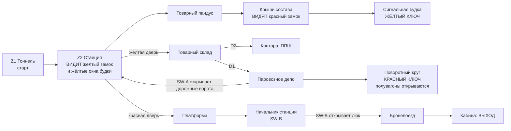

# MAP04 — «Транссиб» (Trans-Siberian), сортировочная станция Свердловск

Каноническая версия: `docs/levels/MAP04-transsib.md` (английский).

Синхронизировано с оригиналом: 2026-10-27.

Проектный документ. Владелец: `level-designer`. Статус: **v1 ПОСТРОЕНА
2026-10-22 (§13): весь план этажа, текстурированный утверждёнными наборами,
населённый на сложностях 1–5, три секрета; одета в набор «Железная дорога»
Эпизода 2 2026-10-22 (D107, §7, §13.6); ещё не пройдена, ещё не запускалась в
движке.** Эпизод 2, «Дорога на Москву», открывается здесь (D104, фаза P4).
Построена по принципу MVP first (D60), как MAP02 и MAP03 дошли до своих v1:
полная и проходимая, баланс после плейтестов. Рабочее задание для PM; вердикт
CEO выносится по прохождению карты, а не по чтению этого документа (D28).
Источник: `src/maps/MAP04/map.py`; тесты: `tests/test_map04_transsib.py`;
маршрут: `transsib-critical` в `tools/route.py`; обзор:
`docs/levels/shots/MAP04-overview.png`. Русское зеркало: причитается к закрытию
фазы (D34).

> **Пройти карту** (PM или CEO; агенты никогда не запускают GZDoom, D26):
> `python3 tools/build.py && SD_ALLOW_ENGINE=1 MAP=MAP04 SKILL=3 tools/run.sh`.
> **Прогнать маршрут:** `SD_ALLOW_ENGINE=1 python3 tools/route.py --route transsib-critical --keep-evidence`
> (сложности 2, 3, 4).

Вводные данные, которым подчиняется этот документ и которые он не повторяет:
`docs/PRD.md` (D35 о фракциях, D58 о ненайденном пропуске MAP02, D60 о MVP
first, D104 об Эпизоде 2), `docs/product/LORE.md`, `docs/engine/BESTIARY.md`,
`docs/engine/BALANCE.md`, `docs/engine/MOD-SPEC.md` (DoomEdNum, ключи,
MAPINFO), `docs/art/TEXTURE-INDEX.md` (только утверждённые лампы) и метод
`docs/levels/MAP03-factory.md`, структуре которого следует этот документ.


## 1. Синопсис

Ноябрь 1977 года. Выбравшись из Танкограда служебным тоннелем, сержант
Виланова поднимается на сортировочную станцию Транссиба в Свердловске, где
Четвёртый рейх держит пути и паровозное депо, а Легион Свободы — сигнальную
будку и товарный склад; он берёт пропуск сигнальщика из будки над вагонами,
пропуск начальника депо — с поворотного круга, и садится в стоящий у
пассажирской платформы советский бронепоезд, который увозит его на запад.

## 2. Место в кампании

| | |
|---|---|
| Идёт после | MAP03 Танкоград, который завершает Эпизод 1 у портала (кластер 1, `endtitle`). Эпизод 2 начинает новую игру на MAP04 (заготовка `episode MAP04` в MAPINFO): **старт с пистолетом**, поэтому карта выдаёт ИЖ, ППШ и РПГ-7 по ходу маршрута. |
| Её номер | MAP04, первая карта Эпизода 2; за ней следует MAP05 (плотина на Волге) через текст кластера 5. |
| Что добавляет | **вертикальное прохождение** (крыши крытых вагонов — путь к первому ключу), первая **ловушка, захлопывающаяся подбором предмета** (красный ключ роняет борта полувагонов), **выход, который является транспортным средством** (кабина бронепоезда) и узел, увиденный сверху. |
| Фракции (D35) | Рейх держит станцию и паровозное депо (локомотивы, его военная машина); Легион — сигнальную будку и товарный склад (снабжение); **обе** — на платформе и в поезде, а контратака из полувагонов смешанная. Оба знамени висят рядом над вокзалом. |
| Кульминация | пассажирская платформа с бронепоездом вдоль неё: Panzermensch на любой сложности, Doughboy, обе фракции; тяжёлый Panzermensch на сложности 4. |
| Выход | регулятор в кабине локомотива (`SDSW1D`, панель опасности, которую носит каждый выход). |

## 3. Что должна делать карта

| Задача | Как это реализует планировка |
|---|---|
| Быть железнодорожной станцией | четыре пути поперёк станции, на них вагоны (крытые товарные, цистерна «НЕФТЬ», платформы высотой в ящик, два открытых полувагона), два светофора на своих столбах, поднятая **сигнальная будка** с окнами по всему периметру, **паровозное депо** с поворотным кругом, мост которого несёт путь, товарный склад со штабелями ящиков, пассажирская платформа с бордюром и колоннами навеса и **бронепоезд** на пути платформы. |
| Использовать вагоны | ряды вагонов — **укрытие** на станции (96 высотой: монстр за ним скрыт, игрок тоже); сцепленный **состав из четырёх крытых вагонов** — поднятые мостки длиной 1280, доступные по товарному пандусу с восточного конца, со снайперами на них; единственный путь в сигнальную будку идёт по этим крышам. |
| Снова учить грамматике ключей (D58) | **жёлтый замок — первое, что видно** на выходе из тоннеля (подсвечен жёлтым в южной стене станции); **жёлтые окна сигнальной будки светятся над вагонами** из того же места; **красный замок** виден с крыш, внизу в северной стене, в раунде 0. Каждый ключ лежит один, освещённый на 192, на постаменте цвета своего замка и виден оттуда, где входят в его комнату (проверено тестом). |
| Ritmo creciente | суммарные хит-пойнты, встреченные за раунд маршрута, растут от раунда к раунду на любой сложности (проверено тестом): тоннель и станция, затем склад и депо, затем полувагоны и платформа; поезд — кода. |
| Завершить первый этап эпизода | выход — это посадка в бронепоезд: через его задний люк (открывается SW-B в кабинете начальника станции), по вагону с десантом, пушечному вагону и машинному отделению в кабину. |

Целевая длительность: 10–12 минут при первом прохождении на сложности 3
(как у MAP03), около 5 при повторном. Протяжённость 4528 × 2592 юнитов (MAP03:
3776 × 2144); тестом проверено, что площадь не превышает 1,5 × площади MAP03.

## 4. План

В масштабе: один символ = 64 × 64 юнита, север наверху, x на восток (0 …
4544), подпись строки — южная грань ячейки; сгенерировано по построенной
карте. Полы: станция, склад, депо **0**; тоннель и яма поворотного круга
**−64**; крыши **96**; сигнальная будка **128**; платформа **32**; поезд
**48**.

```
     y
  2496            ttttttttttttttttttttttttt#bbb
  2432            ttttttttt tttttttt tttttt#bbb      <- the armoured train; E = exit at its west end
  2368        PPPPPPPPPPPPPPPPPPPPPPPPPPPPPPPPPPPPPPPPPPPPPP
  2304        PPPPPPPPPPPPPPPPPPPPPPPPPPPPPPPPPPPPPPPPPPPPPP
  2240        PPPPPPPPPPPPPPPPPPPPPPPPPPPPPPPPPPPPPPPPPPPPPP
  2176        PPPPPPPP PPPPPPP PPPPPPP PPPPPPP PPPPPPP PPPPP   (canopy columns)
  2112        PPPPPPPPPPPPPPPPPPPPPPPPPPPPPPPPPPPPPPPPPPPPPP
  2048        PPPPPPPPPPPPPPPPPPPPPPPPPPPPPPPPPPPPPPPPPPPPPP
  1984                                            PP  BBBB   B = stationmaster, SW-B
  1920                                            ##  BBBB   ## = the RED door
  1856                              ............qqqqqq..............
  1792                              ................................
  1728                              ================================
  1664                              ....CCCC........................
  1600        HHHHHHHHHHHHHHHHHHHH  ....CCCCrrrrrrrrrrrrrrrrrrrr//..
  1536  222   HHHHHHHHHHHHHHHHHHHH  ....YCCCrrrrrrrrrrrrrrrrrrrr//..   Y = the YELLOW KEY
  1472  222LLLHHHHHHHHHHHHHHHHHHHH  ....CCCC........................
  1408  222LLLHHHHHHHHHHHHHHHHHHHH  ................................      111
  1344  222   HHHHHHppppppppHHHHHH  ...wwwww..wwwww..ggggg..........      111
  1280        HHHHHHppppppppHHHHHH  ...wwwww..wwwww..ggggg..........       1
  1216        HHHHHHppppppppHHHHHHA ................................     T T T
  1152     LLLHHHHHH---R----HHHHHHH#================================T//TTTTTTTT  <- start
  1088     LLLHHHHHH--------HHHHHHH#................................T//TTTTTTTT
  1024        HHHHHHppppppppHHHHHH  ....wwwww..ggggg.www............
   960        HHHHHHppppppppHHHHHH  ....wwwww..ggggg.www............
   896        HHHHHHppppppppHHHHHH  ................................
   832        HHHHHHHHHHHHHHHHHHHH  ................................
   768        HHHHHHHHHHHHHHHHHHHH  .........yyyyyy.................
   704        HHHHHHHHHHHHHHHHHHHH             ##                     ## = the YELLOW door
   640        HHHHHHHHHHHHHHHHHHHH             WW
   576        HHHHHHHHHHHHHHHHHHHH    WWWWWWWWWWWWWWWWWWOOOO
   512     wwLHHHHHHHHHHHHHHHHHHHHWWWWWWWWWWWWWWWWWWWWWWOOOO
   448     wwLHHHHHHHHHHHHHHHHHHHHWWWWWWwwwwWWWWWWWWwwwWOOOO
   384        HHHHHHHHHHHHHHHHHHHH    WWWWWWWWWWWWWWWWWWWWWW
   320                                WWWWWWWWWWWWWWWWWWWWWW
   256                                WWWWwwwwWWWWwwwwWWWWWW
   192                                WWWWWWWWWWWWWWWWWWWWWW
   128                                WWWWWWWWWWWWWWWWWWWWWW
    64                                            3
     0                                           333
```

Условные обозначения: `T` служебный тоннель (старт на его восточном конце) и
его ниши-убежища, `/` лестницы и товарный пандус · `.` станция, `=` её пути,
`w` вагоны и штабели ящиков (декорации), `g` полувагоны, `r` крыши состава
(96), `y` и `q` полосы порталов жёлтой и красной дверей · `C` сигнальная
будка (128), её подоконники, `Y` рычажная рама и **жёлтый ключ** · `W`
товарный склад, `O` его контора (D2, ППШ) · `H` паровозное депо, `p` яма
поворотного круга (−64), `-` его мост, `R` стойка («королевская») и **красный
ключ**, `L` стойла, `A` SW-A рядом с дорожными воротами (`#` в западной стене
станции) · `P` платформа, `B` кабинет начальника станции (SW-B), `b` задний
балкон поезда, `t` бронепоезд, `#` его задний люк, выход на западном конце ·
`1` `2` `3` секреты.

| # | Зона | x | y | пол | потолок | свет |
|---|---|---|---|---|---|---|
| Z1 | Служебный тоннель (старт), тюбинги, путь | 4032…4544 | 1120…1248 | −64 | 64 | 112 |
| — | Лестница, 3 ступени по 16; устье | 3936…4032; 3840…3936 | 1120…1248 | −48…−16; 0 | 128 | 112; 128 |
| — | Ниши-убежища (S1 — средняя, 96) | 4160…4480 | 1248…1264 | −64 | 64 | 112 / 96 |
| Z2 | Станция (ночь, открыта небу `SDSKY1` с раунда 2) | 1792…3840 | 768…1920 | 0 | небо 384 | 128 |
| — | Ряды вагонов 1 и 2 (крытый 96, цистерна 96, платформы 64, полувагоны 96 с днищем на 16); два светофора на бетонных столбах высотой 128 | 1984…3072 | 960…1088, 1280…1408 | 64 / 96 | 384 | 128 / 112 |
| — | Крыши состава, четыре сцепленных крытых вагона | 2304…3584 | 1536…1664 | 96 | 384 | 128 |
| — | Товарный пандус, 5 ступеней по 16 | 3584…3744 | 1536…1664 | 80…16 | 384 | 128 |
| — | Полоса портала жёлтой двери | 2368…2752 | 768…832 | 0 | 128 | **192**, жёлтый |
| — | Полоса портала красной двери | 2560…2944 | 1856…1920 | 0 | 128 | **192**, красный |
| Z3 | Сигнальная будка (на своей башне), окна 160…208 по всему периметру, остеклены со стороны станции (`SDSBOX1`); полоса окон открыта небу | 2048…2304 | 1472…1728 | 128 | 240 (полоса: небо 208) | 176, жёлтый |
| — | Ступень с крыш (её крыльцо открыто небу) | 2272…2304 | 1536…1664 | 112 | небо 240 | 176 |
| — | Рычажная рама, жёлтый ключ | 2080…2144 | 1568…1632 | 144 | 240 | **192**, жёлтый |
| Z4 | Товарный склад (вестибюль 2496…2624 × 640…736) | 1920…3328 | 128…640 | 0 | 256 | 144 |
| — | Контора (D2), ППШ | 3088…3328 | 464…640 | 0 | 128 | 128 |
| — | Проход на запад (D1 на его дальнем конце) | 1696…1920 | 448…576 | 0 | 128 | 144 |
| Z5 | Паровозное депо | 384…1664 | 384…1664 | 0 | 320 | 128 |
| — | Яма поворотного круга, две половины, по 3 ступени из каждой | 768…1280 | 928…1440 | −64 | 320 | 128 |
| — | Мост поворотного круга (на нём путь) | 768…1280 | 1120…1248 | 0 | 320 | 128 |
| — | Стойка, красный ключ | 992…1056 | 1152…1216 | 16 | 320 | **192**, красный |
| — | Подъездной путь к станции; его ворота | 1664…1760; 1760…1792 | 1120…1248 | 0 | 128 | 128 |
| — | Стойла (локомотив; закрытые ворота; тёмное — S2) | 192…384 | 448…576, 1120…1248, 1408…1536 | 0 | 192 / 128 | 112 / 96 |
| Z6 | Пассажирская платформа, колонны навеса | 384…3328 | 2048…2432 | 32 | 256 | 160 |
| — | Вестибюль красной двери и ступень | 2688…2816 | 1952…2048 | 0, 16 | 128 | 160 |
| — | Кабинет начальника станции (SW-B) | 2944…3200 | 1952…2048 | 32 | 160 | 144 |
| — | Задний балкон поезда | 2304…2496 | 2432…2592 | 48 | 176 | 128 |
| Z7 | Бронепоезд: вагон с десантом, пушечный вагон, машинное отделение, кабина | 640…2272 | 2464…2592 | 48 | 176 | 128 / 144 |
| E | Ниша выхода (регулятор) | 624…640 | 2496…2560 | 48 | 176 | **192** |

Каждая высота кратна 16; ни одна ступень вверх не выше 16 (проверено тестом).

## 5. Прогрессия, ключи, переключатели и выход



**Ключи.** Жёлтая и красная карточки Doom (редакторные номера **6** и **13**,
замки **3** и **1**, прочитаны из `gzdoom.pk3 → lockdefs.txt`, как на MAP03),
которые рисует Freedoom, пока у нас нет своих. В вымысле это **пропуск
сигнальщика** на рычажной раме сигнальной будки и **пропуск начальника депо**
на стойке поворотного круга.

| Id | Где | Тип | Special | Может ли запереть игрока? |
|---|---|---|---|---|
| D1 | Проход склада → депо | ручная дверь, `SDDOOR1` | `Door_Raise` (1), с обеих сторон | нет |
| D2 | Склад → его контора | ручная дверь, `SDDOOR1` | `Door_Raise` (2), с обеих сторон | нет |
| **YD** | Южная стена станции → склад, шириной 128, между двумя табличками со звездой | **заперта, открывается навсегда**, `SDDOORY` | `Door_LockedRaise (4, 16, 0, 3, 0)`, с обеих сторон | нет |
| **RD** | Северная стена станции → платформа, шириной 128, между побелённым кирпичом | **заперта, открывается навсегда**, `SDDOORR` | `Door_LockedRaise (5, 16, 0, 1, 0)`, с обеих сторон | нет |
| GATE (SH) | Подъездной путь депо → станция, шириной 128 | дистанционная, открывается навсегда | тег 10. Сталь со стороны пути; **собственный кирпич станции со стороны станции**, стена, пока не откроется | нет |
| SW-A | Северная стена подъездного пути, рядом с воротами | `SDSW1B` (кнопка), одноразовый | `Door_Open (10, 16, 0)` | нет |
| HATCH | Задний торец бронепоезда, с его балкона | дистанционный, открывается навсегда, `SDDOOR1` с обеих сторон | тег 11 | нет |
| SW-B | Кабинет начальника станции, задняя стена | `SDSW1A` (рубильник), одноразовый | `Door_Open (11, 16, 0)` | нет |
| GONDOLAS | Борта двух открытых вагонов, обращённые к главному пути | лифт, опускается навсегда | тег 12, `Floor_LowerToLowest (12, 16)`, который несёт **вещь красного ключа** (при подборе) | нет (никогда не нужен) |
| HUT (V3) | Северная стена станции, севернее товарного пандуса → будка путевых рабочих | чулан, открывается навсегда; кирпич станции, пока не сдвинется | тег 13, `Door_Open (13, 16)`, который несёт **вещь жёлтого ключа** (при подборе) | нет (тупик, никогда не нужен) |
| EXIT | Западная стена кабины, ниша 64 × 128 | `SDSW1D` | `Exit_Normal (0)` | — |

**Порядок, как его играют тесты** (`test_the_route_is_the_designed_one`),
четыре раунда:

1. Только нажимные панели: тоннель, станция, пандус и крыши, сигнальная
   будка, **жёлтый ключ** (S1 можно взять).
2. Жёлтая дверь: склад (D2, его контора), проход (D1), депо, **красный
   ключ** (S2 и S3 можно взять).
3. Красная дверь, дорожные ворота SW-A (короткий путь обратно на станцию) и
   полувагоны (подбор красного ключа): платформа, кабинет начальника станции.
4. SW-B: люк, поезд, **выход**.

**Указатели** (урок MAP02, D58, и правила MAP03):

- **Жёлтый замок — первое, что видно.** От устья тоннеля жёлтая дверь видна
  освещённой в южной стене станции за концом первого ряда вагонов (проверено
  тестом), а над вторым рядом окна сигнальной будки светятся жёлтым (проверено
  тестом): замок и комната его ключа одним взглядом.
- **Красный замок виден до своего ключа**, с крыш, внизу в северной стене
  (проверено тестом, раунд 0).
- **Каждый ключ лежит один, освещённый, на маршруте**, в цвете своего замка,
  и ничто другое этот цвет не носит (проверено тестом): жёлтый ключ на
  рычажной раме, виден вдоль крыш через дверь будки (проверено из трёх точек);
  красный ключ на стойке, виден от двери депо (проверено тестом), и ни одного
  монстра на обеих линиях обзора при появлении (проверено тестом).
- **Каждый переключатель виден вместе с тем, что он открывает.** SW-A в
  собственной стене подъездного пути, ворота перед ним (проверено тестом);
  SW-B смотрит из кабинета через платформу на люк поезда (проверено тестом);
  от открытого люка выход виден вдоль поезда (проверено тестом).

**Правила против софтлоков** (MAP01 §4, MAP02 §5, MAP03 §5): ни одна дверь не
закрывается за игроком (замки и дистанционные двери открываются навсегда,
ручные двери открываются снова с обеих сторон); нет лифтов, на которых едет
игрок (борта полувагонов только открываются); у каждого спуска есть подъём
обратно в той же зоне (крыши → пандус, яма → её ступени, лестница тоннеля);
окна сигнальной будки высотой 48, сквозь них смотрят, но не лезут. Проверено
на каждом этапе: из любого сектора, достижимого игроком, есть путь назад к
старту, а в конце — путь дальше к выходу; **ни секрет, ни полувагон, ни
дорожные ворота не нужны** для выхода (проверено тестом).

## 6. Кривая интенсивности

```
  high |                                                     ########
       |                                       ####          ########  <- the platform,
 press |                         ####     ##   ####  ####    ########     the train alongside
  ure  |           ####  ##      ####     ##   ####  ####    ########  ##
       |   ##      ####  ##  ##  ####  ## ##   ####  ####    ########  ##  ##
   low |   ##      ####  ##  ##  ####  ## ##   ####  ####    ########  ##  ##
       +---------------------------------------------------------------------------->
        tunnel     yard  roofs box  ware- office round- turn- gondolas platform train cab
                                    house       house  table (yard)
        0:00                                                                     ~11:00
```

| Бит | Пространство | Ощущение | Вводимая механика |
|---|---|---|---|
| 1 | Тоннель, лестница | выход из темноты Танкограда; пикет наверху лестницы | преемственность: тюбинги и путь; ИЖ в тоннеле перед первым боем |
| 2 | Устье | **вид**: станция ночью, жёлтый замок, будка, светящаяся жёлтым над вагонами | замок и комната его ключа одним взглядом |
| 3 | Станция | стрелки среди вагонов, гончая в проходах | вагоны как укрытие |
| 4 | Пандус, крыши | **вверх**: снайперы на составе, красный замок внизу | состав как мостки; спрыгнуть можно свободно, пандус — путь назад |
| 5 | Сигнальная будка | бой в тесноте в освещённой стеклянной коробке; ключ на раме | — |
| 6 | Склад | депо Легиона, его первый Doughboy среди штабелей ящиков | ППШ в конторе |
| 7 | Паровозное депо | паровозы Рейха, гончие, Panzermensch у поворотного круга (3+) | РПГ-7 у двери; яма и её ступени |
| 8 | Поворотный круг | красный ключ на стойке: **ловушка захлопывается** на станции позади | подбор, который что-то делает |
| 9 | Дорожные ворота, станция снова | SW-A открывает ворота; войска из полувагонов на станции | короткий путь с тыла (SH MAP02, ставень MAP03) |
| 10 | Платформа | **кульминация**: обе фракции вокруг бронепоезда, Panzermensch, Doughboy, тяжёлый на 4 | — |
| 11 | Поезд | бой в тесноте по вагонам до кабины | выход, который является транспортным средством |

Хит-пойнты, встреченные за раунд (тестом проверено, что растут с раунда 0 до
раунда 2):

| Раунд | Сложность 2 | Сложность 3 | Сложность 4 |
|---|---|---|---|
| 0 (тоннель, станция, крыши, будка) | 300 | 400 | 590 |
| 1 (склад, депо) | 920 | 1660 | 2110 |
| 2 (полувагоны, платформа) | 1110 | 1900 | 3070 |
| 3 (поезд) | 80 | 100 | 600 |

## 7. Текстуры

### 7.1 По зонам (все утверждены и упакованы; проверено тестом)

Набор «Железная дорога» Эпизода 2 (D107, утверждён 2026-10-22,
`docs/art/TEXTURE-INDEX.md`, «Episode 2») применён с 2026-10-22; куда он
поставлен и как выровнен — в §7.2.

| Зона | Стены | Пол | Потолок |
|---|---|---|---|
| Служебный тоннель | `SDTUBB1` (один тайл, как в тоннелях MAP02 и MAP03); ниши `SDTUNL1` | `SDFLR2` + полоса `SDRAIL1` (повёрнута: ложе метро, линия Танкограда) | `SDCEIL2` |
| Лестница, товарный пандус, стены ямы | `SDCONC1` | `SDFLR2` | — |
| Станция | `SDBRCK1`; два светофора `SDSIGL1` (по одной грани) на столбах `SDCONC1`; флаг СССР `SDFLAG1` по обе стороны устья (D119: советские флаги с 2026-10-23; прежде были флаги Рейха); двое закрытых ворот склада `SDGATE2` | **`SDBLST1`** балласт, пути **`SDTRAK1`** (повёрнут) | небо (`F_SKY1`; MAPINFO `sky1` = `SDSKY1`); его ниши `SDCEIL2` |
| Вагоны | крытые, состав и оба полувагона **`SDWAGN1`**; цистерна **`SDTANK1`**; платформы `SDCRAT1` (высотой в один ящик) | крыши, верх цистерны и борта-кромки полувагонов **`SDWROF1`** (повёрнут); платформы `SDCRTOP1`; днища полувагонов **`SDGOND1`** (повёрнут, со сдвигом) | небо |
| Порталы замков | жёлтый: таблички `SDSTAR1` по обе стороны `SDDOORY`; красный: `SDBRCK2` по обе стороны `SDDOORR` (правило v1 MAP03) | `SDFLR2` | `SDCEIL1` |
| Сигнальная будка | внутри `SDTILE2`, снаружи башня `SDBRCK1`, окна остеклены **`SDSBOX1`** со стороны станции; фасад рычажной рамы **`SDLEVR2`** | `SDFLR3`; рама **`SDLEVR1`**; ступень `SDGRAT1` | `SDCEIL1`; полоса окон и крыльцо — небо |
| Склад | `SDBRCK1`; проходы `SDBRCK2`; штабели ящиков и ряд S3 `SDCRAT1`; знамя Красной Армии `SDFLAG2` (D119; прежде был флаг Легиона) | `SDFLR2`; штабели `SDCRTOP1` | `SDCEIL1` |
| Контора склада | `SDTILE2` | `SDFLR3` | `SDCEIL1` |
| Паровозное депо | **`SDBRCK3`** (зал, подъездной путь, стойла, ниша SW-A, кладовая S2); фонарь `SDWIND1`; двери стойл **`SDRHDR1`** (стойло 2 и панель S2); локомотив `SDSTEL1`; борта моста `SDSTEL1` | `SDFLR2`; пути **`SDTRAK1`** (повёрнут); настил моста **`SDGRAT2`** с его путём `SDTRAK1`; стойла **`SDBLST1`**; стойка `SDFLR4` | `SDCEIL2` |
| Платформа | `SDMARB2` (плитка вокзала по красному мрамору); борт поезда **`SDARMR2`**; оба флага; вокзальное табло **`SDSTAN1`** над бордюром | `SDMFLR2`; бордюр `SDMFLR3` (повёрнут на 180, K7 MAP02) | `SDCEIL1` |
| Кабинет начальника станции | `SDTILE2` | `SDFLR3` | `SDCEIL1` |
| Бронепоезд | **`SDARMR2`**, красная звезда **`SDARMR1`** на двух длинных стенах пушечного вагона и на задней стене заднего балкона; кабина **`SDCAB2`** (бока) и **`SDCAB1`** (её перед, будка котла); ниша выхода `SDSTEL1` | `SDFLR4` | `SDCEIL2`; кабина `SDCEIL1` |
| Двери, переключатели | `SDDOOR1` (D1, D2, люк), `SDDOORY`, `SDDOORR`; `SDSW1B` (SW-A), `SDSW1A` (SW-B), `SDSW1D` (выход) | | |
| Плакаты (§7.3) | `SDPOSTR1` Ленин, `SDPOSTR3` Сталин, `SDPOSTR2` мурал о космонавтике | ниши: пол их комнаты | ниши: `SDCEIL1` |

### 7.3 Плакаты (CEO 2026-10-22; `tests/test_posters.py`)

«Reutiliza cuadros [...] y en los nuevos el de Lenin y Stalin, que esos
posters puedan aparecer en cualquier nivel» («Используй картины повторно [...]
а в новых — ту с Лениным и Сталиным, чтобы эти плакаты могли появляться на
любом уровне»). Четыре картины и пара Маркс–Энгельс, все в `POSTERS` в
`map.py`; каждая целая (одна линия ровно 128 длиной, в секторе ровно высотой
с картину, закреплена по полу, смещение 0). Там, где комната выше картины,
картина висит в глубине ниши глубиной 16, потолок которой срезан до её
высоты (метод знамён); каждая ниша освещена на одну ступень лампы (16) выше
своей комнаты, чтобы лицо читалось ночью. Ниши — плоская декорация глубиной
16, в них никто не стоит, и ни маршрут, ни ключ, ни замок, ни секрет не
сдвигаются.

| Имя | Картина | Где | Зачем |
|---|---|---|---|
| `yard_red_door_lenin` | Ленин | станция, северная стена, ниша x 2432-2560 (глубина на y 1936), к западу от портала красной двери | фасад вокзального здания на станцию: крыши состава смотрят на него сверху вместе с красным замком (§5) |
| `yard_red_door_stalin` | Сталин | станция, северная стена, ниша x 2944-3072 (глубина на y 1936), к востоку от портала красной двери | близнец Ленина по другую сторону замка |
| `warehouse_legion_stalin` | Сталин | склад, восточная стена x 3328, y 320-448 (комната высотой 256: ниши нет) | знамя Красной Армии (`SDFLAG2`, y 192-256; D119, до того знамя Легиона) рядом со Сталиным, который там уже был |
| `platform_mural` | мурал | платформа, стена здания, ниша x 1024-1152 (глубина на y 2032), высотой 128 | мурал вокзала, лицом к бронепоезду, к западу от знамён двух фракций |
| `roundhouse_south` | **Энгельс** (`SDPOSTR5`) | депо, южная стена, ниша x 960-1088 (глубина на y 368), на оси лестницы поворотного круга | **слот Маркс–Энгельс**: собственный плакат депо, «СОЕДИНЯЙТЕСЬ!» над поворотным кругом |
| `warehouse_west` | **Маркс** (`SDPOSTR4`) | склад, западная стена x 1920, y 320-448, рядом с проходом в депо | **слот Маркс–Энгельс**: встречается первым (склад, затем проход, затем депо), поэтому его половина фразы идёт первой |

**Пара Маркс–Энгельс (D117, 2026-10-22)** висит в двух слотах
(`POSTER_SLOTS_MARX_ENGELS`, Маркс первым), по 128×256 каждый, как Ленин и
Сталин: `SDPOSTR4` Маркс «ПРОЛЕТАРИИ / ВСЕХ СТРАН,» и `SDPOSTR5` Энгельс
«СОЕДИНЯЙТЕСЬ!», отражён зеркально, чтобы смотреть на Маркса.
`MARX_ENGELS = ("SDPOSTR4", "SDPOSTR5")` перечисляет их в `WALL_TEXTURES`;
`tests/test_posters.py` хранит размещение (`PAIR`).

В §7.2 нет строки плаката или пропаганды, которую нужно заменить: в ожидании
ничего не меняется.

### 7.2 Набор «Железная дорога»: куда пошёл каждый элемент и что ещё ожидается

**Применено 2026-10-22** (D107; `tests/test_map04_transsib.py` хранит каждую
строку). Ни маршрут, ни ключ, ни замок, ни дверь, ни переключатель, ни секрет,
ни плакат не сдвинулись; новая геометрия — только декорация: столбы двух
светофоров (пропы, заменяющие два стальных столба в тех же проходах), две
ниши ворот склада глубиной 16 и путь моста поворотного круга в виде двух
полос по обе стороны стойки.

| Элемент | Где | Как выровнен |
|---|---|---|
| балласт `SDBLST1` | земля станции; три стойла депо | по миру, без смещения |
| путь на балласте `SDTRAK1` | главный путь и северная ветка станции; подъездной путь и пути стойл депо; путь моста поворотного круга | `rotationfloor` 90 (рельсы вдоль x, как было у `SDRAIL1`); каждая полоса — ровно один тайл 64 поперёк на сетке 64, так что виден один путь и никогда рельс следующего тайла (проверено тестом). Тоннель сохраняет `SDRAIL1`, бетонное ложе метро из Танкограда. Стойла шириной 128 и получают балласт, а не путь: плоский путь там показал бы рельсы второго пути |
| товарный вагон `SDWAGN1` | крытый вагон ряда 1, четыре крытых вагона состава, кожухи и опускающиеся борта обоих полувагонов | вагон высотой 96 на тайле 128: `offsety` 32 срезает верх, так что ходовая часть стоит на земле. Вдоль x каждый длинный борт — **один прогон**: он начинается на деревянной стойке (`offsetx` 64 на левом от зрителя конце), идёт через разрезы художника без скачка (борта полувагонов — отдельные сектора), а вагон длиной 320 кончается на шве тайла, так что состав читается как четыре сцепленных вагона, а не одна стена; торцы показывают один целый тайл (всё проверено тестами) |
| цистерна `SDTANK1` «НЕФТЬ» | вагон ряда 2 (был «военным вагоном» из `SDSTEL1`) | `offsety` 32; `offsetx` 96, так что её 320 показывают два целых тайла по центру: «НЕФТЬ» дважды, никогда не обрезано (проверено тестом) |
| бронелист `SDARMR2` | борт поезда на платформе (1728 = 27 целых листов, закреплены по бордюру), каждый вагон поезда внутри, задний балкон | простая заливка |
| бронелист со звездой `SDARMR1` | три панели: две длинные стены пушечного вагона (по центру, x 1472-1600) и задняя стена заднего балкона (x 2336-2464, звезда, которую видит платформа) | каждая шириной в один тайл на стене высотой ровно в один тайл (внутри поезда 48-176), никогда не сложены стопкой и никогда не стоят рядом (проверено тестом). Борт на платформе высотой 224: звезда там показалась бы дважды, одна над другой, поэтому он остаётся простым листом. Простые части балкона смещены так, чтобы звезда начиналась на шве листов |
| светофор `SDSIGL1` | **два светофора, по одной грани (D107: единичное использование)**: главного пути, восточная грань столба на x 3488, y 1088-1152, обращённая к устью тоннеля (первое, что видно на выходе из него); северного прохода, западная грань столба на x 3264, y 1440-1504, обращённая к будке | каждый столб — проп-сектор высотой 128 (`SDCONC1` на других гранях), так что грань — нижняя текстура ровно в один тайл высотой, целая; проверено тестом: ни одной грани длиннее 64, ни одной выше одного тайла, никакие две не соприкасаются, по одной на светофор |
| кирпич депо `SDBRCK3` | зал, подъездной путь, стойла, ниша SW-A, кладовая S2 | закреплён по полу: фриз идёт на 128 и 256 в зале высотой 320, под потолком в стойлах. Станционная грань ворот подъездного пути остаётся `SDBRCK1` (кирпич станции, проверено тестом) |
| `SDGATE2` «СКЛАД» | двое закрытых, опломбированных товарных ворот склада в южной стене станции, x 2112-2240 и 2880-3008, далеко от жёлтого замка | каждые — целый тайл в глубине ниши глубиной 16, срезанной до 128 (метод знамён) |
| `SDGRAT2` (набор плотины) | настил моста поворотного круга над ямой, по обе стороны его пути | по миру; «просечно-вытяжная сталь над пустотой» — это и есть мост поворотного круга |

Сознательно не используются: `SDSPIL1`, `SDCTRL1`, `SDTURB1` и остальное из
наборов плотины и Москвы не имеет места на сортировочной станции. Стены
станции остаются `SDBRCK1`.

**Раунд 2, применён 2026-10-22 (D113;** `docs/art/TEXTURE-INDEX.md`,
«Episode 2, round 2»; `tests/test_map04_transsib.py` хранит каждую строку). Ни
маршрут, ни ключ, ни замок, ни дверь, ни переключатель, ни секрет, ни плакат,
ни монстр не сдвинулись; единственная новая геометрия — один сектор под
вокзальным табло (собственный участок бордюра, идентичный ему).

| Элемент | Где | Как выровнен |
|---|---|---|
| небо (`F_SKY1`; MAPINFO `sky1` = `SDSKY1`, за PM) | станция и всё, что на ней стоит (пути, вагоны, крыши, полувагоны, пандус, светофоры), полоса окон сигнальной будки и её крыльцо с крыш | стены станции стоят на 384, дальше ночь. Ниши, врезанные в стены станции (товарные ворота, флаги), получают собственную крышу (`SDCEIL2`): под небом стена над ними исчезла бы. Будка читается со станции как кирпичная башня, освещённое остекление и ночь над перемычками окон (потолок самой кабины — внутри) |
| крыша вагона `SDWROF1` | четыре крыши состава, верх крытого вагона и цистерны, кромки и опускающиеся борта обоих полувагонов | `rotationfloor` 90: мостки идут вдоль вагона (x). Вагон глубиной 128, два плоских тайла: на каждой крыше два мостка, симметричных относительно её середины |
| пол полувагона `SDGOND1` | днища обоих полувагонов | `rotationfloor` 90 и сдвиг на 16 в обе стороны: каждое днище лежит на 16 от сетки створок 32, так что стыки створок встречаются с кромками днища (9 × 3 створки); 16 равно собственной противоположности по модулю 32, поэтому знак сдвига значения не имеет |
| перед кабины `SDCAB1` (одна деталь) | передняя стена кабины (x 640), ниша выхода врезана в её середину | один тайл поперёк стены 128, две части по 32 по обе стороны ниши продолжают его (столбцы 0-31 и 96-127): видны круглые окна и бока будки котла, её середина (манометры, регулятор, топка) за панелью выхода, регулятор — и есть выход |
| бок кабины `SDCAB2` | две боковые стены кабины (192, три тайла) | закреплён по полу, целые тайлы от сетки |
| остекление `SDSBOX1` | каждое окно будки, видимое со станции: внешние линии полосы, по всему периметру, кроме крыльца (896 остекления) | средняя текстура каждой линии, только со стороны станции (изнутри станция видна сквозь окно); `offsety_mid` 8 (UDMF zdoom, по частям), так что строки 8-55 заполняют проём высотой 48; стёкла целые по сетке 64. Стекло непрозрачно, поэтому каждая линия несёт ещё и `blocksight`: легионеры в будке не могут стрелять сквозь стекло, сквозь которое не видит игрок |
| `SDLEVR1` рычажная рама, верх | рама (постамент жёлтого ключа) | ровно один плоский тайл: рама 64 × 64 и на 32 от сетки в обе стороны, сдвиг 32 (собственная противоположность по модулю 64); `rotationfloor` 90 поворачивает доски, на которых стоит сигнальщик, к крыльцу (на восток). **НЕ ПРОВЕРЕНО**, в какую сторону поворачивает GZDoom: если в движке они смотрят на запад, `LEVER_ROTATION` равен 270 |
| `SDLEVR2` рычажная рама, фасад | фасад рамы высотой 16 и два её торца, видимые из кабины | `offsety` 45: строки 45-60, пронумерованные латунные таблички и чугунное ложе |
| `SDRHDR1` двери пути | закрытые двери стойла 2 и панель S2 в стойле 3 (та же грань: подсказка S2 остаётся тенью) | каждая — целый тайл, 128 × 128 |
| `SDSTAN1` вокзальное табло «СВЕРДЛОВСК / СОРТИРОВОЧНЫЙ» | под навесом над краем платформы, x 2048-2304 (линия платформа–бордюр на y 2368) | средняя текстура этой одной линии, ровно 256 длиной (бордюр под ней — отдельный сектор, чтобы линия была такой), со стороны платформы; подвешено от навеса (256) вниз до 192, над любыми головами; читается вдоль платформы по пути к люку |

**Всё ещё ожидается** (каждый — одна замена в `src/maps/MAP04/map.py`, как
только деталь появится; ничто не блокирует карту):

| # | Нужно | Вид | Где | Сейчас носит |
|---|---|---|---|---|
| 7b | **Переключатель выхода на языке кабины** (рукоять регулятора, пара SW1/SW2) | пара переключателей 64×128 | ниша выхода | `SDSW1D` (выход каждой карты) |
| 11 | Борт фермы **моста поворотного круга** | стена 64×64 | борта моста над ямой | `SDSTEL1` |
| 14 | Колонны **навеса платформы** (чугунные) и потолок навеса | стена 64×128, плоскость | пять колонн навеса | `SDMARB2` (колонны вырезаны из платформы) |
| 15 | Перед **локомотива** (дверца дымовой коробки паровоза) | стена 128×96 | локомотив стойла 1 | `SDSTEL1` |
| 16 | Стена **товарных сараев станции** (дерево) | стена 64×128 | северная стена станции | `SDBRCK1` |
| 17 | **Путь поперёк стойл и подъездного пути** (геометрия, за этой ролью: полоса 64 внутри каждого стойла 128 и поперёк подъездного пути и ворот, делящая сектора, в которых лежат вещи и панель S2) | — | стойла, подъездной путь (1664…1792) | балласт в стойлах, бетон на подъездном пути: путь обрывается у устья каждого стойла и у подъездного пути |

Строки 1, 3, 4, 7 (стены кабины), 8, 9, 12 и 13 сделаны в раунде 2 (выше);
строки 2, 5, 6 и 10 списка v1 — в первом проходе.

Спрайты (за art-director; классы за `mod-engineer`), по желанию: буферные
упоры (где путь кончается у стойл), водоналивная колонка, фонарные столбы со
светом (световой проход v2), колёсные пары вагонов.

## 8. Секреты

Правило MAP01: подсказка — это сравнение или вопрос, никогда не знак; у
каждого секрета есть путь назад (проверено тестом), ни один не нужен
(проверено тестом).

| # | Где | Подсказка (проверена тестом) | Награда (на любой сложности) |
|---|---|---|---|
| S1 | Служебный тоннель, за средней нишей-убежищем | три ниши; средняя в тени (96 против 112), и её задняя стена — сборная панель (`SDCONC1`), тогда как две другие показывают обшитый бетон тоннеля с кабелями (`SDTUNL1`): кабельный ящик, который является нажимной панелью | бронежилет, две перевязки (ранняя помощь при старте с пистолетом) |
| S2 | Третье стойло депо | два стойла кончаются закрытыми воротами; третье тёмное (96 против 112), и его ворота — нажимная панель | **РОКС-3** на карту раньше и две канистры топлива |
| S3 | Южная стена склада | четыре ящика заполняют её участок; третий стоит на 16 назад, в тени | тяжёлый бронежилет, коробка ПГ-7В (для платформы) |

Каждая панель — `Door_Open` (нажимная, открывается навсегда) на обеих гранях,
с флагом `secret`; каждая кладовая — сектор со special 1024. S1 открыт в
раунде 0, S2 и S3 — в раунде 1 (проверено тестом).

## 9. Враги и ресурсы по сложностям

Собственные числа бестиария (21100-21107, а с D116 ещё 21110 — пулемётчик
Легиона; DoomEdNum из MAPINFO), каждый класс, кроме Генерала (он пал в
Танкограде). Вложены по парам сложностей Doom (`skill_tier`): 1-2, 3, 4-5.

| Зона | Сложность 2 | Сложность 3 | Сложность 4 |
|---|---|---|---|
| Устье тоннеля (на станции по обе стороны от него) | 1 стрелок | 1 стрелок | 2 стрелка |
| Станция (земля) | 2 стрелка + 1 гончая | 2 стрелка + 1 гончая + 1 штурмовик | 2 стрелка + 1 гончая + 2 штурмовика |
| Будка путевых рабочих (жёлтый ключ, V3: туда перешли трое стрелков станции) | 1 стрелок | 2 стрелка | 3 стрелка |
| Крыши состава | 2 стрелка | 3 стрелка | 3 стрелка + 1 штурмовик |
| Сигнальная будка | 1 легионер | 1 легионер | 1 легионер + **1 пулемётчик** |
| Склад + контора | 3 легионера + **1 пулемётчик** + 1 штурмовик + 1 Doughboy | 4 легионера + 1 пулемётчик + 2 штурмовика + 1 Doughboy | 5 легионеров + 1 пулемётчик + 2 штурмовика + 2 Doughboy |
| Паровозное депо | 2 гончие + 2 стрелка | 3 гончие + 2 стрелка + 1 Panzermensch | 3 гончие + 3 стрелка + 1 Panzermensch |
| Полувагоны (красный ключ) | 1 легионер + 1 стрелок | + 1 штурмовик + 1 гончая | 2 легионера + 1 стрелок + 2 штурмовика + 1 гончая |
| Платформа | 1 Panzermensch + 1 легионер + **1 пулемётчик** + 2 стрелка + 1 штурмовик + 1 Doughboy | + **1 пулемётчик** + 1 Doughboy + 1 гончая | 1 Panzermensch + 1 легионер + 2 пулемётчика + 3 стрелка + 2 штурмовика + 2 Doughboy + 1 гончая + **1 тяжёлый Panzermensch** |
| Бронепоезд | 1 штурмовик + 1 стрелок | + 1 стрелок (кабина) | + 1 Panzermensch (пушечный вагон) |
| **Всего** | **29** | **42** | **56** |

**Безопасный старт** (`tests/test_safe_starts.py`, 2026-10-22): на
сложностях 2, 3 и 4 ни один монстр не видит зону старта (старт и шаг вокруг
него) в пределах 768 юнитов; собственная проверка обзора Doom, запущенная на
построенной карте. Пикет у устья тоннеля стоял наверху лестницы (3888, 1150 и
1220), в 593 по прямой вниз по тоннелю от старта; теперь он стоит на станции по
обе стороны от устья, спиной к восточной стене станции (3776, 1056 лицом на
север; 3776, 1312 лицом на юг, сложность 4), вне линии тоннеля и встречается
у устья. То же число, тот же раунд (0).

**Дебют пулемётчика Легиона** (`SD_LegionGunner`, 80 HP, очереди хитскана,
D116; `docs/engine/2026-10-22_P4_ep2-enemies.md` §2): 2 / 3 / 4 на сложностях
2 / 3 / 4, каждый на месте легионера (та же фракция, то же число), там, где у
очереди длинная линия: задняя стена склада (3050, 200), перед ним весь зал;
платформа (2600, 2340; со сложности 3 ещё 2300, 2200), вдоль неё за колоннами
навеса; на сложности 4 сигнальная будка (2240, 1670), её окна над крышами и
станция — его бойница. **На MAP04 нет ни АКМ, ни магазина** (`2026-10-22_P4_akm.md`
§6): каждый пулемётчик роняет 15 патронов 7,62×39, первые в эпизоде,
сбережённые для винтовки MAP05. Ни один не в поле зрения старта. Закреплено
`test_the_legion_gunners`.

Против 25 / 38 / 52 на MAP03 (с 3000 HP Генерала на любой сложности): чуть
больше числом, меньше весом; первая карта эпизода.

**Оружие** (старт с пистолетом): ИЖ в тоннеле, до первого боя; ППШ в конторе
склада; РПГ-7 у двери депо, ближе к ней, чем Panzermensch депо (проверено
тестом); РОКС-3 только в S2. Ручной «Катюши» нет.

**Боеприпасы, D119 (2026-10-23).** Плейтест CEO по Эпизодам 2 и 3: «hay muchos
objetos de munición, siempre sale de sobras» («патронов подбираемых много,
всегда остаётся с избытком») и «siempre acabas con la escopeta» («ты всегда
заканчиваешь с дробовиком»). Теперь боеприпасы следуют за монстрами: они
**растут со сложностью** вместе с ними (таблица `AMMO` в `map.py`, строки с
наименьшим и наибольшим уровнем), а не по правилу расходников, поэтому на
лёгкой сложности подборов меньше, чем на тяжёлой. Мерило G3-8 — от MAP03
(убийства в зарядах ИЖ, пулемётчик 2; ПГ-7В по 2 заряда, топливо по ставке
РОКС-3, 13,5 за единицу при 80 у ИЖ, D119), размещено на маршруте, без
дропов и без секретов; полосы D119 (`docs/engine/BALANCE.md` §8): **1,5-2,0 ×
на сложности 2, 1,3-1,6 на 3, 1,2-1,45 на 4**, заряды дробовика не более 35 %
от этого, и каждый этап маршрута не ниже порога своей сложности по урону
против хит-пойнтов, встреченных к этому моменту (всё проверено тестами).

| | Сложность 2 | Сложность 3 | Сложность 4 |
|---|---|---|---|
| Нужно (заряды) | 57 | 92 | 138 |
| Размещено (эквиваленты зарядов), v1 → D119 | 250 → **94,5** | 242 → **132,5** | 199 → **169,5** |
| Отношение, v1 → D119 | 4,39 → **1,66** | 2,63 → **1,44** | 1,44 → **1,23** |
| Подборы боеприпасов на маршруте, v1 → D119 | 30 → **16** | 27 → **18** | 21 → **21** |
| Заряды дробовика (8 от ИЖ включены) | 20 | 40 | 52 |
| Патроны 7,62×25 (35 от ППШ включены) | 505 | 585 | 735 |
| ПГ-7В (2 от РПГ-7 включены) | 12 | 17 | 22 |
| Доля размещённого урона: заряды / патроны / ПГ-7В | 22 / 56 / 22 % | 31 / 46 / 23 % | 32 / 45 / 23 % |

В v1 заряды дробовика составляли около трёх четвертей размещённого урона на
любой сложности. По участкам, с оружием, которое у игрока там есть: тоннель,
станция и крыши (ТТ-33 и ИЖ) — два отдельных заряда на сложностях 2-3 и две
обоймы на сложности 2, одна коробка зарядов и одна коробка патронов на
сложности 4; склад и депо (ППШ и РПГ-7) — от пяти до восьми коробок патронов,
один отдельный подбор зарядов, одна коробка ПГ-7В (две на сложности 4);
платформа (тяжёлые) — четыре-пять коробок патронов, одна-две коробки ПГ-7В,
коробка зарядов со сложности 3. Обоймы стрелков и 15 патронов АКМ от
пулемётчиков (АКМ на MAP04 нет) по-прежнему идут сверху.

**BALANCE §8.3-§8.4, с поправкой PM от 2026-10-23** (всё проверено тестами):
заряды плюс выпавшие у легионеров ИЖ (по 2 заряда каждое с D119) против всего
размещённого и выпавшего: 27 / 34 / 34 % (≤ 35 %); каждый пул — только с
этапа своего оружия (ПГ-7В — с РПГ-7 депо; топлива на маршруте нет, РОКС-3
лежит в S2); на каждом этапе патроны ППШ и ТТ-33 — крупнейший пул кроме
зарядов дробовика и не менее 40 % его, а ПГ-7В — не более 30 % урона этапа
(склад и депо 27 / 24 / 30 %, платформа 30 / 27 / 27 %): РПГ-7 — сильный
второй ствол, а не новый дробовик. **Сложность 4 сохраняет 21 подбор v1**:
нижняя граница полосы (1,2), 35 % зарядов и 30 % ракет оставляют нести её
коробкам ППШ, десятой доле заряда за раунд; сложности 2 и 3 теряют 14 и 9
(тест не допускает ни одной сложности выше v1 и требует меньше на всех).
Закреплено `test_g3_8_the_ammo_budget`,
`test_ammunition_scales_up_and_there_is_less_of_it`,
`test_ammo_against_hit_points_by_skill_and_by_stage`,
`test_shells_with_the_drops_are_no_more_than_35_percent`,
`test_each_pool_from_the_stage_of_its_weapon` и
`test_the_newest_bullet_weapon_leads_every_stage_but_the_bosss`
(`tests/test_map04_transsib.py`, 82 теста OK на 2026-10-23).

**Здоровье и броня на маршруте:** перевязки 9 / 8 / 5, аптечки 6 / 6 / 4,
бонусы здоровья 9, бонусы брони 7 / 7 / 6, один бронежилет (склад).
Тяжёлый бронежилет — в S3.

## 10. Используемые элементы движка

| Нужно | Выдаётся | Статус |
|---|---|---|
| Ручная дверь | `Door_Raise` 12 (tag, 16, 150, 0) | ПРОВЕРЕНО на MAP01 |
| Дистанционная дверь, одноразовый переключатель | `Door_Open` 11 (tag, 16, 0) | ПРОВЕРЕНО на MAP01 |
| Запертая дверь, остающаяся открытой | `Door_LockedRaise` 13 (tag, 16, 0, lock, 0), замки 3 и 1 | ПРОВЕРЕНО на MAP02 / MAP03 (маршрут G6) |
| Выход | `Exit_Normal` 243 | ПРОВЕРЕНО на MAP01 |
| Ключи | вещи 6 (`YellowCard`), 13 (`RedCard`) | как на MAP03 |
| **Special подбора** | `special` 21, `arg0` 12, `arg1` 16 на вещи красного ключа; с V3 `special` 11, `arg0` 13, `arg1` 16 на жёлтом ключе (§14) | поле — база UDMF (как special смерти Генерала на MAP03); GZDoom исполняет special предмета при подборе (путь подбора `Inventory`, прочитан в zscript g4.14.2). Механизм **ПРОВЕРЕН в движке на MAP06** (`Door_Open` её красного ключа, RKEY маршрута, 2026-10-23); на этой карте: K3, K14 |
| **Floor_LowerToLowest** | special 21 (tag, speed) | номер прочитан из собственной таблицы спешлов g4.14.2 (2026-10-23, `src/maps/common/pickup_events_e2.py`); его действие в нашем движке **НЕ ПРОВЕРЕНО**: K3 (баррикады MAP06, V3, — доказательство для маршрута) |
| Цветной свет | `lightcolor` сектора: жёлтый `0xFFD860`, красный `0xFF6048` | как на MAP03 |
| Повёрнутые флэты | `rotationfloor` 90 на путях, 180 на бордюре | как на MAP02 (K7, K8) |
| Смещения текстур на гранях стен | `offsetx` / `offsety` сайддефа (база UDMF) на вагонах и балконе (§7.2); нижняя текстура двусторонней линии оставлена незакреплённой, так что её верхняя строка — край поднятого пола, а `offsety` её поднимает | собственное поведение Doom; на этой карте **НЕ ПРОВЕРЕНО**: K10 |
| Секреты | `special` сектора 1024; линии панелей с флагом `secret` | как на MAP01-MAP03 |

План тегов: **1** D1 · **2** D2 · **4** жёлтая дверь · **5** красная дверь ·
**6** панель S1 · **7** панель S2 · **8** панель S3 · **10** дорожные ворота
(SW-A) · **11** люк поезда (SW-B) · **12** борта полувагонов (подбор красного
ключа; ни одна линия его не несёт) · **13** будка путевых рабочих (подбор
жёлтого ключа, V3; ни одна линия его не несёт). Свободны: 3, 9, 14 и выше.

## 11. MAPINFO, LANGUAGE и маршрут

MAPINFO и LANGUAGE — за агентом-заготовщиком (P4): `map MAP04 lookup
"SD_MAP04_NAME"`, `cluster = 5`, `next = "MAP05"`, `SD_MAP04_NAME` =
"Trans-Siberian" / «Транссиб» / "Transsiberià" и `SD_MAP04_EXIT_TEXT`
(бронепоезд проходит станцию и идёт на запад). Эта роль их не трогает.

`transsib-critical` (`tools/route.py`) — это g3-auto карты, метод
tankograd-critical: A0 (старт, без ключа); YD0 и RD0 (оба замка нажаты без
ключа: закрыты); YKEY (пройти на жёлтый ключ на рычажной раме, без `give`);
YD1 (жёлтая дверь открывается, войти на склад); RDY (красная дверь закрыта
при одном жёлтом ключе); RKEY (пройти на красный ключ на стойке); SWA
(дорожные ворота открываются, люк ещё закрыт); RD1 (красная дверь, пройти на
платформу); SWB (люк открывается); E0 (с заднего балкона через люк по поезду к
кабине); E1 (регулятор). Каждая позиция считывается с построенной карты
(ключи по редакторному номеру, переключатели по тегу, двери по тегу и
замку, E0 по лучу из ниши выхода мимо тега люка); карта находится по своим
константам (`TAG_HATCH`, `TURNTABLE`), никогда по слоту. Её выход
сверяется с `next` из MAPINFO (MAP05).

## 12. План версий

| Версия | Содержание | Готово, когда |
|---|---|---|
| **v1 — полная, текстурированная, населённая** ✅ **ПОСТРОЕНА 2026-10-22** (§13) | весь план §4, оба ключа и замка, оба переключателя, люк, выход, состав и будка, поворотный круг, ловушка полувагонов, три секрета, население и ресурсы из §9, утверждённые наборы (§7.1) | проход PM в движке (§13.3) и CEO проходит её на сложности 3 |
| v2 — набор «Железная дорога» и свет | §7.2 по мере утверждения деталей art-director (~~сначала небо~~: раунд 2 поставил небо и восемь деталей, 2026-10-22); пятна прожекторов и лампа будки, мерцание в депо; буферные упоры, водоналивная колонка | игрок впервые находит оба ключа и поезд, не получая подсказок |
| v3 — баланс | после плейтестов (D60): боеприпасы сложностей 2-3, вес платформы | первая карта эпизода пройдена на сложности 3 |

## 13. Протокол постройки v1 (2026-10-22)

### 13.1 Что в ней есть

Всё из §4-§9: 104 сектора, 481 линия, 132 вещи (старт, два ключа, 56 монстров
на сложности 4, 3 секрета). Построена за один проход через `GridMap`, как v1
MAP03. Плакаты (§7.3, 2026-10-22) добавляют четыре сектора-ниши: 108. Набор
«Железная дорога» (§7.2, §13.6) добавляет шесть декоративных секторов: 114
секторов, 522 линии.

### 13.2 Проверка, которая действительно выполнена

- `python -m unittest tests.test_map04_transsib -v`: 66 тестов, OK
  (структура, текстуры, свет, четыре раунда, отсутствие ловушки, линии обзора
  грамматики ключей, переключатели, полувагоны, население, боеприпасы,
  секреты).
- `python tools/route.py --print --route transsib-critical`: последовательность
  собирается (12 шагов, 2741 символ, в пределах лимита 8000).
- `python tools/verify.py fast` (2026-10-22, с MAP05 и MAP06, приземлявшимися
  параллельно): build и check_pk3 PASS; тестов 2441, 3 падения, ни одного в
  файлах этой карты. То, что называет MAP04, — это
  `test_doughboy_sprites.MapFitTests.test_the_doughboy_is_placed_in_every_map`,
  которое сравнивает карты, ставящие Doughboy, с фиксированным набором
  (MAP01-MAP03, RANGE): карты Эпизода 2 тоже ставят его, так что ожидаемому
  набору нужны MAP04-MAP06 (изменение его владельца). Проверки посадки из того
  же тестового файла на MAP04 проходят, как и для Panzermensch и Schwer.
- **Не запускался: GZDoom** (D26). В движке здесь ничего не видели.

### 13.3 Чек-лист движка для PM (D26: эта роль не запускает GZDoom)

| # | Проверка | Как |
|---|---|---|
| K1 | Карта загружается с чистым логом, MAP04 из «Новой игры» Эпизода 2 | `tools/smoke.py` / `run.sh` с `MAP=MAP04` |
| K2 | `transsib-critical` даёт PASS на сложностях 2, 3, 4 | `SD_ALLOW_ENGINE=1 python3 tools/route.py --route transsib-critical --keep-evidence` |
| K3 | **Подбор красного ключа роняет борта обоих полувагонов** (special 21 на вещи ключа), и войска выходят | пройти RKEY, затем посмотреть на станцию; `netevent sdtag 12` должен вывести пол 0 для обоих бортов |
| K4 | Окна сигнальной будки читаются со станции как окна (проёмы высотой 48 на 160), и сквозь них виден жёлтый свет | скриншот от устья тоннеля |
| K5 | Состав проходим из конца в конец (без зацепов у сцепок: четыре сектора на 96), и спуск на станцию не смертелен | пройти его |
| K6 | Кромка бордюра лежит на стороне поезда (`rotationfloor` 180, как K7 MAP02) | скриншот на платформе |
| K7 | Монстры в полувагонах не видят наружу до ловушки (их днище 16, борта 96) | смотреть с земли; с крыш их видно и можно стрелять, по замыслу |
| K8 | Станция под небом `SDSKY1` (раунд 2): её стены стоят 384, затем ночь, нет верхней текстуры между двумя потолками-небом (вагоны, светофоры, полоса и крыльцо будки), ниши товарных ворот и флагов со стеной над ними (не плита неба); будка читается как кирпичная башня со светящимися окнами и ночью над их перемычками | скриншоты от устья и с крыш |
| K10 | **Борта вагонов** (§7.2): ходовая часть на земле (`offsety` 32), каждый крытый вагон состава начинается на стойке и кончается на шве, борта полувагонов без скачка там, где опускающаяся панель встречается с кожухом, и после спуска нет несовпавшего остатка; «НЕФТЬ» на цистерне дважды, целая | скриншоты от устья, вдоль ряда 1 и с крыш после RKEY |
| K11 | **Два светофора** (`SDSIGL1`): по одной целой голове, не обрезанной и не удвоенной; светофор главного пути виден от устья тоннеля, его красная линза читается как свет | скриншоты от устья и со ступени будки |
| K12 | Панели со звездой (`SDARMR1`) целые в пушечном вагоне и на задней стене балкона, как её видит платформа; 27 листов борта в `SDARMR2` без шва, плавающего на середине высоты; `SDTRAK1` идёт вдоль x на путях станции и на мосту поворотного круга (повёрнут на 90), его рельсы продолжают рельсы станции; балласт и путь одного цвета; фриз `SDBRCK3` депо на 128 и 256 | скриншоты на платформе, в поезде, у устья и на мосту |
| K13 | **Раунд 2** (§7.2): мостки на крышах идут вдоль вагонов; створки полувагонов встречаются с кромками днищ (без половинки створки у кромки) после того, как красный ключ роняет борта; будка котла в кабине целая по обе стороны от выхода (круглые окна), её бока целые; остекление будки целое в каждом окне, строки 8-55, освещённое, а легионеры внутри не стреляют сквозь него; рычажная рама — одна целая рама, доски к крыльцу (если на запад, `LEVER_ROTATION` 270), на её фасаде видны латунные таблички; двери стойла 2 и панель S2 той же грани; вокзальное табло целое, читается с платформы, не размножено плиткой | скриншоты в кабине, в будке, на крышах, в депо, на платформе |
| K14 | **V3: подбор жёлтого ключа открывает будку путевых рабочих** (`Door_Open` 13 на вещи ключа): её дверь, кирпич станции, поднимается в северной стене у пандуса, и выходят трое стрелков; RD0 читает тег 13 закрытым, YKEY читает его открытым | строка YKEY маршрута в отчёте; взгляд с пандуса после YKEY |
| K9 | Плакаты (§7.3) целые и читаются: два у красной двери с крыш состава (свет 144 на станции со 128), Сталин на складе рядом со знаменем Красной Армии, мурал платформы, слот депо над поворотным кругом; ни один не обрезан сверху и не размножен плиткой, а ниши глубиной 16 не цепляют при стрейфе вдоль стен | скриншоты с крыш, из вестибюля склада, с платформы и с моста |

### 13.6 Проход набора «Железная дорога» (2026-10-22)

25 утверждённых деталей Эпизода 2 (D107), применённых по §7.2 ролью
`level-designer`. Геометрия нетронута там, где это важно: ни маршрут, ни
ключ, ни замок, ни дверь, ни переключатель, ни секрет, ни плакат, ни монстр
не сдвинулись; тесты линий обзора (жёлтая дверь и будка от устья, красная
дверь с крыш, ключи) проходят без изменений. Добавлена декорация: столбы
светофоров (пропы, в проходах стальных столбов), две ниши ворот, полосы пути
моста.

- `python -m unittest tests.test_map04_transsib tests.test_posters`: 105 тестов
  OK, среди них новые `test_the_signals_are_single_use` (D107: ни одна грань
  `SDSIGL1` не длиннее 64 или выше одного тайла, ни одна не касается другой),
  `test_each_star_is_one_panel_one_tile_high_and_alone`,
  `test_wagon_sides_run_whole_and_continuous` и
  `test_the_railway_set_dresses_the_yard_and_the_roundhouse`.
- `python tools/verify.py fast`: PASS (build, check_pk3, 2762 теста).
- **Не запускался: GZDoom** (D26): K10-K12 за PM.

### 13.4 Открытые для CEO пункты

1. **Пройти v1** на сложности 3 (D28): хороший ли путь к сигнальной будке —
   состав крытых вагонов, и читается ли жёлтая будка от устья тоннеля?
2. ~~Ночное небо~~: стоит с раунда 2 (D113, `SDSKY1`). Правильно ли читается
   сигнальная будка с ночью над перемычками её окон?
3. **РОКС-3 в S2.** Картой раньше, как секрет (MAP03 выдала его на маршруте);
   или оставить S2 для брони, а выдачу отдать MAP05?
4. **Ловушка красного ключа** (полувагоны открываются, когда его берут):
   оставить или привязать к SW-A, как чуланы MAP03?

### 13.5 Что держат другие роли

- `art-director`: то, что §7.2 всё ещё перечисляет (пара переключателей
  выхода в кабине, фермы поворотного круга, навес, перед локомотива, сараи).
- `mod-engineer` / заготовка: MAPINFO и LANGUAGE для MAP04 (сделаны
  агентом-заготовщиком P4), музыка эпизода.
- `qa-engineer` / PM: проход по движку из §13.3.

### 13.7 Раунд 2 (2026-10-22, D113)

Второй раунд Эпизода 2 применён по §7.2 ролью `level-designer`: небо над
станцией (`sky1` в MAPINFO — `SDSKY1`, за PM), крыши вагонов и полы
полувагонов, кабина изнутри, остекление и рычажная рама сигнальной будки,
двери пути депо и вокзальное табло. Геометрия: один сектор под вокзальным
табло (`z6_coping_board`, собственный участок бордюра, идентичный ему), так
что линия табло ровно 256. Ни маршрут, ни ключ, ни замок, ни дверь, ни
переключатель, ни секрет, ни плакат, ни монстр не сдвинулись; тесты линий
обзора проходят без изменений. 115 секторов, 525 линдефов, 416 вершин.

- `python -m unittest tests.test_map04_transsib tests.test_posters`: 131 тест
  OK, среди них новые `test_the_night_sky_is_over_the_yard_only`,
  `test_the_wagons_wear_their_roofs_and_the_gondolas_their_floors`,
  `test_the_lever_frame_is_one_whole_frame`,
  `test_the_cab_is_a_steam_cab_from_inside`,
  `test_the_signal_box_is_glazed_from_the_yard`,
  `test_the_station_board_hangs_over_the_platforms_edge`,
  `test_middle_textures_are_only_the_glazing_and_the_board` и
  `test_the_stalls_wear_their_road_doors`.
- `python tools/verify.py fast`: build и `check_pk3` PASS (0 ошибок, 0
  предупреждений); единственные падения тестовой стадии вне этой карты
  (тесты побайтового тождества и крови у перерисованных спрайтов врагов,
  документы `test_gen_shells`).
- **Не запускался: GZDoom** (D26): K8 и K13 за PM.

## 14. V3 (2026-10-23): события при подборе (A2, D119/D120)

Плейтест CEO попросил ключи, которые что-то запускают (D119); D120 включил это
в V3. Эта карта была образцом (красный ключ и полувагоны, с v1); V3 даёт
жёлтому ключу собственное событие, так что оба ключа карты что-то делают.
Три карты Эпизода 2 делят проверенные спешлы и хелперы в
`src/maps/common/pickup_events_e2.py` (общий для всей игры шаблон пишется
параллельно как PICKUP-EVENTS.md, в этой папке, другим level-designer; PM их
объединит).

**Форма, использованная здесь** (эпизода, MAP04-MAP06):

1. Один special на самой вещи ключа (UDMF `special`, `arg0..arg4`),
   исполняемый GZDoom при подборе ключа, активатор — игрок. ПРОВЕРЕНО в
   движке с 2026-10-23 на MAP06 (её красный ключ открывает тег 10; шаг RKEY
   маршрута).
2. Тег, который **не несёт ни одна линия**, так что его запускает только
   подбор (проверено тестом: `test_no_line_carries_a_pickups_tag`).
3. То, что он открывает, — **тупик**, из которого игрок выходит, открытый
   навсегда, в нём нет ничего, что нужно маршруту (проверено тестом: выход
   достигается при всех закрытых тегах подборов).
4. **Предупреждено**: то, что открывается, в поле зрения того места, куда
   игрок идёт дальше, и движется со своим звуком (двери, пола).
5. Выпущенные им монстры **перемещены**, а не добавлены, где бы это ни
   позволял баланс (MAP04: трое стрелков станции), так что полосы G3-8 не
   сдвигаются.
6. Маршрут читает тег закрытым до ключа и открытым после него, так что проход
   PM в движке доказывает каждое событие.

| Ключ | Событие | Special на вещи | Тег | Что движется | Монстры |
|---|---|---|---|---|---|
| Красный (стойка) | контратака из полувагонов (v1) | `Floor_LowerToLowest (12, 16)` | 12 | борта обоих полувагонов опускаются 96 → 16 | 2 / 4 / 6 (§9) |
| **Жёлтый (рычажная рама)** | **будка путевых рабочих** (V3) | `Door_Open (13, 16)` | 13 | дверь будки в северной стене станции (3520…3648, 1920…1936) поднимается; будка (3456…3712, 1936…2064, высотой в один тайл) — тупик | 1 / 2 / 3 стрелка, переведённых со станции (3550 1460, 2950 1250, 3200 1830) |

**Ритм.** Раунд 0 (тоннель, станция, крыши, будка) был самым лёгким на
карте; теперь станция тише на входе (на двух-трёх стрелков меньше), а пропуск
сигнальной будки открывает будку путевых рабочих на выходе: когда игрок
возвращается на восток по крышам или спускается по товарному пандусу, её
дверь поднимается в 260 юнитах севернее пандуса, и путевые рабочие Рейха
выходят между ним и жёлтой дверью. Будка обращена к пандусу и восточным
крышам состава и вне поля зрения старта (проверено тестом). Хит-пойнты,
встреченные за раунд, по-прежнему растут от раунда к раунду на любой
сложности (проверено тестом); итоги остаются 29 / 42 / 56.

**Счёт.** 117 секторов, 535 линий (прежде 115 и 525): будка и её дверь.
Тесты: `tests/test_map04_transsib.py`, 88 OK (новые:
`test_the_yellow_key_opens_the_yard_hut`, `test_no_line_carries_a_pickups_tag`,
`test_the_hut_opens_only_after_the_yellow_key`,
`test_the_hut_holds_a_fight_on_every_skill`, `test_the_route_reads_the_hut`,
`test_the_hut_is_seen_from_the_ramp_and_the_east_roofs`). Маршрут
`transsib-critical`: RD0 читает тег 13 закрытым, YKEY ждёт 70 тиков и читает
его открытым. **Не запускался: GZDoom** (D26): K14 за PM.

## 15. V3 (2026-10-24): РГД-5 (A4) и пропагандистский громкоговоритель (B5)

**РГД-5** (ADR 012; совет по размещению `docs/engine/2026-10-23_V3_rgd5.md`
§6). Гранаты — расходники в `ITEMS`, поэтому они **убывают** со сложностью:
**4 / 3 / 2** гранаты на сложностях 2 / 3 / 4 (сложности 1 и 5 удваивают их,
как каждый подбор). Почему здесь: подсумок перед станцией: дебют Легиона
десятками — урок гранаты (легионеры за вагонами, затем склад). Ящика нет
(21022: только награда секрета).

| Где | Что | Сложности |
|---|---|---|
| `z1_tunnel` (4300, 1136) | подсумок (21009): оружие и 2 | любая сложность |
| `z2_yard` (3550, 1100) | отдельная граната (21021) | сложности 1-3 |
| `z4_hall` (2400, 450) | отдельная граната (21021) | сложности 1-2 |

**Бюджет** (BALANCE §8, граната — 1,25 эквивалента заряда, считается только
в полосе и в целой доле зарядов): отношение размещено / нужно на сложностях
2 / 3 / 4 переходит 1,658 → 1,746 / 1,440 → 1,481 / 1,228 → 1,246, внутри
1,5-2,0 / 1,3-1,6 / 1,2-1,45. Ни один другой подбор не сдвинулся. Готовность
этапа, лидерство самого нового оружия и этап босса гранат не считают.

**Громкоговоритель** (`SD_Loudspeaker`, 21201; MOD-SPEC §6.14; D124):
`z6_platform` (2048, 2280), радиус 512 (платформа длиной 2944): реплики 1, 16,
9, 10, 12, 15 (фронт, сигнал точного времени, парад, погода, объявление о
каске, план Танкограда: города, который сержант только что покинул).
Таблица `LOUDSPEAKERS` в `map.py`; геометрия не изменена (у него нет тела,
пока не нарисован рупор). Тесты: собственные у карты
(`test_every_pickup_can_be_picked_up`, полоса G3-8 с гранатами),
`tests/test_rgd5_maps.py`, `tests/test_loudspeaker.py`.

**Чек-лист движка (PM, D26):** гранаты лежат там, где говорит таблица, и
подбираются (`printinv`: `SD_Rgd5` и `SD_Rgd5Ammo`); громкоговоритель
проигрывает свою заставку при приближении, читает свои реплики поверх музыки
уровня, затихает при удалении (идущая реплика договаривается) и не слышен из
соседней комнаты; чистый лог.
