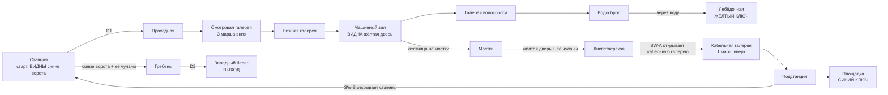

# MAP05 — «Волжская ГЭС» (Volga Dam), гидроэлектростанция в Жигулях

Каноническая версия: `docs/levels/MAP05-volga-dam.md` (английский).

Синхронизировано с оригиналом: 2026-10-27.

Проектный документ. Владелец: `level-designer`. Статус: **v1 ПОСТРОЕНА
2026-10-22 (§13): вся карта, проходимая от старта до выхода,
текстурирована только утверждёнными лампами, населена, три секрета; набор
«Плотина» применён в тот же день (§7.2, §13.6); пока не пройдена, прогона в
движке ещё не было (D26).** Эпизод 2, «Дорога на Москву» (D104, фаза P4),
вторая карта. Построена по принципу «сначала MVP» (D60). Исходник:
`src/maps/MAP05/map.py`; тесты: `tests/test_map05_dam.py` (карта) и
`tests/test_map05_route.py` (её автоматический маршрут); маршрут `dam-critical`
в `tools/route.py`; обзор `docs/levels/shots/MAP05-overview.png`. Русское
зеркало: причитается к закрытию фазы (D34).

> **Пройти карту** (PM или CEO; агенты никогда не запускают GZDoom, D26):
> `python3 tools/build.py && SD_ALLOW_ENGINE=1 MAP=MAP05 SKILL=3 tools/run.sh`.
> Автоматический прогон: `SD_ALLOW_ENGINE=1 python3 tools/route.py --route dam-critical --keep-evidence`.

Вводные данные, которым подчиняется этот документ и которые он не повторяет:
`docs/PRD.md` (D35 фракции, D58 ненайденный пропуск, D60 сначала MVP, D104
эпизод 2), `docs/engine/BESTIARY.md`, `docs/engine/BALANCE.md`,
`docs/engine/MOD-SPEC.md` (DoomEdNum, замки, пропуска),
`docs/art/TEXTURE-INDEX.md` (только утверждённые лампы) и метод
`docs/levels/MAP03-factory.md`.


## 1. Синопсис

Ноябрь 1977 года. Бронепоезд переправляет сержанта Виланову через Волгу на
станцию у восточного берега плотины в Жигулях, вровень с её гребнем; ворота
преграждают дорогу на запад. Он спускается внутрь плотины, отбивает у
Четвёртого рейха и Легиона Свободы машинный зал, водосброс и диспетчерскую,
поднимается по кабельной галерее на подстанцию за пропуском к этим воротам и
прорывается на запад по гребню к дальнему берегу.

## 2. Место в кампании

| | |
|---|---|
| Идёт после | MAP04, сортировочная станция Транссиба: её текст выхода (`SD_MAP04_EXIT_TEXT`) заканчивается словами «За рекой стоит плотина у Жигулей… Сегодня утром турбины стоят». MAP05 начинается на платформе станции рядом с бронепоездом (стальная глыба на рельсах, перекрывающая тоннель, из которого он вышел). |
| Идёт перед | MAP06, Красная площадь. Текст выхода (`SD_MAP05_EXIT_TEXT`) начинается словами «Вы переходите гребень плотины, внизу ревёт водосброс. За вашей спиной турбины снова вращаются»: гребень — последняя прогулка, водосброс лежит под ним, а SW-A в диспетчерской — рубильник начальника смены. |
| Что добавляет | **вертикальность** (три уровня, всего 384 по высоте: спуск и подъём сквозь бетон), **вода** (лёгкое жжение), ключ за дверью другого ключа (жёлтый → синий), **короткий путь, найденный с обратной стороны**, который избавляет от долгого пути назад, и две **контратаки на собственных тегах замков**. |
| Фракции (D35) | обе. Легион держит станцию на восточном берегу и открытую воду водосброса (там летают его Doughboy); Рейх управляет машиной: галереями, машинным залом, подстанцией. Диспетчерскую заняли обе, гребень держат обе. Генерал принадлежит MAP03 и здесь его нет. |
| MAPINFO, LANGUAGE | работа агента-каркаса (P4): `map MAP05 lookup "SD_MAP05_NAME"`, `cluster = 6`, `next = "MAP06"`, `sky1 = "SKY1"`, `par = 330`; названия и тексты в `[enu default]`, `[ru]`, `[ca]`. Эта роль не трогает ни то, ни другое (§11). |

## 3. Что должна делать карта

| Задача | Как это реализует планировка |
|---|---|
| Быть плотиной | гребень тянется на 3552 юнита с востока на запад на отметке +384, машинный зал лежит у его подножия (0) по течению, канал водосброса (−64) идёт от шлюзовых затворов под парапетом гребня; станция и выход находятся на двух берегах, на концах гребня. Из водосброса игрок смотрит снизу вверх на парапет гребня на 448 юнитов; с западного конца гребня он смотрит вниз, в водосброс. |
| Использовать высоту | спуск — три марша по семь ступеней внутри бетона (смотровая галерея), мостки в машинном зале — двенадцать подъёмов вверх, обратный подъём — один длинный марш в кабельной галерее. Лифтов нет (MAP01 §4). |
| Научить порядку двух ключей | **синие ворота** на гребень — первое, что видно (по платформе от старта, залиты синим светом); **жёлтая дверь** высоко на северных мостках машинного зала, её видно с пола зала при входе; **жёлтый ключ** лежит за водой водосброса; **синий ключ** — за подъёмом к жёлтой двери, на подстанции. Замок раньше ключа, оба раза (проверено тестом). |
| Снова ответить на D58 | каждый ключ один на освещённом месте (192, цвета своего замка) на маршруте, и виден оттуда, откуда это место входит в поле зрения (проверено тестом: жёлтый ключ — от устья галереи водосброса через воду, синий ключ — с верха кабельной галереи). |
| Награждать знание карты | SW-B открывает ставень от подстанции прямо на станцию, в 200 юнитах от синих ворот; без него путь назад долгий (кабельная галерея, диспетчерская, зал, три марша вверх: около 3000 юнитов). Проверено тестом, что он не обязателен. |
| Нарастание | три трети по набранным очкам здоровья, каждая тяжелее предыдущей на каждой сложности, а гребень — самый тяжёлый такт из всех (проверено тестом, §6). |

Целевая длительность: 12–15 минут при первом прохождении на сложности 3
(MAP03: 10–12); около 6 при повторном.

## 4. План

Сгенерирован по построенной карте, 64 × 64 юнита на символ, север наверху.
Полы: гребень, станция, подстанция **+384**; мостки и диспетчерская **+192**;
машинный зал, галереи, дорожки водосброса **0**; канал **−64**.

```
     y   x 384 .................................................................. 5056
  1984   XX RRRRRRRRRRRRRRRRRRRRRRccRRRRRRRRRRRRRRRRRRRRRRccRRRRRRR  SSSSSSSSS
  1920   XX#RRRRRRRRRRRRRRRRRRRRRRRRRRRRRRRRRRRRRRRRRRRRRRRRRRRRRRRBbSSSSooooo
  1856   XX#R-----------------------------------------------------RBb----ooooo   <- the train
  1792   XX RRRRRRRRRRRRRRccRRRRRRRRRRRRRRRRRRRccRRRRRRRRRRRRRRRRRR  SSSSSSSSS
  1728      ========================== RR ========== ## ===========  SSSSSSSSS   @ start (4704, 1664)
  1664    WWWWWW~~~~WWWW              RRRR          3333             SSSSSSSSS
  1600    WWWWWW~~~~WWWW              RRRR          3333  UUUUUUUUU  SSSSSSSSS
  1536    WWWWWW~~~~WWWW                                  UUooUUUUUU#SSSSSSSSSkk
  1472    WWWWWW~~~~WWWW                                  UUooUUUUUU#SSSSSSSSSkk
  1408    WWWWWW~~~~WWWW                                  UUooUUUUU  SSSSSSSSS
  1344    WWWWWWs~ssWWWW                                  UUUUUUUUU     ## kk
  1280    WWWWWWs~ssWWWW                                  UUUUU22UU    GGGGkk
  1216    WWWWWW~~~~WWWW              CCCCCCCCCC          UUUUU22UU    GGGG
  1152    WWWWWW~~~~WWWW              CCCCCCCCCC          UUUUUUUUU    GGGG
  1088    WWWWWW~~~~WWWW              CccCCCCccCKKsssssKKKUUUUUUUUU     ss
  1024    WWWWWW~~~~WWWW              CCCCCCCCCCKKsssssKKKUUooUUooU     ss
   960    W111WW~~~~WWWW           kk CCCCCCCCCC    kk    UUooUUooU     ss
   896    W111WW~~~~WWWW           kk CCCCCCCCCC    kk    UUooUUooU     ss
   832    W111WW~~~~WWWW    sssssHHHHHHHHHyyHHHHHHHHHHHH               LLLL
   768    WWWWWW~~~~WWWW    sssssHHHHHHHHHyyHHHHHHHHHHHH               LLLL
   704    WWWWWW~~~~WWWW    HHHHHHHHHHHHHHHHHHHHHHHHHHHH                ss
   640    WWWWWW~~~~WWWW    HHHHHHHHHHHHHHHHHHHHHHHHHHHH                ss
   576    WWWWWW~~~~WWWW    HHHHHHHHHHHHHHHHHHHHHHHHHHHH                ss
   512    WWWWWWs~ssWWWW    HHHHHHHHHHHHHHHHHHHHHHHHHHHHgggggggggggssssLLLL
   448    WWWWWWs~ssWWWW    HHHoooHHHoooHHHoooHHHoooHHHHgggggggggggssssLLLL
   384    WWWWWW~~~~WWWW    HHHo oHHHo oHHHo oHHHo oHHHH     #
   320    WWWWWW~~~~WWWWWWWWHHHoooHHHoooHHHoooHHHoooHHHH     2
   256    WWWWWW~~~~WWWWWWWWHHHHHHHHHHHHHHHHHHHHHHHHHHHH   22222
   192    WWWWWW~~~~WWWW    HHHHHHHHHHHHHHHHHHHHHHHHHHHH   22222
   128    WWWWWW~~~~WWWW    HHHHHHHHHHHHHHHHHHHHHHHHHHHH   22222
    64           ##
 -128          1111      (S1, the drain, down to y -224)
```

Легенда: `S` станция (старт) · `-` рельсы · `o` бронепоезд, генераторы (пустое
место в каждом — его сплошная шахта) и трансформаторы · `b` портал синих
ворот, `B` **синие ворота** · `G` проходная · `s` лестницы и ступени · `L`
площадки смотровой галереи · `g` нижняя галерея · `H` машинный зал; его
северная полоса на 768–896 — это мостки (+192), `y` — портал жёлтой двери на
них (**жёлтая дверь** чуть севернее) · `C` диспетчерская, `c` пульты и
баррикады гребня · `K` кабельная галерея · `U` подстанция, `2` (в ней)
площадка **синего ключа** · `W` дорожки водосброса, `~` канал, `1` (в нём)
лебёдочная с **жёлтым ключом** · `R` гребень · `=` парапеты · `X` зал западного
берега, **выход** у его западной стены · `#` двери и ставни · `k` чуланы с
монстрами · `1`, `2`, `3` внизу и сбоку: секреты S1 (водосток), S2 (насосная),
S3 (закрытая будка крана). Два окна диспетчерской в зал и клеристорные
стёкла имеют глубину 32 и 16 и в этом масштабе не видны.

| # | Зона | x | y | пол | потолок | свет |
|---|---|---|---|---|---|---|
| Z1 | Станция (старт), рельсы, поезд (реквизит, +128) | 4288…4864 | 1408…2048 | 384 | небо | 128 |
| Z1b | Портал синих ворот | 4224…4288 | 1856…1984 | 384 | 512 | **192**, синий |
| — | Синие ворота (замок 2) | 4192…4224 | 1856…1984 | 384 | дверь | |
| Z2 | Проходная, за D1 | 4416…4672 | 1152…1376 | 384 | 512 | 144 |
| Z3 | Смотровая галерея: 3 марша по 7 ступеней, 2 площадки | 4416…4672 | 448…1152 | 384→0 | +128 | 112 |
| Z4 | Нижняя галерея | 3456…4192 | 448…576 | 0 | 128 | 112 |
| Z5 | Машинный зал, 4 генератора (кожух +48, шахта сплошная) | 1664…3456 | 128…896 | 0 | 448 | 160 |
| Z5c | Мостки (лестница из 11 ступеней от западного конца) | 1664…3456 | 768…896 | 16…192 | 448 | 160 |
| Z5y | Портал жёлтой двери на мостках | 2560…2688 | 768…896 | 192 | 320 | **192**, жёлтый |
| Z6 | Диспетчерская (пульты +32, два окна в зал) | 2304…2944 | 928…1312 | 192 | 352 | 160 |
| Z7 | Галерея водосброса | 1408…1664 | 256…384 | 0 | 128 | 112 |
| Z7w | Водосброс: восточная и западная дорожки | 512…1408 | 128…1760 | 0 | небо | 112 |
| Z7c | Канал (вода, ранит 5 раз в 32 тика), выходы со ступенями на y 448–576 и 1280–1408 | 896…1152 | 128…1760 | −64 | небо | 112 |
| Z7k | Лебёдочная, жёлтый ключ | 576…768 | 832…1024 | 16 | 144 | **192**, жёлтый |
| Z7s (V3) | Стена старого шлюза (падает вместе с жёлтым ключом) · затопленная камера шлюза за ней, тупик | 480…512 · 224…480 | 1152…1280 · 1088…1344 | 128 = потолок (закрыта), падает до −16 · −16 (вода, без жжения) | 128 | 112 · 144, мерцание (special 65) |
| Z8 | Кабельная галерея: ровный участок, 11 ступеней, верхний коридор | 2976…3584 | 1056…1184 | 192→384 | +128 | 112 |
| Z9 | Подстанция (3 трансформатора +96, 2 сплошные опоры); высоковольтное ограждение на южной и северной сторонах, за каждым полоса глубиной 16 (небо на 512), а за ней закрытый небесный блок глубиной 16 (реквизит, недосягаем) | 3584…4160 | 896…1664 (полосы 864…896, 1664…1696) | 384 | небо | 128 |
| Z9p | Площадка трансформатора, синий ключ | 3904…4032 | 1216…1344 | 400 | небо | **192**, синий |
| Z9s | Проход к ставню станции, SW-B | 4160…4256 | 1472…1600 | 384 | 512 | 128 |
| Z9t (V3) | Инструментальная, в западной стене подстанции (дверь открывается синим ключом), тупик | 3440…3584 | 1216…1344 | 384 | 512 | 112 |
| Z10 | Гребень, дорога (`SDFLR1`) и рельсы, 4 баррикады, 2 будки крана | 640…4192 | 1792…2048 | 384 | небо | 128 |
| — | Парапеты (+32, непроходимый край) | 640…4192, 4288…4864 | 1760…1792, 2048…2080 | 416 | небо 432 | 128 |
| Z11 | Зал западного берега, за D2 | 448…608 | 1792…2048 | 384 | 512 | 144 |
| E | Ниша выхода | 432…448 | 1888…1952 | 384 | 512 | **192** |

Протяжённость 4576 × 2304 юнита (MAP03: 3776 × 2144). 158 секторов, 639
линий начиная с V3 (§15; до неё 154 и 621, до отделки набором «Плотина»
141 и 575, §13.6).
Каждая высота кратна 16; ни один подъём ступени не выше 16 (проверено тестом).

## 5. Прогрессия, ключи, переключатели и выход



**Ключи.** Синяя и жёлтая карты Doom, номера в редакторе **5** и **6**,
замки **2** и **3** (`gzdoom.pk3 → lockdefs.txt`, g4.14.2), оба уже
отработаны в движке (бронедверь MAP02, жёлтая дверь MAP03). Они порождаются
как `SD_BluePass` и `SD_YellowPass` (`src/zscript/sd/keys.zs`); карта ставит
номера Doom.

| Id | Где | Тип | Special | Может ли запереть игрока снаружи? |
|---|---|---|---|---|
| D1 | Станция → проходная | ручная дверь | `Door_Raise (1)`, обе стороны | нет |
| **YD** | Мостки → диспетчерская, шириной 128 | **запертая, открывается насовсем**; заодно открывает два чулана на мостках (тег 4) | `Door_LockedRaise (4, 16, 0, 3, 0)`, обе стороны, повторяемая | нет |
| SH-A | Диспетчерская → кабельная галерея | дистанционная, открывается насовсем, сталь с обеих сторон | тег 10 | нет |
| SW-A | Восточная стена диспетчерской, рядом с SH-A | `SDSW1A` (рубильник), одноразовый | `Door_Open (10, 16, 0)` | нет |
| SH-B | Проход подстанции → станция | дистанционная, открывается насовсем. Сталь со стороны прохода; **кирпич станции со стороны станции**: короткий путь, найденный с обратной стороны | тег 11 | нет |
| SW-B | Северная стена прохода, рядом с SH-B | `SDSW1B` (нажимная кнопка), одноразовая | `Door_Open (11, 16, 0)` | нет |
| **BG** | Станция → гребень, шириной 128 | **запертая, открывается насовсем**; заодно открывает два чулана станции (тег 3) | `Door_LockedRaise (3, 16, 0, 2, 0)`, обе стороны, повторяемая | нет |
| D2 | Гребень → зал западного берега | ручная дверь | `Door_Raise (2)`, обе стороны | нет |
| **SLUICE** (V3) | Западная стена западной дорожки → камера шлюза | стена, которая **падает** насовсем (её пол опускается до уровня камеры, на ступень ниже дорожки) | тег 12, `Floor_LowerToLowest (12, 64)` на **вещи жёлтого ключа** (при подборе); её попутчики трясут плотину и поднимают воду (§15) | нет (тупик, никогда не нужен) |
| STORE (V3) | Западная стена подстанции → инструментальная | чулан, открывается насовсем; до подъёма — лист подстанции | тег 14, `Door_Open (14, 16)` на **вещи синего ключа** (при подборе) | нет (тупик, никогда не нужен) |
| EXIT | В глубине ниши 64 × 128 в западной стене западного зала, на линии D2 | `SDSW1D`, панель опасности | `Exit_Normal (0)` | — |

**Порядок в том виде, как его играют тесты** (`test_the_route_is_the_designed_one`),
четыре раунда:

1. Только с D1 и нажимными панелями: станция, спуск, машинный зал с мостками,
   водосброс, **жёлтый ключ**. Синие ворота видны со старта, жёлтая дверь — из
   зала (оба факта проверены тестом).
2. Жёлтая дверь (и чуланы на мостках): диспетчерская, SW-A.
3. SW-A: кабельная галерея, подстанция, **синий ключ**, SW-B.
4. Синие ворота (и чуланы станции) и ставень SW-B: гребень, D2, западный
   зал, **выход**; S3 по пути.

**Указатели** (D58, как на MAP03): каждый ключ один на освещённом месте (192)
цвета своего замка (`lightcolor` синий `0x90A8FF`, пропуск MAP02; жёлтый
`0xFFD860`, пропуск MAP03), и больше ничто на карте не носит ни один из этих
цветов (проверено тестом). Жёлтая дверь носит `SDDOORY`; синие ворота — свою
синюю створку `SDDOORB` (с D113, §7.2) в синем свете. Каждый переключатель — настоящая
панель переключателя, одноразовая, в виду того ставня, который она открывает
(проверено тестом).

Правила, устраняющие целые классы софтлоков (MAP01 §4, MAP03 §5), все
проверены тестами: ни одна дверь не закрывается за игроком (замки и
дистанционные двери открываются насовсем, ручные двери открываются повторно с
обеих сторон); лифтов нет; нет спуска без подъёма обратно (мостки падают на
192 к залу, лестница поднимает обратно; дорожки падают на 64 в воду, три
ступени выводят из неё на обоих берегах в двух местах); парапеты —
**непроходимые линии** (`blocking`), так что никто не ходит, не падает и не
прыгает с плотины; ни секрет, ни короткий путь не нужны; из каждого
достижимого сектора на каждом этапе есть путь назад к старту и, в конце,
путь дальше к выходу.

## 6. Кривая интенсивности

```
  high |                                                                 ######
       |                                                                 ######  <- the crest:
 press |                  ####                         ####              ######     Panzermensch,
  ure  |                  ####  ###                    ####   ##   ####  ######     heavy, Doughboys
       |   ##        ##   ####  ###   ##    ###        ####   ##   ####  ######
   low |   ##   ##   ##   ####  ###   ##    ###   ##   ####   ##   ####  ######   ##
       +--------------------------------------------------------------------------->
        station  galleries hall spillway catwalk control cable substation station crest  exit
                                         closets               SW-B     closets
        0:00                                                                     ~14:00
```

| Такт | Пространство | Ощущение | Вводимая механика |
|---|---|---|---|
| 1 | Станция | с поезда в холод; пикет Легиона; **вид**: синие ворота, закрытые | замок, показанный первым |
| 2 | Проходная, смотровая галерея | вниз, в бетон; тесный бой на площадках | спуск |
| 3 | Машинный зал | большая комната: четыре генератора как укрытия, стрелки на мостках наверху, Panzermensch в дальнем конце; **жёлтая дверь высоко на мостках** | РПГ-7 у двери |
| 4 | Водосброс | снова снаружи, у подножия плотины; гребень на 448 выше; Doughboy над водой; ключ за ней | вода жжёт |
| 5 | Мостки, жёлтая дверь | **всплеск**: чуланы на мостках открываются за спиной игрока, когда открывается дверь | собственная контратака замка |
| 6 | Диспетчерская | обе фракции у пультов; SW-A | рубильник |
| 7 | Кабельная галерея, подстанция | подъём; тяжёлые среди трансформаторов; синий ключ | — |
| 8 | SW-B, станция | ставень открывается на станцию: **короткий путь**; синие ворота; **всплеск** из чуланов станции | короткий путь с обратной стороны |
| 9 | Гребень | **кульминация**: длинная дорога на запад по верху плотины, обе фракции, тяжёлый у дальней двери | — |
| 10 | Западный берег | D2, выход | — |

Измерено (набранные очки здоровья по тактам; `test_the_intensity_rises`):

| Такт | Сложность 2 | Сложность 3 | Сложность 4 |
|---|---|---|---|
| Станция, проходная | 90 | 90 | 210 |
| Галереи | 60 | 380 | 380 |
| Машинный зал | 620 | 850 | 1060 |
| Водосброс | 460 | 520 | 950 |
| Диспетчерская + чуланы на мостках | 280 | 330 | 450 |
| Кабельная галерея, подстанция | 690 | 840 | 1840 |
| Гребень + чуланы станции + западный зал | **1090** | **2640** | **3300** |

## 7. Текстуры

### 7.1 По зонам (все утверждены и упакованы, проверено тестом)

| Зона | Стены | Пол | Потолок |
|---|---|---|---|
| Станция | `SDBRCK1` (здания станции), два советских флага `SDFLAG1`/`SDFLAG2` (флаг СССР и знамя Красной армии с D119) в нишах по обе стороны стены синих ворот, Сталин `SDPOSTR3` в нише рядом с ними (7.3); парапет `SDDAM1`; сигнальный столб `SDSIGL1` (один раз, D107) | `SDFLR2`, рельсы `SDRAIL1` | небо |
| Бронепоезд | `SDARMR2` (поезд MAP04), одна звезда `SDARMR1` посередине его южного борта | `SDFLR4` | небо |
| Проходная, западный зал | `SDTILE2` | `SDFLR3` | `SDCEIL1` |
| Диспетчерская | `SDTILE2`, четыре щита `SDCTRL1`, стоящие на полу (два по бокам от мурала, по одному на каждой боковой стене); пульты — стол `SDCTRL1`; решётки `SDGRIL1` (маскированные) в двух окнах над залом | `SDFLR3`; пульты `SDFLR4` | `SDCEIL1` |
| Смотровая, нижняя и кабельная галереи | `SDTUNL1` (бетон в опалубке с кабельными трассами) | `SDFLR2` | `SDCEIL2` |
| Машинный зал | `SDDAM1` (бетон плотины), клеристорий `SDWIND1`, Ленин `SDPOSTR1` в западной стене, два портрета на задней стене мостков (7.3) | `SDFLR3` | `SDCEIL1` |
| Генераторы | кожухи `SDTURB1` (высотой 48: основание плитки, фланец и цоколь на полу), шахты `SDSTEL1` | `SDFLR4` | |
| Мостки и их лестница | лицо к залу и подступенки `SDSTEL1`; задняя стена `SDDAM1` (зала) | `SDGRAT2` | |
| Водосброс | `SDDAM1`; берега над водой `SDDAM2` (отметка уровня воды на воде); лицо плотины над каналом — решётка `SDSPIL1` | `SDFLR2`; вода `SDWATR1` (анимированная) | небо |
| Подстанция | высоковольтное ограждение `SDHVLT1` (маскированное) на южной и северной сторонах, гофрированный лист `SDRUST1` на восточной и западной (там, где входят кабельная галерея и проход), трансформаторы `SDSTEL1`, опоры и портал между ними `SDSTEL1`, гирлянды изоляторов `SDINSL1` (маскированные) под порталом | `SDFLR2`, площадка `SDFLR4`; низ портала `SDFLR4` | небо |
| Гребень | парапеты и портики `SDDAM1`, баррикады `SDCRAT1` / `SDCRTOP1`, будки кранов `SDRUST1`, ворота S3 `SDGATE1` | `SDFLR1` (линия жёлтой полосы как осевая линия дороги), рельсы `SDRAIL1` | небо |
| Двери, переключатели | `SDDOOR1` (D1, D2), `SDDOORB` (синие ворота), `SDDOORY` (жёлтая дверь); `SDSW1A` (SW-A), `SDSW1B` (SW-B), `SDSW1D` (выход) | | |

Небо — `F_SKY1`, маркер движка; `sky1` в MAPINFO — `SDSKY1`, Урал ночью (D113,
решение PM); над парапетами
стоит небесный потолок на 16 выше их верха (432), приём Doom для открытого
воздуха: за ними ночное небо, а не стена.

### 7.2 Набор «Плотина» (утверждён 2026-10-22, D107; применён 2026-10-22)

Набор арт-директора (`tools/art/gen_dam.py`, TEXTURE-INDEX «Episode 2»)
заменил все заглушки v1. Несколько лампов, предложенных в этом разделе,
под этими именами нарисованы не были; каждый берёт ближайший утверждённый
фрагмент (`DAM_SET` в `map.py`, проверено тестом: предложенный ламп, который
существует, носится как есть, а тот, которого нет, — как его замена):

| Предложено | Нарисовано? | Карта носит | Где |
|---|---|---|---|
| `SDWATR1`…`4` | да | `SDWATR1` (кадры 2–4 через ANIMDEFS, 8 тиков) | канал, выпуск S1 и его панель |
| `SDTURB1` | да (128×128, а не предложенные 64×128) | `SDTURB1` | кожухи четырёх генераторов; шахты остаются `SDSTEL1` (плитка не стыкуется по вертикали: её цоколь повторялся бы по колонне высотой 400) |
| `SDTURB2` | нет | `SDDAM1` | стены машинного зала, задняя стена мостков и чуланы: зал находится внутри плотины |
| `SDPANL1` | нет | `SDCTRL1` | четыре щита на стенах диспетчерской (ниже) |
| `SDPANL2` | нет | `SDCTRL1`, её стол, строки 64–95 | лицевые стороны двух пультов, высотой 32 |
| `SDSLUC1` | нет | `SDSPIL1` | лицо плотины над северным концом канала: мусорная решётка, под которой выбегает вода |
| `SDHVLT1` | да (раунд 2, D113) | `SDHVLT1` | ограждение подстанции, южное и северное: маскированная средняя текстура на двусторонней линии (ниже) |
| `SDDOORB` | да (раунд 2, D113) | `SDDOORB` | синие ворота, обе стороны |
| `SDGRIL1` | да (раунд 2, D113) | `SDGRIL1` | решётки в двух окнах диспетчерской над залом (ниже) |

Из этой таблицы больше ничто не ждёт (`PENDING_TEXTURES` пуст).

Новые фрагменты, которых раздел не предлагал: `SDDAM1`/`SDDAM2` (бетон
плотины, снаружи и внутри), `SDGRAT2` (мостки и их лестница, взамен
`SDGRAT1` с завода), `SDINSL1`, а из железнодорожного набора `SDARMR1`/`SDARMR2`
(бронепоезд, как на MAP04) и `SDSIGL1` (единственное использование).

**Выравнивание.** Каждый ламп стеновых текстур набора имеет высоту 128.
Постпроход после сборки (`align_to_world`) задаёт `offsety` каждой грани
(смещение строки в Doom, положительное поднимает текстуру) по той высоте,
к которой её привязывает Doom (стену — к полу, нижнюю текстуру — к более
высокому полу, верхнюю — к более низкому потолку), а `offsetx` — по сетке карты
(лицевая сторона с v1, обратная сторона с v2):

- `SDDAM1` на единой сетке от пола зала (0): её стыки подъёма по 64 px идут
  на одном уровне от стен водосброса вверх по лицам парапетов (416), вокруг
  зала, по задней стене мостков (192), по ступеням лестницы шириной 32 и по
  створкам чуланов, и вдоль стен, разрезанных углом соседа, без шва
  (проверено тестом на каждой грани).
- `SDDAM2` только на гранях, поднимающихся из воды (берега канала и ступени
  выхода), её подошва на воде (−64): отметка уровня воды (72 px вниз по
  плитке) идёт на 8 ниже края дорожек, слизь на ватерлинии.
- `SDSPIL1` от воды вверх, целые плитки от −64, обрезанные под парапетом.
- Кожухи `SDTURB1`: строки 80–127 (подошва люка, нижний фланец, цоколь на
  полу). Табличка изготовителя 1957 года (строки 40–62) лежит выше 48 кожухов
  и не видна.
- Пульты `SDCTRL1`: строки 64–95, стол (жёлтый поручень, кнопки).

**Щиты диспетчерской (для `SDPANL1`).** Комната высотой 160, а `SDCTRL1` —
128 и не стыкуется по вертикали (второй стол виднелся бы под потолком).
Поэтому каждый щит — это средняя текстура на двусторонней линии, которую
Doom рисует один раз: полоса глубиной 8 вдоль стены (`prop_z6_board_*`, тот
же пол и потолок, что у комнаты), её лицо к комнате непроходимо и
lower-unpegged, так что щит стоит на полу, высотой 128, а над ним виден
плиточный фон стены. Два щита по 256 стоят по бокам от мурала на северной
стене; по одной плитке на каждой боковой стене (x 2304 и 2944, y 928…1056)
смотрят друг на друга.

**Портал и изоляторы.** `SDINSL1` маскирована (RGBA, жёсткая альфа, D66, как
`SDCHAN1`): только как средняя текстура на двусторонней линии. Балка
`z9_gantry` соединяет две опоры (x 3632…3664, y 1408…1536), её низ на +320
над подстанцией (704), стальное лицо высотой 64 до линии неба; гирлянды
свисают с неё на обеих длинных гранях, по две, от 704 вниз до 576, на фоне
неба, в 192 над полом (над любой головой). Под порталом ходят (проходимая
зона); стимпак, лежавший между опорами, теперь лежит в ней (в его строке
таблицы стоит `z9_gantry`; он не сдвинулся).

**Решётки окон (раунд 2).** `SDGRIL1` маскирована: средняя текстура линии
между каждым окном и мостками (y 896), на обеих её сторонах, так что решётки
видны из зала (вровень с его лицом) и, через щель глубиной 32, из комнаты.
Doom подвешивает её от верха окна (320, более низкий потолок); `offsety_mid` 2
(UDMF zdoom, смещение строки по частям, которое использует MAP06) ставит туда
строку 2, так что 80 строк окна (240…320) показывают строки 2–81: обе
клёпаные плоскости внутри проёма. Две целые панели на сетке 64 на окно.
Подоконник, на 48 выше мостков, по-прежнему не пускает никого внутрь.

**Высоковольтное ограждение (раунд 2).** `SDHVLT1` маскирована, и показать
её может только средняя текстура, поэтому южная (y 896) и северная
(y 1664) стороны подстанции стали каждая одной непроходимой двусторонней
линией от угла до угла (576 = девять панелей, столб на каждых 64 мировой
сетки, то есть по одному на каждом углу). За каждой линией — полоса глубиной
16 (`prop_z9_fence_s` / `_n`), открытая в небо на 512, ровно по высоте
ограждения, так что ограждение висит целиком от этого неба до земли; за
полосой — закрытый небесный блок глубиной 16 (`prop_z9_verge_s` / `_n`,
пол = потолок = 384): два небесных потолка рядом не рисуют стены между
собой, поэтому сквозь проволоку ночь спускается до самого края плотины, а не
упирается в стену. Восточная и западная стороны остаются `SDRUST1`: через
них входят кабельная галерея и проход на станцию, и ограждение там
оставило бы их крытые устья стоять в одиночку. Предупреждающая табличка
есть на каждой панели (она в самой плитке), как на ограждении настоящей
подстанции.

**Сигнал.** `SDSIGL1` один раз (D107: единственное использование, один
пролёт 64, никогда не тайлится): бетонный столб 16 × 64 к северу от
станционного пути (x 4304…4320, y 1968…2032, +128), его восточная грань —
сигнал, красный, в сторону поезда: линия упирается в закрытые синие ворота.
Грань ровно в одну плитку высотой.

Геометрия, добавленная отделкой, и ни одна из деталей не на маршруте:
портал (сектор под балкой), четыре полосы щитов и сигнальный столб
(реквизит, непроходимые). Ни один пол, которым пользуется маршрут, не
сдвинулся; ни дверь, ни ключ, ни переключатель, ни секрет, ни плакат не
изменились. Панель S1 теперь носит `SDDAM1`, стену канала, в которую она
вырезана (подсказка остаётся тенью и отступом, как раньше).

### 7.3 Плакаты (CEO, 2026-10-22: «que esos posters puedan aparecer en cualquier nivel» («чтобы эти плакаты могли появляться на любом уровне»))

Утверждённые изображения, а не ожидающие утверждения: ни одна строка 7.2 не
была плакатом или пропагандой, поэтому ни одна не заменяется. Пять картинок,
каждая целиком: одна односторонняя линия ровно по ширине плаката в секторе
ровно по его высоте, привязанная к полу, смещение 0
(`tests/test_posters.py`). Они перечислены в `POSTERS` в `map.py`.

| Имя | Ламп | Где | Зачем |
|---|---|---|---|
| `z5_lenin` | `SDPOSTR1` Ленин | машинный зал, западная стена, x 1648, y 576…704: ниша глубиной 16, высотой 256 (`z5_lenin_niche`) в зале высотой 448 | конец зала, на который игрок смотрит сверху вниз, входя из нижней галереи, в стороне от шахт генераторов: Ленин над турбинами («Коммунизм — это Советская власть плюс электрификация всей страны») |
| `z1_stalin` | `SDPOSTR3` Сталин | станция, западная стена, x 4272, y 1600…1728: ниша глубиной 16, высотой 256 (`z1_stalin_niche`, с собственным бетонным потолком, чтобы кирпич был виден над ней под небом) | первая стена, которую игрок видит по прибытии, между ставнем и двумя советскими флагами (D119; до этого — знамёна оккупантов): портрет станции с её флагами |
| `z6_mural` | `SDPOSTR2` мурал о космонавтике | диспетчерская, северная стена, x 2560…2688, y 1328: ниша глубиной 16 на подоконнике 32 (`prop_z6_mural_niche`, пол 224, потолок 352) | прямо напротив жёлтой двери; комната высотой 160, мурал — 128 |
| `z5_catwalk_w` | `SDPOSTR4` **Маркс** (слот Маркс—Энгельс) | задняя стена мостков, y 896, x 2240…2368 (высотой 256: мостки 192 до крыши 448) | вместе с Энгельсом обрамляет жёлтую дверь, в 320 от её оси; левый, если смотреть из зала (лицом на север) |
| `z5_catwalk_e` | `SDPOSTR5` **Энгельс** (слот Маркс—Энгельс) | задняя стена мостков, y 896, x 2880…3008 | зеркало западного, справа |

**Пара Маркс—Энгельс (D117, 2026-10-22).** `POSTER_SLOTS_MARX_ENGELS =
("z5_catwalk_w", "z5_catwalk_e")`, Маркс первым: `SDPOSTR4` Маркс «ПРОЛЕТАРИИ /
ВСЕХ СТРАН,» слева от жёлтой двери, `SDPOSTR5` Энгельс «СОЕДИНЯЙТЕСЬ!»
(зеркально, смотрит на Маркса) справа от неё, так что две полосы читаются как
строка Манифеста через дверь; `MARX_ENGELS = ("SDPOSTR4", "SDPOSTR5")`
перечисляет их в `WALL_TEXTURES` (`tests/test_posters.py` проверяет, что Маркс
левый). С пола зала край мостков скрывает самые нижние ~30–40
юнитов двух портретов на мостках (полосу с лозунгом); с мостков они видны
целиком.

Добавленная геометрия: три ниши глубиной 16 (три сектора выше); ни один пол,
которым пользуется маршрут, не сдвигается, ничто, от чего зависят ключ,
дверь или секрет, не затронуто.

## 8. Секреты (построены в v1)

Правило MAP01: подсказка — это сравнение или вопрос, а не указатель; у
каждого секрета есть путь назад; ни один не нужен (проверено тестом).

| # | Где | Подсказка | Награда (на всех сложностях) |
|---|---|---|---|
| S1 | Южный конец канала: выпуск | единственный участок стен канала, отступающий на 16 назад, в тени (96 против 112), там, где вода должна вытекать. Нажимная панель (тег 5), собственный `SDDAM1` канала, открывается в водопропускную трубу и сухую дренажную комнату на −64 | коробка PG-7V, аптечка, коробка патронов к дробовику |
| S2 | Южная стена нижней галереи | каждый метр галереи несёт свои кабельные трассы (`SDTUNL1`); одна панель шириной 64 — простой бетон (`SDCONC1`), отступает на 16, в тени. Она открывается (тег 6) в насосную | бронежилет, коробка патронов к дробовику, стимпак |
| S3 | Восточная будка крана на гребне | две одинаковые будки крана на южной стороне гребня: западная стоит открытой (бонус здоровья-другой, легионер на сложности 3); восточная заперта гофрированными воротами (`SDGATE1`), которые и есть нажимная панель (тег 7) | **Ручная «Катюша»** и две канистры топлива (ещё один залп): кнопка паники для гребня |

Панели несут флаг линии `secret` (односторонние на автокарте), а сектору
комнат присвоен special 1024. S1 и S2 открываются в раунде 0; S3 — на гребне.

## 9. Враги и ресурсы по сложностям

Номера бестиария (DoomEdNum в MAPINFO 21100–21107, а 21110 — пулемётчик
Легиона с D116), вложенные по парам сложностей Doom (`skill_tier`). Все
классы, кроме Генерала.

| Такт / зона | Сложность 2 | Сложность 3 | Сложность 4 |
|---|---|---|---|
| Станция, проходная | 3 легионера | 3 легионера | 3 легионера + 2 штурмовика |
| Смотровая и нижняя галереи | 3 стрелка | 4 стрелка + 2 гончие | 4 стрелка + 2 гончие |
| Машинный зал (включая мостки) | Panzermensch + 3 стрелка + 1 штурмовик | Panzermensch + 4 стрелка + 2 штурмовика + 1 гончая | Panzermensch + 4 стрелка + 3 штурмовика + 2 гончие |
| Водосброс (дорожки и вода) | Doughboy + **1 пулемётчик** | Doughboy + 1 пулемётчик | 2 Doughboy + **2 пулемётчика** |
| Шлюз (V3: всплеск жёлтого ключа; легионер и штурмовик с дорожки переехали сюда, добавлен ещё один легионер) | 2 легионера | 2 легионера + 1 штурмовик | 2 легионера + 1 штурмовик |
| Диспетчерская + чуланы на мостках (жёлтый тег) | 1 легионер + 2 стрелка + 1 штурмовик + 1 гончая | 1 легионер + **1 пулемётчик** + 3 стрелка + 1 штурмовик + 1 гончая | 1 легионер + 1 пулемётчик + 3 стрелка + 3 штурмовика + 1 гончая |
| Подстанция, а с V3 и её инструментальная (синий ключ: две гончие, посаженные в ней на цепь) | Panzermensch + 2 стрелка + 1 гончая | Panzermensch + 2 стрелка + 2 гончие | Panzermensch + тяжёлый + 2 стрелка + 2 гончие |
| Чуланы станции (синий тег), гребень, западный зал | Panzermensch + Doughboy + 2 легионера + **1 пулемётчик** + 2 стрелка + 1 штурмовик | Panzermensch + **тяжёлый** + 2 Doughboy + 3 легионера + 1 пулемётчик + 2 стрелка + 3 штурмовика | Panzermensch + тяжёлый + 3 Doughboy + 4 легионера + 1 пулемётчик + 3 стрелка + 4 штурмовика + 1 гончая |
| **Итого** | **32** (31 до V3) | **47** (46) | **61** (60) |

**Пулемётчики Легиона** (`SD_LegionGunner`, 80 HP, очереди hitscan, D116;
`docs/engine/2026-10-22_P4_ep2-enemies.md` §2): 2 / 3 / 4 на сложностях 2 / 3 /
4, каждый на месте легионера (та же фракция, то же число), там, где у очереди
длинная линия обстрела, а у пулемётчика есть укрытие: западная дорожка
водосброса (640, 576; на сложности 4 ещё 640, 1600), парапет за спиной и
ширина канала впереди; восточный конец диспетчерской (2848, 1248, со
сложности 3), вдоль рядов пультов; гребень (1408, 1840), вся его длина для
стрельбы вдоль. Каждый роняет 15 патронов к АКМ (ниже не учтены). Ни один не
в пределах видимости старта (`tests/test_safe_starts.py`). Закреплено
`test_the_legion_gunners`.

**Безопасный старт** (`tests/test_safe_starts.py`, 2026-10-22): на сложностях 2, 3 и 4 ни один монстр не видит зону старта (старт и шаг вокруг него) в пределах 768 юнитов; собственный тест видимости Doom, запущенный на построенной карте. Вся станция лежит в пределах 768 от старта, поэтому пикет Легиона (2 легионера и штурмовик на сложности 4) больше не стоит на открытой платформе (он видел старт с 370 и 450): он ждёт в укрытии бронепоезда, между поездом и парапетом (4592, 4688, 4784 на y 2016, лицом к поезду), и встречается, когда игрок огибает западный конец поезда по пути к синим воротам. То же число, тот же раунд.

В сравнении с 25 / 38 / 52 на MAP03: карта крупнее, без босса, поэтому
больше тел и три Panzermensch на каждой сложности (зал, подстанция,
гребень), тяжёлый — со сложности 3. Doughboy только под небом
(водосброс, гребень), где они летают (проверено тестом).

**Оружие** (старт с пистолетом: `+map MAP05` даёт только ТТ-33), на каждой
сложности, на маршруте, каждое перед боем, для которого оно предназначено:
**ИЖ** на платформе, **ППШ-41** в нижней галерее, **РПГ-7** у двери
машинного зала (ближе, чем Panzermensch зала, проверено тестом), **РОКС-3** в
диспетчерской; **Ручная «Катюша»** в S3. С D116 **АКМ**
(`SD_Akm`, 21008, 30 патронов) лежит у западного конца нижней галереи (3648,
512): после ППШ (галерею проходят с востока на запад) и перед дверью зала с
его РПГ-7, новая винтовка эпизода для длинных директрис плотины
(`docs/engine/2026-10-22_P4_akm.md` §6). **Магазины АКМ**
(`SD_AkmAmmo`, 21020, 30 патронов) **11 / 14 / 17 на сложностях 2 / 3 / 4 с D119**
(до этого 4 / 3 / 2): начиная с галереи, запас АКМ лидирует на каждом этапе
(ниже), поэтому большинство коробок патронов на плотине стали магазинами (`test_the_akm_between_the_ppsh_and_the_rpg`).

**Боеприпасы, D119 (2026-10-23).** Плейтест эпизодов 2 и 3 у CEO:
"hay muchos objetos de munición, siempre sale de sobras" («предметов с боеприпасами много, их всегда остаётся с избытком») и "siempre acabas
con la escopeta" («всегда в итоге остаёшься с дробовиком»). Теперь боеприпасы следуют за монстрами: они **растут со
сложностью** так же, как те (таблица `AMMO` в `map.py`, строки с самым низким и
самым высоким уровнем), а не по правилу расходников. Линейка G3-8 — линейка MAP03 (убийства
в патронах к ИЖ, пулемётчик 2; PG-7V по 2 патрона к дробовику, патроны к АКМ по
80 / 12 на патрон дробовика, топливо по 13,5 на единицу РОКС-3 из 80 с D119), только
маршрут, без дропа, без секретов; полосы D119 (`docs/engine/BALANCE.md` §8):
**1,5–2,0 × на сложности 2, 1,3–1,6 на 3, 1,2–1,45 на 4**, патроны к дробовику
не более 35 % от общего:

| | Сложность 2 | Сложность 3 | Сложность 4 |
|---|---|---|---|
| Нужно (V3: на одного легионера больше, из шлюза) | 71 → **72** | 119 → **120** | 169 → **170** |
| Размещено, v1 (D116) → D119 (V3 не добавляет) | 297,0 → **112,2** | 279,5 → **160,1** | 251,0 → **209,6** |
| Отношение, v1 → D119 → V3 | 4,18 → 1,58 → **1,56** | 2,35 → 1,35 → **1,33** | 1,49 → 1,24 → **1,23** |
| Предметов с боеприпасами на маршруте, v1 → D119 | 45 → **18** | 40 → **24** | 31 → **30** |
| Патроны к дробовику (включая 8 от ИЖ) | 24 | 40 | 56 |
| Патроны 7,62×25 (включая 35 от ППШ) | 135 | 185 | 285 |
| Патроны 7,62×39 (включая 30 от АКМ) | 360 | 450 | 540 |
| PG-7V (включая 2 от РПГ-7) | 7 | 12 | 17 |
| Топливо (включая 40 от РОКС-3) | 40 | 60 | 60 |
| Доля урона: дробовик / 7,62×25 / АКМ / PG-7V / топливо | 22 / 12 / 49 / 11 / 6 % | 26 / 12 / 43 / 13 / 6 % | 27 / 14 / 40 / 14 / 5 % |

В v1 патроны к дробовику давали две трети размещённого урона. **АКМ лидирует**
(BALANCE §8.4.2 с поправкой PM от 2026-10-23: новейшее пулевое оружие
лидирует, РПГ-7 и РОКС-3 — никогда; и указание из брифа "el AKM tras
recogerlo; PPSh; cohetes y combustible con moderación" («АКМ после того, как его подобрали; ППШ; ракеты и топливо умеренно»)): на каждом этапе,
начиная с галереи, его магазины — самый большой запас помимо патронов к дробовику и
составляют не менее 40 % от него. По участкам: станция и проходная
(ИЖ) — только россыпь патронов к дробовику; нижняя галерея, машинный зал и дорожки
водосброса (ППШ, затем АКМ, РПГ-7 у двери зала) — четыре–пять
магазинов, две–четыре коробки патронов, коробка PG-7V к пусковой установке,
коробка патронов к дробовику только на сложности 4; диспетчерская (РОКС-3 и его 40 единиц топлива, другого
топлива нет) — два магазина; кабельная галерея и подстанция — три–четыре
магазина, а со сложности 3 единственная на карте канистра топлива, PG-7V нет
после поправки; гребень — от двух до шести магазинов, коробка патронов со
сложности 3, коробка патронов к дробовику и коробка PG-7V со сложности 3, вторая
коробка PG-7V на сложности 4. Две канистры в будке S3 и коробки патронов к
дробовику в секретах не менялись и не учитываются; 15 патронов к АКМ от пулемётчиков
идут сверх. Также проверено тестами: патроны к дробовику вместе с выпавшими из легионеров
ИЖ — менее 35 % всего размещённого и выпавшего (§8.3: 28 / 29 / 30 %; 29 / 30 / 31 % с
легионером V3), каждый запас только с
этапа своего оружия (§8.4.1), PG-7V не более 30 % урона любого этапа
(максимум: гребень на сложности 4, 25 %), топливо не более 15 % по карте
(6 / 6 / 5 %).

Также проверяется на каждом раунде маршрута (размещённый до сих пор урон против
встреченных до сих пор очков здоровья, на нижней границе полосы сложности с D119; `tests/test_map05_dam.py`,
88 тестов OK на 2026-10-23). **Здоровье** на сложности 4: 6 стимпаков + 5 аптечек, 9
бонусов здоровья; **броня**: бронежилет наверху на мостках (за подъём
к нему), тяжёлый жилет в проходе SW-B (раунд 2, перед чуланами станции
и гребнем), 6 пластин. Расходники уменьшаются со сложностью (проверено тестом).

## 10. Используемые элементы движка

| Потребность | Выдаётся | Статус |
|---|---|---|
| Ручная дверь | `Door_Raise` 12 (tag, 16, 150, 0), `playeruse` + `repeatspecial` | ПРОВЕРЕНО на MAP01 |
| Дистанционная дверь, одноразовый переключатель | `Door_Open` 11 (tag, 16, 0) | ПРОВЕРЕНО на MAP01 |
| Запертая дверь, остающаяся открытой | `Door_LockedRaise` 13 (tag, 16, 0, lock, 0) | ПРОВЕРЕНО на MAP02 (замок 2) и MAP03 (замок 3) |
| Тег запертой двери открывает ещё и чуланы | двери-секторы чуланов делят тег с замком | **НЕ ПРОВЕРЕНО**: на MAP03 чуланы едут на `Door_Open` переключателя; здесь на `Door_LockedRaise`, который действует на каждый сектор своего тега (`EV_DoDoor` в ZDoom, как `Door_Raise`). Контрольный список V3 |
| Ключи | вещи 5, 6 (`SD_BluePass`, `SD_YellowPass` через `replaces`) | как MAP02, MAP03 |
| Цветной свет | `lightcolor` сектора | как MAP02, MAP03 |
| Ранящий пол | `damageamount` 5, `damageinterval` 32 сектора | имена полей ПРОВЕРЕНЫ в спецификации (MAP03 §16.2); в игре НЕ ПРОВЕРЕНО: V4 |
| Небо | потолок `F_SKY1`, MAPINFO `sky1 = "SKY1"` | маркер неба IWAD; наружные секторы с разной высотой потолка рядом друг с другом (небесный хак: верхней текстуры между двумя небесными потолками нет) НЕ ПРОВЕРЕНО здесь: V2 |
| Непроходимые парапеты | двусторонние линии с флагом `blocking` | непроходимый флаг Doom; блокирует игроков и монстров, но не снаряды |
| Повёрнутые плоскости | `rotationfloor` 90 на рельсах и дороге гребня | как MAP02, MAP03 |
| Секрет | `special` сектора 1024; линии панели с флагом `secret` | как MAP01–MAP03 |
| **Special предмета** (V3) | `special` + `arg0..arg4` вещи на обоих ключах и на двух попутчиках рядом с жёлтым ключом (§15) | механизм ПРОВЕРЕН в движке на MAP06 (`Door_Open` красного ключа, маршрут RKEY, 2026-10-23); здесь V16–V18 |
| Floor_LowerToLowest, Floor_RaiseByValue, Radius_Quake (V3) | specials 21, 23, 120 | номера прочитаны из собственной таблицы specials g4.14.2 (2026-10-23, `src/maps/common/pickup_events_e2.py`); их действие НЕ ПРОВЕРЕНО: V16, V17 |
| Мерцающий свет (V3) | `special` сектора 65 (`dLight_Flicker`, gzdoom.pk3 `xlat/defines.i`) на камере шлюза | как Z5 на MAP01 и MAP07; НЕ ПРОВЕРЕНО здесь: V16 |
| Анимированная вода | пол `SDWATR1`, ANIMDEFS `flat SDWATR1` (4 кадра, 8 тиков) | ANIMDEFS проверен тестом (`tests/test_animdefs.py`); в игре НЕ ПРОВЕРЕНО: V11 |
| Смещения текстур | `offsetx`/`offsety` сайддефа на каждой грани набора «Плотина» (§7.2) | смещение строки в Doom, положительное поднимает текстуру; знак НЕ ПРОВЕРЕН в движке: V12 |
| Средние текстуры | `SDINSL1` (маскированная) под порталом, верх на более низком потолке; щиты `SDCTRL1` на линиях `blocking` + `dontpegbottom`, подошва на полу; ни та ни другая не `wrapmidtex` | двусторонняя средняя текстура рисуется один раз (ZDoom); прецедент с маскированной `SDCHAN1` на MAP03; НЕ ПРОВЕРЕНО здесь: V13 |

План тегов: **1** D1 · **2** D2 · **3** синие ворота и два чулана станции ·
**4** жёлтая дверь и два чулана на мостках · **5** панель S1 · **6** панель S2 ·
**7** панель S3 · **10** SH-A (SW-A) · **11** SH-B (SW-B) · с V3 (§15), без
линии, несущей любой из них: **12** стена шлюза (жёлтый ключ) · **13** вода
канала (попутчик жёлтого ключа) · **14** инструментальная (синий ключ).
Свободны: 8, 9, 15 и выше.

## 11. MAPINFO и LANGUAGE (не работа этой роли)

Написаны агентом-каркасом, работающим параллельно (P4): `map MAP05
lookup "SD_MAP05_NAME"` ("Volga Dam" / «Волжская ГЭС» / "La presa del
Volga"), `cluster = 6`, `next = "MAP06"`, `music = "D_SDFUNR"`
(временно), `sky1 = "SKY1"`, `par = 330`; `SD_MAP04_EXIT_TEXT` вводит,
`SD_MAP05_EXIT_TEXT` выводит. Больше ничего в карте от них не зависит. Par
330 справедлив для игрока, знающего маршрут (§3); моя оценка — 360.

## 12. План версий

| Версия | Содержание | Готово, когда |
|---|---|---|
| **v1 — целая, текстурированная, населённая** ✅ **ПОСТРОЕНА 2026-10-22** (§13) | план §4 со всеми дверями, обоими ключами, обоими замками, обоими переключателями, коротким путём, выходом; только утверждённые лампы (§7.1) со списком ожидающих (§7.2); три секрета §8; население и бюджет §9 | CEO проходит её на сложности 3 и доходит до MAP06 |
| v2 — свет и детали | ~~набор «Плотина» подставлен~~ сделано 2026-10-22 (§7.2, §13.6); свет: свечение генераторов, прожекторы над подстанцией, фонари гребня (арт-директор рекомендует гребень и водосброс 160–192, зал 128–160); ~~решётки на окнах диспетчерской~~ сделано в раунде 2 (`SDGRIL1`, §7.2); сектор водохранилища над северным парапетом (`SDWATR1` теперь есть; небесный приём за ним требует проверки в движке) | игрок впервые находит оба ключа и выход, ему никто не подсказывает |
| v3 — баланс | после плейтестов (D60) | карта пройдена на сложности 3 |

## 13. Запись о сборке v1 (2026-10-22)

### 13.1 Что в ней есть

Всё из §4–§10. Собрана за один проход от заглушки (одна комната, старт и
выход, написанная первой, чтобы сборка не падала для остальных агентов
P4).

### 13.2 Проверки, фактически выполненные

- `python -m unittest tests.test_map05_dam` — 68 тестов, OK: структура,
  текстуры, свет, четыре раунда, отсутствие ловушки на любом этапе, линии
  видимости обоих замков и обоих ключей, переключатели, двери, вода,
  парапеты, население, G3-8, секреты.
- `python -m unittest tests.test_map05_route` — 10 тестов, OK: `dam-critical`
  находит MAP05 по её константам, играет порядок замысла, нажимает каждую линию
  из нужной комнаты в пределах дальности использования, наступает на оба
  ключа, заканчивается D2 и переключателем выхода на одной линии.
- `python -m unittest tests.test_route` — OK с зарегистрированным `dam-critical`
  (его настройка теперь загружает каждую карту, которую называет встроенный
  маршрут).
- `python tools/verify.py fast` (2026-10-22, 2494 теста): docs, build и
  check_pk3 PASS; ничто из MAP05 не падает. Три общих теста падают на всём
  эпизоде 2, а не только на этой карте: `test_doughboy_sprites` и
  `test_general_sprites` закрепляют набор карт, на которых размещены Doughboy /
  Генерал, за эпизодом 1 (MAP04–MAP06 теперь размещают Doughboy, MAP06 —
  Генерала), а `test_panzermensch_sprites` находит проёмы высотой 64 на
  MAP06. Собственные проёмы высотой 64 на MAP05 (окна диспетчерской) подняты
  до 80 ради этого теста.
- **Прогона в движке не было** (D26).

### 13.3 Контрольный список движка для PM (D26: эта роль не запускает GZDoom)

| # | Проверка | Как |
|---|---|---|
| V1 | Карта загружается с чистым логом; `dam-critical` PASS на сложностях 2, 3, 4 | `SD_ALLOW_ENGINE=1 python3 tools/route.py --route dam-critical --keep-evidence` |
| V2 | Открытые места читаются как открытые: небо над станцией, водосбросом, подстанцией и гребнем; нет верхней текстуры там, где встречаются два небесных потолка; за парапетами небо | пройти по гребню и водосбросу |
| V3 | Жёлтая дверь открывает два чулана на мостках; синие ворота — два чулана станции | открыть каждый замок, оглянуться |
| V4 | Канал ранит (около 5 HP в секунду), и ступени выводят из него | встать в воду |
| V5 | Никто не ходит и не прыгает с гребня; монстры на гребне не падают в водосброс | попытаться перепрыгнуть парапет |
| V6 | Из водосброса парапет гребня стоит на 448 выше; монстры на гребне, видящие там игрока, не ломают бой | посмотреть вверх из водосброса |
| V7 | Doughboy летают над водой и гребнем и не застревают на парапетах | понаблюдать за ними |
| V8 | `lightcolor` синий и жёлтый на замках и на местах ключей | как L4 на MAP02, K4 на MAP03 |
| V9 | Три секрета засчитываются (3 из 3 на экране итогов) | нажать каждую панель, войти |
| V11 | Вода движется (`SDWATR1`–`4`), читается как вода, а не как кобальт портала | встать у канала |
| V12 | Смещения набора «Плотина» (§7.2): стыки подъёма `SDDAM1` на одном уровне от водосброса вверх по лицу парапета высотой 416 и вокруг зала и мостков, без шва на разрезанной стене; отметка уровня воды `SDDAM2` чуть ниже края дорожек, слизь у воды; решётка от воды вверх; цоколи генераторов на полу; на пультах виден стол. Если каждая грань смещена на одну и ту же величину, знак смещения обратный: перевернуть его в `align_to_world` | пройти по водосбросу, залу, диспетчерской |
| V13 | Средние текстуры: четыре щита `SDCTRL1` стоят на полу диспетчерской, нарисованы один раз (плиточная стена выше, а не второй щит) и останавливают игрока; гирлянды `SDINSL1` свисают с портала с небом между ними (нет мусора в прозрачных пикселях), игрок проходит под ними | диспетчерская; подстанция |
| V14 | `SDSIGL1` один раз на столбе станции, звезда `SDARMR1` целиком на южном борту поезда | прибыть |
| V15 | Раунд 2 (D113): решётки `SDGRIL1` в обоих окнах, обе плоскости внутри проёма, видны из зала и из комнаты, нет мусора в их прозрачных пикселях; **ограждение** `SDHVLT1` на южной и северной сторонах подстанции, целиком от земли до верхней перекладины, столб на каждом углу, ночное небо сквозь проволоку вплоть до земли (не стена, не HOM: закрытый небесный блок за полосой), никто (игрок или Doughboy) его не пересекает; `SDDOORB` на синих воротах, обе стороны; небо `SDSKY1` по всему кругу | подстанция от устья кабельной галереи и из середины; диспетчерская; станция |
| V16 | **V3, плотина прорывается** (§15): при наступании на жёлтый ключ стена шлюза в западной стене западной дорожки падает (со скрежетом) за 18 тиков до воды камеры, лампа камеры мерцает, выходит караул Легиона у шлюза; YKEY маршрута читает тег 12 открытым (YD0 закрыта) | строка YKEY в отчёте; взгляд от лебёдки |
| V17 | **V3, попутчики**: экран трясётся около 3 с (Radius_Quake, интенсивность 3), никто не ранен; вода канала поднимается на 16 (`netevent sdtag 13` печатает пол −48), вровень с первой ступенью; оба бонуса подбираются вместе с ключом (сообщения о подборе); землетрясение, вероятно, **беззвучно** (`world/quake` определён в gzdoom.pk3 только для Hexen: ошибки не ожидается, поискать её в логе) | наступить на ключ; лог |
| V18 | **V3, инструментальная**: при наступании на синий ключ дверь инструментальной в западной стене подстанции поднимается, и гончие выходят; BKEY маршрута читает тег 14 открытым (SWA закрыта) | строка BKEY в отчёте |
| V10 | Плакаты (7.3) целы и читаемы: ниша Сталина показывает над собой кирпич, а не небо (её потолок — бетон под небесной комнатой); Ленина читается от восточной двери зала с 160; мурал сидит на своём подоконнике через жёлтую дверь; портреты на мостках с пола и с мостков | прибыть; пройти по залу и мосткам |

### 13.4 Для прохождения CEO

1. Читается ли плотина как плотина: станция на гребне, спуск, зал у
   подножия, водосброс под гребнем, длинный гребень на запад?
2. Читается ли жёлтая дверь, высоко на мостках, с пола зала?
3. Правилен ли укус воды («leve», «лёгкий»), и не слишком ли водосброс велик или пуст для
   своего боя?
4. Короткий путь (SW-B на станцию): найден ли и стоит ли он того?
5. Гребень: слишком долгая прогулка или правильный последний бой?

### 13.5 Что держат другие роли

- `art-director`: набор «Плотина» на месте, раунд 2 тоже (§7.2, §13.7): ничто
  из §7.2 больше не ждёт.
- `mod-engineer` / каркас: MAPINFO и LANGUAGE на месте (§11); карте больше
  ничего не нужно.
- PM: §13.3.

### 13.6 Набор «Плотина» применён (2026-10-22)

Каждая заглушка v1 заменена утверждённым набором «Плотина», как говорит §7.2,
со смещениями каждой грани, заданными постпроходом после сборки; никогда не
нарисованные предложенные имена разрешены в ближайший утверждённый ламп
(`DAM_SET`), `SDGRIL1` оставлена ожидающей. Добавленная геометрия: портал,
четыре полосы щитов, сигнальный столб; на маршруте ничего не сдвинулось.
Тесты: `tests/test_map05_dam.py`, 79 (набор «Плотина» размещён и разрешён,
ничего ненарисованного не ожидает, не осталось заглушек v1, вода, `SDDAM1` на
единой сетке по y и x на каждой грани, мокрые берега и решётка, кожухи, щиты и
пульты, изоляторы маскированы и только как средние текстуры, сигнал один раз,
звезда поезда); `tests/test_map05_route.py`
10, без изменений. `python tools/verify.py fast`: PASS (2779 тестов, 229 пропущено).
Прогона в движке не было (D26): V11–V14 выше. `docs/levels/shots/MAP05-overview.png`
предшествует отделке (план тот же; портал, щиты и сигнальный
столб слишком малы, чтобы быть видными в этом масштабе).

## 14. Открытые вопросы к CEO

1. **Пройти v1** (§13.4).
2. ~~Вид синих ворот~~: решено в раунде 2 (D113), ворота носят
   `SDDOORB`.
3. **Ручная «Катюша» в S3 снова** (MAP03 спрятала её в S1): оставить её
   секретом на гребне или положить на маршрут эпизода 2?

### 13.7 Раунд 2 применён (2026-10-22, D113)

Раунд 2 набора «Плотина» (`docs/art/TEXTURE-INDEX.md` «Episode 2, round 2»):
`SDGRIL1` в окнах диспетчерской, `SDHVLT1` на южной и северной сторонах
подстанции, `SDDOORB` на синих воротах (§7.2); `sky1` в MAPINFO —
`SDSKY1` (решение PM). **Добавленная геометрия**: четыре реквизита за
ограждением (две полосы глубиной 16 с небом на 512, два закрытых небесных блока),
вне досягаемости за непроходимой линией; южная и северная стены подстанции
стали этой линией. Больше ничего не сдвинулось: ни дверь, ни ключ, ни замок,
ни переключатель, ни секрет, ни плакат, ни монстр, ни предмет; маршрут и
раунды достижимости те же (проверено тестом). 154 сектора, 621 линия, 470 вершин.

**Проверки, фактически выполненные** (без движка, D26): `tests/test_map05_dam.py`
82 теста OK (новые: окна с решётками, подстанция с ограждением с севера и
юга, отделка синих ворот; обновлённые: створки дверей, средние
текстуры; два теста, нарочно падавшие, `test_the_dam_set_is_on_the_map`
и `test_what_still_waits_is_not_drawn_yet`, теперь проходят, раз фрагменты
надеты); `tests/test_map05_route.py` 10 OK; `tools/verify.py fast`: build и
`check_pk3` PASS; единственные падения стадии тестов лежат вне этой карты
(побайтовая идентичность перерисованных спрайтов врагов и тесты крови,
docs в `test_gen_shells`). Прогон в движке — V15 (§13.3).

## 15. V3 (2026-10-23): плотина прорывается (A3) и события ключей (A2)

D119 (плейтест CEO) попросил ключи, которые что-то запускают; D120 включил
события подбора (A2) и постановочные сцены карт (A3) в V3, а для этой карты
это — **плотина, которая прорывается**. Форма эпизода — форма MAP04 (§14
там): один special на собственной вещи ключа, на теге, который не несёт ни
одна линия, открывающий тупик, где нет ничего нужного маршруту, с
предупреждением, а монстров, где позволяет баланс, переносят, а не
добавляют; маршрут читает каждый тег закрытым до своего ключа и открытым
после него. Что MAP05 добавляет к форме: **попутчики**, для события, которому
нужен более чем один special (`src/maps/common/pickup_events_e2.py`).

**Постановочная сцена.** Жёлтый ключ лежит на лебёдке шлюза, за водой
водосброса. Его подбор:

| Что происходит | Как | Откуда это берётся |
|---|---|---|
| Стена старого шлюза в западной стене западной дорожки **падает** со скрежетом за 18 тиков | `Floor_LowerToLowest (12, 64)` на **собственной вещи ключа**; стена — сектор высотой 128 (пол = потолок, `SDDAM1` плотины со стороны дорожки, выровненная по миру: стена, пока не упадёт), на 480…512 × 1152…1280 | маршрут читает это (YD0 закрыта, YKEY открыт) |
| **Плотина трясётся** 3 с, никто не ранен | `Radius_Quake (3, 105, 0, 24, 0)` на **попутчике**: бонусе здоровья в 8 к югу от ключа (tid 0: по центру на игроке) | PM смотрит (V17) |
| **Вода** водосброса **поднимается** на одну ступень (−64 → −48, вровень с первой ступенью выхода), за 16 тиков | `Floor_RaiseByValue (13, 8, 16)` на **попутчике**: бонусе брони в 8 к северу от ключа; тег 13 — только канал | `netevent sdtag 13` (V17) |
| За упавшей стеной — **затопленная камера шлюза** (224…480 × 1088…1344, вода глубиной 16, крыша 128), её гаснущая лампа **мерцает** | special сектора 65 (собственный 144 ↔ 112 стены), не видна, пока стена не упадёт | V16 |
| **Караул Легиона у шлюза** выходит через дорожку | 2 легионера / + 1 штурмовик: легионер и штурмовик с западной дорожки переехали сюда, добавлен один легионер | §9 |

Попутчик — это бонус (ALWAYSPICKUP в Doom: подбирается даже при полном здоровье
и броне), лежащий в 8 юнитах от ключа, внутри тех 36, на которых
касаются обоих, так что прогулка, берущая ключ, берёт и его (проверено тестом: в
пределах досягаемости, никогда на месте ключа, на каждой сложности, никогда не
событие маршрута). Землетрясение никого не ранит (damrad 0). Ничего не
закрывается: стена падает до пола камеры, на ступень ниже дорожки (обе
ступени пройдены в обе стороны, проверено тестом), камера — тупик, из
которого игрок выходит, а вода только поднимается, так что каждый выход из
неё остаётся (проверено тестом: поднявшись, она лежит вровень с первой
ступенью, всё ещё под дорожками). Предупреждение: стена обращена к лебёдке и
западной дорожке (в виду места ключа, проверено тестом), скрежещет, падая, и
экран трясётся.

**Событие синего ключа (A2).** Его подбор на площадке трансформатора
открывает инструментальную подстанции: `Door_Open (14, 16)` на вещи ключа;
инструментальная (3440…3568 × 1216…1344, её дверь в западной стене на
3568…3584, гофрированный лист подстанции, пока она не поднимется) на виду у
площадки (проверено тестом) и содержит двух гончих подстанции, переведённых
сюда (с 3640 1280 и 4064 1600): 1 / 2 / 2 на сложностях 2 / 3 / 4, выпускаемых,
когда ключ взят.

**Ритм.** Прогулка через водосброс к ключу тише (западная дорожка сохраняет
своих пулемётчиков, а Doughboy — над водой), и ключ запускает плотину: бой
возвращается из самой плотины. На подстанции гончие больше не ждут у устья
кабельной галереи; они приходят, когда ключ взят. Трети маршрута по-прежнему
нарастают на каждой сложности, а гребень по-прежнему самый тяжёлый такт
(проверено тестом); G3-8: 1,56 / 1,33 / 1,23
(§9), патроны к дробовику 29 / 30 / 31 % с дропом.

**Счёт.** 158 секторов, 639 линий (до этого 154 и 621): стена,
камера, инструментальная и её дверь. Вещей 148 (145): легионер и два
попутчика. Тесты: `tests/test_map05_dam.py` 98 OK (новые: прорыв,
попутчики, вода, инструментальная, линии видимости, раунды, чтение
маршрута); `tests/test_map05_route.py` OK с новыми тегами. **Не запускался:
GZDoom** (D26): V16–V18 за PM.

## 16. V3 (2026-10-24): РГД-5 (A4) и пропагандистское радио (B5)

**РГД-5** (ADR 012; рекомендации по размещению `docs/engine/2026-10-23_V3_rgd5.md`
§6). Гранаты — расходники в `ITEMS`, поэтому они уменьшаются со сложностью:
**3 / 3 / 2** гранаты на сложностях 2 / 3 / 4 (сложности 1 и 5 удваивают их, как
любой предмет). Почему здесь: бросать вниз, на нижний уровень: из галереи и с мостков
над машинным залом (брошенная россыпью граната даёт и само оружие, ADR 012). Ящика нет (21022: только награда за секрет).

| Где | Что | Сложности |
|---|---|---|
| `z4_gallery` (3900, 480) | россыпная граната (21021) | каждая сложность |
| `z5_catwalk` (2900, 800) | россыпная граната | каждая сложность |
| `z5_catwalk` (3200, 800) | россыпная граната | сложности 1–3 |

**Бюджет** (BALANCE §8, граната — 1,25 эквивалента патрона к дробовику, считается только
в полосе и в общей доле патронов к дробовику): отношение размещённого / нужного
на сложностях 2 / 3 / 4 идёт 1,559 → 1,611 / 1,334 → 1,366 / 1,233 → 1,248, внутри
1,5–2,0 / 1,3–1,6 / 1,2–1,45. Больше ни один предмет не сдвинулся. Готовность
этапов, лидерство новейшего оружия и этап босса гранаты не учитывают.

**Громкоговоритель** (`SD_Loudspeaker`, 21201; MOD-SPEC §6.14; D124): `z5_hall` (2560, 448), радиус 512 (зал длиной 1792, высотой 448): реплики 1, 6, 13, 14; RAD02 — именно об этой плотине, поэтому ждёт MAP06.
Таблица `LOUDSPEAKERS` в `map.py`; геометрия не менялась (тела у него нет, пока
не нарисован его рупор). Тесты: собственные у карты (`test_every_pickup_can_be_picked_up`,
полоса G3-8 с гранатами), `tests/test_rgd5_maps.py`,
`tests/test_loudspeaker.py`.

**Контрольный список движка (PM, D26):** гранаты лежат там, где говорит таблица,
и подбираются (`printinv`: `SD_Rgd5` и `SD_Rgd5Ammo`); громкоговоритель
звонит своей заставкой при приближении, читает свои реплики поверх музыки
уровня, замолкает при удалении (начатая реплика дочитывается) и не слышен из
соседней комнаты; чистый лог.
