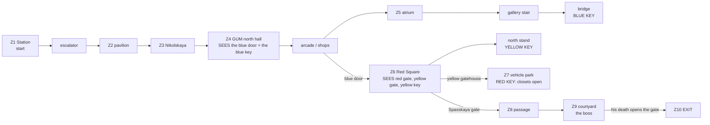

# MAP06 — «Красная площадь» (Red Square), последняя карта эпизода 2

Каноническая версия: `docs/levels/MAP06-red-square.md` (английский).

Синхронизировано с оригиналом: 2026-10-27.

Проектный документ. Владелец: `level-designer`. Статус: **v1.1 ПОСТРОЕНА
2026-10-22, ещё не пройдена, прохода в движке пока нет** (D26: эта роль никогда
не запускает GZDoom). Построена по принципу «сначала MVP» (D60): весь план,
текстурирован только утверждёнными лампами, населён, обеспечен ресурсами,
три ключа, три секрета, босс и выход; v1.1 одевает её в утверждённый
московский набор эпизода 2 (D107, §7 и §16). Исходник: `src/maps/MAP06/map.py`;
тесты: `tests/test_map06_red_square.py` (сама карта, 59 тестов) и
`tests/test_map06_route.py` (маршрут, 12); вид сверху (v1, не перегенерирован
под текстуры v1.1): `docs/levels/shots/MAP06-overview.png`. Русское зеркало:
причитается при закрытии фазы (D34).

> **Пройти карту** (PM или CEO; агенты никогда не запускают GZDoom, D26):
> `python3 tools/build.py && SD_ALLOW_ENGINE=1 MAP=MAP06 SKILL=3 tools/run.sh`
> — или вручную `-file dist/sovietdoom.pk3 +map MAP06 -skill 3`.
> Автоматический прогон: `SD_ALLOW_ENGINE=1 python3 tools/route.py --route redsquare-critical --keep-evidence`.

Вводные данные, которым подчиняется этот документ и которые он не повторяет:
D104 (P4, эпизод 2 «Дорога на Москву»), `docs/product/LORE.md` (D12, правила
уважения), `docs/PRD.md` (D35 фракции, D58 урок ключа, D60 MVP в первую
очередь, D68 спецдействия вещей), `docs/art/TEXTURE-INDEX.md` (только
утверждённые лампы), `docs/engine/MOD-SPEC.md` §6.1 (редакторские номера),
`docs/engine/BALANCE.md` и метод `docs/levels/MAP03-factory.md`, арене и
боссу которой следует финал этой карты.

## 1. Синопсис

Москва, ноябрь 1977 года, за несколько дней до парада в честь годовщины
(`SD_QUIT_04`): сержант Виланова выходит из метро на «Площади Революции» в
столицу, занятую Четвёртым рейхом и Легионом Свободы, с боем проходит по
Никольской и через разграбленный ГУМ, отбивает Красную площадь у парада,
устроенного для захватчиков, и через Спасские ворота кремлёвской стены
проникает во двор Кремля, чтобы убить босса эпизода.

## 2. Место в кампании

| | |
|---|---|
| Идёт после | MAP05, плотины на Волге (карта другого агента, D104). Дорога эпизода заканчивается в Москве; прибытие по метро связывает её с тоннелями MAP02. |
| Её номер | MAP06, последний слот эпизода 2 (MAPINFO: кластер 7, финал эпизода; зона mod-engineer). |
| Что добавляет | **три ключа** (MAP03 учила двум), **первое в кампании открытое небо в большом масштабе** (площадь 1792 × 2304 под небом), **вертикаль, через которую воюют** (галерея и мостик ГУМа, трибуны) и **выход, открываемый смертью**: смертью босса. |
| Кульминация | двор Кремля за Спасскими воротами: босс на помосте, обе фракции вокруг него; его смерть открывает ворота выхода. |
| Фракции (D35) | Рейх держит станцию, улицу и склон (военная оккупация); Легион держит ГУМ («капитал» в универмаге) и запускает контратаку из музея; обе фракции держат площадь и обе охраняют босса (проверено тестом). |

## 3. Что должна делать карта

| Задача | Как это реализует планировка |
|---|---|
| Быть Москвой | четыре узнаваемых места в их настоящем порядке: зал метро с бронзовыми фигурами в арках, Никольская, линия ГУМа под стеклянной крышей, Красная площадь с кремлёвской стеной с зубцами «ласточкин хвост», Спасская башня, Мавзолей с трибунами, Минин и Пожарский; техника парада, остановившаяся на площади. Всё построено из утверждённых лампов, с v1.1 — из московского набора (§7); что всё ещё заглушка, указано в §8. |
| Быть самой большой и самой трудной картой | протяжённость 5552 × 4928 юнитов (MAP03: 3776 × 2144); 42 / 68 / 96 монстров (MAP03: 25 / 38 / 52), каждый класс бестиария, босс на любой сложности. |
| Научить трём ключам | каждый замок виден раньше своего ключа (проверено тестом): синяя дверь — из северного зала ГУМа, вниз по аркаде; красные ворота, жёлтая привратная башня **и жёлтый ключ** — все сразу от синей двери, через парад. Каждый ключ лежит один на своём освещённом пятне цвета света своего замка (D58). |
| Открытое пространство и высота | площадь — под открытым небом; в ГУМе галерея на 128 выше вдоль линии, мостик через неё и верхний этаж магазинов; трибуны — 7 ступеней до верхнего ряда на 128 выше. Снайперы сверху, Doughboy под стеклянной крышей, техника парада как укрытие. |
| Завершить эпизод | ворота выхода в западной стене двора открываются только со смертью босса (спецдействие его вещи); переключатель выхода — за ними. |

Целевая длительность: 15–18 минут при первом прохождении на сложности 3;
около 7 — когда карта уже знакома (предложение по пару: 420 с, §13).

## 4. План

Авторитетный план — вид сверху, сгенерированный из исходника:
`docs/levels/shots/MAP06-overview.png` (север наверху). Схема (не в масштабе):

```
                                    +---------- STATION (z1, -128) ---------+--S1
                         pavilion<==escalator  hall, arches with statues    |
                          (z2)      (8 steps)  platforms + tracks both sides|
                  S3 yard   |                  start ->                     |
           +----------------+---- NIKOLSKAYA STREET (z3, sky) -------------+
           | Resurrection   |   barricades, a truck, three courtyard gates
           | gate (barred)  |
  +--------+----museum----------+   +--------- GUM north hall (z4) ---------+
  |  closet W   closet E        |   | arcade |shops| line (z5, glass roof) |gallery|upper shops
  |                             |   |        |     |     ...bridge+BLUE KEY|  +128 |   S2
  | stand N (YELLOW KEY, +128)  |   |        |     |                       |       |
 K| mausoleum      RED SQUARE   |[B]| blue   |atrium+fountain  stairs ---- |       |
 r| stand S (ROKS-3)  (z6, sky) |   | door   |     |                       |       |
 e|    parade vehicles as cover |   |        |     |                       |       |
 m[R] Spasskaya tower           |   +--------- GUM south hall ------------+
 l|                    [Y] gatehouse
 i|   VEHICLE PARK (z7, sky): RED KEY on the command post's plinth
 n+-----------------------------+
 |
 KREMLIN COURTYARD (z9): boss on the dais, Tsar Bell, Tsar Cannon --[gate]-- exit (z10)
 (through [R], the passage z8)
```

| # | Зона | x | y | пол | потолок | свет |
|---|---|---|---|---|---|---|
| Z1 | Зал станции (старт), «Площадь Революции» | 4096…5376 | 4736…4992 | −128 | 64 | 144 |
| — | Арки, по 4 с каждой стороны, по 2 бронзовые фигуры в каждой (пропсы высотой 96) | 4224…5120 | 4672…4736, 4992…5056 | −128 | 0 | 144 |
| — | Платформы, кромки, пути (на 16 ниже) | 4096…5376 | 4352…4736, 5056…5376 | −128 / −144 | 64 | 128 / 112 |
| — | Эскалатор, 8 ступеней по 16, подъём на запад | 3840…4096 | 4800…4928 | −112…0 | +128 | 128 |
| Z2 | Уличный павильон | 3520…3840 | 4160…4992 | 0 | 192 | 128 |
| Z3 | Никольская улица (небо; 384 с v1.1, три целых пролёта фасада ГУМа) | 2816…4352 | 3648…4096 | 0 | небо 384 | 112 |
| — | Воскресенские ворота: 2 арки, баррикады высотой 64 поперёк них (с V3 они опускаются вместе с жёлтым ключом, §17) | 2816…3136 | 3456…3648 | 0 / 64 | 192 | 112 / 144 |
| Z3r (V3) | Резерв: ниша и ворота в северной стене Никольской прямо вверх по улице от первой арки (ворота опускаются вместе с жёлтым ключом) · двор за ними, тупик | 2816…2944 · 2752…2976 | 4096…4128 · 4128…4336 | 0, ворота 128 = потолок (закрыты) · 0 | 128 · небо 256 | 112 |
| Z4 | Северный зал ГУМа · южный зал | 3520…4352 | 3328…3584 · 1152…1408 | 0 | 256 | 128 |
| Z4 | Аркада (западная линия), 4 колонны; окна фасада (подоконник 112) на площадь | 3520…3776 | 1408…3328 | 0 | 192 | 128 |
| Z4 | Синяя полоса замка (одна плитка) · синяя дверь · портал со стороны площади | 3520…3584 · 3488…3520 · 3456…3488 | 2176…2560 · 2304…2432 | 0 | 128 | **192**, синий |
| Z4 | Четыре разграбленных магазина (два сквозных в аркаду); проёмы высотой 128 | 3808…3936 | 1472…3264 | 0 | 160 | 112 |
| Z5 | Линия под стеклянной крышей (южная, к северу от мостика) | 3968…4224 | 1408…2944, 3008…3328 | 0 | стеклянная крыша 448 | 144 |
| Z5 | Атриум, фонтан (пропс) | 3808…4352 | 2176…2496 | 0 | стеклянная крыша 448 | 160 |
| Z5 | Галерея, южная и северная части; лестницы в 8 ступеней от атриума | 4224…4352 | 1536…1920, 2752…3264 | +128 | стеклянная крыша 448 | 144 |
| Z5 | **Мостик** через линию; **синий ключ** на его освещённой середине | 3968…4224 | 2944…3008 | +128 | стеклянная крыша 448 | 144 / **192**, синий |
| Z5 | Западная верхняя комната (зелёная броня) · три верхних магазина | 3808…3968 · 4384…4608 | 2880…3072 · 1600…3264 | +128 | 448 / 256 | 144 / 112 |
| Z6 | **Красная площадь** (небо); три гранитные линии поперёк неё, шириной 64, на y 1728, 2240, 2816 | 1664…3456 | 1152…3456 | 0 | небо 384 | 144 |
| Z6 | Кремлёвская стена: тело (замкнутый блок неба) · боевой ход шириной 32, его лицо — «ласточкины хвосты» (`SDKREM2`, средняя текстура, непроходимая линия) · пилоны у парапета и у флагов | 1600…1632 · 1632…1664 | 448…3456 | 128 · 128 / 256 · 256 | = пол · небо 256 · = пол | 144 |
| Z6 | Спасская башня: основание и ярус с часами (замкнутые блоки неба), зелёный шатёр, открытый в небо пояса, с рубиновой звездой на нём, в поясе неба 768 | 1600…1856 | 1216…1408 | 448 / 576 / 704 | = пол / = пол / 768 | 144 |
| Z6 | Портал **красного замка** (Спасские ворота) перед поясом неба 256 | 1600…1664 | 1472…1600 | 0 | 128 | **192**, красный |
| Z6 | Мавзолей, три яруса (пропс) | 1664…1856 | 2176…2432 | 64 / 112 / 144 | небо | 144 |
| Z6 | Трибуны N и S: 7 ступеней по 16 до верхнего ряда глубиной 96 | 1664…1984 | 2560…3008, 1856…2112 | 16…128 | небо | 144; верх N **192**, жёлтый (**жёлтый ключ**) |
| Z6 | Техника парада: 3 танка, 2 грузовика, 2 ракетовоза (пропсы) | §4.2 | | 48–96 | небо | 144 |
| Z6 | Две кладовые музея (засада красного ключа) | 1920…2112, 2304…2496 | 3472…3584 | 0 | 128 | 112 |
| Z6 | Портал **жёлтого замка**; привратная башня — южная стена площади | 2688…2816 | 1120…1152 | 0 | 128 | **192**, жёлтый |
| — | Парапет над склоном (замкнутый блок неба) | 1664…2560 | 1088…1152 | 128 | = пол | 144 |
| Z7 | Парк техники на склоне (небо); крыльцо за жёлтой дверью | 1664…2944 | 448…1088 | 0 | небо 384 | 128 |
| Z7 | Постамент командного пункта: **красный ключ** | 2112…2240 | 640…768 | 16 | небо | **192**, красный |
| Z8 | Проход Спасских ворот (синяя броня, баллоны, ракеты) | 1408…1568 | 1472…1600 | 0 | 128 | 112 |
| Z9 | **Двор Кремля** (небо); кремлёвская стена изнутри как его восточная стена (боевой ход 1344…1376, тело 1376…1408, два пилона по сторонам прохода ворот) | 512…1344 | 768…2048 | 0 | небо 512 | 144 |
| Z9 | Помост, 2 ступени; босс в `MAP06_BOSS_SPOT` (960, 1536) | 832…1088 | 1408…1664 | 16 / 32 | небо | 144 |
| Z9 | Царь-колокол (высота 128), Царь-пушка (64), четыре колонны | | | | | |
| Z10 | Ворота выхода (`SDGATE1`, тег 12) · зал выхода · ниша выхода (`SDSW1D`) | 416…448 · 192…416 · 176…192 | 1472…1600 | 0 | 128 | 128; ниша **192** |

Все высоты кратны 16; ни одна ступень вверх не выше 16 (проверено тестом).

### 4.1 Открытое небо: небеса на разных высотах (НЕ ПРОВЕРЕНО в движке)

Каждая односторонняя стена выглядит такой высоты, какова высота потолка
сектора, который она ограничивает; два соседних небесных потолка не рисуют
стены между собой (небесный трюк Doom, сохранённый в GZDoom). Карта
использует это, чтобы придать каждому зданию его высоту:

- небо площади на **384**: фасад ГУМа и музей стоят в три этажа; порталы
  дверей (потолок 128) показывают фасад над собой;
- кремлёвская стена (v1.1) — **замкнутый блок неба** высотой 128 (её тело,
  x 1600…1632) с **боевым ходом** перед ним (x 1632…1664): пол 128, небо на
  256, вне досягаемости. Линия между боевым ходом и площадью (или парком,
  трибунами, Мавзолеем) носит маскированную **`SDKREM2`** как среднюю
  текстуру, привязанную к небу боевого хода: её сплошная нижняя половина
  (128…192) продолжает лицо стены, а верхняя (192…256) — это зубцы «ласточкин
  хвост», с небом между ними и в их прорезях. Лицо ниже (0…128) — одна плитка
  `SDKREM1`, тот же кирпич пиксель в пиксель, уложенный теми же рядами и
  столбцами (§7.2), так что в месте, где парапет садится на стену, шва не
  видно. Линия **непроходима** (верхние ряды трибун на одной высоте с боевым
  ходом; на неё никто не заходит и не взлетает). Там, где парапет над склоном
  встречается со стеной, и позади двух флагов оккупантов стена — сплошной
  пилон на 256; восточная стена двора — та же стена изнутри, два пилона по
  сторонам прохода ворот;
- Спасская башня: три замкнутых блока неба на 448, 576 и 704, основание в
  `SDSPAS1` (кирпич и белый камень башни, аркатурный фриз вверху), у среднего
  яруса на четырёх гранях высотой 128 — часы `SDCLOK1` (по одной целой на
  грань, с D113), у верхнего — `SDSTEL1` (зелёный шатёр). Шатёр больше не
  замкнутый блок: его верх открыт в небо пояса (768) в двух половинах, а
  линия между ними (x 1728) несёт рубиновую звезду `SDRUBY1` (маскированную)
  с обеих сторон в половинном масштабе (`scalex_mid` / `scaley_mid` 2, UDMF
  zdoom), так что звезда 64 × 64 стоит от шатра (704) до неба (768); линия
  непроходима. Вокруг башни пояс неба 768, чтобы ярусы были видны; перед
  воротами пояс неба 256, чтобы стена над порталом ворот имела собственную
  высоту стены (одна плитка `SDKREM1` над порталом);
- парапет над склоном: замкнутый блок неба высотой 128, видимый как низкая
  стена с небом за ней.

Если аппаратный рендерер нарисует что-то из этого неверно («небесная стена»
над более низким небом, башня, обрезанная на 384), запасной вариант —
выровнять пояса до 384 площади: больше ничего не сдвигается (проверка движка
E1, §12). Если средняя текстура зубцов нарисуется неверно (обрезана, замощена
плиткой или кусок неба в её отверстиях), запасной вариант — поднять пол
боевого хода до `MERLON_TOP` (плоский кирпичный верх на 256, как были зубцы в
v1 — блоками): одна константа, больше ничего не сдвигается.

### 4.2 Парад, остановившийся

Танки (корпус высотой 48, башня 80), грузовики (48) и ракетовозы (64, ракета
96) в оливковых бронелистах (`SDARMR2`; у ракетовозов длинные борта
`SDARMR1`, одна целая красная звезда на каждые 128) с рифлёными палубами, в
двух колоннах вдоль оси парада и третьей посередине. Каждая машина стоит в
стороне от трёх линий видимости, которые площадь должна давать от синей двери
(красные ворота, жёлтая привратная башня, жёлтый ключ; проверено тестом).
Ещё три стоят в парке техники.

## 5. Прогрессия, ключи, двери и выход



**Ключи.** Три ключ-карты Doom под советскими именами (MOD-SPEC §6:
`SD_BluePass` 5, `SD_YellowPass` 6, `SD_RedPass` 13), замки 2, 3 и 1
(`lockdefs.txt` из gzdoom.pk3, как их приводят MAP02 и MAP03).

| Id | Где | Тип | Special | Может ли запереть игрока снаружи? |
|---|---|---|---|---|
| **BD** | фасад ГУМа, аркада → площадь, шириной 128, `SDDOORB` (с D113) между двумя кобальтовыми мозаиками (синяя дверь MAP02) | запертая, открывается навсегда | `Door_LockedRaise (4, 16, 0, 2, 0)`, обе стороны | нет |
| **YD** | Привратная башня, площадь → парк техники, `SDDOORY` | запертая, открывается навсегда | `Door_LockedRaise (5, 16, 0, 3, 0)` | нет |
| **RD** | Спасские ворота, площадь → проход, `SDDOORR` | запертая, открывается навсегда | `Door_LockedRaise (6, 16, 0, 1, 0)` | нет |
| S1, S2, S3 | нажимные панели (§9) | открываются навсегда | `Door_Open (1/2/3, 16)`, обе стороны, `secret` | нет |
| CL | две кладовые музея | открываются навсегда | тег 10, **без линии**: спецдействие вещи красного ключа `Door_Open (10, 16)` | нет |
| **BARRIERS** (V3) | две баррикады Воскресенских ворот и ворота двора-резерва на Никольской | **опускаются** навсегда до пола с обеих сторон | тег 13, **без линии**: спецдействие вещи жёлтого ключа `Floor_LowerToLowest (13, 32)` | нет (арки открывают петлю на уже пройденную улицу; двор — тупик; никогда не нужны) |
| GATE | двор → зал выхода, `SDGATE1` с обеих сторон, без special | открываются навсегда | тег 12, **без линии**: спецдействие вещи босса `Door_Open (12, 16)` | только если босс не мог бы умереть: §11 |
| EXIT | глубина ниши 16, `SDSW1D` | | `Exit_Normal (0)` | — |

**Порядок, как его разыгрывают тесты** (`test_the_route_is_the_designed_one`),
пять раундов: (0) станция, улица, ГУМ и его верхний этаж, **синий ключ** (и
панели трёх секретов, никогда не нужные); (1) синяя дверь: площадь, трибуны,
**жёлтый ключ**; (2) жёлтая привратная башня: парк, **красный ключ**, взятие
которого открывает кладовые; (3) Спасские ворота и кладовые: проход, двор;
(4) смерть босса: ворота выхода, выход.

Указатели (D58): каждый ключ лежит один на своём освещённом пятне, цвета
своего замка (`lightcolor` сектора, как в MAP02 и MAP03), и виден раньше, чем
до него доходят: синий ключ — из северного зала ГУМа и с линии под мостиком;
жёлтый — от синей двери; красный — сквозь жёлтую привратную башню (проверено
тестом, и ни один монстр на момент появления не стоит ни на одной из этих
линий видимости). Свет 192 тратится только на восемь секторов: три портала
замков, синюю полосу, три пятна ключей, нишу выхода (проверено тестом).

Правила против софтлока, как в MAP01 и MAP03: ни одна дверь не закрывается
за игроком; лифтов нет; из каждого перепада (края галереи и мостика, пути)
есть путь обратно наверх; ни один секрет не нужен (проверено тестом). Из
каждого сектора, достижимого на любом этапе, есть путь обратно к старту — со
смертью босса и без неё (проверено тестом), и в конце выход достижим отовсюду.

## 6. Кривая интенсивности

| Бит | Пространство | Ощущение | Механика |
|---|---|---|---|
| 1 | Станция | разминка: пикет Рейха среди бронзовых фигур | сразу ИЖ |
| 2 | Никольская | ночная улица, блокпост, гончая | укрытие за баррикадами |
| 3 | Северный зал ГУМа | универмаг: синяя дверь в конце аркады, ключ на мостике выше | **ключ виден, но недосягаем** |
| 4 | Линия ГУМа, атриум, галерея | снайперы сверху, Doughboy под стеклом | **высота**: лестница, мостик |
| 5 | Красная площадь | **раскрытие и открытый бой**: парад, стена, башня, три цели сразу | открытое пространство, техника как укрытие |
| 6 | Трибуна | подъём на открытом месте за жёлтым ключом | уязвимость |
| 7 | Парк техники | тяжёлые Рейха на склоне | красный ключ |
| 8 | Назад через площадь | **всплеск**: кладовые музея открываются за спиной игрока | схема MAP03, спущенная ключом |
| 9 | Двор | **кульминация**: босс и обе фракции | босс |
| 10 | Выход | ворота открываются со смертью босса | — |

## 7. Текстуры по зонам (все утверждены и упакованы; проверено тестом)

| Зона | Стены | Пол | Потолок |
|---|---|---|---|
| Зал станции | `SDMARB1` красный мрамор; арки с фигурами `SDBRAS1`; восточная полоса `SDMOSA1` | `SDMFLR2` | `SDMCEIL2` (светильники) |
| Платформы, пути | `SDMARB2`; кромка `SDMEDG1`; стены путей `SDTUBB1` | `SDMFLR1`, `SDMFLR3`, `SDRAIL1` (повёрнутый) | `SDMCEIL1` |
| Эскалатор | `SDTILE1` | `SDFLR4` | `SDMCEIL1` |
| Павильон, улица | `SDCONC1`; северный фасад ГУМа `SDGUM1` (x 3520…4352); ворота дворов `SDGATE1`; баррикады `SDCRAT2`, грузовик `SDSTEL1` | `SDMFLR1` / `SDFLR2` | `SDMCEIL1` / небо |
| Воскресенские ворота, музей | `SDMUSE1` (кирпич музея с белыми деталями: стена музея на площади, створки кладовых, две арки ворот) | `SDMFLR1` | — / небо |
| Залы ГУМа, аркада | `SDMARB2`; оконные щели фасада прорезаны сквозь `SDGUM1` | `SDMFLR2` / `SDMFLR1` | `SDMCEIL1` |
| Линия ГУМа, галерея | витрины `SDGUMS1` / `SDGUMS2` / `SDGUMS3` («ТКАНИ», «ОБУВЬ», «ЧАСЫ»), по одному магазину на каждые 64 стены, под галереей и над ней (§7.2) | `SDMFLR2` / `SDMFLR1` | стеклянный свод `SDGUMR1` |
| Магазины | `SDTILE1`; добыча `SDCRAT1` / `SDCRTOP1` | `SDMFLR1` | `SDMCEIL1` |
| Площадь | фасад ГУМа `SDGUM1` (три пролёта высотой, портал синей двери — один пролёт), музей `SDMUSE1`; кремлёвская стена `SDKREM1` с «ласточкиными хвостами» `SDKREM2` (§4.1) и шестью парадными полотнищами `SDBANR1`; советские флаги `SDFLAG3`/`SDFLAG4` (парадное знамя и израненный в боях флаг СССР на кремлёвском кирпиче, D119; до того — флаги оккупантов) рядом на гребне; башня `SDSPAS1` / `SDCLOK1` / `SDSTEL1` и рубиновая звезда `SDRUBY1`; Мавзолей, трибуны и постамент Минина `SDTRIB1`, Минин `SDBRAS1`; привратная башня `SDCONC1`; парапет `SDBRCK2` | `SDCOBL1`; три линии `SDCOBL2`; трибуны, пороги и верхи памятников `SDMFLR1` | небо |
| Техника | `SDARMR2`; длинные борта ракетовозов `SDARMR1` | `SDFLR4` | небо |
| Парк | `SDCONC1`; внешнее лицо кремлёвской стены, как на площади | `SDFLR2` | небо |
| Двор | `SDBRCK1` (дворцы), советские флаги `SDFLAG1`/`SDFLAG2` (флаг СССР и знамя Красной Армии на этом кирпиче, D119); восточная стена — кремлёвская, `SDKREM1` + `SDKREM2`; проход ворот `SDKREM1`; Царь-колокол и Царь-пушка `SDBRAS1`; помост `SDMARB1` | `SDCOBL1` / `SDMFLR2` | небо |
| Двери, переключатель | `SDDOORB` (синяя, между `SDMOSA1`), `SDDOORY`, `SDDOORR`, `SDGATE1` (ворота выхода); выход `SDSW1D` | | |
| Плакаты | `SDPOSTR1` Ленин, `SDPOSTR3` Сталин (раздел 7.1) | | |

### 7.1 Плакаты (CEO, 2026-10-22: «que esos posters puedan aparecer en cualquier nivel» («чтобы эти плакаты могли появляться на любом уровне»))

Четыре картины и пара Маркс — Энгельс, каждая — целый плакат 128×256: одна
односторонняя линия длиной 128 в секторе высотой ровно 256, привязанная к
полу, смещение 0 (`POSTERS` в `map.py`; `tests/test_posters.py`). Только
текстурные линии и четыре неглубокие ниши; ни маршрут, ни ключ, ни дверь, ни
линия видимости не сдвигаются.

| Имя | Плакат | Где | Зачем |
|---|---|---|---|
| `gum_north_lenin` | Ленин | северный зал ГУМа, южная стена, x 3808-3936 при y 3328 (зал высотой 256: ниши нет) | первое, что видно впереди при входе с Никольской, рядом с проходом дальше под стеклянную крышу: у магазина нации всё ещё висит его портрет |
| `gum_north_slot` | **Маркс** `SDPOSTR4` (слот) | северный зал ГУМа, восточная стена, x 4352, y 3392-3520 | первый из пары на маршруте, «ПРОЛЕТАРИИ / ВСЕХ СТРАН,» |
| `square_facade_lenin` | Ленин | фасад ГУМа на площади, к северу от синей двери: ниша `prop_z6_portrait_lenin` (x 3456-3472, y 2496-2624), пол 64, потолок 320 | парадные портреты: подвешены высоко на фасаде по обе стороны дверей, как 7 ноября; на них направлены прожекторы (144) |
| `square_facade_stalin` | Сталин | то же, к югу от синей двери: `prop_z6_portrait_stalin` (y 2112-2240) | пара, симметричная относительно синей двери; виден с трибун и при каждом пересечении |
| `courtyard_stalin` | Сталин | северная стена двора Кремля, выемка `z9_portrait_stalin` (x 1024-1152, y 2048-2064), высота 256 | два советских флага (D119; до того — знамёна оккупантов) висят рядом с ним в комнате босса |
| `courtyard_slot` | **Энгельс** `SDPOSTR5` (слот) | та же стена, выемка `z9_portrait_slot` (x 576-704), знамёна между двумя | последний: «СОЕДИНЯЙТЕСЬ!» в комнате босса, два советских флага между ним и Сталиным |

Ниши фасада — пропсы (пол 64, выше любой ступени: по ним не ходят и до них не
добираются; в тестах достижимости они `prop_`); их устье показывает `SDGUM1`
фасада ниже (0-64) и выше (320-384), боковины ниши глубиной 16 — `SDCONC1`.
Выемки двора глубиной 16, на уровне пола двора, как и у самих знамён.

**Пара Маркс — Энгельс (D117, 2026-10-22).** `POSTER_SLOTS_MARX_ENGELS`
называет два слота, Маркса первым: `SDPOSTR4` Маркс и `SDPOSTR5` Энгельс
(зеркально, смотрит в сторону Маркса), 128×256, как Ленин и Сталин, в порядке
маршрута, так что каждый читается отдельно. `MARX_ENGELS = ("SDPOSTR4",
"SDPOSTR5")` перечисляет их в `WALL_TEXTURES`; `tests/test_posters.py` держит
размещение (`PAIR`).

Ни одна строка раздела 8 не является плакатом или пропагандистской вещью,
поэтому ни одна не заменяется. Парадные полотнища `SDBANR1` (v1.1) — ткань на
кремлёвской стене, а не плакаты: на них нет ни портрета, ни текста (D12).

### 7.2 Как уложен московский набор (v1.1, D107)

- **Привязка к миру.** `SDKREM1`, `SDKREM2`, `SDBANR1`, `SDGUM1` и `SDSPAS1`
  (`ALIGNED` в `map.py`) уложены по миру, а не по каждой линии:
  `align_to_world` даёт каждой стороне, носящей такую текстуру, `offsetx`,
  который ставит её столбец 0 на сетку мира вдоль линии, а по частям
  (`offsety_top` / `_mid` / `_bottom`, UDMF zdoom) — смещение строки, которое
  ставит строку 0 на высоту лампа: 0 для стены, полотнищ и пролётов ГУМа (так
  что пролёты складываются в стопку от булыжника, по три до неба 384, и
  оконные щели прорезают те же пролёты), 448 для Спасской (её фриз на верху
  башни). Так кирпич идёт без разрыва от лица до зубцов и от одной линии к
  другой (проверено тестом).
- **«Ласточкины хвосты»** (§4.1): `hang_merlons` кладёт `SDKREM2` на сторону
  площади, парка и двора каждой линии между боевым ходом стены и землёй и
  делает линию непроходимой. Её зубцы центрируются на y ≡ 32 (mod 64), так
  что зубец стоит по обе стороны от каждого полотнища, а просвет приходится на
  каждый конец участка.
- **Полотнища**: шесть `SDBANR1` на лице стены, каждое — ровно один пролёт 64,
  начинающийся на сетке, высотой в одну плитку, так что полотнище целиком
  висит от древка на 128 до бахромы на 15 над булыжником: два между
  Спасскими воротами и южной трибуной, по одному с каждой стороны Мавзолея
  (симметрично ему), два в северном конце; ни одного под флагами оккупантов
  (проверено тестом).
- **Пол площади**: `SDCOBL1`, поперёк с востока на запад три линии `SDCOBL2`
  (секторы `z6_line_1..3`, y 1728, 2240, 2816, шириной 64 на плоской сетке,
  так что каждая показывает свою одну линию плит; та же высота, небо и свет,
  что у площади). Они пересекаются там, где не стоит ни одна вещь (проверено
  по таблице зон), а памятники и парад стоят на них.
- **Гранит**: `SDTRIB1` на лицах трибун (каждый подступенок и каждый ярус
  показывает свою чёрную полосу лабрадорита сверху, поскольку ламп
  привязан к верху каждого бока), три яруса Мавзолея и постамент Минина.
- **Раунд 2 (D113)**: `SDMUSE1`, `SDFLAG3` и `SDFLAG4` входят в `ALIGNED`
  (строки от 0, столбцы по миру): белая полоса музея идёт ровно от стены
  музея через створки кладовых до Воскресенских ворот, а флаги гребня сходятся
  с окружающим их `SDKREM1` ряд в ряд (их кирпич повторяет зерно `SDKREM1`).
  Линия ГУМа построена в `SDGUMS1`; затем `dress_shopfronts` режет каждую её
  стену по сетке мира 64 (новые вершины на той же линии: ничего не сдвигается)
  и даёт каждому участку в 64 вывеску его столбца, `SHOPFRONTS[(x or y // 64) % 3]`,
  привязанную к миру, так что магазины идут «ТКАНИ», «ОБУВЬ», «ЧАСЫ» вдоль
  каждой стены (три яруса друг над другом показывают один и тот же магазин).
  `SDGUMR1` — потолочный флэт каждого сектора под сводом, привязанный к миру
  (его железные арки поперёк линии, с востока на запад).
- **Парад**: `SDARMR2` (броня бронепоезда, железнодорожный набор) на каждой
  грани каждой машины; `dress_carriers` кладёт `SDARMR1` на длинные борта
  ракетовозов, по одной красной звезде на 128, считая от конца борта,
  поднятой на 28 строк, чтобы звезда (строки 29-88) была целой на корпусе
  высотой 64.

## 8. Ожидающие текстуры

Каждая стоит вместо детали, которая шла бы карте лучше; замена — это одна
константа в `map.py` (имя в скобках), ничего не сдвигается. **Сделано в v1.1
(D107)**: брусчатка и её гранитные линии (старый № 1), фасад ГУМа (№ 3),
кремлёвская стена и её «ласточкины хвосты» (№ 6), гранит Мавзолея (№ 8),
борта машин парада (№ 11, из брони железнодорожного набора). **Сделано в
раунде 2 (D113, 2026-10-22, §16c)**: витрины ГУМа (№ 4, `SDGUMS1`-`3`), его
стеклянная крыша (№ 5, `SDGUMR1`), часы и рубиновая звезда Спасской (№ 7,
`SDCLOK1`, `SDRUBY1`), кирпич музея (№ 9, `SDMUSE1`), синяя створка (№ 10,
`SDDOORB`), ночное небо (№ 14, `SDSKY2` в `sky1` MAPINFO, зона PM) и флаги
гребня на кирпиче Кремля (№ 16, `SDFLAG3`/`SDFLAG4`).

| # | Нужно | Заглушка сейчас | Где |
|---|---|---|---|
| 2 | Асфальт с трамвайными рельсами / бордюром, флэт | `SDFLR2` (`FLOOR_ASPHALT`) | Никольская, парк |
| 12 | **Бронзовые статуи**, текстура или спрайты (фигуры «Площади Революции», Минин и Пожарский, Царь-колокол и Царь-пушка) | блоки `SDBRAS1` (`BRASS`) | станция, площадь, двор |
| 13 | Флэт воды для фонтана (`SDWATR1-4` из MAP05 — серо-голубая вода Волги; чаше, возможно, нужна своя) | `SDMFLR1` | атриум |
| 15 | **Собор Василия Блаженного** как спрайт линии горизонта или полоса неба (в `SDSKY2` есть силуэт Москвы, но не собор) | — (не построено) | за склоном |
| 17 | Башни и ракеты техники парада как спрайты или собственные боковины | блоки `SDARMR2` | площадь, парк |

## 9. Секреты

Правило MAP01: подсказка — это сравнение, а не знак; у каждого есть путь
обратно (проверено тестом).

| # | Где | Подсказка | Награда |
|---|---|---|---|
| S1 | Зал станции, восточный конец, за спиной у старта | из двух мозаик в торцевой стене вторая стоит на 16 глубже, в тени (свет 96) | рюкзак, бронежилет, коробка дробовых патронов |
| S2 | ГУМ, верхний магазин U2 | его задняя стена — стена из ящиков там, где остальные верхние магазины показывают плитку | **ручная «Катюша»** и упаковка баллонов (BFG Doom в последней карте эпизода; традиция S1 в MAP03) |
| S3 | Никольская, северная сторона | из трёх ворот дворов средние утоплены вдвое глубже и темнее | двор (открытое небо): две аптечки, ракеты |

Каждая панель — `Door_Open` на обеих сторонах с флагом линии `secret`
(односторонняя на автокарте); каждая комната — сектор со special 1024. Ни один
не нужен для выхода (проверено тестом).

## 10. Враги и ресурсы по сложностям

Размещены собственными номерами бестиария (21100–21107, а с D116 ещё 21110 —
стрелок Легиона и 21111 — Колосс Свободы); босс на любой сложности. Пары
сложностей вложены (`skill_tier`), как в MAP01–MAP03.

| Зона | Сложность 2 | Сложность 3 | Сложность 4 |
|---|---|---|---|
| Станция | 3 стрелка | +2 стрелка | +1 стрелок, 1 штурмовик |
| Павильон | 1 рекрут | +1 рекрут | +1 штурмовик |
| Никольская | 3 стрелка, 1 штурмовик, 1 гончая | +2 стрелка, 1 штурмовик | +1 стрелок, 1 штурмовик, 1 гончая |
| ГУМ, первый этаж | 3 рекрута, **1 пулемётчик**, 1 штурмовик | +2 рекрута, 1 штурмовик | +2 рекрута, 1 Doughboy |
| Линия ГУМа и верхний этаж | 1 рекрут, **1 пулемётчик**, 1 штурмовик, 1 Doughboy | +1 рекрут, 1 штурмовик | +1 рекрут, 1 штурмовик, 1 Doughboy |
| Красная площадь | 5 стрелков, 3 штурмовика, 2 гончие, 1 Panzermensch, 1 Doughboy | +2 стрелка, 2 штурмовика, 1 Doughboy, **1 пулемётчик** | +2 стрелка, 1 штурмовик, 1 гончая, 1 Panzermensch, 1 тяжёлый, **1 пулемётчик** |
| Резерв (V3: волна жёлтого ключа, пятеро из охраны площади выведены) | 1 стрелок | +1 стрелок, 1 гончая | +1 стрелок, 1 штурмовик |
| Кладовые музея (красный ключ) | 2 рекрута | +1 рекрут, 1 штурмовик | +2 штурмовика |
| Парк техники | 3 стрелка, 1 гончая, 1 Panzermensch | +2 стрелка, 1 штурмовик | +1 штурмовик, 1 гончая, 1 тяжёлый |
| Проход ворот | — | 1 штурмовик | — |
| Двор | **босс** (Колосс Свободы), 2 штурмовика, 1 Doughboy | +2 гончие | +1 Panzermensch, 1 тяжёлый, 1 Doughboy |
| **Итого** | **42** | **69** | **98** |

**Пулемётчики Легиона** (`SD_LegionGunner`, 80 HP, очереди хитскана, D116;
`docs/engine/2026-10-22_P4_ep2-enemies.md` §2): 2 / 3 / 4 на сложностях 2 / 3 /
4 там, где у очереди длинная линия, а у него есть укрытие. На любой сложности
двое занимают место рекрута: аркада ГУМа (3600, 2900), на всю её длину к
северу и к югу, и южная галерея наверху (4288, 1700), вдоль галереи. Со
сложности 3 ещё один стоит на Красной площади за западной машиной
остановившегося парада (2176, 2450), а на сложности 4 ещё один — за восточной
машиной северной линии (2810, 1900): оба добавлены, оба смотрят на двери ГУМа
через ширину площади. Каждый роняет 15 патронов АКМ (ниже не учтены). Ни один
не видит старт (`tests/test_safe_starts.py`).

**Безопасный старт** (`tests/test_safe_starts.py`, 2026-10-22): на сложностях 2, 3 и 4 ни один монстр не видит зону старта (старт и шаг вокруг него) в пределах 768 юнитов; собственный тест видимости Doom, запущенный на построенной карте. Первый стрелок зала станции перенесён с 4600, 4864 (в 616) на 4384, 4896, на 830 дальше по залу: виден, но первый выстрел за игроком. То же число, та же зона.

По классам на сложности 4: 29 стрелков, 15 рекрутов, 4 пулемётчика, 25
штурмовиков, 10 гончих, 7 Doughboy, 4 Panzermensch, 3 тяжёлых Panzermensch,
босс.

**Ресурсы.** Проходимо со старта с пистолетом: ИЖ в зале станции, ППШ в
северном зале ГУМа, РПГ-7 на северной галерее (перед Panzermensch на
площади), РОКС-3 на верхнем ряду южной трибуны (перед тяжёлыми склона), всё на
маршруте на любой сложности; ручная «Катюша» в S2. АКМ нет: винтовка — из
MAP05 (`docs/engine/2026-10-22_P4_akm.md` §6); **магазины АКМ** (`SD_AkmAmmo`,
21020, 30 патронов) — **по 2 на любой сложности с D119** (до того 4 / 3 / 2;
игрок, начавший с пистолета, никогда не владеет винтовкой), ни одного во дворе
(босс — работа РПГ-7): у ППШ в северном зале ГУМа и на площади.

**Боеприпасы, D119 (2026-10-23).** Плейтест CEO по эпизодам 2 и 3:
«hay muchos objetos de munición, siempre sale de sobras» («много предметов с
боеприпасами, всегда остаётся с избытком») и «siempre acabas con la escopeta»
(«всегда в итоге остаёшься с дробовиком»); и колосс снижен до **3000 HP**
(как у Spider Mastermind, §11). Теперь боеприпасы следуют за монстрами:
**растут со сложностью**, как и они (таблица `AMMO` в `map.py`, строки с
низшим и высшим уровнем), а не по правилу расходников. Линейка G3-8 — линейка
MAP03 (убийства в патронах ИЖ; колосс 48 по ставке Генерала, прежде 72;
стрелок 2; ПГ-7В по 2 дробовых патрона, патроны АКМ по 80 / 12, топливо по ставке
РОКС-3, 13.5 на единицу из 80, с D119), только маршрут, без секретов; полосы D119
(`docs/engine/BALANCE.md` §8): **1.5-2.0 × на сложности 2, 1.3-1.6 на 3,
1.2-1.45 на 4**, дробовые патроны не более 35 % от этого:

| | Сложность 2 | Сложность 3 | Сложность 4 |
|---|---|---|---|
| Нужно (D116 → D119, колосс 72 → 48) | 160 → 136 | 207 → 183 | 326 → 302 |
| Размещено, v1 (D116) → D119 | 647.5 → **209.5** | 605.0 → **253.9** | 523.5 → **386.6** |
| Отношение, v1 → D119 | 4.05 → **1.54** | 2.92 → **1.39** | 1.61 → **1.28** |
| Боеприпасов на маршруте, v1 → D119 | 73 → **25** | 66 → **30** | 55 → **47** |
| Дробовые патроны (8 от ИЖ включены) | 56 | 72 | 108 |
| Патроны 7.62×25 (35 от ППШ включены) | 635 | 785 | 1285 |
| ПГ-7В (2 от РПГ-7 включены) | 27 | 32 | 52 |
| Топливо (40 от РОКС-3 включены) | 160 | 180 | 220 |
| Доля урона: дробовые / 7.62×25 / АКМ / ПГ-7В / топливо | 28 / 32 / 4 / 23 / 13 % | 30 / 32 / 4 / 22 / 12 % | 29 / 35 / 2 / 24 / 10 % |

В v1 дробовые патроны составляли около 63 % размещённого урона. По участкам:
станция, павильон и улица (ИЖ) — коробка дробовых патронов и россыпь, коробка
патронов; ГУМ (ППШ, РПГ-7) — коробки патронов, магазин и коробка ПГ-7В с
гранатомётом; площадь и южная трибуна (РОКС-3 и баллон) — коробки патронов,
коробка дробовых патронов со сложности 3, коробка ПГ-7В со сложности 3 (три
на сложности 4); парк техники — от двух до четырёх коробок патронов, его
коробка ПГ-7В, коробка дробовых патронов и баллон только на сложности 4;
проход ворот и двор — доля колосса. **BALANCE §8.4.2 с поправкой PM от
2026-10-23:** вне стадии босса патроны ППШ лидируют на каждой стадии не менее
чем с 40 % боеприпасов, кроме дробовых патронов (РОКС-3, самое новое с площади, — нет), ПГ-7В не
более 30 % урона стадии (максимум: площадь на сложности 4, 25 %), топливо не
более 15 % по карте (13 / 12 / 10 %); во дворе колосса лидируют ракеты.

**Последний участок** (проход ворот и двор, z8 и z9, по урону против очков
здоровья, встреченных там, босс включён, не менее нижней границы полосы
сложности; `test_the_final_stretch_pays_for_the_colossus`): при колоссе в 3000
одна из двух коробок ПГ-7В, добавленных D116 (640, 1536), есть только на
сложности 4; другая (1250, 1300) остаётся на любой сложности ради §8.4.3 (на
стадии босса ПГ-7В и топливо покрывают не менее его 48 дробовых патронов;
у сложности 2 20 ПГ-7В и пакет прохода, 56.9;
`test_the_boss_is_the_heavy_weapons_job`). Пять россыпей ПГ-7В во дворе и один
баллон убраны на любой сложности, а вторая коробка дробовых патронов — коробка
патронов со сложности 3. Размещено там: 20 / 20 / 25 ПГ-7В на сложностях 2 / 3
/ 4 (23 прямых попадания убивают его, BALANCE §7), пакет топлива прохода и
коробка патронов, коробка дробовых патронов и баллоны со сложности 3: 6450 /
3520 (1.83), 7120 / 3880 (1.84) и 8065 / 5780 (**1.40**).

Проверка MAP03, что дробовые и обычные патроны одни покрывают всех монстров,
кроме босса (вторая половина BALANCE §8.4.3), **снята поправкой PM**: она не
может выполняться вместе с §8.3 и потолком сложности 4, и её тест удалён.
Проверено тестом также: дробовые патроны с выпавшими ИЖ рекрутов — менее 35 %
всего размещённого и выпавшего (§8.3: 30 / 32 / 31 %), каждый запас только со
стадии своего оружия (§8.4.1).

Проверено тестом также на каждой стадии маршрута, на нижней границе полосы
сложности (`tests/test_map06_red_square.py`, 71 тест OK на 2026-10-23).
Здоровье на сложности 4: 6 стимпаков, 6 аптечек, 9 бонусов здоровья; 6 бонусов
брони (по два у каждого замка), бронежилет в западной верхней комнате ГУМа,
тяжёлый бронежилет в проходе ворот, перед боссом. Сложности 3 и 2 добавляют
стимпаки, аптечки и боеприпасы.

## 11. Босс: Колосс Свободы (D116)

Босс эпизода 2 — **Колосс Свободы** (`SD_LibertyColossus`, 21111, 3000 HP с
D119, как у Spider Mastermind (прежде 4500), радиус 44, высота 110, `+BOSS
+NORADIUSDMG`; `docs/engine/2026-10-22_P4_ep2-enemies.md` §3), в именованной
константе **`MAP06_BOSS_SPOT = (960, 1536)`** на помосте двора, лицом к воротам
(`BOSS_ANGLE = 0`), на любой сложности. **Генерал** (босс MAP03,
`SD_General`, 3000 HP) стоял вместо него до D116 и убран с карты.

- **Замена (2026-10-22):** `BOSS_KIND = "colossus"`, класс в `MONSTER_KINDS` /
  `MONSTER_CLASSES` и в `CLASS_FILES` теста; место, направление и спецдействие
  смерти без изменений. Маршрут читает класс с карты (он в `COUNT_CLASSES`) и
  наносит ему урон сверх здоровья (`BOSS_HURT` 100000); `tools/route.py` не
  потребовал правок.
- **Он помещается:** верх помоста (`z9_dais_2`, 128 × 128) вмещает его тело
  шириной 88 с запасом по 20 с каждой стороны, небо двора (512) более чем
  вчетверо выше его роста, а проход ворот (128 × 128) позволяет ему выйти
  вслед за игроком (проверено тестами: `test_every_monster_has_room_for_its_body`,
  `test_the_courtyard_is_his_size`, `test_the_boss_is_the_liberty_colossus`).
- **Его смерть открывает выход**, механизм MAP03 v1.1 (D68): его вещь несёт
  `special = 11` (`Door_Open`), `arg0 = 12`, `arg1 = 16`; ни одна линия не
  несёт тег 12, так что нажатие на ворота ничего не делает (проверено тестом).
  GZDoom запускает special монстра, когда тот умирает (`AActor::Die`), кто бы
  его ни убил.
- **Место:** двор 832 × 1280 под небом 512, помост — две ступени по 16; ему
  никогда не приходится проходить через дверь (проход ворот высотой и шириной
  128, так что он может последовать за игроком на площадь; его смерть
  открывает ворота, где бы она ни произошла).
- **Риск, сказанный прямо:** если special смерти в движке не сработает, выход
  окажется недостижим. Склады MAP03 используют тот же механизм, и он всё ещё
  НЕ ПРОВЕРЕН в игре (MAP03 §16.5 V4). Проверка E3 (§12) это решает; запасной
  вариант — работа mod-engineer: в блоке MAP06 в MAPINFO `SpecialAction =
  "SD_LibertyColossus", "Door_Open", 12, 16`, который открывает тот же тег,
  когда умирает последний колосс (§13; его `+BOSSDEATH` и финальный
  `A_BossDeath` это позволяют). При `-nomonsters` выход открыться не может,
  как на картах боссов Doom.

## 12. Используемые элементы движка и чек-лист движка для PM (D26)

| Нужно | Выдаётся | Статус |
|---|---|---|
| Запертые двери | `Door_LockedRaise` 13, замки 1, 2, 3 | ПРОВЕРЕНО на MAP02 (2) и MAP03 (1, 3) |
| Нажимные панели (секреты) | `Door_Open` 11, флаг линии `secret`, special сектора 1024 | ПРОВЕРЕНО на MAP01–MAP03 |
| Выход | `Exit_Normal` 243 | ПРОВЕРЕНО |
| Цветной свет | `lightcolor` сектора | как MAP02/MAP03 (их K4) |
| Повёрнутые флэты | `rotationfloor` 90 / 180 | как MAP02 |
| **Special вещи при смерти** | босс: `special` 11, `arg0` 12 | спецификация ПРОВЕРЕНА; **в игре НЕ ПРОВЕРЕНО** |
| **Special вещи при подборе** | красный ключ: `special` 11, `arg0` 10; с V3 жёлтый ключ: `special` 21, `arg0` 13, `arg1` 32 (§17) | special предмета в стиле Hexen; у красного ключа **ПРОВЕРЕНО в движке** (маршрут RKEY, тег 10 открыт, отчёты 2026-10-23); `Floor_LowerToLowest` жёлтого ключа (номер из собственной таблицы g4.14.2, `src/maps/common/pickup_events_e2.py`) **НЕ ПРОВЕРЕНО**: E10 |
| **Небеса на разных высотах, замкнутые блоки неба** | §4.1 | **НЕ ПРОВЕРЕНО** |
| **Маскированная средняя текстура между двумя небесными потолками** («ласточкины хвосты») | `SDKREM2` на двусторонней линии, небо площади 384 / небо боевого хода 256 | маскированная средняя ПРОВЕРЕНА по роду (цепь `SDCHAN1` MAP03); **под небом НЕ ПРОВЕРЕНО** |
| Смещения текстур по частям | `offsety_top` / `offsety_mid` / `offsety_bottom` стороны (UDMF zdoom) | первое применение в кампании; **НЕ ПРОВЕРЕНО** |
| **Масштабированная маскированная средняя текстура** (рубиновая звезда, раунд 2) | `scalex_mid` / `scaley_mid` 2.0 стороны (UDMF zdoom): `SDRUBY1` рисуется 64 × 64 | **НЕ ПРОВЕРЕНО**: в какую сторону GZDoom читает масштаб (2.0 должно уменьшать картинку вдвое); если увеличивает вдвое, значение 0.5 |

Чек-лист движка для PM (один прогон, сложность 3, затем маршрут на 2, 3, 4):

- **E1** площадь: кремлёвская стена показывает свои **зубцы «ласточкин хвост»
  на фоне неба** (смотреть от синей двери, из середины площади, с верхнего
  ряда северной трибуны прямо под ними и со двора у его восточной стены):
  небо (не плита стены, не HOM, не пол боевого хода) между зубцами и в их
  прорезях; зубцы целые, не замощены вниз и не обрезаны сверху; **нет шва**
  между сплошной половиной зубцов и кирпичом ниже (те же ряды, те же стыки);
  линия зубцов продолжается за башней, воротами, пилоном парапета и флагами.
  Три яруса башни видны над ней из середины площади и от синей двери; нет
  плиты цвета неба над порталом двери, нет HOM.
- **E8** московский набор (v1.1): полотнища целые (древко вверху лица,
  бахрома чуть выше булыжника); фасад ГУМа в три целых пролёта высотой на
  площади и на Никольской, портал синей двери ровно один пролёт, оконные щели
  читаются как щели (они прорезают пролёты на 112-160); гранитные линии
  поперёк площади прямые и одиночные; подступенки трибун и ярусы Мавзолея
  каждый с чёрной полосой сверху; звёзды ракетовозов целые на бортах.
- **E2** красный ключ: его подбор открывает кладовые музея (шаг RKEY
  маршрута проверяет, что тег 10 открыт).
- **E10** (V3, §17) жёлтый ключ: при наступлении на него две баррикады в
  арках Воскресенских ворот уходят в брусчатку (со скрежетом; первую видно с
  пятна ключа, обе — со ступеней трибуны), и вместе с ними опускаются ворота
  резерва на Никольской; резерв (1 / 3 / 5) спускается по улице, через первую
  арку, на площадь за спиной игрока. YD0 маршрута читает тег 13 закрытым,
  YKEY — открытым. Проверить также, что волна находит арку (у погони в Doom
  нет поиска пути: ворота стоят прямо вверх по улице от неё, так что путь —
  одна линия) и что опустившиеся баррикады не оставляют несовмещённых граней
  ящиков в арках.
- **E3** босс: его убийство открывает ворота выхода (шаг BOSS1 маршрута
  проверяет, что тег 12 открыт после урона от помощника); и вручную один раз.
- **E4** ГУМ: синий ключ виден на мостике из северного зала; лестницы галереи
  поднимаются; мостик пересекает линию.
- **E5** оконные щели на фасаде ГУМа: в них смотрят, но не проходят.
- **E6** машины и статуи парада: никто не застревает на углу.
- **E9** раунд 2 (D113), **MAP06 теперь ночная карта** (`SDSKY2`): площадь
  остаётся на свете 144 (128-160 art-director для ночи; он уже был таким),
  поэтому проверить, что под новым небом она читается как ночь, а не как
  день, и если нет — понизить `LIGHT_SQUARE` до 128. Спасская: целые часы на
  каждой грани яруса (ни одни не обрезаны, золотые стрелки без пяти
  двенадцать), **рубиновая звезда** на шатре на фоне неба, целая, шириной 64,
  ножкой на шатре (если она показана шириной 256 или обрезана, масштаб
  читается в другую сторону: §12). Линия ГУМа под стеклянным сводом (неба в
  ней уже нет), витрины по одной вывеске на 64 по очереди и целые по высоте
  (три яруса до свода, верхний наполовину), арки свода поперёк линии. Белая
  полоса музея ровная от стены поверх створок кладовых до Воскресенских
  ворот; кладовые по-прежнему похожи на стену до красного ключа; флаги гребня
  без шва со стеной из кирпича. Синяя створка `SDDOORB` на обеих сторонах.
- **E7** плакаты (раздел 7.1): каждый целый, не обрезан и не замощен; два
  портрета фасада висят на 64-320 под небом площади с камнем фасада над ними
  (нет плиты неба, нет HOM в нише глубиной 16) и читаются через площадь при
  свете 144; Сталин двора и слот читаются рядом со знамёнами.

## 13. MAPINFO и LANGUAGE (для агента-каркаса / `mod-engineer`)

Не файлы этой роли. Что нужно карте:

- `map MAP06 lookup "SD_MAP06_NAME"`: «Красная площадь» / "Red Square"
  (и `[ca]` «Plaça Roja»), кластер финала эпизода 2 (7);
- `par = 420` (оценка level-designer для игрока, знающего маршрут);
- `sky1 = "SDSKY2"`, Москва ночью (в MAPINFO с 2026-10-22, D113);
- рекомендуется: `SpecialAction = "SD_LibertyColossus", "Door_Open", 12, 16`
  как запасной вариант для special смерти босса (§11; до D116 — строка
  Генерала);
- музыка: музыка эпизода, зона sound-designer.

## 14. Автоматический маршрут: `redsquare-critical`

`tools/route.py`, читается с построенной карты, как `tankograd-critical`
(ничего не скопировано: теги, замки, ключи, класс и место босса берутся из
`map.py`): A0 старт (без ключа) → BD0 синяя дверь отказывает → BKEY синий
ключ, на который наступают на мостике → BD1 синяя дверь, на площадь → YD0,
RD0 жёлтые и красные ворота отказывают при одном ключе → YKEY вверх по
трибуне к жёлтому ключу → YD1 привратная башня → RDY красные ворота
отказывают при двух ключах → RKEY красный ключ (и тег 10 должен быть
открыт: кладовые) → RD1 Спасские ворота → BOSS0 во дворе, ворота выхода
закрыты → BOSS1 босс ранен сверх здоровья (урон от помощника), ворота выхода
открыты → E0 через ворота к переключателю → E1 нажат. Его геометрия
проверяется в `tests/test_map06_route.py` (без движка).

## 15. Правила уважения (D12)

Карта показывает настоящие места столицы как декорацию вторжения и обращается
с ними как с архитектурой. Мавзолей — замкнутый блок: на нём ничто не стоит,
не лежит и не воюет (проверено тестом), там нет ни ключа, ни награды; флаги на
кремлёвской стене и в его дворе — советские (D119: CEO счёл, что знамёна
оккупантов читаются как часть декорации, а не врага, поэтому они стали
флагами СССР и знамёнами Красной Армии, те же лампы); ни плакат, ни текст, ни
шутка не касаются реальных жертв.

## 16. Запись о сборке v1 (2026-10-22)

**Проверка, действительно выполненная** (без движка, D26):
`tests/test_map06_red_square.py` 53 теста OK; `tests/test_map06_route.py` 12 OK;
`tests/test_route.py` 107 OK с новым зарегистрированным маршрутом;
`tools/check_pk3.py` на свежей сборке: 0 ошибок, 0 предупреждений (MAP06: 886
вершин, 1180 линий, 197 секторов, 215 вещей). `tools/verify.py fast` не смог
заменить `dist/sovietdoom.pk3`, пока его держал процесс GZDoom (прогон PM в
движке); те же части запускались отдельно (сборка в черновой путь,
check_pk3, `tests/_tiers.py fast`). Быстрый ярус нашёл одну геометрическую
ошибку этой карты, исправленную: штабель ящиков высотой 64 под потолком 128
оставлял пространство высотой 64, в которое проходит Panzermensch, а тяжёлый
нет (`test_panzermensch_sprites`); теперь магазины высотой 160, а ящики
стоят в стороне от проёмов. Два межкартовых теста всё ещё называют карты, на
которых может стоять класс, и пока не знают эпизода 2 (`test_doughboy_sprites`,
`test_general_sprites`: Генерал стоял в MAP06 по замыслу до D116, §11); их
владельцы обновят ожидаемые наборы.

## 16b. Запись о сборке v1.1 (2026-10-22): московский набор

CEO утвердил текстуры эпизода 2 25/25 (D107); v1.1 кладёт на карту московский
набор (и броню железнодорожного набора) по §7 и §7.2. **Геометрия изменена
только там, где её требуют «ласточкины хвосты»**: полоса v1 из блоков зубцов и
просветов кремлёвской стены (288/256) стала телом на 128, боевым ходом
шириной 32 с небом на 256 и двусторонними непроходимыми линиями лица,
несущими `SDKREM2`, и тремя пилонами на 256 (стык парапета, позади флагов,
по сторонам прохода ворот двора); поэтому `MERLON_TOP` изменился с 288 на 256, а
вместе с ним небо поясов ворот и порог флагов. Ещё две косметические высоты:
небо Никольской 320 → 384 (три целых пролёта фасада ГУМа) и три полосы
`z6_line_*` в полу площади (та же высота, небо и свет). Ни одна дверь, ключ,
замок, тег, секрет, линия видимости, плакат, монстр или предмет не сдвинулись;
маршрут и каждый раунд достижимости те же (проверено тестом).

**Проверка, действительно выполненная** (без движка, D26):
`tests/test_map06_red_square.py` 59 тестов OK (старый тест просветов заменён
тестами «ласточкиных хвостов» и боевого хода; новые: привязка к миру,
полотнища, брусчатка, камень памятников, броня парада);
`tests/test_map06_route.py` 12 OK; `tools/verify.py fast` PASS (сборка,
`check_pk3` 0 ошибок 0 предупреждений, 2779 тестов). Теперь MAP06: 745
вершин, 961 линия, 206 секторов, 215 вещей. Прогон в движке (E1, E8) — за PM.

**Открытые вопросы для CEO** (судить по прохождению, D28):

1. Правильного ли размера площадь? (1792 × 2304; открытые пространства Doom
   редко превышают 2048 по стороне.)
2. ГУМ: достаточно ли высоты у мостика и галереи, или верхний этаж должен
   идти на всю длину (ещё одна лестница)?
3. Башня (с раунда 2): ярус с часами и рубиновая звезда на шатре, звезда в
   половинном масштабе (64 шириной на шатре 64): достаточно ли велика?
4. Засада красного ключа из музея: оставить или заодно будить уцелевших на
   площади?

## 16c. Раунд 2 (2026-10-22, D113): вторая партия московского набора, ночь

Второй раунд текстур эпизода 2 (`docs/art/TEXTURE-INDEX.md`, «Episode 2,
round 2») применён там, где его просил §8; `sky1` в MAPINFO — `SDSKY2` (зона
PM). По частям:

| Часть | Где | Как |
|---|---|---|
| Часы `SDCLOK1` | ярус с часами Спасской, все четыре грани | стена яруса (`CLOCK`); каждая грань — одна линия длиной 128, высотой 128, целая |
| Рубиновая звезда `SDRUBY1` (маскированная) | на шатре: линия, делящая его верх пополам (x 1728) | шатёр открыт в небо пояса (768) в двух половинах; звезда с обеих сторон линии, `scalex_mid` / `scaley_mid` 2 (64 × 64), подвешена от неба вниз до шатра; линия непроходима |
| Витрины `SDGUMS1`-`3` | каждая стена линии ГУМа, атриума, галереи и западной верхней комнаты, и фасад галереи над линией (где была `SDWIND1`) | `dress_shopfronts` (§7.2): одна вывеска на 64 стены, по очереди по столбцу мира, привязана к миру |
| Стеклянный свод `SDGUMR1` | потолок линии, атриума (и фонтана), галереи, её лестниц, мостика и западной верхней комнаты (где было небо) | флэт, привязанный к миру, той же высоты (448) |
| Кирпич музея `SDMUSE1` | стена музея на площади, створки и косяки двух кладовых, две арки Воскресенских ворот (со стороны площади и улицы) | `ALIGNED` от 0: белая полоса ровная повсюду |
| `SDFLAG3` / `SDFLAG4` | два флага в гребне кремлёвской стены (советские с D119; вместо `SDFLAG1`/`SDFLAG2` там) | `ALIGNED` от 0, как `SDKREM1`; пара во дворе остаётся `SDFLAG1`/`SDFLAG2` (она висит на `SDBRCK1`) |
| Синяя створка `SDDOORB` | синяя дверь, обе стороны | заменяет `SDDOOR1`, которую эта карта больше не носит |

**Свет.** Art-director рекомендует 128-160 для открытого неба ночью; площадь
144, парк 128, двор 144, Никольская 112: всё уже в этом диапазоне (или ниже
него), поэтому **ничего не понижено** (проверено тестом:
`test_the_square_is_lit_for_a_night`). Читается ли 144 как ночь под `SDSKY2` —
это E9.

**Геометрия.** Изменился только верх шатра: один замкнутый блок на 704 стал
двумя половинами, открытыми в небо пояса на 768 (декорация, вне
досягаемости), чтобы у звезды было место. Разрезы витрин добавляют вершины на
существующих линиях (823 вершины, 1040 линий, 207 секторов, 215 вещей). Ни
одна дверь, ключ, замок, тег, секрет, линия видимости, плакат, монстр,
предмет или босс не сдвинулись; маршрут и раунды достижимости не менялись
(проверено тестом). `SDSTAR1`, `SDWIND1` и `SDDOOR1` с этой карты убраны.

**Проверка, действительно выполненная** (без движка, D26):
`tests/test_map06_red_square.py` 64 теста OK (новые: стеклянная крыша,
розданные и привязанные витрины, часы и рубиновая звезда, кирпич музея, свет
ночи; обновлены: синяя створка, флаги на собственном кирпиче, открытое небо);
`tests/test_map06_route.py` 12 OK; `tests/test_posters.py` 54 OK;
`tools/verify.py fast`: сборка и `check_pk3` PASS (0 ошибок, 0 предупреждений);
единственные падения тестового этапа — вне этой карты (побайтовая идентичность
и тесты крови у перерисованных спрайтов врагов, документы `test_gen_shells`).
Прогон в движке — за PM: §12 E9.

## 16d. D116 (2026-10-22): колосс, пулемётчики Легиона, магазины АКМ

- **Босс:** `BOSS_KIND = "colossus"`, `SD_LibertyColossus` (21111) на
  `MAP06_BOSS_SPOT`, Генерал убран (§11). Его special смерти без изменений
  (`Door_Open (12, 16)` на его вещи); он помещается на помост и во двор
  (проверено тестами). `tools/route.py` не менялся: `redsquare-critical`
  читает класс из `BOSS_KIND` и ранит его (`netevent sdhurt 11`, его индекс в
  `COUNT_CLASSES`).
- **Пулемётчики** 2 / 3 / 4 (§10): два рекрута стали пулемётчиками (аркада,
  южная галерея), два пулемётчика добавлены на площади (сложность 3,
  сложность 4): итого 42 / 69 / 98.
- **Магазины АКМ** 4 / 3 / 2, ни одного во дворе; винтовки нет (она из MAP05).
- **Боеприпасы пересчитаны** под 4500 HP (§10): две коробки ПГ-7В добавлены во
  дворе на любой сложности; последний участок с 1.27 до 1.45 на сложности 4.
- **Тесты:** `tests/test_map06_red_square.py` (новые: босс — колосс, последний
  участок оплачивает его, пулемётчики и магазины; `_class_facts` теперь
  хранит первые константы тела класса, поскольку в файле колосса есть ещё
  `SD_STOMP_RADIUS` и `SD_STOMP_QUAKE_RADIUS`), `tests/test_map06_route.py`
  (здоровье босса из его собственного файла, индекс ранения его),
  `tests/test_safe_starts.py` зелёный.
- **Прогон в движке причитается (D26, PM):** E3 с колоссом (его смерть
  открывает тег 12); `redsquare-critical` на сложностях 2-4.

## 17. V3 (2026-10-23): барьеры опускаются (A3) и события ключей (A2)

D119 просил ключи, которые что-то запускают; D120 включил в V3 события
подбора (A2) и постановочные сцены карты (A3). В MAP06 уже была одна:
красный ключ открывает кладовые музея за спиной, ПРОВЕРЕНО в движке (RKEY
маршрута, 2026-10-23). V3 добавляет небольшую сцену карты на жёлтом ключе, в
форме эпизода (MAP04 §14, MAP05 §15; общие special и помощники в
`src/maps/common/pickup_events_e2.py`): один special на вещи самого ключа, тег,
который не несёт ни одна линия, тупики, ничего, что нужно маршруту, монстры
перемещены, а не добавлены, маршрут читает тег закрытым до ключа и открытым
после.

**Сцена.** На северной трибуне — жёлтый ключ. Когда его берут:

| Что происходит | Как |
|---|---|
| Ящики, перегораживающие **две арки Воскресенских ворот, уходят** в брусчатку (16 тиков) | `Floor_LowerToLowest (13, 32)` на вещи ключа; баррикады (уже не пропсы) несут тег 13 и опускаются до пола арок, 192 в свету |
| Через Никольскую **ворота двора-резерва опускаются** вместе с ними (32 тика) | тот же special, тот же тег: один special, без довеска. Ворота — сектор высотой 128 (пол = потолок) в глубине ниши, как две другие ворота улицы, `SDGATE1` со стороны улицы, их лицо едет вниз вместе с полом (не lower-unpegged): никакого предупреждения до движения (проверено тестом) |
| **Резерв Рейха** выходит маршем: по улице, через первую арку, на площадь, за спину игроку, когда тот идёт на юг к жёлтой привратной башне | 1 / 3 / 5 (стрелки, гончая, штурмовик), пятеро из охраны площади выведены (§10). Ворота стоят прямо вверх по улице от первой арки (тот же интервал x), так что их путь — одна линия, и на ней ничего нет (проверено тестом): у погони в Doom нет поиска пути |

**Никогда не ловушка, никогда не помеха.** Арки соединяют площадь с
Никольской, которую игрок прошёл в раунде 0: петля, ни один замок не обойдён
(площадь в любом случае за синей дверью, проверено тестом). Двор — тупик,
из которого игрок выходит пешком. Выход достигается при поднятых барьерах и
закрытых кладовых (проверено тестом).

**Предупреждено, насколько позволяют арки.** Баррикады стоят глубиной 64 в
своих арках, так что с пятна ключа видна только первая (её восточный конец), а
со ступеней трибуны на спуске — обе (проверено тестом); они скрежещут,
опускаясь, за 1100 юнитов (слышно ли это там — НЕ ПРОВЕРЕНО: E10); а волне,
прежде чем она дойдёт до игрока, нужно пересечь улицу и площадь, более 1000
юнитов. Если PM найдёт в движке, что оно не объявлено, дешёвое исправление —
довесок рядом с ключом (форма MAP05), освещающий арки (`Light_Fade`, special
113, по тегу секторов арок со стороны площади): строка кода и тест, не
сделано без проверки.

**Ритм.** Площадь, через которую игрок воюет первой, чуть светлее (на пятерых
меньше охраны); жёлтый ключ, единственный открытый подъём открытого боя,
посылает резерв за спину игрока на пути к привратной башне, кладовые красного
ключа — за спину на обратном пути: площадь отвечает дважды. Итоги не
изменились, 42 / 69 / 98; G3-8 не изменился (те же монстры, те же боеприпасы;
проверка готовности по стадиям по-прежнему проходит).

**Счёт.** 210 секторов, 1052 линии (207 и 1040 прежде): ниша, ворота, двор.
Тесты: `tests/test_map06_red_square.py` 91 OK (новые: special, тег и секторы
барьеров, раунды, вид ворот, резерв на каждой сложности, прямой путь волны,
линии видимости, чтение маршрута, никакое событие подбора не нужно);
`tests/test_map06_route.py` OK с тегом 13. **Не запускался: GZDoom** (D26): E10
за PM.

## 18. V3 (2026-10-24): РГД-5 (A4) и пропагандистское радио (B5)

**РГД-5** (ADR 012; совет по размещению `docs/engine/2026-10-23_V3_rgd5.md`
§6). Гранаты — расходники в `ITEMS`, поэтому с ростом сложности их становится
**меньше**: **4 / 3 / 2** гранаты на сложностях 2 / 3 / 4 (сложности 1 и 5
удваивают их, как каждый предмет). Почему здесь: на Никольской у устья
павильона, перед баррикадами: блокпост берётся поверх ящиков, не показывая
головы. **Ни одной во дворе Кремля** (колосс не получает осколочного урона,
`+NORADIUSDMG`), и ни одна не засчитана на его стадию (BALANCE 8.4.3). Ящика
нет (21022: только награда секрета).

| Где | Что | Сложности |
|---|---|---|
| `z3_street` (3620, 3950) | подсумок (21009): оружие и 2 | любая сложность |
| `z3_street` (3560, 3760) | россыпью граната (21021) | сложности 1-3 |
| `z3_street` (3150, 3950) | россыпью граната | сложности 1-2 |

**Бюджет** (BALANCE §8, граната 1.25 эквивалента дробового патрона,
учитывается только в целом для полосы и доли дробовых патронов): отношение
размещённого к нужному на сложностях 2 / 3 / 4 идёт 1.540 → 1.577 / 1.387 →
1.408 / 1.280 → 1.288, внутри 1.5-2.0 / 1.3-1.6 / 1.2-1.45. Ни один другой
предмет не сдвинулся. Готовность стадий, лидерство самого нового оружия и
стадия босса гранат не учитывают.

**Громкоговоритель** (`SD_Loudspeaker`, 21201; MOD-SPEC §6.14; D124): два.
`z6_square` (2400, 2000), радиус 512: реплики 2, 9, 7, 5 («парад не отменён»
на самой Красной площади; победа на плотине после MAP05). `z5_atrium` (3900,
2250), 384 самого актора: реплики 8, 12, 14, 10, 3, 4 (гражданские объявления
ГУМа; воздушная тревога и павшие объекты нигде больше в эпизодах 2-3 не
слышны). Их зоны (радиус + 128) разнесены на 1520, больше, чем 640 + 512.
Таблица `LOUDSPEAKERS` в `map.py`; геометрия не менялась (у него нет тела,
пока не нарисован рупор). Тесты: тесты самой карты
(`test_every_pickup_can_be_picked_up`, полоса G3-8 с гранатами),
`tests/test_rgd5_maps.py`, `tests/test_loudspeaker.py`.

**Чек-лист движка (PM, D26):** гранаты лежат там, где сказано в таблице, и
подбираются (`printinv`: `SD_Rgd5` и `SD_Rgd5Ammo`); громкоговоритель звонит
своим джинглом при приближении, читает свои реплики поверх музыки уровня,
замолкает при удалении (начатая реплика договаривается) и не слышен из
соседней комнаты; чистый лог.
