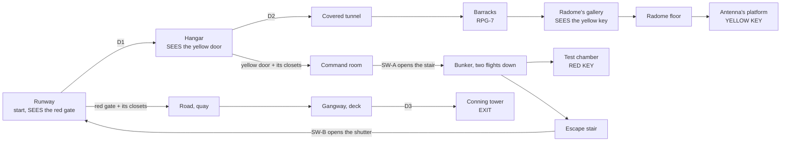

# MAP07 — «Новая Земля» (Novaya Zemlya), арктическая радиолокационная станция

Каноническая версия: `docs/levels/MAP07-novaya-zemlya.md` (английский).

Синхронизировано с оригиналом: 2026-10-27.

Проектный документ. Владелец: `level-designer`. Статус: **v1 ПОСТРОЕНА
2026-10-22 (§13): вся карта, проходимая от старта до выхода, текстурирована
только утверждёнными лампами, населена, три секрета; с 2026-10-22 (D113) она
носит арктический набор Эпизода 3 и подводную лодку из морского набора
(§7.1), три ещё не нарисованных лампа заменены временными (§7.2); v1.2
(D116) добавляет пулемётчиков Легиона и АКМ (§9); ещё не пройдена, прохода
в движке ещё нет (D26).** Эпизод 3, «Портал» (The Portal, D112), первая
карта. Построена по принципу «сначала MVP» (D60). Исходник:
`src/maps/MAP07/map.py`; тесты: `tests/test_map07_novaya_zemlya.py` (карта),
`tests/test_map07_route.py` (её автоматический маршрут) и блок
`Map07Posters` в `tests/test_posters.py`; маршрут `zemlya-critical` в
`tools/route.py`; обзор `docs/levels/shots/MAP07-overview.png`. Русское
зеркало: причитается к закрытию фазы (D34).

> **Пройти карту** (PM или CEO; агенты никогда не запускают GZDoom, D26):
> `python3 tools/build.py && SD_ALLOW_ENGINE=1 MAP=MAP07 SKILL=3 tools/run.sh`.
> Автоматический прогон: `SD_ALLOW_ENGINE=1 python3 tools/route.py --route zemlya-critical --keep-evidence`.

Вводные данные, которым подчиняется этот документ и которые он не повторяет:
`docs/PRD.md` (D35 фракции, D58 ненайденный пропуск, D60 сначала MVP, D112
эпизод 3), `docs/engine/BESTIARY.md`, `docs/engine/BALANCE.md`,
`docs/engine/MOD-SPEC.md` (DoomEdNums, замки, пропуска),
`docs/art/TEXTURE-INDEX.md` (только утверждённые лампы) и метод
`docs/levels/MAP05-volga-dam.md`.


## 1. Синопсис

Ноябрь 1977 года, полярная ночь. Ил-14 полярной авиации высаживает сержанта
Виланову на обледенелую взлётную полосу радиолокационной станции на Новой
Земле, которую захватчики превратили в маяк, наводящий их подкрепления на
портал. Он пересекает ангар и крытые служебные тоннели до радиокупола,
берёт пропуск антенны, открывает командный пункт, спускается в бункер
ядерных испытаний за пропуском порта и с боем прорывается на замёрзший
причал и вниз по рубке подводной лодки, которая доставит его на MAP08.

## 2. Место в кампании

| | |
|---|---|
| Идёт после | MAP06 (конец эпизода 2). Здесь открывается эпизод 3: игрок прибывает по воздуху, Ил-14 стоит на полосе у него за спиной. |
| Идёт перед | MAP08: выход — рубка подводной лодки; текст перехода принадлежит агенту каркаса (`SD_MAP07_EXIT_TEXT`, кластер 8). |
| Что добавляет | **открытое прибытие под полярной ночью**, **купольный зал с подвешенной тарелкой** (радиокупол, ключ на площадке антенны, который виден через провал с галереи), **подземный бункер со светящимся ядром** (жутковатый штрих), **порт с открытой водой и посадкой** (трап, подводная лодка), та же грамматика, что на MAP05: два ключа, два замка, увиденные первыми, короткий путь, найденный с обратной стороны, контратаки на собственных тегах замков. |
| Фракции (D35) | обе. Легион Свободы прибыл по воздуху: он держит аэродром (полоса, ангар) и спит в казармах; Четвёртый рейх управляет маяком: тоннели, радиокупол, бункер. Обе фракции стоят в командном пункте и обе держат порт. Doughboy летают над полосой и открытой водой. Генерала здесь нет. |
| MAPINFO, LANGUAGE | принадлежат агенту каркаса (на момент написания на месте: `map MAP07 lookup "SD_MAP07_NAME"`, `cluster = 8`, `next = "MAP08"`). Эта роль не трогает ни то, ни другое (§11). |

## 3. Что должна делать карта

| Задача | Как это реализует планировка |
|---|---|
| Быть арктической радиолокационной станцией | аэродром (полоса, Ил-14, топливозаправщик, ангар), казармы, соединённые **крытыми тоннелями** (между зданиями никто не ходит снаружи), **радиокупол** (ступенчатый восьмиугольник, венец, тарелка, подвешенная над площадкой антенны), командный пункт с щитами, пультами и штурманским столом, **бункер ядерных испытаний** под станцией и **порт** с открытой водой, льдинами, паковым льдом и подводной лодкой у причала. |
| Использовать высоту | галерея радиокупола и площадка антенны на 128 выше его пола; бункер на 256 ниже полосы (два марша вниз от командного пункта, одна длинная аварийная лестница вверх); море на 64 ниже причала; палуба лодки на 32 выше него. Лифта нет. |
| Научить порядку двух ключей | **красные ворота** — первое, что видно, на дальнем конце полосы, освещены красным; **жёлтая дверь** в западной стене ангара видна при входе в ангар; **жёлтый ключ** лежит на площадке антенны; **красный ключ** в бункере, за командным пунктом жёлтой двери. Замок раньше ключа, оба раза (проверено тестом). |
| Снова ответить на D58 | каждый ключ один на освещённом месте (192, цвета своего замка) на маршруте, виден оттуда, откуда входят в его помещение (проверено тестом: жёлтый ключ с галереи радиокупола через провал, красный ключ от двери испытательной камеры). |
| Награждать знание карты | SW-B в начале аварийной лестницы бункера открывает ставню прямо на полосу, в 200 единицах от красных ворот; без него обратный путь длинный (лестница бункера, командный пункт, ангар, полоса: около 2500 единиц). Проверено тестом: он не обязателен. |
| Нарастание | три трети по набранным очкам здоровья, каждая тяжелее предыдущей на каждой сложности, а порт — самый тяжёлый этап из всех (проверено тестом, §6). |

Целевая длительность: 13–16 минут при первом прохождении на сложности 3;
около 6 при повторном.

## 4. План

По построенной карте, 64 × 64 единицы на символ, север наверху. Полы: полоса,
ангар, казармы, командный пункт, пол радиокупола, причал **0**; галерея
радиокупола и площадка антенны **+128**; бункер **−256**; море **−64**; палуба
лодки **+32**.

```
     y   x 0 ............................................................... 4608
  2496                                      RRRRRRRRR
  2368          CCCCCCC                   RRRRRRRRRRRRR                22222
  2240          CCC!CCC                  RRRRRRRRRRRRRR                  2
  2112          CCCCCCC                  RRRRpppyRRRggggg    BBBBBBBBBBBBBB
  1984          ccc                      RRRRpPppRRRgggg~~~~BBBBBBBBBBBBBB
  1856                                   RRRRRsRRRRRgg      BBBBBBBBBBBBBB
  1792  ~~~~~~~QQQQQQ   UUUUUUUUUU       RRRRRsRRRRRRRR      BBBBBBBBBBBBBB
  1600  ~~~~~~~QQQQQQ3  UUUUUUUUUU        RRRRRRRRRRRR             tt
  1472  ~~~~~~~QQQQQQ3  UUUUUUUUUU          RRRRRRRR               tt
  1280  ~~SSSS~QQQQQQ   UUUUUUUUUUssssssssssss    MMMMMMMMMMM       #
  1152  ~~SSSSsssQQQQqq UUUUUUUUUU           #MMMMMMMMMMMyHHHHHHHHHHHHkk
  1024  ~~SSSSsssQQQQqq    ee                MMMMMMMMMMMyHHHHHHHHHHHHkk
   896  ~~SSSS~QQQQQQ      ee                MMMMMMMMMMM HHHHHHHHHHHHkk
   768  ~~E#SS~QQQQQQ      ee                            HHHHHHHHHHHH
   640  ~~SSSS~QQQQQQ      ee#  kk kk                   #
   448  ~~SSSS~QQQQQQrrrrrr    ==================      ===========
   320  ~~SSSS~QQQQQQrrrrr#rWWWWWWWWWWWWWWWWWWWWWWWWWWWWWWWWWWWWWWWWW
   192  ~~SSSS~QQQQQQrrrrrr  WWWWWWWWWWWWWWWWWWWWWWWWWWWWWW@ooooooooo1
    64  ~~~~~~~QQQQQQ        WWWWWWWWWWWWWWWWWWWWWWWWWWWWWWWWWWWWWWWWW
  -128  ~~~~~~~QQQQQQ        =============================================
```

Легенда: `W` взлётная полоса (старт `@` рядом с Ил-14, `o` самолёт) · `#` двери
и ставни · `H` ангар, `y` портал жёлтой двери · `k` шкафы · `t` крытый
тоннель · `B` казармы · `g` лестница тоннеля вверх на галерею радиокупола ·
`R` радиокупол, `p` площадка антенны с пьедесталом `P` и жёлтым ключом `y` на
его подставке, `s` её лестница · `M` командный пункт · `s` (ряд 1280) два
марша бункера · `U` зал бункера, `C` испытательная камера с красным ключом `!`
и гнездом ядра `c` · `e` аварийная лестница вверх к ставне SW-B на полосу ·
`r` портовая дорога через красные ворота · `Q` причал, `q` открытый сарай,
`3` S3, запертый сарай · `~` море, `S` подводная лодка, `E` её рубка (выход) ·
`=` бордюры и паковый лёд · `1`, `2`, `3`: секреты S1 (трюм самолёта), S2 (за
шкафчиками), S3. Обзорный PNG точен; этот набросок не в масштабе.

| # | Зона | x | y | пол | потолок | освещённость |
|---|---|---|---|---|---|---|
| Z1 | Взлётная полоса (старт), осевая линия, Ил-14 (винты), топливозаправщик, ящики | 1664…4608 | 0…576 | 0 | небо 512 | 128 |
| Z1r | Портал красных ворот (в караульном доме) | 1600…1664 | 224…352 | 0 | 128 | **192**, красный |
| — | Красные ворота (замок 1) | 1568…1600 | 224…352 | 0 | дверь | |
| Z2 | Ангар (ящики, остов Ил-14 в ремонте) | 3456…4352 | 704…1344 | 0 | 320 | 144 |
| Z2y | Портал жёлтой двери | 3392…3456 | 960…1088 | 0 | 128 | **192**, жёлтый |
| — | Жёлтая дверь (замок 3) | 3360…3392 | 960…1088 | 0 | дверь | |
| Z3 | Крытый тоннель на север; лестница тоннеля на запад (8 подъёмов) | 3840…3968; 3200…3456 | 1376…1728; 1920…2048 | 0; 16…128 | +128 | 112 |
| Z4 | Казармы (койки, ниши шкафчиков, подоконник мурала) | 3456…4352 | 1728…2176 | 0 | 160 | 128 |
| Z5 | Радиокупол (ступенчатый восьмиугольник; венец 704; тарелка 640 над центром) | 2176…3200 | 1536…2560 | 0 | 512 / 704 / 640 | 144 / 128 |
| Z5g | Галерея (тоннель приходит сюда), лестница вниз на север (7 ступеней) | 3008…3200 | 1856…2336 | 128…16 | 512 | 144 |
| Z5p | Площадка антенны, лестница вверх с юга (7 ступеней), пьедестал непроходим | 2560…2816 | 1696…2176 | 128 | 640 | 128 |
| Z5k | Подставка ключа на восточном краю площадки | 2752…2816 | 2016…2080 | 144 | 640 | **192**, жёлтый |
| Z6 | Командный пункт (2 пульта, стол с картой, 3 щита) | 2688…3328 | 832…1344 | 0 | 256 | 160 |
| Z7 | Лестница бункера: 7 ступеней, площадка, 7 ступеней | 2080…2656 | 1152…1280 | 0 → −256 | +128 | 112 |
| Z7h | Зал бункера (2 колонны, мерцающая лампа) | 1536…2080 | 1152…1856 | −256 | −32 | 112 (лампа 144, мерцание) |
| Z7c | Испытательная камера; гнездо ядра (декорация, SDPORT1) | 1536…2048 | 1920…2368 | −256 | −32 | 96 (ядро 176) |
| Z7k | Постамент, красный ключ | 1760…1824 | 2112…2176 | −240 | −32 | **192**, красный |
| Z7e | Аварийная лестница (15 ступеней) и её верх, SW-B | 1792…1920 | 608…1152 | 0 → −240 | +128 | 112 |
| Z8 | Портовая дорога | 1152…1536 | 128…448 | 0 | небо | 128 |
| Z9 | Причал, открытый сарай, сарай S3 | 768…1344 | −256…1664 | 0 | небо / 128 | 128 / 112 |
| Z10 | Море (наносит урон 5/32 тика), ступени вверх на y 128, 768, 1408, две льдины | 0…768 | −256…1664 | −64 | небо | 112 |
| Z11 | Палуба лодки, трап (+16), тамбур люка | 256…768 | 192…1344 | 32 | небо / 160 | 128 |
| Z12 | Рубка; ниша выхода | 288…416 | 736…864 | 32 | 160 | 112; **192** |

Протяжённость 4672 × 2848 единиц (MAP05: 4576 × 2304). 169 секторов, 697
линий. Каждая высота кратна 16; ни один подъём ступени не выше 16 (проверено
тестом).

## 5. Прогрессия, ключи, переключатели и выход



**Ключи.** Жёлтая и красная карты Doom, номера в редакторе **6** и **13**,
замки **3** и **1** (`gzdoom.pk3 → lockdefs.txt`, g4.14.2), оба открыты в
движке на MAP03. Появляются как `SD_YellowPass` и `SD_RedPass`.

| Id | Где | Тип | Special | Может ли закрыть игроку путь? |
|---|---|---|---|---|
| D1 | Полоса → ангар | ручная дверь | `Door_Raise (1)`, обе стороны | нет |
| D2 | Ангар → крытый тоннель | ручная дверь | `Door_Raise (2)`, обе стороны | нет |
| **YD** | Ангар → командный пункт | **заперта, открывается насовсем**; также два шкафа ангара (тег 4) | `Door_LockedRaise (4, 16, 0, 3, 0)`, обе стороны | нет |
| SH-A | Командный пункт → лестница бункера | дистанционная, открывается насовсем, сталь с обеих сторон | тег 10 | нет |
| SW-A | Западная стена командного пункта, рядом с SH-A | `SDSW1A`, одноразовый | `Door_Open (10, 16, 0)` | нет |
| SH-B | Верх аварийной лестницы → полоса | дистанционная, открывается насовсем. Сталь со стороны лестницы; **бетон блока бункера со стороны полосы** (находится с обратной стороны) | тег 11 | нет |
| SW-B | Верх аварийной лестницы, восточная стена | `SDSW1B`, одноразовый | `Door_Open (11, 16, 0)` | нет |
| **RG** | Полоса → портовая дорога | **заперты, открываются насовсем**; также два шкафа полосы (тег 5) | `Door_LockedRaise (5, 16, 0, 1, 0)`, обе стороны | нет |
| D3 | Палуба → рубка (люк) | ручная дверь | `Door_Raise (3)`, обе стороны | нет |
| EXIT | Западная стена рубки, на линии D3 | `SDSW1D` | `Exit_Normal (0)` | — |

**Порядок, как его проигрывают тесты** (`test_the_route_is_the_designed_one`),
четыре раунда:

1. С D1, D2 и нажимными панелями: полоса, ангар, тоннель, казармы,
   радиокупол, **жёлтый ключ**. Красные ворота видны от старта, жёлтая дверь
   из ангара (оба проверены тестом).
2. Жёлтая дверь (и шкафы ангара): командный пункт, SW-A.
3. SW-A: бункер, **красный ключ**, аварийная лестница, SW-B.
4. Красные ворота (и шкафы полосы) и ставня SW-B: дорога, причал, подводная
   лодка, D3, **выход**; S3 по пути.

**Ориентиры** (D58): каждый ключ один на освещённом месте (192) цвета своего
замка (`lightcolor` жёлтый `0xFFD860`, красный `0xFF6048`, как на MAP03), и
больше ничто не носит ни тот, ни другой цвет (проверено тестом). Жёлтая дверь
носит `SDDOORY`, красные ворота `SDDOORR`. Каждый переключатель — настоящая
грань, одноразовая, на виду у того, что она открывает (проверено тестом).

Софтлока нет, всё проверено тестами: ни одна дверь не закрывается за игроком;
нет лифта, на котором игрок ехал бы (радарный лифт V3 только спускает
монстров, §17); нет спуска без подъёма обратно (лестница галереи, лестница
площадки, три ступени вверх по стене причала в трёх местах, льдины в одной
ступени от воды); бордюры и паковый лёд — **непроходимые линии**
(`blocking`); ни секрет, ни короткий путь не нужны; из каждого достижимого
сектора на каждом этапе есть путь обратно к старту и, в конце, путь дальше к
выходу.

## 6. Кривая интенсивности

```
  high |                                                              ######
       |                                                              ######  <- the harbour:
 press |                          ####                 ####   ##     ######     Panzermensch,
  ure  |   ##                     ####          ##     ####   ##     ######     heavy, Doughboys,
       |   ##   ##    ##          ####   ##     ##     ####   ##     ######     both factions
   low |   ##   ##    ##     ##   ####   ##     ##     ####   ##     ######  ##
       +------------------------------------------------------------------------>
        runway hangar tunnel barracks radome command bunker chamber  road harbour sub
                                          closets               closets
        0:00                                                                 ~15:00
```

| Этап | Пространство | Ощущение | Вводимая механика |
|---|---|---|---|
| 1 | Взлётная полоса | с самолёта в полярную ночь; пикет Легиона; **вид**: красные ворота на дальнем конце, закрыты | замок, показанный первым |
| 2 | Ангар | наземный персонал Легиона; **жёлтая дверь** в западной стене | — |
| 3 | Тоннели, казармы | теснота; РПГ-7 | — |
| 4 | Радиокупол | большой купольный зал, тарелка над головой; **жёлтый ключ через провал** с галереи; Panzermensch под венцом | ключ виден, но недостижим |
| 5 | Жёлтая дверь, командный пункт | **всплеск**: шкафы ангара открываются позади; обе фракции у стола с картой; SW-A | собственная контратака замка |
| 6 | Бункер | вниз, в темноту; гончие; мерцающая лампа; **ядро, светящееся кобальтом**, за красным ключом | жутковатый штрих |
| 7 | Аварийная лестница, SW-B | ставня открывается на полосу: **короткий путь** | короткий путь с обратной стороны |
| 8 | Красные ворота, дорога, порт | **всплеск** из шкафов полосы; затем **кульминация** на причале: обе фракции, тяжёлый у трапа, Doughboy над водой | — |
| 9 | Подводная лодка | трап, палуба, D3, выход | — |

Замерено (набранные очки здоровья по этапам; `test_the_intensity_rises`):

| Этап | Сложность 2 | Сложность 3 | Сложность 4 |
|---|---|---|---|
| Полоса, ангар | 180 | 640 | 730 |
| Тоннели, казармы | 110 | 320 | 350 |
| Радиокупол | 710 | 920 | 1090 |
| Командный пункт + шкафы ангара | 170 | 220 | 340 |
| Бункер | 710 | 880 | 2030 |
| Шкафы полосы, дорога, порт, подводная лодка | **1170** | **2740** | **3500** |

## 7. Текстуры

### 7.1 По зонам (все утверждены и упакованы, проверено тестами)

Лампы Эпизода 3 (D113, `docs/art/TEXTURE-INDEX.md`, «Arctic» и «Naval»)
выделены **жирным**.

| Зона | Стены | Пол | Потолок |
|---|---|---|---|
| Взлётная полоса | фасад блока бункера `SDCONC1`; фасад ангара `SDRUST1`; караульный дом `SDBRCK1` с двумя советскими флагами `SDFLAG1`/`SDFLAG2` (D119: перерисованы как советские флаги); сугробы (бордюры) **`SDICE2`** | **`SDRWY1`**, центральная полоса **`SDRWY2`**, обе повёрнуты на 90° (`rotationfloor`); верх сугробов **`SDSNOW1`** | небо |
| Ил-14 | `SDSTEL1` (фюзеляж, крылья, гондолы, оперение, хвост над рампой; `SDPLAN1` не нарисована, §7.2); грузовая рампа `SDGATE1` (S1) | `SDFLR4`; крыльцо под хвостом **`SDRWY1`** повёрнутая | небо |
| Топливозаправщик | `SDTANK1` («НЕФТЬ»), один тайл в высоту | `SDFLR4` | небо |
| Ангар | `SDRUST1`; ящики `SDCRAT1`/`SDCRTOP1`; Ленин `SDPOSTR1` в нише | `SDFLR2`; крыльцо D1 снаружи **`SDSNOW1`** | `SDCEIL1` |
| Тоннели | `SDTUNL1` | `SDFLR2` | `SDCEIL2` |
| Казармы | `SDCONC2`; ниши шкафчиков `SDLOCK1`; койки `SDSTEL1`; мурал `SDPOSTR2` на подоконнике | `SDFLR3` | `SDCEIL1` |
| Радиокупол | **`SDRADM1`** (стены, фаски и венец); обод тарелки, площадка, галерея `SDSTEL1` | `SDFLR2`; площадка `SDGRAT2`; галерея `SDFLR4` | `SDCEIL2`; низ тарелки `SDGRAT2` (сетка) |
| Командный пункт | `SDTILE1`; два щита по бокам от Сталина **`SDRADR1`** (по два экрана PPI на каждом, анимация `SDRADR1-4`), восточный щит `SDCTRL1`, все стоят на полу; пульты — столешница `SDCTRL1`; Сталин `SDPOSTR3`; Маркс `SDPOSTR4` и Энгельс `SDPOSTR5` на южной стене | `SDFLR3`; пульты и стол с картой `SDFLR4` | `SDCEIL1` |
| Бункер | `SDTUBB1`; проход камеры `SDMEDG1` (предупреждающие шевроны); ядро `SDPORT1` (анимация); ставня от командного пункта **`SDHERM1`** с обеих сторон, аварийная ставня **`SDHERM1`** на грани лестницы (со стороны полосы остаётся `SDCONC1`, стена) | `SDFLR4` | `SDCEIL2`, лампа `SDCEIL1` |
| Порт | склады `SDBRCK3`; два сарая внутри **`SDHUT1`** (одинаковые, для сравнения в S3); стена причала `SDDAM2` (отметка прилива на воде); ледяные грани **`SDICE2`**; сугробы **`SDICE2`**; дверь S3 `SDGATE2` | дорога, причал, крыльца, сугробы **`SDSNOW1`**; море `SDWATR1` (анимация); льдины и паковый лёд **`SDICE1`** | небо |
| Подводная лодка | корпус и рубка **`SDHULL1`** (морской набор), «471» **`SDHULL2`** один раз на южной грани рубки, одна звезда `SDARMR1` на её северной грани; внутри рубки **`SDNAVC1`**; трап `SDSTEL1` | палуба и крыльцо люка **`SDRUBR1`** (морской набор; протоптанная дорожка вдоль y, лодка лежит вдоль y); внутри `SDFLR4` | небо; рубка `SDFLR4` |
| Двери, переключатели | `SDDOOR1` (D1, D2), D3 **`SDBULK1`** (водонепроницаемая дверь «3», морской набор), `SDDOORY`, `SDDOORR`; `SDSW1A`, `SDSW1B`, `SDSW1D`. На этой карте нет синего замка, поэтому нет `SDDOORB` | | |

**Выравнивание (проверено тестом).** `SDRADM1` на одной сетке от пола
радиокупола: целые панели по 128 до обода 512 и до венца 704. `SDHULL1` с
краем палубы на палубе (32) и на верху рубки (160): из воды корпус
показывает верхние 96 строк тайла, край палубы вверху. `SDICE2` от земли на
сугробах, от воды (-64) на льдинах и паковом льду. Эти три идут по мировой
сетке x/y (`LUMP_WIDTH`), так что разделённая линия не показывает шва.
`SDRWY1` и `SDRWY2` — близнецы, повёрнутые одинаково: штрих (столбцы тайла
27-36) приходится на мировые y 283-293, середину полосы шириной 64 на y
256-320, как бы движок её ни повернул. `SDRADR1` висит на щитах длиной 256 и
128 от их начала: по два целых экрана на каждом. Одиночные элементы
(`SDHERM1`, `SDBULK1`, `SDHULL2`, звезда) на линиях длиной ровно 128,
смещение 0.

### 7.2 Арктический набор: что было заказано, что носится

Заказ арт-директору, как построено в v1 (`ARCTIC_SET` в `map.py`, проверено
тестом: где предложенный ламп существует, карта носит его; где нет, носится
временная замена, и в тот день, когда предложенный ламп появится в
`assets/`, тест краснеет, пока карта его не наденет).

| Предложено | Вид | Что | Носится сейчас | Где |
|---|---|---|---|---|
| `SDSNOW1` | флэт | утрамбованный снег | **`SDSNOW1`** | дорога, причал, крыльца, верх сугробов (полоса носит `SDRWY1`, нарисованную для неё) |
| `SDSNOW2` | стена 64×128 | грань сугроба | `SDICE2` (не нарисована; ближайшая замена — ледниковый лёд) | сугробы вокруг полосы и причала |
| `SDICE1` | флэт | морской лёд | **`SDICE1`** | льдины, паковый лёд |
| `SDICE2` | стена 64×128 | кромка льда у воды | **`SDICE2`** | грани льдин и пакового льда |
| `SDRADM1` | стена | обшивка радиокупола | **`SDRADM1`** (нарисована 128×128) | стены и венец радиокупола |
| `SDPLAN1` | стена 64×128 | обшивка Ил-14 в красном и серебряном цветах полярной авиации | `SDSTEL1` (не нарисована; подсказка S1 — сталь самолёта против его гофрированной рампы) | самолёт |
| `SDSUBH1` | стена | корпус подводной лодки | `SDHULL1` (нарисована под этим именем в морском наборе) | корпус, рубка |
| `SDMAPT1` | флэт | штурманский стол с Арктикой на нём | `SDFLR4` (не нарисована; среди установленных флэтов карты нет) | стол командного пункта |
| `SDRADR1` | стена 128×128 | радарный пульт с круглым экраном PPI | **`SDRADR1`** | два северных щита |
| `SDAURO1` | небо | полярная ночь с сиянием | — (небо из MAPINFO, от каркаса: `SKY1` Freedoom) | `PENDING_TEXTURES` |

Всё ещё за `art-director`, если CEO захочет: `SDPLAN1`, `SDMAPT1`,
`SDAURO1`. Нарисованы, но здесь не используются: близнец `SDRUBR1` —
`SDRUBR2` (заподлицо палубный люк; люк MAP07 — это дверь в рубке) и
остальной морской набор (для MAP08).

### 7.3 Плакаты (CEO, 2026-10-22: «que esos posters puedan aparecer en cualquier nivel» («чтобы эти плакаты могли появляться на любом уровне»))

Каждый целиком: одна односторонняя линия ровно по ширине плаката, в секторе
ровно его высоты, прикреплён к полу, смещение 0 (`tests/test_posters.py`,
блок `Map07Posters`).

| Имя | Ламп | Где |
|---|---|---|
| `z2_lenin` | `SDPOSTR1` Ленин | ангар, восточная стена, x 4368, y 960…1088, ниша глубиной 16 и высотой 256; обращён к жёлтой двери через ангар |
| `z6_stalin` | `SDPOSTR3` Сталин | командный пункт, северная стена, y 1344, x 2944…3072, между двумя щитами (высота помещения 256) |
| `z4_mural` | `SDPOSTR2` космонавтика | красный уголок казарм, северная стена, y 2192, x 3840…3968, на подоконнике высотой 32 между нишами шкафчиков |
| `z6_slot_e` | `SDPOSTR4` **Маркс** (слот Маркса и Энгельса) | командный пункт, южная стена, y 832, x 3136…3264: левый, если смотреть из помещения (лицом на юг) |
| `z6_slot_w` | `SDPOSTR5` **Энгельс** (слот Маркса и Энгельса) | командный пункт, южная стена, y 832, x 2752…2880: правый |

**Пара Маркс и Энгельс (D117, 2026-10-22).** `POSTER_SLOTS_MARX_ENGELS =
("z6_slot_e", "z6_slot_w")`, Маркс первым: `SDPOSTR4` Маркс «ПРОЛЕТАРИИ /
ВСЕХ СТРАН,» и `SDPOSTR5` Энгельс «СОЕДИНЯЙТЕСЬ!» (зеркально, смотрит на
Маркса), 128×256, как Ленин и Сталин; `MARX_ENGELS = ("SDPOSTR4",
"SDPOSTR5")` перечисляет их в `WALL_TEXTURES`. Стена — южная стена
помещения, поэтому если смотреть изнутри, восток слева: Маркс на востоке,
Энгельс на западе, и две полосы читают строку Манифеста слева направо через
ось помещения (`tests/test_posters.py` проверяет это).

## 8. Секреты (построены в v1)

Правило MAP01: подсказка — это сравнение, а не знак; у каждого секрета есть
путь обратно; ни один не обязателен (проверено тестом).

| # | Где | Подсказка | Награда (на каждой сложности) |
|---|---|---|---|
| S1 | Трюм Ил-14 | самолёт, с которого игрок сошёл, склёпан из стали на каждой грани, кроме одной: гофрированная грузовая рампа (`SDGATE1`) под хвостом, она и есть нажимная панель (тег 6) | коробка патронов к дробовику, аптечка, коробка патронов |
| S2 | За шкафчиками казарм | в восточной нише шкафчиков один отсек шириной 64 стоит на 16 глубже, в тени (96 против 128); он такой же шкафчик, как остальные, и нажимная панель (тег 7) в склад комиссара | коробка ПГ-7В, стимпак, коробка патронов к дробовику |
| S3 | Второй сарай причала | на причале два одинаковых сарая; южный стоит открытым (два бонуса здоровья), северный заперт складской дверью «СКЛАД» (`SDGATE2`), нажимная панель (тег 8) | **Ручная Катюша** и две канистры топлива: кнопка паники для порта |

Панели несут флаг `secret`; помещения — сектор special 1024. S1 и S2
открываются в раунде 0, S3 в раунде 3.

## 9. Враги и ресурсы по сложностям

Номера бестиария (MAPINFO DoomEdNums 21100-21107, а 21110 — пулемётчик с
D116), вложены по парам сложностей Doom. Все классы, кроме Генерала,
колосса и Консорциума.

| Этап / зона | Сложность 2 | Сложность 3 | Сложность 4 |
|---|---|---|---|
| Полоса, ангар | 4 легионера + 1 штурмовик | 6 легионеров + 1 штурмовик + Doughboy | 7 легионеров + 2 штурмовика + Doughboy |
| Тоннель, казармы | 1 стрелок + 3 легионера | + 1 гончая + 1 штурмовик | + 1 легионер |
| Радиокупол | Panzermensch + 3 стрелка + 1 гончая | + 1 гончая + 1 штурмовик | + 1 стрелок + 1 гончая |
| Командный пункт + шкафы ангара (жёлтый тег) | 3 легионера + 1 стрелок + 1 штурмовик | + 1 легионер + 1 стрелок | + 2 штурмовика |
| Бункер | Panzermensch + 3 стрелка + 1 гончая | + 1 гончая + 1 стрелок | + 1 гончая + **тяжёлый** перед ядром |
| Шкафы полосы (красный тег), дорога, порт, подводная лодка | Panzermensch + Doughboy + 3 легионера + 3 стрелка + 2 штурмовика | + **тяжёлый** + Doughboy + 1 легионер + 1 стрелок + 2 штурмовика | + Doughboy + 3 легионера + 1 гончая + 2 штурмовика |
| Пулемётчики (D116) | 3: полоса, ангар, причал | + 1 на палубе | + 1 у красных ворот |
| **Всего** | **37** | **55** | **72** |

Пулемётчики Легиона (D116, `SD_LegionGunner`, 21110, 80 HP; роняют половину
магазина АКМ), 3 / 4 / 5 на сложностях 2 / 3 / 4, каждый у укрытия с длинной
линией огня по земле, которую игроку нужно пересечь (проверено тестом: ни
одного в шкафу, у каждого реквизит, стена или ступень в пределах 128;
безопасный старт сохраняется):

| Сложность | Где | Линия | Укрытие |
|---|---|---|---|
| 2 | полоса, (2240, 416), лицом на восток | вся длина полосы на восток до самолёта (1480 от старта) | западные ящики |
| 2 | ангар, (3872, 1264), лицом на юг | пол ангара до его двери | остов в ремонте |
| 2 | южный конец причала, (1056, -192), лицом на север | весь причал | бордюр причала |
| 3 | палуба лодки, (320, 1216), лицом на юг | вниз по корпусу | край корпуса |
| 4 | западный конец полосы, (1792, 96), лицом на восток | вся длина полосы | бордюр и стена ворот |

**Безопасный старт** (`tests/test_safe_starts.py`, 2026-10-22): на
сложностях 2, 3 и 4 ни один монстр не видит стартовую зону (старт и шаг
вокруг него) в пределах 768 единиц; собственная проверка видимости Doom,
запущенная на построенной карте. Прогон PM в движке (2026-10-22 14:13,
сложность 3, без режима бога) обнаружил, что два ближайших легионера на
полосе (3456, 384 и 3136, 192: в 300 и 580 единицах) снимают игроку здоровье
со 100 % до 3 % примерно за 1,3 с. Первый теперь прячется за ящиками к западу
от самолёта (3296, 128), вне поля зрения, пока игрок не обойдёт их; второй
стоит на полосе в 840 единицах (2880, 352), на виду, и первый выстрел —
игрока. То же число, та же зона, тот же раунд.

В сравнении с 31 / 46 / 60 на MAP05: эпизод 3 открывается на ступень выше
(проверено тестом). Три Panzermensch на каждой сложности (радиокупол,
бункер, причал), тяжёлый со сложности 3 (причал), а на сложности 4 ещё и
перед ядром. Doughboy только под небом (полоса, открытая вода; проверено
тестом).

**Оружие** (старт с пистолетом), на каждой сложности, на маршруте, каждое
перед своим боем: **ИЖ** у самолёта, **ППШ-41** в ангаре, **АКМ** (D116,
`SD_Akm` 21008) в стойках ангара после него (эпизод 3 начинается здесь с
пистолета, поэтому оно на маршруте даже для того, кто взял одно на плотине),
**РПГ-7** в казармах (единственный путь в радиокупол проходит через них,
проверено тестом), **РОКС-3** в командном пункте (для бункера); **Ручная
Катюша** в S3. **Магазины АКМ** (`SD_AkmAmmo` 21020, 30 патронов) 11 / 14 /
19 на сложностях 2 / 3 / 4 с D119 (§16; 4 / 3 / 2 из D116 ушли вместе с
масштабированием вниз).

**Боеприпасы, D119** (`docs/engine/BALANCE.md` §8: линейка G3-8, убийства в
патронах ИЖ, пулемётчик 2, ПГ-7В по 2 патрона, топливо 13,5 / 80, магазин АКМ
4,5; только маршрут, без выпадения, без секрета). Боеприпасы маршрута — это
`AMMO` в `map.py`, отдельно от `ITEMS`: они появляются начиная с самого
низкого уровня сложности вверх, как и монстры, за которых они платят (§16).

| | Сложность 2 | Сложность 3 | Сложность 4 |
|---|---|---|---|
| Нужно | 74 | 128 | 177 |
| Размещено | 122.6 | 187.5 | 229.0 |
| Отношение (диапазон 1.5-2.0 / 1.3-1.6 / 1.2-1.45) | 1.66 | 1.46 | 1.29 |
| До D119 (размещено, отношение) | 343.0, 4.64 | 325.5, 2.54 | 275.0, 1.55 |
| Подборов боеприпасов на маршруте (до D119) | 22 (49) | 31 (44) | 39 (33) |
| Доля дробовика, с учётом выпадения легионеров (≤ 35 %) | 28.6 % | 34.5 % | 32.9 % |
| Урон по пулам: дробовик / ППШ / АКМ / ПГ-7В / топливо | 17 / 15 / 45 / 14 / 8 % | 26 / 10 / 37 / 19 / 7 % | 24 / 11 / 41 / 19 / 6 % |

Проверяется также на каждом раунде маршрута по нижней границе сложности,
каждый пул только после своего оружия, магазины АКМ ведут на каждом этапе, а
ПГ-7В не больше 30 % любого из них (у карты нет босса; §16). **Здоровье** на
сложности 4: 6 стимпаков + 5 аптечек, 9 бонусов здоровья; **броня**:
бронежилет в ангаре (для радиокупола), тяжёлый жилет в начале аварийной
лестницы (раунд 2, перед шкафами полосы и портом), 6 пластин. Здоровье и
броня уменьшаются со сложностью (проверено тестом).

## 10. Используемые элементы движка

| Потребность | Выдаётся | Статус |
|---|---|---|
| Ручная дверь | `Door_Raise` 12 (тег, 16, 150, 0) | ПРОВЕРЕНО на MAP01 |
| Дистанционная дверь, одноразовый переключатель | `Door_Open` 11 (тег, 16, 0) | ПРОВЕРЕНО на MAP01 |
| Запертая дверь, остающаяся открытой | `Door_LockedRaise` 13 (тег, 16, 0, замок, 0) | ПРОВЕРЕНО на MAP02/MAP03 |
| Тег запертой двери, открывающий шкафы | шкафы делят тег с замком | НЕ ПРОВЕРЕНО в движке (как V3 на MAP05): V3 |
| Ключи | thing 6, 13 (`SD_YellowPass`, `SD_RedPass`) | как MAP03 |
| Цветной свет | `lightcolor` сектора | как MAP02-MAP06 |
| Мерцающий свет | special сектора 65 на лампе бункера | как MAP01 |
| Повреждающий пол | `damageamount` 5, `damageinterval` 32 на море | как MAP05 (в игре там тоже НЕ ПРОВЕРЕНО): V4 |
| Небо и приём с открытым воздухом | `F_SKY1`; бордюры и паковый лёд с небом на 16 над их верхом | как парапеты MAP05: V2 |
| Непроходимые бордюры | двусторонние линии `blocking` | флаг Doom |
| Средние текстуры | три щита (два `SDRADR1`, один `SDCTRL1`), `blocking` + `dontpegbottom` | как MAP05: V13 |
| Анимированные текстуры | `SDWATR1` (флэт), `SDPORT1` (стена), `SDRADR1` (стена, средняя текстура, 12 тиков) через ANIMDEFS | всё уже в ANIMDEFS; здесь НЕ ПРОВЕРЕНО: V11, V15 |
| Смещения текстур | `SDDAM2` на стене причала, `SDCTRL1` на пультах, `SDRADM1`, `SDHULL1`, `SDICE2` на своих сетках | помощник MAP05; V12, V16 |
| Поворот флэта | `rotationfloor` 90 на полосе (`SDRWY1`) и её центральной полосе (`SDRWY2`) | UDMF GZDoom; здесь НЕ ПРОВЕРЕНО: V17 |
| Событие при подборе (V3, §17) | у thing `special` 21 `Floor_LowerToLowest` (тег, скорость) на жёлтом ключе, красном ключе и аптечке на дороге | поле, как красный ключ MAP04; номер НЕ ПРОВЕРЕН в нашем движке (K3 MAP04): V19-V21 |

План тегов: **1** D1 · **2** D2 · **3** D3 · **4** жёлтая дверь + шкафы
ангара · **5** красные ворота + шкафы полосы · **6** S1 · **7** S2 · **8** S3 ·
**10** SH-A · **11** SH-B · **12** радарный лифт (жёлтый ключ) · **13**
камеры бункера (красный ключ) · **14** сугроб (аптечка). Свободны: 9, 15 и
далее.

## 11. MAPINFO и LANGUAGE (не этой роли)

Принадлежат агенту каркаса: `map MAP07 lookup "SD_MAP07_NAME"`, `cluster =
8`, `next = "MAP08"`, небо и музыка. Ничто в карте не зависит от большего.
Пар около 360 справедлив для игрока, знающего маршрут.

## 12. План версий

| Версия | Содержание | Готово, когда |
|---|---|---|
| **v1 — целая, текстурированная, населённая** ✅ **ПОСТРОЕНА 2026-10-22** (§13) | §4-§10 с утверждёнными лампами; арктический набор и подводная лодка применены в тот же день (D113, §7) | CEO проходит её на сложности 3 и доходит до MAP08 |
| v2 — свет и остальное | небо с полярным сиянием (`SDAURO1`, если нарисуют); пятна прожекторов на полосе и причале; `SDPLAN1`/`SDMAPT1`, если нарисуют (по одной строке в `ARCTIC_SET`) | впервые играющий находит оба ключа и выход, ничего не подсказывая |
| v3 — баланс | после плейтестов (D60) | пройдена на сложности 3 |

## 13. Запись о постройке v1 (2026-10-22)

### 13.1 Что в ней есть

Всё из §4-§10, построено за один проход от заглушки (одно помещение, старт
и выход, написанные первыми, чтобы сборка никогда не падала для других
агентов эпизода 3).

### 13.2 Фактически выполненная проверка

- `python -m unittest tests.test_map07_novaya_zemlya` — 77 тестов, OK.
- `python -m unittest tests.test_posters` (`Map07Posters`, 6) — OK.
- `python -m unittest tests.test_map07_route tests.test_route` — 117
  тестов, OK (`zemlya-critical` зарегистрирован; `next` в MAPINFO для MAP07
  — MAP08).
- `python tools/verify.py fast` (2026-10-22, 3094 теста): docs, build и
  check_pk3 PASS; один провал, общий, а не только MAP07:
  `test_doughboy_sprites` фиксирует карты, где размещён Doughboy, как
  MAP01-MAP06 и RANGE, а теперь их размещают и MAP07, MAP08, MAP09 (13.5).
- **Прогона в движке не было** (D26).
- 2026-10-22, D113, применены арктический и морской наборы (§7):
  `python -m unittest tests.test_map07_novaya_zemlya tests.test_map07_route`
  — 92 теста, OK.

### 13.3 Чек-лист движка для PM (D26)

| # | Проверка | Как |
|---|---|---|
| V1 | Загружается с чистым логом; `zemlya-critical` PASS на сложностях 2, 3, 4 | `SD_ALLOW_ENGINE=1 python3 tools/route.py --route zemlya-critical --keep-evidence` |
| V2 | Открытое пространство читается как открытое: небо над полосой и портом, нет верхней текстуры между двумя небами, за бордюрами и паковым льдом небо | пройти по полосе и причалу |
| V3 | Жёлтая дверь открывает два шкафа ангара; красные ворота — два шкафа полосы | открыть каждый замок, оглянуться |
| V4 | Море наносит урон (~5 HP в секунду), ступени и льдины ведут наружу | встать в воду |
| V5 | Никто не пересекает бордюр или паковый лёд; Doughboy над водой не застревают на паковом льду | попробовать; понаблюдать |
| V6 | Радиокупол читается как купол: венец, тарелка, подвешенная над площадкой (её сетчатый низ), ключ, видимый с галереи | встать на галерею |
| V7 | Бункер: лампа мерцает, гнездо ядра показывает `SDPORT1` анимированной, целой, кобальтовой | встать в камеру |
| V8 | `lightcolor` жёлтый и красный на замках и местах ключей | как V8 на MAP05 |
| V9 | Три секрета засчитываются (3 из 3) | нажать каждую панель |
| V10 | Плакаты целиком (ниша Ленина, Сталин на стене, мурал на подоконнике, слоты) | пройти по ангару, командному пункту, казармам |
| V11 | Море движется (`SDWATR1`-`4`) | встать у причала |
| V12 | Отметка прилива `SDDAM2` чуть ниже края причала; пульты показывают столешницу | посмотреть |
| V13 | Три щита командного пункта стоят на полу, нарисованы один раз, останавливают игрока | упереться в один из них |
| V14 | Ил-14 читается как самолёт (фюзеляж, низкие крылья, гондолы, хвост над рампой) | прибыть |
| V15 | Экраны радарных пультов развёртываются (`SDRADR1`-`4`, средняя текстура) | встать перед северными щитами |
| V16 | Стены эпизода 3 на своих сетках: панели радиокупола целиком до обода и венца, край палубы лодки на палубе из воды, ледяные грани без швов | посмотреть на радиокупол, на лодку с причала, на льдины |
| V17 | Плиты полосы и осевая линия идут вдоль полосы (восток-запад), штрих посередине своей полосы, нет шва между `SDRWY1` и `SDRWY2` | прибыть, посмотреть на запад |
| V18 | Рубка с палубы: выше верха рубки (160), вокруг её внутреннего помещения и над крыльцом люка верхняя текстура против неба (потолки помещения и крыльца — `SDFLR4`, а не небо) показывается как коробка до 512 (`SDHULL1` над крыльцом, `SDSTEL1` вокруг помещения, как в v1). Если так, потолкам крыльца и помещения нужно небо (решение по дизайну: мостик, открытый ночи) | посмотреть на рубку с трапа |

### 13.4 Для прохождения CEO

1. Читается ли прибытие: самолёт, полоса в полярной ночи, красные ворота на
   дальнем конце?
2. Радиокупол: читается ли жёлтый ключ через провал, и тарелка?
3. Бункер: достаточно ли жутко (мерцание, ядро)?
4. Порт: тот ли последний бой; подводная лодка как выход?
5. Короткий путь (SW-B на полосу): найден ли и стоит ли того?

### 13.5 Что держат другие роли

- `art-director`: что осталось от арктического заказа, §7.2 (`SDPLAN1`,
  `SDMAPT1`, `SDAURO1`), если CEO захочет.
- Каркас / `mod-engineer`: MAPINFO и LANGUAGE для MAP07 на месте.
- **Общие тесты, не этой роли**: `tests/test_doughboy_sprites.py`
  (`test_the_doughboy_is_placed_in_every_map`) фиксирует набор карт, где
  размещён Doughboy, и требует добавить `"MAP07"` (MAP07 размещает четырёх).
- Ловушка для каждой новой карты: карта, которая определяет и
  `MURAL_NICHE`, и `LENIN`, отвечает маркерам маршрута MAP01
  (`ZARYA_MARKERS`), и `tools/route.py` падает при импорте. MAP07 называет
  свою нишу `RED_CORNER_NICHE`.
- PM: §13.3.

## 14. Открытые вопросы для CEO

1. **Пройти v1** (§13.4).
2. **Транспорт выхода**: подводная лодка (как построено) или ледокол?
   Причал подходит для любого; рубка становится мостиковой дверью.
3. **Ручная Катюша в S3 снова** (как на MAP05): оставить секретом или дать
   на маршруте в начале эпизода 3?

## 15. Запись v1.2: пулемётчики и АКМ (2026-10-22, D116)

Только население и подбираемые предметы: ни геометрия, ни дверь, ни ключ, ни
секрет, ни плакат не сдвинуты.

- **Пять пулемётчиков Легиона** (`SD_LegionGunner`, 21110), 3 / 4 / 5 на
  сложностях 2 / 3 / 4 (§9): итого 37 / 55 / 72 (было 34 / 51 / 67).
  Интенсивность по-прежнему растёт через три трети, порт — самый тяжёлый
  этап; безопасный старт сохраняется.
- **АКМ** (`SD_Akm`, 21008) в ангаре, после ППШ и перед РПГ-7, в
  `ROUTE_WEAPONS`; **магазины** (`SD_AkmAmmo`, 21020) 4 / 3 / 2 по
  сложностям.
- Тесты (`tests/test_map07_novaya_zemlya.py`): пулемётчики (число по
  сложностям, никогда в шкафу, укрытие в пределах 128), магазины 4 / 3 / 2,
  АКМ на маршруте, его патроны в G3-8 (30 в магазине, в среднем 12 на
  патрон); читатель классов берёт первое значение каждой константы.
- Проверки в движке для PM: **V19** очереди пулемётчиков из укрытия на
  дистанции (полоса, ангар, причал); **V20** АКМ в ангаре подбирается и
  стреляет (MOD-SPEC §6.12: оно всё ещё носит кадры ППШ, пока не нарисованы
  кадры Gemini).

## 16. Запись v1.3: боеприпасы D119 (2026-10-23)

Плейтест CEO по Эпизодам 2 и 3: боеприпасов «siempre sale de sobras»
(«всегда остаётся с избытком»), «siempre acabas con la escopeta» («всегда
в итоге остаёшься с дробовиком»). Только подбираемые предметы: ни геометрия,
ни дверь, ни ключ, ни секрет, ни монстр, ни плакат не сдвинуты; награды
секретов не изменились.

- **Боеприпасы маршрута переехали из `ITEMS` в `AMMO`**, читаются как
  (зона, номер в редакторе, x, y, *самый низкий* уровень сложности): каждая
  сложность получает запас, общий для всех сложностей, сложности 3-5
  добавляют то, чего стоят средние монстры, а сложности 4-5 — то, чего
  стоят тяжёлые. Вложенные наоборот (расходники Doom, больше на лёгкой), они
  не укладывались ни в одну полосу сложности 2: сложность 4 требует в 2,4
  раза больше убийств, чем сложность 2, поэтому сложность 2 получила в 4,6
  раза больше своей потребности.
- **Убраны, а не только уменьшены** на сложностях 2 и 3: на 27 / 13 подборов
  меньше (§9). Сложность 4 и так была самой скудной: её запас упал с 275 до
  229 эквивалентов патронов дробовика, но она держит 39 подборов против 33,
  потому что АКМ, которое теперь ведёт на каждом этапе, идёт по 30 патронов
  в магазине (коробке магазинов потребовался бы актор: `mod-engineer`). По
  видам, сложность 2 / 3 / 4, до -> после: коробки патронов к дробовику
  8 / 8 / 7 -> 0 / 1 / 1; патроны к дробовику 17 / 14 / 9 -> 3 / 5 / 6;
  обоймы 7 / 6 / 4 -> 0; коробки патронов 3 -> 3 / 3 / 4; россыпью ПГ-7В
  5 / 5 / 3 -> 3; коробки ПГ-7В 2 -> 1 / 3 / 4; канистры 3 -> 1 / 2 / 2;
  магазины АКМ 4 / 3 / 2 -> 11 / 14 / 19.
- **Смесь** (BALANCE §8.3-8.4 с поправкой PM от 2026-10-23): дробовик не
  более 35 % с учётом выпавших ИЖ легионеров; каждый пул только после
  встречи со своим оружием; вне этапа босса или мини-босса ведёт новейшее
  пулевое оружие (АКМ, иначе ППШ: наибольшая доля
  боеприпасов этапа, кроме патронов к дробовику, не менее 40 %), а ПГ-7В — сильный второй, не
  более 30 % урона этапа, чтобы дробовик не менялся на гранатомёт; топливо
  никогда не должно вести и остаётся не более 15 % урона карты (РОКС-3
  приглушён). Два магазина лежат в командном пункте рядом с собственными 40
  РОКС-3, так что АКМ там по-прежнему ведёт.
- Тесты (`tests/test_map07_novaya_zemlya.py`): полоса по сложностям, каждый
  этап на нижней границе сложности, доля дробовика с выпадением, каждый пул
  после своего оружия, пули ведут, а ПГ-7В ≤ 30 % каждого этапа, топливо ≤
  15 % и АКМ впереди ППШ, боеприпасы следуют за монстрами (меньше подборов
  на сложностях 2-3, меньше запаса на сложности 4); `ROKS_AVERAGE` 13.5.
  Тест магазинов 4 / 3 / 2 удалён.
- Вторую половину BALANCE §8.4.3 (каждый монстр, кроме босса, только на
  патронах дробовика и обычных патронах) PM отбросил; исключение для РОКС-3
  — поправка PM. Прогон в движке за PM (D26).

## 17. V3: события при подборе и постановочные сцены (2026-10-23, A2 и A3 из D120)

Работа V3, не в v1.2. Три события, каждое запускается **подбором
предмета**: у предмета есть UDMF `special` и `arg0..`, которые GZDoom
выполняет при подборе (образец — красный ключ и гондолы MAP04; форма
`Door_Open` ПРОВЕРЕНА в движке через RKEY в `tunguska-critical`,
2026-10-23). Эти теги не несёт **ни одна линия**: эти секторы двигает только
подбор. Таблица — `PICKUP_EVENTS` в `map.py`; `tests/_pickup_events_e3.py`
хранит проверки, общие для MAP07-MAP09 (PM унифицирует шаблон через
`docs/levels/PICKUP-EVENTS.md`).

| Событие | Предмет (где) | Special | Тег | Что движется | Кто ждёт | Предупреждение |
|---|---|---|---|---|---|---|
| **A3 грузовой лифт радара** | жёлтый ключ (площадка антенны) | `Floor_LowerToLowest (12, 8)` | 12 | кабина `z5_lift_car` (2064-2144 x 2096-2256), наверху на 128 за решёткой — дверью высоко в западной стене радиокупола, опускается на пол (~3,7 с) | 1 / 2 / 3 Рейха (стрелок; + гончая; + стрелок) | решётка `z5_lift_gate` мерцает (65, 160 против 112 у кабины); лебёдка (звук движения пола) |
| **A2 камеры бункера** | красный ключ (постамент перед ядром) | `Floor_LowerToLowest (13, 32)` | 13 | две стенные панели `z7_cell_s_wall`, `z7_cell_n_wall` в западной стене испытательной камеры, пол на потолке камеры (-32), опускаются до её пола (~1,6 с) | 2 / 3 / 4 Рейха (два стрелка; + гончая; + гончая) в `z7_cell_s`, `z7_cell_n` | полоса камеры перед каждой панелью мерцает (65, 160 против 96 у камеры) |
| **A3 сугроб, который оседает** | аптечка на портовой дороге (1344, 432), под разбитым прожектором | `Floor_LowerToLowest (14, 16)` | 14 | сугроб `z8_snowbank` (1280-1408 x 448-480), высотой 128 у фасада склада, опускается в дорогу (~1,8 с) | 1 / 2 / 3 (стрелок; + стрелок; + легионер) на первом этаже склада `z8_snowbank_pocket` | пятно прожектора `z8_snowbank_lamp` мерцает (65, 160 против 128 у дороги); аптечка лежит в нём |

**Почему именно эти и как они прячутся.** Задание просило, чтобы лёд или
земля оседали при взятии ключа; оба ключа лежат в помещениях (площадка
антенны, испытательная камера), поэтому оседающий лёд — это аптечка на
дороге, «объект» (A2: «llaves y objetos», «ключи и объекты»), а ключам
достались лифт и камеры. До подбора ни у одной линии, откуда ждут монстры,
нет проёма (пол кабины — потолок решётки; панель закрыта от пола до потолка;
верх сугроба встречается с перемычкой склада): никто их не видит и не
слышит игрока через неё (звук Doom останавливается на закрытой линии),
поэтому они ждут; просыпаются, когда проём открывается, по виду или по
первому выстрелу (проверено тестом).

**Монстры перемещены, а не добавлены**: итоги (37 / 55 / 72), очки здоровья
каждого этапа, боеприпасы и их полосы не изменились (всё проверено тестами
заново). Лифт держит западного стрелка радиокупола (сложность 2), гончую
тарелки (3) и юго-западного стрелка (4); камеры — двух стрелков зала (2), его
западную гончую (3) и восточную гончую (4); склад — стрелков причала в (864,
320) (2) и (832, 1600) (3) и его легионера в (1088, 448) (4). Аптечка
перенесена из (1408, 384) на дороге на пятно прожектора.

**Соблюдённые правила (проверено тестами):** никогда не на критическом пути
(выход при закрытых тегах всех событий); никогда не ловушка (из помещения
каждого события есть путь назад к старту, на каждом раунде); место предмета
достижимо без его события, помещения события никогда не достижимы без него;
безопасный старт (каждый выпущенный монстр дальше 768 от старта;
`tests/test_safe_starts.py` работает на построенной карте); четыре раунда §5
не изменились (каждый подбор срабатывает в раунде, где достигается его
предмет: лифт в раунде 0, камеры в раунде 2, сугроб в раунде 3). Лифт — не
лифт игрока: кабина опускается и остаётся внизу, тупик, из которого
выходят.

**Маршрут** (`tools/route.py`, `zemlya-critical`): RKEY теперь ждёт время
двери и ожидает открытый тег 13 (осевшая панель — это открытая по росту
игрока), первое доказательство в движке `Floor_LowerToLowest` на предмете.
Лифт не запрашивается (его кабина всегда на тело выше, так что «открыт» ничего
не доказывает); аптечку маршрут никогда не берёт.

**Дополнения к чек-листу движка (от PM, D26):**

| # | Проверка | Как |
|---|---|---|
| V19 | Взятие жёлтого ключа опускает радарный лифт до пола радиокупола вместе с его Рейхом; лампа решётки мерцает до этого; стальная грань кабины читается как решётка лифта под перемычкой решётки | пройти к YKEY, посмотреть на запад с площадки; `netevent sdtag 12` печатает пол 0 |
| V20 | Взятие красного ключа опускает обе панели камер в западной стене камеры; выходят гончие и стрелки; полосы перед ними мерцают | шаг маршрута RKEY (тег 13 открыт) и посмотреть на запад |
| V21 | Взятие аптечки на дороге опускает сугроб; первый этаж склада открывается под кирпичной перемычкой; пятно прожектора мерцает; грань сугроба читается как утрамбованный лёд (`SDICE2`) | пройти на аптечку на дороге; `netevent sdtag 14` печатает пол 0 |

## 18. V3 (2026-10-24): РГД-5 (A4) и пропагандистское радио (B5)

**РГД-5** (ADR 012; рекомендация по размещению
`docs/engine/2026-10-23_V3_rgd5.md` §6). Гранаты — расходники в `ITEMS`,
поэтому они уменьшаются со сложностью **вниз**: **4 / 3 / 2** гранаты на
сложностях 2 / 3 / 4 (сложности 1 и 5 удваивают их, как и каждый подбор).
Почему здесь: Эпизод 3 — старт с пистолетом: снова подсумок, в ангаре;
россыпью — среди коек. Ящика нет (21022: только награда секрета).

| Где | Что | Сложности |
|---|---|---|
| `z2_hangar` (3900, 1000) | подсумок (21009): оружие и 2 | каждая сложность |
| `z4_barracks` (3800, 1950) | граната россыпью (21021) | сложности 1-3 |
| `z4_barracks` (4150, 1950) | граната россыпью | сложности 1-2 |

**Бюджет** (BALANCE §8, граната 1,25 эквивалента патрона дробовика,
учитывается только в целом для полосы и доли дробовика): отношение
размещено / нужно на сложностях 2 / 3 / 4 идёт 1.657 → 1.725 / 1.465 →
1.494 / 1.294 → 1.308, внутри 1.5-2.0 / 1.3-1.6 / 1.2-1.45. Ни один другой
подбор не сдвинут. Готовность этапа, лидерство новейшего оружия и этап босса
гранаты не учитывают.

**Громкоговоритель** (`SD_Loudspeaker`, 21201; MOD-SPEC §6.14; D124):
`z4_barracks` (3904, 1952), 384 у актора: реплики 2, 7, 13, 16 (казарменное
радио вдали от Москвы: плотина, строка из лора, завод-крепость, сигнал
точного времени). Таблица `LOUDSPEAKERS` в `map.py`; геометрия не менялась
(у него нет тела, пока не нарисован его рупор). Тесты: собственные тесты
карты (`test_every_pickup_can_be_picked_up`, полоса G3-8 с гранатами),
`tests/test_rgd5_maps.py`, `tests/test_loudspeaker.py`.

**Чек-лист движка (PM, D26):** гранаты лежат там, где указывает таблица, и
подбираются (`printinv`: `SD_Rgd5` и `SD_Rgd5Ammo`); громкоговоритель
играет свой джингл при приближении, читает свои реплики поверх музыки
уровня, затихает при удалении (идущая реплика договаривается) и не слышен из
соседнего помещения; чистый лог.
