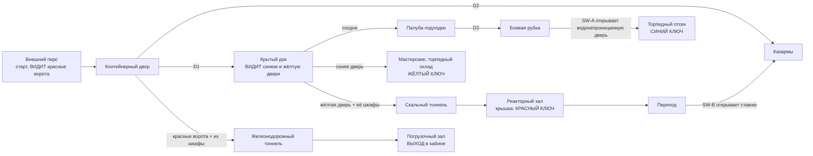

# MAP08 — «Североморск» (Severomorsk), база подводных лодок Северного флота

Каноническая версия: `docs/levels/MAP08-severomorsk.md` (английский).

Синхронизировано с оригиналом: 2026-10-27.

Проектный документ. Владелец: `level-designer`. Статус: **v1 ПОСТРОЕНА
2026-10-22 (§13): вся карта, проходимая от старта до выхода, населённая,
три секрета; v1.1 в тот же день (§15): она носит набор «Naval» (D113), а для
каждой морской детали, которую так и не нарисовали, взят ближайший из
установленных лампов (§7.2); ещё не пройдена, прохода в движке пока нет
(D26).**
Эпизод 3, «Портал» («The Portal», D112), вторая карта. Построена по принципу
MVP first (D60). Источник: `src/maps/MAP08/map.py`; тесты:
`tests/test_map08_severomorsk.py` (карта), `tests/test_map08_route.py` (её
автоматический маршрут) и блок `Map08Posters` в `tests/test_posters.py`;
маршрут `severomorsk-critical` в `tools/route.py`; обзор
`docs/levels/shots/MAP08-overview.png`. Русское зеркало: причитается к
закрытию фазы (D34).

> **Пройти карту** (PM или CEO; агенты никогда не запускают GZDoom, D26):
> `python3 tools/build.py && SD_ALLOW_ENGINE=1 MAP=MAP08 SKILL=3 tools/run.sh`.
> Автоматический прогон: `SD_ALLOW_ENGINE=1 python3 tools/route.py --route severomorsk-critical --keep-evidence`.

Вводные данные, которым подчиняется этот документ и которые он не повторяет:
`docs/PRD.md` (D35 фракции, D58 ненайденный пропуск, D60 MVP first, D112
эпизод 3), `docs/engine/BESTIARY.md`, `docs/engine/BALANCE.md`,
`docs/engine/MOD-SPEC.md` (DoomEdNum, замки, пропуска),
`docs/art/TEXTURE-INDEX.md` (только утверждённые лампы) и метод
`docs/levels/MAP05-volga-dam.md`, структуре которого следует этот документ.


## 1. Синопсис

Ноябрь 1977 года, полярная ночь. Патрульный катер доставляет сержанта
Виланову по Кольскому заливу с Новой Земли к внешнему пирсу Североморска, где
Легион Свободы, пришедший морем, выгружает груз для портала в Тунгуске, а
Четвёртый рейх, пришедший по железной дороге, удерживает базу, вырубленную в
граните; он поднимается на борт атомной подводной лодки, ошвартованной в
крытом доке, берёт ключи от мастерских, скального тоннеля и реакторного зала
и уходит на восток через железнодорожный тоннель на товарном составе,
который должен был увезти груз.

## 2. Место в кампании

| | |
|---|---|
| Идёт после | MAP07, арктической радиолокационной станции на Новой Земле. Сержант прибывает морем: катер пришвартован у пирса, рядом со стартом игрока. |
| Идёт перед | MAP09, порталом захватчиков в Тунгуске. Выход — регулятор в кабине товарного локомотива, стоящего в железнодорожном тоннеле носом на восток. |
| Что добавляет | **транспорт, на борт которого можно подняться и внутри которого можно ходить** (подводная лодка: сходни на палубу, люк, боевая рубка с перископом, торпедный отсек), **три ключа** цепочкой, **воду**, которая не ранит, **спуск в скалу** (реакторный зал 128 под причалами), **кран**, на который лезут ради секрета, **короткий путь, найденный с обратной стороны**, и две контратаки на собственных тегах замков. |
| Фракции (D35) | обе. Легион пришёл морем: пирс, двор, док, лодка и казармы, которые он сделал своими квартирами. Рейх пришёл по железной дороге: мастерские, скальный тоннель, реактор, переход. Обе охраняют груз в железнодорожном тоннеле и погрузочном зале, последней схватке. Генерала здесь нет. |
| MAPINFO, LANGUAGE | работа агента-каркасчика (D112): `map MAP08`, `next = "MAP09"` (читается маршрутом). Эта роль не трогает ни то, ни другое (§11). |

## 3. Что должна делать карта

| Задача | Как это реализует планировка |
|---|---|
| Быть базой подводных лодок | внешний пирс на фьорде с краном, контейнерный двор перед скалой, **крытый док, вырубленный в скале** (бассейн шириной 384 между двумя причалами, боновое заграждение поперёк его устья, галерея крана на южной стене), **подводная лодка**, ошвартованная в нём (чёрный корпус с резиновой плиткой, палуба со спасательным люком, рубка с тактическим номером «471», нос заведён в крытый эллинг в скале), мастерские и торпедный склад, казармы флота, реакторный зал глубоко в скале, железнодорожный тоннель к погрузочному залу с товарным составом. |
| Подняться на борт | сходни с обоих причалов на палубу (+32); палуба — сухой переход между причалами; D3, переборочный люк на восточном конце палубы, открывается внутрь лодки: шахта, узкий проход, боевая рубка (колодец перископа посередине, панели `SDNAVC1` на обеих длинных стенах), водонепроницаемая дверь (SW-A), носовой проход, торпедный отсек (стеллажи, аппараты на носовой стене). Внутренность лодки соединена с доком только через D3 (проверено тестом): снаружи от неё ничего не видно. |
| Использовать высоту | лестница крана к его палубе (+192), галерея крана в доке (+192), помост мастерской (+128), скальный тоннель и переход вниз в реакторный зал (−128), лестница вверх к крышке реактора (+64): только лестницы, лифтов нет (MAP01 §4). |
| Обучить трём ключам | **все три замка видны в раунде 0**: красные ворота через двор от старта (красный свет в конце колеи), синяя и жёлтая двери через бассейн от того места, куда D1 выводит игрока на южный причал (проверено тестом). Ключи идут по одному на раунд: синий (лодка), жёлтый (за синим), красный (за жёлтым). |
| Снова ответить на D58 | каждый ключ один на освещённом месте (192, цвет своего замка) на маршруте, виден оттуда, откуда в это место входят; красная крышка реактора светится с обоих подходов к залу (проверено тестом). |
| Вознаграждать знание карты | SW-B открывает ставню из перехода реактора прямо в казармы, дверь из двора и красные ворота; без него обратный путь идёт через скальный тоннель, док и D1 (проверено тестом: не обязателен). |
| Нарастание | подход, затем док и мастерские, затем реактор и зал, каждый тяжелее предыдущего на каждой сложности; зал — самый тяжёлый этап из всех (проверено тестом, §6). |

Целевая длительность: 13–16 минут при первом прохождении на сложности 3
(MAP05 — 12–15); около 6 при повторном.

## 4. План

Сгенерирован по построенной карте, один символ = 64 × 64 юнита, взято в его
центре, север наверху, подпись строки — южный край ячейки. Полы: причалы,
двор, пирс, казармы, мастерские, железнодорожный тоннель, зал **0**; вода
дока **−64**; палуба **+32** (внутренность лодки тоже); кран и галерея дока
**+192**; помост мастерской **+128**; реакторный зал **−128**, его крышка
**+64**.

```
     y   x 0                                    x 2496                              x 4928
  2752  ~~~~~~~~~~~~~~~~~~~   ggggggggggggggggggWWWWWWWWWW
  2688  ~~~~~~~~~~~~~~~~~~~   ggggggggggggggggggWooooooooW
  2624  ~~~~~~~~~~~~~~~~~~~   gWWWWWWWWWWWWWWWWWWWWWWWCCWW
  2560  ~~~~~~~~~~~~~~~~~~~   gWWooWWooWWooWWWWWWWWWWWWWWW
  2496  ~~~~~~~~~~~~~~~~~~~   gWWWWWWWWWWWWWWWWWWooooooooW
  2432  ~~~~~~~~~~~~~~~~~~~   WWWWWWWWWWWWWWWWWWWWWWWWWWWW            kk kk
  2368  ~~~~~~~~~~~~~~~~~~~       bb                                  kk kk
  2304  ~~~~~~~~~~~~~~~~~~~ QQQQQQQQQQQQQQQQQQQQQQQQQQQQQQ            kk kk HHHHHHHHHH
  2240  ~~~~~~~~~~~~~~~~~~~ QQQQQQQQQQQQQQQQQQQQQQQQQQQQQQytttttttttttttttttHHHHHHHHHH
  2176  ~~~~~~~~~~~~~~~~~~~ QQQQQQQQQQQQQQQQQQQQQQQQQQQQQQytttttttttttttttttHHHHHHHHHH
  2112  ~~~~~~~~~~~~~~~~~~~wwsswwwwsswwwwwwwwwwwwwwwwwssww                  HHHHHHHHHH
  2048  ~~~~~~~~~~~~~~~~~~~wwsswwwwsswwwwwwwwwwwwwwwwwssww    SSSS   SSSSS  HHHHHHHHHH
  1984  ~~~~~~~~~~~~~~~~~~~wwwwwDDDDDDDDDDDDFFFDDDDDDDDDDSSS  SSSS   SSSSS  HHHHHHHHHH
  1920  ~~~~~~~~~~~~~~~~~~~wwwDDDDDDDDDDDDDDFFFDDDDDDDDDDSSSSSSSSSSSSSSSTS  HHHHHHHHHH
  1856  ~~~~~~~~~~~~~~~~~~~wwwwwDDDDDDDDDDDDDDDDDDDDDDDDDD    SSSS   SoooS  HHHHHHHHHH
  1792  ~~~~~~~~~~~~~~~~~~~wwsswwwwsswwwwwwwwwwwwwwwwwssww                  HHHHHHHHHH
  1728  ~~~~~~~~~~~~~~~~~~~ QQQQQQQQQQQQQQQQQQQQQQQQQQQQQQ                  HHHHHHHHHH
  1664  ~~~~~~~~~~~~~~~~~~~ QQQQQQQQQQQQQQQQQQQQQQQQQQQQQQ                  HHssKKKKHH
  1600  ~~~~~~~~~~~~~~~~~~~ QQQQQQQQQQQQQQgggggggggggggggg                  HHssKKKKHH
  1536  ~~~~~~~~PPPPPPPP             QQ     kk                              HHssKKKKHH
  1472  ~~~~~~~~ccc33PPP             ##     kk                              HHssKKKKHH
  1408  ~~~~~~~~cccccPPPYYYYYYYYYYYYYYYYYYYYYYYYY      222                  HHssHHHHHH
  1344  ~~~~~~~~ccPPPPPPYYYYYYYYYYYYYYYYYYYYYYYYY      222                  HHssHHHHHH
  1280  ~~~~~~~~ccPPPPPPYYYooooYYYooYYYYYYYYYYYYY       2                   HHssHHHHHH
  1216  ~~~~~~~~ccPPPPPPYYYooooYYYooYYYYooooYYYYYkk   BBBBBB                HHssHHHHHH
  1152  ~~~~~~~~ccPPPPPPYYYYYYYYYYooYYYYooooYYYYYkk   BoBoBo                HHHHHHHHHH
  1088  ~~~~~~~~ccPPPPPPYYYYYYYYYYooYYYYYYYYYooYY     BoBoBo                HHHHHHHHHH
  1024  ~~~~~~~~PPPPPPPPYYooooYYYYYYYYYYYYYYYooYY BBBBBBBBBB                HHHHHHHHHH
   960  ~~~~~LL~PPPPPPPPYYooooYYoYYYYYYYYYYYYYYYY#BBBBBBBBBBBBBBppppppppppppHHHHHHHHHH
   896  ~~~~~LL~PPPPPPPPYYYYYYYYYYYYYYYYYYYYYYYYY#BBBBBBBBBBBBBBppppppppppppHHHHHHHHHH
   832  ~~~~~LL~PPPPPPPPYYYYYYYYYYYYYYYYYYYYYYYYY BBBBBBBBBBB
   768  ~~~~~LL~PPPPPPPPYYYYYYYYYYYYYooYooooYYYYY     BBBBBBB
   704  ~~~~~LL~PPPPPPPPYYYYYYYYYYYYYYYYooooYYYYY 111 BBBBBBB     XXXXXXXXXXXX
   640  ~~~~~LL~PPPPPPPPYYYYYYYYYYYYYYYYYYYYYYYYY1111 BoooooB     XXXXXXXXXXXX
   576  ~~~~~~~~PPPPPPPPYYYYYYYYYYYYYYYYYYYYYYYYY1111 BBBBBBB     XXXXXXooXXXX
   512  ~~~~~~~~PPPPPPPPYYYYYYYYYYYYYYYYYYYYYYYYY 111             XXooXXXXXXXX
   448  ~~~~~~~~PPPPPPPPYYYYYYYYYYYYYYYYYYYYYYYYY 111             XXXXXXXXXXXX
   384  ~~~~~~~~PPPPPPPPYYYYYYYYYYYYYYYYYYYYYYYYY       t    t    XXXXXXXXXXcX
   320  ~~~~~~~~PPPPPPPP=========================rttttttttttttttttXXooooooXocc
   256  ~~~~~~~~PPPPPPPPYYYYYYYYYYYYYYYYYYYYYYYYYrttttttttttttttttXXooooooXooo
   192  ~~~~~~~~~~~~~~~~-------------------------                 XXXXXXXXXXXX
   128  ~~~~~~~~~~~~~~~~                                          XoXXXooXXXXX
    64  ~~~~~~~~~~~~~~~~                                          XXXXXXXXXXXX
     0  ~~~~~~~~~~~~~~~~
```

Легенда: `~` фьорд и устье дока (бутафория: вода под низким небом, входить
нельзя) · `L` патрульный катер · `P` внешний пирс (старт), `c` кран (его
лестница, палуба и сплошная башня), `3` S3, кабина крана · `Y` контейнерный
двор, `=` его колея, `-` его ограда, `o` контейнеры, ящики, вагоны, койки,
столы, токарные станки, стеллажи · `r` портал красных ворот (сами **красные
ворота** сразу к востоку) · `#` двери и ставни · `k` монстр-шкафы (закрытые
ниши с монстрами) · `1` S1 · `B` казармы (зал, коридор, спальное помещение,
столовая), `2` S2 · `p` переход от реактора (SW-B; ставня в казармы на его
западном конце) · `Q` причалы дока, `g` его галерея крана (+192) и помост
мастерской, `w` бассейн, `s` ступени и лестницы · `D` палуба подводной
лодки, `F` её рубка · `S` внутри лодки (шахта, проходы, боевая рубка,
торпедный отсек), `T` поднос **синего ключа** · `b` портал синей двери (сама
**синяя дверь** сразу к северу) · `y` портал жёлтой двери (сама **жёлтая
дверь** сразу к востоку) · `W` мастерские и торпедный склад, `C` тележка
**жёлтого ключа** · `t` скальный тоннель и железнодорожный тоннель · `H`
реакторный зал, `K` крышка с **красным ключом** · `X` погрузочный зал, `c` (в
нём) кабина локомотива с **выходом**. Боновое заграждение, сходни и ниши
глубиной 16 в таком масштабе не видны.

| # | Зона | x | y | пол | потолок | свет |
|---|---|---|---|---|---|---|
| — | Фьорд, устье дока (бутафория, вода) | 0…1216 | 0…2816 | −64 | небо 48 / 768 | 112 |
| Z1 | Внешний пирс (старт), катер (бутафория) | 512…1024 | 256…1600 | 0 | небо | 112 |
| Z1c | Кран: лестница из 11 ступеней, палуба, сплошная башня | 544…832 | 1088…1568 | 16…192 | небо | 112 |
| Z2 | Контейнерный двор, колея, 5 контейнеров (+128), 3 ящика (+64) | 1024…2624 | 256…1472 | 0 | небо | 112 |
| Z2r | Портал красных ворот | 2624…2688 | 288…416 | 0 | 128 | **192**, красный |
| — | Красные ворота (замок 1) | 2688…2720 | 288…416 | 0 | дверь | |
| Z6 | Казармы: зал (256), коридор, спальное помещение (128), столовая | 2688…3584 | 576…1312 | 0 | 128…256 | 144 |
| Z11 | Переход: 7 ступеней вниз к реактору, SW-B | 3616…4352 | 896…1024 | 0→−128 | +128 | 112 |
| Z3 | Крытый док: южный и северный причалы | 1280…3200 | 1600…1792, 2176…2368 | 0 | 448 | 128 |
| Z3w | Бассейн (вода, безвредная), выходные ступени на x 1344 и 2944 на обоих причалах | 1248…3200 | 1792…2176 | −64 | 448 | 128 |
| Z3g | Галерея крана (лестница из 11 ступеней от x 2208) | 2560…3200 | 1600…1696 | 192 | 448 | 128 |
| Z3b, Z3y | Портал синей двери (северный причал, северная стена); жёлтой (восточная стена) | 1664…1792; 3200…3264 | 2368…2432; 2208…2336 | 0 | 128 | **192**, синий; жёлтый |
| Z4 | Подводная лодка: сходни (+16), палуба, корма (+16), рубка (бутафория +160) | 1408…3200 | 1888…2080 | 32 | 448 | 128 |
| Z4i | Внутри лодки: шахта, проходы, боевая рубка, торпедный отсек | 3232…4224 | 1856…2112 | 32 | 160 | 128 |
| Z4t | Поднос торпедного отсека, синий ключ | 4096…4160 | 1952…2016 | 48 | 160 | **192**, синий |
| Z5 | Мастерские (помост +128), торпедный склад | 1408…3200 | 2464…2816 | 0 | 320 / 256 | 144 |
| Z5c | Торпедная тележка, жёлтый ключ | 2944…3072 | 2608…2672 | 16 | 256 | **192**, жёлтый |
| Z7 | Скальный тоннель: 7 ступеней вниз, два монстр-шкафа | 3296…4352 | 2208…2336 | 0→−128 | +128 | 112 |
| Z8 | Реакторный зал; лестница из 11 ступеней к крышке | 4352…4992 | 896…2368 | −128 | 384 | 112 |
| Z8k | Крышка реактора, красный ключ | 4608…4864 | 1472…1728 | 64 | 384 | **192**, красный |
| Z9 | Железнодорожный тоннель, два укрытия | 2720…3712 | 288…416 | 0 | 128 | 112 |
| Z10 | Погрузочный зал: товарный вагон, вагон-цистерна, локомотив (бутафория), ящики, советские флаги | 3712…4480 | 64…768 | 0 | 320 | 128 |
| E | Кабина локомотива, выход на её восточной стене | 4368…4480 | 304…416 | 32 | 160 | 128; ниша **192** |

Протяжённость 4992 × 2816 юнитов (MAP05: 4576 × 2304; проверено тестом: не
более 1,5 × её площади). 191 сектор, 765 линий. Каждая высота кратна 16; ни
одна ступень вверх не выше 16 (проверено тестом).

## 5. Прогрессия, ключи, переключатели и выход



**Ключи.** Карточки Doom, номера редактора **5** синий, **6** жёлтый, **13**
красный, замки **2**, **3**, **1** (`gzdoom.pk3 → lockdefs.txt`, g4.14.2), все
три уже открывались в движке (MAP02, MAP03, MAP04). Они появляются как наши
пропуска (`src/zscript/sd/keys.zs`).

| Id | Где | Тип | Special | Может ли запереть игрока снаружи? |
|---|---|---|---|---|
| D1 | Двор → док (южный причал) | ручная дверь, крытые тамбуры с обеих сторон | `Door_Raise (1)`, обе стороны | нет |
| D2 | Двор → казармы | ручная дверь, тамбуры | `Door_Raise (2)`, обе стороны | нет |
| D3 | Палуба → внутрь лодки (переборочный люк) | ручная дверь | `Door_Raise (3)`, обе стороны | нет |
| SH-A | Боевая рубка → носовой проход (водонепроницаемая дверь) | дистанционная, открывается навсегда, с обеих сторон сталь | тег 10 | нет |
| SW-A | Восточная стена боевой рубки, рядом с SH-A | `SDSW1A` (рубильник), одноразовый | `Door_Open (10, 16, 0)` | нет |
| **BD** | Северный причал → мастерские, шириной 128 | **заперта, открывается навсегда** | `Door_LockedRaise (4, 16, 0, 2, 0)`, обе стороны | нет |
| **YD** | Северный причал → скальный тоннель | **заперта, открывается навсегда**; также два шкафа тоннеля (тег 5) | `Door_LockedRaise (5, 16, 0, 3, 0)` | нет |
| SH-B | Переход → коридор казарм | дистанционная, открывается навсегда. Сталь со стороны перехода; **бетон коридора со стороны казарм**: найдена с обратной стороны | тег 11 | нет |
| SW-B | Северная стена перехода, рядом с SH-B | `SDSW1B` (кнопка), одноразовая | `Door_Open (11, 16, 0)` | нет |
| **RG** | Двор → железнодорожный тоннель | **заперта, открывается навсегда**; также два шкафа двора (тег 6) | `Door_LockedRaise (6, 16, 0, 1, 0)` | нет |
| EXIT | Восточная стена кабины, ниша 64 × 128 | `SDSW1D` | `Exit_Normal (0)` | — |

**Порядок, как его проигрывают тесты** (`test_the_route_is_the_designed_one`),
пять раундов:

1. С D1, D2, D3 и кнопочными панелями: пирс и кран, двор, казармы, док,
   палуба, лодка до боевой рубки. Все три замка увидены (проверено тестом).
2. SW-A: торпедный отсек, **синий ключ**.
3. Синяя дверь: мастерские и торпедный склад, **жёлтый ключ**.
4. Жёлтая дверь (и шкафы тоннеля): скальный тоннель, реакторный зал,
   **красный ключ**, переход и SW-B.
5. Красные ворота (и шкафы двора) и ставня SW-B: железнодорожный тоннель,
   зал, **выход**.

**Сигнализация** (D58): каждый ключ один на освещённом месте (192) цвета
своего замка (`lightcolor` синий `0x90A8FF`, жёлтый `0xFFD860`, красный
`0xFF6048`), и больше ничто на карте не носит эти цвета (проверено тестом).
Жёлтая дверь носит `SDDOORY`, красные ворота `SDDOORR`, синяя дверь `SDDOORB`
(и синий свет). Каждый переключатель — настоящая лицевая сторона
переключателя, одноразовая, в поле зрения той двери, которую открывает
(проверено тестом). У каждой двери и замка, выходящих к небу или к 448 дока,
перед собой есть крытый тамбур или портал высотой в одну клетку, так что её
створка — на высоту одной двери (проверено тестом).

Правила, устраняющие целые классы софтлоков (MAP05 §5), все проверены
тестами: ни одна дверь не закрывается за игроком; лифтов нет; нет спуска без
подъёма обратно (у крана, галереи, помоста, крышки и палубы есть свои
лестницы или сходни; у бассейна по три выходные ступени на каждом причале в
двух местах); во фьорд войти нельзя (его проём над пирсом равен 48, ниже
любого тела), а боновое заграждение поперёк устья дока непроходимо; ни один
секрет и ни один короткий путь не обязателен; из каждого достижимого сектора
на каждой стадии есть путь обратно к старту и, в конце, путь дальше к выходу.

## 6. Кривая интенсивности

| Такт | Пространство | Ощущение | Вводимая механика |
|---|---|---|---|
| 1 | Пирс, двор | с катера в полярную ночь; Легион выгружает груз; **красные ворота через двор** | замок показан первым |
| 2 | Казармы | квартиры Легиона, тесные помещения; ППШ и бронежилет | — |
| 3 | Док | огромный зал, вырубленный в скале, лодка в нём; **два других замка через воду** | сходни, безвредная вода |
| 4 | Внутри лодки | узкие проходы, боевая рубка, SW-A, торпедный отсек; синий ключ | водонепроницаемая дверь |
| 5 | Мастерские, торпедный склад | панцерменш Рейха среди станков, стрелки на помосте; жёлтый ключ, РОКС-3 | — |
| 6 | Скальный тоннель, реакторный зал | **всплеск**: шкафы тоннеля открываются вместе с жёлтой дверью; вниз, в темноту; тяжёлый среди механизмов; красная крышка | собственная контратака замка |
| 7 | Переход, SW-B | короткий путь в казармы | короткий путь с обратной стороны |
| 8 | Двор, железнодорожный тоннель | **всплеск** из шкафов двора за спиной игрока у красных ворот; укрытия | — |
| 9 | Погрузочный зал | **кульминация**: обе фракции вокруг состава, панцерменш, тяжёлый, Каски | — |
| 10 | Кабина | регулятор | — |

Измерено (набранные очки здоровья по тактам; `test_the_intensity_rises`):

| Такт | Сложность 2 | Сложность 3 | Сложность 4 |
|---|---|---|---|
| Пирс, двор, казармы | 210 | 670 | 790 |
| Док и лодка | 670 | 760 | 820 |
| Мастерские, торпедный склад | 560 | 790 | 940 |
| Скальный тоннель (шкафы), реактор, переход | 860 | 2050 | 2190 |
| Шкафы двора, железнодорожный тоннель, зал | **1120** | **2410** | **2980** |

## 7. Текстуры

### 7.1 По зонам (все утверждены и упакованы, проверено тестом)

| Зона | Стены | Пол | Потолок |
|---|---|---|---|
| Фьорд, скалы, док, реакторный зал | `SDROCK1` (живая скала), мировая привязка; грани причалов и пирса в воде `SDDAM2` (линия прилива, основание на воде) | `SDWATR1` (анимированный) на воде | небо; под скалой `SDROCK2` |
| Пирс, двор | скала `SDROCK1`; ограда `SDRUST1`; контейнеры `SDCONT1` (один контейнер на клетку, высотой в одну клетку, целиком); ящики `SDCRAT1`/`SDCRTOP1` | `SDFLR2`, колея `SDTRAK1`; западный и южный края пирса `SDPIER1` (бордюр до воды) | небо |
| Кран | лестница и палуба `SDSTEL1`; башня (по всему периметру) и кабина `SDRUST1`, ворота S3 `SDGATE1`; **`SDCRAN1`**, маскированный, на обеих гранях трёх открытых краёв палубы (решётчатое ограждение высотой в одну клетку на палубе, непроходимое) | `SDGRAT2` | небо; кабина `SDCEIL1` |
| Док | `SDROCK1`; край галереи крана **`SDCRAN1`** на обеих гранях (как у крана); её лестница и фланг `SDSTEL1` | `SDFLR2`; края причалов над бассейном `SDPIER1` (бордюр до воды, прерван у ступеней и сходней); галерея `SDGRAT2` | `SDROCK2` |
| Подводная лодка | корпус, корма и рубка `SDHULL1` (со стороны воды основание на воде, затопленные отверстия сразу над ним; со стороны палубы верхний край на палубе; вдоль лодки на одной сетке); «471» из `SDHULL2` по одному разу на каждой длинной грани рубки (одна клетка над палубой, целиком); грань эллинга по обе стороны от D3 `SDROCK1` | палуба, корма, верх рубки `SDRUBR1`; один спасательный люк `SDRUBR2` позади рубки, на оси корпуса; сходни `SDGRAT2` | `SDROCK2` |
| Внутри лодки | `SDSTEL1`; длинные стены боевой рубки `SDNAVC1` (помещение высотой в одну клетку, по две целые панели); нос `SDTUBB1` (торпедные аппараты) | `SDFLR4` | `SDCEIL1` |
| Казармы | зал и столовая `SDCONC2`, коридор `SDCONC1`, северная стена спального помещения `SDLOCK1` (высотой в один шкафчик) | `SDFLR3` | `SDCEIL1` |
| Мастерские, торпедный склад | `SDBRCK1`, `SDCONC1`; станки и стеллажи `SDSTEL1` | `SDFLR2`, помост `SDGRAT2` | `SDCEIL1` |
| Тоннели, переход | `SDROCK1` (скальный тоннель, переход, железнодорожный тоннель, их шкафы и укрытия) | `SDFLR2`; железнодорожный тоннель `SDBLST1` + `SDTRAK1` | `SDROCK2` |
| Погрузочный зал | `SDBRCK3`; вагоны `SDWAGN1`, `SDTANK1`; корпус локомотива `SDARMR2`; советские флаги `SDFLAG1`/`SDFLAG2` рядом (D119: перерисованы в советские флаги) | `SDBLST1`, колея `SDTRAK1` | `SDCEIL2` |
| Кабина локомотива | будка машиниста `SDCAB1` на южной стене, напротив двери (её средние 96 колонок: кабина — это середина клетки); `SDCAB2` на остальных (задняя стена показывает одно целое окно) | `SDFLR4` | `SDCEIL1` |
| Двери, переключатели | `SDDOOR1` (D1, D2), **`SDBULK1`** (D3, круглая водонепроницаемая дверь), **`SDDOORB`** (синяя дверь), `SDDOORY`, `SDDOORR`; `SDSW1A`, `SDSW1B`, `SDSW1D` | | |

### 7.2 Набор «Naval» (D113) в носке

`NAVAL_SET` в `map.py` сопоставляет каждой детали, которую запросил дизайн
(D112), ламп, который карта носит вместо неё: её саму, если арт-директор её
нарисовал, и ближайший установленный ламп, если не нарисовал никто
(проверено тестом в обе стороны, а также что каждый названный в нём ламп есть
на карте; ожидаемое имя, которое оказывается упакованным, проваливает тест,
пока его не начнут носить).

| Предложено | Что | Носится |
|---|---|---|
| `SDROCK1` | живая скала | **она сама**, с `SDROCK2` над головой |
| `SDHULL1` | чёрный корпус с резиновой плиткой и рубка | **он сам** |
| `SDHULL2` | маркировка рубки | **он сам**: «471», тактический номер (красная звезда `SDARMR1` с рубки снята) |
| `SDBULK1` | предложен как внутренние стены лодки; нарисован как круглая водонепроницаемая дверь | **он сам на D3**; внутри остаётся `SDSTEL1` (картинка двери на каждой стене читалась бы как двери) |
| `SDHTCH1` | водонепроницаемый люк (D3), так и не нарисован | `SDBULK1` на D3; заподлицо люк `SDRUBR2` на палубе |
| `SDTORP1` | дверцы торпедных аппаратов, так и не нарисованы | оставлен `SDTUBB1`: `SDBULK1` там дал бы две круглые двери, которые никогда не открываются, рядом с D3, которая открывается |
| `SDCONT1` | боковина контейнера | **он сам** |
| `SDLOCO1` | корпус локомотива, так и не нарисован | снаружи оставлен `SDARMR2`; внутри кабина носит `SDCAB1` и `SDCAB2` (паровая кабина эпизода 2, D113) |
| `SDREAC1` | кожух корпуса реактора, так и не нарисован | оставлен `SDSTEL1` (`SDTURB1`, корпус генератора плотины, рассматривался: его фланцы и цоколь пришлись бы посреди стены на фланге высотой 192) |
| `SDDOORB` | синяя створка для синей двери | **она сама** (из эпизода 2, D113) |

Из набора носятся также: `SDNAVC1` (боевая рубка), `SDCRAN1` (кран и
галерея), `SDPIER1` (бордюры), `SDRUBR1`/`SDRUBR2` (палуба); и `SDDAM2` из
MAP05 на гранях причалов в воде.

Всё ещё в ожидании, и ничто их не заменяет (`PENDING_TEXTURES`): `SDPERI1`
(труба перископа, маскированная; пока колодец — сплошная стальная колонна) и
небо полярной ночи с северным сиянием (небо в MAPINFO, решение каркасчика).

### 7.3 Плакаты (CEO, 2026-10-22: «que esos posters puedan aparecer en cualquier nivel» («чтобы эти плакаты могли появляться на любом уровне»))

Три картины и пара Маркс–Энгельс, каждый целиком: одна односторонняя линия
ровно по ширине плаката, в нише ровно по его высоте, закреплено к полу,
смещение 0 (`tests/test_posters.py`, `Map08Posters`).

| Имя | Ламп | Где | Зачем |
|---|---|---|---|
| `z6_lenin` | `SDPOSTR1` Ленин | зал казарм, северная стена, x 2752…2880 (ниша глубиной 16, высотой 256) | зал флота, первая стена, видимая через D2 |
| `z3_stalin` | `SDPOSTR3` Сталин | южная стена дока, x 1536…1664, рядом с D1 (ниша высотой 256) | напротив лодки через воду |
| `z6_mural` | `SDPOSTR2` мурал о космонавтике | южная стена столовой, x 3136…3264, на подоконнике высотой 32 | «красный уголок» столовой |
| `z3_slot_w` | `SDPOSTR4` **Маркс** (слот Маркс–Энгельс) | северная стена северного причала, x 1408…1536 | вместе с Энгельсом обрамляет синюю дверь, в 256 от её оси; левый, если смотреть с причала |
| `z3_slot_e` | `SDPOSTR5` **Энгельс** (слот Маркс–Энгельс) | северная стена северного причала, x 1920…2048 | зеркало западного, справа |

**Пара Маркс–Энгельс (D117, 2026-10-22).** `POSTER_SLOTS_MARX_ENGELS =
("z3_slot_w", "z3_slot_e")`, Маркс первым: `SDPOSTR4` Маркс «ПРОЛЕТАРИИ / ВСЕХ СТРАН,» и `SDPOSTR5` Энгельс «СОЕДИНЯЙТЕСЬ!» (зеркальный, смотрит на Маркса), 128×256, как Ленин и Сталин; `MARX_ENGELS = ("SDPOSTR4", "SDPOSTR5")` перечисляет их в `WALL_TEXTURES`. Если смотреть на
северную стену с причала, запад слева: Маркс на западе, Энгельс на востоке,
полосы читаются поверх синей двери (`tests/test_posters.py` это проверяет).

## 8. Секреты (построены в v1)

Правило MAP01: подсказка — это сравнение или вопрос, никогда не указатель;
у каждого секрета есть путь обратно; ни один не обязателен (проверено
тестом). Все три открываются в раунде 0.

| # | Где | Подсказка | Награда (на каждой сложности) |
|---|---|---|---|
| S1 | Восточная скала двора, к югу от D2: бомбоубежище 1941 года | единственный участок скалы шириной 128, который отстоит на 16 назад, в тени (96 против 112); кнопочная панель (тег 7) — это сама скала | бронежилет, коробка патронов к дробовику, стимпак |
| S2 | Шкафчики спального помещения: кабинет замполита | один шкафчик из ряда северной стены отстоит на 16 назад, в тени; это и есть панель (тег 8) | коробка PG-7V, аптечка, коробка патронов |
| S3 | Кабина крана на пирсе | у крана есть лестница и палуба, которые никуда не ведут; его кабина закрыта гофрированными воротами (`SDGATE1`), панель (тег 9) | **Ручная «Катюша»** и две канистры с топливом (ещё один залп): для зала |

## 9. Враги и ресурсы по сложностям

Номера бестиария (DoomEdNum из MAPINFO 21100–21107, с D116 21110 пулемётчик,
а с D123 21113 Хромированный маршал, который убрал из этой карты 21111
Колосса Свободы), вложены друг в друга по парам сложностей Doom. Все классы,
кроме Генерала и Консорциума.

| | Сложность 2 | Сложность 3 | Сложность 4 |
|---|---|---|---|
| Легионеры | 14 | 17 | 22 |
| Штурмовики | 4 | 8 | 13 |
| Каски (двор, палуба, зал: помещения высотой ≥ 256, проверено тестом) | 2 | 3 | 4 |
| Стрелки Рейха | 8 | 12 | 14 |
| Гончие | 2 | 5 | 6 |
| Панцерменши (мастерские, реактор, зал) | 3 | 3 | 3 |
| Тяжёлые панцерменши (реактор, зал) | 0 | 2 | 2 |
| Пулемётчики Легиона (D116) | 3 | 4 | 5 |
| **Хромированный маршал** (мини-босс зала; D123, место Колосса Свободы с D116) | 0 | 1 | 1 |
| **Итого** | **36** | **55** | **70** |

Пулемётчики Легиона (D116, `SD_LegionGunner`, 21110, 80 HP; роняют половину
магазина АКМ), 3 / 4 / 5 на сложностях 2 / 3 / 4, каждый у укрытия с длинной
линией огня вдоль земли, которую игроку нужно пересечь (проверено тестом: ни
один не в шкафу, у каждого в пределах 128 есть бутафория, стена или ступень;
безопасный старт сохраняется):

| Сложность | Где | Линия | Укрытие |
|---|---|---|---|
| 2 | северо-восточный угол двора, (2560, 1408), лицом на запад | вся длина двора до пирса (2030 от старта) | груз и скала |
| 2 | галерея крана в доке, (2880, 1648), лицом на запад | южный причал до D1, сверху от 192 | ограждение галереи и её край |
| 2 | зал, на колее у устья тоннеля, (3776, 352), лицом на запад | 1000 юнитов железнодорожного тоннеля | товарный вагон за спиной |
| 3 | палуба подлодки, (2592, 1984), лицом на запад | палуба к корме до сходней | рубка |
| 4 | двор, (1920, 880), лицом на запад | двор до пирса (1310 от старта) | средние ящики |

**Хромированный маршал** (D123, `SD_ChromeGeneral`, 21113: вариант колосса,
поведение, тело и 3000 HP Колосса Свободы на спрайтах Генерала ×1,3,
затонированных под хром; шириной 88 и высотой 110, `+NORADIUSDMG`, `+BOSS`)
стоит в погрузочном зале на **сложностях 3 и 4** как мини-босс карты, на том
самом месте, которое занимал Колосс Свободы с D116 по D123 (статуя с D123 —
босс одной лишь MAP06), у локомотива в (4352, 512), лицом на запад, туда, где
игрок выходит из железнодорожного тоннеля. Зал размером 768 на 704 под
крышей на 320, так что у него есть место, а состав служит укрытием. Он
ничего не открывает: его special смерти — none, а в блоке MAPINFO для MAP08
нет флага смерти босса (его `A_BossDeath` здесь ничего не делает; НЕ
ПРОВЕРЕНО в движке). Его `+BOSS` не меняет музыку: в `SD_MusicVariant` нет
петли босса для MAP08 (только для MAP06 и MAP09), так что играет A/B-пьеса
карты. Выход не за ним: игрок может пробежать мимо него к кабине. **Для
него** (пересчитано под 3000 в D119, §17): на сложностях 3 и 4 в
железнодорожном тоннеле и зале лежат 25 PG-7V (коробка в тоннеле на каждой
сложности, одна в первом укрытии и три в зале начиная со сложности 3),
коробка патронов к дробовику и ещё четыре патрона дробовика в эквиваленте,
пять магазинов АКМ, две коробки патронов и две канистры; аптечка в зале на
каждой сложности. Его арена — единственная на карте, где PG-7V могут
лидировать (§17). Проверено тестом: ракет и топлива там не меньше трети его
очков здоровья, а весь запас обоих укладывается в полосу G3-8 для
сложности относительно Маршала и окружающих его монстров (сложность 3: 8435
среднего урона на 5370 HP, 1,57; сложность 4: 8435 на 5910, 1,43; полоса
1,3–1,6 / 1,2–1,45). BALANCE §8.4.3: арена зала несёт PG-7V и топливо с
избытком сверх его 48 патронов дробовика.

**Безопасный старт** (`tests/test_safe_starts.py`, 2026-10-22): на сложностях 2, 3 и 4 ни один монстр не видит зону старта (старт и шаг вокруг него) в пределах 768 юнитов; собственная проверка видимости Doom, запущенная на построенной карте. Легионер на пирсе перенесён с 928, 1344 (604 от старта) в дальний северо-восточный угол пирса, 976, 1568 (820 от старта): виден через пирс, за пределами безопасной дистанции. То же число, та же зона.

В сравнении с 31 / 46 / 60 у MAP05: на один ключ больше, на одну карту дальше.

**Оружие** (старт с пистолетом), на каждой сложности, на маршруте, каждое
перед боем, для которого оно предназначено: **ИЖ** на пирсе рядом со стартом,
**ППШ-41** в зале казарм, **РПГ-7** на галерее крана в доке (раунд 0, до
первого панцерменша, раунд 2, проверено тестом), **РОКС-3** в торпедном
складе (для реактора и зала); **Ручная «Катюша»** в S3. **АКМ** (D116,
`SD_Akm` 21008) у верха лестницы галереи, рядом с РПГ-7; **магазины АКМ**
(`SD_AkmAmmo` 21020) 10 / 15 / 17 на сложностях 2 / 3 / 4 с D119 (§17; D116:
4 / 3 / 2 ушли вместе с понижением масштаба).

**Боеприпасы, D119** (`docs/engine/BALANCE.md` §8: линейка G3-8, убийства в
патронах ИЖ, пулемётчик 2, мини-босс 48 (колосса с D119, было 72;
Хромированного маршала с D123, те же 3000), PG-7V по 2 патрона дробовика,
топливо 13,5 / 80, магазин АКМ 4,5; только маршрут, без выпадений, без
секретов). Боеприпасы маршрута — это `AMMO` в `map.py`, отдельно от `ITEMS`:
они появляются начиная со своей низшей ступени сложности, как и монстры, за
которых они платят.

| | Сложность 2 | Сложность 3 | Сложность 4 |
|---|---|---|---|
| Нужно | 78 | 190 | 218 |
| Размещено | 123,5 | 260,4 | 279,4 |
| Отношение (полоса 1,5–2,0 / 1,3–1,6 / 1,2–1,45) | 1,58 | 1,37 | 1,28 |
| До D119 (нужно, размещено, отношение; колосс на 72) | 78, 388,0, 4,97 | 214, 370,5, 1,73 | 242, 342,0, 1,41 |
| Подборы боеприпасов на маршруте (до D119) | 22 (49) | 40 (44) | 43 (35) |
| Доля патронов дробовика, с учётом выпадений от солдат (≤ 35 %) | 32 % | 33 % | 33 % |
| Урон по пулам: дробовик / ППШ / АКМ / PG-7V / топливо | 20 / 15 / 41 / 13 / 11 % | 27 / 13 / 29 / 24 / 7 % | 25 / 13 / 30 / 25 / 6 % |

Проверено также на каждом раунде маршрута относительно нижней границы
сложности, каждый пул только после своего оружия, магазины АКМ лидируют на
каждой стадии, а PG-7V составляют не более 30 % её, кроме арены мини-босса
(зал на сложностях 3 и 4, где они лидируют; §17). **Здоровье** на сложности 4:
7 стимпаков + 6 аптечек, 8 бонусов здоровья; **броня**: бронежилет в
спальном помещении (раунд 0), тяжёлый жилет в переходе (раунд 3, перед
шкафами двора и залом), 6 пластин. Здоровье и броня уменьшаются со
сложностью.

## 10. Используемые элементы движка

| Потребность | Генерируется | Статус |
|---|---|---|
| Ручная дверь | `Door_Raise` 12 (tag, 16, 150) | ПРОВЕРЕНО на MAP01 |
| Дистанционная дверь, одноразовый переключатель | `Door_Open` 11 (tag, 16, 0) | ПРОВЕРЕНО на MAP01 |
| Запертая дверь, остающаяся открытой | `Door_LockedRaise` 13 (tag, 16, 0, lock, 0), замки 1-3 | ПРОВЕРЕНО на MAP02-MAP04 |
| Тег замка, открывающий и шкафы | секторы дверей шкафов делят тег замка | как MAP05 (её V3, там тоже НЕ ПРОВЕРЕНО): пункт V3 чек-листа |
| Ключи | вещи 5, 6, 13 | как MAP04-MAP06 |
| Цветной свет | `lightcolor` сектора | как MAP02-MAP05 |
| Небо | потолок `F_SKY1`; низкое небо фьорда (48) рядом с небом пирса (768) | трюк с небом между двумя небесными потолками, как в MAP05; фьорд под низким небом НЕ ПРОВЕРЕН: V2 |
| Непроходимое боновое заграждение | двусторонние линии с флагом `blocking` | флаг непроходимости Doom |
| Закрытые внутренности транспорта | корпус локомотива (пол 160) смыкается с потолком кабины (160); внутренность лодки отгорожена от дока | стандартная геометрия Doom; НЕ ПРОВЕРЕНО в этом проходе движка: V5 |
| Повёрнутые флэты | `rotationfloor` 90 на каждой колее | как MAP04 |
| Секрет | `special` сектора 1024; панели с флагом `secret` | как MAP01-MAP05 |
| Анимированная вода | пол `SDWATR1` (ANIMDEFS, 4 кадра) | как MAP05 |
| Маскированная решётка на двусторонних линиях | `texturemiddle` `SDCRAN1` с обеих сторон, `dontpegbottom` (основание на более высоком полу), `blocking` | как изоляторы MAP05 (`SDINSL1`); этот ламп в движке НЕ ПРОВЕРЕН: V12 |
| Бордюры, повёрнутые к воде | `rotationfloor` 180 (край южного причала) и 270 (западный край пирса) | 180 одинаково при любом направлении поворота; **направление 270 НЕ ПРОВЕРЕНО**: V11 |
| Спасательный люк по центру | `ypanningfloor` 32 на его клетке 64 | одинаково при любом знаке; первое использование поля в проекте, НЕ ПРОВЕРЕНО: V11 |
| Событие при подборе (V3, §19) | `special` вещи 21 `Floor_LowerToLowest` (tag, speed) на синем и жёлтом ключе | поле как у красного ключа MAP04; номер НЕ ПРОВЕРЕН в нашем движке (K3 MAP04): V13-V14 |

План тегов: **1** D1 · **2** D2 · **3** D3 · **4** синяя дверь · **5**
жёлтая дверь и два шкафа тоннеля · **6** красные ворота и два шкафа двора ·
**7**-**9** панели S1-S3 · **10** SH-A (SW-A) · **11** SH-B (SW-B) · **12**
люлька загрузки торпед (синий ключ) · **13** торпедный погреб (жёлтый ключ).
Свободны: 14 и выше.

## 11. MAPINFO и LANGUAGE (не эта роль)

Пишет агент-каркасчик (D112): `map MAP08`, `next = "MAP09"` (маршрут читает
его и ведёт туда). Карта ни от чего другого не зависит. Моя оценка пара:
390 секунд.

## 12. План версий

| Версия | Содержание | Готово, когда |
|---|---|---|
| **v1 — целая, текстурированная, населённая** ✅ **ПОСТРОЕНА 2026-10-22** (§13) | §4-§10 | CEO проходит её на сложности 3 и доходит до MAP09 |
| v1.1 — набор «Naval» ✅ **2026-10-22** (§15) | набор в носке (`NAVAL_SET`), решётка крана, бордюры, люк на палубе | V11 и V12 проходят в движке |
| v2 — свет и детали | свет: прожекторы над двором, лампы дока, свечение реактора, мерцание в тоннеле; труба перископа (`SDPERI1`); небо с северным сиянием | игрок при первом прохождении находит три ключа и выход, ему не подсказывают |
| v3 — баланс | после плейтестов (D60) | карта пройдена на сложности 3 |

## 13. Запись о постройке v1 (2026-10-22)

### 13.1 Что в ней есть

Всё из §4-§10, построено за один проход от заглушки (одна комната, старт и
выход, написана первой, чтобы сборка никогда не падала из-за остальных
агентов эпизода 3).

### 13.2 Фактически выполненная проверка

- `python -m unittest tests.test_map08_severomorsk` — 74 теста, OK.
- `python -m unittest tests.test_map08_route` — 10 тестов, OK:
  `severomorsk-critical` находит MAP08 по её константам, играет порядок
  дизайна, нажимает каждую линию из нужной комнаты в радиусе использования и
  лицом к ней, наступает на три ключа, заканчивает в кабине лицом к
  регулятору.
- `python -m unittest tests.test_posters` — OK с блоком `Map08Posters`.
- `python tools/verify.py fast`: см. отчёт PM (V1 из §13.3 — часть,
  относящаяся к движку).
- **Прогона в движке нет** (D26).

### 13.3 Чек-лист движка для PM (D26: эта роль не запускает GZDoom)

| # | Проверка | Как |
|---|---|---|
| V1 | Карта загружается с чистым логом; `severomorsk-critical` проходит PASS на сложностях 2, 3, 4 | `SD_ALLOW_ENGINE=1 python3 tools/route.py --route severomorsk-critical --keep-evidence` |
| V2 | Фьорд читается как вода до дальнего берега под ночным небом (его небесный потолок 48, у пирса 768): нет зала зеркал, нет стены там, где должна быть вода; устье дока с пирса показывает над собой скальную стену | встать на пирс, смотреть на запад и на север |
| V3 | Жёлтая дверь открывает два шкафа тоннеля; красные ворота — два шкафа двора | открыть каждый замок, оглянуться |
| V4 | Вода бассейна не ранит; ступени выводят наружу; боновое заграждение останавливает игрока | прыгнуть в воду, плыть на запад |
| V5 | Внутренность лодки ничего не показывает из дока и наоборот; кабина закрыта корпусом локомотива; «471» на рубке целиком на обеих гранях | подняться на борт; посмотреть на рубку с палубы и с причалов |
| V6 | Створки замков высотой в одну дверь с обеих сторон (тамбуры, порталы), шкафы в скале двора — скала, пока не откроются | пройти по двору и по доку |
| V7 | `lightcolor` синий, жёлтый, красный на замках и местах ключей | как L4 в MAP02 |
| V8 | Три секрета засчитываются (3 из 3) | толкнуть каждую панель, войти |
| V9 | Плакаты (7.3) целые и читаемые | казармы, док, столовая |
| V10 | Каски парят во дворе, над палубой и в зале, не застревая | понаблюдать за ними |
| V11 | Каждый бордюр `SDPIER1` лежит со стороны воды (западный край пирса у катера, его южный край, края обоих причалов над бассейном); люк `SDRUBR2` на палубе целый, на оси корпуса | пройти по пирсу и причалам; если западный бордюр пирса лежит со стороны суши, `KERB_ROTATION["west"]` равно 90 (одна строка) |
| V12 | Решётка `SDCRAN1` стоит высотой в одну клетку на палубе крана и на галерее, прозрачная, с обеих сторон, и останавливает игрока; корпус читается как корпус со стороны воды (затопленные отверстия над ватерлинией) и с палубы; скала читается как скала без швов; линия прилива на причалах | встать на причалы и на пирс; подняться на кран и на галерею |

### 13.4 Для прохождения CEO

1. Читается ли док как вырубленный в скале, а лодка как лодка (рубка,
   палуба, люк в неё)?
2. Достаточно ли внутри лодки клаустрофобно, или слишком коротко?
3. Три ключа цепочкой: понятно, или слишком много ходьбы (короткий путь SW-B
   помогает на обратном пути к красным воротам)?
4. Зал: та ли это последняя схватка?

### 13.5 Что держат другие роли

- `art-director`: набор «Naval» внутри (D113, §7.2, §15); по-прежнему нужны:
  `SDPERI1` (перископ) и, если CEO их захочет, так и не нарисованные
  `SDTORP1`, `SDLOCO1`, `SDREAC1`.
- Каркас (D112): MAPINFO и LANGUAGE для MAP08 (§11).
- Общие тесты не этой роли: `tests/test_doughboy_sprites.py` фиксирует набор
  карт, на которых размещены Каски; MAP08 их размещает (§9).
- PM: §13.3.

## 14. Открытые вопросы для CEO

1. **Пройти v1** (§13.4).
2. **Вид синей двери**: решено, `SDDOORB` (v1.1).
3. **Ручная «Катюша» в S3** (кабина крана), как MAP05 держала её в секрете.
4. **Мини-босс в зале** (сложности 3-4): решено D123, Хромированный маршал на месте колосса (§18). Остаётся одна строка, чтобы убрать его (`MONSTERS`) или оставить только на сложности 4.

## 15. Запись о v1.1: набор «Naval» в носке (2026-10-22, D113)

Только текстуры: никакая геометрия, от которой зависят маршрут, ключи,
двери, секреты или плакаты, не сдвинулась. Что изменилось, всё в `map.py` и
проверено в `tests/test_map08_severomorsk.py`:

- **Скала** (`SDROCK1`, над головой `SDROCK2`) на всём, что вырублено в
  граните: скалы и дальний берег фьорда, док, три тоннеля и переход, их
  шкафы и укрытия, реакторный зал. Мировая привязка (`align_to_world`,
  помощник MAP05): каждая грань на одной сетке 64 × 128 от земли, так что
  швы разделённых стен и панель S1 растворяются в ней.
- **Ватерлиния** (`SDDAM2`) на каждой грани, поднимающейся из бассейна или
  фьорда на причал, пирс или ступень (`wet_the_banks`, из MAP05), основание
  на воде.
- **Лодка**: `SDHULL1`, выровненный по воде со стороны бассейна (затопленные
  отверстия сразу над ней) и по палубе со стороны палубы, сходней и кормы;
  «471» из `SDHULL2` по одному разу на каждой грани рубки; `SDRUBR1` на
  палубе, корме, верху рубки и тамбуре люка; один спасательный люк `SDRUBR2`
  (сектор 64 × 64 заподлицо, `z4_escape_hatch`) позади рубки; грань эллинга
  по обе стороны от D3 теперь скала, а не стена из пластин до самой крыши;
  `SDBULK1` на D3; `SDNAVC1` на длинных стенах боевой рубки.
- **Причалы**: полосы бордюра `SDPIER1`, заподлицо, глубиной в одну клетку,
  на западном и южном краях пирса (`z1_kerb_w`, `z1_kerb_s`) и на краях обоих
  причалов над бассейном (`z3_kerb_s`, `z3_kerb_n`), прерванные там, где идут
  ступени вниз и где опускаются сходни, так что причалы по-прежнему
  соединяются с обоими. Один легионер на краю южного причала теперь стоит в
  `z3_kerb_s` (то же место, тот же такт и фракция: префикс зоны не
  изменился).
- **Двор**: `SDCONT1` на пяти контейнерах.
- **Краны**: `SDCRAN1`, маскированный, на обеих гранях краёв палубы крана и
  галереи крана в доке, блокирующий (ограждение; лестницы остаются путём
  вниз, проверено тестом); башня крана теперь носит `SDRUST1` по всему
  периметру (раньше носила стену пирса).
- **Кабина**: `SDCAB1` (его середина) на южной стене, `SDCAB2` на остальных;
  старый стол `SDCTRL1` снят. Перемычка кабины и грань ступени носят
  `SDARMR2` корпуса.
- **Двери**: синяя дверь `SDDOORB`.

Снято с MAP08: `SDDAM1`, `SDTUNL1`, `SDARMR1`, `SDCTRL1`.
191 сектор (+5: четыре полосы бордюра и люк), 765 линий.

Фактически выполненная проверка: `python -m unittest tests.test_map08_severomorsk
tests.test_map08_route tests.test_posters` OK; `python tools/verify.py fast`
(см. отчёт PM). **Прогона в движке нет** (D26): V11 и V12 (§13.3) — новые
проверки.

## 16. Запись о v1.2: пулемётчики, колосс и АКМ (2026-10-22, D116)

Только население и подбираемое: никакая геометрия, дверь, ключ, секрет или
плакат не сдвинулись.

- **Пять пулемётчиков Легиона** (`SD_LegionGunner`, 21110), 3 / 4 / 5 на
  сложностях 2 / 3 / 4, и **Колосс Свободы** (`SD_LibertyColossus`, 21111)
  как мини-босс зала на сложностях 3 и 4 (§9): итого 36 / 55 / 70 (было 33 /
  50 / 64). Интенсивность по-прежнему растёт, зал — самый тяжёлый такт;
  безопасный старт сохраняется.
- **АКМ** (`SD_Akm`, 21008) на галерее крана рядом с РПГ-7, в
  `ROUTE_WEAPONS`; **магазины** (`SD_AkmAmmo`, 21020) 4 / 3 / 2 по
  сложностям.
- **Для колосса**: коробка PG-7V в железнодорожном тоннеле, топливный блок
  (`ED_CELL_PACK` 17) и аптечка в зале, три коробки патронов к дробовику
  вдоль тоннеля и зала, на каждой сложности.
- Тесты (`tests/test_map08_severomorsk.py`): пулемётчики (число по
  сложностям, никогда в шкафу, укрытие в пределах 128), колосс (только
  сложности 3-4, в зале, ракеты и топливо для него), магазины 4 / 3 / 2, АКМ
  на маршруте, его патроны в G3-8; читатель классов берёт первое значение
  каждой константы (файл колосса объявляет ещё и радиус топота).
- Проверки движка для PM: **V13** колосс в зале на сложности 3: место,
  чтобы обойти состав, его пламя и топот, ничего при его смерти (ни выхода,
  ни двери, ни строки в логе); **V14** очередь пулемётчика у устья тоннеля
  вдоль железнодорожного тоннеля.

## 17. Запись о v1.3: боеприпасы D119 и колосс на 3000 (2026-10-23)

Плейтест CEO по эпизодам 2 и 3: боеприпасы «siempre sale de sobras» («всегда остаётся с избытком»),
«siempre acabas con la escopeta» («всегда в итоге остаёшься с дробовиком»), а боссы на уровне классического Doom
(колосс 3000, как у Паука-Предводителя, `mod-engineer`). Только подбираемое:
никакая геометрия, дверь, ключ, секрет, монстр или плакат не сдвинулись;
награды секретов не изменились.

- **Боеприпасы маршрута перенесены из `ITEMS` в `AMMO`**, читаются как
  (зона, номер редактора, x, y, *низшая* ступень сложности): каждая сложность
  получает запас на всех сложностях, сложности 3-5 добавляют то, во что
  обходятся средние монстры и колосс, сложности 4-5 — то, во что обходятся
  тяжёлые. Вложенные в обратную сторону (расходники Doom, больше на лёгких),
  они не позволяли уложиться ни в одну полосу сложности 2: на сложности 2
  было в 4,97 раза больше нужного.
- **Убрано, а не только уменьшено** на сложностях 2 и 3: на 27 / 4 подборов
  меньше. Сложность 4 и так была самой скудной: её запас упал с 342 до 279,4
  эквивалентов патронов дробовика, но подборов у неё 43 против 35, потому что
  АКМ, теперь лидирующий на каждой стадии, идёт по 30 патронов в магазине
  (коробка магазинов потребовала бы актора: `mod-engineer`). По видам,
  сложность 2 / 3 / 4, до -> после: коробки патронов к дробовику 9 -> 0 / 2 /
  2; патроны дробовика 15 / 12 / 7 -> 4 / 5 / 5; обоймы 7 / 6 / 4 -> 0;
  коробки патронов 3 -> 3 / 6 / 6; россыпью PG-7V 4 / 4 / 3 -> 2 / 3 / 3;
  коробки PG-7V 3 -> 1 / 6 / 7; канистры 3 -> 2 / 3 / 3; топливный блок 1 ->
  0; магазины АКМ 4 / 3 / 2 -> 10 / 15 / 17.
- **Запас колосса пересчитан под 3000** (§9): внутри полосы на сложностях 3
  и 4 (1,57 / 1,43), PG-7V первыми.
- **Состав** (BALANCE §8.3-8.4 с поправкой PM от 2026-10-23): патроны
  дробовика не более 35 % с учётом выроненных солдатами ИЖ; каждый пул
  только после встречи со своим оружием; вне арены босса или мини-босса
  лидирует новейшее пулевое оружие (АКМ, иначе ППШ: наибольшая доля
  боеприпасов стадии, кроме патронов дробовика, не менее 40 %), а PG-7V — сильный
  второй, не более 30 % урона стадии, чтобы дробовик не менялся на
  ракетомёт; топливу лидировать не нужно, и оно остаётся не более 15 %
  урона карты (РОКС-3 приглушён). Зал на сложностях 3 и 4 — арена колосса:
  там PG-7V лидируют. Два магазина лежат в торпедном складе рядом с
  собственными 40 для РОКС-3.
- Тесты (`tests/test_map08_severomorsk.py`): полоса по сложностям, каждая
  стадия на нижней границе сложности, доля патронов дробовика с выпадениями,
  каждый пул после своего оружия, пули лидируют, а PG-7V ≤ 30 % каждой
  стадии, кроме колоссовой, топливо ≤ 15 % и АКМ впереди ППШ, боеприпасы
  следуют за монстрами (меньше подборов на сложностях 2-3, меньше запас на
  сложности 4), зал колосса внутри полосы, а PG-7V и топливо его стадии
  больше его 48 патронов дробовика; `ROKS_AVERAGE` 13,5, колосс 48 патронов
  дробовика. Тест 4 / 3 / 2 для магазинов удалён.
- Вторая половина BALANCE §8.4.3 (каждый монстр, кроме босса, только на
  патронах дробовика и обычных патронах) была снята PM; исключение для
  РОКС-3 — поправка PM. Проход в движке за PM (D26).

## 18. Запись о v1.4: Хромированный маршал на месте колосса (2026-10-23, D123)

CEO оставил оба вида колосса («Coloso me gustan las 2: colorear general y la estatua de la libertad. Quiero los 2 en el juego», D123; «Колосс: мне нравятся оба: раскрасить генерала и статую свободы. Хочу оба в игре»): статуя
(`SDLC`) — босс MAP06, а Генерал, затонированный под хром, который она носила
до тех пор, — новый враг, **`SD_ChromeGeneral`, «Хромированный маршал»**
(«The Chrome Marshal», 21113; `mod-engineer`, `docs/engine/BESTIARY.md` §12, строка 12),
размещённый здесь PM. Изменилась одна вещь: класс и номер редактора
мини-босса зала (`ED_COLOSSUS` 21111 → `ED_CHROME_GENERAL` 21113, вид в
`MONSTERS` `colossus` → `chrome_general`). Ничто не сдвинулось: то же место
(4352, 512), лицом на запад, сложности 3 и 4; те же 3000 HP, так что запас
зала (25 PG-7V, магазины, канистры) и каждое отношение из §9 и §17 остаются
как были (его 48 патронов дробовика). Никакая геометрия, дверь, ключ,
секрет, подбираемое или плакат не изменились; итого 36 / 55 / 70.

- Тесты (`tests/test_map08_severomorsk.py`): Маршал держит зал только на
  сложностях 3 и 4, на месте и в направлении колосса, 3000 HP; в карте не
  осталось ни одного 21111; PG-7V и топливо стадии босса больше его 48
  патронов дробовика. `tests/test_ep2_enemies.py`: Маршал размещён в MAP08 и
  больше нигде, колосса в MAP08 больше нет. `tools/route.py` считает 21113 и
  умеет ранить `SD_ChromeGeneral` (добавлен в `COUNT_CLASSES`).
- Проверки движка для PM: **V15** Маршал в зале на сложности 3: хромовая
  тонировка на спрайтах Генерала ×1,3 (`Translation` на truecolour PNG НЕ
  ПРОВЕРЕН), его ракеты, струя и топот как у колосса, его собственное имя в
  некрологе (EN, RU, CA) и музыка карты без изменений, когда он вступает в бой
  (на MAP08 нет петли босса).

## 19. V3: события при подборе и постановочные сцены (2026-10-23, A2 и A3 из D120)

Работа V3, не в v1.2. Два события, каждое запускается **подбором ключа**:
ключ несёт UDMF `special` и `arg0..`, которые GZDoom выполняет при подборе
(образец — красный ключ MAP04; форма `Door_Open` ПРОВЕРЕНА в движке по RKEY
из `tunguska-critical`, 2026-10-23). **Ни одна линия** не несёт ни одного из этих тегов.
Таблица — `PICKUP_EVENTS` в `map.py`; проверки — `tests/_pickup_events_e3.py`,
общие с MAP07 и MAP09 (форму описывает MAP07 §17; PM унифицирует её с
`docs/levels/PICKUP-EVENTS.md`).

| Событие | Ключ (где) | Special | Тег | Что движется | Кто ждёт | Предупреждение |
|---|---|---|---|---|---|---|
| **A3 люлька загрузки торпед** (пример PM: лифт подлодки опускается с засадой) | синий ключ (поднос торпедного отсека) | `Floor_LowerToLowest (12, 8)` | 12 | люлька `z4_torpedo_lift` (4080-4208 x 2112-2192) в северной стене торпедного отсека за стеллажами; её пол — это подволок отсека (160), так что из отсека она выглядит как стальная грань; опускается до пола отсека (32) примерно за 3,7 с | 1 / 2 / 3 легионера (легионер; + штурмовик; + легионер) | полоса перед ней `z4_torpedo_lamp` мерцает (65, 160 против 128 в отсеке); лебёдка |
| **A2 торпедный погреб** | жёлтый ключ (торпедная тележка) | `Floor_LowerToLowest (13, 32)` | 13 | панель восточной стены склада `z5_magazine_wall` (3200-3216 x 2576-2704), в конце прохода тележки, пол на потолке склада (256), опускается до его пола (примерно за 2 с) | 1 / 2 / 3 бойца Рейха (стрелок; + гончая; + гончая) в `z5_magazine` | полоса перед ней `z5_magazine_lamp` мерцает (65, 160 против 144 в складе) |

**Люлька не выходит в нос**: 256 торпедных аппаратов носа (`SDTUBB1`) остаются
целыми (проверено тестом); люлька не доходит до них на 16.

**Монстры перемещены, а не добавлены**: итоги (36 / 55 / 70), очки здоровья
каждого такта, боеприпасы и их полосы не изменились (снова проверено
тестом). Люлька вмещает легионера торпедного отсека (сложность 2),
штурмовика (3) и третьего легионера боевой рубки (4); погреб — стрелка склада
(2) и гончую (3) и вторую гончую мастерской (4). На сложности 2 торпедный
отсек пуст, пока не опустится люлька.

**Соблюдённые правила (проверено тестом):** никогда на критическом пути;
никогда не ловушка; скрыты, пока не сработают (нет линии с проёмом оттуда,
где ждут монстры, так что они не видят и не слышат игрока); есть на каждой
сложности и далеко от старта; каждое срабатывает в раунде, в котором
достигается его ключ, так что пять раундов из §5 не меняются (люлька в
раунде 1, погреб в раунде 2).

**Маршрут** (`severomorsk-critical`): YKEY теперь ждёт время двери и ожидает
открытый тег 13 (панель погреба опущена). О люльке не спрашивается (её
платформа всегда высотой в тело).

**Дополнения к чек-листу движка (PM, D26):**

| # | Проверка | Как |
|---|---|---|
| V13 | Подбор синего ключа опускает люльку загрузки торпед до пола отсека вместе с тремя; полоса перед ней мерцает; грань платформы читается как сталь погрузочной шахты, а не корпус | дойти до BKEY, повернуться на север; `netevent sdtag 12` печатает пол 32 |
| V14 | Подбор жёлтого ключа опускает восточную панель склада в конце прохода; собаки идут по проходу | шаг маршрута YKEY (тег 13 открыт), смотреть на восток |

## 20. V3 (2026-10-24): РГД-5 (A4) и пропагандистское радио (B5)

**РГД-5** (ADR 012; совет по размещению `docs/engine/2026-10-23_V3_rgd5.md`
§6). Гранаты — расходники в `ITEMS`, так что они уменьшаются со сложностью:
**3 / 2 / 2** гранаты на сложностях 2 / 3 / 4 (сложности 1 и 5 удваивают их,
как каждое подбираемое). Почему здесь: у рельсов и среди контейнеров двора;
ни одной рядом с мини-боссом зала. Ящика нет (21022: только награда секрета).

| Где | Что | Сложности |
|---|---|---|
| `z2_yard` (1400, 450) | россыпью граната (21021) | каждая сложность |
| `z2_yard` (2000, 450) | россыпью граната | каждая сложность |
| `z2_yard` (1800, 1000) | россыпью граната | сложности 1-2 |

**Бюджет** (BALANCE §8, граната 1,25 эквивалента патрона дробовика,
учитывается только в целом для полосы и доли патронов дробовика): отношение
размещённого к нужному на сложностях 2 / 3 / 4 переходит 1,583 → 1,631 /
1,370 → 1,384 / 1,282 → 1,293, внутри 1,5-2,0 / 1,3-1,6 / 1,2-1,45. Другие
подбираемые не сдвинулись. Готовность стадий, лидерство новейшего оружия и
арена босса гранат не учитывают.

**Громкоговоритель** (`SD_Loudspeaker`, 21201; MOD-SPEC §6.14; D124): `z6_mess` (3184, 640), 384 у актора: реплики 2, 9, 14, 6 (столовая флота: плотина, парад, доноры крови, план).
Таблица `LOUDSPEAKERS` в `map.py`; геометрия не менялась (у него нет тела, пока
не нарисован его рупор). Тесты: собственные у карты
(`test_every_pickup_can_be_picked_up`, полоса G3-8 с гранатами),
`tests/test_rgd5_maps.py`, `tests/test_loudspeaker.py`.

**Чек-лист движка (PM, D26):** гранаты лежат там, где указано в таблице, и
подбираются (`printinv`: `SD_Rgd5` и `SD_Rgd5Ammo`); громкоговоритель играет
свой джингл при приближении, читает свои реплики поверх музыки уровня,
затихает при удалении (начатая реплика договаривается) и не слышен из
соседней комнаты; чистый лог.
