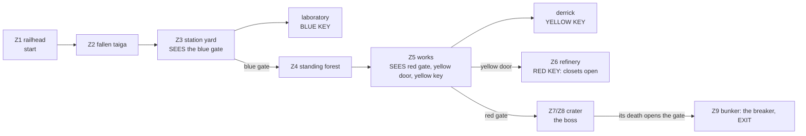

# MAP09 — «Тунгуска» (Tunguska), последняя карта эпизода 3

Каноническая версия: `docs/levels/MAP09-tunguska.md` (английский).

Синхронизировано с оригиналом: 2026-10-27.

Проектный документ. Владелец: `level-designer`. Статус: **v1.1 ПОСТРОЕНА
2026-10-22 (текстурирована в собственном наборе эпизода, D113), ещё не
пройдена, прохода в движке ещё не было** (D26: эта роль никогда не запускает
GZDoom). Построена по принципу «сначала MVP» (D60): весь план, только
одобренные и упакованные lump'ы, населена, снабжена, три ключа, три секрета,
босс и выход; v1.1 заменяет заглушки набором «Тайга/Чужие» (§7; чего он не
рисует — §8); **v1.2 (D116, 2026-10-22) ставит на место Генерала
собственного финального босса эпизода 3, Консорциум, пулемётчиков Легиона в
лесу, на комбинате, в нефтезаводе и в кратере, АКМ рядом с ППШ и пересчитывает
запасы кратера под босса в 9000 HP** (§10, §11, §16.2); **v1.3 (D119,
2026-10-23) урезает боеприпасы до диапазонов BALANCE §8 и пересчитывает
кратер под 4000 HP Консорциума** (§10, §11, §16.3); **V3 (2026-10-23/24)
добавляет события при подборе ключей и землю кратера, которая раскрывается
при Прорыве Консорциума** (§18, §18.3). Исходник: `src/maps/MAP09/map.py`;
тесты: `tests/test_map09_tunguska.py` (карта, 66 тестов) и
`tests/test_map09_route.py` (маршрут, 13); плакаты: `tests/test_posters.py`
(`Map09Posters`); вид сверху: `docs/levels/shots/MAP09-overview.png`.
Русское зеркало: причитается при закрытии фазы (D34).

> **Пройти карту** (PM или CEO; агенты никогда не запускают GZDoom, D26):
> `python3 tools/build.py && SD_ALLOW_ENGINE=1 MAP=MAP09 SKILL=3 tools/run.sh`
> — или вручную `-file dist/sovietdoom.pk3 +map MAP09 -skill 3`.
> Автоматический прогон: `SD_ALLOW_ENGINE=1 python3 tools/route.py --route tunguska-critical --keep-evidence`.

Вводные данные, которым подчиняется этот документ и которые он не повторяет:
D112 (эпизод 3, «Портал»), `docs/product/LORE.md` (D12, правила уважения;
фракции D35), `docs/PRD.md` (D58 урок ключей, D60 сначала MVP, D68 специалы
вещей), `docs/art/TEXTURE-INDEX.md` (только одобренные lump'ы; D107:
`SDSIGL1` — единственное использование), `docs/engine/MOD-SPEC.md` §6.1,
`docs/engine/BALANCE.md` и метод `docs/levels/MAP06-red-square.md`, чьему
боссу, засаде и маршруту следует финал этой карты.

## 1. Синопсис

Подкаменная Тунгуска, центральная Сибирь, ноябрь 1977 года: сержант Виланова
приезжает по железной дороге с MAP08 на конечную станцию в мёртвой тайге, идёт по
старой лесовозной дороге сквозь деревья, которые взрыв 1908 года уложил
плашмя, поднимается по перевалу к эпицентру от заброшенной советской
научной станции, пересекает стоящий мёртвый лес в эпицентре и пожирающие его
комбинаты захватчиков, штурмует их нефтезавод и спускается в кратер, где
захватчики держат свой **главный портал** (портал Танкограда был
второстепенным — зацепка из `SD_END03_TEXT`), чтобы убить босса и опустить
рубильник, который его закрывает.

## 2. Место в кампании

| | |
|---|---|
| Идёт после | MAP08, база Северного флота (карта другого агента, D112); он приезжает по железной дороге. |
| Её номер | MAP09, последний слот эпизода 3 (MAPINFO: завершающий кластер эпизода; дело агента по каркасу / mod-engineer, §13). |
| Что добавляет | **крупнейшая карта** кампании (размах 7040 × 5504; MAP06 5552 × 4928) и **самая тяжёлая** (57 / 88 / 122 монстра; MAP06 42 / 68 / 96); **затишье перед бурей** (конечная станция, тайга и стоящий лес редки и темны; комбинат, нефтезавод и кратер — нет); **ямы, которые жгут** (кислота на комбинате и в кратере, расплавленный канал MAP03 на нефтезаводе); **кратер, в который пробиваются с боем**, семь террас до портала. |
| Кульминация | кратер: босс, Консорциум (D116), на дне перед порталом, обе фракции на террасах; его смерть открывает управляющий бункер; его рубильник закрывает портал и завершает эпизод. |
| Фракции (D35) | Рейх держит конечную станцию, тайгу и двор научной станции (военная оккупация); Легион держит лабораторию (капитал забирает науку) и открывает чуланы; обе держат лес, комбинат, нефтезавод и кратер, и обе охраняют босса (проверено тестом). |

## 3. Что должна делать карта

| Задача | Как это реализует планировка |
|---|---|
| Быть Тунгуской | настоящая примета взрыва 1908 года: во внешнем кольце деревья лежат **плашмя и радиально**, каждый ствол направлен от эпицентра (`LOGS`, ориентированы `log_direction` от `CRATER_CENTRE`, проверено тестом); в эпицентре они всё ещё **стоят, ободранные** («телеграфный лес»: колонны пустоты, уходящие из виду в небо на 448). Советская научная станция в духе экспедиций Кулика (бревенчатые избы, бетонная лаборатория). |
| Быть главным порталом захватчиков | их комбинаты расползаются по мёртвому лесу (башни из их органического металла со светящимися ядрами поля портала, трубопроводы, кислотные ямы); их нефтезавод; кратер, окружённый сдерживающей стеной, террасами уходящий к порталу — колонне кобальтового поля высотой в два тайла. |
| Быть самой большой и самой тяжёлой картой | см. §2; каждый класс бестиария, босс на любой сложности. |
| Снова научить трём ключам | каждый замок виден раньше своего ключа (проверено тестом): синие ворота — со двора станции, раньше лаборатории; красные ворота, жёлтая дверь **и жёлтый ключ** — разом с опушки леса у комбината; красный ключ — от жёлтой двери. Каждый ключ лежит один на освещённом пятне цвета света своего замка (D58). |
| Затишье, потом ад | §6: 2 + 4 монстра на сложности 2 от старта до станции; один комбинат вмещает 15. |
| Завершить эпизод | ворота бункера открываются только со смертью босса (специал его вещи); выключатель выхода за ними — рубильник портала. |

Целевая длительность: 20–25 минут при первом прохождении на сложности 3;
около 9 при повторном (предложение пар: 540 с, §13).

## 4. План

Авторитетный план — вид сверху, сгенерированный из исходника:
`docs/levels/shots/MAP09-overview.png` (север наверху). Схема (не в масштабе):

```
                 S3
     +-----------++------------------------------+   +---------------------+
     |  Z5 THE INVADERS' WORKS (sky 512)         |   | Z6 REFINERY (320)   |
     |  towers (cores), conduits, acid pits      [Y]=| vats, turbines,     |
     |  derrick + stair: YELLOW KEY (+128)       |   | molten channel,     |
     |  closets W   [R] red gate   closets E     |   | bridge; RED KEY dais|
+----+----------------++-------------------------+   +---------------------+
| Z4 STANDING FOREST  ||  Z7 rim / Z8 seven terraces down (-128)
| (sky 448) stripped  ||        CRATER (sky 512)
| trunks, a clearing  ||        the PORTAL, the boss before it
| RPG-7               ||
+-------[B]-----------+|____________[gate]__________
| Z3 RESEARCH STATION |   Z9 bunker: the breaker (EXIT)
| izbas, laboratory:  +====+-----------------------------------+--------------+
| BLUE KEY, S2        gate |  Z2 FALLEN TAIGA (sky 320)        | Z1 RAILHEAD  |
|                     |    |  trunks lying away from the crater| halt (S1)    |
+---------------------+    +-----------------------------------+ train, start |
                                                               +--------------+
```

| # | Зона | x | y | пол | потолок | свет |
|---|---|---|---|---|---|---|
| Z1 | Конечная станция: балласт, путь (повёрнутый `SDTRAK1`), поезд (товарный вагон, бронированный вагон, котёл паровоза: пропы 128) | 5888…7552 | 384…576 | 0 | небо 320 | 128 |
| Z1 | Кабина паровоза: оболочка 144 в квадрате (блок 160, стены 8), кабина внутри 128 в квадрате (16…144), её дверной проём в задней части северной стороны, в сторону платформы | 7344…7488 | 416…560 | 16 | 144 / небо 160 | 112 |
| Z1 | Станционный двор; платформа (старт в 7296, 640, лицом на запад); полустанок (блок крыши 160, комната 16…144) | 5888…7488 | 576…1152 | 0 / 16 | небо 320 / 144 | 128 / 112 |
| Z2 | Поваленная тайга: 15 стволов (проп высотой 32, длиной 256, радиально; диагональные — лестницы из блоков по 48 юнитов) | 2304…5888 | 384…1408 | 0 | небо 320 | 112 |
| Z3 | Двор научной станции (частокол) и его ворота со стороны тайги | 512…2304 | 448…1856 | 0 | небо 256 | 128 |
| Z3 | Три избы (блоки крыши 160, комнаты 16…144, дверные проёмы, у которых небо лежит на линии крыши) | 640…1024 | 576…1792 | 16 | 144 | 112 |
| Z3 | Лаборатория: зал высотой в плакат, приборная, вестибюль; **синий ключ** на верстаке (32) | 1312…2048 | 896…1600 | 16 / 32 | 272 / 144 | 144 / 128; верстак **192**, синий |
| Z3/Z4 | **Синие ворота** в ограде захватчиков: портал · дверь · тамбур | 1920…2048 | 1856…1952 | 0 | 128 | портал **192**, синий |
| Z4 | Стоящий лес: 56 стволов (колонны пустоты по 32 юнита), поляна | 1024…2752 | 1952…4608 | 0 | небо 448 | 104 |
| Z5 | Комбинат; обожжённая кромка (`SDBURN1`) в сторону леса | 2752…5440 | 3968…5632 | 0 | небо 512 | 144 / 120 |
| Z5 | Две кислотные ямы (урон), три башни (256, ядра 384), четыре трубопровода (96) | | | −16 | | 176 |
| Z5 | Вышка: лестница 7 × 16 на север от y 4768, площадка 128; **жёлтый ключ** на верху лестницы | 4000…4256 | 4768…5184 | 16…128 | небо 512 | ключ **192**, жёлтый |
| Z5 | Четыре трубные ниши в северной стене (S3 — третья) | 3584…4480 | 5632…5648 | 0 | 128 | 144 / 96 |
| Z5/Z7 | **Красные ворота** в сдерживающей стене: портал · дверь · тамбур; по сторонам два **чулана** | 3456…4480 | 3840…3968 | 0 | 128 | портал **192**, красный |
| Z5/Z6 | **Жёлтая дверь**: портал · дверь · тамбур | 5440…5536 | 4672…4800 | 0 | 128 | портал **192**, жёлтый |
| Z6 | Нефтезавод: четыре чана (96, расплавленные верха), две турбины (`SDTURB1`, 128), пульт (`SDCTRL1`), расплавленный канал (−16, урон) и его мост; советские флаги | 5536…7296 | 3968…5376 | 0 | 320 | 128 |
| Z6 | Помост: **красный ключ** | 7104…7232 | 4672…4800 | 16 | 320 | **192**, красный |
| Z7 | Бровка кратера шириной 128 внутри сдерживающей стены | 2944…4992 | 1792…3840 | 0 | небо 512 | 160 |
| Z8 | Семь террас (шириной 64, по 16 вниз каждая) и дно; четыре кислотные ямы, четыре пилона; портал (цоколь −96, поле до 160, обрамлён четырьмя столбами 32 в квадрате до 192 в его углах) | 3520…4416 | 2368…3264 | −16…−128 | небо 512 | 160; поле и рама 176 |
| Z9 | Выходной тамбур · ворота бункера (`SDGATE1`, тег 12) · зал · ниша (`SDSW1D`) | 3840…4096 | 1520…1792 | 0 | 128 | 128; ниша **192** |

Каждая высота кратна 16; ни одна ступень вверх не выше 16 (проверено тестом).

### 4.1 Открытое небо (НЕ ПРОВЕРЕНО в движке)

Трюк с небом из MAP06, на пяти высотах: конечная станция и тайга 320, научная
станция 256, лес 448 (стоящие ободранные стволы — колонны пустоты: их грани
поднимаются до этого неба, из виду), комбинат и кратер 512 (ядра башен на 384
стоят на его фоне). Деревянные здания с крышей — это **закрытые блоки неба**
на 160 (пол = потолок, небо), их комнаты на 16…144 внутри, а потолки их
дверных проёмов — небо на 160, так что над проёмом не рисуется плита стены.
Запасной вариант, если рендерер рисует «стену неба»: выровнять небо до одной
высоты (константы `*_SKY`); больше ничего не сдвигается.

## 5. Прогрессия, ключи, двери и выход



Ключи: `SD_BluePass` 5, `SD_YellowPass` 6, `SD_RedPass` 13; замки 2, 3, 1.

| Id | Где | Тип | Специал | Может ли запереть игрока снаружи? |
|---|---|---|---|---|
| **BD** | ограда захватчиков к северу от научной станции, `SDDOORB` | заперта, открывается насовсем | `Door_LockedRaise (4, 16, 0, 2, 0)`, обе стороны | нет |
| **YD** | западная стена нефтезавода, `SDDOORY` | заперта, открывается насовсем | `Door_LockedRaise (5, 16, 0, 3, 0)` | нет |
| **RD** | сдерживающая стена кратера, `SDDOORR` | заперта, открывается насовсем | `Door_LockedRaise (6, 16, 0, 1, 0)` | нет |
| S1, S2, S3 | нажимные панели (§9) | открываются насовсем | `Door_Open (1/2/3, 16)`, обе стороны, `secret` | нет |
| CL | два чулана комбината в сдерживающей стене | открываются насовсем | тег 10, **без линии**: специал вещи красного ключа `Door_Open (10, 16)` | нет |
| GATE | бровка → бункер, `SDGATE1` обе стороны, без специала | открываются насовсем | тег 12, **без линии**: специал вещи босса `Door_Open (12, 16)` | только если босс не мог умереть: §11 |
| EXIT | задняя стенка ниши глубиной 16, `SDSW1D` | | `Exit_Normal (0)` | — |

**Порядок, как его проигрывают тесты** (`test_the_route_is_the_designed_one`),
пять раундов: (0) конечная станция, тайга, научная станция, **синий ключ**
(панели S1 и S2 открываются, но не нужны); (1) синие ворота: лес, комбинат,
**жёлтый ключ** (S3); (2) жёлтая дверь: нефтезавод, **красный ключ**, подбор
которого открывает чуланы; (3) красные ворота и чуланы: кратер; (4) смерть
босса: бункер, выход.

Указатели (D58): синие ворота видны со двора от двери лаборатории; синий
ключ — из вестибюля лаборатории; освещённый зев красных ворот, жёлтая дверь и
жёлтый ключ — всё с опушки леса (`EDGE_VIEW`); красный ключ — из жёлтого
тамбура, по прямой вдоль моста нефтезавода. Ни один монстр не стоит на линии
видимости ни одного ключа при появлении (проверено тестом). Свет 192
тратится только на семь секторов: три портала замков, три места ключей, нишу
выхода (проверено тестом).

Правила против софтлока: ни одна дверь не закрывается за игроком; лифтов нет;
из каждого спуска (вышка, террасы) есть путь назад наверх; каждая яма,
кислотная или расплавленная, глубиной в одну ступень (проверено тестом); ни
один секрет не нужен. Из каждого сектора, достижимого на любом этапе, есть
путь назад к старту — и со смертью босса, и без неё, а в конце выход
достижим отовсюду (проверено тестом).

## 6. Кривая интенсивности

| Такт | Пространство | Ощущение | Механика |
|---|---|---|---|
| 1 | Конечная станция | прибытие, пикет на путях; полустанок | ИЖ |
| 2 | Поваленная тайга | **тревожное спокойствие**: мёртвая тишина, стволы рядами плашмя, гончие | петлять между стволами |
| 3 | Двор научной станции | караул Рейха среди изб; синие ворота | ППШ в избе |
| 4 | Лаборатория | Легион забрал науку; Ленин над верстаком | **синий ключ**; прототип S2 |
| 5 | Стоящий лес | **самое жуткое место**: голые шесты до неба, головы, плывущие на поляне | РПГ-7 на его дальней кромке |
| 6 | Комбинат | **раскрытие и бой**: башни, кислотные ямы, три цели на виду | РОКС-3; высота (вышка) |
| 7 | Нефтезавод | тяжёлые; расплавленный канал или охраняемый мост | красный ключ |
| 8 | Назад через комбинат | **всплеск**: чуланы открываются за спиной игрока | схема MAP06 |
| 9 | Кратер | **кульминация**: вниз по семи террасам к порталу, босс, обе фракции | босс |
| 10 | Бункер | ворота открываются со смертью босса; рубильник закрывает портал | — |

## 7. Текстуры по зонам (все одобрены и упакованы; проверено тестом)

v1.1 (D113): набор эпизода «Тайга/Чужие» (`docs/art/TEXTURE-INDEX.md`),
`SDDOORB` и кабина `SDCAB1`/`SDCAB2` из второго раунда эпизода 2.

| Зона | Стены | Пол | Потолок |
|---|---|---|---|
| Конечная станция | кромка леса `SDBARK2` (местами берёза `SDBARK1`); товарный вагон `SDWAGN1`, борта бронированного вагона `SDARMR1` (звезда на каждые 128) / `SDARMR2`, котёл паровоза и кабина снаружи `SDARMR2`; буфер `SDSTEL1`; сигнал `SDSIGL1` один раз (D107); край платформы `SDWAGN1`, её задняя стена `SDLOGW1` | `SDBLST1` под поездом, путь `SDTRAK1` (повёрнут на 90), двор `SDMOSS1`, платформа `SDCRTOP1` | небо |
| Кабина | передняя `SDCAB1` (одна грань 128, целиком), бока и задняя `SDCAB2` (окна целиком) | `SDFLR4` | `SDFLR4` |
| Полустанок, избы | `SDLOGW1` внутри и снаружи; шкафчики полустанка `SDLOCK1` | `SDCRTOP1` | `SDCRTOP1` |
| Тайга | кромка леса `SDBARK2` (берёзы); её западная стена — частокол `SDLOGW1`; поваленные стволы `SDBARK2` с верхами `SDBURN1`, три берёзовых (`SDBARK1`, верха `SDMOSS1`: брёвна 3, 8, 13) | `SDBURN1`, повёрнут на 90 (`BURNT_TURN`) | небо |
| Двор научной станции | частокол `SDLOGW1`; ограда захватчиков `SDALNM1`; наружная сторона лаборатории `SDCONC1`; радиомачта `SDSTEL1` | `SDMOSS1` | небо |
| Лаборатория | зал `SDTILE1`, приборная `SDTILE2`, щиты `SDCTRL1`, вестибюль `SDCONC1`, верстак `SDSTEL1` | `SDFLR3` | `SDCEIL1` |
| Лес | стволы `SDBARK2`, каждый седьмой `SDBARK1` (`birch_trunks`); кромка леса `SDBARK2`; ограда и сдерживающая стена `SDALNM1` | `SDPEAT1` (Южное болото) | небо |
| Комбинат | `SDALNM1` (стены, башни, трубопроводы, ниши, чуланы), полоса `SDGLYP1` посередине каждой грани башни и пластина по обе стороны красных ворот, ядра `SDPORT1`, вышка `SDSTEL1`, западная стена кромки `SDBARK2`; кислотные ямы `SDACID1` | `SDFLR4`, кромка `SDBURN1`, вышка `SDGRAT1` | небо |
| Нефтезавод | `SDBRCK1`; чаны `SDRUST1`; турбины `SDTURB1`; пульт `SDCTRL1`; советские флаги `SDFLAG1`/`SDFLAG2` рядом (D119: перерисованы в советские флаги) | `SDFLR4`, мост `SDGRAT1`, канал и чаны `SDMOLT1` | `SDCEIL2` |
| Кратер | сдерживающая стена и террасы `SDALNM1`; пилоны `SDGLYP1` (одна пластина на грань); цоколь `SDALNM1`; портал `SDPORT1` (два тайла, один широкий между столбами) в раме из `SDPRTE1`; пластина с глифами по обе стороны ворот бункера | бровка и террасы `SDBURN1`, дно `SDFLR4`, ямы `SDACID1` | небо |
| Бункер | `SDSTEL1`; тамбур `SDALNM1`; ворота `SDGATE1`; выход `SDSW1D` | `SDFLR4` | `SDCEIL1` |
| Двери | `SDDOORB` (синяя, косяки `SDALNM1`), `SDDOORY`, `SDDOORR` (косяки `SDALNM1`); пороги `SDFLR4` | | |

**Кислота или расплав — решено:** зелёная кислота везде, где работают
захватчики: две ямы комбината и четыре в кратере вокруг портала (цвет их жил
и глифов). Расплавленный металл там, где они плавят: канал нефтезавода и его
четыре чана (облик Танкограда, MAP03). Жгут одинаково: `damageamount` 10
каждые 32 тика у сектора, а не у флэта (проверено тестом).

**Выравнивание.** `align_to_world` (метод MAP05) привязывает каждую грань
`SDLOGW1`, `SDBARK1`/`2`, `SDALNM1`, `SDGLYP1` и `SDARMR2` к рядам от земли
(стыки брёвен, через каждые 16, совпадают и с полом изб на ступень выше, и с
землёй) и к колонкам карты, так что стена, разрезанная соседями, не даёт шва,
а каждая пластина с глифами начинается на своём краю (все стоят на кратных
64; проверено тестом). Картинки кабины стоят на её полу и начинаются с левого
конца каждой стены (`SDCAB1` целиком, `SDCAB2` окнами целиком); каждый
столб рамы показывает средние 32 `SDPRTE1`, его кобальтовый канал (проверено
тестом).

### 7.1 Плакаты (CEO, 2026-10-22: «que esos posters puedan aparecer en cualquier nivel» («чтобы эти плакаты могли появляться на любом уровне»))

Все в научной станции: одна односторонняя линия длиной 128, в комнате ровно
высотой с картинку, привязана к полу (`POSTERS`; `tests/test_posters.py`).

| Имя | Картинка | Где | Зачем |
|---|---|---|---|
| `lab_hall_lenin` | Ленин | северная стена зала, x 1504-1632 (зал высотой 256) | над верстаком, где лежит синий ключ: первое, что видно из вестибюля |
| `lab_hall_stalin` | Сталин | западная стена зала, y 1360-1488 | другой портрет станции |
| `lab_instr_mural` | мурал о космонавтике (128×128) | западная стена приборной (высота 128) | собственная картина научной станции, рядом со щитами |
| `lab_hall_slot_n` | **Маркс** `SDPOSTR4` (слот) | северная стена зала, x 1664-1792 | рядом с Лениным над верстаком: ряд основоположников на одной стене |
| `lab_hall_slot_s` | **Энгельс** `SDPOSTR5` (слот) | южная стена зала, x 1344-1472 | напротив Маркса через зал |

**Пара Маркс–Энгельс (D117, 2026-10-22).** `POSTER_SLOTS_MARX_ENGELS`,
первым Маркс: `SDPOSTR4` Маркс «ПРОЛЕТАРИИ / ВСЕХ СТРАН,» и `SDPOSTR5` Энгельс «СОЕДИНЯЙТЕСЬ!» (зеркально, смотрит на Маркса), 128×256, как Ленин и Сталин; `MARX_ENGELS = ("SDPOSTR4", "SDPOSTR5")` перечисляет их в `WALL_TEXTURES`. Два слота смотрят друг на друга через
зал, так что каждый читается отдельно (`tests/test_posters.py`, `PAIR`).

## 8. Недостающие текстуры

Чего набор «Тайга/Чужие» (D113) не рисует; каждая из них всё ещё заглушка,
меняется одной константой в `map.py`.

| # | Нужно | Заглушка сейчас | Где |
|---|---|---|---|
| 1 | **Кромка мёртвой тайги**, стена 128×256: стоящие обугленные стволы с небом между ними (маскированная стена или стена с небом сверху) | `SDBARK2` мозаикой (`BARK`): читается как одна стена коры | каждая наружная граница |
| 2 | **Кора вдоль лежащего ствола** (борозды идут вдоль него): GZDoom не умеет поворачивать текстуру стены, а `SDBARK1`/`2` — кора стоящих деревьев | `SDBARK2` / `SDBARK1` (полоса 32 из их верхних рядов) | 15 поваленных стволов тайги |
| 3 | **Спиленные или сломанные концы стволов** (плоские) | `SDBURN1` / `SDMOSS1` | верхи поваленных стволов |
| 4 | **Чужой пол** (обшивка) | `SDFLR4` (`PLATE`) | комбинат, нефтезавод, дно кратера, кабина |
| 5 | **Сплавленная земля кратера** (стекловидная, растрескавшаяся) для террас | `SDBURN1` | кратер |
| 6 | **Паровоз снаружи** (котёл, дымовая коробка, колёса) | `SDARMR2` (бронированный паровоз) | котёл и оболочка кабины |
| 7 | **Сибирское ночное небо** (MAPINFO `sky1`, дело mod-engineer) | `SKY1` из Freedoom | везде под открытым небом |

## 9. Секреты

Правило MAP01: подсказка — это сравнение, а не вывеска; у каждого есть путь назад (проверено тестом).

| # | Где | Подсказка | Награда |
|---|---|---|---|
| S1 | полустанок, восточная стена | из трёх шкафчиков средний стоит на 16 глубже, в тени (свет 96) | рюкзак, бронежилет, коробка патронов к дробовику |
| S2 | приборная лаборатории | из трёх приборных щитов средний стоит глубже, в тени | **Ручная «Катюша»**, прототип лаборатории, и батарея энергоячеек |
| S3 | северная стена комбината | из четырёх ниш в металле захватчиков третья вдвое глубже и темнее | две аптечки, коробка ПГ-7В |

## 10. Враги и ресурсы по сложностям

| Зона | Сложность 2 | Сложность 3 | Сложность 4 |
|---|---|---|---|
| Конечная станция | 2 стрелка | +1 гончая | +1 стрелок |
| Поваленная тайга | 2 гончие, 2 стрелка | +1 штурмовик, 1 гончая | +1 стрелок, 1 штурмовик, 1 гончая |
| Двор научной станции, избы | 4 стрелка, 1 штурмовик | +2 стрелка, 1 гончая | +1 стрелок, 1 штурмовик, 1 Panzermensch |
| Лаборатория | 4 легионера | +1 легионер, 1 штурмовик | +1 легионер, 1 штурмовик, 1 Doughboy |
| Стоящий лес | 2 гончие, 1 Doughboy, 1 легионер, 1 стрелок | +1 Doughboy, 1 гончая, 1 штурмовик | +1 Doughboy, 1 гончая, 1 штурмовик |
| Комбинат | 4 стрелка, 5 легионеров, 2 штурмовика, 2 гончие, 1 Panzermensch, 1 Doughboy | +2 стрелка, 2 легионера, 2 штурмовика, 1 гончая, 1 Doughboy | +2 стрелка, 1 легионер, 2 штурмовика, 1 гончая, 1 Doughboy, 1 Panzermensch, 1 тяжёлый |
| Чуланы комбината (красный ключ) | 2 легионера | +1 легионер, 1 штурмовик | +2 штурмовика |
| Нефтезавод | 2 стрелка, 3 легионера, 3 штурмовика, 1 гончая, 1 Panzermensch, 1 Doughboy | +1 стрелок, 1 легионер, 1 штурмовик, 1 гончая, 1 тяжёлый, 1 Doughboy | +1 стрелок, 1 легионер, 1 штурмовик, 1 гончая, 1 тяжёлый, 1 Panzermensch |
| Кратер | **босс**, 2 стрелка, 1 легионер, 2 штурмовика, 1 гончая, 1 Panzermensch, 1 Doughboy, 1 пулемётчик | +2 легионера, 1 гончая, 1 тяжёлый | +2 штурмовика, 1 Doughboy, 1 тяжёлый, 1 пулемётчик |
| **Итого** | **60** | **92** | **127** |

Пулемётчики Легиона (D116, `SD_LegionGunner`, 21110, 80 HP; роняют половину
магазина АКМ), 3 / 4 / 5 на сложностях 2 / 3 / 4, каждый у укрытия с длинной
линией огня вдоль земли, которую игроку предстоит пересечь (проверено тестом:
ни одного в чулане, у каждого проп, стена или ступень в пределах 128):

| Сложность | Где | Линия | Укрытие |
|---|---|---|---|
| 2 | комбинат, (5184, 4800), лицом на запад | ширина комбината до опушки леса | восточный трубопровод за спиной |
| 2 | нефтезавод, (6720, 4416), лицом на запад | через канал: мост и жёлтая дверь | чан у плеча |
| 2 | вторая терраса кратера, южная, (4480, 2016), лицом на север | вверх по террасам к красным воротам | ступень террасы |
| 3 | стоящий лес, (2400, 3104), восточный край поляны, лицом на север | поляна и лес назад до синих ворот | ствол у плеча |
| 4 | шестая терраса кратера, южная, (3712, 2272), лицом на север | через дно кратера и портал | ступень террасы |

По классам на сложности 4: 28 стрелков, 26 легионеров, 26 штурмовиков, 19
гончих, 11 Doughboy, 6 Panzermensch, 5 пулемётчиков, 5 тяжёлых Panzermensch,
босс. Прислужники босса (§11) в итоги не входят: они приходят в ходе боя.

**Ресурсы.** Можно пройти со старта с пистолетом: ИЖ на полустанке, ППШ и
**АКМ** (D116, `SD_Akm` 21008) в первой избе, РПГ-7 на дальней кромке
стоящего леса, РОКС-3 на обожжённой кромке комбината, всё на маршруте на
любой сложности; Ручная «Катюша» в S2. Магазины АКМ (`SD_AkmAmmo` 21020, 30
патронов) на маршруте **18 / 24 / 32** на сложностях 2 / 3 / 4 с D119 (§16.3;
4 / 3 / 2 из D116 ушли вместе с урезанием).

**Боеприпасы, D119** (`docs/engine/BALANCE.md` §8: линейка G3-8, в зарядах
ИЖ по ~62,5 HP на заряд, 30 патронов АКМ — 4,5 заряда, ПГ-7В — 2, топливо
13,5 / 80; только маршрут, без дропа, без секрета; **Консорциум — 64 заряда
с D119 (было 144), его прислужники — ещё 23** (было 39), см. §11).
Боеприпасы маршрута — это `AMMO` в `map.py`, отдельно от `ITEMS`: они
появляются начиная со своей наименьшей сложности, как и монстры, за которых
они платят (§16.3).

| | Сложность 2 | Сложность 3 | Сложность 4 |
|---|---|---|---|
| Нужно | 214 | 313 | 454 |
| Размещено | 344,6 | 421,6 | 562,6 |
| Отношение (диапазон 1,5-2,0 / 1,3-1,6 / 1,2-1,45) | 1,61 | 1,35 | 1,24 |
| До D119 (нужно, размещено, отношение) | 310, 978,5, 3,16 | 409, 916,0, 2,24 | 550, 759,0, 1,38 |
| Подборов боеприпасов на маршруте (до D119) | 48 (97) | 59 (88) | 78 (72) |
| Доля зарядов, с дропом легионеров (≤ 35 %) | 34,7 % | 34,9 % | 33,8 % |
| Урон по пулам: заряды / ППШ / АКМ / ПГ-7В / топливо | 32 / 10 / 26 / 25 / 7 % | 31 / 11 / 28 / 25 / 6 % | 30 / 13 / 28 / 25 / 4 % |

Также проверено тестом на каждом этапе маршрута относительно нижней границы
сложности, с HP прислужников босса, посчитанными вместе с его собственными;
каждый пул только после своего оружия; магазины АКМ ведут на каждом этапе до
кратера, ПГ-7В — не более 30 % каждого из них; в кратере, на этапе босса,
ведут ПГ-7В (§16.3).
**Собственный запас арены (бровка, тамбур красных ворот и первая терраса
кратера — кольцо, по которому идёт бой)** проверен тестом: он сам покрывает
4000 HP Консорциума и 1060 его прислужников на каждой сложности, при этом
ракеты и топливо составляют треть этого, а с D119 он лежит внутри диапазона
сложности для босса, его прислужников и собственных монстров кратера (раньше
был заполнен под 9000; BALANCE §8.4.3: его ПГ-7В и топливо больше, чем 64
заряда босса):

| Сложность | ПГ-7В | Топливо РОКС-3 | Магазины АКМ | Заряды | Патроны | Стимпаки + аптечки | Урон (средний) | Счёт (HP) | Отношение |
|---|---|---|---|---|---|---|---|---|---|
| 2 | 37 | 60 | 4 | 40 | 150 | 7 + 6 | 11 645 | 6 380 | 1,83 |
| 3 | 37 | 60 | 4 | 40 | 150 | 6 + 6 | 11 645 | 7 590 | 1,53 |
| 4 | 47 | 60 | 4 | 40 | 150 | 4 + 4 | 12 995 | 9 190 | 1,41 |

До D119 арена вмещала 48 / 46 / 31 ПГ-7В, 360 / 360 / 240 топлива и 160
зарядов, 28 040 / 27 770 / 23 225 среднего урона. Лечение не изменилось.

Лечение на сложности 4: 9 стимпаков, 9 аптечек, 7 бонусов здоровья; 6
бонусов брони (по два у каждого замка), бронежилет в третьей избе, тяжёлый
жилет у тамбура красных ворот, перед кратером. Сложности 3 и 2 добавляют
стимпаки и аптечки; боеприпасы следуют за монстрами (D119).

## 11. Босс: Консорциум (D112, размещён в D116)

Финальный босс эпизода 3, **Консорциум** (`SD_Consortium`, 21112, 4000 HP с
D119 (раньше 9000), радиус 56, высота 128; его замысел и поведение:
`docs/engine/2026-10-22_P4_ep3-final-boss.md`), стоит в именованной
константе **`MAP09_BOSS_SPOT = (3968, 3136)`** на дне кратера перед порталом,
лицом к красным воротам (`BOSS_ANGLE = 90`), на любой сложности
(`BOSS_KIND = "consortium"`). До D116 его замещал Генерал (`SD_General`,
21106, 3000 HP); место, направление и специал смерти не сдвинулись, а
Генерала здесь больше не ставят.

- **Портал за его спиной.** Укоренённый в фазе 1, он вызывает прислужников
  через портал позади себя: 144 позади и 80 в каждую сторону, затем прямо
  позади. Лицом на север эти места — (3888, 2992), (4048, 2992) и (3968,
  2992): на дне кратера между ним и основанием портала (оно кончается на y
  2944), вне кислотных ям, с запасом места для гончей или Doughboy
  (проверено тестом: `test_the_portal_is_at_the_bosss_back`).
- **Его смерть открывает выход**: его вещь несёт `special = 11`
  (`Door_Open`), `arg0 = 12`, `arg1 = 16`; тег 12 не несёт ни одна линия
  (проверено тестом). Его смерть также убивает его прислужников
  (`A_KillChildren`).
- **Простор:** кратер 2048 в квадрате под небом 512 (640 над его дном, в пять
  раз больше его 128); террасы по 16, так что, освободившись (фаза 2), он
  ходит по всему кратеру. Его тело шириной 112 помещается на дне в его
  месте.
- **Счёт.** 4000 HP с D119, как у Кибердемона (`+NORADIUSDMG`: 30
  попаданий РПГ-7 или 6 полных залпов Ручной «Катюши»; BALANCE §7), плюс его
  прислужники. При 9000 их считали как стоимость долгого боя: четыре
  укоренённые пары, волна Прорыва и пять свободных пар, 1700 HP. При 2000 HP
  на фазу (Прорыв по-прежнему на половине) портал вызывает примерно вдвое
  реже (H): две укоренённые пары (стрелок и легионер, 50 HP пара), волна
  Прорыва из четырёх (600, без изменений) и две свободные пары (гончая и
  легионер, 180 HP пара), 1060 HP, 23 заряда по линейке G3-8. Запас арены
  (§10) проверен тестом: он сам оплачивает и то и другое, и уже не намного
  больше.
- **Риск, сказанный прямо:** если специал смерти не сработает, выход будет
  недостижим. Страховочное решение — дело mod-engineer: MAPINFO
  `SpecialAction = "SD_Consortium", "Door_Open", 12, 16` в блоке MAP09 (§13;
  по состоянию на 2026-10-22 его там нет).

## 12. Используемые элементы движка и чек-лист движка PM (D26)

| Нужно | Выдаётся | Статус |
|---|---|---|
| Запертые двери | `Door_LockedRaise` 13, замки 1, 2, 3 | ПРОВЕРЕНО (MAP02, MAP03) |
| Нажимные панели | `Door_Open` 11, `secret`, специал сектора 1024 | ПРОВЕРЕНО |
| Выход | `Exit_Normal` 243 | ПРОВЕРЕНО |
| Цветной свет, повёрнутый флэт | `lightcolor`, `rotationfloor` 90 | как в MAP02/MAP06 |
| Повреждающий пол | `damageamount` 10, `damageinterval` 32 | поля ПРОВЕРЕНЫ (MAP03 §16.2); в игре НЕ ПРОВЕРЕНО |
| Специал вещи при смерти / при подборе | босс (тег 12), красный ключ (тег 10); V3: синий ключ (тег 13, `Door_Open`), жёлтый ключ (тег 14, `Floor_LowerToLowest` 21) | красный ключ ПРОВЕРЕН `tunguska-critical` RKEY (2026-10-23); синий проверен BKEY; 21 НЕ ПРОВЕРЕНО в нашем движке (K3 MAP04): E12 |
| Босс, который двигает карту (V3 A3) | Прорыв Консорциума: `Floor_LowerToLowestTxTy (15, 16)` и `Light_Flicker (15, 176, 112)` из ZScript, тег в arg4 вещи босса (§18.3) | НЕ ПРОВЕРЕНО (первые специалы секторов, вызванные из ZScript в моде; перенос урона TxTy): E14 |
| Небо на пяти высотах, закрытые блоки неба как крыши, дверные проёмы с небом | §4.1 | **НЕ ПРОВЕРЕНО** |
| Анимированные стены и флэты | `SDPORT1`, `SDMOLT1` (ANIMDEFS) | ПРОВЕРЕНО (MAP03) |
| Анимированная кислота | `SDACID1-4` (ANIMDEFS, 8 тиков) | НЕ ПРОВЕРЕНО (на карте ещё не было) |
| Повёрнутый флэт, не являющийся путём | `SDBURN1`, `rotationfloor` 90 на тайге | НЕ ПРОВЕРЕНО, в какую сторону лежат стволы |

Чек-лист движка (один прогон на сложности 3, затем маршрут на 2, 3, 4):

- **E1** хижины: полустанок и избы читаются как низкие деревянные здания
  (стена до 160, выше небо); ни плиты стены, ни HOM над их дверными
  проёмами.
- **E2** стоящий лес: стволы уходят из виду; нет HOM там, где 56 колонн
  встречают небо на 448.
- **E3** комбинат: ядра башен (`SDPORT1`) целиком поверх металла захватчиков;
  жёлтый ключ виден на вышке с опушки леса.
- **E4** красный ключ открывает чуланы комбината (шаг маршрута RKEY).
- **E5** смерть босса открывает ворота бункера (шаг маршрута BOSS1).
- **E6** кислотные ямы и расплавленный канал жгут, и из них выходят; канал
  нефтезавода пересекают по мосту без вреда.
- **E7** плакаты целиком в лаборатории; сигнал целиком на своём столбе.
- **E8** кислотные ямы анимированы и жгут, как расплавленный канал; зелёный и
  оранжевый читаются как две разные вещи.
- **E9** кабина: `SDCAB1` целиком спереди, окна целиком, никакой плиты над её
  дверным проёмом (снова трюк хижин с небом); оболочка читается как кабина
  паровоза.
- **E10** стыки брёвен встречают пол в хижинах и на частоколе; полосы и
  пластины с глифами целиком; столбы портала показывают свой кобальтовый
  канал; обугленные стволы тайги лежат примерно в сторону кратера.

- **E11-E14** события при подборе V3 и земля Прорыва: §18.

## 13. MAPINFO и LANGUAGE (для агента по каркасу / `mod-engineer`)

Не файлы этой роли. Что нужно карте:

- `map MAP09 lookup "SD_MAP09_NAME"`: «Тунгуска» / "Tunguska" (`[ca]`
  «Tunguska»), завершающий кластер эпизода 3;
- `par = 540`;
- `sky1`: сибирское ночное небо, когда оно появится (§8 №12);
- рекомендуется: `SpecialAction = "SD_Consortium", "Door_Open", 12, 16` как
  запасной вариант специала смерти босса (§11; до D116 он был у Генерала);
- текст концовки: портал закрыт (последний текст эпизода — дело агента по
  каркасу).

## 14. Автоматический маршрут: `tunguska-critical`

`tools/route.py`, считывается с построенной карты, как `redsquare-critical`
(теги, замки, ключи, класс и место босса берутся из `map.py`): A0 старт →
BD0 синие ворота отказывают → BKEY синий ключ → BD1 синие ворота, в лес →
YD0, RD0 жёлтая дверь и красные ворота отказывают при одном ключе → YKEY
жёлтый ключ на вышке → YD1 жёлтая дверь → RDY красные ворота отказывают при
двух ключах → RKEY красный ключ (тег 10 должен быть открыт: чуланы) → RD1
красные ворота → BOSS0 на первой террасе кратера, ворота бункера закрыты →
BOSS1 босс ранен сверх своего здоровья, ворота открыты → E0 через ворота к
рубильнику → E1 нажат. Геометрия проверена тестами в
`tests/test_map09_route.py`.

**Консорциум в BOSS1 (D116).** `hurt` помощника равен 100 000, что более чем
в двадцать раз превышает его 4000 (D119; раньше девять тысяч, маршрут не
менялся). При полном здоровье один удар убивает его: его Прорыв (фаза 2, 65
тиков неуязвимости) проверяется в его погоне, а не в его уроне, и больше
ничто на маршруте его не ранит (монстры не умеют; маршрут не стреляет).
Если он когда-либо окажется в середине Прорыва, когда выполняется BOSS1,
первый удар ничего не сделает, поэтому BOSS1 ждёт `TUNGUSKA_BREACH_WAIT` (70
тиков) и ранит его снова, прежде чем прочесть ворота (мёртвого босса не
ранят дважды: помощник пропускает здоровье ≤ 0). НЕ ПРОВЕРЕНО в движке, пока
PM не запустит маршрут.

**Земля, которая раскрывается (V3 A3, §18.3).** Прорыв также опускает
четыре струпа кратера (тег 15). Маршрут этого не видит и не должен: один
удар при полном здоровье убивает босса без Прорыва, и ни один шаг не стоит
на струпе (проверено тестом в `tests/test_map09_route.py`); маршрут не
изменился.

## 15. Правила уважения (D12)

Место настоящего природного события, трактуемое как пейзаж: никаких жертв
(взрыв 1908 года, насколько известно истории, никого не убил), никаких
шуток. Советская станция почтена, а не осмеяна; Ленин и Сталин появляются
только как плакаты; два советских флага висят рядом на кирпиче нефтезавода
(D119: знамёна оккупантов перерисованы в советские флаги, те же lump'ы).

## 16. Запись о сборке v1 (2026-10-22)

**Проверка, которая была реально проведена** (без движка, D26):
`tests/test_map09_tunguska.py` 54 теста OK; `tests/test_map09_route.py` 12
OK; `tests/test_posters.py` (`Map09Posters`) и `tests/test_general_sprites.py`
(MAP09 добавлена в карты Генерала: он стоит здесь замещающим по замыслу,
§11) OK. `tools/verify.py fast`: сборка, `check_pk3` (0 ошибок, 0
предупреждений) PASS; набор 3094 теста, одна неудача, не только этой карты:
`test_doughboy_sprites.test_the_doughboy_is_placed_in_every_map` перечисляет
карты, где может стоять Doughboy, и ещё не знает MAP07, MAP08 и MAP09 (их
владелец добавит). MAP09: 883 вершины, 962 линии, 133 сектора, 249 вещей.
Проход в движке (§12) — дело PM.

### 16.1 v1.1, текстуры эпизода (2026-10-22, D113)

Заменены все заглушки §8 v1, которые закрывает набор (§7); синяя дверь носит
`SDDOORB`; у паровоза появилась кабина, в которую можно войти (единственная
добавленная геометрия: оболочка, комната и дверной проём на конечной
станции, вне маршрута), а у портала — рама (четыре столба в углах поля,
внутри его основания: ни одна проходимая клетка не изменилась). Ни дверь,
ни ключ, ни секрет, ни монстр, ни предмет, ни свет, ни плакат, ни босс не
сдвинулись. Тесты: 59 в `tests/test_map09_tunguska.py` (пять новых: набор там,
где его ставит замысел, пластины с глифами целиком, мировая сетка, рама
портала, кабина; тест ям теперь отличает кислоту от расплава), 12 тестов
маршрута без изменений, все OK. MAP09: 962 вершины, 1048 линий, 140
секторов, 249 вещей. `tools/verify.py fast` в тот же день: сборка и
`check_pk3` PASS (0 ошибок, 0 предупреждений); набор, 3127 тестов, 23 неудачи
и 1 ошибка, ни одна не относится к MAP09 (тесты спрайтов перерисованных
врагов и створки дверей MAP05, другая работа в процессе на том же дереве).
Проход в движке (§12, E1-E10) — дело PM.

### 16.2 v1.2, собственный босс эпизода, пулемётчики и АКМ (2026-10-22, D116)

- **Босс:** `BOSS_KIND` с `"general"` на `"consortium"` (21112); Генерал
  ушёл из `MONSTER_KINDS` / `MONSTER_CLASSES`. Место, направление и специал
  смерти без изменений (§11).
- **Пулемётчики:** пять `SD_LegionGunner` (21110), 3 / 4 / 5 по сложности
  (§10).
- **АКМ:** `SD_Akm` (21008) в первой избе рядом с ППШ, в `ROUTE_WEAPONS`;
  магазины (21020) 4 / 3 / 2 на маршруте, 3 / 3 / 2 на арене.
- **Арена пересчитана** под 9000 HP и прислужников (§10, §11): ракеты,
  топливо, магазины, заряды, лечение на первой террасе кратера.
- **Маршрут:** BOSS1 ранит босса дважды с интервалом 70 тиков (§14).
- Итого 60 / 92 / 127 (было 57 / 88 / 122); 284 вещи.
- Тесты: `tests/test_map09_tunguska.py` 63 (новые: портал за спиной босса,
  кратер оплачивает босса, пулемётчики, магазины АКМ; читатель классов
  берёт первое значение каждой константы, так как файл босса также
  объявляет радиус землетрясения; проверка высоты кратера теперь измеряет
  небо минус пол, 640); `tests/test_map09_route.py` 13 (новые: второй удар
  сверх Прорыва; здоровье босса читается из его собственного файла);
  `tests/test_safe_starts.py` без изменений и зелёный. Проход в движке (E5
  с Консорциумом и его E1-E10 в `2026-10-22_P4_ep3-final-boss.md`) — дело
  PM.

### 16.3 v1.3, боеприпасы D119 и кратер под 4000 (2026-10-23)

Плейтест CEO по эпизодам 2 и 3: боеприпасов «siempre sale de sobras»
(«всегда остаётся с избытком»), «siempre acabas con la escopeta» («всегда
в итоге остаёшься с дробовиком»), а босс — на уровне классического Doom
(Консорциум 4000, как у Кибердемона, `mod-engineer`). Только подбираемое:
ни геометрия, ни дверь, ни ключ, ни секрет, ни монстр, ни плакат не
сдвинулись; награды секретов и лечение без изменений.

- **Боеприпасы маршрута переехали из `ITEMS` в `AMMO`**, читаются как (зона,
  номер в редакторе, x, y, *наименьший* уровень сложности): каждая сложность
  получает запас для всех сложностей, сложности 3-5 добавляют то, во что
  обходятся средние монстры, сложности 4-5 — то, во что обходятся тяжёлые.
  При вложении наоборот (расходники Doom, больше на лёгкой) ни один диапазон
  сложности 2 не удерживался.
- **Убраны, а не только уменьшены** на сложностях 2 и 3: на 49 / 29 подборов
  меньше. Сложность 4 и так была самой скудной: её запас упал с 759 до 562,6
  эквивалента зарядов, но подборов в ней 78 против 72, потому что АКМ,
  который теперь ведёт каждый этап до кратера, идёт по 30 патронов в
  магазине (коробка магазинов потребовала бы актора: `mod-engineer`). По
  видам, сложность 2 / 3 / 4, до -> после: коробки зарядов 28 / 26 / 23 ->
  4 / 5 / 7; заряды 12 / 10 / 7 -> 4; обоймы 7 / 6 / 5 -> 0; коробки
  патронов 11 / 10 / 9 -> 6 / 8 / 13; россыпь ПГ-7В 11 / 9 / 9 -> 2; коробки
  ПГ-7В 12 / 12 / 8 -> 9 / 11 / 15; топливные пакеты 3 / 3 / 2 -> 0;
  канистры 6 / 6 / 5 -> 5; магазины АКМ 7 / 6 / 4 -> 18 / 24 / 32.
- **Кратер пересчитан под 4000** (§10, §11): с бровки, тамбура и первой
  террасы на сложностях 2 / 3 / 4 убраны шесть коробок зарядов, 3 / 3 / 2
  топливных пакета, 6 / 4 / 4 россыпью ПГ-7В и (сложности 2-3) коробка
  ПГ-7В; добавлен один магазин АКМ (сложность 4: два, канистра и четыре
  коробки ПГ-7В, её прежний запас был самым тонким). Запас лежит внутри
  диапазона (1,83 / 1,53 / 1,41), первыми ПГ-7В: кратер — сцена босса, где им
  разрешено вести. Прислужники пересчитаны под более короткий бой (H): 1060
  HP, 23 заряда.
- **Смесь** (BALANCE §8.3-8.4 с поправкой PM от 2026-10-23): заряды не более
  35 % с учётом сброшенных легионерами ИЖ; каждый пул только после встречи
  со своим оружием; вне сцены босса или мини-босса ведёт новейшее оружие под
  пулю (АКМ, иначе ППШ: наибольшая доля незарядных боеприпасов этапа, не
  менее 40 %), а ПГ-7В — сильный второй, не более 30 % урона этапа, чтобы
  дробовик не менялся на гранатомёт; топливо никогда не должно вести и
  остаётся не более 15 % урона карты (РОКС-3 приглушён). Лес, комбинат и
  нефтезавод лишились лишних коробок ПГ-7В в пользу магазинов и коробок
  патронов.
- Тесты (`tests/test_map09_tunguska.py`, 66): диапазон по сложности, каждый
  этап на нижней границе сложности, доля зарядов с дропом, каждый пул после
  своего оружия, пули ведут, а ПГ-7В ≤ 30 % каждого этапа, кроме кратера,
  топливо ≤ 15 % и АКМ впереди ППШ, боеприпасы следуют за монстрами (меньше
  подборов на сложностях 2-3, меньше запаса на сложности 4), кратер внутри
  диапазона, а его ПГ-7В и топливо больше 64 зарядов босса; `ROKS_AVERAGE`
  13,5, Консорциум 64 заряда, прислужники 1060 HP. Ушли: магазины 4 / 3 / 2
  и бюджет без тяжёлого оружия (смесь D119 ожидает, что ПГ-7В будут
  расстреляны).
- Вторую половину BALANCE §8.4.3 (каждый монстр, кроме босса, только на
  зарядах и патронах) PM убрал; исключение для РОКС-3 — поправка PM.
  `tunguska-critical` не изменился и по-прежнему читает здоровье босса из
  его файла (тесты маршрута проходят); его проход в движке — дело PM (D26).

## 17. Открытые пункты

1. Сделано: `test_doughboy_sprites` перечисляет MAP07-MAP09.
4. D116, ответ D119: бой с Консорциумом при 9000 был слишком долгим; CEO
   поставил классический уровень Doom, 4000, и арена посчитана под него плюс
   ~1060 HP прислужников (H). Игра PM это измерит; рычаг здесь — ПГ-7В арены.
2. Для CEO, по прохождению: достаточно ли спокойна тайга (или слишком
   пуста)? Спуск в кратер — верный финал, или сам портал должен быть
   достижим (площадка вокруг него)?
3. Портал мог бы заметно закрываться, когда опущен рубильник (скрипт: дело
   mod-engineer), перед текстом концовки.

## 18. V3: события при подборе и постановочные сцены (2026-10-23, A2 и A3 из D120)

Работа V3, в v1.2 её нет. Три события, запускаемые **подбором ключа**
(чуланы красного ключа — из v1; V3 добавляет события синего и жёлтого
ключей и даёт всем трём предупредительную лампу), и одна постановочная
сцена, запускаемая **второй фазой босса**, построена 2026-10-24 (§18.3).
Ключ несёт UDMF `special` и `arg0..`, которые GZDoom выполняет при подборе
(`Door_Open (10, 16)` красного ключа ПРОВЕРЕН RKEY из `tunguska-critical`,
2026-10-23 02:23). Ни один из этих тегов не несёт ни одна линия. Таблица —
`PICKUP_EVENTS` в `map.py`; проверки — `tests/_pickup_events_e3.py`, общие с
MAP07 и MAP08 (форму называет MAP07 §17; PM унифицирует её с
`docs/levels/PICKUP-EVENTS.md`).

### 18.1 События

| Событие | Ключ (где) | Специал | Тег | Что движется | Кто ждёт | Предупреждение |
|---|---|---|---|---|---|---|
| **A2 карантинная комната** | синий ключ (верстак лаборатории) | `Door_Open (13, 16)` | 13 | дверь `z3_lab_quarantine_door` в восточной стене зала, к северу от вестибюля, до движения — плитка зала | 1 / 2 / 3 легионера в `z3_lab_quarantine` (1808-1952 x 1488-1584) | полоса зала перед ней `z3_lab_lamp` мерцает (65, 160 при 144 у зала) |
| **A3 грузовой подъёмник комбината** | жёлтый ключ (вышка) | `Floor_LowerToLowest (14, 8)` | 14 | кабина `z5_lift_car` (4992-5120 x 5664-5792), наверху на 128 за воротами на высоту двери в северной стене комбината, к востоку от ниш; опускается на пол комбината (~3,7 с) | 1 / 2 / 3 (стрелок; + штурмовик; + легионер) | ворота `z5_lift_gate` мерцают (65, 160 при 112 у кабины); лебёдка |
| A2 чуланы комбината (v1) | красный ключ (помост нефтезавода) | `Door_Open (10, 16)` | 10 | двери двух чуланов в сдерживающей стене | из v1, без изменений | V3: полоса комбината перед каждым чуланом, `z5_closet_w_lamp` и `z5_closet_e_lamp`, мерцает (65, 160 при 144 у комбината) |

Карантинная дверь не доходит 16 до северной стены зала, так что слот Маркса
там остаётся целым (проверено `tests/test_posters.py`). Ворота подъёмника —
не пятая ниша: четыре ниши северной стены (подсказка S3) не тронуты, а
ворота носят лампу и стальную кабину за собой.

**Монстры перемещены, не добавлены**: итоги (60 / 92 / 127), HP каждого
такта, боеприпасы и их диапазоны, запас кратера без изменений (снова
проверено тестом). Карантинная комната вмещает легионера зала в (1728,
1504) (сложность 2), его легионера в (1408, 1520) (3) и легионера
приборной в (1600, 1184) (4); подъёмник — стрелка комбината в (4992, 5568)
(2), штурмовика в (4480, 5568) (3) и легионера в (4864, 5248) (4).

**Соблюдаемые правила (проверено тестом):** никогда не на критическом пути
(выход с каждым тегом события, оставленным закрытым, смерть босса по-прежнему
нужна); никогда не ловушка; скрыты, пока не сработают; есть на любой
сложности и далеко от старта; пять раундов §5 без изменений (модель MAP09
открывает подбор как замок, в раунде после достижения его ключа:
карантин — с синими воротами, подъёмник — с жёлтой дверью, чуланы — с
красными воротами, как в v1).

**Маршрут** (`tunguska-critical`): BKEY теперь ждёт время двери и ждёт
открытого тега 13; тег 10 у RKEY как в v1. Подъёмник не запрашивается (его
кабина всегда на тело выше); в остальном критический маршрут тот же.

### 18.2 Дополнения к чек-листу движка (дело PM, D26)

- **E11** Подбор синего ключа открывает карантинную комнату; её легионеры
  выходят в зал; полоса перед дверью мерцает; дверь читается как плитка зала,
  пока не сдвинется (шаг маршрута BKEY: тег 13 открыт).
- **E12** Подбор жёлтого ключа опускает подъёмник комбината с его тремя;
  лампа ворот мерцает до этого; `netevent sdtag 14` выводит пол 0.
- **E13** Лампы чуланов комбината мерцают по дороге к ним; чуланы по-прежнему
  открываются красным ключом (шаг маршрута RKEY).
- **E14** (§18.3) Прорыв Консорциума раскрывает землю кратера: довести его
  ниже 2000 (игрой или `netevent sdhurt 12 2100` при загруженном помощнике
  маршрута); на строке «tears itself free» четыре струпа рядом с кислотными
  ямами опускаются на 16 под землетрясением, показывают кислоту, жгут, как
  ямы, и мерцают; `netevent sdtag 15` выводит пол −144 для каждого; из каждого
  выходят; ни одной `Script error` про `Floor_LowerToLowestTxTy` или
  `Light_Flicker`. E12 из проектного документа босса — та же проверка.

### 18.3 Земля кратера, раскрывающаяся со второй фазой Консорциума (ПОСТРОЕНО 2026-10-24)

Задание: «земля кратера раскрывается, когда Консорциум входит во вторую
фазу». Подцепить это без нового ZScript было нельзя (на карте ничто не
срабатывает на половине здоровья: ни линия не пересекается, ни предмет не
берётся, у MAPINFO нет хука здоровья, ACS в `src/` не используется), поэтому
2026-10-23 это было описано здесь для `mod-engineer`; 2026-10-24 хук и
геометрия были построены вместе (V3 A3).

* **Хук** (`src/zscript/monsters/consortium.zs`, обновление его проектного
  документа от 2026-10-24). На первом тике Прорыва, один раз (Прорыв идёт
  один раз), `A_SD_ConsortiumOpenGround` читает тег из **arg4 вещи босса** и
  вызывает `Floor_LowerToLowestTxTy (tag, 16)` и `Light_Flicker (tag, 176,
  112)`. Тег едет в arg4, а не константой в классе: `special` вещи — это
  `Door_Open (12, 16)` её смерти, который читает только arg0-arg2, а
  призванный босс (или поставленный на другой карте) имеет там 0 и ничего не
  открывает. Простое `Floor_LowerToLowest` из контракта стало его вариантом
  **TxTy**, который также даёт опущенному полу флэт и урон соседа, к которому
  он опускается, так что струпьям не нужен собственный урон (они жгли бы до
  Прорыва), а они всё равно становятся кислотой.
* **Карта** (`map.py`): `TAG_CRATER_BREACH = 15`, его несёт вещь босса в
  `arg4` (`BOSS_BREACH_TAG_ARG`, проверено равенство с
  `SD_CONSORTIUM_BREACH_TAG_ARG` класса), и **ни одна линия, ни один
  подбор его не несут**. Четыре струпа `z8_scab_1..4` (`CRATER_SCABS`),
  каждый — трещина шириной 64 посередине кислотной ямы, идущая от ямы к краю
  дна (седьмой террасе): к западу от двух западных ям (x 3520-3680, y
  2560-2624 и 3008-3072) и к востоку от двух восточных ям (x 4256-4416, те
  же y). До Прорыва каждый — собственная плита пола кратера, высота (−128),
  свет (160) и небо: ничего не видно. При Прорыве они опускаются на одну
  ступень к яме рядом (−144, 8 тиков, под землетрясением, которое Прорыв
  уже трясёт), принимают её кислоту и её урон (10 каждые 32 тика) и мерцают
  176/112: кольцо пола вокруг портала распадается на четыре острова (босса —
  на севере, юге, западе и востоке), соединённых террасами и пересекаемых
  через 64 кислоты.
* **Не ловушка, ничего не сдвинуто.** Глубиной 16, выходят на пол с любой из
  длинных сторон (только короткий конец у седьмой террасы высотой 32); выход
  достижим с каждого струпа после Прорыва. Ни одного струпа под телом
  босса, на местах его прислужников перед порталом, под телом монстра или
  подбираемым; ни монстр, ни предмет, ни боеприпас не перемещены и не
  добавлены (запас арены, §10, и диапазоны BALANCE §8 без изменений);
  безопасные старты не тронуты (кратер — дальний конец карты). Снизу никто не
  ждёт: четыре подкрепления Прорыва и так приходят через портал за боссом, а
  у 16-глубокой трещины нет «низа», где можно спрятать их.
* **Маршрут** (`tunguska-critical`): без изменений. 100 000 урона BOSS1
  убивает босса при полном здоровье, так что маршрут никогда не входит в
  Прорыв и земля на нём не раскрывается; ни один шаг не стоит на струпе
  (проверено тестом).
* **Тесты:** `tests/test_map09_tunguska.py` (струпья с тегом 15 и ничего
  больше, только босс называет его на каждой сложности, arg совпадает с
  классом, скрыты до Прорыва, каждый от ямы до края дна и опускается на одну
  ступень в кислоту этой ямы, из них выходят с достижимым выходом, вне босса,
  его прислужников, любого монстра и подбираемого);
  `tests/test_ep3_boss.py`
  (`test_the_breach_opens_the_ground_once_where_the_map_asks`);
  `tests/test_map09_route.py` (маршрут вне струпьев).
* **Проверка движка E14** (§18.2).

## 19. V3 (2026-10-24): РГД-5 (A4) и пропагандистское радио (B5)

**РГД-5** (ADR 012; совет по размещению `docs/engine/2026-10-23_V3_rgd5.md`
§6). Гранаты — расходники в `ITEMS`, поэтому они убывают **с ростом**
сложности: **3 / 2 / 2** гранаты на сложностях 2 / 3 / 4 (сложности 1 и 5
удваивают их, как каждый подбор). Почему здесь: у изб научной станции;
**ни одной в кратере** (Консорциум не берёт осколочный урон), ни одна не
посчитана на его этап. Никакого ящика (21022: только награда секрета).

| Где | Что | Сложности |
|---|---|---|
| `z3_izba_a` (750, 700) | россыпью граната (21021) | любая |
| `z3_izba_b` (750, 1300) | россыпью граната | любая |
| `z3_yard` (1160, 1000) | россыпью граната | сложности 1-2 |

**Бюджет** (BALANCE §8, граната — 1,25 эквивалента заряда, считается только
в диапазоне и в целом доли зарядов): отношение размещено / нужно на
сложностях 2 / 3 / 4 идёт 1,610 → 1,628 / 1,347 → 1,355 / 1,239 → 1,245,
внутри 1,5-2,0 / 1,3-1,6 / 1,2-1,45. Другие подборы не сдвигались.
Готовность этапов, лидерство новейшего оружия и этап босса гранат не
считают.

**Громкоговоритель** (`SD_Loudspeaker`, 21201; MOD-SPEC §6.14; D124):
`z3_yard` (1632, 736), у подножия мачты двора, 384 актора, **с ламповым
фоном** (`arg3` 4): только реплики 7 и 5, последний советский аванпост перед
чужими комбинатами, слышимый как далёкая шумная станция.
Таблица `LOUDSPEAKERS` в `map.py`; геометрия не менялась (у него нет тела,
пока не нарисован его рупор). Тесты: собственные карты
(`test_every_pickup_can_be_picked_up`, диапазон G3-8 с гранатами),
`tests/test_rgd5_maps.py`, `tests/test_loudspeaker.py`.

**Чек-лист движка (PM, D26):** гранаты лежат там, где говорит таблица, и
подбираются (`printinv`: `SD_Rgd5` и `SD_Rgd5Ammo`); громкоговоритель звонит
своим джинглом при приближении, читает свои реплики поверх музыки уровня,
затихает при удалении (начатая реплика договаривается) и не слышен из
следующей комнаты; чистый лог.
